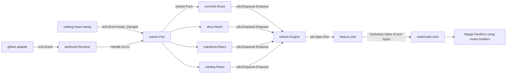

# 20-design / 01 - Kernel: `scm`, `freshness`, `job`, `reactor`, `routes`, `safehtml`

Status: design for implementation. Date: 2026-10-14. Unit key `01-kernel`.
Conforms to `04-decisions.md` (D-01, D-03, D-06, D-12, D-13, Q-02, Q-11, Q-18, amendments A-01, A-12, A-13, A-20, A-21, A-23, A-25, A-26 and section 7), `10-architecture.md` (sections 4.1, 5, 6, 8.1, 8.2, 8.3, 8.10, 8.13, 11.2, 15, 17.3, 20, 21) and ADR-001, ADR-003, ADR-005, ADR-014, ADR-023, ADR-024, and the design guardrails of `02-design-guardrails.md` (GR-ids).

This document is self-sufficient: an engineer who has not seen this conversation can implement the six kernel packages from it. A reference module that compile-checks and tests every contract below lives next to it in `20-design/01-kernel.assets/` (about 5,300 lines of Go including tests; module `github.com/cantara/source-code-portal`, Go 1.27.1). **What was compile-checked and executed** is listed in section 16. The one-line version: every exported signature quoted here is the output of `go doc` on that module, `go vet` is clean, 92 top-level tests (176 with sub-tests) pass under `-race` (`-count=20` on the pure packages), and three fuzz targets ran clean. An independent verification (section 17, 2026-10-14) logged 22 findings in the first draft (21 fixed in this text and in the module, one tracked as task K12); the module and this text describe the corrected state. The reference is a starting skeleton, not a prototype to throw away: sections 13.1 and 13.2 say how to adopt it.

Companion files:

| File | Content |
|---|---|
| `20-design/01-kernel.md` | this document |
| `20-design/01-kernel.assets/` | the reference module (`go.mod`, `internal/{scm,freshness,job,reactor,routes,safehtml,kerneltest}`, `cmd/routestsv`) |
| `20-design/01-kernel.routes.tsv` | the generated route tables (public 64 rows, admin 39 rows), the output of `go run ./cmd/routestsv`; section 7 renders it |

Conventions: "MUST/MUST NOT" are binding for the implementation; "design choice" marks a decision taken here where the architecture was silent; "Deviation Dn" points at section 14; "Question Qn" at section 15. Rule ids such as `SC-04` or `RT-12` name numbered rules of section 4 so that the test plan (section 12) and the trace (section 11) can point at them. Digits like `scp_reactor_runs_total` are metric names (section 9).

---

## 1. Purpose, scope, non-goals, packages

### 1.1 Purpose

The kernel is the **vocabulary** every other package speaks. It has no I/O, starts no goroutine, reads no clock and holds no mutable global. Six small packages, each answering one question that at least three other packages would otherwise answer differently:

| Package | The question it settles | Why it is shared |
|---|---|---|
| `internal/scm` | What is a repository, a commit, a tree, an event; what does the portal call a repository (`Slug`), a group (`GroupID`), and who may see what (`ViewClass`)? | `catalog`, `commits`, `docs`, `manifests`, `badges`, `integrations`, `webhook`, `github`, `store`, `readmodel`, `httpapi/authz`, `overview` all read these types; a provider-neutral home keeps `github` from being imported by anyone |
| `internal/freshness` | How old is this, is it still good, and when is it due again? | `store` rows, `readmodel` slots, `refresh` planner, API envelopes, badges and `/status` must agree on one derivation (G-02, GR-26) |
| `internal/job` | How does a feature ask the engine for work, and how does the engine tell a transient failure from a permanent one? | `refresh` must not know features and features must not know `refresh` (G8) |
| `internal/reactor` | How does one normalised event reach every feature's reaction, and what does the webhook answer? | The only place that knows both `job` and `scm`; fixes the 503-versus-202 rule (GR-21) |
| `internal/routes` | What URLs does the server answer, who answers them, and how are URLs built? | One table for the public listener and one for the admin listener, including the API class; the single place URLs are formatted on the Go side (GR-15, G-10) |
| `internal/safehtml` | How does the type system prove that HTML was sanitised? | `docs`, `pages`, `overview` and `render` must name the type; only one function may mint it (GR-32) |

### 1.2 In scope

| Area | In this unit |
|---|---|
| Identity | `SourceID`, `RepoID`, `InstallationID`, `Slug`, `GroupID` with grammars and parsers; `RepoRef` and its stable key; reserved slugs |
| Visibility | `Visibility` (fail-closed zero value), `ViewClass`, `Classed[T]`, `Repository.VisibleTo`, `Membership` view-class-aware accessors |
| Value types | `Repository`, `Release`, `RepoStats`, `Commit` (no e-mail), immutable `Tree`, `Page`, `File`, `Blob`, `Validators`, `Result` |
| Text hygiene | `CleanLine`, `NewSubject`, commit ordering (`CompareCommits`) |
| Events | `EventKind` (exhaustive list), `Event`, `Branch`, `IsPushTo`, `LogValue` |
| Freshness | `State`, `Status`, `Policy`, `Info`, `Value[T]`, `Derive`, the three transitions, `Interval` |
| Job contract | `Key` grammar, `Priority`, `Scope`, `Outcome`, `RunFunc`, `Spec` and its validation, `Enqueuer`, sentinels, behaviour interfaces, `Classify` |
| Fan-out | `reactor.Func`, `Fan`, panic recovery, error joining, observation hook |
| Route table | `Table`, `Route`, `Class`, `Recorder`, `Verify`, reserved prefixes, SPA shapes, all URL builders, `Absolute` |
| Safe HTML | `SafeHTML`, `Sanitize`, `Text`, `DocsPolicy`, `PolicyVersion`, golden file, structural fuzz oracle |
| Enforcement slice | the kernel's import rows as an executable test (`kerneltest`), the compile-time assertions of this unit |

### 1.3 Non-goals

- No persistence. The kernel defines the **text forms** that other units persist (section 5) but owns no table, file or cache.
- No provider knowledge. `scm` is a vocabulary, not a provider framework (GR-04); it names GitHub only in comments and in the `X-GitHub-Delivery` note of `Event.Delivery`.
- No encoding tags. `scm` types carry no `json` or `yaml` tags on purpose: wire shapes are generated DTOs (G7, GR-11) and persisted shapes belong to the persisting feature. The only kernel types with text forms are `Visibility`, `freshness.State` (a `string`), `Status.String`, `job.Key` (a `string`), `SafeHTML` (marshal-only) and `job.Class.String`.
- No HTTP handlers. `routes` registers handlers that others supply and builds none itself.
- No Markdown, no rendering, no chroma. `safehtml` owns the sanitiser and the allow-list; `docs/internal/render` owns the pipeline that feeds it.
- No metrics instruments. The kernel packages import no OpenTelemetry module; the one instrumented seam (`reactor.Deps.Observe`) is a plain callback that `cmd/scp` turns into instruments (section 9).
- No configuration keys (section 6).
- No `Clock` interface (ADR-003): `freshness` takes `now` and a random number as arguments.

### 1.4 Directories and files (exact)

```
internal/scm/
  ids.go          sentinel errors, ValidationError, SourceID, RepoID, InstallationID, Slug, GroupID, parsers, reserved slugs
  repo.go         RepoRef, Visibility, ViewClass, Classed, Repository, Release, RepoStats
  commit.go       Commit, MaxSubjectRunes, CompareCommits, NewSubject, CleanLine
  tree.go         EntryType, TreeEntry, Tree (immutable, sorted), TreeOptions
  result.go       Page, File, Blob, Validators, Result
  event.go        EventKind, EventKinds, Event, Branch, IsPushTo, LogValue
  membership.go   GroupMeta, MemberRepo, GroupSpec, MembershipSpec, NewMembership, Membership
  *_test.go       section 12
internal/freshness/
  freshness.go    State, Status, Policy, MinInterval, Info and transitions, Value[T]
  *_test.go
internal/job/
  key.go          Key and its grammar
  spec.go         Priority, Scope, Outcome, RunFunc, Spec, Validate
  enqueue.go      Enqueuer, EnqueueFunc, ErrQueueFull, ErrClosed, IsRefusal
  classify.go     RateLimited, Permanent, Gone, Class, Classify, MarkGone, MarkPermanent
  *_test.go
internal/reactor/
  fan.go          Func, Reactor, Outcome, Observation, Deps, PanicError, Fan, New, NewNamed, Handle
  *_test.go
internal/routes/
  table.go        Class, Route, Table, Recorder, VerifyError, pattern parser, Sample/Expand, SPAShapes, ReservedPrefixes
  public.go       Public(): the public listener's 64 routes
  admin.go        Admin(): the admin listener's 39 routes (24 API operations, the shell, metrics, pprof, probes, assets)
  url.go          URL builders, Absolute
  *_test.go
internal/safehtml/
  safehtml.go     SafeHTML, Sanitize, Text, PolicyVersion, IDPrefix, MaxInputBytes, ErrNotDecodable
  policy.go       DocsPolicy and the attribute regular expressions
  testdata/policy_golden.json
  *_test.go       corpus (67 payloads), golden, structural oracle, fuzz, bombs
internal/kerneltest/     (test-only package; becomes part of internal/archtest, see 13.2)
  kernel_test.go  import rows of the six packages, banned stdlib imports, compile-time shape assertions
cmd/routestsv/           (development tool; not shipped) prints the route tables as TSV
```

Package names are single words and none is on the G1 ban list (`util common helper model models types api interfaces base`). No file is named `util.go`, `helpers.go` or `types.go`.

### 1.5 What the implementer must read first

1. Section 2 (where the packages sit and who consumes what) and section 3 (the types).
2. Section 7 (the route table) if you build `webapp`, `httpapi` or any `Mount`.
3. Section 14 (deviations) before changing a name: several names differ from architecture 8.x on purpose.

---

## 2. Position in the architecture

### 2.1 Ranks and rows

From architecture 5.2 (with the one change of D5):

| Rank | Package | May import (internal) | Third-party |
|---|---|---|---|
| 0 | `scm` | none | none |
| 0 | `freshness` | none | none |
| 0 | `routes` | none | none (stdlib `net/http`, `net/url`, `regexp` only) |
| 0 | `safehtml` | none | `microcosm-cc/bluemonday` v1.0.27 |
| 1 | `job` | `freshness` | none |
| 2 | `reactor` | `job`, `scm` (architecture also lists `platform/logx`; D5 removes it) | none |

`reactor` receives its logger as a `*slog.Logger` in `Deps`; the context attributes `logx` adds (request id, delivery id) travel on the handler, so the package never needs to import `logx`. `reactor` uses `log/slog`, `runtime/debug`, `errors`, `context`, `time`, `strconv`, `fmt`.

`routes` and `scm` are stdlib-only by construction, so `webapp` and `readmodel` (also rank 0) can import them or receive their values without a cycle. `kerneltest.TestImportRows` fails if any kernel package imports another internal package outside its row or any third-party package outside the table above.

### 2.2 What each package gives to whom

| Kernel type or function | Consumers (architecture sections 5.2, 6, 8) |
|---|---|
| `scm.RepoRef`, `RepoRef.Key`, `ParseRepoKey` | every per-repository job key tail (`kind/source/owner/name`), `store` rows, `webhook`/`github` (event decoding), reactors |
| `scm.Slug`, `ParseSlug`, `IsReservedSlug` | `catalog` (assignment, `slug_prefix` hint), every handler that reads `PathValue("repo")`, `routes` builders |
| `scm.Membership` | `catalog` (builder), `commits` projector, `overview`, `manifests` rollups, `badges` bridge, `authz.LookupRepo` |
| `scm.ViewClass`, `Classed[T]`, `Visibility` | every global projection (`commits.Latest`, `manifests.Graph`, `site.meta`, group badge counts, `llms-full.txt`), `httpapi/authz.ClassOf` (A-23) |
| `scm.Repository`, `RepoStats` | slots `Repos`, `Stats` (`readmodel`), all readers |
| `scm.Commit`, `NewSubject`, `CompareCommits` | `commits` (ingest, projector, k-way merge cursor), `github` (decode), `store` |
| `scm.Tree`, `TreeOptions`, `Page`, `File`, `Blob`, `Validators`, `Result` | consumer interfaces of architecture 8.7 satisfied directly by `*github.Client`; `docs`, `manifests`, `media` |
| `scm.Event`, `EventKind` | `github` (producer), `webhook`, `reactor`, `catalog` head sweep (synthetic producer), every `React` method |
| `freshness.Value[T]`, `Info`, `Derive` | every snapshot slot, API `freshness` envelopes, badges, `/status`, `integrations`, `ops` |
| `freshness.Policy`, `Interval` | `job.Spec.Policy`; `refresh.Planner` (Q3) |
| `job.Key`, `Spec`, `Outcome`, `Enqueuer` | feature `Jobs()`, `refresh.Engine` (satisfies `Enqueuer`), bridges |
| `job.RateLimited`, `Permanent`, `Gone`, `Classify` | `github` typed errors (satisfy structurally), `refresh` classification |
| `reactor.Func`, `Fan` | features' `React` methods (converted in `cmd/scp`), `webhook.Sink`, `catalog.EventSink` |
| `routes.Public/Admin`, `Table.Handle/Mux/Verify` | `cmd/scp` wiring, every `Mount`, `webapp` (reserved prefixes and shapes arrive as values), `overview` and `docs` (builders), `httpapi` (imports `routes` for pattern names) |
| `safehtml.SafeHTML`, `Sanitize`, `Text`, `DocsPolicy` | `docs/internal/render` (the only caller of `Sanitize` on rendered input), `docs`, `pages`, `overview` (name the type), `store` (re-sanitise on load) |

### 2.3 The four cross-feature mechanisms (ADR-024) and the kernel's part in each

| Mechanism | Kernel part |
|---|---|
| A. snapshot slots with kernel types | `scm.Repository`, `scm.RepoStats`, `scm.Membership`, `scm.Classed[T]`, `freshness.Value[T]` are the value types of the shared slots and globals |
| B. consumer-defined interfaces | `scm.TreeOptions`, `scm.Page`, `scm.Tree`, `scm.File`, `scm.Blob`, `scm.Result`, `scm.Validators` make direct satisfaction possible without the adapter importing the consumer (5.1 rule 7) |
| C. job registration | `job.Spec`, `job.Key`, `job.Enqueuer`, `job.Outcome`, behaviour interfaces |
| D. normalised events and reactors | `scm.Event`, `reactor.Func`, `reactor.Fan` |



Plain-text fallback: the `github` adapter and the catalog head sweep produce `scm.Event`; `webhook` and `catalog` call `reactor.Fan.Handle`; the fan calls each feature's reaction, which calls `job.Enqueuer.Enqueue` (satisfied by `refresh.Engine`); the engine later runs the `job.Spec.Run` functions, which write `freshness.Value[T]` slots of `scm` types; handlers read those slots and build links with `routes`.

### 2.4 Units this unit depends on and units that depend on it

- Depends on: nothing at run time. At build time it depends on the owner's decisions in `04-decisions.md` and on the OpenAPI documents under `20-design/api/` for the API route patterns (D1).
- Constrains: `04-refresh-webhook` (uses `job.*`, `scm.Event`, `reactor.Fan`; section 14 D6 and Q3 reconcile two small differences), `05-github-adapter` (satisfies `job.RateLimited/Permanent/Gone` structurally, returns `scm` types), `14-integrations-access` (uses `freshness.Value[Status]`, `scm.ViewClass`, `scm.GroupMeta.Integrations`), `catalog` (builds `scm.Membership`, assigns slugs), `docs/render` (calls `safehtml.Sanitize`), `webapp` and `overview` (use `routes` values and builders), `httpapi` (imports `routes`, defines `Mux` equal to `routes.Recorder`), `cmd/scp` (registers handlers by route name, wires the fan).

---
## 3. Domain model and Go types

All blocks below are signatures (bodies elided) copied from `go doc` output of the reference module. Names and shapes are binding; bodies are specified in section 4.

### 3.1 `scm`

```go
package scm // internal/scm, rank 0, imports nothing from this module

// Sentinels. Adapters wrap them; callers use errors.Is.
var ErrNotFound, ErrForbidden, ErrUnavailable, ErrInvalid error

// ValidationError is returned by every parser; errors.Is(err, ErrInvalid) is true. Value is cut to 64 bytes at construction.
type ValidationError struct{ Type, Value, Reason string }
func (e *ValidationError) Error() string
func (e *ValidationError) Is(target error) bool

// ---- identity ----
type SourceID string       // ^[a-z0-9][a-z0-9-]{0,31}$
type RepoID int64          // GitHub numeric id; 0 = unknown
type InstallationID int64  // 0 = none
type Slug string           // ^[a-z0-9._-]{1,100}$, not "." or "..", not reserved
type GroupID string        // ^[a-z0-9][a-z0-9-]{0,62}$

func ParseSourceID(s string) (SourceID, error)
func ParseSlug(s string) (Slug, error)              // canonical (lower-case) input only
func SlugFromName(name string) (Slug, error)        // ASCII-lower-cases, then ParseSlug
func IsReservedSlug(s string) bool                  // "ext", "groups", "avatars"
func ParseGroupID(s string) (GroupID, error)        // canonical input only
func (s SourceID) String() string; func (s Slug) String() string; func (g GroupID) String() string

type RepoRef struct {
    Source SourceID
    ID     RepoID
    Owner  string
    Name   string
}
func (r RepoRef) IsZero() bool
func (r RepoRef) Key() string                 // "source/owner/name", owner and name ASCII-lower-cased
func (r RepoRef) KeyParts() []string          // the same three folded parts, for job.NewKey(kind, ref.KeyParts()...)
func (r RepoRef) SameRepo(o RepoRef) bool     // equal non-zero IDs in one source, else equal Key()
func (r RepoRef) Validate() error             // source grammar; owner and name safe for a job key and a URL
func (r RepoRef) String() string
func ParseRepoKey(s string) (RepoRef, error) // inverse of Key; ID is 0

// ---- visibility ----
type Visibility uint8
const ( VisUnknown Visibility = iota; VisPublic; VisInternal; VisPrivate ) // zero is NOT public (D4)
func (v Visibility) String() string
func ParseVisibility(s string) (Visibility, error)       // "", unknown words: error
func (v Visibility) MarshalText() ([]byte, error)
func (v *Visibility) UnmarshalText(b []byte) error
func (v Visibility) Visible(c ViewClass) bool            // VisPublic: both classes; everything else: ViewAll only

type ViewClass uint8
const ( ViewPublic ViewClass = iota; ViewAll )           // zero is the least privileged class

type Classed[T any] struct{ Public, All T }
func Same[T any](v T) Classed[T]                          // one computation for a public-only deployment
func (c Classed[T]) For(v ViewClass) T                    // anything but ViewAll yields Public

// ---- value types ----
type Repository struct {
    Ref           RepoRef
    Slug          Slug
    Description   string
    DefaultBranch string
    Topics        []string
    Visibility    Visibility
    Archived      bool
    Fork          bool
    HTMLURL       string
    CreatedAt     time.Time
    PushedAt      time.Time
}
func (r Repository) VisibleTo(c ViewClass) bool
func (r Repository) Clone() Repository                    // copies Topics

type Release struct {
    Tag, Name, URL string
    Prerelease     bool
    PublishedAt    time.Time
}
type RepoStats struct {
    OpenIssues  int
    Stars       int
    License     string   // SPDX id or ""
    Release     *Release // nil: none
    HeadSHA     string
    HeadTreeOID string
    PushedAt    time.Time
}
func (s RepoStats) Clone() RepoStats                      // deep: copies Release

const MaxSubjectRunes = 200
type Commit struct {
    SHA         string
    Subject     string    // first line, cleaned, capped
    AuthorLogin string
    AuthorName  string
    CommittedAt time.Time // UTC; zero = unknown, sorts last
    URL         string
}                                                          // no e-mail field, by design (GR-35)
func (c Commit) HasDate() bool
func CompareCommits(a, b Commit) int                       // newest first, ties by SHA descending, unknown dates last
func NewSubject(message string) string
func CleanLine(s string, maxRunes int) string

type EntryType uint8
const ( EntryUnknown EntryType = iota; EntryBlob; EntryTree; EntryCommit; EntryLink )
func (t EntryType) String() string
type TreeEntry struct{ Path, SHA, Mode string; Size int64; Type EntryType }
type Tree struct{ /* sha, sorted entries, truncated */ }
func NewTree(sha string, entries []TreeEntry, truncated bool) Tree  // takes ownership; sorts by Path, drops duplicate paths (first wins)
func (t Tree) SHA() string
func (t Tree) Truncated() bool
func (t Tree) Len() int
func (t Tree) All() iter.Seq[TreeEntry]
func (t Tree) Lookup(path string) (TreeEntry, bool)
func (t Tree) Under(dir string) iter.Seq[TreeEntry]
type TreeOptions struct{ Recursive bool; Path string; MaxEntries int }

type Page[T any] struct{ Items []T; Next string }        // Next == "" on the last page
func (p Page[T]) HasNext() bool
type File struct{ Path, SHA string; Data []byte; Truncated bool }
type Blob struct{ SHA string; Data []byte }
type Validators struct{ SHA, ETag string }               // content identifiers, not credentials
func (v Validators) IsZero() bool
type Result[T any] struct{ Value T; NotModified bool; Validators Validators; FetchedAt time.Time }
func (r Result[T]) Resolve(stored T) T                    // NotModified ? stored : Value

// ---- membership ----
type GroupMeta struct {
    ID           GroupID
    DisplayName  string
    Description  string
    Integrations map[string]map[string]string           // provider -> key -> default
}
func (g GroupMeta) Integration(provider, key string) (string, bool)
func (g GroupMeta) Clone() GroupMeta
type MemberRepo struct{ Slug Slug; Ref RepoRef; Visibility Visibility }
type GroupSpec struct{ Meta GroupMeta; Members []Slug; Default Slug }
type MembershipSpec struct{ Repos []MemberRepo; Groups []GroupSpec }
type Membership struct{ /* immutable; zero value is an empty, usable membership */ }
func NewMembership(spec MembershipSpec) (Membership, error)      // all violations, errors.Join; every MemberRepo.Ref must pass RepoRef.Validate
func (m Membership) Groups() []GroupMeta                          // config order, every class
func (m Membership) Group(g GroupID) (GroupMeta, bool)
func (m Membership) GroupsOf(s Slug) []GroupID                    // config order
func (m Membership) ReposOf(g GroupID) []Slug                     // = VisibleReposOf(g, ViewAll)
func (m Membership) VisibleReposOf(g GroupID, c ViewClass) []Slug
func (m Membership) DefaultRepo(g GroupID) (Slug, bool)           // = DefaultRepoFor(g, ViewAll)
func (m Membership) DefaultRepoFor(g GroupID, c ViewClass) (Slug, bool)
func (m Membership) SlugFor(ref RepoRef) (Slug, bool)             // by (Source, ID) when ID != 0, else case-folded Key; a key match whose known ID differs is refused
func (m Membership) Repo(s Slug) (MemberRepo, bool)
func (m Membership) Len(c ViewClass) int
func (m Membership) Slugs(c ViewClass) []Slug                     // sorted; allocates

// ---- events ----
type EventKind string
const (
    EventPush              EventKind = "push"
    EventRelease           EventKind = "release"
    EventCreate            EventKind = "create"
    EventRepository        EventKind = "repository"
    EventInstallation      EventKind = "installation"
    EventInstallationRepos EventKind = "installation_repositories"
    EventPing              EventKind = "ping"
    EventHeadChanged       EventKind = "head_changed" // synthetic: catalog head sweep
)
func EventKinds() []EventKind          // all eight, declaration order, fresh slice
func (k EventKind) Known() bool
type Event struct {
    Kind          EventKind
    Delivery      string
    Source        SourceID
    Installation  InstallationID
    Repo          RepoRef   // zero for installation-level events
    Action        string
    Ref           string
    Before, After string
    Created, Deleted, Forced bool
    CommitCount   int
    ChangedPaths  []string
    PathsComplete bool
    HeadTreeOID   string
}
func (e Event) Branch() (string, bool)           // only refs/heads/<name>
func (e Event) IsPushTo(branch string) bool      // a push, not a deletion, to that branch
func (e Event) LogValue() slog.Value             // group without the path list
```

Notes on the shapes:

- `scm.Slug` is the portal id; `RepoRef` is the upstream identity. They are different types on purpose (GR-07, GR-15): a `Slug` is one validated URL segment and is never derived from order; a `RepoRef` is compared with `SameRepo` or `Key`, never with `==` (a ref parsed from a job key has `ID == 0`).
- `Membership` is a value, not a pointer: its maps are never mutated after `NewMembership`, so copies share memory safely, and the zero value is usable (an empty catalogue).
- The `Visibility` text form (`public`, `internal`, `private`, `unknown`) is the one persisted in `repo.visibility`; `unknown` is accepted on read so a row can round-trip, but `ParseVisibility("")` is an error.

### 3.2 `freshness`

```go
package freshness // internal/freshness, rank 0, imports nothing

type State string // persisted text; must never change
const (
    StateOK          State = "ok"
    StateNotFound    State = "not_found"
    StateUnsupported State = "unsupported"
    StateTooLarge    State = "too_large"
    StateNoContent   State = "no_content"
    StateError       State = "error"
    StateNever       State = "never" // also the meaning of the zero value ""
)
func States() []State                       // the SQL CHECK constraint is generated from and tested against this
func (s State) Valid() bool                 // one of States(), or ""
func (s State) HasResult() bool             // ok, not_found, unsupported, too_large, no_content

type Status uint8                           // derived at read time; zero is StatusUnknown
const ( StatusUnknown Status = iota; StatusFresh; StatusStale; StatusError )
func (s Status) String() string             // "unknown", "fresh", "stale", "error": the API enum

type Policy struct {
    TTL            time.Duration
    Jitter         float64       // +- fraction, [0, 0.5]
    IdleBackoffMax time.Duration // 0 disables back-off; otherwise >= TTL
}
func (p Policy) Validate() error
const MinInterval = time.Second
func (p Policy) Interval(unchangedStreak int, u float64) time.Duration

type Info struct {
    State      State
    FetchedAt  time.Time // last successful fetch or successful 304; zero = no good value
    CheckedAt  time.Time // last attempt
    Attempts   int       // consecutive failures
    ErrCode    string    // stable machine code of the last failure
    ContentSHA string
    TTL        time.Duration
}
func (i Info) HasValue() bool
func (i Info) StaleAfter() time.Duration                        // 1.5 x TTL
func (i Info) StaleSince() (time.Time, bool)
func (i Info) Derive(now time.Time) Status
func (i Info) AfterSuccess(state State, now time.Time, contentSHA string) Info  // panics on a non-result state
func (i Info) AfterRevalidated(now time.Time) Info                              // 304: confirm the held value; a result state is kept, after a failure ok
func (i Info) AfterRevalidatedAs(state State, now time.Time) Info               // 304 for a caller that knows the held state (no_content, too_large, ...); panics on a non-result state
func (i Info) AfterFailure(now time.Time, errCode string) Info                  // stale-while-error
func (i Info) Validate() error

type Value[T any] struct{ V T; Info Info }
func (v Value[T]) Status(now time.Time) Status
```

### 3.3 `job`

```go
package job // internal/job, rank 1, imports freshness

type Key string                                    // "kind/part/part/...", at most 512 bytes
const GlobalPart = "_"
func NewKey(kind string, parts ...string) Key      // panics on an invalid kind, no parts, or a bad part (JB-01)
func GlobalKey(kind string) Key                    // kind + "/_"
func ParseKey(s string) (Key, error)               // for keys read from outside the process
func ValidKind(kind string) bool                   // ^[a-z][a-z0-9]*(\.[a-z][a-z0-9_-]*)*$, at most 64 bytes
func (k Key) Kind() string; func (k Key) Tail() string; func (k Key) Parts() []string
func (k Key) IsGlobal() bool; func (k Key) String() string

type Priority uint8
const ( PrioInteractive Priority = iota + 1; PrioWebhook; PrioScheduled; PrioBackfill ) // lower runs first; 0 is invalid
func (p Priority) Valid() bool; func (p Priority) String() string

type Scope uint8
const ( ScopeRepo Scope = iota + 1; ScopeGlobal )                                      // 0 is invalid
func (s Scope) Valid() bool

type Outcome struct{ Unchanged bool; NextDue time.Time }
type RunFunc func(ctx context.Context, k Key) (Outcome, error)

type Spec struct {
    Kind     string           // "commits.refresh"
    Upstream string           // ^[a-z][a-z0-9-]{0,31}$
    Scope    Scope
    Prio     Priority
    Policy   freshness.Policy
    Timeout  time.Duration    // 0 = the upstream's JobTimeout
    Run      RunFunc
}
func (s Spec) Validate() error                     // every violation, joined

type Enqueuer interface {
    Enqueue(k Key, p Priority, notBefore time.Time, force bool) error
}
type EnqueueFunc func(k Key, p Priority, notBefore time.Time, force bool) error // adapter for tests and bridges
var ErrQueueFull, ErrClosed error
func IsRefusal(err error) bool                     // errors.Is ErrQueueFull or ErrClosed

type RateLimited interface{ error; RetryAt() time.Time }
type Permanent  interface{ error; Permanent() bool }
type Gone       interface{ error; Gone() bool }
func AsRateLimited(err error) (time.Time, bool)
func IsPermanent(err error) bool
func IsGone(err error) bool
func MarkGone(err error) error                     // wrap so Classify says Gone; nil stays nil
func MarkPermanent(err error) error

type Class uint8
const ( ClassNone Class = iota; ClassTransient; ClassRateLimited; ClassPermanent; ClassGone; ClassCanceled )
func (c Class) String() string
func Classify(err error) Class
```

### 3.4 `reactor`

```go
package reactor // internal/reactor, rank 2, imports job and scm

type Func func(ctx context.Context, ev scm.Event, enq job.Enqueuer) error
type Reactor struct{ Name string; React Func }       // Name: ^[a-z][a-z0-9.-]{0,31}$ (enforced), labels logs and metrics

type Outcome string
const (
    OutcomeOK      Outcome = "ok"
    OutcomeRefused Outcome = "refused" // job.ErrQueueFull or job.ErrClosed
    OutcomeError   Outcome = "error"
    OutcomePanic   Outcome = "panic"
)
type Observation struct{ Reactor string; Kind scm.EventKind; Outcome Outcome; Duration time.Duration }
type Deps struct{ Log *slog.Logger; Observe func(Observation) }   // both optional
type PanicError struct{ Reactor string; Value any }
func (e *PanicError) Error() string

type Fan struct{ /* immutable */ }
func New(enq job.Enqueuer, d Deps, rs ...Func) *Fan               // names them reactor-0, reactor-1, ...
func NewNamed(enq job.Enqueuer, d Deps, rs ...Reactor) *Fan       // the constructor cmd/scp uses
func (f *Fan) Handle(ctx context.Context, ev scm.Event) error     // satisfies webhook.Sink and catalog.EventSink; RA-01a drops a malformed Repo
```

### 3.5 `routes`

```go
package routes // internal/routes, rank 0, stdlib only

type Class uint8
const ( ClassAPI Class = iota + 1; ClassSPA; ClassServer; ClassAdmin )
func (c Class) String() string                    // "api", "spa", "server", "admin"

type Route struct {
    Name    string // stable; handlers are registered by name
    Method  string // "GET" or "POST"; GET also matches HEAD
    Pattern string // ServeMux pattern without the method
    Class   Class
    Owner   string // the package that implements the handler
}
func (r Route) FullPattern() string               // Method + " " + Pattern
func (r Route) Sample() string                    // a concrete path that must resolve to this route
func (r Route) Expand(vals map[string]string) string
func (r Route) Wildcards() []string
func (r Route) HasSlug() bool                     // a wildcard named "repo"

type Table struct{ /* routes, registered set, one mux */ }
func Public() *Table                              // the public listener (:9090)
func Admin() *Table                               // the admin listener (:9091)
func (t *Table) Without(names ...string) *Table   // before any registration: a feature switched off
func (t *Table) All() []Route
func (t *Table) Routes(c Class) []Route
func (t *Table) Lookup(name string) (Route, bool)
func (t *Table) Handle(mux *http.ServeMux, name string, h http.Handler)  // any route by name (hand-written API handlers such as api.openapi included); panics on misuse
func (t *Table) Mux(m *http.ServeMux) *Recorder                          // API routes register through this
func (t *Table) Verify() error
func (t *Table) SPAShapes() []string
func (t *Table) ReservedPrefixes() []string
func ReservedSuffixes() []string

type Recorder struct{ /* table, mux */ }
func (r *Recorder) HandleFunc(pattern string, h func(http.ResponseWriter, *http.Request))
func (r *Recorder) ServeHTTP(w http.ResponseWriter, req *http.Request)

type VerifyError struct{ Missing, Shadowed []string }

// URL builders (every dynamic value escaped per segment; section 4.R)
func Dashboard() string; func Commits() string; func Dependencies() string
func Group(groupID string) string;  func GroupCommits(groupID string) string
func Repo(slug string) string;      func RepoCommits(slug string) string;  func RepoDependencies(slug string) string
func Page(pageSlug string) string
func RepoDoc(slug, docPath string) string;  func RepoDocMD(slug, docPath string) string
func ReadmeMD(slug string) string;  func AgentsMD(slug string) string;  func ChangelogMD(slug string) string
func RepoDependenciesMD(slug string) string;  func GroupDependenciesMD(groupID string) string
func Packages(purl string) string                  // "/packages?purl=" + QueryEscape
func Badge(slug, kind string) string;  func BadgeGroup(groupID, kind string) string
func Media(slug, ref, filePath string) string;  func MediaExt(sig, id string) string
func LLMs(scope string) string;  func LLMsFull(scope string) string   // scope: "", group id, or "repo:<slug>"
func Sitemap() string; func Robots() string; func OpenAPI() string; func Schema(file string) string
func Webhook(source string) string
func API(segments ...string) string
func Absolute(base, p string) (string, error)
```

### 3.6 `safehtml`

```go
package safehtml // internal/safehtml, rank 0, third-party: bluemonday only

const PolicyVersion = 1                 // bump whenever DocsPolicy's observable behaviour changes
const IDPrefix = "doc-"
const MaxInputBytes = 8 << 20

type SafeHTML struct{ s string }        // unexported field: the zero value is the only value outside this package
func (h SafeHTML) String() string
func (h SafeHTML) IsZero() bool
func (h SafeHTML) MarshalText() ([]byte, error)   // encoding/json emits a string
func (*SafeHTML) UnmarshalText([]byte) error      // always fails with ErrNotDecodable
var ErrNotDecodable error

type Policy struct{ /* constrained bluemonday policy, read-only after construction */ }
func DocsPolicy() *Policy                         // build once, share
func Sanitize(p *Policy, untrusted []byte) SafeHTML   // nil policy strips all markup
func Text(s string) SafeHTML                      // escapes plain text into <pre>
```

---
## 4. Behavioural specification

Rule ids: `SC` scm, `FR` freshness, `JB` job, `RA` reactor, `RT` routes, `SH` safehtml. Each rule names the reference code that implements it and the test that pins it (section 12).

### 4.1 `scm`

**SC-01 Identity grammars.** All parsers return `*ValidationError` (`errors.Is(err, scm.ErrInvalid)`); none panics; all lengths are bytes.

| Type | Grammar | Notes |
|---|---|---|
| `SourceID` | `^[a-z0-9][a-z0-9-]{0,31}$` | the configured source name (`acme`, `ghes-main`); first character not `-` |
| `Slug` | `^[a-z0-9._-]{1,100}$`, not `.`, not `..`, not reserved | a leading dot is legal (`.github` is a real repository name); a dot-only slug is not |
| `GroupID` | `^[a-z0-9][a-z0-9-]{0,62}$` | lower case only (ADR-023; OpenAPI `groupId` pattern is `^[a-z0-9-]+$`) |
| `RepoRef.Owner` | 1..100 bytes, first `[A-Za-z0-9]`, rest `[A-Za-z0-9._-]` | GitHub login or organisation name |
| `RepoRef.Name` | 1..100 bytes of `[A-Za-z0-9._-]`, not `.` or `..` | GitHub repository name; may start with a dot |

**SC-02 Slugs.** `ParseSlug` accepts canonical (already lower-case) text only and returns the same string as a `Slug`; `SlugFromName` lower-cases ASCII first and is what the catalogue calls for a GitHub name. `IsReservedSlug` is true for exactly `ext`, `groups`, `avatars`: they would be ambiguous path segments in `/media/{repo}/{ref}/...` (`/media/ext/...` is the signed external image route), in `/badges/{repo}/{file}` versus `/badges/groups/...`, and in the avatar routes. The catalogue refuses a reserved slug with the hint "set `slug_prefix` for the source" (architecture 11.3). Slug assignment, collision handling (`slug_prefix`, rename aliases) is `catalog`'s job; the kernel only validates.

**SC-03 Group ids.** `ParseGroupID` accepts canonical (lower-case) text only and never folds: a group id is written once, in configuration, in its canonical form, and `config lint` reports a non-canonical id with the grammar of SC-01 (GR-12). There is no case-folding constructor for group ids.

**SC-04 Repository keys.** `RepoRef.Key()` is `source/owner/name` with owner and name ASCII-lower-cased, because GitHub resolves both case-insensitively and a webhook payload may use a different casing than the catalogue (GR-21: a reactor resolves "is this repository ours" by the key, never by display strings). `ParseRepoKey(ref.Key())` returns a ref with `ID == 0` and folded names, and `Key()` of that ref equals the input (round-trip tested). `SameRepo` compares `Source` and non-zero `ID` when both IDs are known, otherwise `Key()`. `Validate` checks the source grammar and that owner and name are safe to embed in a job key and a URL path (no `/`, no control character, no whitespace). A job key tail MUST be `ref.Key()`: build it with `job.NewKey(kind, ref.KeyParts()...)`, and a job wrapper recovers the ref with `scm.ParseRepoKey(k.Tail())`.

**SC-05 Visibility is fail-closed.** `VisUnknown` is the zero value and is not public. `Visibility.Visible(c)` returns true for `VisPublic` in both classes and for everything else only in `ViewAll`. A repository whose visibility was never set is therefore invisible to anonymous readers; this is a security control (architecture 17.3), not a convenience. `Visibility` marshals to the lower-case words `public`, `internal`, `private`, `unknown`; `UnmarshalText` rejects anything else, including the empty string.

**SC-06 View classes.** `ViewPublic` is the zero value. `Classed[T].For(v)` returns `All` only for `ViewAll`; any other value (including a future class) yields `Public`. `Same(v)` is for a deployment with no non-public repository: the producer computes once and stores the same value in both variants (A-23). A global projection that is not `Classed` MUST NOT be computed from a snapshot that contains non-public repositories (reviewed in section 10).

**SC-07 Ownership of shared values.** Types that hold a slice or map expose `Clone` (`Repository`, `RepoStats`, `GroupMeta`); producers clone before `Put` into a slot and never touch the value again; readers never mutate (architecture 6.1 rule 1). `Tree` and `Membership` are immutable by construction. `Event` slices (`ChangedPaths`) are shared with the producer: consumers must not mutate or retain them (stated in the type comment; reactors are bound by RA-05).

**SC-08 Commits.** No e-mail field exists, so none can be stored (GR-35). `Subject` is `NewSubject(message)`: the text before the first `\n`, passed through `CleanLine(_, MaxSubjectRunes)`. `CompareCommits(a, b)` orders newest first, equal timestamps by SHA descending, commits without a date after all dated ones (GR-29: a missing date is a typed state and must never break a page). Every list, projector and cursor in the portal uses this one order; a k-way merge cursor encodes `(CommittedAt, SHA)`.

**SC-09 `CleanLine`** makes untrusted single-line text safe to display and to hand to an LLM. In order of the loop:
1. invalid UTF-8 bytes become U+FFFD;
2. every Unicode space (`unicode.IsSpace`: TAB, CR, LF, VT, FF, NEL, NBSP, U+2028, U+2029, U+3000, ...) becomes one ASCII space, runs collapse to one, leading space is trimmed, trailing space is trimmed at the end;
3. C0 and C1 controls and DEL are dropped;
4. invisible and direction-changing characters are dropped: U+00AD, U+061C, U+200B, U+200E, U+200F, U+202A-U+202E, U+2060-U+2064, U+2066-U+206F, U+FEFF, the tag block U+E0000-U+E007F (ASCII smuggling), **every other Default_Ignorable_Code_Point** (`unicode.Other_Default_Ignorable_Code_Point`: U+034F, the Hangul fillers U+115F, U+1160, U+3164, U+FFA0, the Khmer inherent vowels U+17B4-U+17B5, U+FFF0-U+FFF8, ...) and **every variation selector except U+FE0E and U+FE0F** (`unicode.Variation_Selector`: U+FE00-U+FE0D, U+180B-U+180D, U+E0100-U+E01EF). These are the known invisible channels for smuggling text to an LLM: sixteen invisible symbols per position carry 4 bits each, so keeping U+FE00-U+FE0F everywhere (as the first draft did) left a working channel (V-05);
5. U+200C and U+200D (needed by scripts and emoji sequences) are kept; U+FE0E and U+FE0F (text and emoji presentation) are kept **only directly after a visible character**, never at the start, after a space or after another selector; combining marks (Mn, Mc, Me) are kept; any other non-printable character (unassigned, private use, remaining format characters) is dropped;
6. the output stops after `maxRunes` runes (0 or negative: no cut), never inside a rune; a cut leaves no trailing space.
`FuzzCleanLine` asserts: valid UTF-8; at most `maxRunes` runes when `maxRunes > 0`; no newline, carriage return, tab or NUL; no leading, trailing or doubled space; idempotence (`CleanLine(CleanLine(x), 0) == CleanLine(x, n)` and `CleanLine(CleanLine(x, n), n) == CleanLine(x, n)`); and that U+202E, U+200B, the tag block, every variation selector other than U+FE0E/U+FE0F and every other default-ignorable code point never survive.

**SC-10 Trees.** `NewTree` takes ownership of its slice, sorts it stably by `Path` (byte order) and removes duplicate paths (first wins), so `Lookup` and `Under` are binary searches, iteration is deterministic and the adapter can memoise one `Tree` per tree SHA and hand it to several consumers. `Under(dir)` yields the entries strictly below `dir` (`""` is the whole tree; a trailing slash on `dir` is ignored) without allocating. `Truncated` carries GitHub's `truncated: true` so a consumer can choose to fall back to per-directory listing. `EntryUnknown` is the zero `EntryType`: an entry that was not decoded is never mistaken for a blob.

**SC-11 Results.** `Result.NotModified == true` means `Value` is the zero value and the caller keeps what it stored; `Resolve(stored)` returns the value the caller should now hold. `Validators.SHA` is authoritative; `ETag` is an optimisation valid only inside one token lifetime (A-04). `Page.Next == ""` ends a listing; the cursor is opaque to everyone but the adapter.

**SC-12 Events.** `EventKinds()` lists all eight kinds; a test in every consumer that switches on `EventKind` iterates it so that no kind is silently unhandled (GR-21). `Event.Branch()` reports a branch name only for `refs/heads/<non-empty>`: tags and every other ref report false (GR-21: a push to a tag must not refresh a default-branch item). `IsPushTo(branch)` is true only for an `EventPush` that is not a deletion to exactly that branch. `LogValue` renders `kind, delivery, repo, ref, commits, paths (count), paths_complete`; the path list is never logged. `PathsComplete == false` means the per-commit path lists were capped or absent (architecture section 0 V13: the push payload's path arrays are unverified against GitHub's documentation), and a reactor MUST then treat "any path might have changed".

**SC-13 Membership.** `NewMembership(MembershipSpec)` validates and builds the index in one pass and returns every violation joined with `errors.Join`:
- each `MemberRepo.Slug` passes `ParseSlug` and is unique; each `MemberRepo.Ref` passes `RepoRef.Validate()` (reactors and job wrappers build job keys from the catalogue's ref, and `job.NewKey` panics on a bad part: a malformed ref is refused at build time, V-09); each `RepoRef.Key()` is unique, and so is each non-zero `(Source, ID)` (one repository, one slug);
- each `GroupSpec.Meta.ID` passes `ParseGroupID` and is unique;
- every member names a known slug and appears once per group; a non-empty `Default` is one of the members.
It copies everything it keeps. Order is data given by the builder: groups in config order, members as the builder listed them (the catalogue passes slug order); `GroupsOf(slug)` follows group config order, so "which group comes first" for a repository in several groups has an explicit, documented answer (GR-08). Visibility rules: `VisibleReposOf(g, ViewPublic)` lists the public members only (and aliases the full list when every member is public, so the common case allocates nothing); `DefaultRepoFor(g, c)` returns the default only when it is visible to `c`; `Len(c)` and `Slugs(c)` count and list repositories visible to `c`; `Groups()` lists every group to every class, because group existence is configuration, not data (a group whose members are all hidden is shown empty). `SlugFor(ref)` resolves by `(Source, ID)` first when `ref.ID != 0` and otherwise through the case-folded `Key()`; a key match is **refused** when the event carries an ID, the catalogue entry has a known ID and the two differ (a different repository that now has the name of a renamed or deleted one must not refresh the old entry, GR-21, V-04); a catalogue entry whose ID is unknown still matches by key; two catalogue entries with the same non-zero `(Source, ID)` are rejected at build time. The zero `Membership` is an empty catalogue and every accessor returns the zero answer.

**SC-14 Errors.** `ValidationError.Value` is cut to 64 bytes **when the error is constructed** (`ToValidUTF8` after the cut, `...` appended; the first draft cut only inside `Error()`, so the struct, logged with `slog.Any`, still carried the whole input, V-10) so hostile input cannot bloat logs or inject newlines through `%q`. `ErrNotFound`, `ErrForbidden`, `ErrUnavailable` are sentinels that `github` wraps in its typed `github.Error`; feature code uses `errors.Is`.

### 4.2 `freshness`

**FR-01 `Derive(now)`** (pure; the handler passes `now`):

| Held value (`FetchedAt` set) | Last attempt | Age (`now - FetchedAt`, negative treated as 0) | Status |
|---|---|---|---|
| no | never attempted (`State` `""` or `never`, or a result state without `FetchedAt`) | | Unknown |
| no | `State == error` | | Error |
| yes | `State == error` | any | Stale |
| yes | `TTL <= 0` | any | Stale |
| yes | not error | `<= 1.5 x TTL` | Fresh |
| yes | not error | `> 1.5 x TTL` | Stale |

The boundary is inclusive: an item exactly 90 minutes old with TTL 1 hour is Fresh; one nanosecond later it is Stale. A `not_found` state is a definitive upstream answer, so it ages like any result (Fresh, then Stale). Clock skew (an item "fetched in the future") reads as Fresh.

**FR-02 Transitions** (the only way the stores and jobs update an `Info`):
- `AfterSuccess(state, now, sha)`: `state` MUST satisfy `HasResult()` (panics otherwise: a programming error); sets `State`, `FetchedAt = CheckedAt = now.UTC()`, clears `Attempts` and `ErrCode`, replaces `ContentSHA`; keeps `TTL`.
- `AfterRevalidated(now)`: a 304 or equal-SHA confirmation: `FetchedAt = CheckedAt = now`, clears the failure fields, **keeps `ContentSHA`** and **keeps a result state** (`not_found`, `unsupported`, `too_large`, `no_content` stay what they were: the first draft rewrote every state to `ok`, so a repository without commits or a README over the size cap turned into `ok` at its first unchanged refresh, V-03); after a failure `State` is `error` and the original result state is no longer recorded in `Info`, so the state becomes `ok`. A caller that knows the state of the value it holds (the commits ring is `no_content`) uses `AfterRevalidatedAs(state, now)`. Both return the receiver unchanged when no value is held (a 304 cannot create a value); `AfterRevalidatedAs` panics on a non-result state, like `AfterSuccess`.
- `AfterFailure(now, code)`: stale-while-error: `State = error`, `CheckedAt = now`, `Attempts++`, `ErrCode = code`; **`FetchedAt` and `ContentSHA` are kept** so the last good value keeps serving (G-05, GR-26).
`Info.Validate()` checks the cross-field invariants (known state; a result state has `FetchedAt`; `ok` has no `ErrCode`; `Attempts >= 0`; `CheckedAt` not before `FetchedAt`) and is used by `storetest` as the oracle for every row a `Store` returns.

**FR-03 `Policy.Interval(streak, u)`** is the one arithmetic of "when is it due again": start from `TTL` (an unset TTL counts as `MinInterval`); while `streak` steps remain, `IdleBackoffMax > 0` and `base < IdleBackoffMax`, double `base` (saturating, no overflow); clamp to `IdleBackoffMax`; then multiply by `1 + Jitter * (2u - 1)` with `u` in `[0,1)` supplied by the caller (clamped to `[0, 0.999999999]`); never return less than `MinInterval` (1 s). Robustness (V-06): `u` that is NaN or negative counts as 0; a `Jitter` outside `[0, 0.5]` (including NaN, which `Validate` also rejects) counts as 0; a result at or above `math.MaxInt64` nanoseconds saturates to `MaxInt64` instead of relying on the platform-dependent float-to-integer conversion (arm64 saturates, amd64 wraps to a negative value, which the 1 s floor then turned into a 1 s interval: a hot loop). Worked example, TTL 1 h, Jitter 0.1, `IdleBackoffMax` 6 h, `u = 0.5`: streak 0..4 gives 1 h, 2 h, 4 h, 6 h, 6 h; at streak 0 `u = 0` gives 54 min and `u -> 1` gives about 66 min. `Policy.Validate`: `TTL > 0`, `0 <= Jitter <= 0.5`, `IdleBackoffMax == 0 || IdleBackoffMax >= TTL`; `job.Spec.Validate` calls it, so an invalid policy fails at registration, not at the first tick. Q3 asks `refresh` to call this function instead of keeping a second copy.

**FR-04 Persisted text.** `State` strings are the `item.status` column values and are never renamed (section 5). The zero value `""` means `never`. `Status.String()` is the API enum of `freshness.status`; `Status` itself is never persisted.

**FR-05 Time is never data.** No function in the package reads a clock or a random source. The engine never publishes merely because time passed; `Derive(now)` is evaluated in the handler (architecture 8.2).

### 4.3 `job`

**JB-01 Key grammar.** `kind/part/part/...`, at most 512 bytes. `kind` matches `^[a-z][a-z0-9]*(\.[a-z][a-z0-9_-]*)*$` (at most 64 bytes): `commits.refresh`, `catalog.reconcile`, `manifests.graph`. Each part is 1..200 bytes of valid UTF-8 without `/`, white space (`unicode.IsSpace`; added by the cross-design review CD-JOB-02 so that every key matches the admin contract pattern `^[a-z][a-z0-9._-]*/[^\s]+$` of `RetryJobRequest.key`, which is now `maxLength: 512` like the kernel), control characters (C0, DEL, C1: `unicode.IsControl`) or U+2028/U+2029 (V-08: the first draft accepted invalid UTF-8 and the Unicode line separators in a part from `POST /api/v1/admin/jobs/retry` and from persisted plan rows). Repository jobs have three parts (`source/owner/name` = `RepoRef.Key()`), global jobs the single part `_` (`GlobalKey`). Engine, planner and store treat a key as an opaque string; only `Kind()` and `Tail()` are interpreted.

**JB-02 Two constructors, two failure modes.** `NewKey` is for keys built from validated typed ids and **panics** on an invalid kind, no parts, or a bad part (an invariant violation that the engine's per-job recovery turns into a parked key, never a process crash). `ParseKey` is for keys that cross a trust boundary (persisted plan rows, parked keys, `POST /api/v1/admin/jobs/retry`) and **returns an error**. `FuzzParseKey` asserts: an accepted key rebuilds to itself through `NewKey(k.Kind(), k.Parts()...)`.

**JB-03 `Spec.Validate`.** Every violation is reported together: valid kind; `Upstream` matches `^[a-z][a-z0-9-]{0,31}$`; `Scope` and `Prio` set (the zero values are invalid on purpose, so an unset field is caught); `Policy.Validate()`; `Timeout >= 0`; `Run != nil`. `cmd/scp` calls `Validate` on every spec at registration and aborts startup on error (all violations listed).

**JB-04 `Enqueuer` contract.** `Enqueue` never blocks and never panics. It coalesces with a queued or running entry of the same key (raising priority and pulling `notBefore` earlier, never the reverse); `force` unparks a parked key; a zero or past `notBefore` means now. It returns `ErrQueueFull` when the keyed table is at its cap and `ErrClosed` once the engine has stopped. An engine may return its own sentinel for a key of an unregistered kind (`refresh.ErrUnknownKind`, 04); that is a wiring bug and is **not** a refusal. `IsRefusal(err)` is exactly "`errors.Is` `ErrQueueFull` or `ErrClosed`" and is what the webhook uses to choose 503 over 202.

**JB-05 Classification.** `Classify(err)` applies the precedence **Gone > Permanent > RateLimited > Canceled > Transient**; `nil` is `ClassNone`. A plain error is transient. `context.Canceled` classifies as `ClassCanceled` (shutdown is neither a failure nor a retry reason); `context.DeadlineExceeded` is transient (a timeout is a failure). `Permanent` and `Gone` require the method to return true (`Permanent() bool`, `Gone() bool`), so a type can express "usually permanent, not this time". `AsRateLimited` finds the retry time anywhere in the chain whatever the final class, and the engine calls it whenever it is true so that a rate-limit signal riding in an error that is also `Permanent` or `Canceled` is never lost (G8, GR-23). The engine decides actions; this package only classifies (the action table is architecture section 15).

`Class.String()` is total (an out-of-range value prints `invalid` instead of panicking inside a log call, V-07).

**JB-06 What features mark.** A job wrapper converts "the subject no longer exists" (`scm.ErrNotFound` on the repository itself, `readmodel.ErrUnknownRepo`, `store.ErrNoRepo`) with `job.MarkGone(err)`, and `readmodel.ErrInvalidSnapshot` with `job.MarkPermanent(err)` (a retry would rewrite the same row). Both preserve `Unwrap`, so `errors.Is` on the original still works. `github.Error` satisfies the three behaviour interfaces structurally and never imports `job`.

**JB-07 Priorities.** `PrioInteractive < PrioWebhook < PrioScheduled < PrioBackfill` and lower runs first; `Spec.Prio` is the priority of planner-driven runs, an `Enqueue` call carries its own. A reactor uses `PrioWebhook`; an operator action uses `PrioInteractive`; the cold-start planner pass uses `PrioBackfill`.

### 4.4 `reactor`

**RA-01 `Handle(ctx, ev)`** runs every reactor in registration order on the caller's goroutine and returns `errors.Join` of the failures, each wrapped as `reactor <name>: <err>`. A failing or panicking reactor never stops the others. No goroutine is started. With zero reactors it returns nil.

**RA-01a Malformed events are dropped whole.** Before any reactor runs, `Handle` checks that a non-zero `ev.Repo` passes `RepoRef.Validate()`. A malformed ref (an owner containing `/`, a control character, an over-long name) returns an error that matches `scm.ErrInvalid`, is logged at WARN with the event, and runs **no** reactor: reactors build job keys from the ref and `job.NewKey` panics on a bad part, so this is the second line of defence behind the `github` decoder (which validates first). It is not a refusal, so the webhook still answers 202 (a broken payload will not improve on redelivery). A zero `Repo` (installation-level events) is legal.

**RA-02 Context.** Reactors receive `context.WithoutCancel(ctx)`: values (request id, delivery id, trace) survive, cancellation does not, so a client that hangs up cannot leave a fan-out half done and the delivery is never half-processed (verified: a reactor handed an already-cancelled context sees `ctx.Err() == nil` and its values).

**RA-03 Outcomes and the webhook answer.** Per reactor: `ok`; `refused` when the error is `job.IsRefusal` (log at WARN); `error` for any other error (log at ERROR); `panic` when recovered (log at ERROR with the stack, the event and the reactor name). The webhook answers 503 (GitHub redelivers) **only** when `job.IsRefusal(err)` on the joined error; any other non-nil error is logged here and the delivery is still answered 202 (events are hints; the level-triggered planner repairs a lost one within its TTL, GR-21). `errors.Is(joined, job.ErrQueueFull)` works through the wrapping and the join.

**RA-04 Panics.** A panic in a reactor is recovered, becomes `*PanicError{Reactor, Value}` (no stack in the error text; the stack goes to the log only), is observed with `OutcomePanic`, and is joined into the returned error. A panic is not a refusal: the webhook still answers 202.

**RA-05 The reactor contract** (what a feature's `React(ctx, ev, enq)` MUST do; it is a plain method that does not import `reactor`):
1. It is a cheap pure decision plus non-blocking `Enqueue` calls: no I/O, no waiting, no lock held across a call, nothing that can exceed GitHub's 10 s delivery deadline.
2. It does not retain the event or any of its slices.
3. It is safe for concurrent use: webhook goroutines and the catalog head sweep call it at the same time.
4. It resolves the repository through `Membership.SlugFor(ev.Repo)` (by `(source, ID)` when the event carries an ID, so a push to a repository renamed on GitHub still resolves before the reconcile catches up; otherwise by the case-folded key); an unknown repository is ignored, never an error (GR-21).
5. It acts only on `ev.IsPushTo(<default branch>)` (push) or the kind-specific condition; tags and other refs are ignored.
6. It treats `!ev.PathsComplete` as "any path may have changed".
7. It enqueues "bring this repository up to date" keys built from the **catalogue's** ref, `job.NewKey(kind, m.Repo(slug).Ref.KeyParts()...)`, never from the event's names (after a rename they differ, and the planner's key for the item uses the catalogue's), never fetches, never writes (GR-21).
8. It returns the `Enqueue` error unchanged so that refusals propagate.
A reference skeleton (the commits reactor):

```go
func (s *Service) React(ctx context.Context, ev scm.Event, enq job.Enqueuer) error {
    mem := s.membership() // the Membership global of the current snapshot, read once
    slug, ok := mem.SlugFor(ev.Repo)
    if !ok {
        return nil // not ours
    }
    r, _ := mem.Repo(slug)
    if !ev.IsPushTo(s.defaultBranch(slug)) {
        return nil
    }
    // KeyParts are the folded source, owner and name of the catalogue's ref: the key the planner uses, so the two coalesce.
    return enq.Enqueue(job.NewKey(KindRefresh, r.Ref.KeyParts()...), job.PrioWebhook, time.Time{}, false)
}
```

**RA-06 Construction.** `New` and `NewNamed` panic on a nil `Enqueuer`, a nil `Func`, or a `Reactor` whose name does not match `^[a-z][a-z0-9.-]{0,31}$` (wiring errors at startup; the grammar is enforced because the name becomes a metric label, V-14). Names are for logs and metric labels and are a closed set chosen in `cmd/scp` (`catalog`, `commits`, `docs`, `manifests`); `New` names anonymous reactors `reactor-0`, `reactor-1`. The fan copies its slice, so later changes by the caller have no effect; a `Fan` is immutable and safe for concurrent use.

**RA-07 Observation.** After each reactor `Deps.Observe` (if set) receives `Observation{Reactor, Kind, Outcome, Duration}`; the duration uses the process clock, so a `synctest` bubble measures virtual time (tested). `Observe` MUST be cheap and non-blocking; `cmd/scp` wires it to two instruments (section 9). A panic inside `Observe` is recovered and logged (`reactor observer panicked`): it must not stop the remaining reactors or escape `Handle` (V-15; the first draft let it escape, which would also have skipped every later reactor of the delivery).

### 4.5 `routes`

**RT-01 Table construction invariants** (checked in `newTable`, a violation panics at process start because the tables are literals in this package): every `Name` matches `^[a-z][a-z0-9-]*(\.[a-z0-9-]+)*$` and is unique within the table; `Method` is `GET` or `POST`; `Class` and `Owner` are set; `Pattern` parses (RT-02); `FullPattern()` (`METHOD pattern`) is unique; a `ClassAPI` pattern starts with `/api/`, contains no `{x...}` and no trailing slash (an API pattern is an OpenAPI path). Wildcard names are drawn from a fixed vocabulary (`repo groupId slug file ref path rest sig id docId source`), enforced by a test, so the same concept has the same name in every route.

**RT-02 Pattern syntax and the ServeMux facts it rests on.** The package parses patterns itself (`{x}`, `{x...}` last, `{$}` last, trailing `/` subtree) to build samples, wildcard lists and reserved prefixes; a wildcard must be a whole segment. Facts verified against the Go 1.27.1 `net/http.ServeMux` (the reference test `TestResolution` and a throw-away probe, 2026-10-14):

| # | Fact | Consequence for the table |
|---|---|---|
| E1 | `GET /badges/{repo}/{kind}.svg` panics at registration: `bad wildcard segment (must end with '}')` | badge file is one wildcard `{file}` (`kind` + `.svg`) |
| E2 | `POST /webhooks/github` coexists with `GET /{path...}`, but the method-less `/webhooks/github` panics: `matches more methods than GET /{path...}, but has a more specific path pattern` | every webhook pattern carries a method; `GET /webhooks/github` falls through to the SPA fallback (a real 404 from `webapp`) |
| E3 | a `GET` pattern also matches `HEAD`; another method on a GET-only path answers `405` | no separate HEAD routes |
| E4 | the most specific pattern wins, regardless of registration order: `/repos/foo/commits` resolves to `spa.repo.commits`, `/repos/foo/docs/a/b.md` to `doc.md`, `/repos/foo/whatever` to the `{rest...}` catch-all, `/groups/g/llms.txt` to `llms.group` | explicit routes beat `negotiated.repo.rest` and `spa.fallback`; the table never needs ordering |
| E5 | a single-segment wildcard receives the **decoded** value and `%2F` stays inside the segment: `/api/v1/repos/x/docs/a%2Fb.md` gives `docId = "a/b.md"`; the unencoded `/api/v1/repos/x/docs/a/b.md` matches no API route and falls to the fallback | the API document id is one percent-encoded segment (D1); builders escape per segment |
| E6 | `/repos/%2e%2e/x` reaches the handler with `repo = ".."` (the mux cleans a literal `..` but not the encoded one); `PathValue` is not validated by the mux | RT-10: every handler turns `PathValue` into a typed id; `ParseSlug("..")` fails |
| E7 | `GET /repos/x/docs` (no trailing slash) is answered by the mux itself with `307` to `/repos/x/docs/` because the subtree pattern `docs/{path...}` exists; `/repos/x/docs/` then resolves to `doc.md` with an empty `path` | the `doc.md` handler must define the empty path (Q2) |
| E8 | `{$}` matches the root only; `GET /{path...}` matches every other path | `spa.root` is `/{$}`; the SPA catch-all is last in effect, never in order |

**RT-03 Classes.** `ClassAPI`: JSON under `/api/`, registered only through `Table.Mux`, equal to OpenAPI paths; `ClassSPA`: a page shape of the single-page app (the shell, or a negotiated Markdown variant); `ClassServer`: server-generated content that never falls back to the SPA (badges, media, llms, raw Markdown, webhooks, assets, probes); `ClassAdmin`: admin listener only (metrics, pprof). There is no alias class: every URL the server answers is a canonical route of one of these four classes (GR-15). `Owner` is the implementing package name; it is used by `Verify` messages, by the visibility enumeration test (it walks every route whose pattern has a `{repo}` wildcard) and by the generated route reference.

**RT-04 Registration.** `Table.Handle(mux, name, h)` registers a route by name: every non-API route and the API routes whose handler is hand-written rather than generated (`api.openapi` is `httpapi.Static`, architecture 11.2; unit 06 wires it with `Handle`, and the first draft's refusal of API routes in `Handle` made that call panic at startup, V-02); it panics on an unknown name, on a nil handler, and on a second registration of the same name (also across `Handle` and the `Recorder`). Generated API handlers register through `Table.Mux`. A table binds to exactly one `*http.ServeMux` (a second, different mux panics). `Table.Mux(m)` returns the `*Recorder` that features' `Mount(httpapi.Mux)` receive.

**RT-05 The Recorder.** It satisfies `httpapi.Mux` (exactly oapi-codegen's generated `ServeMux` interface: `HandleFunc(pattern, func(w, r))` plus `http.Handler`, verified on oapi-codegen v2.8.0). Generated `HandlerFromMux` registers `"GET /api/v1/..."` patterns; `HandleFunc` looks the full pattern up in the table, **panics** if it is not a `ClassAPI` entry of this table (an operation with no table row) and panics on a second registration. API routes are therefore in the table, `Verify` sees them, and generated code can no longer bypass the table (Go review F-11).

**RT-06 `Verify()`** (called by `cmd/scp` after all registration, before the listener starts; failure aborts startup) proves two things: every route of the table has a handler (`Missing`), and for every registered route a sample request built from the pattern (`{x}` -> `x1`, `{x...}` -> `x1/y2`) resolves, in the real mux, to **that route's own pattern** (`Shadowed`): nothing shadows it and no more specific pattern steals it. The error lists everything found. Routing is therefore decided by the standard mux and proved at startup, never by a hand-written path parser (GR-15).

**RT-07 API patterns equal OpenAPI paths** (D1). `api.docs.get` is `/api/v1/repos/{repo}/docs/{docId}`, not `{id...}`: oapi-codegen v2.8.0 turns `{id...}` into the invalid wildcard `{id___}` (verified 2026-10-14). A test in `internal/apispec` (kin-openapi loader) compares the table's `ClassAPI` rows with the bundled documents **in both directions**: public table = public document (22 operations); admin table = admin document (24 operations: the 22 public ones plus `getStatus` and `retryJob`; the admin document is a superset, architecture 11.4 "admin root adds ops admin operations", unit 07 D-1). The check was re-run by the verification with `$ref` resolution (the first draft's script did not follow the admin document's `$ref` path items and so saw only 2 admin paths while the admin table had 3; the admin table then lacked 21 of the 24 operations, V-22): public 22 = 22, admin 24 = 24, both equal.

**RT-08 SPA shapes.** `SPAShapes()` returns the sorted patterns of the `ClassSPA` rows except the catch-all (`/{$}` is returned as `/{$}`; the consumer maps it to `/`). Public: `/`, `/commits`, `/dashboard`, `/dependencies`, `/groups/{groupId}`, `/groups/{groupId}/commits`, `/packages`, `/pages/{slug}`, `/repos/{repo}`, `/repos/{repo}/commits`, `/repos/{repo}/dependencies`, `/repos/{repo}/docs/{path...}`. Admin: `/status`. A test asserts the equality of this set with the shapes in `dist/routes.json` (generated from `web/routes.ts`, architecture 12). `/packages/{purl}` is **not** a shape: a purl contains `/`, `:`, `@`, `%` and ServeMux hands handlers decoded values, so the purl is the query parameter `?purl=`.

**RT-09 Reserved prefixes and suffixes.** `ReservedPrefixes()` computes, from the table, the path prefixes under which the history fallback must never apply: for every route that is not `ClassSPA` and has more than one segment, its first literal segment, unless that same first segment also holds an SPA route; `/.well-known/` is always included; the result is sorted. For the current table:

- public: `/.well-known/`, `/_frame/`, `/api/`, `/assets/`, `/badges/`, `/media/`, `/schemas/`, `/webhooks/`;
- admin: `/.well-known/`, `/api/`, `/assets/`, `/debug/`.
`/repos/`, `/groups/`, `/commits/`, `/pages/` are not reserved because SPA routes live under them. `ReservedSuffixes()` is `.md .adoc .txt .xml .svg .json .yaml`. `cmd/scp` passes both to `webapp` in `Options`; `webapp` imports nothing. Extensionless GET/HEAD outside the reserved set fall back; a path with an extension that is not in `dist` is a real 404; never gate the fallback on `Accept: text/html` (curl and unfurlers send `*/*`), architecture 11.2.

**RT-10 Handlers validate path values.** The mux does not (E6). Every handler MUST convert `r.PathValue("repo")` with `scm.ParseSlug`, `groupId` with `scm.ParseGroupID`, and so on, before any lookup, and answer 404 (not 400) for a value that parses but is unknown and for one that does not parse (GR-15, GR-16). `Route.HasSlug()` marks the routes that carry a slug; the rename-alias redirect (architecture 11.2 `negotiated.repo.rest`) must wrap **every** route with a `{repo}` wildcard, not only the catch-all, because an explicit route such as `/repos/{repo}/commits` wins over the catch-all and would otherwise never see an old slug (`TestSlugAliasGap` records which routes these are).

**RT-11 One canonical URL per resource.** The tables contain only canonical routes: no second spelling of a page, no alias of another URL shape, no compatibility class (GR-15). Three redirects exist and none is produced here: `spa.root` (`GET /{$}`) is answered by `webapp` with `302` to `/dashboard` (the listener's home page); a renamed repository's old slug is answered by `overview` with `308` to the current slug (RT-10, `negotiated.repo.rest`, `catalog.aliases`); and a renamed group's earlier id on `/groups/{groupId}` is answered by `overview` with `308` to the current id (`catalog.group_aliases`, unit 08 section 4.2). All three are resource renames or the listener home, not second spellings of a URL. Every other path that is not a row of the table falls, in the real mux, to `spa.fallback`, and `webapp` answers a real `404` because no SPA shape matches it (RT-09, GR-16). Liveness and readiness are `probe.live` and `probe.ready`, and operational state is `api.status` on the admin listener (RT-14, GR-17, GR-41); there is no other health or diagnostic route. `TestResolution` pins that unknown paths such as `/foo` reach the fallback, and `TestPublicHasNoManagementRoutes` rejects any management-style pattern on the public table.

**RT-12 URL builders** are the only place URLs are formatted on the Go side (a `forbidigo` rule rejects `"/repos/"+` style concatenation outside this package, GR-15). Rules: every dynamic value is escaped as **one path segment** (`url.PathEscape`), so no value can add a segment, a dot segment, a query or a fragment; a multi-segment path (`RepoDoc`, `Media`) is first cleaned lexically inside a rooted path (`a/../b` becomes `b`, `../../etc/passwd` becomes `etc/passwd`, empty and `.` become empty) and then escaped per segment; the purl is a query parameter (`QueryEscape`); `Webhook("")` is `/webhooks/github`; `LLMs(scope)`: `""` is `/llms.txt`, `repo:<slug>` is `/repos/<slug>/llms.txt`, anything else is a group id. Every builder output for the values `foo`, `a b`, `a/b`, `a?b`, `a#b`, `ü`, `a%2Fb`, `x;y`, `[::1]`, `a+b`, `%`, `..a`, `a..`, `.github` resolves in the real mux to the right route with the original value as `PathValue` (`TestBuildersRoundTrip`); the dot segments `.` and `..` are not representable (the mux cleans them) and so are never valid slugs.

**RT-13 `Absolute(base, p)`** joins the externally visible base (the public listener's `public_url`, `server.public.public_url`, owned by `httpx`/`cmd/scp` config) and a builder path: `base` must be `http` or `https` with a host and no userinfo, query or fragment; `p` must start with `/`; a trailing slash on `base` is trimmed. It is for `sitemap.xml`, `llms.txt`, JSON-LD and the `Link` header.

**RT-14 The admin table** (39 routes): the 24 API operations of the admin document (the 22 public ones, answered by the same handler objects with an anonymous principal and the public view class, and `api.openapi` serving the admin bundle, plus `api.status` and `api.admin.retry` (POST)), `spa.status`, `spa.fallback`, `admin.metrics`, six `admin.pprof*` rows (`/debug/pprof/` subtree, `cmdline`, `profile`, `symbol` GET and POST, `trace`), the two probes and the four asset routes. The public API is there because the admin SPA's `/status` page uses `getSite` and `getSnapshot` and one `schema.d.ts` is generated from the admin bundle (07 D-1); every feature's `Mount` therefore runs on both `Recorder`s and `Verify` is called on both tables (D14). It has no badges, no webhooks, no media and no `llms` routes: the admin listener is not a second public site (GR-17); `TestPublicHasNoManagementRoutes` and `TestAdminAPIIsTheSupersetOfThePublicAPI` pin both halves. pprof and metrics are registered only through this table, so the public mux has no `/debug` (test).

**RT-15 `Without(names...)`** removes routes before any registration (a feature switched off or not yet shipped: `api.events` until the SSE flag is on, `frame.mermaid` until v1.1); it panics on an unknown name and after registration began, and a removed route is not reported as missing by `Verify`. Removing a route makes its path fall to the fallback, which answers 404.

### 4.6 `safehtml`

**SH-01 The type contract.** `SafeHTML` has one unexported string field. The only functions that return a non-zero value are `Sanitize` and `Text`; there is no `Mint`, `FromString` or conversion. A struct literal `safehtml.SafeHTML{}` outside the package can only be the empty value. It **marshals** as text, so a generated API DTO can carry it (`json.Marshal` of a struct with a `SafeHTML` field emits the HTML as a JSON string, with `<`, `>` escaped by `encoding/json`); it can **never be decoded**: `UnmarshalText` always returns `ErrNotDecodable`, so `json.Unmarshal` into a struct that holds one fails loudly instead of silently producing the zero value or, worse, a forged one. Stored HTML therefore comes back only through `Sanitize` (SH-04).

**SH-02 The allow-list** (`DocsPolicy`, starts from deny-all):

| Group | Elements |
|---|---|
| Text and structure | `h1`..`h6`, `p`, `br`, `hr`, `blockquote`, `pre`, `code`, `section`, `div`, `span`, `details`, `summary`, `figure`, `figcaption` |
| Inline | `em`, `strong`, `b`, `i`, `u`, `del`, `s`, `ins`, `sup`, `sub`, `kbd`, `samp`, `var`, `mark`, `abbr`, `cite`, `q`, `small`, `time` |
| Lists and tables | `ul`, `ol`, `li`, `dl`, `dt`, `dd`, `table`, `thead`, `tbody`, `tfoot`, `tr`, `th`, `td`, `caption` |
| Links and media | `a`, `img`, `picture`, `source`, `input` (checkbox only) |

Content of these elements is **removed together with the element**: `script`, `style`, `iframe`, `object`, `embed`, `noscript`, `template`, `textarea`, `title`, `xmp`, `noembed`, `noframes`, `svg`, `math`, `frame`, `frameset`, `nostyle`, `head`, `select`, `option`, `button`, `form`. Any other element is stripped but its text kept (bluemonday default). There is **no** `style` attribute anywhere, no `on*` attribute, no `target` from the author, no `name`, no `tabindex`, no `data-*`, no `srcdoc`, no `svg`, no `iframe`, no `form`, no `video`/`audio`.

Attributes (regular expressions are binding and live in `policy.go`; they are anchored):

| Attribute | On | Rule |
|---|---|---|
| `class` | `pre`, `code` | `^(chroma\|language-[A-Za-z0-9_+#.-]{1,32})$` |
| `class` | `span` | `^(line\|[a-z]{1,3}[0-9]?)$` (chroma token classes, verified against chroma v2.27.0) |
| `class` | `div` | `^(md-alert( md-alert-(note\|tip\|important\|warning\|caution))?\|footnotes)$` |
| `class` | `p` | `^md-alert-title$` |
| `class` | `ul`, `ol`, `li` | `^(contains-task-list\|task-list-item)$` |
| `class` | `a` | `^(footnote-ref\|footnote-backref)$` |
| `id` | all | `^doc-[A-Za-z0-9_:.-]{1,100}$` (DOM-clobbering defence: an id without the prefix is dropped) |
| `role` | `div`, `a`, `section` | `^doc-(noteref\|backlink\|endnotes\|footnote)$` |
| `lang`, `dir`, `title` | all | `^[\p{L}\p{N} ._,:;()'/!?-]{0,200}$` |
| `align` | `p`, `div`, `th`, `td`, `img`, `table` | `left\|right\|center\|justify` |
| `colspan`, `rowspan`, `start` | `th`, `td`, `ol` | `^[0-9]{1,4}%?$` |
| `open` | `details` | `open` or empty |
| `datetime` | `time` | `^[0-9TZ:+.-]{4,40}$` |
| `href` | `a` | parseable URL **and** `(?i)^(?:https?://[^/\\\s?#][^\s]*\|mailto:[^\s]*\|[^:/?#\s]*(?:[/?#][^\s]*)?)$` (an http(s) URL with a non-empty host, `mailto:`, or a relative reference with no `:` before the first `/`, `?` or `#`); `javascript:`, `data:`, `vbscript:`, `tel:`, `x:y` and the opaque absolute forms `https:///host` and `https:host` (which browsers read as absolute links but a URL parser reads as relative, so they skipped the rel and target rule) are dropped (V-12) |
| `rel` | `a` | `^(noopener\|noreferrer\|nofollow\|ugc)( (noopener\|noreferrer\|nofollow\|ugc)){0,3}$`; **fully-qualified links always get** `target="_blank"` and a `rel` that contains `nofollow`, `noreferrer` and `noopener` (the author's own tokens are merged in, never replace them: `rel="ugc"` becomes `ugc nofollow noreferrer noopener`), relative links get neither (`AllowStandardURLs` is not used because it would add `nofollow` to relative links) |
| `src` | `img`, `source` | **root-relative only**: `^/(?:[^/\\\s"'<>][^\s"'<>]*)?$`; `//host`, `/\host`, `https://`, `a.png` are dropped |
| `srcset` | `img`, `source` | one to ten root-relative candidates, optional `1x`/`640w` |
| `alt` | `img` | `^.{0,300}$` |
| `width`, `height` | `img` | `^[0-9]{1,4}%?$` |
| `loading` | `img` | `lazy\|eager` |
| `media`, `type` | `source` | `^[a-z0-9 ()/:+.,-]{1,100}$` |
| `type`, `checked`, `disabled` | `input` | `checkbox`; flags; any other `input` is removed |

**SH-03 What it does and does not promise.** (a) The output is a **fixpoint**: `Sanitize(p, Sanitize(p, x)) == Sanitize(p, x)`, which makes re-sanitising stored HTML safe and idempotent (fuzzed). (b) It is **not** a Markdown or link-checking step: a `#heading-one` href passes (relative) and an `id` without `doc-` is dropped, so the renderer MUST emit `doc-` ids and `#doc-` fragments itself. (c) An `` whose `src` is dropped survives with its `alt` only; an element left with no attributes and no text may vanish; the renderer MUST rewrite every image to `/media/{repo}/{ref}/{path}` or `/media/ext/{sig}/{id}` (`routes.Media`, `routes.MediaExt`) **before** sanitising, because anything else is removed. (d) A nil `*Policy` strips all markup (text only). (e) Input larger than `MaxInputBytes` (8 MiB) is not parsed; the result is the fixed notice `<p>Content too large to display.</p>`. (f) Output can be larger than input (a `<` becomes `&lt;`: up to four times, measured 4 MiB in, 16 MiB out), so a caller that stores the result applies its own size cap. (g) **The output is a filtered token stream, not a repaired tree**: `<div>unclosed` stays unclosed and `</div></div>stray` keeps its stray end tags (pinned by `TestOutputIsNotBalanced`). Injected as the `innerHTML` of one dedicated element, as the SPA does, the HTML fragment parser closes open elements at the end of the fragment and ignores unmatched end tags, so nothing escapes the element; **concatenated into a larger server-built document** an unmatched `</div>` would close the host's container (a layout break-out, not script execution). No server-side template may therefore splice `SafeHTML.String()` into another document; the renderer's own output is balanced because its `x/net/html` pass runs before the sanitiser, only tampered stored bytes can be unbalanced (V-13).

**SH-04 Persistence rule** (architecture 8.10): the store holds rendered HTML as **untrusted bytes** next to the pipeline version (which includes `PolicyVersion`). On warm start the bytes are re-sanitised (about 1 ms per document, a one to two second CPU cost for 1,000 READMEs) when the version matches, or re-rendered from the persisted source when it does not. A corrupted or tampered database therefore cannot inject script, and "the only minter is the sanitiser" stays true.

**SH-05 `PolicyVersion` and the golden file.** `testdata/policy_golden.json` records, for each of 67 corpus payloads, the exact sanitiser output at the recorded `PolicyVersion` (currently 1). `TestPolicyGolden` fails when an output changes without a version bump, when the golden file is for another version, and when a corpus input is missing (regenerate with `go test ./internal/safehtml -update`; new inputs need no bump, a changed output does). A bluemonday upgrade that changes any output therefore fails CI until a human bumps `PolicyVersion`, which forces a re-render of every stored document (ADR-005).

**SH-06 Limits and bombs.** `MaxInputBytes = 8 MiB` is justified by measurement: sanitising a 4 MiB hostile input took 11 ms (unclosed comment, huge `id`/`class`/`srcset`), 24-32 ms (attribute flood, long attribute, entity flood) and 101-134 ms (deep `div` nesting, repeated links, `<` flood, many tags) on the reference machine; `TestBombs` (twelve hostile shapes at 4 MiB) fails above 5 s, a margin of about 40x over the slowest measured case. The verification re-ran twenty shapes (the twelve plus unclosed `<b>`, nested tables, an escape-heavy `href`, NUL flood, 4-byte `title`, newline `alt`, backtracking-prone `srcset` and `src`) **at the limit** (8 MiB less 1,000 bytes): the slowest was 328 ms (`<b>` x 2.8 million), every attribute-bomb shape was rejected in under 50 ms, and no shape was super-linear, so the 8 MiB limit is measured, not extrapolated (V-17).

**SH-07 `Text(s)`** is for README formats the portal does not render (architecture 14.1): NUL is dropped, invalid UTF-8 becomes U+FFFD, the rest is `html.EscapeString`-ed inside `<pre>...</pre>`. Its output is a fixpoint of `Sanitize(DocsPolicy())` (tested), so it can share the stored-HTML path.

**SH-08 Constraints on the renderer** that the policy relies on (checked by `docs/internal/render`'s own tests): chroma is used with `html.WithClasses(true)` and **without** line-number tables (chroma v2.27.0 emits `lntable`, `lntd`, `lnlinks` only for those, which the span/class regexes do not admit; inline line numbers use `ln`/`lnt`, which they do); heading and footnote ids carry the `doc-` prefix; alerts use the `md-alert` class vocabulary above; task lists use `contains-task-list`/`task-list-item` and a disabled checkbox.

**SH-09 The structural oracle.** The fuzz and corpus tests do not grep for strings (a harmless text such as "javascript:" would trip it); they parse the output with `golang.org/x/net/html` and assert: every element is in the allow-list (plus the `html/head/body` the parser adds around a fragment), every attribute is in the allow-list and none starts with `on`, every `href` has scheme `http`, `https`, `mailto` or none, every `src` is root-relative and not `//` or `/\`, every `id` starts with `doc-`. A fuzz run found one real bug in the first version (`src="/#"` normalised to `/`, then rejected by the regular expression, breaking the fixpoint); the regex now admits a bare `/`.

---
## 5. Data

### 5.1 What this unit stores

Nothing. The kernel owns no table, no file, no cache and no snapshot slot. It owns **text forms** that other units persist or put on the wire; changing one is a migration of that other unit, so each is listed with its owner and rule.

| Form | Defined by | Where it appears | Rule |
|---|---|---|---|
| `freshness.State` words (`ok`, `not_found`, `unsupported`, `too_large`, `no_content`, `error`, `never`) | `freshness.States()` | `item.status` column and its SQL `CHECK` (architecture 9.2); `Info` JSON in tests | never renamed; a new state needs a store migration and a `States()` entry together; `storetest` generates the `CHECK` from `States()` and a test compares (`TestStateSetMatchesTheSQLCheckConstraint`) |
| `freshness.Status` words (`unknown`, `fresh`, `stale`, `error`) | `Status.String` | API `freshness.status` (open enum for clients, ADR-020) | derived, never persisted |
| `scm.Visibility` words (`public`, `internal`, `private`, `unknown`) | `Visibility.String` / `UnmarshalText` | `repo.visibility` column, config, logs | fail-closed parse (empty string is an error) |
| `scm.RepoRef.Key()` (`source/owner/name`, folded) | `scm` | join key of `item`, `commit`, `repo` rows; tail of every per-repository job key | the fold rule is part of the schema |
| `job.Key` (`kind/part/...`) | `job` | `task` plan rows, parked keys, `POST /api/v1/admin/jobs/retry` body, logs (`job_key`), traces | grammar fixed (JB-01); kinds are append-only names; renaming a kind orphans stored plan rows |
| `scm.EventKind` words | `scm` | log field `kind`, metric labels (`scp_webhook_*`, `scp_reactor_*`), never persisted | additions require every consumer's exhaustive test to be updated (GR-21) |
| `reactor.Outcome` words (`ok`, `refused`, `error`, `panic`) | `reactor` | metric label `outcome` | closed set |
| rendered HTML | `safehtml` | **never as a `SafeHTML` value**: stored as untrusted bytes next to the pipeline version (which includes `PolicyVersion`); re-sanitised on load (SH-04) | `PolicyVersion` bump invalidates every stored document |
| route names | `routes` | generated route reference, `Verify` errors, tests; not in logs (the access log carries `r.Pattern`, which is bounded) | stable; renaming needs a one-line change in the table and in the owner's `Handle` call |
| route patterns | `routes` | the OpenAPI document (API class), `web/routes.ts` shapes (SPA class), external links, bookmarks | changing a pattern is a breaking change (API: `oasdiff`; SPA: the shapes test) |

### 5.2 Memory and cost

Measured on the reference module (Apple M-series, Go 1.27.1, 2026-10-14):

| Item | Measurement |
|---|---|
| `scm.Membership` of 5,000 repositories in 50 groups (every repository in two groups, one in ten private) | retained heap about 1.8 MiB; build 1.4 ms, 3.2 MB and 15.8k allocations per build (`BenchmarkNewMembership5000`); the test bounds the heap at 8 MiB |
| `Membership.SlugFor` + `GroupsOf` + `VisibleReposOf` | about 70 ns and 3 small allocations (the key string) per call (`BenchmarkMembershipReads`) |
| `safehtml.Sanitize` of a typical 55 KB rendered README | about 1.5 ms, 1.0 MB and 44k allocations (`BenchmarkSanitizeReadme`), about 38 MB/s |
| `safehtml.Sanitize` of a 4 MiB hostile input | 11-134 ms (SH-06) |
| `routes.Public()` | 64 rows built in about 30 microseconds (326 allocations); `Verify` of the public table (one mux lookup per route) about 35 microseconds (`BenchmarkVerifyPublic`, `BenchmarkBuildPublicTable`); both run once at startup |

`Membership` is rebuilt by `catalog` only when the catalogue changes (reconcile), never per request; per-request cost is the reads in the second row.

---

## 6. Configuration

### 6.1 This unit owns no configuration keys

No key of the typed configuration (`scp.yaml`, architecture section 16) is read by the kernel. This follows from the dependency rule: `platform/config` is rank 1 and the kernel packages are rank 0 to 2 with no `platform` import; and from G9: values arrive by constructor, never from `os.Getenv`. The section is still required because the kernel **consumes** values that other units own, and because several kernel constants look like settings and must not become one.

### 6.2 Values the kernel receives (constructor arguments, not keys)

| Value | Owner of the key | Delivered to | How |
|---|---|---|---|
| public base URL (`server.public.public_url`) | `httpx` / `cmd/scp` config | `routes.Absolute(base, path)` | argument of every call (`sitemap`, `llms.txt`, `Link` headers) |
| route switches (`live.sse.enabled`; the v1.1 Mermaid frame flag) | `live`, `webapp` config | `Table.Without(...)` | `cmd/scp` removes the rows before registration |
| slug reserved words and the `slug_prefix` hint | `catalog.slug_prefix_by_source` | `scm.IsReservedSlug` (a fixed list) | `catalog` calls it at startup validation and builds its own error text |
| reactor logger and observer | `logx`, `telemetry` | `reactor.Deps` | `cmd/scp` builds both |
| per-spec `Policy` (TTL, jitter, idle back-off cap), `Timeout` | each feature's config (`commits.ttl`, `manifests.refresh.ttl`, ...) | `job.Spec` | the feature builds its `Spec` from its own config; `Spec.Validate` rejects an invalid policy at startup |
| `PolicyVersion` | none: a source constant | stored with rendered HTML | bumped by a code change, never configured |

### 6.3 Constants that are deliberately not configurable

| Constant | Value | Why fixed |
|---|---|---|
| `scm.MaxSubjectRunes` | 200 | a security and layout bound; changing it changes every stored subject and every golden file |
| `CleanLine` character classes | see SC-09 | a security property, not a preference |
| identity grammars | SC-01 | they are URL, key and schema contracts |
| `job` key limits | 512 bytes total, 200 per part, 64 per kind | storage and log bounds |
| `freshness.MinInterval` | 1 s | the planner's tick granularity |
| stale threshold | 1.5 x TTL | architecture 8.2; a user-visible semantic, same for every item |
| `safehtml.MaxInputBytes` | 8 MiB | measured against the bomb timings (SH-06); renderer input is itself bounded by the docs budget |
| `safehtml.IDPrefix` | `doc-` | part of the renderer contract |
| reserved prefixes and suffixes | computed from the table | a configured list would drift from the routes |

A reviewer should reject a change that turns any row above into a key: "documented keys == consumed keys" (GR-12) would then need the kernel to import `config`, which the rank table forbids.

---

## 7. HTTP/API surface

The kernel does not serve application content. It defines **every route of both listeners**: this section is the authoritative list (architecture 11.2 says "authoritative list in `routes.Public()`/`Admin()`"; this is that list, generated from the reference module into `01-kernel.routes.tsv`). A handler author finds the route name, the pattern, the class and the owner here, registers with `Table.Handle(mux, name, h)` (non-API) or implements the generated server interface mounted through `Table.Mux(mux)` (API), and builds links with the `routes` builders.

Reading the tables: **Name** is the registration key; **Pattern** is the ServeMux pattern (the method is in its own column; `GET` also matches `HEAD`); **Class** is `api`, `spa`, `server` or `admin` (RT-03); **Owner** is the implementing package; **Architecture 11.2 row** says which row of the architecture table the route comes from, so nothing in 11.2 is missing.

### 7.1 Public listener (`:9090`), 64 routes

**API class (22 routes; JSON, registered through the Recorder; the patterns are the OpenAPI paths)**

| Name | Method | Pattern | Owner | Architecture 11.2 row | Notes |
|---|---|---|---|---|---|
| `api.site` | GET | `/api/v1/site` | overview | `api.site` | title, nav, announcement, view-class repo count, build |
| `api.openapi` | GET | `/api/v1/openapi.yaml` | apispec | `api.openapi` | `httpapi.Static` serving the public bundle, registered with `Table.Handle` (hand-written, RT-04); operation `getOpenApiDocument` |
| `api.snapshot` | GET | `/api/v1/snapshot` | live | `api.snapshot` | snapshot version for polling |
| `api.events` | GET | `/api/v1/events` | live | `api.events` | SSE, v1.1; `Without("api.events")` until enabled |
| `api.groups` | GET | `/api/v1/groups` | catalog | `api.groups` | |
| `api.group` | GET | `/api/v1/groups/{groupId}` | catalog | `api.group` | |
| `api.group.repos` | GET | `/api/v1/groups/{groupId}/repos` | overview | `api.group.repos` | Q1 closed by cross-design review CD-RT-01: owner `overview` (the OpenAPI tag; `catalog` cannot import `overviewapi`, G7) |
| `api.repos` | GET | `/api/v1/repos` | overview | `api.repos` | Q1 closed (CD-RT-01): owner `overview` |
| `api.repo` | GET | `/api/v1/repos/{repo}` | overview | `api.repo` | composite |
| `api.commits` | GET | `/api/v1/commits` | commits | `api.commits` | k-way merge |
| `api.docs.list` | GET | `/api/v1/repos/{repo}/docs` | docs | `api.docs.list` | |
| `api.docs.get` | GET | `/api/v1/repos/{repo}/docs/{docId}` | docs | `api.docs.get` | **D1**: architecture says `{id...}`; `docId` is one percent-encoded segment (E5) |
| `api.manifests.repo` | GET | `/api/v1/repos/{repo}/manifests` | manifests | `api.manifests.repo` | |
| `api.manifests.deps` | GET | `/api/v1/repos/{repo}/dependencies` | manifests | `api.manifests.deps` | |
| `api.manifests.sbom` | GET | `/api/v1/repos/{repo}/sbom.cdx.json` | manifests | `api.manifests.sbom` | CycloneDX 1.7 |
| `api.manifests.graph` | GET | `/api/v1/dependencies/graph` | manifests | `api.manifests.graph` (first of three paths) | D2 |
| `api.manifests.versions` | GET | `/api/v1/dependencies/versions` | manifests | `api.manifests.graph` (second) | D2 |
| `api.manifests.licenses` | GET | `/api/v1/dependencies/licenses` | manifests | `api.manifests.graph` (third) | D2 |
| `api.manifests.component` | GET | `/api/v1/components` | manifests | `api.manifests.component` (first of two) | `?purl=` query, never a path segment; D2 |
| `api.manifests.dependents` | GET | `/api/v1/components/dependents` | manifests | `api.manifests.component` (second) | D2 |
| `api.pages` | GET | `/api/v1/pages` | pages | `api.pages` | |
| `api.page` | GET | `/api/v1/pages/{slug}` | pages | `api.page` | |

`api.status` and `api.admin.retry` of architecture 11.2 are admin-listener routes (7.2). A request under `/api/` that matches no row is answered by `httpapi/validate.ProblemMux` as a `not-found` or `method-not-allowed` problem (the route falls to `spa.fallback`, which `webapp` refuses for the reserved prefix `/api/`; the table test `TestResolution` records that `/api/v1/nope` reaches the fallback).

**SPA class (13 routes; the shell, or a negotiated Markdown variant)**

| Name | Method | Pattern | Owner | Architecture 11.2 | Notes |
|---|---|---|---|---|---|
| `spa.root` | GET | `/{$}` | webapp | SPA `/` | `302` to `/dashboard` (RT-11); `{$}` matches the root only (E8) |
| `spa.dashboard` | GET | `/dashboard` | webapp | SPA `/dashboard` | |
| `negotiated.group` | GET | `/groups/{groupId}` | overview | `negotiated.group` | `Accept: text/markdown` serves the Markdown body, `Vary: Accept`; else the shell |
| `spa.group.commits` | GET | `/groups/{groupId}/commits` | webapp | SPA | |
| `spa.commits` | GET | `/commits` | webapp | SPA | |
| `negotiated.repo` | GET | `/repos/{repo}` | overview | `negotiated.repo` | same negotiation; the alias redirect for renamed slugs wraps it (RT-10) |
| `doc.md` | GET | `/repos/{repo}/docs/{path...}` | docs | `doc.md` | `.md`/`.adoc` suffix serves raw text; otherwise negotiated; empty `path`: Q2 |
| `spa.repo.commits` | GET | `/repos/{repo}/commits` | webapp | SPA | |
| `spa.repo.dependencies` | GET | `/repos/{repo}/dependencies` | webapp | SPA | |
| `spa.dependencies` | GET | `/dependencies` | webapp | SPA | |
| `spa.packages` | GET | `/packages` | webapp | SPA | `?purl=` |
| `spa.page` | GET | `/pages/{slug}` | webapp | SPA | |
| `spa.fallback` | GET | `/{path...}` | webapp | catch-all | history fallback; never for reserved prefixes and suffixes (RT-09); a non-matching shape gets a real 404 with the shell body |

**Server-only class (29 routes; never fall back to the SPA)**

| Name | Method | Pattern | Owner | Architecture 11.2 row |
|---|---|---|---|---|
| `badge` | GET | `/badges/{repo}/{file}` | badges | `badge` (`file` = kind + `.svg`; E1) |
| `badge.group` | GET | `/badges/groups/{groupId}/{file}` | badges | `badge.group` (group badges) |
| `media.repo` | GET | `/media/{repo}/{ref}/{path...}` | media | `media.repo` |
| `media.ext` | GET | `/media/ext/{sig}/{id}` | media | `media.ext` |
| `readme.md` | GET | `/repos/{repo}/readme.md` | docs | `readme.md` (first of three) |
| `agents.md` | GET | `/repos/{repo}/agents.md` | docs | `readme.md` (second) |
| `changelog.md` | GET | `/repos/{repo}/changelog.md` | docs | `readme.md` (third) |
| `negotiated.repo.rest` | GET | `/repos/{repo}/{rest...}` | overview | `negotiated.repo.rest`: first checks `catalog.aliases` (308 to the current slug, rest of path and query kept), else the shell's real 404 |
| `llms.index` | GET | `/llms.txt` | overview | `llms` (1 of 8) |
| `llms.full` | GET | `/llms-full.txt` | overview | `llms` |
| `llms.group` | GET | `/groups/{groupId}/llms.txt` | overview | `llms` |
| `llms.group.full` | GET | `/groups/{groupId}/llms-full.txt` | overview | `llms` |
| `llms.repo` | GET | `/repos/{repo}/llms.txt` | overview | `llms` |
| `llms.repo.full` | GET | `/repos/{repo}/llms-full.txt` | overview | `llms` |
| `deps.group.md` | GET | `/groups/{groupId}/dependencies.md` | manifests | `llms` (owner manifests) |
| `deps.repo.md` | GET | `/repos/{repo}/dependencies.md` | manifests | `llms` (owner manifests) |
| `sitemap` | GET | `/sitemap.xml` | overview | `sitemap` |
| `robots` | GET | `/robots.txt` | overview | `robots` |
| `schemas` | GET | `/schemas/scp/{file}` | docs | `schemas` |
| `webhook` | POST | `/webhooks/github` | webhook | `webhook` (1 of 2) |
| `webhook.source` | POST | `/webhooks/github/{source}` | webhook | `webhook` (2 of 2) |
| `csp.report` | POST | `/csp-reports` | webapp | `csp.report` |
| `probe.live` | GET | `/livez` | ops | `probe.live` |
| `probe.ready` | GET | `/readyz` | ops | `probe.ready` |
| `assets` | GET | `/assets/{file}` | webapp | `assets` (1 of 4; `<name>-<hash>.<ext>`) |
| `theme.init` | GET | `/theme-init.js` | webapp | `assets` (2) |
| `favicon` | GET | `/favicon.svg` | webapp | `assets` (3) |
| `manifest` | GET | `/manifest.webmanifest` | webapp | `assets` (4) |
| `frame.mermaid` | GET | `/_frame/mermaid.html` | webapp | v1.1 frame; `Without("frame.mermaid")` until then |

The catch-all row of architecture 11.2 is `spa.fallback` (above). Note that `negotiated.repo.rest` sits in the server class because it never serves the shell: an unmatched `/repos/{repo}/whatever` answers 404.

Paths that are not rows of this table (for example `/foo`) are not routed: they reach `spa.fallback` and answer a real 404 (RT-11).

### 7.2 Admin listener (`:9091`), 39 routes

**API class (24 routes: the 22 public operations of 7.1, same names, methods and patterns, answered by the same handler objects, plus the two operator operations).** `api.openapi` there serves the admin bundle.

| Name | Method | Pattern | Class | Owner | Architecture 11.2 |
|---|---|---|---|---|---|
| `api.status` | GET | `/api/v1/status` | api | ops | `api.status` (admin listener only) |
| `api.admin.retry` | POST | `/api/v1/admin/jobs/retry` | api | ops | `api.admin.retry` (requires `Content-Type: application/json` and `X-SCP-Request: 1`) |
| the 22 rows `api.*` of 7.1 | GET | as in 7.1 | api | as in 7.1 | superset of the public document (D14) |

**Shell, management, probes and assets (15 routes)**

| Name | Method | Pattern | Class | Owner | Architecture 11.2 |
|---|---|---|---|---|---|
| `spa.status` | GET | `/status` | spa | webapp | SPA `/status` |
| `spa.fallback` | GET | `/{path...}` | spa | webapp | catch-all for the shell |
| `admin.metrics` | GET | `/metrics` | admin | ops | admin class |
| `admin.pprof` | GET | `/debug/pprof/` | admin | ops | admin class (index and named profiles, including `goroutineleak`) |
| `admin.pprof.cmdline` | GET | `/debug/pprof/cmdline` | admin | ops | |
| `admin.pprof.profile` | GET | `/debug/pprof/profile` | admin | ops | |
| `admin.pprof.symbol` | GET | `/debug/pprof/symbol` | admin | ops | |
| `admin.pprof.symbol.post` | POST | `/debug/pprof/symbol` | admin | ops | |
| `admin.pprof.trace` | GET | `/debug/pprof/trace` | admin | ops | |
| `probe.live` | GET | `/livez` | server | ops | admin class |
| `probe.ready` | GET | `/readyz` | server | ops | |
| `assets` | GET | `/assets/{file}` | server | webapp | |
| `theme.init` | GET | `/theme-init.js` | server | webapp | |
| `favicon` | GET | `/favicon.svg` | server | webapp | |
| `manifest` | GET | `/manifest.webmanifest` | server | webapp | |

`/debug/pprof/` is a subtree pattern, so named profiles (`heap`, `goroutine`, `goroutineleak`, `allocs`, ...) resolve through the index handler; the five explicit rows exist because `net/http/pprof` registers them separately and `Verify` must see each. The admin mux is where `net/http/pprof` and the Prometheus handler are registered (an `archtest` rule restricts the pprof import to `ops`).

### 7.3 Resolution and precedence

ServeMux picks the most specific matching pattern (E4); the table never depends on registration order. The important consequences, all pinned by `TestResolution` (public table, real mux, real handlers that echo their route name and path values):

| Request | Resolves to |
|---|---|
| `GET /repos/foo` | `negotiated.repo` |
| `GET /repos/foo/commits` | `spa.repo.commits` (wins over `negotiated.repo.rest`) |
| `GET /repos/foo/readme.md` | `readme.md` |
| `GET /repos/foo/llms.txt` | `llms.repo` |
| `GET /repos/foo/docs/a/b.md` | `doc.md` with `path = a/b.md` |
| `GET /repos/foo/whatever` | `negotiated.repo.rest` with `rest = whatever` |
| `GET /repos/three.js` | `negotiated.repo` with `repo = three.js` |
| `GET /groups/g/llms-full.txt` | `llms.group.full` |
| `GET /badges/foo/issues.svg` | `badge` (`repo=foo`, `file=issues.svg`) |
| `GET /badges/groups/g/repos.svg` | `badge.group` |
| `GET /badges/groups/issues.svg` | `badge` with `repo = groups` (why `groups` is a reserved slug) |
| `GET /media/ext/sig/id` | `media.ext` |
| `GET /media/foo/main/a/b.png` | `media.repo` |
| `GET /media/ext/a/b/c` | `media.repo` with `repo = ext` (why `ext` is a reserved slug) |
| `POST /webhooks/github`, `/webhooks/github/acme` | `webhook`, `webhook.source` |
| `GET /webhooks/github` | `spa.fallback` (a real 404 from `webapp`) |
| `POST /dashboard` | `405` from the mux |
| `GET /foo` | `spa.fallback` (a real 404 from `webapp`) |
| `GET /api/v1/repos/foo/docs/a%2Fb.md` | `api.docs.get` with `docId = a/b.md` |

### 7.4 Reserved prefixes, suffixes, SPA shapes (values handed to `webapp`)

Public reserved prefixes: `/.well-known/ /_frame/ /api/ /assets/ /badges/ /media/ /schemas/ /webhooks/`. Admin: `/.well-known/ /api/ /assets/ /debug/`. Reserved suffixes: `.md .adoc .txt .xml .svg .json .yaml`. Public SPA shapes (12): `/`, `/commits`, `/dashboard`, `/dependencies`, `/groups/{groupId}`, `/groups/{groupId}/commits`, `/packages`, `/pages/{slug}`, `/repos/{repo}`, `/repos/{repo}/commits`, `/repos/{repo}/dependencies`, `/repos/{repo}/docs/{path...}`; admin: `/status`. These are what `cmd/scp` computes (`Table.ReservedPrefixes`, `Table.SPAShapes`) and passes to `webapp.Options`; the SPA build produces `dist/routes.json` from `web/routes.ts`; a test asserts equality of the two sets.

### 7.5 Registration protocol for `cmd/scp`

```go
pub := routes.Public().Without(disabled...)               // disabled from config
mux := http.NewServeMux()
rec := pub.Mux(mux)                                        // the Recorder
catalogapi.HandlerFromMux(catalogStrict, rec)              // generated: registers "GET /api/v1/groups" ... through the table
// ... every feature's Mount(rec)
pub.Handle(mux, "badge", badgesHandler)                    // non-API routes by name
pub.Handle(mux, "api.openapi", httpapi.Static(httpapi.ContentTypeYAML, apispec.Public())) // a hand-written API route: Handle, not the Recorder
// ...
if err := pub.Verify(); err != nil { return err }          // startup fails with the full list
```

The same sequence runs for `routes.Admin()` on the admin mux. Order of calls does not matter.

### 7.6 Behaviour on the wire that this unit decides

- `GET` routes answer `HEAD` for free; `405` for other methods comes from the mux (`Allow` is set by the mux; the `ProblemMux` under `/api/` rewrites it to problem+json).
- Redirects: none are produced here (RT-11). The 302 of `spa.root` belongs to `webapp`, the 308 for renamed slugs to `overview`.
- No route answers `OPTIONS`; there is no CORS in production (GR-18).
- Unknown paths are real 404s everywhere (GR-16): the mux has no catch-all other than `spa.fallback`, and `webapp` decides 404 versus shell by shape and extension.

---

## 8. Concurrency and lifecycle

### 8.1 No goroutines, no clocks, no globals

No kernel package starts a goroutine, reads `time.Now` for a decision, uses `math/rand`, or holds a mutable package variable (G5, G10). The sentinel errors, compiled regular expressions and the blank assertions are logically constant. Consequently no kernel package needs `goleak` or a `Run(ctx)`; the one place a clock is read is `reactor` (`time.Now`/`time.Since` for `Observation.Duration`), which a `synctest` bubble virtualises.

### 8.2 Safety per type

| Type | Mutability | Concurrency |
|---|---|---|
| `scm` identifiers, `RepoRef`, `Commit`, `Event`, `Release` | values | freely copied; `Event` and `Repository` carry slices that are shared (SC-07) |
| `scm.Tree`, `scm.Membership` | immutable after construction | safe for any number of readers; returned slices are read-only |
| `scm.Classed[T]` | value | safe if `T` is |
| `freshness.Info`, `Policy`, `Value[T]` | values; the transitions return a new `Info` | pure functions |
| `job.Key`, `Spec` | values | `Spec.Run` is called concurrently for different keys by the engine (the engine guarantees one running entry per key) |
| `job.Enqueuer` | interface | implementations are safe for concurrent use (`refresh.Engine` is) |
| `reactor.Fan` | immutable after `New`/`NewNamed` | `Handle` is safe for concurrent use (webhook goroutines and the head sweep); the reactors it calls must be too (RA-05); tested with 32 goroutines under `-race` |
| `routes.Table` | built once, mutated only during startup registration; every method takes a mutex | not meant for concurrent use after startup; after `Verify` it is read-only; handlers never touch it |
| `routes.Recorder` | wraps a table and a mux | registration at startup only |
| `safehtml.Policy` | read-only after `DocsPolicy()` | one shared instance for the whole process; bluemonday's `Sanitize` is safe for concurrent use |
| `safehtml.SafeHTML` | value | |

### 8.3 Lifecycle (where each piece is created)

Following the startup sequence of architecture 10.1 (steps abbreviated):

1. `cmd/scp` calls `routes.Public()` and `routes.Admin()` (table literals validated at construction; a bad row panics, so a broken table never ships) and `safehtml.DocsPolicy()` once (it compiles a few dozen regular expressions, about a millisecond).
2. `catalog` builds the first `scm.Membership` from the warm-start repositories and groups (`NewMembership` returns every violation joined; a configuration error aborts startup with all of them listed, architecture 15.5).
3. Features declare `Jobs() []job.Spec`; `cmd/scp` calls `Spec.Validate` on each and registers them with `refresh`; invalid ones abort startup.
4. `cmd/scp` converts each feature's `React` method value to a `reactor.Reactor{Name, React}` and builds one `reactor.NewNamed(engine, Deps{Log, Observe}, ...)`; it passes the `*Fan` to `webhook.Receiver` and to `catalog` as the `Sink`/`EventSink`.
5. `cmd/scp` registers handlers on the tables (7.5) and calls `Verify` on both; the listeners start only after both succeed.
6. At run time nothing in the kernel changes. `catalog` publishes a new `Membership` (a new value, atomically with the snapshot) when the catalogue changes.

### 8.4 Shutdown

The kernel has nothing to stop. Ordering that matters (architecture 10.4): the webhook receiver stops accepting deliveries before the engine closes, so `Fan.Handle` is not called after `ErrClosed` in normal operation; if a delivery races the close, the reactor's `Enqueue` returns `job.ErrClosed`, the fan reports `OutcomeRefused`, and the webhook answers 503 so GitHub redelivers (tested for both sentinels: `TestRefusalIsPropagatedAndDoesNotStopOthers`). A `Fan.Handle` in flight at shutdown completes (its context is `WithoutCancel`), bounded by the reactors' own non-blocking contract.

### 8.5 Time in tests

Pure functions take `now` and `u` as arguments, so most kernel tests need no bubble. The one bubble test, `TestDurationUsesTheVirtualClock`, runs `Fan.Handle` inside `synctest.Test` with a reactor that sleeps 3 ms of virtual time and asserts the observation says exactly 3 ms. Anything built on top (the planner, the engine, the webhook) tests time with `synctest` against the kernel's pure functions: `freshness.Info.Derive(now)` and `Policy.Interval` need no fake clock at all.

---
## 9. Observability

### 9.1 Metrics owned

The kernel packages import no OpenTelemetry module (the `reactor` row of 5.2 allows no third-party import, and the other five are pure). The one instrumented seam is `reactor.Deps.Observe`, a callback invoked once per reactor run. `cmd/scp/internal/bridge` (rank 5, allowed to import `reactor`) implements it with two instruments created from the injected `metric.Meter` (G11); the instrument names are constants next to the instruments in `cmd/scp/internal/bridge/reactormetrics.go` and appear in the generated `docs/reference/metrics.md`.

| Instrument | Kind | Labels | Meaning |
|---|---|---|---|
| `scp_reactor_runs_total` | counter | `reactor` (`catalog`, `commits`, `docs`, `manifests`), `kind` (the eight `scm.EventKind` words), `outcome` (`ok`, `refused`, `error`, `panic`) | one increment per reactor per event; at most 4 x 8 x 4 = 128 series |
| `scp_reactor_seconds` | histogram (seconds) | `reactor` | time inside one reactor; buckets 10 us, 50 us, 100 us, 500 us, 1 ms, 5 ms, 10 ms, 50 ms, 100 ms, 500 ms, 1 s (a reactor is a pure decision; anything above 10 ms is a defect against RA-05) |

Reading them: `outcome="refused"` is the engine saying it is full or closed and is what produces the webhook 503s (`scp_webhook_total{result="queue_full"}` is the receiver's view of the same event); `outcome="panic"` greater than zero is an alert; `outcome="error"` is a bug in a reactor or a malformed event. Events dropped by RA-01a are visible only in the WARN log and in `scp_webhook_total` (the receiver counts the 202); a counter for them is not worth a series.

Other units' metrics that depend on kernel values: `scp_item_age_seconds{kind,stat}` (derived with `Info.FetchedAt`, emitted by `ops`, unit 15 D15-6), `scp_webhook_total{result}`, `scp_sync_jobs_total{kind,outcome}` (the engine's `job.Class` decides the outcome label). The kernel defines no gauge: it holds no state.

### 9.2 Logs

`reactor` logs through the injected `*slog.Logger` with the context (request id, delivery id, trace id are added by `logx` from the context, which `WithoutCancel` preserves):

| Level | Message | Attributes |
|---|---|---|
| ERROR | `reactor panicked` | `reactor`, `event` (group: `kind`, `delivery`, `repo`, `ref`, `commits`, `paths`, `paths_complete`), `panic`, `stack` |
| WARN | `reactor refused by engine` | `reactor`, `event`, `err` |
| ERROR | `reactor failed` | `reactor`, `event`, `err` |
| WARN | `event with an invalid repository dropped` | `event`, `err` |

`scm.Event.LogValue` never includes `ChangedPaths` (it logs the count). `scm.ValidationError.Error` truncates the offending value to 64 bytes and quotes it with `%q`, so an attacker-supplied identifier cannot inject a newline or flood a log line. `routes.Table.Verify` errors are returned to `cmd/scp` and logged once at startup with the full list. `safehtml`, `freshness`, `job` (except classification helpers) and `scm` log nothing.

### 9.3 Traces

The kernel creates no span. `webhook` opens `webhook.handle` (event kind, delivery id) around `Fan.Handle`; reactors run inside it with the span preserved in the context, and each `Enqueue` is linked to the later `job.run` span by the engine. `job.Key` is the `key` attribute of `job.run`; `job.Spec.Kind` is its `kind` attribute.

### 9.4 What `/status` and the API read from the kernel

`ops` renders `job.Key`, `job.Class.String()`, `freshness.Info` fields (`State`, `FetchedAt`, `Attempts`, `ErrCode`) and `Status.String()`; the API's `freshness` envelope is `{status: Info.Derive(now).String(), asOf, fetchedAt, staleSince?: Info.StaleSince(), lastErrorCode?: Info.ErrCode}` (architecture 11.4). `Status` and `State` have `String`/text forms so no consumer switches on numbers.

### 9.5 Route naming in telemetry

The access log and `otelhttp` carry `r.Pattern` (bounded). Because the `Recorder` and `Handle` register exactly the table's `FullPattern()`, the set of `r.Pattern` values is exactly the set of table patterns (plus the mux's own 404/405 for unmatched requests), so cardinality is bounded by the table (103 patterns in total over both listeners, 64 public, 39 admin). The route *name* is not on the request; a reader maps pattern to name with `01-kernel.routes.tsv` or `Table.All()`.

---

## 10. Security

The kernel is where several security controls live as **types**, so that the wrong thing does not compile or cannot be constructed (architecture 20: "structural").

### 10.1 Trust boundaries the kernel sits on

| Boundary | Untrusted input | Kernel's role |
|---|---|---|
| network -> `webhook` -> `Fan` | event fields decoded from a signed but third-party payload | `scm.Event` types; `RepoRef.Validate` in `Fan.Handle` (RA-01a); panic containment (RA-04) |
| network -> handlers | path values, query values | `scm.Parse*` validators (RT-10); builders that escape (RT-12) |
| repository content -> portal | README, docs, commit messages, author names | `safehtml` (SH), `scm.CleanLine` (SC-09) |
| storage -> process | rows read at warm start | `ParseKey`, `ParseVisibility`, `freshness.State.Valid`, re-sanitise (SH-04) |
| operator -> portal | `POST /api/v1/admin/jobs/retry` body | `job.ParseKey` (JB-02) |

### 10.2 Threats and structural controls

| # | Threat | Control | Pinned by |
|---|---|---|---|
| T1 | Stored or reflected XSS through rendered documents (GR-32) | `SafeHTML` is mintable only by `Sanitize` and `Text`; allow-list policy starts from deny-all; no `style`, `svg`, `iframe`, `form`, `on*`; schemes limited to `http`, `https`, `mailto`; fixpoint property; stored HTML is re-sanitised; marshal-only | corpus of 67 payloads (including mutation-XSS vectors `<math><mtext><table><mglyph><style>`, `<noscript>` attribute breakouts, `<xmp>`, CDATA, `&#106;avascript:`), structural oracle, golden file, fuzz |
| T2 | DOM clobbering and in-page spoofing via `id`/`name` | `id` must match `doc-...`; `name` not allowed; `role` allow-listed to the footnote vocabulary | `__proto__` and `name="cookie"` payloads; `TestSpecificOutputs` |
| T3 | Tracking pixels and third-party loads from a README | `img src` and `srcset` only root-relative (`/media/...`); `//host`, `/\host`, scheme URLs dropped; the media proxy (another unit) fetches external images under SSRF guard | `TestSpecificOutputs`, oracle (every `src` is same-origin) |
| T4 | Reverse tabnabbing, referrer leakage | fully-qualified links (including scheme-relative `//host`) always get `target="_blank"` and a `rel` containing `nofollow noreferrer noopener`; author `rel` is merged, never replaces; the opaque absolute forms `https:///host` and `https:host` are dropped by the `href` pattern | `rel="me" target="_self"` case, `TestOpaqueAbsoluteLinksAreDropped`, and the structural oracle (every link with a scheme or host carries target and the three tokens), fuzzed |
| T5 | Sanitiser DoS (nesting, attribute floods, regex backtracking) | `MaxInputBytes`; RE2-based allow-list regexes (linear time) anchored and length-bounded; measured bombs | `TestBombs` (11-134 ms at 4 MiB) |
| T6 | Path injection and traversal through repository names, slugs, doc paths | `ParseSlug` (ASCII, no dot segments, reserved words), `RepoRef.Validate`; builders escape per segment and clean multi-segment paths inside a rooted path; handlers validate `PathValue` (E6) | `TestBuildersRoundTrip` (14 hostile values), `RepoDoc("r","../../etc/passwd")` is `/repos/r/docs/etc/passwd`, slug and key tests |
| T7 | Open redirect or off-site link through a generated URL | `routes` builds no redirect handler; every builder returns a root-relative path; `Absolute` accepts only an `http`/`https` base with a host and no userinfo, query or fragment, and a path that starts with `/` | `TestBuilderOutputs`, `TestAbsolute` (9 hostile bases refused) |
| T8 | Visibility leak: private data to anonymous readers (GR-35) | `VisUnknown` zero value is not public; `Visible` fails closed; `ViewPublic` is the zero `ViewClass`; `Classed[T].For` defaults to Public; `Membership.VisibleReposOf`/`DefaultRepoFor`/`Len`/`Slugs` take the class | `TestVisibilityZeroValueIsNotPublic`, `TestClassed`, `TestMembership` (public view of a group with a private default) |
| T9 | Prompt injection and invisible-text smuggling through commit subjects and author names into LLM outputs and UI | `CleanLine`: strips the tag block, bidi controls, zero-width and format characters, every default-ignorable code point and every variation selector except U+FE0E/U+FE0F (and those only after a visible base), collapses whitespace, caps length | `TestCleanLine`, `TestCleanLineVariationSelectorsAndIgnorables`, `FuzzCleanLine` |
| T10 | Excess personal data (GR-35) | `Commit` has no e-mail field and no tags: nothing can be stored or serialised | type shape |
| T11 | Log injection and log bloat from identifiers | `ValidationError` truncates to 64 bytes and quotes; `Event.LogValue` omits path lists; reactor logs use structured attributes | tests |
| T12 | A hostile payload crashes the process through a reactor | per-reactor panic recovery; `RA-01a` drops malformed refs; the webhook answers 202 for non-refusal errors | `TestPanicIsRecovered...`, `TestInvalidRepositoryNeverReachesReactors` |
| T13 | Key injection into the engine or the store (separator or control characters in a part) | `NewKey` panics, `ParseKey` errors on `/`, control characters, U+2028/U+2029, invalid UTF-8 and over-long parts; keys built from `KeyParts` of a validated ref; `NewMembership` refuses a malformed catalogue ref so a reactor cannot trip `NewKey` | `TestKeyRejects`, `TestKeyPartsMustBeValidUTF8WithoutLineSeparators`, `TestMembershipRejectsInvalidRef`, `FuzzParseKey` |
| T14 | Unicode confusables and normalisation tricks in identifiers | identifiers are ASCII-only by grammar; `CleanLine` applies to display text only, never to identifiers | grammars SC-01 |
| T15 | A route is registered by generated code that bypasses the table, or a debug route lands on the public mux (GR-17) | `Recorder` panics for an API pattern not in the table; `Handle` panics for an unknown name; `Verify` fails startup on a missing or shadowed route; `/debug`, `/metrics` exist only in `Admin()` | `TestRecorderRejectsUnknownPattern`, `TestHandleMisuse`, `TestVerifyReportsMissingAndShadowed`; a test that `Public()` has no `ClassAdmin` row and no `/debug` pattern |
| T16 | Information leak through error strings | `ValidationError` text names the type and a truncated value only; classification never prints stacks; `PanicError.Error` has no stack (the stack goes to the log) | `RA-04` |

### 10.3 Residual risks (accepted, with the reason and the exit)

| # | Risk | Why accepted | Exit |
|---|---|---|---|
| R1 | `Membership.Groups()` lists every group, with display name and description, to every view class | group existence is configuration authored by the operator, not repository data; hiding it would make the dashboard depend on the viewer in a way no one asked for | a deployment whose group names are sensitive sets the visibility policy to `public_only` with trusted-proxy identity (A-13), or a later `GroupMeta.Visibility` field filters `Groups(c)` (additive) |
| R2 | `bluemonday` v1.0.27 is the latest tag and dates from 2024-07-04 (verified on the module proxy 2026-10-14: no newer release); its CSS helper `douceur` v0.2.0 dates from 2015-08-27 and `gorilla/css` v1.0.1 from 2023-10-18 | it is the only mature Go HTML sanitiser with an allow-list API; our policy never enables `style`, so the CSS parsers are not on the hot path; every behaviour we rely on is pinned by the golden file and the oracle; a regression fails CI before release | `safehtml` is the only importer of bluemonday (G6), and `x/net/html` (already a dependency, v0.61.0, 2026-10-09) offers a tokenizer on which a 300-line allow-list walker can be built behind the same API; Q4 asks the owner whether to start it now |
| R3 | `Sanitize` output can be four times its input (`<` becomes `&lt;`) | measured 4 MiB in, 16 MiB out; bounded by `MaxInputBytes` x 4 = 32 MiB transient | the docs store caps what it keeps (docs budget, architecture 9.4) |
| R4 | The 1.5 x TTL staleness threshold is one constant for all item kinds | a user-visible, documented semantic; per-kind thresholds would make "stale" mean different things on one page | change `StaleAfter` for everyone in one place |
| R5 | `ServeMux` behaviours (E1-E8) are properties of Go 1.27.1 | if the standard library changes them the table tests fail at the next toolchain bump (`TestResolution`, `Verify`) | the tests are the alarm; no code depends on an unverified behaviour |
| R6 | `SafeHTML` output is not tag-balanced (SH-03 g) | the sanitiser is token-level by design (bluemonday); balancing would need a tree pass in `safehtml`, which would add `x/net/html` to its row | the SPA injects as `innerHTML` of one element; a rule for any server-side consumer (never splice `SafeHTML` into a document); revisit if a server-rendered page is ever added (ADR-008 says there is none) |

### 10.4 Dependency posture

The kernel's third-party surface is one module family: `github.com/microcosm-cc/bluemonday` v1.0.27 (with `aymerick/douceur` v0.2.0 and `gorilla/css` v1.0.1) in `safehtml`, plus `golang.org/x/net` v0.61.0 **in tests only** (the structural oracle). `govulncheck` runs in CI over the whole module (architecture 22). `kerneltest.TestImportRows` fails if a kernel package gains an import outside its row, and `TestBannedStdlibInKernel` fails on `log`, `os/exec` and (outside `routes`) `net/http`.

---

## 11. Capability and guardrail trace

How to read: 11.1 lists the product capabilities the kernel contributes to (by name, with the capability ids `G-nn` and `N-01` of `04-decisions.md` section 2 where one exists) and names the rule, type or test of this unit that carries each; 11.2 lists the design guardrails of `02-design-guardrails.md` that this unit enforces and the mechanism. Capabilities whose behaviour lives entirely in another unit are listed only where the kernel supplies a type or a contract they use.

### 11.1 Capabilities

| Capability | Carried by (this document) |
|---|---|
| Root redirect to the dashboard | `spa.root` 302 (RT-11, 7.1) |
| Dashboard group cards | `GroupID` (SC-03), `Membership.Groups` config order (SC-13), `routes.Group` (RT-12), `api.groups` (7.1) |
| Latest commits panel | `scm.Classed[T]` for the `Latest` global (SC-06), `scm.Commit`/`CompareCommits` (SC-08) |
| Group page | `negotiated.group`, `api.group`, `api.group.repos` (7.1), `VisibleReposOf` (SC-13) |
| Commit log, all repositories / per group | `spa.commits`, `spa.group.commits`, `api.commits`; order SC-08 |
| Commit log per repository | `spa.repo.commits`, `NewSubject`/`CleanLine` first line capped (SC-08, SC-09) |
| README and document viewer | `negotiated.repo`, `doc.md`, `readme.md`, `SafeHTML` (SH-01..SH-09) |
| Pages and announcement banner | `spa.page`, `api.pages`, `api.page`; `pages` renders through `safehtml` |
| Shared layout and header status | `api.site` (7.1) |
| Not-found and error pages | RT-09 (real 404 by shape and suffix), RT-11, RT-02 E7/E8, 7.3 |
| Syntax highlighting | SH-08 (chroma class vocabulary in the policy) |
| Static assets, favicon, robots | `assets`, `theme.init`, `favicon`, `manifest`, `robots`, `sitemap` (7.1) |
| Header status: repository count | `Membership.Len(ViewClass)` (SC-13) |
| Group configuration, many-to-many membership, default repository | `Membership`, `GroupSpec.Default`, `DefaultRepoFor` (SC-13) |
| Repository discovery with a visibility filter; visibility policy | `Visibility`, `ViewClass`, `Repository.VisibleTo` (SC-05, SC-06, T8) |
| Per-group integration settings | `GroupMeta.Integrations`, `GroupMeta.Integration` (merge order in the type comment; `integrations` applies it) |
| Branch configuration | `Repository.DefaultBranch`; `Event.IsPushTo(branch)` (SC-12); no branch literal in the kernel |
| Startup prefetch, periodic refresh | `job.Spec`, `freshness.Policy`, `Policy.Interval` (FR-03, JB-03) |
| README fetch and cache, commit ingestion | `scm.File`, `Result`, `Validators` (SC-11); `Commit` with a nullable date (SC-08, GR-29) |
| Licence and release data | `RepoStats.License`, `Release`; `EventRelease`, `EventCreate` (SC-12) |
| Background task queue with retry | `job.Enqueuer`, `ErrQueueFull`, `ErrClosed`, `Classify` (JB-04, JB-05) |
| GitHub authentication; rate-limit handling | `job.RateLimited` and `Permanent` behaviour interfaces (JB-05); `scm.ErrForbidden` and friends (SC-14) |
| Webhook receiver: push commits, push documents, create and release, ping | `scm.Event`, `EventKinds`, `Branch`, `IsPushTo`, `PathsComplete` (SC-12); `reactor.Fan` and the 202/503 rule (RA-01..RA-05); `webhook`, `webhook.source` routes (7.1) |
| Repository and group badges | `badge`, `badge.group` (7.1); `routes.Badge`, `BadgeGroup` (RT-12); `GET /badges/groups/{groupId}/{file}` cannot collide with the repository route because `groups` is reserved (SC-02, 7.3) |
| Jenkins and Snyk badges | `GroupMeta.Integrations`; `freshness.Value` for status slots |
| Markdown and AsciiDoc rendering | `safehtml.Sanitize` is the last step of both pipelines; `Text` for unsupported formats (SH-07) |
| Liveness, readiness, operational status, metrics | `probe.live`, `probe.ready`, `api.status`, `admin.metrics` (7.1, 7.2, RT-14) |
| `llms.txt` | `llms.*`, `deps.*.md` routes, `routes.LLMs`, `LLMsFull`, `Absolute` (7.1, RT-12, RT-13) |
| Source providers | `scm` is a vocabulary, not a provider framework; no `Provider` interface exists until a second provider is built (GR-04, 4.1 SC-14 text, 1.3) |
| Cross-origin access | no route answers `OPTIONS`, no CORS row; the public table has no wildcard-origin concept (GR-18) |
| G-01 Scheduled reconcile | `job.GlobalKey`, `ScopeGlobal` (JB-01, JB-03); `EventInstallationRepos`, `EventRepository` |
| G-02 Freshness model | the whole of `freshness` (FR-01..FR-05) |
| G-03 Conditional requests, rate-aware scheduling | `Validators`, `Result.NotModified`, `Info.AfterRevalidated`, `Policy.Interval` idle back-off (SC-11, FR-02, FR-03) |
| G-05 Stale-while-error with visible staleness | `Info.AfterFailure` keeps the held value; `Derive` yields Stale (FR-01, FR-02) |
| G-06 Delivery-id deduplication and replay protection | `Event.Delivery` carries the id (and a synthetic id for the head sweep); the de-dup set and the 202/503 rule are `webhook`'s (RA-03: a delivery answered 2xx is never listed as failed) |
| G-07 Admin listener | `routes.Admin()`, no shared `/debug` or `/metrics` on the public table (RT-14, T15) |
| G-08 Optional authentication / visibility | `ViewClass`, `Classed`, `Membership` class-aware accessors (SC-05, SC-06, SC-13) |
| G-09 Config lint | canonical-only `ParseGroupID` (SC-03); `Membership` build errors list every violation (SC-13) |
| G-10 Route table with named routes | `routes.Table`, `Recorder`, `Verify` (RT-01..RT-08); API = OpenAPI (RT-07); SPA shapes (RT-08); the crawl test uses `Route.Sample` |
| G-12 Structured logs | `Event.LogValue`, reactor log shape (9.2) |
| N-01 Package manifest intelligence | routes `api.manifests.*`, `deps.*.md` (7.1); `Classed` for `Graph` |

Capabilities with no kernel content (for example manifest parsers, search, theming, deployment packaging, G-04, G-11, G-13, G-14) are carried by other units; the kernel supplies only the types noted above.

### 11.2 Design guardrails enforced here

Mechanism codes: TYPE (the type system makes the violation unrepresentable), TEST (a named test fails), DESIGN (the shape of the package leaves no place for it), LINT (a static rule).

| Guardrail | How this unit enforces it | Mechanism |
|---|---|---|
| GR-01 One composition root | one table per listener, one `Verify`; no second routing implementation | DESIGN, TEST |
| GR-04 Nothing without a consumer | `scm` is a vocabulary; no `Provider` interface, no stub event kinds | DESIGN |
| GR-05 Code tells the truth | single-word package names, `Visibility`/`Status` words, `EntryUnknown` zero values; `SafeHTML` is a type, `Visibility` is not a boolean named for its opposite; `Classed.For` | TYPE, review |
| GR-07 Every entity has its own identity | `RepoRef`, `GroupID`, `Membership` are separate entities; no composite key type; `RepoRef` and keys are comparable values; `SameRepo`/`Key` are the only equalities; `Commit` is keyed by SHA inside a repository key (SC-04); round-trip tests | TYPE, TEST |
| GR-08 Deterministic and order-independent | SC-13 explicit order (`GroupsOf` in config order), `GroupMeta.Integrations` merge order documented; `CompareCommits` total order with SHA tiebreak; `NewTree` sorts and de-duplicates | TYPE, TEST (`TestCompareCommits`, `TestMembershipAgainstNaiveModel`) |
| GR-09 Typed, anchored matchers | no pattern matching in the kernel: `Membership` takes explicit slugs and the catalogue's matchers live in `catalog`, so a wrong match cannot hide inside the index | DESIGN |
| GR-10 Refs resolved from the repository | no branch constant; `Repository.DefaultBranch`; `IsPushTo(branch)` takes the branch as an argument | TYPE |
| GR-11 Domain, wire and view types distinct | `scm` types carry no tags; DTOs are generated; `Visibility` and `SafeHTML` implement `encoding.TextMarshaler` only | TYPE (no `json` tags), AT (G7) |
| GR-12 One typed configuration | the kernel reads no key; values arrive by constructor (6.1-6.3); group ids canonical only | DESIGN |
| GR-13 Secrets never leave headers | kernel types hold no credential; `Validators` are content identifiers; `Event.LogValue` and `ValidationError` bound what is logged; `Absolute` refuses userinfo in the public URL | TYPE, TEST |
| GR-15 One route table; generated, escaped links | `routes` builders; `forbidigo` outside `routes`; ServeMux patterns only (the package's pattern parser only builds samples); `Verify` proves every route resolves to its own pattern; `Slug` is a single validated segment, refs are query parameters; `TestBuildersRoundTrip`; no alias routes (RT-11) | LINT, TEST |
| GR-16 Truthful responses | unknown shapes and unknown paths are real 404s (RT-09, RT-11); RA-03 answers 503 only for refusals; `Verify` fails startup instead of serving a broken table; every kernel parser is byte-and-rune based with explicit UTF-8 handling: `CleanLine` repairs invalid UTF-8, `Text` replaces it, `ParseKey` and `ValidationError` reject or cut it (SC-09, SH-07, JB-01, V-08) | TEST |
| GR-17 Separate management plane | pprof and metrics only in `Admin()`; no diagnostic request-echo row; a test that `Public()` has no `ClassAdmin` row and no management pattern | TEST |
| GR-18 Strict browser policy | no route answers `OPTIONS`; no CORS row | DESIGN |
| GR-21 Events are hints | RA-03: refusal -> 503, anything else -> 202; RA-05 items 4 and 5 (resolve through `Membership`, key from the catalogue's ref, default branch only); `Branch()` only for `refs/heads/`; `ChangedPaths` is the union of all commits and `PathsComplete` says when it is not; `EventKinds()` exhaustive-test hook; `SlugFor` refuses a reused name | TYPE, TEST |
| GR-22 Bounded by time | every duration in the kernel is a `time.Duration` (`Policy`, `Spec.Timeout`, `Info.TTL`); no unit-less integer or string duration | TYPE |
| GR-23 Typed upstream failures | `Classify` and the behaviour interfaces; rate-limit signals found anywhere in the chain | TYPE, TEST |
| GR-24 No silent loss of work | `Enqueue` returns typed refusals and never panics; `Outcome`/`Class` give the engine what it needs for backoff and parking; `Classify` separates Permanent, Gone, Canceled | TYPE |
| GR-26 Freshness is data | `freshness.Info`, `Value[T]` on every slot; `Info.Derive` / `Status` / `StaleSince` give every consumer one derivation; `scm.Page` with an opaque `Next` cursor makes the end of a listing explicit (SC-11) | TYPE |
| GR-28 Immutable snapshot, write-time indexes | `Membership` indexes by slug, key, ID and group at build time; `Tree.Lookup`/`Under` binary search; immutable values shared by pointer or by copy | DESIGN, TEST (`BenchmarkMembershipReads`) |
| GR-29 Typed absence | typed `State` words; `Text` for unsupported formats, never an empty value; `HasDate` and undated commits sorted last | TYPE |
| GR-32 Trusted HTML is a type | `SafeHTML` mintable only by `Sanitize` and `Text`; deny-all policy, re-sanitise on load, corpus, golden, fuzz | TYPE, TEST |
| GR-35 Explicit access policy, minimal personal data | `Visibility` (fail-closed zero value), `ViewClass`; no e-mail field in `Commit` | TYPE |
| GR-38 Times in UTC | `FetchedAt` and `CheckedAt` are stored `.UTC()` by the transitions; `Commit.CommittedAt` is documented UTC | TEST (`AfterSuccess` uses `now.UTC()`) |
| GR-40 Staleness is shown | `Info.Derive` / `Status` / `StaleSince` are the one derivation every view uses | TYPE |
| GR-41 Health from outcomes | `Status` is a closed set with one `String()` (`unknown`, `fresh`, `stale`, `error`) that the API enum mirrors (unit 07 Q-3); `reactor.Outcome` and `job.Class` are closed sets with total `String()` methods; `probe.live` and `probe.ready` are separate rows | TYPE, DESIGN |
| GR-42 Structured logs | `Event.LogValue`, `ValidationError` quoting and truncation, structured reactor attributes | TEST |
| GR-43 Tests run offline against shipping code | the reference module is the code to adopt (13.1); no network, no clock decisions, `synctest` for the one clock read | TEST |

---
## 12. Test plan

### 12.1 Strategy

The kernel is pure, so its tests are fast and deterministic: table tests for grammars and derivations, fuzz targets for the three parsers that face hostile input, a golden file for the sanitiser policy, a property test against a naive model for `Membership`, the real `net/http.ServeMux` for every routing claim, and one `synctest` bubble for the only clock read. No test touches the network, the file system (except the golden file) or the process clock for a decision. There is no fake GitHub inside the kernel; where a kernel type must be exercised end to end (webhook payload -> `scm.Event` -> `Fan` -> `Enqueuer`) the test belongs to the units that own the adapter, and section 12.3 (TK-7, TK-8) lists what the kernel contributes to them.

### 12.2 The reference tests (in `01-kernel.assets/`, all green)

| Package | Tests (top-level) | What they pin |
|---|---|---|
| `scm` | `TestSlug`, `TestGroupID`, `TestRepoKeyRoundTripAndFolding`, `TestVisibilityZeroValueIsNotPublic`, `TestClassed`, `TestTree`, `TestCleanLine`, `FuzzCleanLine`, `TestCompareCommits`, `TestEvent`, `TestResultResolve`, `TestClone`, `TestValidationErrorIsBoundedAndQuoted`, `TestSmallHelpers`, `TestEventLogValueOmitsPaths`, `TestMembership`, `TestMembershipCopiesItsInput`, `TestMembershipZeroValueIsUsable`, `TestMembershipRejects`, `TestSlugForMatchesByIDAfterARename`, `TestMembershipAgainstNaiveModel` (200 random catalogues against a brute-force model), `TestMembershipHeap`; added by the verification: `TestValidationErrorValueIsCutAtConstruction`, `TestSlugForRefusesAReusedName`, `TestMembershipRejectsInvalidRef`, `TestCleanLineVariationSelectorsAndIgnorables`, `TestEventLogValueZeroRepo` | SC-01..SC-14 |
| `freshness` | `TestDerive` (11 rows including the 1.5 x TTL boundary, skew, `not_found`), `TestStatusStrings`, `TestTransitionsKeepStaleWhileError`, `TestStateSetMatchesTheSQLCheckConstraint`, `TestPolicyValidate`, `TestIntervalBackoffAndJitter` (table plus `testing/quick` bounds), `TestStaleSince`, `TestInfoValidateRejects`, `TestValueStatus`, `TestResultStatesSurviveRoundTripThroughTransitions`; added: `TestRevalidationKeepsTheResultState`, `TestIntervalNeverMisbehavesOnNaNOrOverflow` | FR-01..FR-05 |
| `job` | `TestKey`, `TestKeyRejects` (14 bad strings, 5 panicking constructions), `TestValidKind`, `TestSpecValidate` (every field), `TestClassify` (12 precedence cases), `TestRefusal`, `TestEnqueueFunc`, `FuzzParseKey`, `TestStringsAndParts`; added: `TestClassStringIsTotal`, `TestKeyPartsMustBeValidUTF8WithoutLineSeparators` | JB-01..JB-07 |
| `reactor` | `TestFanRunsEveryReactorInOrder`, `TestRefusalIsPropagatedAndDoesNotStopOthers` (both sentinels), `TestPanicIsRecoveredCountedAndJoined`, `TestReactorsDoNotSeeCancellationButSeeValues`, `TestConstructorPanics`, `TestConcurrentHandle` (32 goroutines, `-race`), `TestDurationUsesTheVirtualClock` (`synctest`), `TestInvalidRepositoryNeverReachesReactors`, `TestNoReactorsIsNotAnError`, `TestFanCopiesItsReactors`; added: `TestReactorNameGrammar`, `TestObserverPanicDoesNotStopTheFan` | RA-01..RA-07 |
| `routes` | `TestPublicTableRegistersAndVerifies`, `TestAdminTableRegistersAndVerifies`, `TestVerifyReportsMissingAndShadowed`, `TestHandleMisuse`, `TestRecorderRejectsUnknownPattern`, `TestResolution` (25 requests through the real mux), `TestSlugAliasGap`, `TestBuildersRoundTrip` (14 hostile values through three builders and the mux), `TestBuilderOutputs` (every builder), `TestReservedSuffixesAndClassNames`, `TestReservedPrefixes`, `TestSPAShapes`, `TestEveryRouteHasSampleAndConventions`, `TestWithout`, `TestPublicHasNoManagementRoutes`, `TestCounts`; added: `TestHandleRegistersHandWrittenAPIRoutes`, `TestAbsolute`, `TestAdminAPIIsTheSupersetOfThePublicAPI` | RT-01..RT-15 |
| `safehtml` | `TestCorpusIsSafeAndAFixpoint` (67 payloads), `TestSpecificOutputs` (28 cases), `TestNilPolicyStripsEverything`, `TestOversizedInputBecomesNotice`, `TestTextIsEscapedAndAFixpoint`, `TestMarshalOnlyNeverUnmarshal`, `TestPolicyGolden`, `TestStructuralOracleOnCorpus`, `FuzzSanitizeFixpoint`, `TestBombs`; added: `TestOpaqueAbsoluteLinksAreDropped`, `TestOutputIsNotBalanced`; the corpus has 67 payloads (60 plus 7 added) and the oracle also checks the rel/target rule of external links | SH-01..SH-09 |
| `kerneltest` | `TestImportRows`, `TestBannedStdlibInKernel`, compile-time assertions (`*reactor.Fan` is a `Sink`; `*routes.Recorder` is `httpapi.Mux`; `job.EnqueueFunc` is an `Enqueuer`) | rank rows, G2/G3/G4 slice, 2.1 |

Totals: 92 top-level test functions (176 with sub-tests: the 92 tests, the 3 fuzz targets and their 81 seed inputs), 3 fuzz targets, 5 benchmarks. Statement coverage: `scm` 99.0%, `freshness` 100%, `job` 99.0%, `reactor` 100%, `routes` 90.4%, `safehtml` 99.6%. CI floor for the kernel: 90% per package.

### 12.3 Tests the implementer adds when the other units exist

| ID | Test | Where | Rule |
|---|---|---|---|
| TK-1 | table's `ClassAPI` rows equal the bundled OpenAPI paths in both directions (public document = public table, 22 operations; admin document = admin table, 24 operations: the superset of unit 07 D-1). The equivalent check, with `$ref` resolution, was run against `20-design/api/openapi-public.yaml` and `openapi-admin.yaml` on 2026-10-14: equal, 22 and 24 | `internal/apispec` (kin-openapi loader) | RT-07 |
| TK-2 | `routes.Public().SPAShapes()` (with `/{$}` mapped to `/`) equals the shapes in `dist/routes.json`; `Admin()` equals `["/status"]` | `internal/webapp` or `cmd/scp` | RT-08 |
| TK-3 | the closed-world archtest: the six kernel packages' rows of 5.2 (this unit's `kerneltest` is folded into `internal/archtest`; with D5 the `reactor` row is `job`, `scm`) | `internal/archtest` | 2.1 |
| TK-4 | visibility enumeration: for every route with `HasSlug()` and every private repository, an anonymous request is 404 and a repository count by class matches `Membership.Len(c)` | `cmd/scp` e2e | T8, RT-10 |
| TK-5 | link crawl: start from `routes.Dashboard()`, follow every link the server generates (API `url` fields, `llms.txt`, `sitemap.xml`, rendered docs HTML, `Link` headers), assert each resolves to a table route with status < 400 (GR-15); uses `Route.Sample` for the table walk | `cmd/scp` e2e | RT-12 |
| TK-6 | every consumer that switches on `scm.EventKind` iterates `scm.EventKinds()` and asserts a handled or explicitly ignored outcome | `webhook`, `catalog`, each `React` | SC-12 |
| TK-7 | decode fixtures: GitHub push payloads (default branch, tag push, branch delete, forced push, 2,048-commit cap, absent `commits`, missing `repository.full_name`, rename, `installation_repositories`) produce the expected `scm.Event` values; the `PathsComplete` flag is false for the capped and absent cases | `github` decoder tests with `githubtest` fixtures | SC-12, GR-21 |
| TK-8 | webhook mapping with a fake `Enqueuer`: a reactor returning `job.ErrQueueFull` yields 503 with `Retry-After`; `job.ErrClosed` 503; a plain error and a panic 202; a malformed `Repo` 202 and nothing enqueued | `webhook` tests (04) using `reactor.Fan` | RA-03, RA-01a |
| TK-9 | the render pipeline's last step is `safehtml.Sanitize(DocsPolicy())`; the renderer's own corpus (36 payloads from ADR-005) passes the structural oracle; chroma output with classes and without line-number tables survives unchanged (class vocabulary) | `docs/internal/render` | SH-08 |
| TK-10 | `store` round trip: HTML stored as bytes comes back through `Sanitize`; a tampered row containing `<script>` is clean after load; a `PolicyVersion` mismatch forces re-render | `store/storetest`, `docs` | SH-04 |
| TK-11 | `Info` row oracle: every row a `Store` returns passes `Info.Validate`; the `item.status` CHECK equals `States()` | `storetest` | FR-02, FR-04 |
| TK-12 | planner arithmetic: `refresh.Planner` computes next-due with `freshness.Policy.Interval` (if Q3 is accepted) and a `synctest` bubble proves the 1 h, 2 h, 4 h, 6 h, 6 h sequence for an unchanged item | `refresh` | FR-03 |
| TK-13 | route-by-name wiring: `cmd/scp` boots `run()` and `Verify` passes on both tables for the default configuration and for a configuration with `api.events` and `frame.mermaid` removed | `cmd/scp` e2e | RT-06, RT-15 |
| TK-15 | cross-unit wiring: `cmd/scp` registers `api.openapi` with `Table.Handle(mux, "api.openapi", httpapi.Static(...))` and every generated API pattern through `Table.Mux`; `Verify` is green on both tables; the route-by-name list of `cmd/scp` equals `Table.All()` names (no handler registered under a name the table lacks, no table row without a handler) | `cmd/scp` e2e | RT-04, RT-06 |
| TK-14 | the `bluemonday` upgrade drill: Renovate PRs for bluemonday run `TestPolicyGolden`; a failing golden test is resolved by a reviewed `PolicyVersion` bump and `-update`, never by editing the golden file by hand | CI | SH-05 |

### 12.4 Time (`synctest`)

Only `reactor` reads a clock. `TestDurationUsesTheVirtualClock` runs `Fan.Handle` inside `synctest.Test`, the reactor sleeps 3 ms of virtual time, and the observation equals exactly 3 ms. All other kernel logic takes `now` or `u` as arguments, so its tests use fixed `time.Date` values and need no bubble. Units built on the kernel use bubbles for their own timers (04: engine, planner, scheduler) and call `freshness.Info.Derive(now)` with `time.Now()` inside the bubble.

### 12.5 Fuzzing, benchmarks, CI cost

| Target | Property | Budget |
|---|---|---|
| `FuzzCleanLine` | one clean line, valid UTF-8, bounded, idempotent (also with the same cap), no invisible or default-ignorable runes | 20 s nightly; the final run (after the verification): 400 thousand executions in 40 s, no failure |
| `FuzzParseKey` | an accepted key rebuilds to itself through `NewKey`; no part is empty or contains `/`, NUL or newline | 15-20 s; the final run: 10.9 million executions in 20 s, no failure |
| `FuzzSanitizeFixpoint` | fixpoint and structural oracle (allow-list, `on*`, `href` scheme, `src` same-origin, `id` prefix, rel/target of external links) on arbitrary input | 20 s; the final run: 1.4 million executions in 28 s, no failure (an earlier run found the `src="/#"` fixpoint bug, fixed) |
| `BenchmarkNewMembership5000`, `BenchmarkMembershipReads` | cost of the index (5.2) | informational |
| `BenchmarkSanitizeReadme` | about 38 MB/s on a realistic README | regression alarm at +50% |
| `BenchmarkVerifyPublic`, `BenchmarkBuildPublicTable` | startup cost (5.2) | informational |

Fuzz seed corpora are the literal `f.Add` seeds; a `testdata/fuzz/...` file is committed only when it reproduces a fixed bug (then it is a permanent regression test). The reference module has none (the earlier finding was folded into the corpus). CI: `go vet ./...`, `go test -race -count=1 ./...` on every push, `-count=20` on the kernel packages nightly, the three fuzz targets for 20 s each nightly.

---

## 13. Implementation tasks and milestones

### 13.1 Adoption rules for the reference module

The reference is production-shaped: adopt it, do not rewrite it.

1. Copy `01-kernel.assets/internal/{scm,freshness,job,reactor,routes,safehtml}` into the real repository under `internal/` unchanged (module path `github.com/cantara/source-code-portal` is the architecture's assumption, D-01). Set `go 1.27.2` in `go.mod` (the reference was built with 1.27.1, the toolchain that was installed; no 1.27.2-specific feature is used, and the independent verification re-ran `go vet` and `go test -race` green under `GOTOOLCHAIN=go1.27.2` on 2026-10-14, the day go1.27.2 appeared on go.dev/dl).
2. Copy `testdata/policy_golden.json` with `safehtml`; it is part of the contract (SH-05).
3. Copy `cmd/routestsv` only if the team wants the route reference generated (`docs/reference/routes.md`); otherwise delete it. It is not part of the product.
4. Fold `internal/kerneltest` into `internal/archtest` (rows of 5.2 plus the banned-import rules) and into `cmd/scp/assert.go` (the three compile-time assertions); delete the package afterwards.
5. Keep every `_test.go`; they are the acceptance tests.
6. Do **not** add JSON or YAML tags to `scm` types, do not add a method to `SafeHTML` that returns a `SafeHTML` from a string, do not add a package-level variable, and do not import any internal package into the kernel beyond its row. Each of these is a review-blocking change.
7. The sibling units' reference assets (`03-readmodel-store.assets`, `06-httpapi.assets`, `09-commits-badges.md`'s module, `15-live-ops-overview.assets`) contain **snapshots of the first-draft kernel**. They compile against it; after the verification the kernel differs in the places listed in section 17 (notably `routes` table rows and `Table.Handle`, `Info.AfterRevalidated*`, `Membership.SlugFor`, `NewMembership`, `CleanLine`). When the real repository is assembled there is only one kernel (this module); the siblings' tests must then be re-run against it (task K12).

### 13.2 Tasks

Estimates are person-days for one engineer who has read this document, with the reference module as the starting point.

| ID | Task | Files | Depends on | Acceptance | Est. |
|---|---|---|---|---|---|
| K1 | Adopt `scm` (ids, repo, commit, tree, result, event) | `internal/scm/*` | repo skeleton, `go.mod` | `go vet`, `go test -race ./internal/scm` green; `FuzzCleanLine` 20 s clean; coverage >= 90% | 0.5 |
| K2 | Adopt `Membership` and wire the catalog's builder input | `internal/scm/membership*.go`; `catalog` builds `MembershipSpec` | K1, catalog design | property test green; build errors reach `config lint` output with every violation | 0.5 |
| K3 | Adopt `freshness` | `internal/freshness/*` | none | all tests green; `States()` consumed by the SQL `CHECK` generator in `store` | 0.25 |
| K4 | Adopt `job` | `internal/job/*` | K3 | tests green; `github.Error` satisfies `RateLimited`/`Permanent`/`Gone` (assert in `cmd/scp/assert.go`) | 0.25 |
| K5 | Adopt `reactor`; write the metrics bridge (`reactormetrics.go`) with the two instruments of 9.1 | `internal/reactor/*`, `cmd/scp/internal/bridge/reactormetrics.go` | K1, K4, telemetry | `-race` green; the generated `metrics.md` lists both instruments; update the 5.2 row (D5) | 0.5 |
| K6 | Adopt `routes`; wire `cmd/scp` registration (7.5) for both listeners; pass `ReservedPrefixes`/`SPAShapes` to `webapp.Options` | `internal/routes/*`, `cmd/scp/serve.go` | K1; `httpapi.Mux` type; generated API packages | `Verify` passes for both tables with every feature's `Mount` registered; TK-13 | 1.0 |
| K7 | API equality test (TK-1) and SPA shape test (TK-2) | `internal/apispec`, `internal/webapp` tests | K6, bundled OpenAPI documents, `web/routes.ts` | both tests green; either direction of drift fails CI | 0.5 |
| K8 | Adopt `safehtml`; make `docs/internal/render` call it as the last step; make `store` re-sanitise on load | `internal/safehtml/*`, `docs/internal/render`, `docs` | K1 | `TestPolicyGolden` green; TK-9, TK-10 green; `bluemonday` imported nowhere else (depguard rule G6) | 1.0 |
| K9 | Fold `kerneltest` into `archtest`; add depguard rules for the kernel rows | `internal/archtest`, `.golangci.yml` | K1-K6, K8 | archtest red when a kernel package gains a forbidden import; green otherwise | 0.5 |
| K10 | Document cross-unit items: update 5.2 (`reactor` row), 8.13 (route names, added `Table` methods), 11.2 (names, `{docId}`), 4.1 (kernel row text) in `10-architecture.md` | `10-architecture.md` | owner approval of section 14 | amendments listed in Appendix B | 0.25 |
| K11 | Resolve Q1 (owner of `/repos`, `/groups/{id}/repos`), Q2 (empty doc path), Q3 (planner uses `Policy.Interval`) with the catalog, docs and refresh designers | table owner fields, `04-refresh-webhook.md` | K6 | decisions recorded in section 15; table and `01-kernel.routes.tsv` regenerated | 0.25 |
| K12 | Re-sync: replace every sibling snapshot of the kernel with this module and re-run the siblings' tests (06 `internal/wiring` seam tests, 09 `assert_test.go`, 03 store contract tests, 15 overview fixtures); fix what the corrected behaviour changes (the route table rows, `AfterRevalidated` semantics, `SlugFor`, ref validation in `NewMembership`) | the sibling modules | K1-K8 | all sibling tests green against one kernel | 0.25 |

Total about 5.75 person-days, of which about 2 are integration that cannot start before the other units exist.

### 13.3 Milestones

| Milestone | Content | Exit criterion |
|---|---|---|
| KM0 (day 1) | K1, K3, K4: the vocabulary compiles in the real repository | `go build ./...`; other units can import `scm`, `freshness`, `job` (this unblocks `04-refresh-webhook` task T0.1, `05-github-adapter`, `14-integrations-access`) |
| KM1 (day 2) | K2, K5, K6 core: `Membership`, `reactor`, the tables | `catalog` can build a `Membership`; `webhook` can take a `*Fan`; `cmd/scp` registers a stub handler for every route and `Verify` passes |
| KM2 (day 3) | K8: `safehtml` wired into render and store | render pipeline's golden tests green with `Sanitize` last; stored-HTML round trip green |
| KM3 (day 4-5) | K7, K9, K10, K11 | API equality, SPA shapes, archtest rows, amendments merged; Q1-Q3 closed |

These line up with the architecture's milestone M0 ("spike and kernel contracts"): the kernel is the first thing that has to exist because every other unit's `go build` depends on it.

---

## 14. Deviations proposed

Each deviation changes or adds something relative to `10-architecture.md` or `04-decisions.md`. Binding precedence is respected: nothing here contradicts `04-decisions.md` (including section 7); the architecture changes are proposals for the owner, listed in Appendix B.

| # | Architecture text | Proposed change | Evidence | Impact |
|---|---|---|---|---|
| D1 | 11.2 `api.docs.get`: `GET /api/v1/repos/{repo}/docs/{id...}` | `GET /api/v1/repos/{repo}/docs/{docId}`: a single-segment wildcard with the OpenAPI parameter name; a document id with `/` is sent percent-encoded (`%2F`) | oapi-codegen v2.8.0 turns the OpenAPI path `/docs/{id...}` with a parameter named `id...` into the registered pattern `.../docs/{id___}` and `r.PathValue("id___")` (generated 2026-10-14 from a two-path test document and re-generated by the verification; with a parameter named `id` the generator refuses the path: `path ... refers to parameter 'id...', which doesn't exist in specification`, so there is no way to get a working `{x...}` wildcard out of the generator; the `ServeMux` interface in the generated code is `HandleFunc(pattern, handler)` plus `http.Handler`); the current API design (`20-design/api/openapi-public.yaml`) already uses `{docId}`; the mux delivers `%2F` decoded inside one wildcard (E5) | one pattern; the SPA doc route `/repos/{repo}/docs/{path...}` is unaffected (it is not an API route) |
| D2 | 11.2 groups several patterns under one route name (`api.manifests.graph` = three paths, `api.manifests.component` = two, `readme.md` = three, `webhook` = two, `llms` = eight, `assets` = four, `probe.*`) | one table row per (method, pattern); the architecture names that covered several paths become families of names: `api.manifests.graph/versions/licenses`, `api.manifests.component/dependents`, `readme.md/agents.md/changelog.md`, `webhook/webhook.source`, `llms.index/llms.full/llms.group/llms.group.full/llms.repo/llms.repo.full/deps.group.md/deps.repo.md`, `assets/theme.init/favicon/manifest`, `spa.fallback` for the catch-all | `Table.Handle(name)` and `Recorder` register by name against exactly one pattern (RT-01); the full mapping is the "Architecture 11.2 row" column of 7.1 | no behaviour change; the handler count in `cmd/scp` equals the row count |
| D4 | 8.1 `type Visibility uint8 // VisPublic, VisInternal, VisPrivate` (the zero value would be the first constant) | add `VisUnknown` as the zero value; `VisPublic` is 1 | a zero `Visibility` that means public is a fail-open default (security rule: fail closed, 17.3, ADR-023); `TestVisibilityZeroValueIsNotPublic` | `repo.visibility` text form gains `unknown` (readable, never written for a known repository) |
| D5 | 5.2 `reactor` row: `job`, `scm`, `platform/logx`; 6.4 `reactor.New(enq, log, reactors...)` versus 8.3 `New(enq, d Deps, rs ...Func)` | `reactor` imports `job` and `scm` only; it receives `*slog.Logger` and the observer in `Deps`; `NewNamed(enq, d, Reactor...)` and `Reactor{Name, React}` are added so metrics have stable names; 6.4's `log` argument is read as `Deps` | no `logx` symbol is needed: the injected logger's handler already carries context attributes; stricter row means one fewer edge; the 6.4 and 8.3 texts disagree | update row 5.2 and the 6.4 sentence; `New` keeps 8.3's signature |
| D6 | 8.3 `job` lists `Key`, `NewKey`, `Kind`, `Parts`, `Priority`, `Scope`, `Outcome`, `Spec`, `Enqueuer`, the sentinels and the behaviour helpers | additive: `Tail`, `GlobalKey`, `ParseKey`, `ValidKind`, `RunFunc`, `Spec.Validate`, `EnqueueFunc`, `IsRefusal`, `Classify`, `Class`, `MarkGone`, `MarkPermanent`, `Priority.Valid/String`, `Scope.Valid`, `GlobalPart`; `Priority` and `Scope` start at 1 so the zero value is invalid; **no** `job.ErrUnknownKind` (it belongs to `refresh`, as `04-refresh-webhook.md` specifies) | `ParseKey` is required wherever a key crosses a trust boundary (admin retry, persisted plan rows); `Classify` gives the engine one precedence rule instead of three `errors.As` calls in different orders; `IsRefusal` is the single definition of "answer 503" | additive; 04's engine uses `Classify` or keeps its own with the same precedence (Q3 notes the same for `Interval`) |
| D7 | 8.1 `scm` | additive and tightened: `ErrInvalid` and `ValidationError`; `ParseSourceID`, `ParseSlug`, `SlugFromName`, `ParseGroupID`, `IsReservedSlug`; `RepoRef.SameRepo/Validate/IsZero/String/KeyParts`; `RepoRef.Key` **folds owner and name to lower case**; `Visibility.Visible`, `ParseVisibility`, text marshalling; `Classed.Same`; `Repository.VisibleTo/Clone`, `RepoStats.Clone`, `GroupMeta.Clone/Integration`; `CompareCommits`, `NewSubject`, `CleanLine`, `MaxSubjectRunes`; `NewTree` sorts and de-duplicates, `Tree.Lookup/Under`, `EntryUnknown` zero value; `Page.HasNext`, `Validators.IsZero`, `Result.Resolve`; `EventKinds`, `Known`, `Branch`, `IsPushTo`, `LogValue`; `Membership` gains a builder (`NewMembership`, `MembershipSpec`, `GroupSpec`, `MemberRepo`), `Group`, `VisibleReposOf`, `DefaultRepoFor`, `SlugFor`, `Repo`, `Len`, `Slugs`, and resolves by `(Source, ID)` before `Key` | folding: GitHub resolves owner and name case-insensitively and payload casing differs (GR-21), so an unfolded key would not coalesce with the planner's; class-aware `Membership` accessors are what makes the public view of a group computable without a second index (A-23); `Tree` ordering gives deterministic iteration and binary search for `docs` and `manifests`; the hostile-text cleaner is the one implementation of SC-09 shared by `commits` and `github` | additive except the key fold (documented in SC-04; `store` rows use the folded key) |
| D8 | 8.2 `freshness` | additive: `State.Valid/HasResult`, `States`, `Status.String`, `Policy.Validate`, `Policy.Interval`, `MinInterval`, `Info.HasValue/StaleAfter/StaleSince/AfterSuccess/AfterRevalidated/AfterFailure/Validate`, `Value.Status`; `Derive` treats `TTL <= 0` as Stale rather than Fresh | the three transitions encode stale-while-error once (G-05); `Interval` is the single arithmetic (FR-03); the TTL guard prevents a zero-value `Info` from ever reading Fresh | additive; Q3 |
| D9 | 8.10 "There is no Mint, no UnmarshalJSON, no FromString" | `SafeHTML` additionally has `MarshalText` (so DTOs can carry it) and an `UnmarshalText` that **always fails** with `ErrNotDecodable`; package constants `PolicyVersion`, `IDPrefix`, `MaxInputBytes`; `Sanitize(nil, ...)` strips all markup | an explicit failing `UnmarshalText` turns an accidental decode (a DTO field, a store row) into an error instead of a silently empty value; `PolicyVersion` plus the golden file is what makes "the policy changed" a reviewed event (ADR-005) | none for the intent of 8.10: still no way to build a non-zero value except `Sanitize` and `Text` |
| D10 | 8.13 `Table` has `Handle`, `Mux`, `Verify`, `Routes`; `Recorder`; builders `Repo`, `RepoDocMD`, `ReadmeMD`, `Badge`, `BadgeGroup`, `Group`, `LLMs` | additive: `Without`, `All`, `Lookup`, `SPAShapes`, `ReservedPrefixes`, `ReservedSuffixes`, `Route.Sample/Expand/Wildcards/HasSlug/FullPattern`, `VerifyError` (with `Shadowed`), `Absolute` and a builder for every server-answered URL (RT-12); `Verify` also proves no route is shadowed; reserved prefixes are computed from the table, not listed by hand; `Route` has no `InSpec` flag because every API row is an OpenAPI operation | architecture 11.2 says the prefixes are "computed from the table in `cmd/scp`": this is that computation, in the package that owns the table; shadow detection is what E4 makes possible (the sample request for a route must resolve to its own pattern) | additive |
| D11 | 8.13 `Handle`: "non-API classes" | `Table.Handle` registers any route by name, API routes included; generated API handlers still register through `Table.Mux`; the double-registration guard is shared | architecture 11.2 makes `api.openapi` an `httpapi.Static` handler wired in `cmd/scp`, and unit 06 (section 2.5 wiring) calls `table.Handle(api, "api.openapi", ...)`; the first draft panicked on exactly that call (verified by `TestHandleRegistersHandWrittenAPIRoutes`) | none for generated code; removes a startup panic |
| D13 | 8.2 `freshness` | additive: `Info.AfterRevalidatedAs(state, now)`, and `AfterRevalidated` keeps a held result state | an equal-SHA confirmation of a `no_content` commits ring or a `too_large` README must not become `ok` (V-03); unit 09 (3., `no_content`) needs the state to survive | additive; callers of `AfterRevalidated` that relied on "always ok" for a non-ok state were wrong |
| D14 | 11.2 admin class: `/status`, `/api/v1/status`, `POST /api/v1/admin/jobs/retry`, `/metrics`, `/debug/pprof/`, probes, assets, shell catch-all (no public API) | the admin table also carries the 22 public API operations (24 API rows in all), answered by the same handler objects with an anonymous principal | architecture 11.4 says "admin root adds ops admin operations" (a superset root); unit 07 D-1 and its section 7.1 ("the admin `Table` 24"); ADR-010 (the admin listener mounts the same SPA bundle for `/status`) and the page's use of `getSite`/`getSnapshot`; unit 06 Q14/V20 recorded this as an open inconsistency (`routes.Admin()` registered 3 API routes, so `/api/v1/site` on `:9091` would have fallen through to the SPA fallback and `TestAPI table = document` could not pass for the admin listener); `TestAdminAPIIsTheSupersetOfThePublicAPI` and the `$ref`-resolving comparison against `openapi-admin.yaml` | the admin table has 39 rows (was 18); `cmd/scp` mounts every feature on both `Recorder`s; the alternative (the admin SPA calls only `/api/v1/status`, 07's admin document shrinks to two operations) is a one-line change here and in 07 if the owner prefers it (Q9) |

Recorded and closed by the cross-design review (CD-RT-01, 2026-10-14): `Route.Owner` of `api.repos` and `api.group.repos` is now `overview`, as the OpenAPI tags, unit 07 D-2, unit 08 D-6 and unit 15 D15-5 all say (a `catalog` owner cannot compose statuses and latest commits: it may not import `overviewapi`, G7). The table, `01-kernel.routes.tsv` and `internal/routes/public.go` were changed; architecture 11.2 was amended.

---

## 15. Open questions

| # | Question | Default taken in this document | Needed from | Needed by |
|---|---|---|---|---|
| Q1 | Who owns `GET /api/v1/repos` and `GET /api/v1/groups/{groupId}/repos`? Architecture 11.2 says `catalog`; the API draft (`openapi-public.yaml`) tags `listRepos` and `listGroupRepos` as `overview` (they carry statuses and latest commits, which only `overview` may compose from several features, rank 5) | the table says `catalog` (architecture is binding); `Owner` is informational (it drives `Verify` messages and the generated reference) and changing it is a two-line edit, but `Mount` ownership decides which package implements the generated handler | owner, `catalog` and API designers | KM3 |
| Q2 | What does `GET /repos/{repo}/docs/` (empty `path`) return? The mux redirects `/repos/{repo}/docs` to the trailing-slash form with a 307 (E7) and `doc.md` then sees an empty path | `doc.md` answers 308 to `/repos/{repo}` (the SPA has no docs index; the repository page lists the documents); a negotiated Markdown request returns the docs index as Markdown | `docs` designer | before `docs` handlers |
| Q3 | Should `refresh.Planner` call `freshness.Policy.Interval` instead of its own `interval` function? `04-refresh-webhook.md` specifies the same arithmetic with its own seeded `rand` (1 s floor, back-off only when the cap exceeds the TTL); the kernel version takes `u` as an argument, so the planner passes `rnd.Float64()` | yes: one definition; `Spec.Validate` already requires cap >= TTL, so the two agree on every valid policy | `04` designer | KM1 |
| Q4 | Start an `x/net/html`-based allow-list sanitiser now as insurance against the age of `bluemonday` (last tag 2024-07-04, dependency `douceur` last tagged 2015-08-27)? | no; keep bluemonday, with the golden file and oracle as the alarm; revisit at the first unpatched report or at the next architecture review. `safehtml` is the only importer, so replacing it is one package | owner | architecture review |
| Q7 | `Membership.Groups()` lists every group to every view class (R1). Is a hidden-group concept needed in v1? | no | owner | KM3 |
| Q9 | Admin superset (D14): keep the 22 public operations on the admin listener (the default, consistent with 07 D-1, ADR-010 and the SPA bundle), or shrink the admin document and the admin table to the two operator operations and let the `/status` page call only `getStatus`? | keep: the admin listener is a restricted network, the principal is anonymous, the handlers are the same objects, and the SPA stays one bundle with one `schema.d.ts` | owner, `07` and `06` designers | KM1 |
| Q8 | Should the admin table carry `spa.root` (`/{$}`) as the public one does? Unit 06 4.13 says `GET /` on the admin listener is `302 /status`, "handled by `webapp` (`spa.root`)" | no: `GET /{path...}` matches `/` with an empty `path`, so `spa.fallback` receives the root and `webapp` answers the redirect for the listener it serves; a second row would only change `SPAShapes()` of the admin table from `[/status]` to `[/, /status]` | `06` designer | KM1 |

---

## 16. Verification record

### 16.1 What was compile-checked and executed

All of the following ran on 2026-10-14 on `darwin/arm64` with Go 1.27.1 (the installed toolchain; the architecture pins 1.27.2, which the verification later ran as well, 16.3), module `github.com/cantara/source-code-portal` with `go 1.27.1`, in `20-design/01-kernel.assets/`:

- `go vet ./...` clean; `gofmt -l` clean. (Counts below are those of the corrected module after the independent verification of section 17; the first draft had 76 top-level tests.)
- `go build ./...` including `cmd/routestsv`.
- `go test -count=1 ./...`: 92 top-level tests, 176 including sub-tests, no failure, no skip.
- `go test -race -count=20` on `scm`, `freshness`, `job`, `reactor`, `routes`; `-race -count=3` on `safehtml` and `kerneltest`; all green.
- Fuzz, 20-40 s each, final code: `FuzzCleanLine` (400 thousand executions), `FuzzParseKey` (10.9 million), `FuzzSanitizeFixpoint` (1.4 million): no failure; no `testdata/fuzz` file was left behind.
- Benchmarks of 12.5 produced the numbers of 5.2.
- Every signature quoted in section 3 is the output of `go doc -all` on this module.
- `go run ./cmd/routestsv` produced `01-kernel.routes.tsv` (public 64 rows, admin 39); section 7 renders it; the committed file equals a fresh run (diffed).
- The API table was compared with `20-design/api/openapi-public.yaml` and `openapi-admin.yaml` by script with `$ref` resolution (the admin document is a superset): public equal (22 operations), admin equal (24 operations).

### 16.2 Facts verified against primary sources (all 2026-10-14)

| Fact | Method | Result |
|---|---|---|
| Go 1.27.1 `ServeMux` behaviour E1-E8 | a throw-away program and `TestResolution` | as listed in RT-02 |
| oapi-codegen v2.8.0 output for `{id...}` | generated code from a two-path test document with `go run github.com/oapi-codegen/oapi-codegen/v2/cmd/oapi-codegen@v2.8.0 -generate std-http-server` | registers `.../docs/{id___}`; the `ServeMux` interface is `HandleFunc(pattern string, handler func(http.ResponseWriter, *http.Request))` plus `http.Handler`; patterns are `http.MethodGet+" "+options.BaseURL+path`, so `BaseURL` must stay empty |
| chroma v2.27.0 class vocabulary | iterated `chroma.StandardTypes` (88 names) against the span regex | 83 match; the five that do not are `chroma` (handled by the `pre`/`code` rule), the empty name, and `lntable`, `lntd`, `lnlinks` (only emitted with line-number tables, which SH-08 forbids) |
| bluemonday v1.0.27 behaviours (SH-02, SH-03) | `go list -m -json github.com/microcosm-cc/bluemonday@latest` and the corpus and golden tests | latest tag v1.0.27, 2024-07-04; behaviours pinned by `testdata/policy_golden.json` |
| module versions and dates | `go list -m -json <module>@latest` on the module proxy | `microcosm-cc/bluemonday` v1.0.27 (2024-07-04); `aymerick/douceur` v0.2.0 (2015-08-27); `gorilla/css` v1.0.1 (2023-10-18); `golang.org/x/net` v0.61.0 (2026-10-09); `alecthomas/chroma/v2` v2.27.0 (2026-06-17); `oapi-codegen/oapi-codegen/v2` v2.8.0 (2026-07-17) |

### 16.3 What was not checked

- Nothing here was compiled against the real repository: `platform/logx`, `httpapi` (the `Mux` interface was asserted structurally, not imported), `readmodel`, `store`, the generated API packages and `webapp` do not exist yet. The compile-time assertions in `kerneltest` are the stand-ins; K6 and K9 re-run them against the real types.
- `go 1.27.2` was run by the verification (vet and `-race` tests green); a `linux/amd64` build was vetted (cross-compiled) but not executed (no Rosetta on the verification machine); no code depends on a version-specific behaviour. The float-to-integer saturation of `Policy.Interval` is explicit precisely because arm64 and amd64 differ.
- The kin-openapi-based equality test (TK-1) and the `routes.json` equality test (TK-2) were not written (their inputs belong to other units); the script comparison above is the evidence that they will pass today.
- The Go `net/http` behaviours E1-E8 were verified on 1.27.1 only; `TestResolution` and `Verify` are the alarm for a future toolchain.
- GitHub's push payload per-commit path arrays (architecture section 0 V13) remain unverified against GitHub's documentation; `Event.PathsComplete` exists for that reason.

---

## 17. Verification log (independent verifier, 2026-10-14)

Verifier: independent (not the author). Method: read this document, `10-architecture.md` (4.1, 5, 6.4, 8.1-8.3, 8.10, 8.13, 11.2, 11.4, 15, 17), `04-decisions.md` (section 7), ADR-001, -005, -014, -020, -023, -024; ran the reference module in a scratch copy (Go 1.27.1 and go1.27.2, darwin/arm64; `linux/amd64` vetted); read all six packages line by line; wrote probes for every suspicion before changing code; read the sibling units' designs for requests addressed to this unit (06 4.13 and 14.2, 08 D-8, 09 D-10, 07 D-1, 04 7); fetched module versions and an advisory query from the live module proxy and OSV. The full report with evidence is `30-verification/design-01-kernel.md`; this section is the log of what changed here.

Baseline before any change: `go vet` clean, `go test -race` green (76 top-level tests), `routes.tsv` identical to a fresh run. After: `go vet` clean (also `GOOS=linux GOARCH=amd64`), `go test -race -count=3 ./...` green, 92 top-level tests (176 with sub-tests), coverage `scm` 99.0%, `freshness` 100%, `job` 99.0%, `reactor` 100%, `routes` 90.4%, `safehtml` 99.6%; green under go1.27.2; three fuzz targets re-run clean (`FuzzCleanLine` 40 s, `FuzzParseKey` 20 s, `FuzzSanitizeFixpoint` 25 s plus 30 s earlier, with the stronger oracle).

### 17.1 Findings

Severity: H = a documented wiring fails or a security claim is false in a supported configuration; M = wrong behaviour that users or sibling units meet; L = robustness, documentation or test gap; I = informational.

| ID | Sev | Finding | Status | Where fixed |
|---|---|---|---|---|
| V-02 | H | `Table.Handle` panicked on API routes, but architecture 11.2 and unit 06 wire `api.openapi` (`httpapi.Static`) with `Handle`: the documented startup sequence panicked | fixed | RT-04, D11, 7.5; `TestHandleRegistersHandWrittenAPIRoutes` |
| V-03 | M | `Info.AfterRevalidated` rewrote every state to `ok`: a `no_content` commits ring or a `too_large` README became `ok` at the first unchanged refresh (unit 09 3. needs the state kept) | fixed | FR-02, D13, `AfterRevalidatedAs`; `TestRevalidationKeepsTheResultState` |
| V-04 | M | `Membership.SlugFor` fell back to the folded key even when both sides knew different IDs: a push to a new repository that reuses the name of a renamed or deleted one refreshed the old entry (GR-21) | fixed | SC-13; `TestSlugForRefusesAReusedName` |
| V-05 | M | `CleanLine` kept U+FE00-U+FE0F everywhere and kept Hangul fillers, U+034F and other default-ignorable code points: a working invisible channel for LLM prompt smuggling, contradicting T9 | fixed | SC-09, T9; `TestCleanLineVariationSelectorsAndIgnorables`, extended `FuzzCleanLine` |
| V-06 | L | `Policy.Validate` accepted a NaN jitter; `Interval` with NaN `u` or NaN jitter returned 1 s (a hot loop), and a result above `MaxInt64` depended on the platform's float-to-integer conversion | fixed | FR-03; `TestIntervalNeverMisbehavesOnNaNOrOverflow` |
| V-07 | L | `job.Class.String()` panicked for an out-of-range value, inside a log call | fixed | JB-05; `TestClassStringIsTotal` |
| V-08 | L | `ParseKey` and `NewKey` accepted invalid UTF-8, U+2028/U+2029 and C1 controls in a part (admin retry body, persisted plan rows) | fixed | JB-01, T13; `TestKeyPartsMustBeValidUTF8WithoutLineSeparators` |
| V-09 | L | `NewMembership` accepted a malformed `RepoRef`; every reactor then builds `job.NewKey(kind, ref.KeyParts()...)`, which panics | fixed | SC-13; `TestMembershipRejectsInvalidRef` |
| V-10 | L | SC-14 and the type comment said `ValidationError.Value` is cut to 64 bytes; only `Error()` cut it, so the struct logged as a value carried the whole input | fixed | SC-14; `TestValidationErrorValueIsCutAtConstruction` |
| V-12 | L-M | `href="https:///evil.example"` and `https:evil.example` survived without `rel`, `noreferrer` or `target` (browsers read them as absolute links, `url.Parse` as relative): T4 did not hold | fixed | SH-02 `href` pattern, T4; `TestOpaqueAbsoluteLinksAreDropped`, oracle rule, 7 new corpus payloads |
| V-13 | I | `SafeHTML` output is a filtered token stream: `<div>x` and `</div></div>` stay unbalanced; nothing said so | documented | SH-03 (g), R6; `TestOutputIsNotBalanced` |
| V-14 | L | RA-06 and the type comment gave a name grammar that was not enforced (the name is a metric label) | fixed | RA-06; `TestReactorNameGrammar` |
| V-15 | L | A panicking `Deps.Observe` escaped `Handle` and skipped the remaining reactors | fixed | RA-07; `TestObserverPanicDoesNotStopTheFan` |
| V-16 | L | The trace tables lacked several capabilities (source providers, cross-origin access, G-06) and guardrails (GR-09, GR-13, GR-22, GR-41) and did not list the capabilities with no kernel content | fixed | 11.1, 11.2 |
| V-17 | L | SH-06 said scaling beyond 4 MiB was not measured | measured | SH-06 (20 shapes at 8 MiB less 1,000 bytes: max 328 ms, linear) |
| V-19 | L | `PolicyVersion` comment named a test that does not exist (`TestPolicyFingerprint`) | fixed | code comment |
| V-20 | L | `Event.LogValue` printed a zero repository as `//` | fixed | `TestEventLogValueZeroRepo` |
| V-21 | L | D1's evidence overstated the oapi-codegen behaviour: `{id...}` becomes `{id___}` only when the parameter is named `id...`; with a parameter `id` the generator errors | clarified | D1 |
| V-22 | H | The admin table had 3 API rows while the admin OpenAPI document (architecture 11.4, unit 07 D-1, ADR-010) is a 24-operation superset and the admin SPA's `/status` page needs `getSite`/`getSnapshot`; the first draft's equality check did not follow `$ref` path items and reported a false "equal"; unit 06 logged the inconsistency as V20 (open) | fixed | RT-07, RT-14, 7.2, D14, Q9; `TestAdminAPIIsTheSupersetOfThePublicAPI` |
| V-23 | L | Test gaps: no test of `Absolute`, of `Handle` on API routes, or of the admin superset | fixed | 12.2 (16 new top-level tests in all, 76 to 92; listed as "added" in the 12.2 table) |
| V-24 | I | Sibling units copied the first-draft kernel into their assets (03, 06, 09, 15) | open | task K12, 13.1 rule 7 |
| V-25 | I | go1.27.2 (pinned by the architecture) is available as of today; the document said it was not | verified green | 13.1, 16.1, 16.3 |

### 17.2 Checks that found nothing wrong (evidence)

- **Conformance (a).** `go list` of every kernel package against architecture 5.2: `scm`, `freshness`, `routes`, `safehtml` import no internal package; `job` imports `freshness`; `reactor` imports `job` and `scm` (D5 removes `platform/logx`); third party: `bluemonday` only in `safehtml`, `x/net` only in a test; no `log`, no `os/exec`, `net/http` only in `routes`; no `init`, no mutable package variable (G5), `time.Now` only in `reactor` for durations. Signatures of 8.1-8.3, 8.10 and 8.13 compared line by line: every architecture name exists with the architecture's shape; the differences are the additive ones of D4-D10 (and `RunFunc` is a named type that a plain func value is assignable to). A grep for every `scm.`, `freshness.`, `job.`, `reactor.`, `routes.`, `safehtml.` symbol used in the other eleven design documents and their assets found no symbol the kernel lacks.
- **Completeness (b).** Sections 1-15 are present and concrete; section 16 is the author's record; no "TBD" or "decide later"; every open question of section 15 has a default.
- **Technical correctness (d).** Compile and run on go1.27.1 and go1.27.2; `go doc` signatures match section 3; the oapi-codegen v2.8.0 `ServeMux` interface (`HandleFunc` plus `http.Handler`) and the `{id___}` behaviour re-generated; `runtime/pprof` has the `goroutineleak` profile by default in 1.27.1 (and `net/http/pprof` lists it); module proxy: bluemonday v1.0.27 (2024-07-04) is the latest, x/net v0.61.0 (2026-10-09), chroma v2.27.0 (2026-06-17), oapi-codegen v2.8.0 (2026-07-17); OSV has no advisory for bluemonday 1.0.27, douceur 0.2.0 or gorilla/css 1.0.1 (queried today); `TestResolution` (E1-E8) green on 1.27.2; the route TSV equals a fresh `go run ./cmd/routestsv`; the API rows equal the OpenAPI documents with `$ref` resolution (22 and 24). About 45 sanitiser vectors outside the corpus (DOMPurify-class mutation payloads, `plaintext`, `listing`, `annotation-xml`, `select/template/style`, entity-encoded schemes, `srcdoc`, `usemap`, `formaction`) were all neutralised.
- **Security and lifecycle (f).** No goroutine, no clock decision, no global in the kernel; `-race -count=3` clean; the only mutable object, `Table`, is single-use at startup and mutex-guarded; `Fan` is immutable. Findings in this area: V-04, V-05, V-08, V-09, V-12, V-15.
- **Buildability (g).** The reference module builds, vets and tests from a clean copy with `go.mod` and `go.sum` as shipped; every adoption step of 13.1 is mechanical; the open items are the cross-unit ones below.

### 17.3 Not fixed here

1. V-24 / K12: sibling snapshots of the first-draft kernel (their tests need a re-run against this module).
2. Q9: the admin superset (D14) is the design that matches 07 and ADR-010; the owner confirms or asks for the smaller admin document.
3. Q8: `spa.root` on the admin listener (a question for unit 06).
4. TK-1 and TK-2 (kin-openapi and `routes.json` equality tests) need `apispec` and `webapp`; the `$ref`-resolving script comparison is the evidence until then.
5. Appendix B amendments to `10-architecture.md` (owner approval; this verification did not edit the architecture).
6. A `linux/amd64` test run (no Rosetta on the verification machine); the code avoids the one platform-dependent behaviour it knew of (V-06).

---

## Appendix A. Glossary of rule ids

`SC-nn` scm (4.1); `FR-nn` freshness (4.2); `JB-nn` job (4.3); `RA-nn` reactor (4.4); `RT-nn` routes (4.5); `SH-nn` safehtml (4.6); `E1`-`E8` ServeMux facts (RT-02); `D1`-`D14` deviations (14; D3 and D12 are withdrawn and not reused); `Q1`-`Q9` open questions (15; Q5 and Q6 are withdrawn and not reused); `T1`-`T16`, `R1`-`R6` threats and residual risks (10); `K1`-`K12`, `KM0`-`KM3` tasks and milestones (13); `V-nn` findings of the independent verification (17; V-01, V-11 and V-18 are withdrawn and not reused); `TK-1`-`TK-15` tests to add (12.3).

## Appendix B. Amendments to `10-architecture.md` this document asks for

1. Section 5.2, row `reactor`: imports `job`, `scm` (remove `platform/logx`). (D5)
2. Section 6.4: `reactor.New(enq, d Deps, reactors...)` and the existence of `NewNamed`. (D5)
3. Section 8.1: add `VisUnknown` as the zero `Visibility`; `RepoRef.Key` folds case; `NewMembership` and the class-aware `Membership` accessors; `RepoRef.KeyParts`. (D4, D7)
4. Section 8.3: the added `job` names; `Priority` and `Scope` start at 1. (D6)
5. Section 8.13: the added `Table` methods; the builders list; the route classes are `api`, `spa`, `server` and `admin` only. (D10)
6. Section 11.2: `api.docs.get` pattern `{docId}`; the route-name families; the admin listener answers the whole API (24 operations: the 22 public ones plus `api.status` and `api.admin.retry`), i.e. the admin class list is extended by the public API rows. (D1, D2, D14)
7. Section 8.13: `Handle` accepts API routes (D11); section 8.2: `AfterRevalidatedAs` (D13); section 11.2: the route table has no alias rows (RT-11).
8. Section 4.1 table row for `routes`: "stdlib only" stays; add "URL builders for every server-answered URL" (already there) and "reserved prefixes and SPA shapes computed from the table".

## Cross-design review amendments (2026-10-14)

Produced by the cross-design consistency review (`30-verification/cross-design-consistency.md`). Identifiers CD-xx refer to its findings register; companions are `90-config-reference.md`, `91-metrics-catalogue.md`, `92-error-catalogue.md` and `93-deviations-and-open-questions.md`. Text above this section was edited in place where a fix was needed; this section lists what changed and what this unit must still do.

- Changed: `api.repos` and `api.group.repos` are owned by `overview` (CD-RT-01; route table, TSV and `routes/public.go`); Q1 is closed.
- Changed: `job.Key` parts may not contain white space and a whole key is at most 512 bytes (CD-JB-02, logged as CD-JOB-02; `key.go` and tests).
- Changed: `scp_item_age_seconds` is emitted by `ops`, not the kernel (CD-MT-02).
- Open for the owner: D14/Q9 admin superset stays (CD-RT-08).
