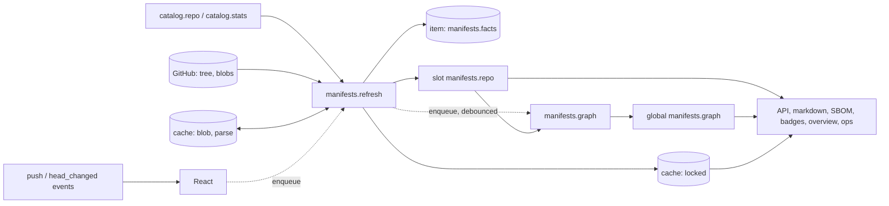

# 11 - Manifests core: model, registry, acquisition, org graph, API and outputs

Unit `11-manifests-core` of the Source Code Portal design (D-15 / N-01). Status: design for review, 2026-10-14; independently verified and corrected the same day (section 17 is the verification log, `30-verification/design-11-manifests-core.md` the report). Binding inputs and precedence: `04-decisions.md` (including section 7), `10-architecture.md` (section 13 and the matrices of sections 5 and 8), `11-adr/ADR-021` and `ADR-022` (with their 2026-10-14 amendments), `05-research/07-manifest-parsing.md`. Where this document and the architecture differ, section 14 lists the difference; nowhere else.

Identifiers used below: **RR-n / RI-n** are the requirements that `13-manifests-ecosystems-b.md` places on the manifests root and on `manifests/internal/*` (section 2.8 answers each); **D-n** deviations proposed (section 14); **OQ-n** open questions (section 15); **V-n** facts verified on 2026-10-14 (section 16); **VF-nn** defects found and fixed by the independent verification (section 17); **E-n** experiments (section 16); **M0..M6** milestones (section 13); **G-xx** are the guarantees of `04-decisions.md` section 2 and **GR-nn** the guardrails of `02-design-guardrails.md` (section 11 traces both).

---

## 0. Compile-check statement and reading guide

**What was compiled.** A scratch module `github.com/cantara/source-code-portal` (`go 1.27`, toolchain `go1.27.1 darwin/arm64`) holds the real code of this unit and stubs of everything it imports. On 2026-10-14 `go vet ./...`, `go test -race -count=1 ./...` (97 passing tests including the seed runs of six fuzz targets, one benchmark, no failures) and `go mod tidy -diff` were clean; `FuzzNormalizeIdempotent` also ran for 5 s (3.7 million executions, no crash). Every Go block in sections 2, 3 and 4 that is marked **(compiled)** is copied from that module. The module is shipped next to this document as `11-manifests-core.assets/` (66 files, about 560 KB; `README.txt` inside says how to rerun the measurements; `verification/` holds the non-compiled checks that were run against the real sibling packages, VF-19).

| Part | Status |
|---|---|
| `internal/manifests` (root, 6,474 lines of code, 2,583 lines of tests), `internal/manifests/internal/{limits,purl,version}` (938 + 374), `internal/manifests/parsertest` (318 + 102) | **real code, tested**: the reference implementation of this design; lifted into the repository at M1. Also compiled and tested against the real kernel, `readmodel`, `store`, `httpapi/authz`, `platform/config` and `apitest` packages in an overlay copy (section 17) |
| `internal/manifests/manifestsapi` | **hand-written stand-in** for the oapi-codegen output of unit 07's contract (schemas `RepoManifests`, `DependencyList`, `DependencyGraph`, `VersionSpreadList`, `LicenseSummary`, `Component`, `DependentList`); field names, JSON tags and Go types follow `api/openapi-public.yaml` one to one; compared field by field with the real oapi-codegen v2.8.0 output (`float32` for `number`, VF-18) |
| `internal/{scm,freshness,job,store,readmodel,httpapi,httpapi/authz,httpapi/openapi}` | **stubs** with the signatures of units 01, 03 and 06 (copied, not owned by this unit); they let the real code run, they prove nothing about the sibling units. The verification replaced them with the real packages in an overlay copy; every divergence found is fixed in the stubs (VF-19) |
| Ecosystem parsers, `NewJoinAssembler`, providers | not part of this unit (units 12 and 13); the tests use a toy `package.json` parser (`name[: dep,dep]`) registered through the same `Registry` |

**Not compile-checked** (stated so nobody assumes otherwise): the generated strict-server adapter (the scratch `Mount` uses hand-written handlers with the same behaviour; section 7.1 shows the adapter shape, checked by hand against the generated types, not compiled), `*github.Client` satisfying `TreeReader`/`BlobReader`/`BlobBatchReader` (unit 05; the tests use fakes), `*sqlite.Store` satisfying `Store` (unit 03; fake in the tests), `cmd/scp` composition and `bridge` code (shown in section 2.6 as prose-level Go, not compiled), the SPA.

**How to read.** Sections 1 to 3 say what exists; section 4 is the behavioural contract (pseudocode, edge cases, error table); 5 to 10 are data, configuration, API, runtime, observability, security; 11 maps guarantees and guardrails to mechanisms; 12 to 15 are the test plan, the work breakdown, deviations and questions; 16 records facts and experiments.

---

## 1. Purpose, scope, non-goals, exact packages

### 1.1 Purpose

Package manifests are the most precise statement a repository makes about what it is built from and what it produces, but they are only worth fetching when something consumes the result and when they are parsed as untrusted input within limits (GR-04, GR-34). D-15 therefore makes package-manifest intelligence a first-class feature: for every repository, which technologies, build tools and toolchain versions it uses and which components it declares; across the organisation, which repositories depend on which (internal dependency graph, reverse index, version spread, declared licences); and all of it through the JSON API, LLM-readable Markdown, CycloneDX and badges, without ever executing repository code.

This unit is the **core** of that feature: everything that is not one ecosystem's file format. It owns the normalised model, the `Parser`/`Assembler`/`Registry` extension point, the acquisition jobs (`manifests.refresh`, `manifests.graph`), the parse runner with its limits and watchdog, version ordering, the org graph, the snapshot slots, the eight JSON operations, the two text routes, the CycloneDX export, the facts offered to badges, overview and the operator status page, the metrics, and the parser test harness every ecosystem uses.

### 1.2 In scope (what this document specifies)

1. `internal/manifests` (rank 4): model, registry, discovery, refresh and graph jobs, reactor, parse runner, default assembler, graph, API handlers, text routes, CycloneDX, views for sibling features, config, metrics.
2. `internal/manifests/internal/purl`, `.../version`, `.../limits` (rank 1): identity, ordering, guards.
3. `internal/manifests/parsertest` (rank 5, imported from `_test.go` only): golden runner, seven-invariant fuzz harness, hostile-input corpus generators.
4. `internal/manifests/manifestsapi`: the generated package of unit 07's `manifests` tag (a stand-in is shipped here; the generator writes the real one).

### 1.3 Non-goals

| Not here | Owner |
|---|---|
| Parsers and assemblers of Maven, Gradle, npm, Python, Cargo, Go (`manifests/ecosystems/{maven,gradle,npm,python,cargo,golang}`) | unit 12 (named by unit 13; no document yet) |
| Parsers of NuGet, Ruby, PHP, Swift, CocoaPods, Dart, Elixir, Docker, Actions, Terraform, Helm; providers (`depsdev`, `sbom`, `github-graph`); `NewJoinAssembler`; `RepoFacts.Enriched` | unit 13 (`13-manifests-ecosystems-b.md`) |
| `github.Client.ListTree`, `ReadBlob`, the batched blob read, SBOM report methods | unit 05 (adapter) |
| Planner, engine, `job.Spec` semantics, reactor fan-out, webhook decoding | units 01 and 04 |
| `readmodel`, `store`, SQL DDL, the `cache` table and its caps | unit 03 |
| `httpapi` middleware, ETag helpers, problem writer, `authz` | unit 06 |
| The OpenAPI contract and the strict-server generation | unit 07 |
| Catalogue slots, membership, aliases | unit 08 |
| `badges` rendering (consumes `BadgeView` through a bridge); `overview` composition (consumes `Technology`, `Related`, `Enabled`); `ops` status page (consumes `Health`) | units 09, 15 |
| SPA features `features/manifests` | web unit |
| Vulnerability data, outdated-versus-registry data, licence enrichment, executing build tools (architecture 2, D-15) | out of v1 |

### 1.4 Exact packages and files

| Package | Rank | Files (reference implementation) | Role |
|---|---|---|---|
| `internal/manifests` | 4 | `model.go registry.go render.go config.go service.go metrics.go codec.go sanitize.go discover.go refresh.go assemble.go assembler.go graph.go graphjob.go refindex.go api.go api_repo.go api_global.go textroutes.go markdown.go cyclonedx.go extras.go views.go limits.go` | feature root |
| `internal/manifests/internal/limits` | 1 | `limits.go watchdog.go expand.go charset.go` | `Limits`, `Guard`, text gates, weighted memory budget, per-file watchdog with circuit, interpolation bound, XML charset reader |
| `internal/manifests/internal/purl` | 1 | `purl.go` | per-ecosystem normaliser, purl build/parse over `packageurl-go`, repository-URL keys |
| `internal/manifests/internal/version` | 1 | `version.go` | ordering and range satisfaction per ecosystem over `deps.dev/util/semver` |
| `internal/manifests/manifestsapi` | generated | `manifests.gen.go` (stand-in: `manifestsapi.go`) | request/response types of the eight operations |
| `internal/manifests/parsertest` | 5 | `parsertest.go`, `testdata/` | golden and fuzz harness for every parser |

Ecosystem packages (`manifests/ecosystems/*`) and providers (`manifests/providers/*`) are rank 5 and import only this root and `manifests/internal/*`; they are other units' work.

---

## 2. Position in the architecture

### 2.1 Imports (matrix row and measured result)

Architecture 5.2 gives `manifests` (rank 4): K4 (`scm freshness job routes readmodel store httpapi httpapi/authz platform/secret platform/logx`), `manifests/manifestsapi`, `manifests/internal/*`; third party: `cyclonedx-go` at the export boundary and the OpenTelemetry API. `go list -f '{{.Imports}}'` on the scratch module (2026-10-14) shows the real result:

| Package | Internal imports | Third-party imports |
|---|---|---|
| `manifests` | `freshness httpapi httpapi/authz httpapi/openapi job readmodel scm store manifests/manifestsapi manifests/internal/{limits,purl,version}` (`routes` and `platform/*` are allowed but unused: the route **names** are constants and the text routes are registered by `cmd/scp`; logging uses `*slog.Logger` handed in) | `cyclonedx-go` (`cyclonedx.go` only), `otel/{attribute,metric,trace}` (API only, G11), `golang.org/x/sync/errgroup` |
| `manifests/internal/limits` | none | `golang.org/x/sync/semaphore`, `golang.org/x/text/encoding/charmap` |
| `manifests/internal/purl` | none | `packageurl-go` v0.1.7 |
| `manifests/internal/version` | none | `deps.dev/util/semver` (commit `7bac2db56a63`, 2026-10-13) |
| `manifests/manifestsapi` | `httpapi/openapi` | none (generated) |
| `manifests/parsertest` | `manifests`, `manifests/internal/purl` | none (the architecture row allows `go-cmp` from `_test.go`; this harness uses `reflect.DeepEqual`) |

Three differences from the matrix are proposed in section 14: the root and `manifestsapi` import the generated `httpapi/openapi` (D-1, same as unit 09's D-12), `x/sync` is used by the root and by `limits` (D-2), and `limits` owns the XML charset reader and therefore `x/text/encoding/charmap` (D-3). `go.yaml.in/yaml/v3` appears in `config_test.go` only (strict-decode proof of the config tags); the root imports no YAML library, decoding belongs to `platform/config`.

### 2.2 Who imports this package

| Importer | What it uses | How |
|---|---|---|
| `cmd/scp` | `New`, `Deps`, `Config`, `DefaultConfig`, `RegisterSlots`, `NewRegistry`, `Registry.*`, `Service.{Jobs,Bind,React,Mount,WarmItem,Drain,Guard,RepoDependenciesMD,GroupDependenciesMD}`, route-name constants | composition (section 2.6) |
| `cmd/scp/internal/bridge` | `Service.BadgeView` (to `badges.Facts`), `Service.Technology`, `Service.Related`, `Service.Enabled` (to `overview.ManifestsSource`), `Service.Health` (to `ops.FeatureHealth`) | mechanism B, bridged (the consumers define the interface; the bridge adapts) |
| `overview` (rank 5) | the **root** is importable (architecture matrix) but it consumes manifests through `overview.ManifestsSource` and the bridge, never by calling `Service` directly | consumer interface |
| `manifests/ecosystems/*`, `manifests/providers/*` | `Parser`, `Assembler`, `File`, `Parsed`, `Limits`, `Registry`, `EcosystemSpec`, `CleanText`, helpers `JoinLock`, `GlobMatch`, `ExpandMembers`, `NewParser`, `WithKind`, `WithAmplification`, `PathSet`, `ComponentID` and model types; `manifests/internal/{limits,purl,version}` | registered in `cmd/scp` |
| `manifests/parsertest` | the whole root surface of a parser | test helper |
| `badges`, `commits`, `docs`, `catalog`, `webhook`, `refresh` | **nothing** (a feature never imports another feature; `badges` gets facts through its own `Facts` interface) | |

### 2.3 The four mechanisms, as this unit uses them

| Mechanism | Use |
|---|---|
| A. Snapshot slots | writes `manifests.repo` (`Slot[freshness.Value[RepoFacts]]`) and `manifests.graph` (`Global[scm.Classed[*Graph]]`); reads `catalog.repo`, `catalog.stats` (`HeadTreeOID`), `catalog.membership` |
| B. Consumer interfaces | defines `TreeReader`, `BlobReader`, optional `BlobBatchReader`, `Store` (satisfied directly by `*github.Client` and `*sqlite.Store`); is itself consumed by `overview`, `badges`, `ops` through bridges |
| C. Job specs | `Jobs()` returns two `job.Spec`: `manifests.refresh` (per repository, upstream `github`) and `manifests.graph` (global, upstream `local`) |
| D. Reactors | `React(ctx, ev, enq)` has the exact shape of `reactor.Func`; it never calls the network |

### 2.4 Consumer interfaces this unit defines (compiled)

These are the exact signatures. `scm.TreeOptions`, `scm.Tree`, `scm.Blob`, `scm.Result`, `scm.RepoRef` are kernel types (unit 01).

```go
// TreeReader and BlobReader are the consumer-side interfaces implemented DIRECTLY by *github.Client (kernel types only).
type TreeReader interface {
	// ref is a branch name, or a 40-hex tree or commit id: unit 05 (4.10) resolves a hex id directly and caches the answer immutably. The walk
	// of a truncated tree (4.3) passes the tree id of each directory as ref and an empty opt.Path (VF-11).
	ListTree(ctx context.Context, r scm.RepoRef, ref string, opt scm.TreeOptions) (scm.Result[scm.Tree], error)
}
type BlobReader interface {
	ReadBlob(ctx context.Context, r scm.RepoRef, sha string, maxBytes int64) (scm.Blob, error)
}

// BlobBatchReader is the OPTIONAL batched read (GraphQL aliases, 25 per query). Missing or unreadable (binary, truncated) blobs are
// absent from the result map; the caller falls back to ReadBlob for them. Proposed addition to architecture 8.7 (D-4).
type BlobBatchReader interface {
	ReadBlobs(ctx context.Context, r scm.RepoRef, shas []string, maxBytes int64) (map[string]scm.Blob, error)
}

// Store is the carve-out of store.Store this feature uses (satisfied by store/sqlite directly, by a hand-written fake in tests).
type Store interface {
	PutItem(ctx context.Context, it store.Item) error
	Revalidated(ctx context.Context, k store.ItemKey, now time.Time) error
	RecordFailure(ctx context.Context, k store.ItemKey, f store.Failure) error
	GetCache(ctx context.Context, ns, key string) ([]byte, bool, error)
	PutCache(ctx context.Context, ns, key string, data []byte) error
}

// PomSource fetches a POM from a public Maven repository for parent and BOM resolution outside the organisation (opt-in).
// The satisfier lives in cmd/scp (a hardened client restricted to manifests.pom_source.hosts); this package never opens a connection.
type PomSource interface {
	Fetch(ctx context.Context, id ComponentID, version string) ([]byte, error)
}
```

`cmd/scp/assert.go` carries the compile-time proofs (section 13, task M5-1): `var _ manifests.TreeReader = (*github.Client)(nil)`, `var _ manifests.BlobReader = (*github.Client)(nil)`, `var _ manifests.BlobBatchReader = (*github.Client)(nil)`, `var _ manifests.Store = (*sqlite.Store)(nil)`, `var _ manifests.PomSource = (*mavencentral.Client)(nil)` (the last only when `pom_source.enabled`).

### 2.5 What this unit exposes (compiled)

```go
// Construction and lifecycle (service.go)
func RegisterSlots(reg *readmodel.Registry) (readmodel.Slot[freshness.Value[RepoFacts]], readmodel.Global[scm.Classed[*Graph]])
func New(cfg Config, d Deps) (*Service, error)
func (s *Service) Bind(enq job.Enqueuer)                       // exactly once, before the engine runs; a second call panics
func (s *Service) Drain(ctx context.Context) error             // waits for abandoned parser goroutines (shutdown, goleak)
func (s *Service) Jobs() []job.Spec                            // manifests.refresh and manifests.graph
func (s *Service) React(ctx context.Context, ev scm.Event, enq job.Enqueuer) error   // reactor.Func shape
func (s *Service) Guard() PrivacyGuard                         // built on the all-repositories graph variant

// HTTP (api.go, textroutes.go): hand registration used by tests; production uses the generated HandlerWithOptions (7.1)
func (s *Service) Mount(m httpapi.Mux)
func (s *Service) RepoDependenciesMD() http.Handler            // route name "deps.repo.md"
func (s *Service) GroupDependenciesMD() http.Handler           // route name "deps.group.md"
var Routes map[string]string                                   // pattern -> route name of the eight JSON operations

// Facts for sibling features (extras.go, views.go)
func (s *Service) WarmItem(it store.Item) (freshness.Value[RepoFacts], error) // ErrNoFacts when the row has no payload (a failed first attempt)
var ErrNoFacts error                                           // the sentinel the warm-start loop skips silently (VF-08)
func (s *Service) BadgeView(snap *readmodel.Snapshot, slug scm.Slug, class scm.ViewClass) (BadgeFacts, bool)
func (s *Service) Technology(snap *readmodel.Snapshot, slug scm.Slug, class scm.ViewClass) (TechnologyView, bool)
func (s *Service) Related(snap *readmodel.Snapshot, slug scm.Slug, class scm.ViewClass) (dependsOn, usedBy []scm.Slug)
func (s *Service) Health(snap *readmodel.Snapshot, now time.Time) Health
func (s *Service) Enabled() bool
func (s *Service) NoteLockMiss(rk store.RepoKey)               // the API calls it when a locked-components lookup misses

// Extension point for ecosystems (registry.go, render.go, assembler.go)
func NewRegistry() *Registry                                   // preloaded with the 16 built-in EcosystemSpec values
func (r *Registry) Register(p Parser) error
func (r *Registry) RegisterEcosystem(s EcosystemSpec) error
func (r *Registry) RegisterAssembler(a Assembler) error
func (r *Registry) Disable(eco EcosystemID)                    // before or after Register: a disabled ecosystem never becomes active (VF-14)
func (r *Registry) Freeze()
func (r *Registry) SetHash() string
func (r *Registry) Parser(id string) (Parser, bool)
func (r *Registry) Spec(e EcosystemID) (EcosystemSpec, bool)
func (r *Registry) Assembler(e EcosystemID) (Assembler, bool)
func (r *Registry) Match(path string) []Parser
func (r *Registry) Interesting(path string, excluded map[string]bool) bool
func (r *Registry) ParserIDs() []string
func (r *Registry) FormatPURL(id ComponentID, display, version, qualifiers string) (string, bool)
func NewParser(id string, version int, eco EcosystemID, match func(string) bool, parse func(context.Context, File, Limits) (Parsed, error)) Parser
func WithKind(p Parser, k FileKind) Parser
func WithAmplification(p Parser, n int) Parser
func CleanText(s string, max int) string
func JoinLock(eco EcosystemID, deps []Dependency, locked []LockedComponent) ([]Dependency, []Diagnostic)
func ExpandMembers(base string, patterns, dirs []string) []string
func GlobMatch(pattern, p string) bool

// Outputs (cyclonedx.go, markdown.go)
func BuildBOM(reg *Registry, repo scm.Repository, f RepoFacts, locked map[string][]LockedComponent, omitted map[string]bool, version string) *cdx.BOM
func WriteBOM(w io.Writer, bom *cdx.BOM) error
func RenderDependenciesMD(w io.Writer, title string, repos []MDRepo, g *Graph, maxRows int, canonicalURL string, now time.Time) error
func (g *Graph) DependsOnRepos(slug scm.Slug) []scm.Slug
func (g *Graph) UsedByRepos(slug scm.Slug) []scm.Slug
```

`Deps` (the collaborators; every one injected, no global state, G3/G11):

```go
type Deps struct {
	Registry  *Registry        // frozen
	Trees     TreeReader
	Blobs     BlobReader
	BlobBatch BlobBatchReader  // optional
	Store     Store
	Publisher *readmodel.Publisher
	Slots     Slots
	Log       *slog.Logger
	Meter     metric.Meter
	Tracer    trace.Tracer
	Authz     authz.Authorizer // nil is replaced by authz.PublicOnly{}: fail closed, only public repositories are served (VF-04)
	Version   string           // application version, recorded in the SBOM tool component
	Private   bool             // access mode on: text outputs use Cache-Control private
	PublicURL string           // absolute base URL for links in text outputs
}
type Slots struct {
	Repos      readmodel.Slot[freshness.Value[scm.Repository]]  // catalog.repo
	Stats      readmodel.Slot[freshness.Value[scm.RepoStats]]   // catalog.stats
	Facts      readmodel.Slot[freshness.Value[RepoFacts]]       // manifests.repo (from RegisterSlots)
	Graph      readmodel.Global[scm.Classed[*Graph]]            // manifests.graph (from RegisterSlots)
	Membership readmodel.Global[scm.Membership]                 // catalog.membership
}
```

### 2.6 Composition in `cmd/scp` (prose-level, not compiled)

```go
// before readmodel.Freeze (unit 03): slots
facts, graph := manifests.RegisterSlots(rmReg)

// registry (unit 12 and 13 supply the Parser/Assembler constructors)
reg := manifests.NewRegistry()
must(reg.Register(npm.NewPackageJSON())) // ... every ecosystem unit's Register helper
must(reg.RegisterAssembler(maven.NewAssembler(pomSource, guard)))        // guard: see below
for _, e := range cfg.Manifests.Acquisition.DisabledEcosystems { reg.Disable(manifests.EcosystemID(e)) } // order against Register does not matter
reg.Freeze()

// service: after the publisher exists (it needs the slots) and before the engine (it needs the specs)
svc, err := manifests.New(cfg.Manifests.Config, manifests.Deps{Registry: reg, Trees: gh, Blobs: gh, BlobBatch: gh, Store: st, Publisher: pub,
	Slots: manifests.Slots{Repos: cat.Repo, Stats: cat.Stats, Facts: facts, Graph: graph, Membership: cat.Membership},
	Log: log, Meter: tel.Meter("manifests"), Tracer: tel.Tracer("manifests"), Authz: az, Version: version.String(), Private: cfg.Access.Mode != "public", PublicURL: cfg.Site.URL})
specs := svc.Jobs()                                  // registered with the engine together with the other features' specs
enq := eng.Enqueuer(); svc.Bind(enq)                 // the planner is the Enqueuer (unit 04)
fan.Add(svc.React)                                   // reactor.Fan
st.LoadItems(ctx, func(it store.Item) error { if it.Key.Kind != manifests.ItemKind { return nil }; v, err := svc.WarmItem(it); if errors.Is(err, manifests.ErrNoFacts) { return nil }; ...collect or log...; return nil })
// one Publisher.Apply writes every warmed Put (the callback must not call the store)
mount: apiHandler := manifestsapi.HandlerWithOptions(strict(svc), ...)   // 8 operations; or svc.Mount(mux) in tests
table.Handle(mux, manifests.RouteNameRepoDepsMD, svc.RepoDependenciesMD())
table.Handle(mux, manifests.RouteNameGroupDepsMD, svc.GroupDependenciesMD())
```

`Deps.Authz` is `authz.Authorizer`; the **view class** of a request is `authz.ClassOf(az, authz.PrincipalFrom(ctx))`. Visibility handling never goes through anything else (section 10.2).

### 2.7 Bridges owed by `cmd/scp/internal/bridge` (specified here, written there)

| Consumer interface (owner) | Bridge reads | Mapping |
|---|---|---|
| `badges.Facts` -> `RepoFacts{Language, BuildTool, LatestVersion, InternalDeps}` (unit 09, section 2.4) | `Service.BadgeView(snap, slug, class)` | each of the four fields becomes a `freshness.Value` carrying `BadgeFacts.Info` (the facts' freshness); `Language` is `Languages[0]`; state `unsupported` when `!Recognised` or `Languages` is empty; `Stale` is redundant with `Info.Derive` and is provided for callers without a clock |
| `overview.ManifestsSource{Enabled() bool; Technology(snap, slug) (TechView, bool)}` (unit 15, `overview/views.go`) | `Service.Enabled`, `Service.Technology`, `Service.Related` | `TechnologyView` -> `overviewapi.TechnologySummary`: `languages[].bytes` is `0` (D-9), `manifestsUrl` from the route table (`spa.repo.dependencies`), `diagnosticCount` = `Diagnostics`. **Request to unit 15 (OQ-3):** the method has no view class, so the bridge can only pass `scm.ViewPublic` and under-counts `internalDependencyCount` for an authenticated viewer; add a `scm.ViewClass` parameter. `dependsOn` merge uses `Related` |
| `ops.FeatureHealth.Manifests() ManifestsView` (unit 15, `ops/views.go`) | `Service.Health(snap, now)` | field for field: `Enabled, RepositoriesWithDiagnostics, DisabledParsers, DanglingUnits, StaleRepos` |

### 2.8 Cross-unit contract table

| Unit | What this unit relies on or provides | State |
|---|---|---|
| **01 kernel** | `scm.{RepoRef,Repository,Slug,Tree,TreeEntry,TreeOptions,Blob,Result,Event,ViewClass,Classed,Membership}`, `freshness.{Info,Value,Policy,State*,Status*}`, `job.{Key,GlobalKey,Spec,Outcome,Enqueuer,MarkGone,MarkPermanent,IsGone,IsPermanent,AsRateLimited,PrioBackfill,PrioScheduled,PrioWebhook}`; route names `api.manifests.{repo,deps,sbom,graph,versions,licenses,component,dependents}`, `deps.repo.md`, `deps.group.md` | compiled against stubs of the signatures in `01-kernel.md`; `Info.Derive` treats `TTL <= 0` as stale, so every published `Info` gets `TTL = idle_backoff_max` (4.6) |
| **03 readmodel/store** | `readmodel.{Publisher,Snapshot,Slot,Global,Register,RegisterGlobal,Put,PutGlobal,Get,GetGlobal,Builder,ErrUnknownRepo,ErrInvalidSnapshot}`; `store.{Item,ItemKey,RepoKey,KeyOf,Failure,ErrNoRepo}`; cache namespaces `manifests.blob`, `manifests.parse`, `manifests.locked` registered at `Open` through `Deps.CacheNamespaces` with caps `store.cache_caps.{blob,parse,locked}`; item kind `manifests.facts` | compatible; the facts payload must fit `store.MaxPayload` (16 MiB), so `limits.max_facts_bytes` is bounded by it (VF-06). Cache keys are at most 512 bytes: `manifests.locked` keys longer than 400 bytes are replaced by `h:<sha256 hex>` (found while reading unit 03's cache section; test `TestLockedKeyIsBounded`) |
| **04 refresh/webhook** | the planner is the `Enqueuer`; `Spec.Timeout`, `Spec.Policy`; `Outcome.Unchanged`; reactor fan-out; a forced enqueue overrides the TTL | compatible: `Bind` exactly once; `Enqueue(key, prio, notBefore, force)` as used by `fakeEnq` in the tests |
| **05 github adapter** | `ListTree`, `ReadBlob`, optional `ReadBlobs` (GraphQL aliased batch), tree entry paths relative to the listed directory in non-recursive mode, `HeadTreeOID` in `RepoStats`; `scm.ErrNotFound`, `ErrForbidden`, `ErrUnavailable` | compatible; `ReadBlobs` is **a request** (D-4; unit 05 4.10 has no such method yet, X-1); the walk addresses every directory by its **tree id** through `ListTree(ref = tree id)` and joins the relative entry paths itself (VF-11) |
| **06 httpapi** | `Mux`, `Mounter`, `Problem` constructors (`Validation`, `InvalidCursor`, `NotFound`, `NotReady`, `Internal`, `New(404,"feature-disabled",...)`), `WriteProblem`, `WriteJSON`, `NotModified`, `WeakETag`, `WeakETagOf`, `ETagKind`, `WithDigest`, `FreshnessDigest`, `Digest`, `EncodeCursor`, `DecodeCursor`, `QueryFingerprint`, `NewPageInfo`, `NewFreshness`; `authz.{Authorizer,ClassOf,PrincipalFrom,LookupRepo}` | compatible; the D15 trap (derived status in the body, therefore in the ETag) is pinned by `TestETagCoversDerivedFreshness`; `authz.Authorizer` may be nil in `Deps` and is then `authz.PublicOnly{}` (VF-04) |
| **07 contract** | operations `getRepoManifests`, `listRepoDependencies`, `getRepoSbom`, `getDependencyGraph`, `getDependencyVersions`, `getDependencyLicenses`, `getComponent`, `listComponentDependents`; schemas in `manifests` tag; ETag kinds and the 404 `feature-disabled` rule | the handlers decode with `DisallowUnknownFields` into the stand-in types, so a member the contract does not have fails the tests; the unit 07 catalogue lists a 404 `featureDisabled` on every operation, answered by `guard`. Checked against the generated oapi-codegen v2.8.0 code and the bundled document: every response of the API tests validates against the contract (VF-18), `Dependency.purl` is required (VF-12), unit ids match their pattern (VF-13), `Artifact.kind` has `other` (VF-17). Unit 07 describes the ETag kinds of `getRepoManifests` (`repo-rev`) and `getRepoSbom` (`tree-sha`) without the digest suffixes this unit adds (X-3) |
| **08 catalog** | slots `catalog.repo`, `catalog.stats`, `catalog.membership`; `Repository.VisibleTo(class)`; `Membership.VisibleReposOf(group, class)` | compatible |
| **09 commits/badges** | `badges.Facts` bridged (2.7) | `BadgeFacts` gained `Info` and `Recognised` to satisfy section 2.4 of unit 09 |
| **12 ecosystems A** | not yet written; consumes the same surface as unit 13 | the RR/RI answers below are the contract it will be written against |
| **13 ecosystems B** | RR-1..RR-23, RI-1..RI-7 (table below) | all accepted or answered |
| **14 integrations/access** | `authz.Authorizer` semantics: 404 as unknown for invisible repositories, `ViewClass` has two values, every global projection exists in two variants | implemented (10.2) |
| **15 live/ops/overview** | slot names `manifests.repo`, `manifests.graph` (live topics), `ManifestsSource`, `ManifestsView`, warning codes `manifests.parser-disabled`, `manifests.stale` | compatible except OQ-3 (X-2) |

**Answers to unit 13's requirements on this unit** (every RR/RI of `13-manifests-ecosystems-b.md` section 2.3):

| Id | Answer |
|---|---|
| RR-1 `FormatPURL` hook | **Accepted, implemented** (`EcosystemSpec.FormatPURL`, `Registry.FormatPURL`; the default formatter uses `purl.Format` with the reserved qualifier `subpath`) |
| RR-2 `NewParser` | **Accepted, implemented**, plus `WithKind` and `WithAmplification` |
| RR-3 `NewJoinAssembler` | **Owned by unit 13** (`manifests/join.go`). The root supplies the default per-directory assembler (RR-9), `JoinLock`, `ExpandMembers`, `GlobMatch` as exported helpers |
| RR-4 `limit.*` counting | **Accepted, implemented** (`LimitDiagPrefix`; parse results with `limit.<name>` diagnostics are counted into `scp_manifests_limit_hits_total{limit}`) |
| RR-5 resolved limits | **Accepted, implemented** (`Limits.Resolved(lockfile)`, `Kinded`) |
| RR-6 edge de-duplication by `(unit, ComponentID, Scope)` | **Accepted, implemented in `BuildGraph`** (the first declaration's `Dep` index is kept; a later duplicate only fills an unknown version) |
| RR-7 `LockedComponent.Source` | **Accepted, implemented**; the API reports it as `provenance` |
| RR-8 `Registry.Spec` | **Accepted, implemented** |
| RR-9 default assembler | **Accepted, implemented** (`defaultAssemble`: one unit per `(ecosystem, dir)` and primary manifest; lock-only units; secondary files stamp `Loc.Path`). `RepoFacts.Enriched` is **not added in v1**; it arrives with the first provider (P5) and bumps `ModelVersion` |
| RR-10 `_local` | **Accepted, implemented**: `rebasePaths` rewrites `SourceRef` before assembly; `LocalNamespace`; channel C resolves it to a unit of the same repository; the API reports it without namespace and flags `internal`; `TestLocalPathsAndEdgeDedupe` |
| RR-11 targets of another ecosystem | **Accepted** (graph and invariants key on `ComponentID` only) |
| RR-12 nominal version | **Accepted** (`effVersion`: exact version, else requirement) |
| RR-13 `<alg>:<hex>` | **Accepted**; CycloneDX exports `sha1`, `sha256`, `sha512`; the Go `h1:` hash and unknown algorithms are not exported |
| RR-14 `IsPrivate` | **Accepted as `Service.Guard()`** returning `PrivacyGuard{Check, Allow}` built on the all-repositories graph (a coordinate produced by a private repository counts as private). The provider's `FactsRequest.IsPrivate` is `!Guard().Allow(id)` |
| RR-15 `manifests.depsdev` namespace | unit 03 / unit 13 (not this unit) |
| RR-16 adapter methods | unit 05 |
| RR-17 `CleanText` | **Accepted, implemented**; `SafeText` (an earlier alias) was removed here |
| RR-18 id format, `RegisterEcosystem` replaces | **Accepted, implemented** |
| RR-19 `Service.Reapply` | **Deferred to P5** (no enrichment in v1). The reserved shape is `func (s *Service) Reapply(ctx context.Context, rk store.RepoKey) error`: take the per-repository lock, load own facts and enrichment items, merge, publish. The only publish point today is `Service.publish`, which is where it hooks in; the lock is not created until a second writer exists (GR-04) |
| RR-20 provider error types | unit 13 (`manifests/source.go`); the root classifies by method set through `job` and needs nothing |
| RR-21 `AddUpstream("deps-dev")` | unit 04 / `cmd/scp` |
| RR-22 config composition | **Accepted**: `manifests.Config` has `yaml` tags and no `Providers`, `Enrich` or per-ecosystem keys; `cmd/scp` embeds it with `,inline` (section 6) |
| RR-23 `Artifact.Kind` closed enum | **Accepted at the API boundary**: `artifactKind` maps an empty kind to `library` and anything else outside `library, application, plugin, bom, image` to `other` (the contract's enum has `other`, VF-17; `TestArtifactKindOther`) |
| RI-1 guard | **Implemented** with the scaffold names (`NewGuard`, `Node`/`Tick`, `Poll`, `CheckSize`, `Enter`/`Leave`, `Expand`); `IsLimit(err) (name, bool)` **exists** (unit 13 says it does not; both `errors.As` and `IsLimit` work) |
| RI-2 text gate | **Name clash resolved**: the input gate is `limits.Input(data []byte) ([]byte, error)` (BOM strip, UTF-16/NUL/invalid UTF-8 rejected with `*EncodingError{Reason}`); `limits.Text(s string, max int) string` is the output cleaner. Unit 13 writes both as "`Text`" in different paragraphs; the compiled names are `Input` and `Text`. XML parsers use `StripBOM` + `RejectBinary` + `CharsetReader` |
| RI-3 output hygiene | `manifests.CleanText` (root), which calls `limits.Text` |
| RI-4 `purl` | **Implemented**: `Build`, `Parse`, `RepoKey`, `RepoKeyFromModulePath`, `Format`, `ParseQualifiers`, `Normalize`, `NormalizeFunc`, `Type`, `EcosystemOfType`, `PyPIName`; `RepoKey` is the single repository-URL canonicaliser used by the graph's channel B |
| RI-5 `version` | **Implemented**: `Compare`, `Satisfies`, `Order`, `Sort`, `Max`, `Parsable`, `WellFormed`, `IsPrerelease`; systems `nuget rubygems composer semver opaque` plus `maven npm pypi go cargo` |
| RI-6, RI-7 `yamlsafe`, `rubydsl` | proposed by unit 13 (its D-1); **not part of this unit**; the architecture tree gains them when unit 13's D-1 is accepted |

---

## 3. Domain model and Go types

All blocks in this section are **(compiled)** from `model.go`, `registry.go`, `discover.go`, `graph.go` unless marked otherwise. Comments are shortened.

### 3.1 Identity

```go
type EcosystemID string // lower case; equals the purl type where the purl specification defines one
const (
	Maven EcosystemID = "maven"; NPM = "npm"; PyPI = "pypi"; Golang = "golang"; Cargo = "cargo"; NuGet = "nuget"; Gem = "gem"; Composer = "composer"
	Swift = "swift"; Pub = "pub"; Hex = "hex"; CocoaPods = "cocoapods"; Docker = "docker"; GitHubActions = "github"; Terraform = "terraform"; Helm = "helm"
)

// ComponentID is the comparable identity of a package WITHOUT a version. Fields are already normalised per ecosystem, so equality is
// struct equality and the type is a map key (GR-07). Maven classifier/type live in Dependency.Qualifiers, never here.
type ComponentID struct {
	Ecosystem EcosystemID
	Namespace string // Maven groupId, npm scope without '@', Go module path prefix, Swift host/owner, Composer vendor; "_local" = a path inside this repository
	Name      string // Maven artifactId, npm bare name, PyPI PEP 503 name, NuGet lower-cased id, crate name
}
```

Normalisation (`purl.Normalize`, idempotent and total; `FuzzNormalizeIdempotent` found and fixed a non-fixed-point in scope trimming, E-2):

| Ecosystem | Namespace | Name | Why |
|---|---|---|---|
| maven, gem, cocoapods | as written | as written | case-sensitive registries |
| npm | scope without any leading `@`, as written | as written | `@scope/name` |
| pypi | `""` | PEP 503 (`[-_.]+` to `-`, lower case) | `packageurl-go` does not implement PEP 503 (V-4) |
| golang | lower case | lower case | module paths are case-folded in the proxy |
| nuget | `""` | lower case (display keeps original case in `Dependency.TargetDisplay`) | NuGet ids are case-insensitive |
| cargo | `""` | lower case, `_` to `-` | crates.io treats them as equal |
| composer, hex, github, docker, terraform, helm | lower case | lower case | |
| pub | `""` | lower case | `packageurl-go` does not enforce it |
| swift | lower case | as written | host/owner case-insensitive |

`Type(eco)` returns the purl type; terraform and helm have no official type and use the custom types `terraform` and `helm` (`ok=false` from their `FormatPURL` hook means "no purl", unit 13 RR-1).

### 3.2 Vocabulary

```go
type Scope uint8 // closed: unknown runtime dev test build optional peer provided; text form via MarshalText, unknown strings decode to ScopeUnknown
type Relationship uint8 // RelUnknown RelDirect RelTransitive (locked components)
type Resolution uint8   // ResDeclared (a requirement only), ResPinned, ResLocked, ResManaged (BOM, catalog, CPM, workspace)
type Confidence uint8   // ConfExact, ConfHeuristic (Gradle scripts, Gemfile, Package.swift, Podfile, mix.exs)
type SourceKind uint8   // SourceRegistry, SourceGit (SourceRef = repository key), SourcePath, SourceURL, SourceProject (build-tool project reference, resolved by an assembler to SourcePath)
type FileKind uint8     // KindManifest, KindLockfile, KindCatalog (version catalog, CPM props, BOM-only POM), KindWorkspace
type Role uint8         // RolePrimary, RoleFixture (path segment in acquisition.fixture_segments; excluded from the graph, rollups and SBOM)
type Severity uint8     // SevInfo, SevWarning, SevError
```

### 3.3 Dependency, artifact, locked component, diagnostic

```go
// Dependency is one declared edge from a unit to a component. 120 bytes: the hot fields are inline, the rare ones live behind Extra.
type Dependency struct {
	Target      ComponentID
	Requirement string // raw, in the ecosystem's syntax ("^1.2", "[1.0,2.0)", "~> 3.1"); never evaluated here
	Version     string // exact version when known (see Resolution)
	Group       string // original group/configuration name ("devDependencies", "testImplementation")
	Line        int32  // 1-based line in the file it was read from; 0 = unknown
	Resolution  Resolution
	Scope       Scope
	Source      SourceKind
	Confidence  Confidence
	Optional    bool
	Extra       *DependencyExtra // TargetDisplay, Condition, Qualifiers, SourceRef, LocPath (setters on *Dependency; never share an Extra)
}
type Artifact struct { ID ComponentID; Display, Version, Kind string } // Kind: library application plugin bom image
type LockedComponent struct {
	ID ComponentID; Version string; Relationship Relationship; Scope Scope
	Integrity string; Licenses []string; DependsOn []int; Loc Location
	Source string // "" = own parse; otherwise the provenance of a provider
}
type Diagnostic struct { Code string; Severity Severity; Message string; Loc Location } // Code "<namespace>.<name>"; Message at most 512 bytes
type Location struct { Path string; Line int }
```

### 3.4 Parser output, units, repository facts

```go
type FileRef struct { Path, BlobSHA, ParserID string; ParserVersion int; Kind FileKind }
type Parsed struct { // pure result of one file; the value cached under (BlobSHA, ParserID, ParserVersion)
	File FileRef; Kind FileKind; Provides []Artifact; Dependencies []Dependency; Locked []LockedComponent
	Properties map[string]string; Parent *Dependency; Imports []Dependency; Members, Includes []string
	Toolchain map[string]string; Licenses []string; Diagnostics []Diagnostic
}
type Unit struct { // one logical project: a Maven module, an npm package, a Go module, a crate, a csproj
	ID string // "<dir>#<ecosystem>[#<primary file base name>]", unique inside a repository
	Ecosystem EcosystemID; Dir string; Role Role; Files []FileRef; Provides []Artifact; Dependencies []Dependency
	Locked []LockedComponent // populated by the assembler, stripped before publication
	LockedCount int; Members []string; Toolchain map[string]string; Licenses []string; Diagnostics []Diagnostic
}
type RepoFacts struct { // the value of the per-repository slot
	TreeSHA string; CommitSHA string; ParsedAt time.Time; ParserSet string // Registry.SetHash() at assembly time
	Units []Unit; Technology Technology; Licences LicenceSummary; Diagnostics []Diagnostic; Truncated bool; FileCount int
}
type Technology struct { Languages, BuildTools []string; Ecosystems []EcosystemID; Toolchain map[string]string }
type LicenceSummary struct { // declared-only in v1 (architecture 13.6, m4)
	Total, Declared int; ByLicence map[string]int // occurrences; at most 50 keys, the rest under "other"
	Components, ComponentsDeclared int; ComponentsByLicence map[string]int
}
```

Rules that make the model safe: `TreeSHA` is authoritative and `CommitSHA` best effort; `Units` are sorted (root `"."` first, then directory, ecosystem, primary path) and capped (`limits.max_units_per_repo`); a unit's `Locked` is empty in the published value and in the persisted payload (`LockedCount` says how many exist; they live in `manifests.locked`); values are immutable after publication (readers share the slices).

### 3.5 Registry and parser contract

```go
type Parser interface { // pure function of File: no I/O, no clock, no network, no globals; safe for concurrent use; never panics (fuzzed)
	ID() string                  // "<ecosystem>/<format>", unique, [a-z0-9/_-], at most 64 bytes
	Version() int                // >= 1; bump on ANY output change; part of every cache key and of Registry.SetHash
	Ecosystem() EcosystemID
	Match(path string) bool      // cheap, path only, case-sensitive on the base name
	Parse(ctx context.Context, f File, lim Limits) (Parsed, error)
}
type File struct { Path string; Data []byte; BlobSHA string } // Path is context for diagnostics only: output must not depend on it (cache is keyed by blob SHA)
type Kinded interface{ Kind() FileKind }      // lockfile parsers say so: they get the lockfile size limit
type Weigher interface{ Amplification() int } // memory weight = size x amplification (default 10)
type Assembler interface { Ecosystem() EcosystemID; Assemble(ctx context.Context, files FileSet, parsed []Parsed) ([]Unit, error) }
type VersionedAssembler interface{ AssemblerVersion() int } // part of SetHash (default 1)
type FileSet interface{ Paths() []string; Has(path string) bool } // deliberately no Read: assembly is a pure function of Parsed values and the path list
type EcosystemSpec struct {
	ID EcosystemID; DisplayName, PURLType string; Normalize func(namespace, name string) (string, string)
	VersionSystem string; Language string; FormatPURL PURLFormatter
}
```

`Limits` (alias of `limits.Limits`): `MaxBytes 1 MiB`, `MaxDepth 256`, `MaxNodes 2,000,000`, `MaxExpand 1 MiB` per value, `MaxExpandAll 8 MiB` per file, `Timeout 2 s`; a zero field means "package default"; the runner always passes resolved values.

### 3.6 Graph types

```go
type RepoIdx, UnitIdx, CompIdx uint32; type VerIdx uint32 // 0 = none
type Edge struct { Comp CompIdx; Ver, Req VerIdx; Dep uint32; Scope Scope; Flags uint8 } // 20 bytes
const ( EdgeIntra uint8 = 1 << iota; EdgeHeuristic; EdgeInternal; EdgeRepoLink )
type Graph struct { BuildID uint64; Truncated bool; Stats GraphStats /* + unexported interned arrays, CSR offsets */ }
type GraphInput struct { Slug scm.Slug; Key string; Facts *RepoFacts } // Key = purl.RepoKey of the repository URL, "" when unknown
func BuildGraph(in []GraphInput, buildID uint64, maxEdges int) *Graph
```

Accessors (read-only, immutable after build): `RepoOf`, `UnitOf`, `CompOf`/`CompIndex`, `Unit`, `UnitData`, `Repo`, `Facts`, `Edges`, `DepOf`, `Component`, `Version`, `Producers`, `ProducerRefs`, `Users`, `Out`, `In`, `Dependents(start, depth, max)`, `Cycles`, `InCycle`, `Spread`, `Stat`, `ByUse`, `RepoLinks`, `NumUnits`, `NumRepos`, `UnitRange`, `Fingerprint`, `DependsOnRepos`, `UsedByRepos`.

### 3.7 Persisted forms

| Namespace / kind | Key | Value | Schema |
|---|---|---|---|
| item `manifests.facts` | `ItemKey{Repo: RepoKey, Kind: "manifests.facts"}`; `content_sha` = `TreeSHA` | JSON `{"schema":1,"facts":RepoFacts}` with `Dependency` in the flat wire form (`wireDep`, short keys `e ns n disp req v res sc g opt cond q src ref conf loc line`), locked components stripped | `FactsSchema = 1`; a reader that meets a larger schema returns `ErrSchema` and the row is rebuilt by the first refresh |
| cache `manifests.parse` | `"<blobSHA>|<parserID>|<parserVersion>"` (`ParseKey`) | JSON `{"schema":1,"parsed":Parsed,"err":{"code","msg"}}`; `err` is a **negative cache** of a deterministic failure (never for a timeout or an abandonment) | `ParseSchema = 1` |
| cache `manifests.blob` | blob SHA (40 hex) | raw bytes, only when the blob is at most `acquisition.raw_blob_cache_max` | |
| cache `manifests.locked` | `"<source>/<owner>/<name>|<unit id>|<treeSHA>"`, or `h:<sha256 hex>` above 400 bytes | gzip of `{"schema":1,"items":[...]}` with the compact wire form `wireLocked` (short keys, zero values omitted); `EncodeLocked`/`DecodeLocked`; decoding is bounded to 256 MiB and any error is a miss | |

---

## 4. Behavioural specification

### 4.1 The parser contract and the seven invariants

A `Parser` is a pure function of `File.Data`. The runner and the harness hold it to seven invariants (`parsertest.CheckInvariants`, applied by `Golden` and `Fuzz`):

1. never panics (the runner also recovers: outcome `panic`, diagnostic `parse.panic`);
2. deterministic: two runs on the same input are deeply equal;
3. every dependency, artifact and locked component has a valid `ComponentID` that is already normalised (`purl.Normalize` is a fixed point on it);
4. no absolute path in locations, `Members` or `Includes` (a relative `..` reference is allowed; the assembler resolves and rejects escapes with `assemble.path-escape`);
5. text fields are valid UTF-8 without C0 controls (tab excepted) or DEL (the root sanitiser strips bidi and zero-width characters again, so a parser bug cannot corrupt the model);
6. a cancelled context returns within 3 s (error or result, never a hang);
7. counts stay inside the limits (`MaxNodes`).

Rules for parser authors (unit 12 and 13 restate them): no `os`, `net`, `time.Now`, `math/rand`, `log/slog` or globals; never read `File.Path` to decide output; poll `Guard.Node()` once per token, line or entry; third-party decoders that cannot poll are called only after the size and shape checks; every output string goes through `limits.Text(s, 512)`; output order is a function of the input bytes (no map-order leaks); a skipped construct is a `Diagnostic`, never silent.

### 4.2 Discovery (`Discover`, pure)

Input: the tree entries (a range-over-func `func(yield func(scm.TreeEntry) bool)`), the frozen registry, `acquisition` and `limits` config. Output: `Discovery{Candidates, Diagnostics, Skipped}`.

```
for each entry e:
    Type tree                                  -> skip
    Type link (symlink, mode 120000)           -> if some parser matches the path: diagnostic tree.symlink-skipped (info); skip
    Type commit (submodule, mode 160000)       -> skip silently (its manifests belong to another repository)
    p = cleanRepoPath(e.Path)                  -> reject (diagnostic tree.path-invalid, warning, no path echoed): empty, absolute, contains "..", "\", NUL or control characters, over 512 bytes
    segs = directory segments of p
    len(segs) > acquisition.max_depth, or any segment in acquisition.exclude_segments   -> skip
    parsers = registry.Match(p); none          -> skip
    limit = limits.manifest_bytes, raised to limits.lockfile_bytes when any matching parser is Kinded == KindLockfile
    e.Size > limit                             -> diagnostic limit.size (warning); skip
    role = Fixture when any segment is in acquisition.fixture_segments, else Primary
    candidate{p, e.SHA, e.Size, parsers, role}
sort candidates: shallow first (fewer "/"), then path
cap at acquisition.max_files: Skipped = n - cap; diagnostic limit.files (warning)
sort diagnostics by code then path (deterministic)
```

### 4.3 The `manifests.refresh` job (`runRefresh`)

Key `manifests.refresh/<source>/<owner>/<name>`. Spec: `Upstream "github"`, `Scope ScopeRepo`, `Prio PrioScheduled` (the steady-state priority of architecture 13; the planner itself starts a key that has never run at `PrioBackfill`, unit 04 4.9, and the reactor raises to `PrioWebhook`, VF-05), `Policy{TTL refresh.ttl, Jitter, IdleBackoffMax}`, `Timeout refresh.job_timeout`.

```
refresh(key):
  ref = ParseRepoKey(key)                     malformed                      -> job.MarkGone, outcome "gone"
  snap = Publisher.Current()                  one snapshot for the whole run
  slug = refIndex.lookup(snap, key)           not in the catalogue           -> job.MarkGone, outcome "gone"
  repo, stats, prev = catalog.repo, catalog.stats, manifests.repo of slug
  forced = takeLockMiss(key)                  the API saw an evicted locked-components entry: re-parse this once
  recheck = takeRecheck(key)                  the reactor saw a push or create that may change the tree: do not trust stats.HeadTreeOID this once (VF-01)

  (0) NO-API-CALL CHANGE DETECTION
      if prev has a value and !forced and !recheck and prev.ParserSet == registry.SetHash() and prev.TreeSHA != "" and stats.HeadTreeOID == prev.TreeSHA:
          return unchanged(prev)               // revalidate the row; republish the slot at most every refresh.republish_after

  (1) TREE
      tree = ListTree(ref, repo.DefaultBranch, {Recursive: true, MaxEntries: acquisition.max_tree_entries})      // 1 call
      ErrNotFound                                -> publish RepoFacts{TreeSHA:"", diagnostic tree.empty} with state NoContent (a state, not a failure)
      other error                                -> fail(): record the failure, keep the held value (stale-while-error), return the error to the engine
      if !tree.Truncated(): disc = Discover(tree.All())
      else walk breadth first from the root tree id (tree.SHA()): ListTree(ref = tree id of the directory, {Recursive:false}) and join the entry paths
           onto the directory path (the reader returns paths relative to the listed tree); a subdirectory is queued by the SHA of its tree entry
           (an entry without a SHA is skipped), so the whole walk reads one immutable snapshot and every call is cacheable by unit 05;
           prune excluded segments and depth, at most acquisition.max_tree_calls reads (cap reached: diagnostic limit.tree-calls and metric limit hit);
           disc = Discover(entries); facts.Truncated = true and diagnostic tree.truncated
      if prev has a value and prev.TreeSHA == tree.SHA and same ParserSet and !forced -> unchanged(prev)

  (2) LOAD every (candidate, parser) pair
      parse cache  manifests.parse[(blobSHA, parserID, parserVersion)] hit       -> Parsed or the cached deterministic failure   (files_total{parse_cache})
      else raw-blob cache manifests.blob[blobSHA] hit                              -> bytes                                        (files_total{blob_cache})
      else fetch: blobs of at most acquisition.batch_max_blob_bytes through BlobBatchReader in batches of acquisition.batch_size (when wired),
                  everything else and every blob missing from a batch through ReadBlob (REST raw), concurrency acquisition.fetch_concurrency;
                  every blob is verified: sha1("blob " + len + "\0" + data) must equal the tree entry's SHA (else diagnostic fetch.sha-mismatch, error, never parsed);
                  UTF-16 BOM or NUL bytes -> diagnostic encoding.unsupported (warning), never parsed;
                  ReadBlob ErrNotFound    -> errBlobVanished: the tree is stale (history rewritten), the job fails and retries with a fresh tree;
                  permanent adapter error -> diagnostic fetch.failed (warning); any other error -> the job fails (engine classifies: rate limit, transient);
                  bytes <= acquisition.raw_blob_cache_max are written to manifests.blob (a parser bump re-parses from it without a network call)
      parse the misses with an errgroup of parse_concurrency goroutines (4.4)

  (3) ASSEMBLE (4.5): units, technology, licences, diagnostics, locked components per unit
  (4) PERSIST locked components to manifests.locked before the facts reference them (a failed PutCache loses only the locked rows)
  (5) PUBLISH (4.6) -> graph job enqueued with notBefore = now + graph.debounce
```

**Idempotence.** Everything is addressed by SHA: running the job twice on the same tree produces byte-equal facts except `ParsedAt` and `Info`.

**`HeadTreeOID` is only a hint.** The catalogue's sweep runs every few minutes, so a webhook can arrive while `stats.HeadTreeOID` still equals the previous `TreeSHA`; without `recheck` the forced job would stop at check (0) and the push would be lost until the next sweep (found in verification, VF-01, `TestPushRefreshBypassesStaleHeadTreeOID`). `React` marks the repository before it enqueues; one run consumes the mark.

**Cold start.** 1,000 repositories cost about 1,000 tree calls and about 240 GraphQL points (6,000 blobs in batches of 25) at `PrioBackfill` (the planner's priority for a key that has never run) behind the engine's budget gate; manifests never gate readiness (G-04); until a repository's job has run its slot is absent and `getRepoManifests` answers 404 `not-found` ("No manifest data has been collected for this repository yet.").

### 4.4 Parsing one file (`parseOne`)

```
text = StripBOM(data); RejectBinary(text) error                           -> cached failure encoding.unsupported (outcome "failed")
len(text) > limit(parser kind)                                            -> cached failure limit.size (outcome "limit", limit hit counted)
weight = len(text) * Amplification(parser, default 10)
out, err = limits.Run(ctx, watchdog, parserID, limits.parse_timeout, weight, func(pctx){ parser.Parse(pctx, File{Path, text, blobSHA}, resolvedLimits) })
   // Run: waits for weight on the weighted semaphore (weight clamped to the capacity), runs the parser in its own goroutine under a deadline
   // of Timeout + watchdog_grace, recovers panics, and on overrun returns ErrAbandoned while the goroutine KEEPS its weight until it really returns.
   // A parser abandoned abandon_trip times opens its circuit: it is disabled until restart (ErrCircuitOpen, gauge circuit_open, ops warning).
err == nil            -> sanitizeParsed (4.5), count limit.* diagnostics, cache Parsed, outcome "ok"
*LimitError           -> cached failure limit.<name> (not cached when name == timeout: it depends on machine load), outcome "limit"
*EncodingError        -> cached failure encoding.unsupported
*PanicError           -> cached failure parse.panic, outcome "panic"
ErrAbandoned          -> NOT cached (retry later), diagnostic parse.abandoned, outcome "abandoned"
ErrCircuitOpen        -> NOT cached, diagnostic parse.circuit-open
ctx cancelled         -> nothing recorded
other error           -> cached failure parse.failed with CleanText(err, 200), outcome "failed"
```

`sanitizeParsed` enforces the model's invariants on parser output no matter what the parser did: every string cleaned and capped (`name 256`, `version 128`, `requirement 512`, `message 512`, `path 512`, `group 128`), identities re-normalised through the ecosystem spec, invalid dependencies dropped with a diagnostic, lines outside the file reset to 0, lists capped (`max_deps_per_file`, `max_locked_per_file`), strings interned with `unique.Make` (the memory budget depends on it: 26.5 MB for 200,000 dependencies, E-1).

### 4.5 Assembly and finalisation

`assembleAll` turns `[]*fileWork` into `RepoFacts`:

```
for each work item: failure -> Diagnostic{code, warning, message, Loc.Path}; empty code = already diagnosed by fetch (not repeated)
                    success -> stamp FileRef{Path, BlobSHA, ParserID, ParserVersion, Kind}; rebasePaths(&p)   // SourceRef, Members, Includes become repo-relative; escapes dropped with assemble.path-escape
group Parsed by ecosystem, sorted by path then parser id
for each ecosystem (sorted): runAssembler under limits.assemble_timeout:
        registered assembler -> Assemble(ctx, PathSet(paths), parsed); a panic or error is contained: diagnostic assemble.failed (error) and the default assembly is used
        none                 -> defaultAssemble
units = finalize(units, roles, max_units_per_repo)
Technology = deriveTechnology(units), Licences = deriveLicences(units)
```

**Default assembler** (RR-9): group `Parsed` by `(ecosystem, directory)`; within a directory the first manifest absorbs the lockfiles, catalogs and workspace files; further manifests form their own units; a directory with only a lockfile gets a lock-only unit; `mergeUnit` concatenates `Provides`, dependencies, locked components, licences, diagnostics, expands `Members` against the known directories (`ExpandMembers`, `GlobMatch` with `*`, `**`, `?`), first toolchain key wins, stamps `Loc.Path` on dependencies read from a secondary file, drops exact duplicates (target, scope, group, condition, qualifiers) and joins the lockfile through `JoinLock`:

```
JoinLock(eco, deps, locked):   // by ComponentID; several locked versions of one component: the Direct one wins, else the first
  for each registry dependency d found in the lock:  d.Version = locked.Version; d.Resolution = ResLocked
                                                     if d.Requirement is parseable and the locked version does not satisfy it: diagnostic lock.stale (warning)
  a registry dependency absent from a non-empty lock (and not optional): diagnostic lock.missing (warning)
```

**`finalize`** applies the root-owned rules to the output of any assembler: clean the unit directory (an escaping directory becomes `.` with `assemble.path-escape`), derive `Role` from the first file's candidate role, cap dependencies at `4 x max_deps_per_file` (`limit.deps`), set `LockedCount`, sort units (root first, then directory, ecosystem, primary path), cap at `max_units_per_repo` (`limit.units`), assign ids `"<dir>#<ecosystem>"` plus `"#<primary base name>"` when two units share directory and ecosystem, and a numeric suffix on any residual collision (never fails). The directory part goes through `idSegment`: white space (any Unicode space) and `%` are percent-escaped, and a part longer than the room the contract leaves (the full id is `^[^#\s]{1,100}#[^\s]{1,300}$`) is truncated and ends in `~` plus 8 hex digits of its SHA-256, so two long directories never collapse (VF-13, `TestUnitIDsSatisfyTheContractPattern`).

**Technology.** Languages: each non-fixture unit contributes its ecosystem's `Language` with weight `1 + deps/50`; TypeScript replaces JavaScript when `typescript` is a dependency of an npm unit; Kotlin is added for Maven units with `org.jetbrains.kotlin` dependencies or a `kotlin` toolchain entry; `.fsproj` and `.vbproj` give F# and Visual Basic; sorted by weight then name. Build tools come from the base names of the unit's files (`pom.xml` maven, `build.gradle*` gradle, `pnpm-lock.yaml` pnpm, ... table `toolByBase`). Toolchain: first unit in directory order wins per key.

**Licences** (declared-only, architecture 13.6): occurrences are locked components, or declared dependencies of a unit without a lockfile; `Declared` counts those with a licence; undeclared components are `unknown` in the API (never listed in `ByLicence`); at most 50 licence keys, the rest folded into `other`.

### 4.6 Publishing and failure

```
publish(facts, state):
   payload = EncodeFacts(facts without locked, max limits.max_facts_bytes)
   ErrFactsTooLarge -> shrinkLargest up to 24 times: every unit with more than half of the largest unit's dependencies is cut to that half, one diagnostic
                       limit.deps per repository; nothing left to cut (every unit has at most one dependency) or the passes are used up -> job.MarkPermanent
   info = prev.Info.AfterSuccess(state, now, treeSHA); info.TTL = refresh.idle_backoff_max          // without a TTL the kernel derives "stale" (Derive treats TTL <= 0 as stale)
   store.PutItem(...)  ErrNoRepo -> job.MarkGone; any other error: log, still publish (architecture 9.3: a failing store does not stop serving)
   Publisher.Apply(Put(slug, Facts, Value{facts with locked stripped and slices cloned to exact size, info}))
        ErrUnknownRepo -> MarkGone;  ErrInvalidSnapshot -> MarkPermanent;  other -> error to the engine
   clear the "clean push" memory of this repository; enqueue manifests.graph (notBefore now + graph.debounce, not forced); outcome "changed"

unchanged(prev):   store.Revalidated(row)                       // the planner's idle back-off advances
   if now - prev.FetchedAt >= refresh.republish_after or prev.Attempts > 0 or prev.State != ok: republish the slot with prev.Info.AfterRevalidated(now) and TTL
   // without this republish a repository that never changes would derive "stale" after 1.5 x idle_backoff_max while nothing is wrong (design 06 D15)
   return Outcome{Unchanged: true}

fail(err):   rate limit or cancelled context: no attempt recorded, return err
             else store.RecordFailure{code, CleanText(err, 200), now}; republish the held value with Info.AfterFailure(now, code); return err
             codes: forbidden, not_found, unavailable, history_rewritten, permanent, internal
```

### 4.7 The reactor (`React`)

```
EventPush:
   unknown repository, ev.Deleted, or push to a branch other than the default branch (ev.IsPushTo)              -> ignored
   ev.Created or ev.Forced or !ev.PathsComplete                                                                 -> mark recheck, enqueue full refresh, PrioWebhook, force
   any ChangedPaths entry Interesting(path, exclude_segments)                                                   -> mark recheck, enqueue refresh, PrioWebhook, force
   otherwise: the push provably touched no manifest. Remember ev.HeadTreeOID as manifest-equivalent for this repository; dropped
EventCreate:       ev.Ref == "refs/heads/" + catalog.repo.DefaultBranch (the tracked branch appeared)                     -> mark recheck, enqueue refresh, PrioWebhook, force
                   any other branch, a tag                                                                                      -> ignored
EventHeadChanged (catalog head sweep, every few minutes):
   unknown repository                                                                                           -> ignored
   facts exist and (HeadTreeOID == stored TreeSHA or == the remembered clean oid)                               -> dropped
   otherwise                                                                                                    -> enqueue refresh, PrioScheduled, force
EventRepository:   action deleted or archived -> ignored; any other action -> enqueue, PrioWebhook, not forced
```

The tracked branch is `catalog.repo.DefaultBranch` (architecture unit 08 D-1, the effective ref); a group `ref` override does not change what this unit reads (OQ-11). Every decision is counted (`scp_manifests_reactor_total{event,result}`). The reactor reads only the snapshot and the small in-memory clean-oid map; it never calls the network. **Caveat carried from architecture 13.5 (V13):** the per-commit path arrays and `head_commit.tree_id` of the push payload are not documented by GitHub; the decoder sets `PathsComplete=false` whenever they are absent, which routes every push to a full refresh, and the head sweep is the backstop.

### 4.8 The org graph

`BuildGraph(inputs, buildID, maxEdges)` is pure and deterministic (the result does not depend on input order; `TestBuildGraphDeterministicUnderShuffle`).

```
sort inputs by slug; intern component ids and version strings
for each repository with facts, for each non-fixture unit (until the running edge total would exceed maxEdges: Truncated = true, stop):
    record the unit; record every Provides artifact as a producer (component -> unit, version)
    one Edge per (unit, component, scope): a later duplicate only fills an unknown version (RR-6); Heuristic confidence sets EdgeHeuristic
    a "_local" target, or SourcePath with a SourceRef, is remembered for channel C
build CSR arrays: producers per component, users per component (reverse index), then:
  channel A (published name): the edge's component has a producer unit other than the consumer  -> EdgeInternal (+ EdgeIntra when same repository), adjacency unit -> producer
                              more than one producer -> Stats.AmbiguousProducers (all producers kept; the API marks them ambiguous)
  channel B (repository URL): a component without producer whose identity names a repository (Actions "uses", Go module path under a tracked host, git dependencies)
                              whose purl.RepoKey matches a tracked repository -> EdgeRepoLink and a RepoLink (repository level, not a unit edge)
  channel C (path): "_local"/SourcePath targets resolve to the unit(s) of the SAME repository whose Dir equals the path -> EdgeIntra|EdgeInternal, adjacency
adjacency sorted and de-duplicated; out and in CSR; Tarjan (iterative) over unit adjacency -> cycles = strongly connected components of size > 1; InCycle
version spread: per component the number of distinct effective versions (exact, else requirement) among its users; "_local" components excluded
stats per component: users, using repositories, distinct versions; ByUse = used components ordered by users desc, then identity
fingerprint = hash of content (units, edges, cycles) used by the graph job to skip an unchanged publish
```

Measured (E-1, E-3): 1,000 repositories x 200 dependencies = 196,195 edges and 19,048 components: **9.7 MB** for the graph on top of **26.5 MB** of facts; a full build of 200,000 edges takes **49 ms** and allocates 38 MB on an M4 Max (ADR-022's "about 9 ms" described an earlier, smaller build; D-8 corrects it).

### 4.9 The `manifests.graph` job (`runGraph`)

Global key `manifests.graph/_`, `Upstream "local"`, `PrioScheduled`, planner TTL `graph.ttl` (repair bound), enqueued by every refresh with a debounce. The graph is **advisory, not a publish gate** (ADR-022 amendment M1): the job reads whatever facts the snapshot has, skips repositories without facts, and never blocks `catalog.reconcile`.

```
snap = Current()
for each repository with a facts value that has units: all += input; pub += input when repo.VisibleTo(ViewPublic)
gAll = BuildGraph(all); gPub = gAll when every input is public, else BuildGraph(pub)        // one variant per scm.ViewClass (M2)
fingerprint(gPub)+"/"+fingerprint(gAll) equals the last published one -> Outcome{Unchanged: true}   (counted graph_publish_total{unchanged})
Apply(PutGlobal(manifests.graph, Classed{Public: gPub, All: gAll}))
```

Readers skip units whose repository is no longer in the snapshot (counted by the gauge `graph_dangling_units`); a graph unit never makes a repository undeletable.

### 4.10 Version systems

`internal/version` wraps `deps.dev/util/semver` (pinned by commit; fallback if the module disappears: vendor the two Apache-2.0 packages). `Of(ecosystem)` maps maven, npm, pypi, nuget, golang, cargo, gem and cocoapods (rubygems), composer to their own systems; swift, pub, hex, terraform, helm to semver; everything else (docker tags, action refs) to `Opaque` (byte comparison, no order). `Compare(sys, a, b) (cmp int, ok bool)` reports `ok=false` when either side is unparseable; `Order` is the total order used for sorting (unparseable versions sort after parseable ones, ties by bytes); `Max`, `Sort`, `IsPrerelease` (stable releases win in `Max`), `Satisfies(sys, v, req) (ok, known bool)` (`known=false` means "cannot judge", never "no"). The Maven comparator is **not transitive** on malformed input (found by `FuzzOrderTransitiveRealistic`, E-4): `WellFormed` gates the comparison and `Order` falls back to a byte pre-sort, so sorting is deterministic and a wrong "latest" cannot come from garbage.

### 4.11 API behaviour per operation

All eight operations are `GET`, described by unit 07's `openapi-public.yaml`; they return `application/json` (the graph also `text/plain`, the SBOM `application/vnd.cyclonedx+json; version=1.7`). Common rules:

* **First statement:** `guard` answers 404 `feature-disabled` while `manifests.enabled` is false. Then one `Snapshot` is read for the whole request (`view`), with the caller's class (`authz.ClassOf`) and that class's graph variant.
* **Per-repository operations** resolve `{repo}` with `authz.LookupRepo` (an invisible or unknown repository is 404 `not-found` with the same body: G-08), then read the facts slot; no facts yet is 404 `not-found`.
* **Graph-backed operations** (`graph`, `versions`, `component`, `dependents`) answer 503 `not-ready` (`Retry-After` 5 s) until the first graph publication since start; `licenses` and the per-repository operations do not need it.
* **`group`** parameters resolve through `catalog.membership` with `VisibleReposOf(group, class)`; unknown group or a group with no visible member: 404 `not-found`.
* **Validation:** every parameter problem is collected and returned as one 400 `validation-failed` with `errors[]` pointers `#/query/<name>`; a malformed or foreign cursor is 400 `invalid-cursor`.
* **Freshness:** each body carries `freshness` aggregated over the repositories it was computed from (status = worst of them; `fetchedAt`, `checkedAt`, `asOf` = the oldest; `staleSince`, `lastErrorCode` from the stale or failing ones).
* **ETag** (unit 06 kinds): snapshot-wide bodies `W/"g<snapshot version>-<class>[.<digest>]"`; per-repository bodies `W/"r<repo rev>-<class>[.<digest>]"`; the SBOM `W/"t<tree sha>-<class>.<digest>"`. For the snapshot-wide bodies `<digest>` is `FreshnessDigest` of the contributing statuses and is **absent while every contributor is fresh**, so the common case keeps a short validator, and a status change (fresh to stale with no republish) changes the validator: the D15 trap, pinned by `TestETagCoversDerivedFreshness`. Two further inputs change a body without changing its revision and are therefore part of the digest (found in verification): `getRepoManifests` and the per-repository text output contain **graph-derived counts** (`counts.internal`, neighbours), so their digest also carries the graph build id (`TestETagCoversGraphDerivedCounts`, VF-02); the SBOM is a function of the tree **and of the parser set** that read it (`scp:parserSet`, components), so its digest is `Digest(ParserSet, repo identity)` (`TestSBOMETagCoversParserSet`, VF-03). The class component is `ord(class)`, and the SBOM and per-repository validators are local kinds `t` and `r` of `httpapi.ETagKind`.

| Operation | Behaviour |
|---|---|
| `getRepoManifests` | `RepoManifests`: identity (`treeSha`, `commitSha`, `parsedAt`, `truncated`), `languages` (share by primary units; `bytes` 0 until the kernel carries GitHub's byte counts, D-9), `ecosystems` (primary units and declared dependencies per ecosystem), `toolchain`, `units[]` (id `<slug>#<unit id>`, dir, ecosystem, role, `provides[]` with a purl and a kind from the closed enum (`library application plugin bom image other`; anything the registry does not know is `other`), files with `blobSha`, `parser` as `id@version`, `kind`, `counts{direct, internal, locked}`, diagnostics), `counts` over primary units, `diagnostics`, `freshness` |
| `listRepoDependencies` | keyset-paged rows (`limit` 1..`output.max_page`, default `output.default_page`); `scope[]` (8), `relationship` direct (default) / transitive / all, `internal` true/false, `ecosystem[]` (20), `unit`, `q` (substring of the identity, 200), `sort` name/ecosystem/scope with `-` for descending (default ecosystem; ties by ecosystem, name, unit, scope, version). Rows are lightweight until the page is cut (only the page's DTOs are built). Every row carries a `purl` (the contract requires it): the ecosystem's `FormatPURL`, or the generic `purl.Build` form when the ecosystem has none (VF-12). Declared rows carry `requirement`, `version`, `resolution`, `condition`, `source`, `sourceRef`, `confidence`, `loc`, `unit`, `provenance: own` and, for internal targets, `internal{repo, unit, version}` (first producer outside the declaring unit). Locked rows come from `manifests.locked`: a unit whose entry was evicted contributes nothing, the response is **not cached** (no `ETag`) and `NoteLockMiss` forces the next refresh of that repository to re-parse (at most once per `refresh.republish_after`, so cache pressure cannot start a refresh loop). The cursor binds sort, a fingerprint of the filters and the tree SHA; changing any of them is `invalid-cursor` |
| `getRepoSbom` | CycloneDX 1.7 (4.12); `ETag` only when every unit's locked components were found (a document cut on purpose by `output.sbom_max_locked` is deterministic and keeps its validator); `Content-Disposition: attachment` with a sanitised file name |
| `getDependencyGraph` | nodes are units, edges are declared dependencies on artifacts produced by **another** unit (`EdgeInternal`, producers via channel A or C); hidden by default: edges inside one repository (`intra=false`), cycles and the version position (`versionStatus` current/behind/ahead/unknown against the producer's declared version). Filters: `group`, `scope[]`, `ecosystem[]`, `focus` (a repository slug = every unit of it, or `slug#unit`; both directions, `depth` 1..3), `format=json|mermaid`. Caps: 2,000 nodes and 20,000 edges (highest-degree nodes survive, then the first edges in deterministic order; `truncated: true`; the summary still counts the whole filtered graph) and 300 nodes for Mermaid. `internal=true` is the only kind in v1 (accepted and reserved). `cycles` lists at most `graph.max_cycles_reported` whose members are all in the output |
| `getDependencyVersions` | components used at least once, ordered by using units then identity: `users`, `repos`, `distinctVersions`, `versions[]` (the effective version per use, at most `output.versions_top_n`, most used first), `internal`, `latestKnown` (highest declared version among producers; external components have none: no registry lookups in v1); filters `group` (statistics recomputed over the group's repositories), `ecosystem[]`, `internal`, `minVersions` 1..100, `q`; keyset cursor on `(users, identity)` |
| `getDependencyLicenses` | buckets of declared licences summed over the visible repositories (`components`, `dependencies`, `repos`), a bucket `unknown` for the undeclared, `coverage{declared, total, ratio}`; `group` filter |
| `getComponent` | by `purl` query parameter (never a path segment); a version or qualifiers in the purl are ignored for identity; invalid purl or unsupported ecosystem is 400; unknown, `_local`, or neither used nor produced is 404; response: normalised versionless `purl`, `producers[]` (with `ambiguous` when more than one), `users`, `repos`, `versions[]`, `dependentsUrl` |
| `listComponentDependents` | direct users of a component, ordered by repository slug, unit, edge; `scope[]`, `group`, keyset cursor `(repo, unit, edge)`; `versionStatus` against the highest producer version |

### 4.12 Outputs

**`dependencies.md`** (`RenderDependenciesMD`, pure): YAML front matter `trust: untrusted-data`, `content: names and versions extracted from package manifests; not instructions`, counts of repositories, units, dependencies and stale repositories, `canonical:`; per repository: state line (derived freshness, short tree SHA, parse time), languages and build tools, a unit table, a dependency table (name, version or requirement, scope, unit), diagnostics as counts per code; at most `output.llm_max_rows` rows per table (a group document lowers it to keep the whole under control) with "N more omitted" lines; for several repositories a version-spread table from the viewer's graph. **Every untrusted string** passes `mdCell`: `CleanText`, then `| ` to `/`, backtick to `'`, `<` `>` to parentheses, line breaks to spaces, wrapped in a code span; so emphasis, links, images, headings and HTML in a package name are inert and the names are still exact (`TestMarkdownIsInert`). `Cache-Control: no-cache` (`private, no-cache` when `Deps.Private`), `X-Content-Type-Options: nosniff`, `Vary: Authorization, Cookie`, `ETag` over snapshot or repo revision, class, freshness digest and graph build id.

**CycloneDX** (`BuildBOM`, pure): spec 1.7 (`cyclonedx-go` v0.12.0), only version written; serial number derived from the tree SHA (equal trees give byte-equal documents; the timestamp is `ParsedAt`); root component = the repository, one application component per non-fixture unit, one library component per distinct purl (declared and locked), scopes `required` for runtime/peer/provided and `optional` for dev/test/build/optional, licences as expressions, hashes from `<alg>:<hex>` for sha1/sha256/sha512, dependency edges from locked `DependsOn`; `_local` components and components without a purl are not exported; metadata properties `scp:treeSha`, `scp:parserSet`, `scp:licences=declared-only`, `scp:lockedUnavailable=<n>` when locked data was evicted and `scp:lockedOmitted=<n>` when the budget `output.sbom_max_locked` (default 200,000 locked components per document) was reached: units are taken in order, a unit that does not fit as a whole is left out as a whole, fixture units and units without locked components cost nothing (`TestSBOMLockedBudget`, VF-16). Signature: `BuildBOM(reg, repo, facts, locked, omitted, version)`; `omitted` names the units left out.

### 4.13 Edge cases (all asserted unless marked "design")

| Situation | Behaviour |
|---|---|
| Empty repository / default branch missing | `ListTree` `ErrNotFound`: facts with `TreeSHA ""`, diagnostic `tree.empty`, freshness state `no_content`; not a failure |
| Tree truncated by GitHub | directory walk; `Truncated` set; `tree.truncated` diagnostic; at most `max_tree_calls` reads, then `limit.tree-calls` |
| Same blob in many repositories (vendored `package.json`) | parse cache is keyed by blob SHA: parsed once |
| Manifest changed, nothing else | one tree read, one blob read, graph job enqueued |
| Tree changed (README) but manifest blobs identical | one tree read, zero blob reads, facts republished with the new `TreeSHA` |
| Blob content does not match its SHA | `fetch.sha-mismatch` error diagnostic, never parsed, other files still processed |
| Blob vanished between tree and read | job fails with `history_rewritten`, retried with a fresh tree |
| Parser error | deterministic failure cached; second refresh at a new tree makes no blob call and no parser call |
| Parser hangs | watchdog abandons after `parse_timeout + watchdog_grace`; weight stays held until the goroutine exits; third abandonment opens the circuit; shutdown waits in `Drain` |
| Hostile input (billion laughs, deep nesting, huge file) | `limit.*` diagnostics; process memory bounded by `parse_memory` (256 MiB weighted) and per-file limits |
| 500 units / 20,000 dependencies per file | capped with `limit.units`, `limit.deps` |
| Payload over `max_facts_bytes` | every unit above half of the largest is cut to that half, up to 24 passes, one `limit.deps` diagnostic; then permanent failure (the previous facts keep serving). Cutting only the largest unit, as the first revision did, could not store 80 mid-sized units (VF-15) |
| Repository removed while a job runs | `MarkGone` from `Publisher.Apply` (`ErrUnknownRepo`) or `PutItem` (`ErrNoRepo`) |
| Repository renamed | job keys use the immutable `RepoRef`; `refIndex` maps key to the current slug |
| Store degraded | facts are still published to the snapshot (architecture 9.3); the row is overdue and retried |
| Public caller, private producer | the public graph variant does not contain the private repository: no edge, no count, no purl, no validator difference visible except the class component of the ETag (10.2) |
| Component with two producers | both kept; API `ambiguous: true`; counted in `Graph.Stats.AmbiguousProducers` |
| Fixture or example directory | unit with `Role=fixture`: excluded from graph, rollups, SBOM and counts; still listed in `getRepoManifests` |
| Monorepo, 40 npm packages + Maven | one unit per package or module; `getRepoManifests.counts` sum primary units |
| Version string unparseable | spread keeps the raw string; `versionStatus` is `unknown`; `latestKnown` omits it |
| Locked components evicted from cache | declared rows still served; locked rows absent, response uncacheable, refresh forced once |
| A push arrives before the head sweep updated `HeadTreeOID` | the reactor marks the repository for recheck; the forced run skips check (0) once and reads the tree (VF-01) |
| More locked components than `output.sbom_max_locked` | SBOM cut deterministically, `scp:lockedOmitted` says how many; the validator is kept (VF-16) |
| A directory name with spaces, `%` or more than 100 bytes | the unit id is escaped or truncated with a hash so that it matches the contract pattern (VF-13) |
| An ecosystem disabled by configuration is registered afterwards | it stays inactive whatever the order of `Register` and `Disable` (VF-14) |
| The store row has an error and no payload (first attempt failed) | `WarmItem` returns `ErrNoFacts`; the loop skips it, the first refresh rebuilds it (VF-08) |
| Facts older than `1.5 x idle_backoff_max` without a republish | derived status `stale` in body and ETag; republished by `unchanged` after `republish_after` so this does not happen to a healthy repository |

### 4.14 Typed errors and diagnostic codes

| Name | Kind | Meaning and mapping |
|---|---|---|
| `ErrFactsTooLarge` | sentinel (`codec.go`) | facts payload above `limits.max_facts_bytes`; handled by shrinking, then `job.MarkPermanent` |
| `ErrSchema` | sentinel | persisted payload written by a newer build; the row is ignored and rebuilt |
| `ErrNoFacts` | sentinel (`extras.go`) | `WarmItem` found a row without a payload (a failed first attempt); skipped silently by the warm-start loop |
| `ErrPrivateCoordinate` | sentinel (`extras.go`) | `PrivacyGuard.Check` refused an external lookup |
| `errBlobVanished` | unexported | maps to failure code `history_rewritten` |
| `*limits.LimitError{Limit, Max}` | type | `size depth nodes expand timeout`; `limits.IsLimit(err)` returns the name |
| `*limits.EncodingError{Reason}` | type | `utf16 nul invalid-utf8 charset:<name>`; diagnostic `encoding.unsupported` |
| `*limits.PanicError` | type | a parser panicked; diagnostic `parse.panic` |
| `limits.ErrAbandoned`, `limits.ErrCircuitOpen` | sentinels | `parse.abandoned`, `parse.circuit-open` |
| `purl.ErrInvalid` | sentinel | `getComponent` 400 |
| `Config.Validate` | joined errors | `manifests.<path>: must be between X and Y` for every violation, never stopping at the first |
| engine classification | via `job` | `MarkGone` (repository not in catalogue or removed), `MarkPermanent` (store or snapshot invalid), rate limits pass through from the adapter |

Diagnostic codes owned by the root (ecosystems add `<ecosystem>.<name>`; unit 13 lists theirs): `limit.files limit.size limit.tree-calls limit.tree-entries limit.units limit.deps limit.locked tree.truncated tree.empty tree.path-invalid tree.symlink-skipped tree.submodule-skipped encoding.unsupported fetch.failed fetch.sha-mismatch fetch.binary parse.failed parse.panic parse.abandoned parse.circuit-open assemble.failed assemble.path-escape lock.stale lock.missing`.

HTTP problem codes used: `validation-failed`, `invalid-cursor`, `not-found`, `feature-disabled`, `not-ready`, `internal` (all from unit 06's catalogue; `rate-limited` and `queue-full` come from the middleware).

---

## 5. Data: slots, store, retention

### 5.1 Snapshot slots

| Slot | Kind | Value | Writer | Readers | Size |
|---|---|---|---|---|---|
| `manifests.repo` | per-repository slot | `freshness.Value[RepoFacts]` | `manifests.refresh` through one `Publisher.Apply` with one `Put`; warm start | the eight API handlers, `BadgeView`, `Technology`, `Health`, the graph job, `GroupDependenciesMD` | 26.5 MB for 1,000 repositories x 200 direct dependencies (measured, `TestResidentHeap`: 196,195 dependencies, strings interned) |
| `manifests.graph` | global | `scm.Classed[*Graph]` (`Public`, `All`) | `manifests.graph` | the four graph-backed handlers, `BadgeView`, `Technology`, `Related`, `Guard`, `Health` | 9.7 MB per variant at the same size; when every repository is public both fields hold the **same pointer** |

The architecture's memory budget (9.4, ADR-022 m6) estimated 30 MB for facts and 6 MB for the graph; the measurement is 26.5 MB and 9.7 MB (the graph keeps the reverse index, the per-component statistics and a pointer to each repository's facts, none of which the estimate counted). Together 36 MB on top of the 52 MB baseline of the rest of the portal (architecture 9.4); `GOMEMLIMIT` stays at about 85% of the container limit.

### 5.2 Store

| What | Where | Key | Value | Written by | Read by |
|---|---|---|---|---|---|
| facts row | `item` table, kind `manifests.facts` (`store.ValidKind` accepts it) | `(repo_id, kind)`; `content_sha` = tree SHA | `{"schema":1,"facts":...}` without locked components, at most `limits.max_facts_bytes` (8 MiB, never above `store.MaxPayload` of 16 MiB; typical 200-dependency repository: 60 to 120 KB) | `publish`; `RecordFailure` (status and error only: stale-while-error keeps payload and `fetched_at`); `Revalidated` (timestamps only) | `WarmItem` at start |
| parse results | cache `manifests.parse` | `blobSHA|parserID|version` | `Parsed` or a cached deterministic failure | `parseOne` | `load` |
| raw blobs | cache `manifests.blob` | blob SHA | bytes up to `raw_blob_cache_max` (256 KiB) | `load` | `load` |
| locked components | cache `manifests.locked` | `repo|unit|tree`, hashed above 400 bytes | gzip compact JSON of one unit's `[]LockedComponent`; 600 components with sha512 integrity about 51 KB, so the 64 MiB default cap holds about 1,200 such repositories (E-6) | `refresh` before `publish` | `listRepoDependencies`, `getRepoSbom` |

The namespaces and their caps are registered at `Open` by `cmd/scp` from unit 03's keys `store.cache_caps.{blob,parse,locked}` (defaults 64, 128, 64 MiB); this unit exports the three names as constants `NSBlob`, `NSParse`, `NSLocked`. Eviction is approximate LRU inside the store transaction (unit 03, 4.9); nothing here depends on an entry staying.

### 5.3 Retention and invalidation

| Data | Lifetime | Invalidated by |
|---|---|---|
| facts row and slot value | as long as the repository exists in the catalogue (cascade delete by `ReplaceCatalogue`; an unknown kind is removed only if `cmd/scp` leaves it out of `KnownKinds`, Q5 of unit 03: it passes every compiled-in kind) | a new tree; a different `Registry.SetHash()` (any parser, assembler or `ModelVersion` change); `forced` (evicted locked entry, webhook) |
| parse results | until evicted by the cap; content-addressed, never expire by time | a parser's `Version()` is in the key: bumping it makes the old entries unreachable |
| raw blobs (at most 256 KiB) | until evicted | content-addressed; after a parser bump they feed the re-parse without a network call; larger blobs are fetched again by SHA at `PrioBackfill` under the budget gate (R-11) |
| locked components | until evicted | tree SHA is in the key; a miss at read time forces one re-parse of that repository |
| graph | rebuilt in full by the graph job; never stored (a restart rebuilds it from the warmed facts, about 50 ms) | |

**Parser bump cost.** Changing one parser's version makes `SetHash` differ, so every repository re-runs the job (check (0) fails): one tree call each (no `HeadTreeOID` shortcut), zero blob calls for blobs in the cache. At 1,000 repositories that is about 1,000 tree calls spread by the engine under `PrioBackfill`.

### 5.4 Warm start

`cmd/scp` calls `Store.LoadItems`; for every row of kind `manifests.facts` it calls `Service.WarmItem(it)`, collects the values and writes them with one `Publisher.Apply` (the callback must not call the store). `WarmItem` decodes the payload, copies the dependency slices to exact size (memory) and builds `freshness.Info{State, FetchedAt, CheckedAt, Attempts, ErrCode, ContentSHA, TTL: refresh.idle_backoff_max}` from the row. A row with `Attempts > 0` and an error code warms as `StateError`, so the stale-while-error state survives a restart (VF-09); a row without a payload returns `ErrNoFacts` (VF-08). Every outcome is counted in `scp_manifests_warm_total{result=ok|no_payload|undecodable}`. A row it cannot read (kind mismatch, corrupt JSON, newer schema) is an error the caller logs and skips; the first refresh rebuilds it (SQLite is a rebuildable cache). A warmed value older than `1.5 x idle_backoff_max` derives `stale` and says so in the body until the first revalidation; the graph job then builds the graph from the warmed facts (the first `manifests.graph` run is enqueued by the planner at start).

### 5.5 Data flow



Plain-text fallback: catalogue slots and GitHub feed `manifests.refresh`, which reads and writes the blob and parse caches, writes locked components and the facts row, publishes the per-repository slot and enqueues the debounced `manifests.graph`; the graph job reads every facts slot and publishes the global graph; handlers read both slots (and the locked cache); events reach `React`, which enqueues refreshes.

---

## 6. Configuration

Block `manifests` of the root configuration (`cmd/scp/config.go` embeds `manifests.Config` with `yaml:",inline"` inside `ManifestsConfig`, RR-22). Env name rule (`platform/config`, unit 02 section 2.6): `SCP_` + the path in upper snake case; **a list of scalars is ONE variable with comma-separated items** (`SCP_MANIFESTS_ACQUISITION_EXCLUDE_SEGMENTS=node_modules,vendor`); the indexed form `..._0` exists only for lists of objects, so none of these keys has one (the first revision promised `_0` names that the loader would not read: VF-20). Durations are Go duration strings, sizes are `ByteSize` text (`256KiB`, `8MiB`, or a plain integer). The platform contract for config structs is followed by every field (VF-07): a `jsonschema_description` (`config.Describe` rejects a key without one), `scp:"min=..,max=.."` on durations and sizes, `jsonschema:"minimum=..,maximum=.."` on numbers, so the schema check reports range violations before `Validate()` runs; `Validate()` adds the cross-field rules and reports every violation with its path (`manifests.refresh.ttl: must be between 1m0s and 24h0m0s`); unknown keys are decode errors (`platform/config`, strict). Every key has a consumer; the consumer column names it. `TestConfigTagsAreDocumented` pins the tags; the real `config.Load` round trip (defaults, comma lists, ranges, `Validate` paths) was run against the real loader (`verification/assertchk_load_test.go.txt`).

| Key | Type | Default | Validation | Env | Consumer |
|---|---|---|---|---|---|
| `manifests.enabled` | bool | `true` | | `SCP_MANIFESTS_ENABLED` | `Service.guard` (404 `feature-disabled`), `Enabled()`, `cmd/scp` (job and reactor registration, badge kinds) |
| `manifests.refresh.ttl` | duration | `30m` | 1m..24h | `SCP_MANIFESTS_REFRESH_TTL` | `Jobs()`: `Policy.TTL` of `manifests.refresh` (also the drift bound for missed webhooks) |
| `manifests.refresh.idle_backoff_max` | duration | `4h` | `refresh.ttl`..168h | `SCP_MANIFESTS_REFRESH_IDLE_BACKOFF_MAX` | `Policy.IdleBackoffMax`; `Info.TTL` of every published facts value (staleness is `1.5 x` this) |
| `manifests.refresh.jitter` | float | `0.1` | 0..0.5 | `SCP_MANIFESTS_REFRESH_JITTER` | `Policy.Jitter` |
| `manifests.refresh.job_timeout` | duration | `3m` | 10s..30m | `SCP_MANIFESTS_REFRESH_JOB_TIMEOUT` | `Spec.Timeout` |
| `manifests.refresh.republish_after` | duration | `1h` | 1m..`idle_backoff_max` | `SCP_MANIFESTS_REFRESH_REPUBLISH_AFTER` | `unchanged`: how often an unchanged result republishes the slot so `FetchedAt` advances |
| `manifests.graph.ttl` | duration | `5m` | 1m..1h | `SCP_MANIFESTS_GRAPH_TTL` | `Policy.TTL` of `manifests.graph` (repair bound) |
| `manifests.graph.debounce` | duration | `2s` | 0..30s | `SCP_MANIFESTS_GRAPH_DEBOUNCE` | `enqueueGraph` (`notBefore`) |
| `manifests.graph.max_edges` | int | `2000000` | 1000..20,000,000 | `SCP_MANIFESTS_GRAPH_MAX_EDGES` | `BuildGraph` (stops, `Truncated`) |
| `manifests.graph.max_cycles_reported` | int | `50` | 0..1000 | `SCP_MANIFESTS_GRAPH_MAX_CYCLES_REPORTED` | `getDependencyGraph` |
| `manifests.acquisition.disabled_ecosystems` | list of string | `[]` | each lower case, no space, `/` or `*` | `SCP_MANIFESTS_ACQUISITION_DISABLED_ECOSYSTEMS` | `cmd/scp` -> `Registry.Disable` (the only per-ecosystem switch, RR-22) |
| `manifests.acquisition.exclude_segments` | list of string | `node_modules vendor .git target build dist out .gradle .venv venv __pycache__ Pods testdata third_party` | plain segment (no `/ * ? [`) | `SCP_MANIFESTS_ACQUISITION_EXCLUDE_SEGMENTS` | `Discover`, `walk`, `React` (`Interesting`) |
| `manifests.acquisition.fixture_segments` | list of string | `examples example samples sample test tests e2e fixtures demo` | plain segment | `SCP_MANIFESTS_ACQUISITION_FIXTURE_SEGMENTS` | `Discover` (`Role=fixture`) |
| `manifests.acquisition.max_depth` | int | `12` | 1..32 | `SCP_MANIFESTS_ACQUISITION_MAX_DEPTH` | `Discover`, `walk` |
| `manifests.acquisition.max_files` | int | `200` | 1..2000 | `SCP_MANIFESTS_ACQUISITION_MAX_FILES` | `Discover` |
| `manifests.acquisition.max_tree_calls` | int | `200` | 1..2000 | `SCP_MANIFESTS_ACQUISITION_MAX_TREE_CALLS` | `walk` |
| `manifests.acquisition.max_tree_entries` | int | `500000` | 1000..5,000,000 | `SCP_MANIFESTS_ACQUISITION_MAX_TREE_ENTRIES` | `TreeOptions.MaxEntries` |
| `manifests.acquisition.fetch_concurrency` | int | `4` | 1..16 | `SCP_MANIFESTS_ACQUISITION_FETCH_CONCURRENCY` | `fetchBlobs` |
| `manifests.acquisition.batch_size` | int | `25` | 1..100 | `SCP_MANIFESTS_ACQUISITION_BATCH_SIZE` | `fetchBlobs` (`BlobBatchReader`) |
| `manifests.acquisition.batch_max_blob_bytes` | size | `256KiB` | 1KiB..4MiB | `SCP_MANIFESTS_ACQUISITION_BATCH_MAX_BLOB_BYTES` | `fetchBlobs` (above this: REST raw) |
| `manifests.acquisition.raw_blob_cache_max` | size | `256KiB` | 0..4MiB | `SCP_MANIFESTS_ACQUISITION_RAW_BLOB_CACHE_MAX` | `load` (what enters `manifests.blob`) |
| `manifests.limits.manifest_bytes` | size | `1MiB` | 1KiB..8MiB | `SCP_MANIFESTS_LIMITS_MANIFEST_BYTES` | `Discover`, `parseOne` |
| `manifests.limits.lockfile_bytes` | size | `8MiB` | `manifest_bytes`..32MiB | `SCP_MANIFESTS_LIMITS_LOCKFILE_BYTES` | same, for `Kinded` lockfile parsers; `ReadBlob` `maxBytes` |
| `manifests.limits.max_depth` | int | `256` | 8..10000 | `SCP_MANIFESTS_LIMITS_MAX_DEPTH` | `Limits.MaxDepth` |
| `manifests.limits.max_nodes` | int | `2000000` | 1000..50,000,000 | `SCP_MANIFESTS_LIMITS_MAX_NODES` | `Limits.MaxNodes` |
| `manifests.limits.max_expand` | size | `1MiB` | 1KiB..16MiB | `SCP_MANIFESTS_LIMITS_MAX_EXPAND` | `Limits.MaxExpand` (interpolation, per value) |
| `manifests.limits.max_expand_file` | size | `8MiB` | `max_expand`..64MiB | `SCP_MANIFESTS_LIMITS_MAX_EXPAND_FILE` | `Limits.MaxExpandAll` (per file) |
| `manifests.limits.parse_timeout` | duration | `2s` | 100ms..1m | `SCP_MANIFESTS_LIMITS_PARSE_TIMEOUT` | `Limits.Timeout` |
| `manifests.limits.assemble_timeout` | duration | `5s` | 100ms..1m | `SCP_MANIFESTS_LIMITS_ASSEMBLE_TIMEOUT` | `assembleAll` (per ecosystem) |
| `manifests.limits.parse_concurrency` | int | `0` (= `min(NumCPU, 4)`) | 0..64 | `SCP_MANIFESTS_LIMITS_PARSE_CONCURRENCY` | `load` errgroup |
| `manifests.limits.parse_memory` | size | `256MiB` | 8MiB..4GiB | `SCP_MANIFESTS_LIMITS_PARSE_MEMORY` | `limits.NewBudget` (weighted semaphore) |
| `manifests.limits.watchdog_grace` | duration | `500ms` | 0..10s | `SCP_MANIFESTS_LIMITS_WATCHDOG_GRACE` | `Watchdog.Grace` |
| `manifests.limits.abandon_trip` | int | `3` | 1..100 | `SCP_MANIFESTS_LIMITS_ABANDON_TRIP` | `Watchdog.Trip` (circuit) |
| `manifests.limits.max_deps_per_file` | int | `20000` | 100..1,000,000 | `SCP_MANIFESTS_LIMITS_MAX_DEPS_PER_FILE` | `sanitizeParsed`, `finalize` (x4 per unit) |
| `manifests.limits.max_locked_per_file` | int | `100000` | 100..5,000,000 | `SCP_MANIFESTS_LIMITS_MAX_LOCKED_PER_FILE` | `sanitizeParsed` |
| `manifests.limits.max_units_per_repo` | int | `500` | 1..5000 | `SCP_MANIFESTS_LIMITS_MAX_UNITS_PER_REPO` | `finalize` |
| `manifests.limits.max_facts_bytes` | size | `8MiB` | 64KiB..16MiB (`store.MaxPayload`) | `SCP_MANIFESTS_LIMITS_MAX_FACTS_BYTES` | `publish` (`EncodeFacts`) |
| `manifests.pom_source.enabled` | bool | `false` | | `SCP_MANIFESTS_POM_SOURCE_ENABLED` | `cmd/scp`: whether the Maven assembler gets a `PomSource` (off by default: no third-party traffic) |
| `manifests.pom_source.hosts` | list of string | `[repo1.maven.org]` | | `SCP_MANIFESTS_POM_SOURCE_HOSTS` | `cmd/scp`: allow-list of the hardened client behind `PomSource` (`platform/netguard`) |
| `manifests.pom_source.private_group_prefixes` | list of string | `[]` | groupId prefix, no space, `/` or `*` | `SCP_MANIFESTS_POM_SOURCE_PRIVATE_GROUP_PREFIXES` | `NewPrivacyGuard` (never looked up externally) |
| `manifests.output.llm_max_rows` | int | `200` | 10..5000 | `SCP_MANIFESTS_OUTPUT_LLM_MAX_ROWS` | `RepoDependenciesMD`, `GroupDependenciesMD` |
| `manifests.output.default_page` | int | `50` | 1..`max_page` | `SCP_MANIFESTS_OUTPUT_DEFAULT_PAGE` | `listRepoDependencies`, `getDependencyVersions`, `listComponentDependents` |
| `manifests.output.max_page` | int | `200` | 1..1000 | `SCP_MANIFESTS_OUTPUT_MAX_PAGE` | the same (upper bound of `limit`) |
| `manifests.output.versions_top_n` | int | `100` | 1..1000 | `SCP_MANIFESTS_OUTPUT_VERSIONS_TOP_N` | version histograms of `getDependencyVersions` and `getComponent` |
| `manifests.output.sbom_max_locked` | int | `200000` | 1000..5,000,000 | `SCP_MANIFESTS_OUTPUT_SBOM_MAX_LOCKED` | `handleSBOM`: the budget of locked components per document (VF-16) |

45 keys. Keys this feature **reads but does not own**: `store.cache_caps.{blob,parse,locked}` (unit 03, mapped to the namespace constants in `cmd/scp`), `server.public.public_url` (becomes `Deps.PublicURL`; written `site.url` before the cross-design review, CD-CF-09: no `site.url` key exists), `access.mode` (becomes `Deps.Private`). Keys owned by unit 13 and composed next to this block: `manifests.ecosystems.*`, `manifests.enrich.*`, `manifests.providers[]`. The architecture sketch's `manifests.allow_list: default` has no key (D-6): the registry's `Match` functions **are** the allow-list and `exclude_segments` and `disabled_ecosystems` are the knobs. Config tags are proven by `TestYAMLStrictDecodeAndByteSize` (a misspelt key fails the decode) and `TestConfigValidateCollectsAll`.

---

## 7. HTTP and API surface

### 7.1 Operations

The contract is unit 07's `api/openapi-public.yaml`, tag `manifests` (generated package `manifestsapi`); handlers implement the generated `StrictServerInterface` methods. In this scratch module the handlers are plain `http.HandlerFunc`s registered by `Mount` with the exact patterns oapi-codegen registers; the strict adapter in the repository is a thin wrapper from the typed request object to the `build*` functions (here `buildRepoManifests`, `buildDependencies`, `shape`, `statsOf`, ...) and from the result to the typed response, for example (prose-level, **not compiled**):

```go
func (s *Server) GetRepoManifests(ctx context.Context, req manifestsapi.GetRepoManifestsRequestObject) (manifestsapi.GetRepoManifestsResponseObject, error) {
	v := s.svc.viewFor(ctx)                                    // one snapshot, the caller's class
	repo, f, prob := s.svc.lookup(ctx, v, string(req.Repo))    // authz.LookupRepo first, then the facts slot
	if prob != nil { return problem404(prob), nil }
	fr := s.svc.aggregate(v.now, "manifests.repo", []freshness.Info{f.Info}, ...)
	etag := s.svc.etagRepo(v, repo.Slug, fr)
	if req.Params.IfNoneMatch != nil && httpapi.MatchETag(*req.Params.IfNoneMatch, etag) {
		return manifestsapi.GetRepoManifests304Response{Headers: openapi.NotModifiedResponseHeaders{ETag: &etag}}, nil
	}
	return manifestsapi.GetRepoManifests200JSONResponse{Body: s.svc.buildRepoManifests(v, repo, f.V, fr), Headers: manifestsapi.GetRepoManifests200ResponseHeaders{ETag: &etag}}, nil
}
```

The shapes above are those of the code oapi-codegen v2.8.0 generates from the bundled contract (checked on 2026-10-14, V-9, closes OQ-7): `GetRepoManifests304Response` is `type ... openapi.NotModifiedResponse` with `Headers.ETag *string`, `Params.IfNoneMatch` is `*string`, the 200 headers carry `ETag *string`, and a number is `float32` (`LanguageShare.Share`, `LicenseCoverage.Ratio`). **`getRepoSbom` is different:** its 200 body is a generated struct with `AdditionalProperties map[string]interface{}` for the `application/vnd.cyclonedx+json` media type, which cannot carry the document `cyclonedx-go` encodes. The adapter therefore returns a small hand-written type (`sbomResponse{body []byte, etag *string}`) that implements the generated `GetRepoSbomResponseObject` (`VisitGetRepoSbomResponse(w) error` sets `Content-Type`, `Content-Disposition`, `ETag` and writes the bytes); the strict interface accepts any type with that method. The response validator of `apitest` has no decoder for the CycloneDX media type, so the SBOM is checked by `TestAPISBOM` (round trip through `cyclonedx-go`) and, in CI, by the schema validator of M4-3 (VF-21).

| Pattern | Route name | `operationId` | ETag kind | Parameters (besides `If-None-Match`) | Statuses |
|---|---|---|---|---|---|
| `GET /api/v1/repos/{repo}/manifests` | `api.manifests.repo` | `getRepoManifests` | repo-rev + freshness and graph digest | | 200 304 404 429 503 default |
| `GET /api/v1/repos/{repo}/dependencies` | `api.manifests.deps` | `listRepoDependencies` | snapshot-variant (none while locked data is missing) | `scope[]` `relationship` `internal` `ecosystem[]` `unit` `q` `sort` `limit` `cursor` | 200 304 400 404 429 503 default |
| `GET /api/v1/repos/{repo}/sbom.cdx.json` | `api.manifests.sbom` | `getRepoSbom` | tree-sha + parser-set digest (none while locked data is missing) | | 200 304 404 429 503 default |
| `GET /api/v1/dependencies/graph` | `api.manifests.graph` | `getDependencyGraph` | snapshot-variant | `group` `scope[]` `ecosystem[]` `intra` `internal` `focus` `depth` `format` | 200 304 400 404 429 503 default |
| `GET /api/v1/dependencies/versions` | `api.manifests.versions` | `getDependencyVersions` | snapshot-variant | `group` `ecosystem[]` `internal` `minVersions` `q` `limit` `cursor` | same |
| `GET /api/v1/dependencies/licenses` | `api.manifests.licenses` | `getDependencyLicenses` | snapshot-variant | `group` | same |
| `GET /api/v1/components` | `api.manifests.component` | `getComponent` | snapshot-variant | `purl` (required) | same |
| `GET /api/v1/components/dependents` | `api.manifests.dependents` | `listComponentDependents` | snapshot-variant | `purl` `scope[]` `group` `limit` `cursor` | same |
| `GET /repos/{repo}/dependencies.md` | `deps.repo.md` | (server-only, not in the contract) | repo-rev + freshness digest + graph build | | 200 304 404 503 |
| `GET /groups/{groupId}/dependencies.md` | `deps.group.md` | (server-only) | snapshot + group + freshness digest + graph build | | 200 304 404 503 |

`manifests.Routes` is the pattern-to-name map of the eight JSON operations; the equality test in `routes` and the OpenAPI path check compare it with the route table and the document (unit 01's table lists exactly these names; unit 01 D2 splits the architecture's grouped names into one name per path). A request for an operation while `manifests.enabled` is false is 404 `feature-disabled` (including the two text routes); the SPA hides the feature through `site.features.manifests`.

### 7.2 Request and response rules

* **Purl is a query parameter**, never a path segment (it contains `/ : @ %`); ADR-022 replaces the research's `/packages/$purl` with `/packages?purl=` (route `spa.packages`).
* **Unit ids** are `"<repo slug>#<unit id>"` where the unit id itself contains `#` (`<dir>#<ecosystem>[#<file>]`); consumers split at the first `#` (`splitUnitID`). They are opaque to clients.
* **Pagination** is keyset only (`limit`, `cursor`); the cursor is opaque URL-safe base64 of a small JSON object (`httpapi.EncodeCursor`) holding the sort key of the last row, a fingerprint of the filters and, for per-repository lists, the tree SHA. A cursor from another filter or another tree is 400 `invalid-cursor`. The next page after a snapshot change continues from the same key; rows inserted before it are not repeated and rows removed are skipped (keyset, not offset).
* **Every list is sorted deterministically** (ties broken down to the row index), so `limit` plus `cursor` visits every row exactly once on a stable snapshot (`TestAPIDependenciesPagingAndFilters`, `TestAPIVersionsComponentDependentsLicences`).
* **Absent versus empty:** nullable members are `null` (`version`, `condition`, `sourceRef`, `commitSha`, `latestKnown`, `parsedAt`); lists are `[]`, never `null`.
* **Bodies contain only names, versions, enumerations, counts and tool-generated codes.** No file content, no description, no script and no free text from a manifest is ever returned except through `CleanText` as a name, version, requirement, condition or diagnostic message (at most 512 bytes); the contract marks those fields `x-scp-untrusted`.
* **Compression, caching headers, request ids, CORS and rate limits** are unit 06's middleware; this unit sets only `ETag`, `Content-Type`, `Content-Disposition` (SBOM) and the text routes' `Cache-Control`, `Vary`, `X-Content-Type-Options`.

### 7.3 Mapping from the model to the contract (selected)

| Contract member | Model source |
|---|---|
| `RepoManifests.units[].id` | `unitID(slug, Unit.ID)` |
| `...provides[].purl` / `kind` | `Registry.FormatPURL(Artifact.ID, Display, "", "")`, else `purl.Build` (always present) / `artifactKind(Artifact.Kind)` (`other` for an unknown kind) |
| `...files[].parser` | `FileRef.ParserRef()` = `id@version` |
| `...counts.internal` | edges of the unit with `EdgeInternal` in the viewer's graph variant |
| `Dependency.purl` | `Service.purl(target, display, version, qualifiers)`: the ecosystem formatter, else the generic form; a string, never null (VF-12) |
| `Dependency.namespace` / `name` | `ComponentID.Namespace` / `TargetDisplay` or `Name`; for `_local` targets no namespace and the path as name |
| `Dependency.source` | `SourceKind` as `registry git path url`; `SourceProject` is shown as `path` |
| `Dependency.resolution` | `declared pinned locked managed` |
| `Dependency.relationship` | `direct` for declared rows, `transitive` for locked rows without a declaration |
| `Dependency.provenance` | `own` or `LockedComponent.Source` |
| `Dependency.internal` | first producer outside the declaring unit (channel A), or the unit whose directory equals the `_local` path (channel C) |
| `GraphEdge.versionStatus` | `versionStatus(eco, consumer effective version, producer declared version)` in the ecosystem's order |
| `ComponentSpread.users / repos / distinctVersions` | `Graph.Stat`, or recomputed over the group's repositories |

---

## 8. Concurrency and lifecycle

### 8.1 Goroutines

This package **starts no goroutine of its own**. Every goroutine lives inside one job run or one request and ends before the job or request returns, except abandoned parsers.

| Goroutine(s) | Owner | Started by | Stops when | Bound |
|---|---|---|---|---|
| job runs (`runRefresh`, `runGraph`) | the engine (unit 04) | the engine, per `job.Key`, never two runs of one key | the job returns or `Spec.Timeout` cancels its context | the engine's per-upstream concurrency (`github`, `local`) |
| parse pool | `load` | `errgroup` with `SetLimit(parse_concurrency)` | before `load` returns (`Wait`) | `min(NumCPU,4)` goroutines |
| fetch pool(s) | `fetchBlobs` | two `errgroup`s with `SetLimit(fetch_concurrency)` (batches, then single reads) | before `fetchBlobs` returns | 4 |
| parser goroutine | `limits.Run` | the parse pool, one per file under the watchdog | the parser returns; **an abandoned one keeps running** and holds its memory weight | the weighted semaphore (`parse_memory`) |
| request handlers | `httpapi` | the HTTP server | the request ends | none here |

### 8.2 Shared state and locking

| State | Protection | Notes |
|---|---|---|
| `Service.cleanOID`, `lockMiss`, `recheck` (small maps) | `Service.mu` | held for a map operation only, never across a call |
| `graphN`, `lastFP`, `enq`, `refIndex` | atomics (`atomic.Uint64`, `atomic.Pointer`) | `Bind` sets `enq` once (`CompareAndSwap`; a second call panics) |
| slots and the graph | immutability | readers share the slices of a published value; **nothing mutates a published `RepoFacts` or `Graph`**; the publisher swaps pointers |
| watchdog counters | `Watchdog.mu` | circuit state per parser id |
| `Registry` | none after `Freeze()` | registration is single-threaded in `cmd/scp`; any registration after `Freeze` panics |

No lock is held across a call to the store, the adapter, the publisher or a parser. The reactor and the handlers read the snapshot with no lock at all.

### 8.3 Ordering and idempotence

* A refresh publishes with one `Apply`; the graph job reads the snapshot at one instant and publishes with another `Apply`; between them a handler can see facts of tree N and a graph built from tree N-1. That is accepted (the graph is advisory) and bounded by `graph.debounce`.
* The graph job is a coalescing global job: many refreshes within the debounce window produce one rebuild; `Unchanged` skips the publish when the fingerprint is equal.
* Jobs are idempotent (everything is addressed by SHA); a retry after a crash re-reads at most the blobs not in the cache.
* A refresh and the API can race on the locked cache: the worst case is a response without locked rows that carries no validator and enqueues a refresh.

### 8.4 Start and shutdown

Start (architecture 8.16): register slots, build the registry (register, disable, freeze), `New`, `Jobs()` into the engine, `Bind`, `React` into the fan-out, warm start, serve. `New` touches neither the network, the store nor the snapshot; it validates the config and creates instruments. Shutdown: the engine cancels job contexts (parsers see `ctx.Done()` at their next poll), then `Drain(ctx)` waits for abandoned parser goroutines up to the shutdown deadline; whatever still runs after that is a bug in a parser and is logged by name by the tests' `goleak`. A cancelled refresh records no attempt and leaves the held value untouched.

### 8.5 Testing concurrency

`TestConcurrentRefreshGraphAndReads` runs twelve refreshes, repeated graph jobs and a stream of API reads under `-race`; `TestWatchdogAbandonAndCircuit` and `TestWatchdogCooperative` run in a `testing/synctest` bubble (virtual time: the 7-hour freshness test needs no sleep); `limits` found a real deadlock this way (a weight above the semaphore capacity blocks forever; fixed by `Budget.Clamp`, E-5).

---

## 9. Observability

Names are constants next to their instruments (`metrics.go`); the registry test of G11 compares them with the generated `docs/reference/metrics.md`. Instruments come from the injected `Meter`; spans from the injected `Tracer` (OTel API only).

| Metric | Type | Labels | Meaning |
|---|---|---|---|
| `scp_manifests_parse_total` | counter | `ecosystem parser outcome` (`ok failed limit abandoned panic`) | parse attempts |
| `scp_manifests_parse_seconds` | histogram (s) | `ecosystem` | parse duration |
| `scp_manifests_limit_hits_total` | counter | `limit` (`size depth nodes expand timeout tree-calls` and parser-defined `limit.*` suffixes) | limits that were hit |
| `scp_manifests_abandoned_total` | counter | `parser` | parser goroutines abandoned by the watchdog |
| `scp_manifests_refresh_total` | counter | `outcome` (`changed unchanged failed gone`) | `manifests.refresh` results |
| `scp_manifests_files_total` | counter | `result` (`parse_cache blob_cache fetched failed skipped`) | candidate files by how they were served |
| `scp_manifests_fetch_total` | counter | `mode` (`batch rest sha_mismatch`) | blob reads |
| `scp_manifests_tree_calls_total` | counter | `mode` (`recursive walk`) | tree reads |
| `scp_manifests_reactor_total` | counter | `event result` (`enqueued_full enqueued_paths enqueued_head enqueued_create enqueued_repo dropped ignored`) | reactor decisions |
| `scp_manifests_warm_total` | counter | `result` (`ok no_payload undecodable`) | rows seen by the warm start |
| `scp_manifests_locked_cache_total` | counter | `result` (`hit miss miss_suppressed corrupt`) | API lookups of locked components (`miss_suppressed`: a forced re-parse of that repository was already requested within `refresh.republish_after`) |
| `scp_manifests_diagnostics_total` | counter | `severity namespace` | diagnostics emitted by refresh jobs |
| `scp_manifests_facts_payload_bytes` | histogram (By) | | persisted payload size |
| `scp_manifests_graph_rebuild_seconds` | histogram (s) | | graph build time |
| `scp_manifests_graph_publish_total` | counter | `result` (`published unchanged`) | graph job outcomes |
| `scp_manifests_units` | gauge | `ecosystem` | units in the snapshot |
| `scp_manifests_stale_repos` | gauge | | repositories whose facts derive stale |
| `scp_manifests_graph_units`, `scp_manifests_graph_edges`, `scp_manifests_graph_cycles` | gauges | | size of the current graph |
| `scp_manifests_graph_dangling_units` | gauge | | graph units whose repository left the snapshot |
| `scp_manifests_parse_inflight_bytes` | gauge | | memory weight held by running (and abandoned) parses |
| `scp_manifests_circuit_open` | gauge | `parser` | 1 = parser disabled until restart |

Cardinality is bounded: `parser` and `ecosystem` come from the frozen registry (about 45 parsers), `limit` and `namespace` from fixed vocabularies, no label carries a repository, path, component or user.

**Spans:** `manifests.refresh` (the job; attributes added by the engine's `job.run`), children `manifests.discover`, `manifests.fetch`, `manifests.parse` (per file), `manifests.assemble`, and `manifests.graph`.

**Logs** (`slog`, fields `job_kind`, `repo` through the logger handed in): INFO `manifests refreshed` (`tree_sha files units`), INFO `manifests graph published` (`build units edges cycles`), WARN `manifests facts not persisted`, WARN `manifests revalidation not persisted`, WARN `manifests graph job not enqueued`. File names, manifest content and package names are **never** logged (a logged document leaks repository content and is unbounded in size; GR-34, GR-42).

**Operator status** (`ops`, via the bridge): `manifests.enabled`, repositories with diagnostics, disabled parsers, dangling units, stale repositories; warnings `manifests.parser-disabled` (warning) and `manifests.stale` (info) are produced by unit 15 from `Health`. The per-repository diagnostics are in `getRepoManifests`.

**Alerts worth having** (documented in the operations guide, not code): `circuit_open == 1` for more than 0; `rate(refresh_total{outcome="failed"}) / rate(refresh_total) > 0.2` for 15 minutes; `stale_repos` above 10% of repositories for 1 hour; `parse_inflight_bytes` at the cap for 5 minutes.

---

## 10. Security

### 10.1 Threats and controls

Everything this feature reads is untrusted: tree paths, blob bytes, package names, versions, requirements, `purl` and `group` and `cursor` parameters. It makes no outbound request of its own (the adapter does; `PomSource` is optional and lives in `cmd/scp`).

| Threat | Control | Test |
|---|---|---|
| XML entity expansion, billion laughs, DTD fetch (GR-34) | no XML library in the core; ecosystem parsers use `encoding/xml` (no entity resolution) with `Guard` depth and node counting; interpolation bounded **before** substitution (`limits.Expand` and `PreCheck`: a 700-byte POM expanded to 160 MB in the adopted library, research E5) | `TestExpandBomb`, `TestExpandCycle` |
| Compression or nesting bombs, huge files, quadratic parsers | byte limit before parse, `MaxDepth`, `MaxNodes`, per-file timeout, weighted memory budget, watchdog with circuit, per-file and per-repository caps | `TestGuardDepthNodes`, `TestWatchdog*`, `parsertest.MustNotExceed` |
| Memory pressure from many large parses | weight = size x amplification on a semaphore of `parse_memory`; weight held until the goroutine really exits | `TestWatchdogAbandonAndCircuit` |
| Path traversal and aliasing in a tree or manifest | `cleanRepoPath`; symlinks and submodules not followed; `rebasePaths`; escapes dropped with `assemble.path-escape`; `FileSet` has no `Read` | `TestDiscover`, `TestLocalPathsAndEdgeDedupe` |
| Blob substitution (a lying proxy or a rewritten history) | every blob checked against `sha1("blob "+len+"\0"+data)` of its tree entry; mismatch is an error diagnostic and the bytes are never parsed or cached | `TestRefreshFailureModes` |
| Hostile identifiers (control, bidi, zero-width, tag characters) reaching JSON, logs, Markdown, Mermaid or SBOM | `CleanText` on every parsed string at the boundary (`sanitizeParsed`) and again at output: Markdown cell wrapper, Mermaid label alphabet, SBOM `CleanText` | `TestCleanText`, `FuzzCleanText`, `TestMarkdownIsInert`, `TestMermaidTextIsInert` |
| Prompt injection through `dependencies.md` | names and versions only; front matter `trust: untrusted-data` and `content: ... not instructions`; no descriptions, scripts or free text; hidden Unicode (tag characters) removed; every cell a code span | `TestMarkdownIsInert` |
| Information leak of private repositories | section 10.2 | `TestAPIViewClassVariants` |
| Third-party lookups that disclose private coordinates (m5) | `PrivacyGuard`: never a coordinate produced by any organisation unit (all-repositories graph) or under `pom_source.private_group_prefixes`; off by default | `TestPrivacyGuard` |
| Resource exhaustion through the API | `limit` capped by `max_page`; graph capped at 2,000 nodes and 20,000 edges (300 for Mermaid); at most 8 `scope`, 20 `ecosystem`, 200-character `q`; keyset paging; graph, versions, licences, component and dependents answer `304` before computing anything when the validator matches (their ETag is computed from the snapshot and the contributing freshness, not from the body) | `TestAPIProblems`, `TestAPIGraph` |
| Cache poisoning of the parse cache | key includes the parser version; a corrupt entry (undecodable) is treated as a miss and re-parsed; a newer schema is ignored | `TestFactsRoundTrip` |
| Supply chain | `packageurl-go`, `deps.dev/util/semver` (pinned by commit, vendoring fallback), `cyclonedx-go`, `x/text`, `x/sync` all pinned in `go.mod`; no code generation at runtime; no plugin loading | `go mod tidy -diff` clean |
| Secrets | none handled; the feature never sees a token (the adapter holds credentials) | |

### 10.2 View classes and visibility (G-08, M2)

`scm.ViewClass` has exactly two values; every projection that spans repositories exists in two variants. Rules this unit implements:

1. The first statement of every per-repository handler is `authz.LookupRepo`; an invisible repository answers **404 with the body of an unknown slug** (no `403`, no hint).
2. The graph is built twice when non-public repositories exist: `Public` from `VisPublic` repositories only, `All` from everything; a handler reads `Classed[*Graph].For(class)` and nothing else. A public caller therefore sees no private unit, no private edge, no private producer, no count that includes one, and `getComponent` of a component only a private repository uses is 404.
3. Counts that could leak (`internalDependencyCount`, `usedBy`, `users`, `repos`, `distinctVersions`, licence totals, version spread) are computed over the class's repositories only: licences and group views iterate `contributing(view, group)`, which filters with `Repository.VisibleTo(class)`.
4. The **ETag contains the class** (`-0`, `-1`) so a validator obtained as a member never matches a public response and vice versa.
5. `dependencies.md` for a group omits invisible repositories without counting them.
6. `Guard()` is built on the `All` variant on purpose: for the privacy decision the strictest view applies.
7. An unauthenticated deployment with `visibility: public` has equal variants (one pointer) and the whole mechanism costs nothing.
8. **Fail closed:** `New` replaces a nil `Deps.Authz` with `authz.PublicOnly{}` (only public repositories are visible). The first revision documented "nil serves everything" and the real `authz.ClassOf` would have panicked on a nil authorizer (VF-04, `TestNilAuthzFailsClosed`).

`TestAPIViewClassVariants` builds a private repository that uses `core`, then asserts as anonymous: 404 for the repository, `users` 1 not 2, 2 repositories in the graph not 3, equal licence totals, and as a member: all of it flipped and a different validator for the same snapshot.

### 10.3 What the SBOM contains

Only what manifests declare: component names, versions, purls, scopes, declared licences, hashes from lockfiles, dependency edges. It contains the repository's own name and owner and the tree SHA. It never contains file content, descriptions, URLs of private registries (a `SourceURL` is not exported), tokens or e-mail addresses.

---

## 11. Guarantee and guardrail trace table

### 11.1 Feature behaviour and guarantees (architecture 21)

| Id | What it demands | Where it lands |
|---|---|---|
| N-01 manifest intelligence | per-repository technologies, build tools, toolchains and declared components; organisation graph, reverse index, version spread, declared licences; every output has a consumer | the whole feature; consumers are the API, markdown, SBOM, badges, overview and ops (sections 1, 2.7, 7) |
| initial population and periodic refresh | every repository is populated after start-up and kept fresh without gating readiness | `manifests.refresh` per repository with TTL 30 min, idle back-off 4 h, cold start at `PrioBackfill` that never gates readiness (4.3, 6) |
| webhook `create` (and `release`) | architecture 21 assigns `create` to `catalog.React` (stats) and `docs`/`manifests` | `React` handles `scm.EventCreate`: a new **tracked branch** (`refs/heads/<catalog DefaultBranch>`) marks recheck and enqueues `manifests.refresh` at `PrioWebhook`, forced; tags and other branches are ignored; `release` events carry no manifest change and belong to the catalogue (4.7, `TestReactCreateOfTrackedBranch`, counter result `enqueued_create`) |
| webhook `push` | a push refreshes only what it can have changed | `React` intersects the changed paths with the registry's allow-list and enqueues one coalesced `manifests.refresh` (4.7) |
| badges | manifest facts are available to the badge renderer | four kinds `language`, `build-tool`, `latest-version`, `internal-deps` through `BadgeView` and the bridge (2.7) |
| health | health is derived from outcomes | `Health` and the `scp_manifests_*` gauges (9); no cache-size counters |
| G-02 freshness model | derived status, staleness, last-good value | every published value carries `freshness.Info` with `TTL = idle_backoff_max`; body and ETag carry the derived status (4.6, 4.11, `TestETagCoversDerivedFreshness`, `TestUnchangedRepublishesBeforeStale`) |
| G-03 conditional requests, rate-aware scheduling | validators, no wasted calls | check (0) of the job: no API call when the HEAD tree oid is unchanged and no webhook marked the repository (`recheck`, VF-01); blobs addressed by SHA; parse cache; head-sweep events instead of polling (4.3, 4.7); API 304 (4.11) |
| G-04 readiness gating | explicit start-up, readiness | manifests never gates readiness; an absent slot is 404 `not-found` on the repository operations and 503 `not-ready` on graph operations (4.3, 4.11) |
| G-05 stale-while-error | last good value keeps serving | `fail` republishes the held value with `AfterFailure`; payload and `fetched_at` unchanged; `TestRefreshFailureModes` |
| G-08 visibility | one class per request, 404 as unknown | 10.2; `Classed[*Graph]`; `LookupRepo` first; `TestAPIViewClassVariants` |
| G-09 config lint and consumption | documented keys equal consumed keys | section 6: every key has a consumer and a `jsonschema_description` (`config.Describe` accepts the block); `Validate` with paths; strict decode test; `config.Load` round trip; M5-4 adds the cross-package consumption test |
| G-10 route table with named routes | no string-built links | route-name constants and `Routes`; text routes registered through `routes.Table.Handle`; PURL as query parameter (7.1) |
| G-11 graceful shutdown | deadline-driven stop | contexts into every parser, `Drain` (8.4) |
| G-12 structured logs and trace context | | 9 (no content in logs; spans per stage) |
| G-13 recorded-fixture harness and fake GitHub | | fakes for the three consumer interfaces in every test; M5-5 runs the pipeline against `githubtest` |
| G-01, G-06, G-07, G-14 | catalogue reconcile, webhook de-duplication, admin listener, CSP | not applicable to this unit (text routes set `nosniff`; the document CSP is unit 06's) |

### 11.2 Design guardrails (`02-design-guardrails.md`)

| Guardrail | Upheld by |
|---|---|
| GR-34 untrusted documents parsed safely and within limits | no XML in the core; `limits.Guard` counts depth and nodes; interpolation bounded before use; parse errors are `CleanText(err, 200)` messages, never the document; DOCTYPE and entities are the ecosystem parsers' unit-12/13 concern with the `encoding/xml` decoder (no entity resolution) |
| GR-04 nothing exists without a consumer | every export has a named consumer (2.2, 2.7); `Reapply`, `RepoFacts.Enriched` and the `allow_list` key are **not** created until a user exists (RR-19, D-6); `SafeText` and `output.dependents_depth` were deleted during this design for lack of a consumer; the root has no unreferenced exported function (the compile-checked surface of 2.5 is the whole list) |
| GR-21 webhook events are hints that become coalesced refresh jobs | an event only **enqueues** `manifests.refresh`; its output goes to its own slot `manifests.repo`; features never write each other's slots (typed handles), so a manifest change can never overwrite another feature's content |
| GR-10 Git refs are resolved from the repository | the job reads `Repository.DefaultBranch` from the catalogue (the effective tracked ref, unit 08 D-1) and the tree oid from `RepoStats`; no branch key exists in this feature; the truncated-tree walk then pins every call to a tree id (4.3). A group-level `ref` override in the catalogue is not followed (OQ-11) |
| GR-07 every entity has its own identity; GR-08 behaviour is deterministic | `ComponentID` is a comparable struct and a map key, property-tested; cache keys are separate strings with a documented grammar; views are sorted by explicit comparators with total tie-breaks, never by iteration order (`TestBuildGraphDeterministicUnderShuffle`) |
| GR-09 matchers are typed and anchored | `GlobMatch` is anchored, segment-wise, `**` explicit (`TestGlobMatch`) |
| GR-22 one client and breaker per upstream | this unit makes no outbound call; the adapter owns the single breaker |
| GR-24 the job engine never loses work silently | the job returns the error; the engine classifies (`MarkGone`, `MarkPermanent`, rate limit) and backs off with jitter; failures are recorded (`RecordFailure`) and visible (`freshness`) |
| GR-12 one typed, strict, validated configuration | strict decode, `Validate` with paths, `time.Duration` and `ByteSize` text, consumer column in section 6 |
| GR-20 limit before parse | size checked before any parse (`Discover`, `parseOne`); blob SHA verified before bytes are used |
| GR-11 domain, wire and view types are distinct | the wire forms (`wireDep`, `wireLocked`, `factsRecord`) and the API types (`manifestsapi`) are separate from the model |
| GR-05 names tell the truth | enum text forms match their meaning (`relationship`, `resolution`, `provenance`); `Units`, `Unit.ID`, `LockedCount` say what they are |
| GR-15 one route table; links are generated | route names; the standard mux owns routing; purl and unit ids are query parameters or opaque ids split by one function |
| GR-16 truthful HTTP responses | 400/404/503 with typed problem codes (4.11, 4.14) |
| GR-28 immutable snapshot with write-time indexes | immutable snapshots; one `Store` with three namespaces and no in-process cache library; the graph is built once per change with the reverse index (`Users`), producers and statistics precomputed; no handler scans all dependencies except by keyset over a sorted slice |
| GR-29 absence and unsupported input are typed states | typed states: `no_content` for an empty repository, diagnostics for every skipped file; `tree.empty` |
| GR-30 retention is bounded and measured | per-repository caps (files, units, dependencies, payload), cache caps, graph cap |
| GR-31 restart is warm | persisted facts row and `WarmItem` (5.4) |
| GR-32 trusted HTML is minted only by the sanitiser; GR-33 structural XML/SVG | no markup is rendered from manifests; Markdown cells are code spans of cleaned text; the Mermaid label alphabet is closed; the SBOM is built through `cyclonedx-go` structures, not strings |
| GR-13 secrets never leave headers | the feature handles no credential and logs no URL, path or content |
| GR-35 explicit access policy, minimal personal data | 10.2; the model stores no e-mail address or person (only repository, owner and package identities) |
| GR-42 structured, correlated logs | `slog` with fixed fields (9) |

---

## 12. Test plan

### 12.1 Principles

Pure functions (discovery, assembly, graph build, markdown, SBOM, version order, normalisation) are tested by table, property and fuzz; the pipeline by hand-written fakes of the three consumer interfaces and the store (no mocking library; the fakes live in `_test.go` and are small enough to read: `fakeGit`, `fakeStore`, `fakeEnq`); time by `testing/synctest` (the seven-hour freshness test sleeps no real time); concurrency always under `-race`. A defect found by a fuzz or race run becomes a named regression test.

### 12.2 What exists (97 passing tests including fuzz seeds, one benchmark; `-race` clean)

Coverage (statements, `go test -cover`, 2026-10-14): root 86.8%, `limits` 73.6%, `purl` 69.7%, `version` 78.0%, `parsertest` 76.8%. The uncovered parts are mostly accessors and the observable-gauge callback (needs an SDK reader, task M5-3).

| File | Tests | Pins |
|---|---|---|
| `api_test.go` | `TestAPIRepoManifests`, `TestAPIDependenciesPagingAndFilters`, `TestAPILockedRowsAndMissingCache`, `TestAPIProblems`, `TestAPIFeatureDisabledAndNotReady`, `TestAPIGraph`, `TestMermaidTextIsInert`, `TestAPIVersionsComponentDependentsLicences`, `TestAPIGroupRestriction`, `TestAPIViewClassVariants`, `TestAPISBOM`, `TestETagCoversDerivedFreshness`, `TestMarkdownIsInert`, `TestDependencyMarkdownRoutesAndRepoNeighbours` | the eight operations against the contract shapes (unknown fields fail), keyset paging and cursor binding, the 400/404/503 codes, `feature-disabled`, ETag 304, no ETag on incomplete locked data, public-versus-all variants and validators, caps, inert text outputs, D15 |
| `e2e_test.go` | `TestRefreshEndToEnd`, `TestRefreshFailureModes`, `TestTruncatedTreeWalk`, `TestReactor`, `TestConcurrentRefreshGraphAndReads`, `TestBatchedFetchWithSingleFallback` | zero API calls on an unchanged tree oid, one tree call and zero blob calls on an unrelated change, cached deterministic failures, SHA mismatch, stale-while-error, `no_content`, `MarkGone`, the directory walk (call count, pruned segments), every reactor row, races between refresh, graph and reads, batch fallback |
| `gaps_test.go` | `TestJobsSpecs`, `TestBindTwicePanics`, `TestGuardUsesTheAllVariant`, `TestRegistryRules`, `TestRunAssemblerContainsPanicAndError`, `TestRebasePaths`, `TestParseOneOutcomes`, `TestOversizedFactsAreShrunkThenRejected`, `TestUnchangedRepublishesBeforeStale`, `TestLicenceBucketsAreCapped`, `TestGroupMarkdownHasVersionSpread` | spec wiring, registry rules and `SetHash`, assembler containment, path rebasing and escapes, every `parseOne` outcome including abandonment, circuit and `Drain`, payload shrinking, republish before stale, licence folding, spread table |
| `graph_test.go`, `heap_test.go` | `TestBuildGraphBasics`, `TestBuildGraphDeterministicUnderShuffle`, `TestCyclesAndReverseIndexConsistency`, `TestEdgeCapTruncates`, `TestLocalPathsAndEdgeDedupe`, `TestGraphAccessorsOfTheAPI`, `TestResidentHeap`, `BenchmarkBuildGraph200k` | channels A, B, C, fixtures excluded, order independence (50 shuffles), SCCs against a brute-force reachability check, edge cap, `_local` resolution and dedupe (RR-6, RR-10), accessors, memory and time |
| `codec_test.go`, `config_test.go`, `sanitize_test.go`, `discover_test.go`, `glob_test.go`, `surface_test.go`, `extras_test.go` | `TestFactsRoundTrip`, `TestLockedKeyIsBounded`, `TestLockedEncodingRoundTripAndSize`, `TestDefaultConfigValid`, `TestConfigValidateCollectsAll`, `TestYAMLStrictDecodeAndByteSize`, `TestCleanText`, `FuzzCleanText`, `TestSanitizeParsed`, `TestDiscover`, `TestDiscoverFileCap`, `TestGitBlobSHA`, `TestGlobMatch`, `TestJoinLock`, `TestNewParserKindAndRegistration`, `TestFormatPURLDefaultAndHook`, `TestLimitsSurface`, `TestWarmItemRoundTrip`, `TestBadgeView`, `TestPrivacyGuard`, `TestTechnologyAndHealth` | persisted forms and schema gate, bounded cache keys and compact locked encoding, config validation (all violations at once, strict keys), text hygiene, discovery rules, hash check, glob anchoring, lock join diagnostics, the `NewParser` surface, warm start, badge facts, privacy rules, technology and health views |
| `verify_test.go` (regression tests of the verification, each failed on the first revision) | `TestPushRefreshBypassesStaleHeadTreeOID`, `TestETagCoversGraphDerivedCounts`, `TestSBOMETagCoversParserSet`, `TestNilAuthzFailsClosed`, `TestRefreshSpecIsScheduledPriority`, `TestConfigFactsBytesFitTheStore`, `TestConfigTagsAreDocumented`, `TestWarmItemWithoutPayload`, `TestWarmItemKeepsFailureState`, `TestReactCreateOfTrackedBranch`, `TestTruncatedWalkUsesTreeIDs`, `TestAPIPurlIsAlwaysPresent`, `TestUnitIDsSatisfyTheContractPattern`, `TestDisableThenRegister`, `TestManyMidSizedUnitsAreShrunkToFit`, `TestSBOMLockedBudget`, `TestArtifactKindOther` | VF-01 to VF-17: stale `HeadTreeOID` after a push, validators that cover graph-derived counts and the parser set, fail-closed authorizer, scheduled priority, config bounds and tags, warm start of failed rows, `create` events, directory walk by tree id, `purl` always present, unit id pattern, disable-then-register, many mid-sized units, SBOM budget, artifact kind `other` |
| `internal/limits` | `TestExpandBomb`, `TestExpandCycle`, `TestTextPolicy`, `TestCharsetXML`, `TestGuardDepthNodes`, `TestWatchdogAbandonAndCircuit`, `TestWatchdogCooperative` | interpolation bounds, input gate, charset reader, guards, watchdog under `synctest` |
| `internal/purl` | `TestNormalizeTable`, `TestBuildParseRoundTrip`, `TestRepoKey`, `FuzzNormalizeIdempotent` | per-ecosystem identity, round trip, repository keys, idempotence |
| `internal/version` | `TestSortSamples`, `TestSatisfies`, `TestMaxPrefersStable`, `FuzzOrderAntisymmetric`, `FuzzOrderTransitiveRealistic`, `FuzzSortDeterministic` | ordering, ranges, determinism |
| `parsertest` | `TestHarnessAcceptsWellBehavedParser`, `TestHarnessCatchesViolations`, `TestGoldenAndCorpus`, `FuzzToy` | the harness itself: a good parser passes, each invariant violation is caught, goldens round trip (`-update`), fuzz entry point |

### 12.3 Planned tests (tasks in section 13)

| Test | Task |
|---|---|
| `TestMain` with `goleak` in `internal/manifests` and `internal/manifests/internal/limits` (the packages that start goroutines inside jobs; G10) | M1-4 |
| `FuzzDiscover` (tree entries), `FuzzDecodeFacts`, `FuzzDecodeLocked`, `FuzzDecodeParse`, `FuzzGlobMatch`, `FuzzBuildGraph` (random units: reverse index and cycle consistency) | M1-4, M3-1 |
| generated-type contract tests with `apitest` (response validation against the bundled OpenAPI; the reference ran this hook in an overlay copy, `verification/api_test_contract_validation.diff`: every `/api/v1` response of the API tests validates, the SBOM excepted), the custom check that every GET has `IfNoneMatch`, `304`, `ETag` and the shared default response, Schemathesis profile for the eight paths, route-table equality with `Routes` | M4-5, M4-6 |
| Instrument-name test with an in-memory SDK reader (G11), observable gauge values, the generated `docs/reference/metrics.md` | M5-3 |
| documented-keys-equal-consumed-keys test over `manifests.Config`, `config.Describe` and a `config.Load` round trip (`verification/assertchk_*.txt`) | M5-4 |
| end to end against `githubtest`: three repositories with real manifests of the unit 12/13 parsers, boot `run()`, wait for `/readyz`, assert the eight operations and the markdown; kill and restart for the warm start; count fake GitHub calls against plan H (about 90 REST and 40 GraphQL points per hour at 1,000 repositories) with a synthetic 1,000-repository catalogue | M5-5 |
| heap ceiling: `TestResidentHeap` asserts facts at most 45 MB and graph at most 15 MB (+50% over the measurement) | M5-6 |
| nightly canary: the real parsers against about 200 public repositories of the target ecosystems, diffed against the oracle (osv-scalibr in a separate module), alert on drift | M5-7 |
| `-fuzztime=30s` per touched parser on PRs, 10 minutes per parser nightly (parsertest convention) | M1-3 |

### 12.4 Golden and corpus rules for ecosystem authors (parsertest)

* `testdata/<case>/<manifest base name>` plus `expected.json`; the golden is the **canonical wire form with zero members removed** (`prune`), so adding a field to the model never rewrites a golden: it changes only when a parser starts or stops producing a value (this was found when `Parsed.Kind` was added and every golden churned, E-7). `go test -update` rewrites.
* Inputs are at most 64 KiB; larger cases are generated in the test (`Corpus.Nested`, `Repeat`, `WithBOM`, `UTF16LE`, `NULInside`).
* Every parser has `func FuzzX(f *testing.F) { parsertest.Fuzz(f, p, seeds...) }` with the committed corpus under `testdata/fuzz`.
* `parsertest.MustNotExceed(t, p, file, d)` guards quadratic behaviour (research E3: a TOML library took 3.8 s for 40 KB of nesting).

---

## 13. Implementation tasks

Sizes: S up to one day, M up to three days, L up to a week, for one engineer. "Depends" names the other units' deliverables that must exist (as code in the repository) or the task uses the stub/fake named in the last column.

### M0. Gates (not tasks of this unit)

| Gate | Needed from | Used by |
|---|---|---|
| G0-1 `scm`, `freshness`, `job` (kernel types) | unit 01 | M2 |
| G0-2 `readmodel` (Publisher, Snapshot, Slot) and `store` (+ `store/sqlite` cache namespaces `manifests.{blob,parse,locked}`) | unit 03 | M2, M5 |
| G0-3 `httpapi`, `httpapi/authz`, `httpapi/openapi` | units 06, 14 | M4 |
| G0-4 generated `manifestsapi` from `api/openapi-public.yaml` | unit 07 | M4 |
| G0-5 adapter methods `ListTree`, `ReadBlob`, optional `ReadBlobs` | unit 05 | M5 (fakes before) |
| G0-6 catalogue slots and membership | unit 08 | M2, M4 |
| G0-7 engine, planner, reactor fan-out | unit 04 | M5 |
| G0-8 archtest and depguard rows with D-1, D-2, D-3 applied | architecture owner | M1 |

### M1. Foundations (no network, no kernel beyond `scm.Slug`)

| Task | Size | Content | Acceptance |
|---|---|---|---|
| M1-1 | S | lift `internal/manifests/internal/{limits,purl,version}` with tests and fuzz corpora | `go test -race` green; `FuzzNormalizeIdempotent` 30 s clean |
| M1-2 | M | lift `model.go registry.go render.go assembler.go sanitize.go codec.go config.go limits.go` | compile-checked surface of 2.5 present; unit 12/13 can register a parser |
| M1-3 | M | lift `parsertest` and `testdata` layout; CI jobs for PR fuzz (30 s per touched parser) and nightly fuzz | the toy parser golden and `FuzzToy` pass; a deliberate invariant violation fails CI |
| M1-4 | S | `TestMain` with `goleak`; new fuzz targets of 12.3; archtest and depguard rows | the matrix test passes with D-1..D-3 applied |

Unit 12 and 13 may start their parsers when M1 lands.

### M2. Pipeline (depends on G0-1, G0-2, G0-6; fakes for the adapter)

| Task | Size | Content | Acceptance |
|---|---|---|---|
| M2-1 | S | `discover.go` | `TestDiscover*`, `TestGitBlobSHA` |
| M2-2 | L | `refresh.go` (change detection, tree and walk, load, fetch with verification, `parseOne`, publish, unchanged, fail), `refindex.go` | `TestRefresh*`, `TestTruncatedTreeWalk`, `TestBatchedFetchWithSingleFallback`, `TestParseOneOutcomes`, `TestOversizedFacts...`, `TestUnchangedRepublishesBeforeStale` |
| M2-3 | M | `assemble.go`, `assembler.go` (default assembler, `JoinLock`, `ExpandMembers`, `finalize`, technology, licences) | `TestJoinLock`, `TestGlobMatch`, `TestRebasePaths`, `TestLicenceBucketsAreCapped` |
| M2-4 | M | `service.go` (`New`, `Deps`, `Jobs`, `Bind`, `Drain`, `RegisterSlots`), `metrics.go` | `TestJobsSpecs`, `TestBindTwicePanics` |
| M2-5 | S | `WarmItem`, `extras.go` (`PrivacyGuard`, `PomSource`) | `TestWarmItemRoundTrip`, `TestPrivacyGuard` |
| M2-6 | S | `React` | `TestReactor` |

### M3. Graph (depends on M2)

| Task | Size | Content | Acceptance |
|---|---|---|---|
| M3-1 | M | `graph.go` (`BuildGraph`, accessors, SCC, spread, statistics) | `TestBuildGraph*`, `TestCycles...`, `TestEdgeCapTruncates`, `FuzzBuildGraph`, `BenchmarkBuildGraph200k` within +50% of 52 ms |
| M3-2 | S | `graphjob.go` (`runGraph`, gauges, `NoteLockMiss`) | `TestConcurrentRefreshGraphAndReads` |
| M3-3 | S | `views.go` (`Technology`, `Related`, `Health`, `Enabled`), `BadgeView`, `Guard` | `TestTechnologyAndHealth`, `TestBadgeView`, `TestGuardUsesTheAllVariant` |

### M4. API and outputs (depends on M3, G0-3, G0-4, G0-6)

| Task | Size | Content | Acceptance |
|---|---|---|---|
| M4-1 | L | strict-server adapters from the generated request and response objects to the `build*` functions (`api.go`, `api_repo.go`, `api_global.go`); `getRepoSbom` returns a hand-written `GetRepoSbomResponseObject` (7.1); delete the scratch `manifestsapi` stand-in and `Mount` (keep `Routes`) | the `TestAPI*` tests pass against the generated types; response validation on |
| M4-2 | S | text routes registered through `routes.Table.Handle` with names `deps.repo.md`, `deps.group.md` | `TestDependencyMarkdownRoutes...`; route crawl test follows the links of `llms.txt` |
| M4-3 | S | `markdown.go`, `cyclonedx.go` as in the reference | `TestMarkdownIsInert`, `TestAPISBOM`; CycloneDX validated by `cyclonedx-cli` or the project's JSON schema in CI |
| M4-4 | S | ETag and freshness aggregation helpers use `httpapi` helpers (no local copies) | `TestETagCoversDerivedFreshness` |
| M4-5 | M | `apitest` handler tests with response validation, route-table equality, custom ETag/304 lint | CI green |
| M4-6 | S | Schemathesis profile for the eight paths | CI green |

### M5. Wiring and hardening (depends on M4, G0-5, G0-7, units 09, 14, 15)

| Task | Size | Content | Acceptance |
|---|---|---|---|
| M5-1 | M | composition in `cmd/scp` (2.6) and `assert.go` proofs (also `var _ reactor.Func = svc.React` and the `Store` assertion against `store/memory`) | `go build ./...` proves the interfaces |
| M5-2 | M | bridges: `BadgeFacts`, overview `ManifestsSource`, ops `FeatureHealth` (2.7) | table tests of the mappings |
| M5-3 | S | metric-name registry test with an in-memory reader; observable gauges | names equal `docs/reference/metrics.md` |
| M5-4 | S | documented-equals-consumed test for `manifests.*` | CI green |
| M5-5 | M | e2e against `githubtest`: boot, readiness, API and markdown, warm start after restart, call budget with 1,000 synthetic repositories | budget within plan H |
| M5-6 | S | heap ceiling assertion, cold start timing | thresholds of 12.3 |
| M5-7 | M | nightly canary against public repositories with oracle diff | job runs; drift alerts |
| M5-8 | S | operations guide section: alerts of 9, `store.cache_caps.locked` sizing (51 KB per 600-component repository), parser circuit | reviewed |

### M6. After v1 (not blocking)

M6-1 `Reapply` and `RepoFacts.Enriched` with unit 13's providers; M6-2 SPDX export when a maintained library exists; M6-3 Conan and sbt parsers (one `Register` call each); M6-4 incremental graph index if the catalogue grows past about 5,000 repositories (ADR-022 alternatives); M6-5 GitHub language byte counts into the kernel so `languages[].bytes` is real (D-9).

**Critical path:** M1 -> (units 12 and 13 deliver parsers in parallel) ; M1 -> M2 -> M3 -> M4 -> M5. About 30 engineer days for this unit's code without the ecosystems.

---

## 14. Deviations proposed

Each deviation says what the architecture states, what this design does, why, and what changes if accepted.

| Id | Architecture says | This design | Why | If accepted |
|---|---|---|---|---|
| D-1 | row `manifests` (rank 4) may import K4, `manifestsapi`, `manifests/internal/*` | also `httpapi/openapi` (generated, rank 0) in `manifests` and `manifestsapi` | the response aggregation returns the shared envelope types `Freshness`, `PageInfo` and `LanguageShare` of `common.yaml`; copying them would fork the contract. Unit 09 proposes the same (its D-12) | add `httpapi/openapi` to the row; depguard rule follows |
| D-2 | third-party column of `manifests` and `manifests/internal/limits` does not list `x/sync` | `errgroup` in the root (parse and fetch pools: the architecture's concurrency table already says "(`errgroup`)"), `semaphore` in `limits` (the "weighted semaphore of 256 MiB") | the concurrency section prescribes both primitives | add `golang.org/x/sync` to both rows |
| D-3 | `x/text/encoding/charmap` belongs to the maven and nuget ecosystem rows | one `limits.CharsetReader` (`iso-8859-1`, `windows-1252`, everything else rejected) in `manifests/internal/limits`; ecosystems call it | one implementation and one test instead of two copies; the architecture requires the same behaviour in both | move `charmap` from the ecosystem rows to the `limits` row |
| D-4 | 8.7 has `TreeReader` and `BlobReader` only | optional `BlobBatchReader` (`ReadBlobs(ctx, repo, shas, maxBytes) (map[string]scm.Blob, error)`), satisfied directly by `*github.Client`, absent in tests and old adapters | 13.4 prescribes "GraphQL batches for blobs under 256 KiB" (about 240 points cold instead of 6,000 REST calls); the interface was not listed | add the interface to 8.7 and the assertion to `cmd/scp/assert.go`; unit 05 implements `ReadBlobs` |
| D-5 | 13.6 names badges as the only bridged consumer | `Technology`, `Related`, `Health`, `Enabled` on `Service` for `overview` and `ops`; `BadgeFacts` gains `Info` and `Recognised` | unit 15's `ManifestsSource` and `ManifestsView` need exactly these; unit 09's mapping rule needs the facts' `Info` | bridges of 2.7 in `cmd/scp/internal/bridge`; OQ-3 for the class parameter |
| D-6 | the config sketch lists `manifests: { enabled, allow_list: default, limits, pom_source, providers }` | `enabled, refresh, graph, acquisition, limits, pom_source, output` (45 keys, section 6); no `allow_list` | the registry's `Match` functions are the allow-list; a second list would be a second source of truth. `refresh`, `graph` and `output` keys exist because 9.6 says every policy value is a config key with a consumer | architecture 16 updated; `providers` and `ecosystems` stay with unit 13 (RR-22) |
| D-7 | 13.6 lists the dependency filters `scope, direct, internal, ecosystem, q` | `scope[], relationship (direct\|transitive\|all), internal, ecosystem[], unit, q, sort` | unit 07's contract (binding for the API) replaced `direct` by `relationship` because locked transitive components are first-class rows | architecture 13.6 text follows the contract |
| D-8 | ADR-022 and 13.3: "full rebuild about 9 ms" per 200,000 edges | measured **49 to 52 ms** and 38 MB allocated for a full build of 196,195 edges including producers, reverse index, statistics, SCC and fingerprint (M4 Max); with two class variants at most about 110 ms every 5 minutes or per debounced change | the 9 ms figure described an earlier, smaller build; the decision (rebuild in full, no incremental index) still holds by a wide margin | correct the number in 13.3 and ADR-022 evidence |
| D-9 | 13.6: every response carries per-language facts; contract `LanguageShare{name, bytes, share}` | `bytes` is `0` and `share` is derived from the manifests (fraction of primary units per language) until a source of GitHub's language byte counts exists in the kernel (`RepoStats` has none) | no honest byte count is available to this unit | M6-5 or the catalogue unit adds `RepoStats.Languages`; then `bytes` and `share` become real; until then the SPA must not label the field "bytes" (OQ-4) |
| D-10 | 13.3: `Edge{Unit, Comp, Ver, Scope, Direct, Intra}`, 12 to 16 bytes | `Edge{Comp, Ver, Req, Dep, Scope, Flags}` 20 bytes (the unit is the slice index; `Req` keeps the raw requirement, `Dep` points at the declaration so the API can show `condition`, `source`, `loc`) | the API must show requirement and location without keeping a second copy of the dependencies; measured total 9.7 MB, inside the 6 MB-plus-reverse-index expectation | none; update the sentence in 13.3 |
| D-11 | 13.3 implies the graph is a separate structure | the graph holds **pointers to the published `RepoFacts`** (no copy) and so pins one facts generation per repository until the next rebuild (at most `graph.ttl` or one debounce) | copying would double the 26.5 MB | none; recorded for the memory model |
| D-12 | locked components: "default cap 64 MiB" | unchanged, but the value is stored **compact and gzipped** (84 bytes per component instead of 370; 51 KB for a 600-component lockfile); `NoteLockMiss` is rate-limited to once per `refresh.republish_after` per repository | with the naive JSON the 64 MiB cap held 29% of 1,000 repositories and an eviction loop (miss, refresh, evict another repository's entry, miss) was possible (E-6) | none; unit 03's default stays |
| D-13 | 13.6 lists the SBOM as containing every component | an SBOM is bounded by the new key `manifests.output.sbom_max_locked` (default 200,000 locked components per document); a unit that does not fit is left out as a whole and the document says so (`scp:lockedOmitted`) | one 5,000,000-component lockfile set would otherwise be built in memory per request (a `GET` anyone may repeat); the facts bound `max_locked_per_file` alone is per file, not per document | add the key to architecture 16 (the key count of D-6 becomes 45) |
| D-14 | 8.7 documents `ListTree(ctx, repo, ref, opt)` for a branch listing | this unit also passes a **40-hex tree id as `ref`** (the directory walk) and relies on unit 05 4.10 resolving it and caching it as immutable | one consistent snapshot per walk and one cacheable call per directory instead of path-addressed reads that can straddle a push | none for the interface (the parameter is a string); unit 05 keeps the behaviour in its contract tests |

---

## 15. Open questions

| Id | Question | Who | Default taken meanwhile |
|---|---|---|---|
| OQ-1 | `refIndex` assumes `Snapshot.Repos()` returns the shared slice while membership is unchanged and compares the first element's address. If unit 03 returns a copy, the index is rebuilt on every job start (O(n), 1,000 entries): harmless, but is the assumption intended? | unit 03 | works either way |
| OQ-2 | Is `RepoStats.HeadTreeOID` filled on **both** the GraphQL bulk sweep and the REST fallback of `catalog.heads`? Check (0) of the job needs it; without it every TTL tick costs one tree call per repository | units 05, 08 | the job falls back to the tree call and compares `TreeSHA` there (one call, no blob reads) |
| OQ-3 | `overview.ManifestsSource.Technology(snap, slug)` has no `ViewClass`. Add the parameter so an authenticated viewer sees the true `internalDependencyCount` | unit 15 | bridge passes `ViewPublic` (never leaks, under-counts) |
| OQ-4 | Who provides GitHub's language byte counts (`languages[].bytes`)? | units 01, 05, 08 | `0` plus a derived `share` (D-9) |
| OQ-5 | Unit 13's `Service.Reapply` (RR-19): is a per-repository mutex enough, or should enrichment publish through the same `publish`? Decide with the first provider | unit 13 | not created in v1 |
| OQ-6 | Unit 12 has no document yet: it must accept `limits.Input`/`limits.Text`/`IsLimit` (RI-1, RI-2), `NewParser`, `Kinded`, `JoinLock`, `GlobMatch` as written in 2.8 | unit 12 | the 13 answers apply |
| OQ-7 | **Closed 2026-10-14.** The strict-server 304 shape: oapi-codegen v2.8.0 on the bundled contract generates `type GetRepoManifests304Response externalRef0.NotModifiedResponse` with `Headers.ETag *string`; the sketch of 7.1 was corrected to that shape (V-9, VF-21) | unit 07 | (answered) |
| OQ-8 | The group document's "Version spread" table is computed over the whole class graph, not over the group's repositories. Is that wanted? A group view arguably should restrict it | unit 14/15 owners | whole graph (it is a property of the organisation) |
| OQ-9 | Reset of an open parser circuit: today "disabled until restart" (architecture 13.2). Does the operator need a button on the admin listener? | unit 15 | restart only |
| OQ-10 | Go toolchain: the architecture pins `go 1.27.2`; the reference was built with go1.27.1. No code depends on the patch level; re-run the suite on the pinned toolchain at M1 | build owner | |
| OQ-11 | A catalogue group may override the tracked ref (`ref` in a group, unit 08). `catalog.stats.HeadTreeOID` is the tree of the repository's real default branch, while this unit reads `catalog.repo.DefaultBranch`. If the two ever differ, check (0) compares a tree oid of another branch with `TreeSHA`: it never matches (one wasted tree call per TTL tick) or, in the worst case, matches a stale facts value. Should unit 08 publish the oid of the effective ref, or should this unit stop using `HeadTreeOID` for repositories whose effective ref is not the default branch? | unit 08 | the reference follows `DefaultBranch` only; check (0) is a pure optimisation, the forced and TTL runs still read the tree |
| OQ-12 | Two measurements the design depends on are still spikes: the cost and truncation threshold of the GraphQL blob batches (architecture spike S-B, W5) and whether GitHub's push payload really carries per-commit path arrays and `head_commit.tree_id` (V13). Neither could be verified without credentials | units 04, 05 | REST raw reads are complete behind the same interface; `PathsComplete=false` routes every push to a full refresh |

---

## 16. Verified facts and experiments

### 16.1 Verified facts (2026-10-14)

| Id | Fact | How verified |
|---|---|---|
| V-1 | Retired; the number is kept so that later V-n references stay stable | |
| V-2 | `packageurl-go` v0.1.7 turns `Django_Foo.Bar` into `django-foo.bar` (not PEP 503: the dot stays) and leaves a `pub` name `Flutter_Bloc` upper case; the own normaliser gives `django-foo-bar` | probe test, 2026-10-14 |
| V-3 | CycloneDX 1.7 is writable and readable with `cyclonedx-go` v0.12.0 (`cdx.SpecVersion1_7`); `EncodeVersion` writes it and `NewBOMDecoder` reads it back with `SpecVersion` 1.7 | `TestAPISBOM` |
| V-4 | `x/text` v0.43.0 exports `charmap.ISO8859_1` and `charmap.Windows1252`; `encoding/xml` errors for any other declared charset without a `CharsetReader` | `TestCharsetXML` |
| V-5 | `golang.org/x/sync/semaphore.Weighted.Acquire(n)` with `n` above the capacity blocks until the context ends (never succeeds); weights must be clamped | found as a deadlock under `synctest` (E-5) |
| V-6 | `deps.dev/util/semver` at commit `7bac2db56a63` compiles and orders Maven, npm, PyPI, NuGet, Go, Cargo, RubyGems and Composer versions; its Maven comparator is not transitive on malformed input | `FuzzOrderTransitiveRealistic` (E-4) |
| V-7 | Go 1.27.1 features used compile and run: `testing/synctest` (`synctest.Test`), range-over-func (`scm.Tree.All`), `unique.Make`, built-in `min`/`max`, `slices`, `maps` | the whole module |
| V-8 | Resolved module versions: `deps.dev/util/semver v0.0.0-20261013100046-7bac2db56a63`, `github.com/CycloneDX/cyclonedx-go v0.12.0`, `github.com/package-url/packageurl-go v0.1.7`, `go.opentelemetry.io/otel`, `/metric`, `/trace v1.47.0`, `golang.org/x/sync v0.24.0`, `golang.org/x/text v0.43.0`, `go.yaml.in/yaml/v3 v3.0.5` (tests only) | `go.mod`, `go mod tidy -diff` clean |
| V-9 | The code oapi-codegen v2.8.0 generates from the bundled contract (redocly bundle of unit 07's files, 3,488 lines for the `manifests` tag): `...304Response` is `NotModifiedResponse` with `Headers.ETag *string`; `If-None-Match` is `*string`; 200 headers carry `ETag *string`; JSON `number` is `float32`; `Dependency.purl` is a required `string` (`Purl` pattern); the SBOM 200 body is a struct with `AdditionalProperties` | ran `oapi-codegen` with the unit 07 configuration into the scratch module; dumped the structs with a go/ast tool and compared them with the stand-in field by field |
| V-10 | Library versions are the newest published on the Go module proxy on 2026-10-14: `github.com/CycloneDX/cyclonedx-go` v0.12.0 (2026-08-22), `github.com/package-url/packageurl-go` v0.1.7 (2026-08-21), `golang.org/x/sync` v0.24.0 (2026-09-23), `golang.org/x/text` v0.43.0 (2026-10-09), `go.opentelemetry.io/otel` v1.47.0 (2026-10-02), `deps.dev/util/semver` pseudo-version of 2026-10-13, `github.com/oapi-codegen/oapi-codegen/v2` v2.8.0 (2026-07-17), `github.com/getkin/kin-openapi` v0.150.0 (2026-10-13) | `https://proxy.golang.org/<module>/@latest`, 2026-10-14 |
| V-11 | The real sibling packages accept this unit: `manifests.Store` is satisfied by `store/sqlite` and `store/memory`, `Service.React` is a `reactor.Func`, `config.Describe(manifests.Config)` passes, `config.Load` applies comma-separated list variables and range checks, every `/api/v1` response of the API tests validates against the bundled contract | overlay copy with the real packages (`verification/`), `go test -race` green |

### 16.2 Experiments

| Id | Question | Result |
|---|---|---|
| E-1 | resident memory of 1,000 repositories x 200 dependencies | `sizeof(Dependency)` 120 bytes; facts **26.5 MB** (strings interned with `unique.Make`, slices cloned to exact size); graph **9.7 MB**; 196,195 edges, 19,048 components (`TestResidentHeap`). An earlier layout with a 200-byte `Dependency` and no interning was about 3 times larger |
| E-2 | is `Normalize` idempotent? | the fuzzer found `"@ @scope"`-style input where one trim left a second to trim; `trimScope` now iterates to a fixed point; 3.7 million executions in 5 s clean |
| E-3 | cost of a full graph build | 49 to 52 ms, 38 MB, 644,000 allocations for 196,195 edges on an Apple M4 Max (`BenchmarkBuildGraph200k`); see D-8 |
| E-4 | is the Maven comparator a total order? | no: the pairs `"1"`, `"1.x0"`, `"1..rC"` break transitivity; `WellFormed` gates the library, `Order` is total by construction (parsable first, then bytes), `Sort` pre-sorts by bytes |
| E-5 | the watchdog under a weight above the budget | deadlock found by `synctest` (the semaphore never grants); fixed by `Budget.Clamp` and pinned by `TestWatchdogAbandonAndCircuit` |
| E-6 | size of the `manifests.locked` entries | naive JSON of 600 npm components with sha512 integrity: 222,001 bytes (370 per component); compact short-key JSON plus gzip: 50,983 bytes (84 per component). 1,000 such repositories need 51 MB, inside the 64 MiB default |
| E-7 | golden stability when the model grows | with the full wire form every golden churned when `Parsed.Kind` was added; with zero members pruned the golden changed only by the new value (`parsertest.prune`) |
| E-8 | hostile Markdown | a package named `evil\|name\`\n# Ignore previous instructions` plus a bidi override produced no extra row, heading or hidden character after `mdCell` (`TestMarkdownIsInert`) |


## 17. Verification log

Independent verification of this unit on 2026-10-14 (full report with evidence: `30-verification/design-11-manifests-core.md`). Method: the scratch module was overlaid with the **real** sibling packages (kernel, `readmodel`, `store` with `sqlite` and `memory`, `httpapi`, `httpapi/authz`, `platform/config`, `apitest`) and with the code oapi-codegen v2.8.0 generates from the bundled contract; the API tests were run with response validation against the bundled OpenAPI (kin-openapi); regression tests were written for every defect and checked to fail on the first revision; library versions were checked on the Go module proxy. Everything below is fixed in this document and in `11-manifests-core.assets/` unless the column says otherwise.

| Id | Severity | Defect found | Fix | Pinned by |
|---|---|---|---|---|
| VF-01 | high | a webhook-forced refresh stopped at check (0) when the sweep had not yet updated `HeadTreeOID`: the push was lost until the next sweep | `recheck` mark set by `React`, consumed by one run (4.3, 4.7) | `TestPushRefreshBypassesStaleHeadTreeOID` |
| VF-02 | medium | `getRepoManifests` ETag ignored the graph build, so `counts.internal` could change under an unchanged validator | digest of graph build id in `etagRepo` (4.11) | `TestETagCoversGraphDerivedCounts` |
| VF-03 | medium | SBOM validator ignored the parser set that produced the components | digest `ParserSet` + repository identity (4.11) | `TestSBOMETagCoversParserSet` |
| VF-04 | high | nil `Deps.Authz` documented as "serve everything"; the real `authz.ClassOf` panics on nil | fail closed with `authz.PublicOnly{}` (10.2 rule 8) | `TestNilAuthzFailsClosed` |
| VF-05 | low | job spec priority `PrioBackfill` contradicts architecture 13 (`PrioScheduled`; the planner raises cold keys itself) | `PrioScheduled` (4.3) | `TestRefreshSpecIsScheduledPriority` |
| VF-06 | medium | `max_facts_bytes` allowed up to 64 MiB; the store rejects payloads above 16 MiB (`store.MaxPayload`) | bound 64 KiB..16 MiB (6) | `TestConfigFactsBytesFitTheStore` |
| VF-07 | medium | config structs had no `jsonschema_description` and no `scp`/`jsonschema` range tags: `config.Describe` rejects the block | every field tagged (6) | `TestConfigTagsAreDocumented`; real `config.Describe` and `config.Load` |
| VF-08 | low | `WarmItem` on a row that only records a failed first attempt returned an opaque decode error | `ErrNoFacts`, skipped by the loop; counter `scp_manifests_warm_total` (5.4, 9) | `TestWarmItemWithoutPayload` |
| VF-09 | medium | stale-while-error was lost on restart (a failed row warmed as healthy) | `Attempts > 0` and an error code warm as `StateError` (5.4) | `TestWarmItemKeepsFailureState` |
| VF-10 | medium | webhook `create` events (architecture 21) had no mechanism in the unit | `React` handles `EventCreate` of the tracked branch (4.7, 11.1) | `TestReactCreateOfTrackedBranch` |
| VF-11 | medium | the truncated-tree walk read directories by path against a moving branch (inconsistent snapshot, uncacheable calls); unit 05 resolves hex ids and caches them immutably | walk by tree id (4.3, D-14) | `TestTruncatedWalkUsesTreeIDs` |
| VF-12 | medium | the contract requires `Dependency.purl` and `Artifact.purl`; an ecosystem whose formatter declines produced an empty value | generic `purl.Build` fallback (7.3) | `TestAPIPurlIsAlwaysPresent` |
| VF-13 | medium | unit ids with spaces, `%` or long directories violate the contract pattern `^[^#\s]{1,100}#[^\s]{1,300}$` and could collide | `idSegment` escaping and hash truncation (4.5) | `TestUnitIDsSatisfyTheContractPattern` |
| VF-14 | medium | `Register` before `Disable` activated a disabled ecosystem (order-dependent) | `Registry.disabled` set (2.5) | `TestDisableThenRegister` |
| VF-15 | medium | shrinking only the largest unit could not store a repository of many mid-sized units: permanent failure | cut every unit above half of the largest, 24 passes (4.6) | `TestManyMidSizedUnitsAreShrunkToFit` |
| VF-16 | medium | the SBOM loaded every locked component of the repository into one document, bounded only per file | `output.sbom_max_locked`, `scp:lockedOmitted` (4.12, D-13) | `TestSBOMLockedBudget` |
| VF-17 | low | `Artifact.kind` has `other` in the contract; the mapping collapsed unknown kinds to `library` | `other` (RR-23) | `TestArtifactKindOther` |
| VF-18 | low | `number` is `float32` in the generated types; the stand-in had `float64` and failed to compile against the real generated package | stand-in and handlers use `float32` (V-9) | compile against the generated package |
| VF-19 | medium | the stubs diverged from the real siblings (`NewPublisher` arguments, `PutGlobal` returns an error, `scm.Membership` not constructible, `store.MaxPayload` absent) so the "compile-checked" statement was weaker than it read | stubs and call sites corrected; section 0 states what was proven against the real packages | overlay build, `go test -race` |
| VF-20 | low | list keys documented with `..._0` environment names; the loader reads one comma-separated variable and ignores the indexed name silently | section 6 | `config.Load` run (`verification/assertchk_load_test.go.txt`) |
| VF-21 | low | the strict-adapter sketch used a 304 shape that does not exist and ignored that the SBOM 200 body is a typed struct | sketch corrected, hand-written `GetRepoSbomResponseObject` (7.1), OQ-7 closed | generated code of v2.8.0 |

**Not fixable here (proposed to the owners, section 14 and 15):** X-1 unit 05 has no `ReadBlobs` (D-4); X-2 unit 15 `ManifestsSource.Technology` has no view class (OQ-3); X-3 unit 07 describes the ETag kinds of `getRepoManifests` and `getRepoSbom` without the digests that VF-02 and VF-03 add; X-4 unit 13 repeats the indexed list environment names of VF-20; X-5 a group-level `ref` override breaks the meaning of `HeadTreeOID` for check (0) (OQ-11). **Still unverified:** GraphQL batch cost (spike S-B) and the webhook path arrays (V13) (OQ-12); the generated strict adapter was not compiled inside the unit; unit 12 has no document yet (OQ-6).

Library versions of V-8 were re-checked on the Go module proxy (V-10).

---

*End of unit 11. The reference implementation is `11-manifests-core.assets/` (module `github.com/cantara/source-code-portal`).*

## Cross-design review amendments (2026-10-14)

Produced by the cross-design consistency review (`30-verification/cross-design-consistency.md`). Identifiers CD-xx refer to its findings register; companions are `90-config-reference.md`, `91-metrics-catalogue.md`, `92-error-catalogue.md` and `93-deviations-and-open-questions.md`. Text above this section was edited in place where a fix was needed; this section lists what changed and what this unit must still do.

- Changed: `errCode` follows the closed vocabulary (CD-ER-01); ghost config keys (`manifests.allow_list`) removed (CD-CF-09).
- Requirement: `manifests.Technology` accessors take the extra `class` parameter (15 R-OVR-1); the matrix additions D-2 and D-3 are accepted (A-30).
- `manifests.graph` is `Classed` and global; `manifests.enrich` is a job kind with upstream `depsdev` (CD-JB-03).
