# Unit 16 - `cmd/scp` composition root, archtest, build, CI, image and release (`16-cmd-build-release`)

| | |
|---|---|
| Status | Design, revision 1, **independently verified 2026-10-14** (section 16: 24 findings, 23 fixed in this document and its companions, 1 left open; report `30-verification/design-16-cmd-build-release.md`). Signature-checked and behaviour-tested in a scratch module (sections 12.2 to 12.6 say exactly what ran and what did not). |
| Date | 2026-10-14 (every external fact below was read on 2026-10-13 or 2026-10-14; the dated verification log is section 12.6). |
| Binding inputs | `04-decisions.md` (including section 7 amendments A-01 to A-26), `10-architecture.md`, `11-adr/`. Guardrails: `02-design-guardrails.md` (GR-01 to GR-45). Background: `05-research/`, `30-verification/`. |
| Sibling designs read | `01` to `15`, `17`, `18` in `20-design/` (the unit numbered `12` and the unit that owns `cmd/fakegithub` source are not present as separate documents; see 15). |
| Companion files | `16-cmd-build-release.assets/` (compiled skeleton of `cmd/scp`, the bridges, `compilecheck`, the archtest package, union-module scripts; its `README.md` explains each directory) and `16-seed-files/` (the files that go to the repository root verbatim: `Makefile`, `.github/workflows/*.yml`, `.goreleaser.yaml`, `renovate.json`, `deploy/*`, `tools/go.mod`, `.golangci.yml`, `web/pnpm-workspace.yaml`, `.dockerignore`, `.gitignore`). |
| What an implementer does with this | Copy the seed files, copy the assets into the repository tree (section 13, tasks B-1 to B-4), then fill in `wire.go` (the product wiring, section 4.2 steps S4 to S9) as the feature units land. Everything else in this unit is already written and tested. |

Reading guide. Section numbers matter: the seed files and the Go sources refer to them (`design 16 section 4.2` is the startup sequence, `4.6` the build, `4.7` CI, `4.8` the image, `4.9` the release, `4.10` Renovate, `4.11` local development, `8.3` the shutdown budget). Section 4 is large because the unit is mostly behaviour (a process, a pipeline); sections 3 and 5 carry the Go types and the bridges.

---

## 1. Purpose, scope, non-goals, packages

### 1.1 Purpose

This unit turns the thirteen feature and platform units into one program and into one shippable artefact:

1. **The composition root** (`cmd/scp`): the only package that sees every other package. It loads the configuration, builds the graph of components in the order of architecture 10.1, hands each its consumer-defined interfaces (directly, or through a bridge), starts the lifecycle plan, and implements the command line (`serve`, `config *`, `descriptor lint`, `doctor`, `github app manifest`, `store check|restore`, `healthcheck`, `version`).
2. **The bridges** (`cmd/scp/internal/bridge`): the small adapters that implement one package's consumer interface over another package's data, where the dependency matrix does not let the consumer import the producer (architecture 6.2, A-20).
3. **The compile-time contract** (`cmd/scp/assert.go`, plus `compilecheck` in the scratch module): proofs that every producer satisfies every interface it is wired to, so that a signature mismatch is a compile error in the first CI run and never a design discovery during integration.
4. **The architecture test** (`internal/archtest`): the closed-world import matrix, the executable acyclicity proof, the generated depguard block, and the source rules that neither the import graph nor `forbidigo` can express (ADR-018).
5. **The pipeline**: the nested `tools/` module, the `Makefile`, the CI, nightly and release workflows, the multi-stage image on distroless, GoReleaser configuration, keyless signing and SBOMs, Renovate, the local development environment (fake GitHub plus Vite proxy), and the order in which the repository is bootstrapped.

### 1.2 Scope

| Area | In this unit | Source of truth in the repository |
|---|---|---|
| Process | `main`, `run(ctx, Env)`, 14 commands, exit-code table, startup S1 to S12, shutdown plan and budget | `cmd/scp/*.go` |
| Configuration | the root `Config` struct (composition only), `default.yaml`, `ShutdownConfig` (key `shutdown.supervisor_grace`), the generated `docs/reference/{config.md,config.schema.json,env.txt}` | `cmd/scp/config.go`, `default.yaml`, `generate.go` |
| Wiring | `wire.go` (the product's S4 to S9), the bridges, `assert.go` | `cmd/scp/wire.go`, `cmd/scp/internal/bridge/` |
| Architecture enforcement | rules table, checks, depguard generator, source rules, materialisation test | `internal/archtest/` |
| Tools | nested module with `oapi-codegen`, `govulncheck`, `go-licenses`, `oasdiff`; Schemathesis pin; golangci-lint, GoReleaser, cosign, syft pins | `tools/go.mod`, `Makefile` |
| Build | combined pnpm and Go build, flags, shape check of the binary | `Makefile`, `deploy/check-binary.sh` |
| CI | `ci.yml` (required check `ci / gate`), `nightly.yml` | `.github/workflows/` |
| Image | `deploy/Dockerfile`, `Dockerfile.release`, `check-final-stage.sh`, `smoke.sh`, example Kubernetes manifests | `deploy/` |
| Release | `release.yml`, `.goreleaser.yaml`, signing, SBOM, provenance, promotion | `.github/workflows/release.yml`, `.goreleaser.yaml` |
| Dependencies | `renovate.json`, pnpm supply-chain policy | `renovate.json`, `web/pnpm-workspace.yaml` |
| Development | `make dev`, `compose.dev.yaml`, `dev.yaml`, Vite proxy, `devtools` build tag | `Makefile`, `deploy/`, `web/vite.config.ts` |
| Bootstrap | the order in which the repository comes into existence, with milestones | section 4.12 and 13 |

### 1.3 Non-goals

- Feature behaviour (catalogue, commits, docs, manifests, ...): owned by units 08 to 15. This unit only wires them.
- The SPA source (`web/src`): units 17 and 18. This unit owns how `web/dist` is built and embedded and how the dev server reaches the portal.
- `internal/platform/*` and `internal/readmodel`, `internal/store`: units 02 and 03. This unit calls them and tests against them (12.5).
- Multi-replica operation, leader election, a Helm chart or operator, a Windows or `darwin/amd64` build, Homebrew or distro packages, an installer, self-update of any kind (GR-45). The Kubernetes manifests are an example (one replica, `Recreate`), not a product.
- Docker Hub publication, GPG signing, a private signing key (cosign is keyless), SLSA level claims beyond what GitHub's build-provenance attestation states.
- Auto-merge of dependency updates (GR-44: CI is the gate and a human merges).
- Bazel, Nx, Turborepo, remote build caches, Dagger, `ko`. The build is `make` plus `go build` plus `pnpm`.
- A `cobra`/`urfave` command line (`archtest` bans `cobra`): the commands are stdlib `flag`.

### 1.4 Packages and files

All of it compiles in the scratch module `github.com/cantara/source-code-portal` (Go 1.27.1, the toolchain installed on the machine; the product's `go.mod` pins 1.27.2, 4.6.1). "Compiled" means: built, vetted, linted with the product's `.golangci.yml` over `./cmd/... ./internal/archtest/...` (0 issues; V16-03: the first revision linted only `./cmd/...` and the archtest package had 11 findings) and tested with `-race` (12.2).

| Path | Rank (arch 5.2) | Role | Files | State |
|---|---|---|---|---|
| `cmd/scp` | 6 (`AllowAll`) | composition root and CLI | `main.go env.go buildinfo.go cli.go load.go config.go default.yaml generate.go run.go wire.go plan.go otlp.go netclient.go netpolicy.go netpolicy_dev.go assert.go cmd_*.go` | compiled; `wire.go` is the skeleton wiring (probes and `/metrics` only) |
| `cmd/scp/internal/bridge` | 5 | wiring adapters | `bridge.go latesink.go reactormetrics.go` | compiled, 11 tests |
| `internal/archtest` | test (`RankTest`) | closed-world matrix and source rules | `rules.go check.go load.go depguard.go source.go` and tests | compiled, 9 tests; ran against the union tree (12.5) |
| `tools/` (nested module `github.com/cantara/source-code-portal/tools`) | n/a | pinned dev-time tools | `go.mod go.sum` and, later, `apicheck/` (unit 07) | `go mod verify` and the four tools ran (12.6) |
| `cmd/fakegithub` | 6 | fake GitHub server | source is unit 05's; this unit builds it (`make build-fakegithub`, `deploy/Dockerfile.fakegithub`) | not in this unit |
| `deploy/`, `.github/workflows/`, `Makefile`, `.goreleaser.yaml`, `renovate.json`, `.dockerignore`, `.gitignore`, `web/pnpm-workspace.yaml` | n/a | pipeline | `16-seed-files/` | actionlint-clean; GoReleaser config checked with `goreleaser check` (12.6) |

### 1.5 Deliverable map

```
20-design/
  16-cmd-build-release.md              this document
  16-cmd-build-release.assets/
    README.md                          what each directory is, what was compile-checked, how to rerun
    cmd/scp/ ...                       the compiled skeleton (copy into the repository as cmd/scp)
    cmd/scp/internal/bridge/           the bridges (copy as is)
    internal/archtest/                 the architecture test (copy as is)
    compilecheck/                      nested module: the architecture 8.7 consumer interfaces against one Client
    docs/reference/                    the three generated reference files of the skeleton configuration
    internal/{github,docs,...}/        STAND-INS written from the sibling documents where a sibling ships no code (README lists each)
    union/                             assemble.sh, swap-catalog.py, union_test.go.txt: build cmd/scp against the real sibling assets
    tools/go.mod, web/                 pinned tools module; the embed files of package web
  16-seed-files/                       repository-root files, verbatim (section 4.6 to 4.11 reproduce them)
```

### 1.6 Vocabulary used below

- **Direct** consumer interface: the producer's method set satisfies the consumer-defined interface with kernel types only; proved in `assert.go`; no code in `cmd/scp` beyond passing the value.
- **Bridged** interface: needs a conversion or a combination of producers; the converter is a type in `cmd/scp/internal/bridge`.
- **Stage**: a `lifecycle.Stage` of unit 02 (`Run`, `Drain`, `Close`, `StopTimeout`).
- **Wire seam**: `WireFunc`, the one function value through which `serve` reaches the product's feature wiring (`Env.Wire`); tests replace it by a stub, `main` installs `productWire`.
- **Skeleton**: the compiled `cmd/scp` in the assets. It is complete except that `productWire` wires only the probes and `/metrics`; the real S4 to S9 are specified in 4.2 and implemented when the feature units land (task B-5 and later).

---

## 2. Position in the architecture

### 2.1 Rank and allowed imports

`cmd/scp` is rank 6 with `AllowAll`: every package of the module except test helpers (`TestHelper` rows) and `internal/archtest`, minus what Go's own `internal/` rule forbids (`visibleFrom`: a feature's nested `internal/` packages are visible only from the feature). `cmd/scp/internal/bridge` is rank 5; the archtest row lists exactly the packages it may import, and the Go `internal/` rule makes it importable by `cmd/scp` only (`bridge` is below `cmd/scp/internal/`).

| Row | Allowed | Notes (why the row differs from architecture 5.2) |
|---|---|---|
| `cmd/scp` | everything except `TestHelper` rows and `archtest` (non-test files) | `_test.go` files may import test helpers |
| `cmd/scp/internal/bridge` | `scm freshness job store readmodel refresh catalog commits docs manifests badges pages integrations media webhook access live ops reactor github` | `reactor` (01 section 9.1: the reactor-metrics bridge) and `github` (05 D-3: `RateGate`, the ops and doctor bridges) were added by this unit; deviation D-9 |
| `internal/archtest` | n/a (`RankTest`) | owns `os/exec` for `go list`; imports no product package |

The bridge deliberately takes plain functions or tiny local interfaces for what it may not import (`platform/httpx`, `github` for the `Admit` method), so the closed-world table needs no edge from rank 5 to rank 2 platform packages beyond those listed.

### 2.2 What `cmd/scp` imports, by purpose

| Purpose | Packages | Where used |
|---|---|---|
| Platform | `platform/{config,secret,logx,telemetry,httpx,lifecycle,netguard}` | S1 to S3, S9, S10, `otlp.go`, `netclient.go`, `plan.go` |
| Kernel | `scm freshness job routes reactor` | bridges, `wire.go`, route registration by name |
| Infrastructure | `readmodel store store/sqlite store/memory refresh github github/auth` | S4 to S8 |
| Features | `catalog commits docs manifests badges pages integrations media webhook access live ops overview` and their `*api` packages | S8, S9 |
| HTTP | `httpapi httpapi/validate httpapi/authz apispec webapp web` | S9 |
| Tools of the CLI | `docs` (root exports `DescriptorSchema`, `LintDescriptor`; CD-IF-04) | `config schema --descriptor`, `descriptor lint` |
| Owned imports | `time/tzdata`, `go.yaml.in/yaml/v3` (`config show`), `html/template` (static fallback page), `os/exec` (the `token_command` runner of 05 section 2.5 in `cmd/scp`; `internal/gitsource` owns its own row) | `Owned` rows name `cmd/scp` as an owner (4.5) |

### 2.3 Consumer-defined interfaces and the compile-time assertions

Architecture 8.7 lists the interfaces consumers declare; each producer must satisfy them. The proof lives in two places:

1. `cmd/scp/assert.go` (below): a `var _ I = (*T)(nil)` block per source of contract. It is part of `go build ./cmd/scp`, so CI proves it on every run. A unit that adds an interface adds its line here in the same change (task rule, section 13).
2. `compilecheck/` (scratch only): the architecture 8.7 interface set re-declared as a consumer would, and one `Client` type satisfying all of them, compiled on 2026-10-14 with Go 1.27.1 (12.5). It exists because 8.7 was written before the siblings and some signatures drifted; it is the cheap test that the architecture document and the units agree.

```go
package main

// Compile-time proofs that every producer satisfies every consumer-defined interface it is wired to (architecture 5.5, 10.1
// step 6). No behavior: a signature that no adapter can satisfy is a compile error in the first CI run, not a design
// discovery. One block per source of the contract; a unit that adds an interface adds its line here in the same change.

import (
	"context"
	"log/slog"
	"net/http"

	"go.opentelemetry.io/otel/metric"
	"go.opentelemetry.io/otel/trace"

	"github.com/cantara/source-code-portal/cmd/scp/internal/bridge"
	"github.com/cantara/source-code-portal/internal/catalog"
	"github.com/cantara/source-code-portal/internal/github"
	"github.com/cantara/source-code-portal/internal/job"
	"github.com/cantara/source-code-portal/internal/ops"
	"github.com/cantara/source-code-portal/internal/platform/config"
	"github.com/cantara/source-code-portal/internal/platform/httpx"
	"github.com/cantara/source-code-portal/internal/platform/lifecycle"
	"github.com/cantara/source-code-portal/internal/platform/logx"
	"github.com/cantara/source-code-portal/internal/platform/secret"
	"github.com/cantara/source-code-portal/internal/platform/telemetry"
	"github.com/cantara/source-code-portal/internal/reactor"
	"github.com/cantara/source-code-portal/internal/refresh"
	"github.com/cantara/source-code-portal/internal/webhook"
)

// Interfaces whose consumers live in packages that may not import the producer (written as the consumers declare them, 02 section 2.3).
type (
	meterSource interface {
		Meter(name string) metric.Meter
	}
	tracerSource interface {
		Tracer(name string) trace.Tracer
	}
	metricsHandler interface{ MetricsHandler() http.Handler }
	validator      interface {
		Validate(report func(path, msg string))
	}
)

// 02-platform (section 2.3).
var (
	_ webhook.Limiter              = (*httpx.Limiter)(nil)
	_ func(*http.Request) string   = (*httpx.ClientIPResolver)(nil).ClientIP
	_ meterSource                  = (*telemetry.Provider)(nil)
	_ tracerSource                 = (*telemetry.Provider)(nil)
	_ metricsHandler               = (*telemetry.Provider)(nil)
	_ func(context.Context) error  = (*httpx.Limiter)(nil).Run
	_ validator                    = httpx.Config{}
	_ validator                    = httpx.RateConfig{}
	_ validator                    = telemetry.Config{}
	_ validator                    = lifecycle.Config{}
	_ validator                    = Config{}
	_ config.Validator             = Config{}
	_ slog.LogValuer               = secret.Secret{}
	_ func(context.Context) string = logx.RequestID
	_ func(context.Context) string = logx.ClientIP
)

// 01-kernel and 04-refresh-webhook (04 section 2.4, 01 section 8.3), plus the bridges of this unit (design 16 section 5).
var (
	_ job.Enqueuer         = (*refresh.Engine)(nil)
	_ job.Enqueuer         = (*refresh.Planner)(nil) // THE Enqueuer of reactors, features, ops.Retrier and the first jobs (04 D2)
	_ webhook.Sink         = (*reactor.Fan)(nil)
	_ catalog.EventSink    = (*reactor.Fan)(nil)
	_ refresh.PlanSink     = (*bridge.PlanSink)(nil)
	_ refresh.Gate         = bridge.RateGate{}
	_ bridge.RateAdmitter  = (*github.Client)(nil)
	_ webhook.Watermarks   = (*bridge.Watermarks)(nil)
	_ ops.Retrier          = (*bridge.Retrier)(nil)
	_ catalog.Tracker      = (*bridge.Tracker)(nil)
	_ bridge.SubjectSetter = (*refresh.Planner)(nil)
	_ bridge.Trigger       = (*refresh.Scheduler)(nil)
	_ planFlusher          = (*bridge.PlanSink)(nil) // the store stage's second worker (storestage.go)
)
```

Classification (A-20): the first block is **direct** (kernel types only). The second block contains two kinds of line: direct ones (`*refresh.Engine` and `*refresh.Planner` are `job.Enqueuer`, `*reactor.Fan` is `webhook.Sink` and `catalog.EventSink`, `*github.Client` has `Admit`) and the bridge types themselves (`bridge.PlanSink` for `refresh.PlanSink`, `bridge.RateGate` for `refresh.Gate`, ...).

#### 2.3.1 Bridge catalogue

"Implemented" means compiled and tested in `cmd/scp/internal/bridge` (11 tests). "Specified" means the owning unit specified the interface and the mapping and this unit owes the code (task B-6 and later); the signatures below are copied from the owning unit's compiled assets, 2026-10-14.

| Bridge | Consumer interface (owner) | Producer(s) | Why bridged | State |
|---|---|---|---|---|
| `bridge.PlanSink` | `refresh.PlanSink{SaveState(job.Key, PlanState)}` (04) | `store.SavePlans` | refresh imports no store; job key to item key; batching so the planner never waits on I/O | implemented |
| `bridge.RateGate` | `refresh.Gate{Admit(upstream string, p job.Priority) time.Duration}` (04) | `github.Client.Admit(github.ReserveClass) time.Duration` (05 section 2.3) | the reserve arithmetic lives in the adapter next to the rate book (X6, deviation D-7) | implemented |
| `bridge.Tracker` | `catalog.Tracker{SetRepos([]scm.RepoRef)}` (08) | `refresh.Planner.SetSubjects`, `Scheduler.Trigger("planner.tick")` | refresh knows string keys only (G8) | implemented |
| `bridge.Retrier` | `ops.Retrier{Retry(key string) error}` (15) | `job.Enqueuer` (the planner), `ops.Err*` | ops imports neither `job` nor `refresh`; translates `ErrUnknownKind`, `ErrQueueFull`, `ErrClosed` | implemented |
| `bridge.Watermarks` | `webhook.Watermarks{Load,Save}` (04) | `store.TaskStore` (`task_state.last_success`) | webhook imports no store | implemented |
| `bridge.TaskSink` | `refresh.Task.OnDone func(string, TaskStatus)` (04) | `store.SaveTask` | scheduler cadence resumes after a restart | implemented |
| `bridge.ParkedSink` | `refresh.WithOnParked`, `WithOnUnparked` (04) | `store.Park`, `Unpark` | poison keys survive a restart | implemented |
| `bridge.ReactorMetrics` | `reactor.Deps.Observe func(reactor.Observation)` (01 section 9.1) | OpenTelemetry meter | reactor imports no OTel | implemented |
| `bridge.LateSink` | `webhook.Sink` and `catalog.EventSink` | `*reactor.Fan`, set once | breaks the one construction cycle (catalog needs the sink at `New`, the fan needs catalog's `React`) | implemented |
| `bridge.BadgeFacts` | `badges.Facts{Facts(*readmodel.Snapshot, scm.Slug) (RepoFacts, bool)}` (09) | `catalog` slots, `commits.view`, `manifests.Service.BadgeView`, `integrations.Service.FactFor` | badges imports no other feature; mapping table in 09 section 2.4 | specified |
| `bridge.PageRenderer` | `pages.Renderer{RenderPage(ctx, []byte) (pages.RenderedPage, error)}` (10) | `docs.Service.RenderPage` | pages imports no docs | specified |
| `bridge.ManifestsSource` | `overview.ManifestsSource{Enabled() bool; Technology(*readmodel.Snapshot, scm.Slug) (TechView, bool)}` (15) | `manifests.Service.{Enabled,Technology,Related}` | `overview` (rank 5) may import `manifests` directly; the view type differs, so the conversion is the bridge (open question OQ-3 of unit 11: a `ViewClass` parameter) | specified |
| `bridge.FeatureHealth` | `ops.FeatureHealth{Docs() DocsView; Descriptors() DescriptorsView; Manifests() ManifestsView}` (15) | `docs.Service`, `manifests.Service.Health` | ops imports no feature | specified |
| `bridge.StoreStatus` | `ops.StoreSource{StoreView() StoreView}` | `store.Store.Health`, sqlite `Info` | ops imports no store | specified |
| `bridge.EngineStatus` | `ops.EngineSource{EngineView() EngineView}` | `refresh.Engine.Inspect/Parked`, `Planner.Progress`, global-job recorder, github breaker state | ops imports no refresh | specified |
| `bridge.TaskStatus` | `ops.TaskSource{Tasks() []TaskView}` | `refresh.Scheduler.Status` | same | specified |
| `bridge.CatalogueStatus` | `ops.CatalogueSource{Catalogue() CatalogueView}` | `catalog.Service`, warm-load report | readiness gates | specified |
| `bridge.GitHubStatus` | `ops.InstallationStatus{Installations() []InstallationView; Rate() []RateView}` | `github.Client` | ops imports no github | specified |
| `bridge.WebhookStatus` | `ops.WebhookInfo{Webhook() WebhookView}` | `webhook.Receiver.Stats` | same | specified |
| `bridge.IntegrationHealth`, `bridge.AccessInfo` | `ops.IntegrationHealth`, `ops.AccessInfo` | `integrations.Service.Health`, `access.Access.Info` | same | specified (14 section 2.4) |
| `bridge.IntegrationOverrides` | 14's per-source override hook | `catalog` group defaults | 14 D-3 | specified |

Direct (no bridge, only an assertion): `*readmodel.Publisher` is `ops.SnapshotSource`, `live.Feed`, `overview.Snapshots`; `*ops.Readiness` is `live.Phase`; `*httpx.Limiter` is `webhook.Limiter`; the commits, docs, pages and integrations services are `overview.{CommitsSource,DocsSource,PagesSource,IntegrationsSource}`; `*github.Client` satisfies the feature reader interfaces of 8.7 (`CommitLister`, `FileReader`, `TreeLister`, `TreeReader`, `BlobReader`, `RenderedReader`, `RepoImageReader`, `Discoverer`, `InstallationStatus`).

### 2.4 What this unit exposes to the others

| To | What | Contract |
|---|---|---|
| every unit | the root `Config` composition rule | a unit's `Config` type is a field of `cmd/scp.Config` under its key, carries `yaml` and `jsonschema_description` tags, has `Validate(report func(path, msg string))`; `TestEveryConfigKeyIsConsumed` fails when a documented key is read by nothing (6.4) |
| every unit | `assert.go` | add the line for a new consumer interface in the same change |
| every unit | `archtest.Rules()` | a new package needs a row; a new heavy import needs an `Owned` row; `make arch-fix` regenerates depguard |
| every unit | `make` targets and CI job names | section 4.6, 4.7; the required status check is `ci / gate` |
| 17, 18 | combined build and dev proxy | `make web` produces `web/dist` with `routes.json`; `VITE_BUILD_ID` equals `main.build`; the proxy list is the route table's reserved prefixes (4.11) |
| 02 | the `Wire` seam and the stage plan | `lifecycle.Plan` built by `buildPlan` (8.2); no unit starts a goroutine outside a stage |
| operators | the CLI, exit codes, the image and release verification recipe | 4.1, 4.3, 4.8, 4.9 |

### 2.5 What this unit needs from the others

| From | Needs | Status (2026-10-14) |
|---|---|---|
| 02 | `config.{Load,Describe,Schema,Reference,EnvNames}`, `lifecycle.Run`, `httpx.{NewServer,ServeAll,PublicChain,AdminChain,NewLimiter,RunSweepers}`, `telemetry.{New,Options}`, `netguard.{NewPolicy,NewClient,PrivateNetworks}`, `logx.Options.Scrub` | present, used by the skeleton |
| 03 | `sqlite.{Open,CheckFile,Restore}`, `store.{SavePlans,SaveTask,LoadTasks,Park,Unpark}` | present; the bridge declares its own narrow interfaces because `store.Store` does not expose these three groups under one name (D-10) |
| 04 | `refresh.{New,NewPlanner,NewScheduler}`, `webhook.New`, `Gate`, `PlanSink` | present; 04 drops `NewReserveGate` and `refresh.gate.reserves.*` (D-7) |
| 05 | `github.{New,Client.Admit,DoctorOptions,RunAppManifest}`, `Deps.NewHTTP`, `github.Network`, `cmd/fakegithub` | **no code asset** (05 ships `worlds/` only): the skeleton compiles against a stand-in written from 05's document; the union module cannot prove it |
| 06 | `webapp.Handler`, `httpapi.MountAll`, `validate.RequestValidator`, chain order of 06 section 2.5 | present (specified in 06 and compiled there) |
| 07 | `apispec.Public/Admin`, `tools/apicheck`, `api/oasdiff-severity.txt` | the Makefile target `api-check` calls them; they land with unit 07 |
| 08 | `catalog.New`, `RegisterSlots`, `Tracker`, `EventSink` | present with two defects against 02's machinery (U-1, U-2, section 14) |
| 09 to 15 | the `New`, `Jobs`, `React`, `Restore`, `Coverage`, `Mount` surfaces named in 4.2 | present as compiled stubs in their assets; the union module builds against 01, 02, 03, 04, 08, 15 |

---

## 3. Domain model and Go types

Everything in this section that is printed from a file is that file's text (included by the build of this document, 2026-10-14); the file is in `16-cmd-build-release.assets/`. A type marked **specified** is not in the skeleton.

### 3.1 The process environment: `Env`

`main` builds one `Env` and calls `run`; nothing below `main` reads `os.Args`, the environment, the standard streams, opens a listener or builds a signal context. That is what makes every command testable with a fake `Env` (the "run pattern") and what keeps `os.Exit` in exactly one place (rule G4).

```go
// Env is everything the process hands to run: no function below main reads os.Args, the environment, the standard streams
// or opens a listener by itself, so every command is testable with a fake Env (Mat Ryer's run pattern).
type Env struct {
	Args           []string // os.Args[1:]
	Environ        []string // os.Environ(): KEY=VALUE pairs, the form config.Load takes
	Stdin          io.Reader
	Stdout, Stderr io.Writer
	// Listen opens a TCP listener. Tests pass a wrapper that records the bound address of ":0" listeners.
	Listen func(addr string) (net.Listener, error)
	// Hostname is the service.instance.id of the telemetry resource ("" when the host has none).
	Hostname string
	// Reload delivers one value per SIGHUP (main.go: signal.Notify, a one-slot channel, coalescing). serve answers each with Wired.Reload;
	// a nil channel means "no reload" (tests, and every command but serve). SIGHUP never stops the process and never re-reads the
	// configuration (a configuration change is a restart); it rotates what 05 and 10 asked for: GitHub App keys and the pages set.
	Reload <-chan struct{}
	// Seed seeds the engine, planner and scheduler jitter; 0 draws a seed from crypto/rand (tests pass a fixed one).
	Seed uint64

	// Seams for the commands that talk to GitHub. main.go sets the real ones (built from the validated Config with the netguard
	// client factory); tests set fakes. A nil seam makes the command exit 1 with "not available in this build".
	Doctor      func(ctx context.Context, cfg Config, o github.DoctorOptions) ([]github.Finding, error)
	AppManifest func(ctx context.Context, o github.ManifestOptions) (github.ManifestResult, error)

	// Wire builds the features (startup steps 2-7). main.go sets wire.go's product implementation; tests of the lifecycle set a stub.
	Wire WireFunc
}
```

`Wire` is the seam to the product's feature wiring. `Doctor` and `AppManifest` are the seams to the GitHub adapter's checks and manifest flow: `main` installs the real functions (built from the validated `Config` with the netguard client factory of 4.4), tests install fakes, and a nil seam makes the command exit 1 with "not available in this build" instead of panicking.

```go
func main() {
	ctx, stop := signal.NotifyContext(context.Background(), os.Interrupt, syscall.SIGTERM)
	// A second signal must kill the process: restore the default handlers as soon as the first one arrived.
	context.AfterFunc(ctx, stop)
	// SIGHUP is NOT ignored by the Go runtime: its default action is to exit at once, without the shutdown plan (V16-01, observed).
	// It is a reload request (GitHub App key rotation, pages reload; 05 sections 2.5 and 4.5, design 10 `pages.Reload`). One slot: a burst is one reload.
	hup := make(chan struct{}, 1)
	sigs := make(chan os.Signal, 1)
	signal.Notify(sigs, syscall.SIGHUP)
	go func() {
		for range sigs {
			select {
			case hup <- struct{}{}:
			default:
			}
		}
	}()
	code := run(ctx, Env{Reload: hup, Args: os.Args[1:], Environ: os.Environ(), Hostname: hostname(),
		Stdin: os.Stdin, Stdout: os.Stdout, Stderr: os.Stderr,
		Listen: func(addr string) (net.Listener, error) { return (&net.ListenConfig{}).Listen(context.Background(), "tcp", addr) },
		Wire:   productWire}) // the product main.go also sets Doctor and AppManifest (4.3.5, 4.3.6)
	stop()
	os.Exit(code)
}
```

### 3.2 Exit codes

One table for every command (section 4.1 explains each use):

```go
// Exit codes (design 16 section 4.1). One table for every subcommand.
const (
	exitOK    = 0 // success; for lint/doctor/check: nothing found at error level (and nothing at warn level under --strict)
	exitFail  = 1 // the thing asked for failed: an I/O or runtime error, doctor FAIL, a corrupt store
	exitUsage = 2 // the INPUT was refused: a bad command line, or a configuration or descriptor with violations (02 section 4.3.8)
	exitWarn  = 3 // completed with caveats: warnings only under --strict

	exitInvalid = exitUsage // the same value read as "violations in the file": lint, descriptor lint and the refusal of serve
)
```

### 3.3 The command table

```go
// command is one entry of the subcommand table. words is the command path ("config", "lint").
type command struct {
	words   []string
	summary string
	run     func(ctx context.Context, env Env, args []string) int
}
```

```go
// commands returns the table. A function, not a package variable (G5); run order is the order shown by `scp help`.
func commands() []command {
	return []command{
		{[]string{"serve"}, "run the portal (public and admin listeners, sync engine, store)", cmdServe},
		{[]string{"config", "lint"}, "validate a configuration file offline; exit 2 on violations", cmdConfigLint},
		{[]string{"config", "schema"}, "print the JSON Schema of the configuration (--descriptor: of the repository descriptor)", cmdConfigSchema},
		{[]string{"config", "reference"}, "print the Markdown reference of every configuration key", cmdConfigReference},
		{[]string{"config", "env"}, "print the SCP_* environment variable of every configuration key", cmdConfigEnv},
		{[]string{"config", "show"}, "print the effective configuration (secrets redacted; --layers: where each key came from)", cmdConfigShow},
		{[]string{"descriptor", "lint"}, "validate scp.yaml repository descriptors", cmdDescriptorLint},
		{[]string{"doctor"}, "check credentials, permissions, webhook, rate state and store", cmdDoctor},
		{[]string{"github", "app", "manifest"}, "register a GitHub App with the minimal permission set (manifest flow)", cmdGitHubAppManifest},
		{[]string{"store", "check"}, "check the integrity of the SQLite file (offline)", cmdStoreCheck},
		{[]string{"store", "restore"}, "replace the SQLite file with a verified backup (offline)", cmdStoreRestore},
		{[]string{"healthcheck"}, "probe a loopback URL (container HEALTHCHECK without curl); exit 0 on 2xx", cmdHealthcheck},
		{[]string{"version"}, "print version and build information", cmdVersion},
	}
}
```

`lookup` takes the longest command whose words prefix `args`, so `config lint` and a future `config` alone cannot collide; `help`, `-h` and `--help` print the table; `-v`, `--version` are `version`. The table is a function, not a package variable (G5), and `TestEveryCommandIsReachableAndDocumented` fails when a command has no summary, no `-h` or is missing from this document's section 4.3.

### 3.4 Configuration types

The root struct is composition only (02 section 6.1): each top-level key is a type owned by the unit that reads it. The skeleton carries the platform sections, `shutdown` (with this unit's one key) and `refresh` (which `cmd/scp` owns, because `refresh` is rank 2 and imports no configuration machinery; 04 task T3.3), plus two stand-ins for sections whose real types are other units' (`catalog`, `store`).

```go
// Config is the root configuration struct: composition only, every key lives in the feature-owned type (02 section 6.1). In the
// product the other units' Config types are fields of this struct, in the order of the architecture 16 outline; the scratch
// skeleton carries the platform sections plus the two stand-ins (Store, Refresh) that cmd/scp itself reads.
type Config struct {
	Version   int              `yaml:"version" jsonschema:"required,enum=1" jsonschema_description:"Config schema version. Must be 1."`
	Server    httpx.Config     `yaml:"server" jsonschema_description:"HTTP listeners."`
	Log       logx.Config      `yaml:"log" jsonschema_description:"Logging."`
	Telemetry telemetry.Config `yaml:"telemetry" jsonschema_description:"Metrics, traces and OTLP export."`
	RateLimit httpx.RateConfig `yaml:"ratelimit" jsonschema_description:"Keyed rate limiter."`
	Shutdown  ShutdownConfig   `yaml:"shutdown" jsonschema_description:"Graceful shutdown budget."`

	// Stand-ins for unit sections whose real types are other units' (catalog.Config, sqlite.Config). Only the keys cmd/scp reads.
	Catalog catalogStub   `yaml:"catalog" jsonschema_description:"Groups and repository selection."`
	Store   storeStub     `yaml:"store" jsonschema_description:"SQLite store."`
	Refresh RefreshConfig `yaml:"refresh" jsonschema_description:"Refresh engine: upstream pacing, backoff, grace."`
}
```

```go
// ShutdownConfig is 02's lifecycle.Config plus the one key this unit adds (deviation D-2): the grace the supervisor gives
// (02 section 6.2 warns above "45 s in the reference manifest"; this key makes that number the operator's, default 45 s).
type ShutdownConfig struct {
	lifecycle.Config `yaml:",inline"`
	SupervisorGrace  time.Duration `yaml:"supervisor_grace" scp:"min=0s,max=10m" jsonschema_description:"The termination grace period the supervisor grants (Kubernetes terminationGracePeriodSeconds). Startup warns when the sum of the shutdown caps exceeds it; 0 disables the check."`
}
```

```go
package main

import "time"

// RefreshConfig is the `refresh:` section (04 section 6.1). The types live here, not in package refresh: refresh is rank 2 and
// imports no configuration machinery, and 04's task T3.3 puts them in cmd/scp/config.go. `refresh.gate.reserves.*` of the
// first draft of 04 does not exist: the reserve thresholds are `github.defaults.budget.reserve.*` of unit 05 (deviation D-7).
type RefreshConfig struct {
	Upstreams   map[string]UpstreamSettings `yaml:"upstreams" jsonschema_description:"Per-upstream concurrency, pacing and job timeout. Every upstream a job kind names must be listed (startup refuses an unknown one); environment variables can change existing entries only."`
	Backoff     BackoffSettings             `yaml:"backoff" jsonschema_description:"Retry backoff of failed jobs: full jitter between base and min(cap, base*2^attempt)."`
	Grace       time.Duration               `yaml:"grace" scp:"min=1s,max=1m" jsonschema_description:"How long in-flight jobs may finish after shutdown begins; they are canceled after that. Also sizes the refresh stage's stop timeout (grace plus 4 s)."`
	PlannerTick time.Duration               `yaml:"planner_tick" scp:"min=1s,max=5m" jsonschema_description:"Interval of the planner's scan for due items (the planner.tick task)."`
	MaxKeys     int                         `yaml:"max_keys" jsonschema:"minimum=1000" jsonschema_description:"Cap of the engine's keyed table (queued plus running plus parked keys); an Enqueue beyond it fails with job.ErrQueueFull."`
	Parking     ParkingSettings             `yaml:"parking" jsonschema_description:"Poison-key parking."`
}

// UpstreamSettings is refresh.UpstreamConfig as configuration.
type UpstreamSettings struct {
	Concurrency int           `yaml:"concurrency" jsonschema:"minimum=1,maximum=64" jsonschema_description:"Jobs of this upstream that may run at once."`
	Pace        time.Duration `yaml:"pace" scp:"min=0s,max=10s" jsonschema_description:"Minimum spacing between job starts of this upstream; 0 means none."`
	JobTimeout  time.Duration `yaml:"job_timeout" scp:"min=1s,max=30m" jsonschema_description:"Default per-run deadline of a job of this upstream when its spec sets none."`
}

// BackoffSettings is refresh.Backoff as configuration.
type BackoffSettings struct {
	Base        time.Duration `yaml:"base" scp:"min=100ms,max=1h" jsonschema_description:"First retry delay."`
	Cap         time.Duration `yaml:"cap" scp:"min=1s,max=24h" jsonschema_description:"Upper bound of a retry delay."`
	MaxAttempts int           `yaml:"max_attempts" jsonschema:"minimum=1,maximum=100" jsonschema_description:"Attempts after which the job is reported exhausted once; retries then continue at the cap."`
}

// Validate is the cross-field rule of the section.
func (b BackoffSettings) Validate(report func(path, msg string)) {
	if b.Cap < b.Base {
		report("cap", "must not be smaller than base")
	}
}

// ParkingSettings is the poison-key policy.
type ParkingSettings struct {
	Retry time.Duration `yaml:"retry" scp:"min=1m,max=720h" jsonschema_description:"Interval of the single retry probe of a parked key."`
}
```

The **product** root (specified; the field order is the order of the architecture 16 outline, and every type is owned by the unit named in the comment; 02 section 6.1.2 lists the same ownership):

```go
// cmd/scp/config.go, product shape. Every field has `yaml` and `jsonschema_description`; the type of each field carries its own scp:"..." bounds.
type Config struct {
	Version      int                     `yaml:"version" jsonschema:"required,enum=1" jsonschema_description:"Config schema version. Must be 1."`
	Server       httpx.Config            `yaml:"server"`       // 02
	Log          logx.Config             `yaml:"log"`          // 02
	Site         overview.SiteConfig     `yaml:"site"`         // 15 (title, description, nav, display_time_zone, default_theme, sitemap, robots)
	Telemetry    telemetry.Config        `yaml:"telemetry"`    // 02
	Store        sqlite.Config           `yaml:"store"`        // 03 (path, sync, busy_timeout, read_conns, backup, cache_caps ...)
	GitHub       GitHubConfig            `yaml:"github"`       // glue, below: github.Config (05) + webhook.Config (04) + discovery keys of 08 under ONE mapping
	Catalog      catalog.Config          `yaml:"catalog"`      // 08
	Refresh      RefreshConfig           `yaml:"refresh"`      // 04 keys, cmd/scp type (3.4)
	Readiness    ops.ReadinessConfig     `yaml:"readiness"`    // 15
	Ops          ops.Config              `yaml:"ops"`          // 15 (liveness, pprof)
	Commits      commits.Config          `yaml:"commits"`      // 09
	Docs         docs.Config             `yaml:"docs"`         // 10
	Manifests    ManifestsConfig         `yaml:"manifests"`    // glue: manifests.Config inline (11) + ecosystems and providers (12, 13), RR-22
	Badges       badges.Config           `yaml:"badges"`       // 09
	Integrations integrations.Config     `yaml:"integrations"` // 14
	Pages        pages.Config            `yaml:"pages"`        // 10
	Access       access.Config           `yaml:"access"`       // 14
	Media        media.Config            `yaml:"media"`        // 10
	Live         live.Config             `yaml:"live"`         // 15
	LLMs         overview.LLMsConfig     `yaml:"llms"`         // 15 (CD-CF-01: the first draft's root had no `llms` section; 15 R-02-2)
	RateLimit    httpx.RateConfig        `yaml:"ratelimit"`    // 02
	Web          webapp.Config           `yaml:"web"`          // 06 (csp.mode)
	Shutdown     ShutdownConfig          `yaml:"shutdown"`     // 02 lifecycle.Config inline + supervisor_grace (this unit)
}

// GitHubConfig is the one mapping three units write into. Each embeds its own piece inline (02 section 6.1.1); Describe refuses a key
// declared twice, which is how the owners are forced to agree (open question Q2 of 02, section 15 here).
type GitHubConfig struct {
	Defaults GitHubDefaults `yaml:"defaults"`
	Sources  []GitHubSource `yaml:"sources"`
}
type GitHubDefaults struct {
	github.Defaults `yaml:",inline"`                         // api_version, http, budget (05)
	Webhook         webhook.Config `yaml:"webhook"`           // 04 section 6.2
}
type GitHubSource struct {
	github.Source `yaml:",inline"`                            // id, host, network, auth, webhook.secret|public_url, discovery, acquisition (05)
	// keys of 04 (webhook.redelivery.*) and 08 (discovery.reconcile_every ...) join as further inline structs once the owners split them
}
type ManifestsConfig struct {
	manifests.Config `yaml:",inline"`                                              // 11
	Ecosystems       EcosystemsConfig `yaml:"ecosystems"`                           // 13 (nuget, actions, terraform limits; 12 owns no key)
	Enrich           EnrichConfig     `yaml:"enrich"`                               // 13 (ttl, idle_backoff_cap, max_units_per_repo; CD-CF-01)
	Providers        []ProviderConfig `yaml:"providers"`                            // 13: a LIST of {kind, enabled, ...} entries (architecture 16: `providers: []`), not a struct (CD-CF-01)
}
```

`TestEveryConfigKeyIsConsumed` (`consumed_test.go`) walks this struct to its leaf fields and fails for a key that no non-test, non-`Validate` code reads; the allow-list has a reason per entry (6.4). `TestDefaultsHaveNoForeignHosts` fails when `default.yaml` names a host (GR-14).

### 3.5 Wiring types

```go
// WireIn is what the startup sequence has built when it calls the feature wiring (steps 1 of design 16 section 4.2 are done).
type WireIn struct {
	Cfg      Config
	Log      *slog.Logger
	Tel      *telemetry.Provider
	Limiters map[string]*httpx.Limiter // "api", "badges", "webhook_invalid", ... by class; the sweeper stage runs over all of them
	Seed     uint64
}
```

```go
// Wired is what steps 2 to 7 produce: handlers for both listeners, the stages of the features, and the hooks the HTTP chains need.
type Wired struct {
	Public, Admin http.Handler
	Features      []lifecycle.Stage // in START order: store (worker + plan flusher; Close = final flush, checkpoint), refresh (engine, scheduler)
	Classify      func(*http.Request) httpx.Class
	Hooks         httpx.Hooks
	AfterClientIP []func(http.Handler) http.Handler // access.Middleware (14 section 4.7.2)
	Draining      func(context.Context) error       // ops readiness.SetShuttingDown
	// Reload answers SIGHUP (Env.Reload): github.Client.ReloadKeys and the pages reload trigger, errors joined; nil when there is
	// nothing to reload. It runs inside the housekeeping stage, never concurrently with itself; an error is logged, never fatal.
	Reload func(context.Context) error
	// Abort releases what S4 to S9 built when serve fails BEFORE lifecycle.Run took ownership of it (a bind error, a bad CIDR): the
	// store handle, the GitHub client's idle connections. Optional; telemetry is shut down by serve itself.
	Abort func(context.Context) error
}
```

```go
// WireFunc is the seam between the generic serve command and the product's feature wiring (wire_*.go in the product).
type WireFunc func(ctx context.Context, in WireIn) (Wired, error)
```

`WireIn` is what steps S1 to S3 of 4.2 have built when `Wire` is called; `Wired` is what steps S4 to S9 return. `Features` are **stages in start order** (store, refresh); the plan builder adds telemetry first and the sweeper, readiness and servers last. The product's `Wired` also carries the pieces the HTTP chains need that only the features can build: `Classify` (from the route table), `Hooks` (06 section 2.5), `AfterClientIP` (the access identity middleware of 14), `Draining` (the joined readiness and SSE drain hook of 15 section 2.7).

#### 3.5.1 The stage plan inputs

```go
// Parts is what the serve command hands to buildPlan: closures over components built in the startup sequence (design 16
// section 4.2). buildPlan owns ORDER and TIMEOUTS only; it knows no component type, so the shutdown order and the shutdown
// budget are tested under synctest without a store, a network or GitHub.
type Parts struct {
	TelemetryClose func(context.Context) error // flush providers with their own context; Close only (started first, stopped last)
	Features       []lifecycle.Stage           // store, refresh ... in START order; their StopTimeouts come from the wiring (store_timeout, RefreshStop)
	Sweep          func(context.Context) error // httpx.RunSweepers over every limiter; the same stage also answers SIGHUP (Hup, Reload)
	Hup            <-chan struct{}             // Env.Reload; nil = no reload
	Reload         func(context.Context) error // Wired.Reload; nil = nothing to reload
	Draining       func(context.Context) error // readiness -> 503, SSE retry; runs FIRST at shutdown while everything still serves
	ServersRun     func(context.Context) error // httpx.ServeAll(ctx, server_timeout, public, admin): ONE stage, both listeners stop together

	Log        *slog.Logger
	OnShutdown func(cause error)
	Observe    func(stage, phase string, d time.Duration, err error)
}
```

`Parts` holds closures over components built in the startup sequence, so `buildPlan` knows the order and the timeouts and no component type (8.2).

### 3.6 Configuration loading

```go
// loadOptions says how a command reads the configuration.
type loadOptions struct {
	file        string
	environ     []string // nil = no environment layer (lint reads the file alone)
	set         []string // --set path=value
	skipSecrets bool     // validate {file: ...} references without reading them (lint)
}
```

```go
// loaded is a configuration and everything learned while reading it.
type loaded struct {
	cfg        Config
	violations []config.Violation
	warnings   []string // config.Result.Warnings plus Config.startupWarnings
}
```

`readConfig` runs `config.Load` once and keeps a `*config.Error` as data (the list of violations), not as a Go error, so `lint`, `doctor` and `serve` each present it their own way; any other error (an unreadable file, a malformed document) is a Go error and an exit-1 problem.

### 3.7 Build information

```go
// version and build are stamped by `-ldflags "-X main.version=... -X main.build=..."` (Makefile, Dockerfile, GoReleaser).
// They are the only package-level variables of the module besides sentinel errors, because -X cannot set anything else;
// .golangci.yml exempts exactly this file from gochecknoglobals. Nothing assigns them at run time.
var (
	version = "dev" // release tag without the leading v, or "dev"
	build   = ""    // git commit SHA of the build; also the SPA build id (X-SCP-Build) and the Vite VITE_BUILD_ID
)
```

`version` and `build` are the only package-level variables of the module besides sentinel errors (`-ldflags -X` cannot set anything else); `.golangci.yml` exempts exactly `cmd/scp/buildinfo.go` from `gochecknoglobals`. `readBuildInfo` falls back to `vcs.revision` when `-X main.build` was not given and to `"unknown"` otherwise.

### 3.8 Refresh and store stages (S8 and S4, compiled)

```go
// refresh.go
type refreshIn struct {
	Cfg RefreshConfig; Seed uint64; Deps refresh.Deps
	Gate refresh.Gate; Plans refresh.PlanSink; Parked *bridge.ParkedSink; Restore []refresh.ParkedKey
	Now func() time.Time; OnExhausted func(k job.Key, attempts int, err error)
}
type refreshCore struct{ Engine *refresh.Engine; Planner *refresh.Planner; Sched *refresh.Scheduler /* + unexported */ }
func newRefreshCore(in refreshIn) (*refreshCore, error)
func (r *refreshCore) Register(specs ...job.Spec) error      // Validate, no duplicates, upstream must be configured; errors, never the library's panics
func (r *refreshCore) Stage() lifecycle.Stage                // "refresh": engine.Run + scheduler.Run, StopTimeout = RefreshStop

// storestage.go
func storeStage(st storeWorker, plans planFlusher, timeout time.Duration) lifecycle.Stage // "store": worker + plan flusher; Close = flush, then the store closes
```

`storeWorker` and `planFlusher` are the two consumer-defined interfaces `Run(ctx) error` and `Close(ctx) error`. `*sqlite.Store` of unit 03 satisfies `storeWorker` and the three bridge store interfaces `PlanStore`, `TaskStore`, `ParkStore`; this was compile-checked on 2026-10-14 against the real `internal/store/sqlite` of `03-readmodel-store.assets` (a scratch copy with one `_test.go` file holding the four assertions; `go vet` passed).

### 3.9 Bridge types

Signatures only; behaviour is section 5.

```go
// cmd/scp/internal/bridge
type (
	PlanStore interface{ SavePlans(ctx context.Context, rows []store.PlanRow) error }
	TaskStore interface {
		SaveTask(ctx context.Context, name string, s store.TaskState) error
		LoadTasks(ctx context.Context) (map[string]store.TaskState, error)
	}
	ParkStore interface {
		Park(ctx context.Context, key, reason string, retryAt time.Time) error
		Unpark(ctx context.Context, key string) error
	}
	RateAdmitter  interface{ Admit(class github.ReserveClass) time.Duration }
	SubjectSetter interface{ SetSubjects(kind string, keys []job.Key) }
	Trigger       interface{ Trigger(name string) bool }
	Handler       interface{ Handle(ctx context.Context, ev scm.Event) error }
)

const (
	DefaultPlanFlushEvery = 5 * time.Second
	UpstreamGitHub        = "github"
	PlannerTickTask       = "planner.tick"
	ReactorRunsMetric     = "scp_reactor_runs_total"
	ReactorSecondsMetric  = "scp_reactor_seconds"
)
var ErrSinkNotWired = errors.New("bridge: event sink not wired yet")

func NewPlanSink(st PlanStore, every time.Duration, onErr func(op string, err error)) *PlanSink
func (*PlanSink) WithItemKinds(m map[string]string) *PlanSink   // job kind -> item kind; CD-JB-01 (the first draft stored plans under the job kind and persisted nothing for commits, docs, manifests)
func (*PlanSink) ItemKindOf(jobKind string) string; func (*PlanSink) JobKindOf(itemKind string) string // the inverse is used by the warm start (LoadPlans -> Planner.Restore)
func (*PlanSink) SaveState(k job.Key, st refresh.PlanState)   // never blocks on I/O
func (*PlanSink) Run(ctx context.Context) error                // flush every `every`
func (*PlanSink) Flush(ctx context.Context) error
func (*PlanSink) Close(ctx context.Context) error              // the final flush
func (*PlanSink) Pending() int
func (*PlanSink) Dropped() uint64

type RateGate struct{ C RateAdmitter }
func (RateGate) Admit(upstream string, p job.Priority) time.Duration

func NewTracker(kinds []string, set SubjectSetter, tick Trigger) *Tracker
func (*Tracker) SetRepos(repos []scm.RepoRef)

func NewRetrier(enq job.Enqueuer) *Retrier
func (*Retrier) Retry(key string) error

func NewWatermarks(st TaskStore) *Watermarks
func (*Watermarks) Load(ctx context.Context, name string) (time.Time, error)
func (*Watermarks) Save(ctx context.Context, name string, t time.Time) error

func NewTaskSink(st TaskStore, onErr func(op string, err error)) *TaskSink
func (*TaskSink) OnDone(name string, s refresh.TaskStatus)

func NewParkedSink(st ParkStore, onErr func(op string, err error)) *ParkedSink
func (*ParkedSink) Park(pk refresh.ParkedKey)
func (*ParkedSink) Unpark(k job.Key, reason string)

func (*LateSink) Set(h Handler)                                // panics on nil and on a second call
func (*LateSink) Handle(ctx context.Context, ev scm.Event) error

func NewReactorMetrics(m metric.Meter) (func(reactor.Observation), error)
```

### 3.10 Architecture test types

```go
// Rule is one row of the allowed-import matrix. Paths are module-relative ("internal/scm", "cmd/scp").
type Rule struct {
	// Pkg is the package path, or a pattern with '*' standing for one path segment
	// ("internal/manifests/ecosystems/*"). A pattern row must match at least one package unless Planned.
	Pkg string
	// Rank is the rank of the architecture 5.2 table (0 kernel .. 6 cmd). RankTest exempts the package from the rank proof.
	Rank int
	// Allow lists the module-relative packages (or '*' patterns) that non-test files of the package may import.
	Allow []string
	// AllowAll lets the package import every package of the module except test helpers and archtest (cmd/scp).
	AllowAll bool
	// Test lists packages that only the package's _test.go files may import in addition to Allow (test helpers).
	Test []string
	// TestHelper marks packages that may be imported by _test.go files and by rows that list them explicitly.
	TestHelper bool
	// Planned rows describe packages that do not exist yet (gitsource, manifests/providers/*).
	Planned bool
	// Note carries the reason for a deviation from the architecture table, if any.
	Note string
}
```

```go
// Owned binds a heavy or dangerous import (path prefix) to the only packages that may import it (rule G6, G2).
type Owned struct {
	Prefix string
	Owners []string // module-relative packages or '*' patterns; empty means nobody
	// Exact matches the import path itself (stdlib entries such as "log", which must not match "log/slog");
	// otherwise the entry matches the path and everything below it ("github.com/yuin/goldmark/ast").
	Exact bool
	// TestOK lets any package's _test.go files import it (02 D14, 14 D-9: tests observe spans and metrics with the SDK's in-memory
	// readers and exporters). Non-test code stays confined to Owners.
	TestOK bool
	Why    string
}
```

```go
// Pkg is the subset of `go list -json` output the checks need. Paths are module-relative.
type Pkg struct {
	Path        string   // "internal/scm"
	Name        string   // package clause name
	Imports     []string // non-test imports, module-relative when internal, full path otherwise
	TestImports []string // imports of _test.go files of the package and of its external test package
	NoGoFiles   bool
}
```

```go
// Violation is one failed rule; Check returns all of them (never stops at the first).
type Violation struct {
	Pkg, Code, Msg string
}
```

Violation codes: `table.duplicate`, `table.dangling`, `table.rank` (the table itself), `tree.norule`, `tree.nopackage`, `tree.planned` (tree against table, both directions), `G1.name` (banned package name), `import` (an import outside the row), `owned` (an import of a heavy library by a non-owner), and the three source codes `route-literal`, `skip`, `todo` (`source.go`).

---

## 4. Behavioural spec

This section is the unit's centre. 4.1 to 4.4 are the program (exit codes, startup, commands, network clients); 4.5 is the architecture test; 4.6 to 4.12 are the pipeline (build, CI, image, release, Renovate, local development, bootstrap order). Shutdown is 8.2 and 8.3.

### 4.1 Exit codes and conventions

One table for every command; the code is the same wherever the same thing happened.

| Code | Name | Meaning | Examples |
|---|---|---|---|
| 0 | `exitOK` | success; for `lint`, `doctor`, `check`: nothing at error level (and nothing at warning level under `--strict`) | clean stop after SIGTERM; `lint` of a valid file |
| 1 | `exitFail` | the thing asked for failed: an I/O or runtime error | unreadable file, bind error, a stage returned an error, `doctor` found a FAIL, corrupt store, a probe returned non-2xx |
| 2 | `exitUsage` (= `exitInvalid`) | the **input** was refused: bad command line, or a configuration or descriptor with violations | unknown flag, a missing required flag, `serve` with an invalid file, `config lint` with a violation |
| 3 | `exitWarn` | completed with caveats | `--strict` and only warnings; `doctor --strict` with only WARN findings |

Rules that follow from it:

- A file that **cannot be read** is 1; a file that **can be read and is wrong** is 2. `serve`, `lint`, `config show`, `descriptor lint` and `github app manifest` apply the same split. (Deviation D-4 explains why this differs from two sibling drafts: research 09 section 8.4 wanted 2 for a `--strict` warning; 2 is the usage code of every other command, so a script cannot tell "wrong flag" from "warnings" if both are 2.)
- `-h`/`--help` exit 0 and print to stdout; a bad flag prints the flag set's usage to stderr and exits 2. `scp` with no arguments prints the command table to stderr and exits 2.
- Standard output is the command's result (parseable); standard error is diagnostics. `--json` (where offered) prints one JSON document to stdout and nothing else there.
- No command prints a secret. `config show` and every log line go through `secret.Secret`; `doctor` additionally scrubs any finding text that contains a credential marker (`-----BEGIN`, `ghs_`, `ghp_`, `github_pat_`, `ghu_`, `ghr_`) and prints `[withheld: looked like a credential]` (a regression becomes visible instead of leaking; a test pins it).
- `run` never calls `os.Exit` (rule G4): it returns the code.

### 4.2 Startup sequence

The sequence is architecture 10.1 made concrete. It has twelve steps (S1 to S12); the mapping to the architecture's nine is in the first table. `serve` itself (compiled, `run.go`) performs S1 to S3, calls the wire seam for S4 to S9, then does S10 and S11; S12 is the readiness latch's own transition.

| Step | Does | Architecture 10.1 | Failure | Exit | Code |
|---|---|---|---|---|---|
| S1 | parse flags; `config.Load` (embedded default, file, `SCP_*`, `--set`), strict decode, `Validate` fan-out, secrets resolved | 1 | every violation printed with file, line and key path; nothing has started | 2 (unreadable file: 1) | `run.go`, `load.go` |
| S2 | OTLP headers file read; secret scrub list; logger (`logx`, JSON or text, `Scrub`); OTel error handler to the log; config warnings logged; telemetry providers built (OTLP client by `netguard`) | 1 | a bad headers file is a violation (2, line numbers, never a value); telemetry construction error: 1 | 2 or 1 | `run.go`, `otlp.go` |
| S3 | trusted proxies parsed; five keyed limiters (`api badges webhook_invalid csp_reports media_ext`) with `scp_ratelimit_rejected_total` and the `scp_ratelimit_keys{class}` gauge; jitter seed from `crypto/rand` (made odd, never 0) | (new) | a bad CIDR: 1 | 1 | `run.go` |
| S4 | **store**: `sqlite.Open` (version guard, open rw/ro/bk, migrate, `quick_check`, quarantine and recreate on corruption), `Deps.CacheNamespaces` from `store.cache_caps`, `Deps.KnownKinds` = every compiled-in item kind | 2 | cannot open or migrate and cannot quarantine: message, exit 1 | 1 | wire |
| S5 | **read model**: `readmodel.NewRegistry`; every feature's `RegisterSlots`; `Freeze`; projectors in order (`commits.latest`, then `overview.SiteProjector`) and validators; `NewPublisher` with the snapshot epoch (8 random bytes drawn here, 07 T-16) | 3 | a duplicate slot name panics in unit 03; the wire converts a recovered registration panic into an error | 1 | wire |
| S6 | **credentials**: `github.New(cfg, Deps)` (one client per source, `Deps.NewHTTP = newGitHubHTTP`, `Deps.RunCommand` = the `token_command` runner of 4.2.3; no network call), then `Client.CheckCredentials(ctx)` (`GET /app` or `GET /user`, installation list) and its log lines | 4 | cold start (no persisted catalogue): exit 1 with the doctor finding; warm start: serve the snapshot, gate `credentials` failing in `/status` | 1 or degraded | wire |
| S7 | **warm start**: `catalog.Warm` and every feature's `Decode`/`Restore` inside the `LoadItems` callback, **one** `Apply` (snapshot version 1); planner restore (`LoadPlans`), parked keys (`LoadParked`), task state (`LoadTasks`); record data age | 5 | a row that does not decode is skipped and counted; a degraded store skips the warm start (cold) | degrade | wire |
| S8 | **features and engine**: construct every service with its consumer interfaces; collect `Jobs()`; `refreshCore.Register` (Spec validation, upstream check); reactors into `reactor.Fan`; `LateSink.Set(fan)`; scheduler tasks; `Tracker.SetRepos(catalog.Repos())`; assertions already compiled in | 6 | any validation error: all printed, exit 1 | 1 | wire, `refresh.go` |
| S9 | **HTTP**: one mux per listener; API class through `Table.Mux`; every other table entry by name; `Table.Verify()` on both tables; request validator from the bundled OpenAPI; middleware chains; `httpx.NewServer` x2 | 7 | a missing or extra handler, a document that does not load: all printed, exit 1 | 1 | wire, `run.go` |
| S10 | **both listeners bound** before the plan runs (so a bind error is a startup error, not a stage failure). The listeners open **after** the wire returned, i.e. after S4 (open, migrate, `quick_check`) and S7 (warm decode); `/livez` therefore answers from S10 on, while the engine's first reconcile and catch-up run, not while the store is being opened (V16-11; an early minimal listener is open question Q16-19) | 8 (part) | bind error: `scp: public listener: ...`, exit 1 | 1 | `run.go` |
| S11 | `lifecycle.Run(plan)`: stages start in order telemetry, store, refresh, ratelimit-sweeper, readiness, servers; the first `catalog.reconcile` was enqueued by the wire through the planner at `PrioWebhook` (the engine accepts work before `Run`) and is dispatched when the refresh stage starts; SIGHUP is answered by the `ratelimit-sweeper` stage (4.2.3) | 8 | a stage failing to start: ordered shutdown of the started ones, exit 1 | 1 | `run.go`, `plan.go` |
| S12 | readiness flips when the gates of 10.2 hold (`store`, `catalogue`, `coverage`, or the startup deadline); `/readyz` 200 | 9 | n/a (never regresses, except for shutdown) | n/a | `ops` |

Every step logs one line `startup step` with `step`, `took` and `err` (the compiled helper `step(name, fn)`); the product wire uses the same helper for its sub-steps, with the names `store`, `registry`, `credentials`, `warm`, `features`, `http`, so the startup profile of any run is `grep "startup step"`.

#### 4.2.1 The compiled part: `cmdServe` (S1 to S3, S10, S11)

```go
// cmdServe is startup steps 1 to 9 of design 16 section 4.2 around the product's feature wiring (env.Wire).
// Exit codes: 0 clean stop, 1 runtime failure (an unreadable file, a bind error, a stage that failed), 2 configuration refused (every violation printed).
func cmdServe(ctx context.Context, env Env, args []string) int {
	fl := newFlagSet(env, "serve")
	path := configPathFlag(fl, env)
	var sets setFlags
	fl.Var(&sets, "set", "override one key: path=value (repeatable; secrets are refused)")
	if code, done := parseFlags(fl, args); done {
		return code
	}
	if fl.NArg() != 0 {
		_, _ = fmt.Fprintln(env.Stderr, "scp serve: no positional arguments")
		return exitUsage
	}

	// S1 configuration: strict decode, validate, resolve secrets. Every violation is printed; nothing has started yet.
	l, err := readConfig(loadOptions{file: *path, environ: env.Environ, set: sets})
	if err != nil { // the file cannot be read at all: an I/O failure, not a refusal of its content
		_, _ = fmt.Fprintf(env.Stderr, "scp: %v\n", err)
		return exitFail
	}
	if len(l.violations) > 0 {
		_, _ = fmt.Fprintf(env.Stderr, "scp: %d configuration problem(s):\n%s", len(l.violations), l.violationText())
		return exitInvalid
	}
	cfg := l.cfg
	bi := readBuildInfo()
	// The OTLP headers file is read here, not by telemetry (rank 0 imports neither secret nor config): a problem in it is a
	// configuration violation, exit 2, with line numbers and never a value (02 section 4.4).
	var otlpHeaders map[string]string
	scrub := secretsOf(&cfg)
	if cfg.Telemetry.OTLP.Enabled && cfg.Telemetry.OTLP.HeadersFile != "" {
		h, hs, problems := parseHeadersFile(cfg.Telemetry.OTLP.HeadersFile)
		if len(problems) > 0 {
			_, _ = fmt.Fprintf(env.Stderr, "scp: %d configuration problem(s):\n  %s\n", len(problems), strings.Join(problems, "\n  "))
			return exitInvalid
		}
		otlpHeaders, scrub = h, append(scrub, hs...)
	}
	lvl, _ := logx.ParseLevel(cfg.Log.Level)
	log := slog.New(logx.NewHandler(env.Stderr, logx.Options{Level: lvl, Format: cfg.Log.Format, AddSource: cfg.Log.AddSource, Service: "scp", Version: bi.Version, Build: bi.Build, Scrub: scrub}))
	routeOTelErrors(ctx, log)
	for _, w := range l.warnings {
		log.WarnContext(ctx, "config", slog.String("warning", w))
	}
	step := func(name string, fn func() error) error {
		t0 := time.Now()
		err := fn()
		log.InfoContext(ctx, "startup step", slog.String("step", name), slog.Duration("took", time.Since(t0)), logx.Err(err))
		return err
	}

	var tel *telemetry.Provider
	if err := step("telemetry", func() (err error) {
		client, cerr := otlpClient(cfg.Telemetry.OTLP)
		if cerr != nil {
			return cerr
		}
		tel, err = telemetry.New(ctx, cfg.Telemetry, telemetry.BuildInfo{Service: "scp", Version: bi.Version, Commit: bi.Build, Instance: env.Hostname}, telemetry.Options{Headers: otlpHeaders, HTTPClient: client})
		return err
	}); err != nil {
		_, _ = fmt.Fprintf(env.Stderr, "scp: telemetry: %v\n", err)
		return exitFail
	}

	// From here until lifecycle.Run owns them, every early return must release what was built: telemetry (its last export carries the
	// startup error, the one signal worth having) and whatever the wire opened (the store). started flips just before lifecycle.Run.
	var (
		w       Wired
		started bool
	)
	defer func() {
		if started {
			return
		}
		bg := context.WithoutCancel(ctx)
		if w.Abort != nil {
			_ = w.Abort(bg)
		}
		_ = tel.Shutdown(bg)
	}()

	trusted, err := httpx.ParseTrusted(cfg.Server.Public.TrustedProxies)
	if err != nil {
		_, _ = fmt.Fprintf(env.Stderr, "scp: %v\n", err)
		return exitFail
	}
	rl := cfg.RateLimit
	rejected, err := tel.Meter("scp/httpx").Int64Counter("scp_ratelimit_rejected_total", metric.WithDescription("Requests refused by a keyed rate limiter."))
	if err != nil {
		_, _ = fmt.Fprintf(env.Stderr, "scp: %v\n", err)
		return exitFail
	}
	newLimiter := func(class string, rule httpx.Rate) *httpx.Limiter {
		return httpx.NewLimiter(httpx.LimiterOptions{Rule: rule, MaxKeys: rl.MaxKeys, IdleTTL: rl.IdleTTL, Class: class, Rejected: rejected})
	}
	limiters := map[string]*httpx.Limiter{
		"api":             newLimiter("api", rl.API),
		"badges":          newLimiter("badges", rl.Badges),
		"webhook_invalid": newLimiter("webhook_invalid", rl.WebhookInvalid),
		"csp_reports":     newLimiter("csp_reports", rl.CSPReports),
		"media_ext":       newLimiter("media_ext", rl.MediaExt),
	}
	if _, err := tel.Meter("scp/httpx").Int64ObservableGauge("scp_ratelimit_keys", metric.WithDescription("Keys tracked by each rate limiter; at ratelimit.max_keys the overflow bucket is in use."),
		metric.WithInt64Callback(func(_ context.Context, o metric.Int64Observer) error {
			for class, lim := range limiters {
				o.Observe(int64(lim.Len()), metric.WithAttributes(attribute.String("class", class)))
			}
			return nil
		})); err != nil {
		_, _ = fmt.Fprintf(env.Stderr, "scp: %v\n", err)
		return exitFail
	}
	seed := env.Seed
	if seed == 0 {
		var b [8]byte
		_, _ = rand.Read(b[:])
		seed = binary.LittleEndian.Uint64(b[:]) | 1
	}

	// S2-S7 the features (store, readmodel, credentials, warm load, engine, handlers): the product's wire.go.
	if env.Wire == nil {
		_, _ = fmt.Fprintln(env.Stderr, "scp serve: not available in this build")
		return exitFail
	}
	if err := step("wire", func() (err error) {
		w, err = env.Wire(ctx, WireIn{Cfg: cfg, Log: log, Tel: tel, Limiters: limiters, Seed: seed})
		return err
	}); err != nil {
		_, _ = fmt.Fprintf(env.Stderr, "scp: %v\n", err)
		return exitFail
	}

	deps := httpx.Deps{
		Log: log, MeterProvider: tel.MeterProvider(), TracerProvider: tel.TracerProvider(), Propagator: tel.Propagator(),
		Clients: httpx.NewClientIPResolver(trusted), Limiters: limiters, BodyLimit: 1 << 20, PublicURL: cfg.Server.Public.PublicURL, HSTS: cfg.Server.Public.HSTS, AdminHosts: cfg.Server.Admin.AllowedHosts,
		Classify: w.Classify, Hooks: w.Hooks, AfterClientIP: w.AfterClientIP,
	}
	pubSrv := httpx.NewServer(cfg.Server.Public.Listen, httpx.PublicChain(deps)(w.Public), cfg.Server.Timeouts, log)
	admSrv := httpx.NewServer(cfg.Server.Admin.Listen, httpx.AdminChain(deps, cfg.Server.Admin.BearerToken)(w.Admin), cfg.Server.Timeouts, log)

	// S8a both listeners open BEFORE lifecycle.Run: a bind error is a startup error with a clear message, not a stage failure.
	// They open after the wire (store open, migrated, warm start decoded), so /livez answers while the engine catches up (V16-11).
	pln, err := env.Listen(cfg.Server.Public.Listen)
	if err != nil {
		_, _ = fmt.Fprintf(env.Stderr, "scp: public listener: %v\n", err)
		return exitFail
	}
	aln, err := env.Listen(cfg.Server.Admin.Listen)
	if err != nil {
		_ = pln.Close()
		_, _ = fmt.Fprintf(env.Stderr, "scp: admin listener: %v\n", err)
		return exitFail
	}
	log.InfoContext(ctx, "listening", slog.String("public", pln.Addr().String()), slog.String("admin", aln.Addr().String()))

	phase, _ := tel.Meter("scp/lifecycle").Float64Histogram("scp_lifecycle_phase_seconds",
		metric.WithUnit("s"), metric.WithDescription("Duration of each shutdown or startup phase of each lifecycle stage."))
	observe := func(stage, ph string, d time.Duration, err error) {
		out := "ok"
		switch {
		case errors.Is(err, lifecycle.ErrStopTimeout):
			out = "timeout" // CD-MT-01: the vocabulary of unit 02 (ok|error|timeout)
		case err != nil:
			out = "error"
		}
		phase.Record(context.WithoutCancel(ctx), d.Seconds(), metric.WithAttributes(attribute.String("stage", stage), attribute.String("phase", ph), attribute.String("outcome", out)))
	}
	sh := cfg.Shutdown
	plan := buildPlan(cfg, Parts{
		TelemetryClose: tel.Shutdown,
		Features:       w.Features,
		Sweep:          func(c context.Context) error { return httpx.RunSweepers(c, sweepList(limiters)...) },
		Hup:            env.Reload,
		Reload:         w.Reload,
		Draining:       w.Draining,
		ServersRun: func(c context.Context) error {
			return httpx.ServeAll(c, sh.ServerTimeout, httpx.Listener{Srv: pubSrv, Ln: pln}, httpx.Listener{Srv: admSrv, Ln: aln})
		},
		Log:     log,
		Observe: observe,
	})
	log.InfoContext(ctx, "shutdown budget", slog.Duration("worst_case", cfg.ShutdownBudget()), slog.Duration("supervisor_grace", sh.SupervisorGrace))
	// S8b run until a signal (ctx) or a stage fails; the stages stop in reverse order.
	started = true
	if err := lifecycle.Run(ctx, plan); err != nil && !errors.Is(err, context.Canceled) {
		_, _ = fmt.Fprintf(env.Stderr, "scp: %v\n", err)
		return exitFail
	}
	return exitOK
}
```

Points of the code that are contracts, not accidents:

1. **Both listeners are opened before `lifecycle.Run`.** A bind error is a startup error with a clear message, not a stage failure; the listeners open after the wire returned (store opened and migrated, warm start done), so liveness answers while the engine catches up, not while the store opens (V16-11). `env.Listen` is the only way a listener appears, so tests bind `:0`.
2. **The headers file is read in `cmd/scp`**, not in `telemetry` (rank 0 imports neither `secret` nor `config`): a problem in it is a configuration violation (exit 2), and every value in it is added to the log scrub list.
3. **Every failure between the telemetry build and `lifecycle.Run` releases what was built** (V16-02): one deferred cleanup, disarmed by `started` just before `lifecycle.Run`, calls `Wired.Abort` (the store handle, the GitHub client) and `tel.Shutdown(context.WithoutCancel(ctx))`, so the one useful signal, the startup error, is exported and nothing is leaked. The first revision shut telemetry down only after a wire failure; a bind error or a bad CIDR after it leaked the store and the exporters (`TestServeFailureAfterWireCallsAbort`).
4. **`context.Canceled` from `lifecycle.Run` is not a failure** (a signal is the normal way to stop); any other error is exit 1 after printing it.
5. The worst-case shutdown and the supervisor grace are logged once (`shutdown budget`); a worst case above the grace is also a startup **warning** (`startupWarnings`), never a refusal: the operator may choose a larger store timeout than the supervisor allows, at their risk (02 section 6.2).

#### 4.2.2 The specified part: the product wire (S4 to S9)

`productWire` in the skeleton wires the probes and `/metrics` by route name through the real kernel tables (and deliberately skips `Table.Verify`, which would correctly report the routes nobody registered). The product's `wire.go` is the following sequence. It is long on purpose: every line is a duty some sibling unit assigned to `cmd/scp` and listed under "composition" in its own document. The names are those of the sibling documents; where a sibling's compiled asset exists the names were checked against it on 2026-10-14. It is **specified, not compiled** (it needs every feature unit's real `New`).

```go
// S4 store -------------------------------------------------------------------------------------------------------------------
kinds := knownKinds()                       // EVERY compiled-in item kind, enabled or not (11 Q5; 03: Deps.KnownKinds deletes other kinds at Open):
                                            //   commits.ItemKind "commits.ring", docs.ItemKind, manifests.ItemKind "manifests.facts", catalog.StatsKind, integrations ...
st, rep, err := sqlite.Open(ctx, in.Cfg.Store, sqlite.Deps{Log: log, Meter: in.Tel.Meter("scp/store"), Tracer: in.Tel.Tracer("scp/store"),
	BuildID: build, CacheNamespaces: map[string]int64{manifests.NSBlob: capBlob, manifests.NSParse: capParse, manifests.NSLocked: capLocked}, KnownKinds: kinds})
logOpenReport(rep)                          // rebuilds, quarantine path, pruned rows

// S5 read model --------------------------------------------------------------------------------------------------------------
reg := readmodel.NewRegistry()
catSlots := catalog.RegisterSlots(reg)                                          // catalog.repo (existence), stats, membership, aliases, group_aliases, sync
view, latest := commits.RegisterSlots(reg)                                      // commits.view, commits.latest (global)
docsSlot := readmodel.Register[docs.RepoDocs](reg, docs.SlotName)
pagesSet := readmodel.RegisterGlobal[pages.Set](reg, pages.GlobalName)
facts, graph := manifests.RegisterSlots(reg)
intSlot := integrations.RegisterSlots(reg)
siteMeta := overview.RegisterSlots(reg)                                          // site.meta
reg.Freeze()
pub := readmodel.NewPublisher(reg,
	[]readmodel.Projector{commitsProj.Projector(), overview.SiteProjector(slots, syncSource), manifestsProj, intProj},   // ORDER is part of the contract (15 section 2.7)
	[]readmodel.Validator{catSlots.Validator, commitsProj.Validator()}, readmodel.Deps{Meter: ..., Tracer: ..., Log: log}, /* epoch: 07 T-16, Q16-5 */)

// S6 credentials and client --------------------------------------------------------------------------------------------------
gh, err := github.New(in.Cfg.GitHub.Config(), github.Deps{Logger: log, Meter: in.Tel.Meter("scp/github"), Tracer: in.Tel.Tracer("scp/github"),
	Version: bi.Version, Seed: in.Seed, NewHTTP: newGitHubHTTP, LookupEnv: lookupEnv /* over Env.Environ */, RunCommand: newCommandRunner(env.Environ)})   // no network call (05 section 2.3)
credErr := gh.CheckCredentials(ctx)                                              // definite 401s only; fatal when the store holds no catalogue (cold), else the "credentials" gate fails in /status
```

The real order cannot follow the numbering of the architecture literally: `catalog.New` needs the `EventSink` (the fan) and the `Tracker` (which needs the planner), the fan needs every feature's `React`, and the planner needs the engine. The cycle is broken by two things this unit owns: `bridge.LateSink` (the fan is built last and installed once) and constructing the engine, planner and scheduler **first** (`newRefreshCore` needs only configuration, the gate and the sinks, none of which needs a feature). The order that works, and the one `wire.go` implements:

```go
// 1. persistence bridges over the opened store (S4)
plans  := bridge.NewPlanSink(st, bridge.DefaultPlanFlushEvery, onStoreErr).WithItemKinds(map[string]string{ // CD-JB-01: job kind -> item kind (03 plan-kind rule)
	commits.JobKind: commits.ItemKind, docs.JobKind: docs.ItemKind, manifests.KindRefresh: manifests.ItemKind, /* catalog.stats is its own item kind (identity); integrations sweeps and the other catalog jobs are global: no plan row */
})
parked := bridge.NewParkedSink(st, onStoreErr)
tasks  := bridge.NewTaskSink(st, onStoreErr)
marks  := bridge.NewWatermarks(st)
restoreParked := mustLoadParked(st)                                               // LoadParked -> []refresh.ParkedKey (S7 input)

// 2. the sync machinery (S8), before any feature
core, err := newRefreshCore(refreshIn{Cfg: in.Cfg.Refresh, Seed: in.Seed, Deps: refresh.Deps{Log: log, Meter: in.Tel.Meter("scp/refresh"), Tracer: ...},
	Gate: bridge.RateGate{C: gh}, Plans: plans, Parked: parked, Restore: restoreParked, OnExhausted: logExhausted})
core.Sched.Add(refresh.Task{Name: "store.optimize", Every: 24 * time.Hour, Run: st.Optimize, OnDone: tasks.OnDone, InitialDelay: resume("store.optimize")})   // 03 T-IN-6 and Q10: daily
core.Sched.Add(refresh.Task{Name: "store.check", Every: 7 * 24 * time.Hour, Run: func(ctx context.Context) error { return st.Check(ctx, false) },                  // weekly quick_check; a failure degrades the store
	OnDone: tasks.OnDone, InitialDelay: resume("store.check")})
tracker := bridge.NewTracker(perRepoKinds, core.Planner, core.Sched)             // Trigger("planner.tick") after SetSubjects

// 3. features, catalogue first
cat, err := catalog.New(catalog.Deps{Config: in.Cfg.Catalog, Sources: catalogSources(in.Cfg.GitHub, gh), Store: st, Pub: pub, Slots: catSlots,
	Events: late /* webhook.Sink and catalog.EventSink */, Tracker: tracker, Log: log, Meter: ..., Tracer: ...})
commitsSvc, _ := commits.New(commits.Deps{Cfg: in.Cfg.Commits, Lister: gh, Store: st, Pub: pub, Slots: ..., Authz: az, ...})
docsSvc, _   := docs.New(docs.Deps{... Files: gh, Trees: gh, Rendered: renderedOrNil(in.Cfg, gh), Signer: mediaSvc, ...})
mediaSvc, _  := media.New(media.Deps{... Client: netguardImageClient(), ...})    // 4.4: strict zero policy, MaxRedirects 0
pagesSvc, _  := pages.New(pages.Deps{... Renderer: bridge.PageRenderer{D: docsSvc}, ...})
mfSvc, _     := manifests.New(in.Cfg.Manifests.Config, manifests.Deps{Registry: ecosystemRegistry(in.Cfg.Manifests), Trees: gh, Blobs: gh, BlobBatch: gh, ...})
intSvc, _    := integrations.New(...)                                             // jenkins and snyk clients: 4.4
badgeSvc, _  := badges.New(badges.Deps{Facts: bridge.BadgeFacts{...}, ...})
accessSvc, _ := access.New(...); az := accessSvc.Authorizer()
whCfg        := in.Cfg.GitHub.Defaults.Webhook                                  // mounted at github.defaults.webhook (04 section 2.2)
whRecv, _    := webhook.NewReceiver(whCfg, whSources, gh.Verifier(int(whCfg.MaxBody)), late /* webhook.Sink */, limiterAdapter{limiters["webhook_invalid"]}, /* Allow(key) bool */
	clientIP, webhook.Deps{Log: log, Meter: ..., Tracer: ...})                     // a *webhook.Receiver IS the http.Handler (04 section 7)
whRedeliv    := webhook.NewRedelivery(redeliverySources, gh /* Redeliverer */, late, marks, webhook.Deps{...})
opsSvc, _    := ops.New(in.Cfg.Ops, in.Cfg.Readiness, ops.Deps{Log: log, Meter: ..., Build: buildInfo, Started: started, Kinds: opsKinds(specs), Retrier: bridge.NewRetrier(core.Planner),
	Sources: ops.Sources{Snapshot: pub, Store: bridge.StoreStatus{...}, Engine: bridge.EngineStatus{...}, Catalogue: bridge.CatalogueStatus{...}, Installations: bridge.GitHubStatus{gh},
		Tasks: bridge.TaskStatus{core.Sched}, Features: bridge.FeatureHealth{...}, Integrations: intSvc, Access: accessSvc, Webhook: bridge.WebhookStatus{whRecv}}})   // 15 section 2.7: Readiness (core kinds) is inside ops
liveSvc, _   := live.New(in.Cfg.Live, live.Deps{Feed: pub, Readiness: opsSvc.Ready, BuildID: build, Epoch: epoch, ClientKey: clientIP, MaxPerClient: in.Cfg.RateLimit.SSEPerIP, ...})
                                                                                   // + a second instance (StatusTopic: true) for the admin listener when 01's R-01-2 lands
ovSvc, _     := overview.New(in.Cfg.Site /* + overview config */, overview.Deps{Commits: commitsSvc, Docs: docsSvc, Manifests: bridge.ManifestsSource{S: mfSvc}, Integrations: intSvc, Badges: badgeSvc, Pages: pagesSvc, ...})

// 4. jobs, reactors, tasks
check(core.Register(cat.Jobs()...), core.Register(commitsSvc.Jobs()...), core.Register(docsSvc.Jobs()...), core.Register(mfSvc.Jobs()...), core.Register(intSvc.Jobs()...),
	core.Register(whRedeliv.Jobs()...), core.Register(githubInstallationsSpec(gh)))   // errors.Join, never a panic; the last two are 4.2.3
mfSvc.Bind(core.Planner); commitsSvc.Bind...                                      // the PLANNER is the Enqueuer (04 D2)
fan := reactor.NewNamed(core.Planner, reactor.Deps{Log: log, Observe: reactorMetrics}, reactor.Reactor{Name: "catalog", React: cat.React}, {"commits", commitsSvc.React}, {"docs", docsSvc.React}, {"manifests", mfSvc.React},
	{"github", installationReactor(gh)})                                        // 4.2.3
late.Set(fan)
core.Sched.Add(refresh.Task{Name: pages.TaskName, Every: pagesSvc.Every(), Run: pagesSvc.Reload, OnDone: tasks.OnDone})
// resume(name) is the Task.InitialDelay of every task above: due = task_state.last_success + Every, from LoadTasks; no state = a jittered first run
// (refresh.Task.InitialDelay func(rnd *rand.Rand) time.Duration, 04 scheduler.go; there is no SetInitialDelay)

// S7 warm start (03 section 4.6): decode INSIDE the LoadItems callback, then ONE Apply
catApply, info, err := cat.Warm(ctx)
items := collectDecoded(st, map[string]decodeFunc{commits.ItemKind: ..., docs.ItemKind: docsSvc.Decode, manifests.ItemKind: mfSvc.WarmItem, ...})
pub.Apply(func(b *readmodel.Builder) error { catApply(b); commitsSvc.Restore(...); docsSvc.Restore(...); mfSvc.Restore...; return nil })   // snapshot version 1
core.Planner.Restore(loadPlans(st)); tracker.SetRepos(cat.Repos())                // AFTER the planner exists and after the warm load (08 D-10)
commitsSvc.EnqueueUnrestored(pub.Current(), core.Planner)                         // once: rings that Restore skipped (09 section 4.7)
```

```go
// S9 HTTP -----------------------------------------------------------------------------------------------------------------------
pt, at := routes.Public(), routes.Admin()                                         // switches: pt = pt.Without(names of disabled features) (live.sse off, manifests off ...)
rvPub := validate.RequestValidator(apispec.Public(), validate.WithObserver(...)); rvAdm := validate.RequestValidator(apispec.Admin(), ...)
pubMux, admMux := http.NewServeMux(), http.NewServeMux()
rec := pt.Mux(pubMux)
httpapi.MountAll(rec, cat, commitsSvc, docsSvc, mfSvc, pagesSvc, ovSvc, liveSvc)  // API class: ONLY through the recording mux
rec.HandleFunc("GET /api/v1/openapi.yaml", httpapi.Static(httpapi.ContentTypeYAML, apispec.Public()).ServeHTTP)
for _, r := range pt.Routes(routes.ClassSPA) { if r.Owner == "webapp" { pt.Handle(pubMux, r.Name, spa) } }                      // 06 section 2.5
for _, n := range []string{"assets", "theme.init", "favicon", "manifest"} { pt.Handle(pubMux, n, spa) }
pt.Handle(pubMux, "csp.report", spa.CSPReports())
pt.Handle(pubMux, badges.RouteBadge, badgeSvc.Repo()); /* RouteBadgeGroup, media.RouteRepo, media.RouteExt, docs.RouteReadmeMD ... */
pt.Handle(pubMux, "webhook", whRecv); pt.Handle(pubMux, "webhook.source", whRecv); /* the two webhook patterns are ALWAYS registered (04 section 7): a request to a disabled source gets a defined answer */
pt.Handle(pubMux, "probe.live", opsSvc.LiveHandler()); pt.Handle(pubMux, "probe.ready", opsSvc.ReadyHandler(false))   // admin: ReadyHandler(true) (detail)
// the inner chain (06 section 2.5, order is load-bearing): ProblemMux(rv(APIDefaults(Gzip(WithRequest(mux)))))
// alias redirect (15 section 2.7): the INNERMOST step after identity, so LookupRepo sees the caller's principal
if err := errors.Join(pt.Verify(), at.Verify()); err != nil { return Wired{}, err }                                        // "no handler registered for ..." / "unknown route name"
if err := errors.Join(spec.Validate...); /* safehtml.DocsPolicy() built once and cached: 10 */                              // fail closed on a bad bundle
```

Notes on the listing:

- **`Table.Verify` on both tables is the last thing S9 does** and its failure is a startup error that lists every missing handler. One table per listener, verified at startup, is what keeps the served URLs, the generated links and the documentation in agreement (GR-01, GR-15).
- **Route switches** (`Table.Without`) remove routes of a disabled feature from the table, so that Verify, the validator, the SPA route list and the OpenAPI equality test all agree that the feature does not exist; `manifests.enabled: false` still registers the 404 `feature-disabled` handlers (11 section 7) because the contract lists them.
- **Every `Enqueue` goes through the planner**; the engine's own `Enqueue` is for the planner (04 D2). `bridge.Retrier`, the reactor fan, the first reconcile, `commits.EnqueueUnrestored` and `manifests.Bind` all take `core.Planner`.
- **The OpenAPI documents are validated in S9** (`apispec.Public()`/`Admin()` loaded with kin-openapi, a request validator per listener): a bundle that does not load is a build bug caught in CI and a startup error here (07 section 12 "fail closed").
- **The first reconcile** is enqueued by the wire (after `core.Register`, before `lifecycle.Run`; the engine accepts work before `Run` and refuses only after it closed, 04 `engine.go`; `refreshCore.Stage()` itself enqueues nothing, V16-10), via `core.Planner.Enqueue(job.GlobalKey("catalog.reconcile"), job.PrioWebhook, time.Time{}, false)`: it is paced, gated and parked like any other call, and on a warm start it does not wait for `reconcile_every` (08 D-10).
- **The drain hooks are one function**: `Wired.Draining` calls, in this order, the readiness flip (`ops` marks the phase `shutting down`, so `/readyz` answers 503) and the SSE drain of every `live` instance (clients get a retry hint) and returns their errors joined (`errors.Join`); 15 section 2.7 is the source of the order. `buildPlan` places it in the `readiness` stage's `Drain`, which runs first at shutdown (8.2).
- **Consistent snapshot epoch**: S5 draws the 8-byte epoch and hands it to the publisher (07 T-16/Q-13). The 03 assets did not yet carry `Epoch` on 2026-10-14; open question Q16-5.

#### 4.2.3 Failure policy

| Condition at start | Behaviour |
|---|---|
| configuration invalid | print all violations, exit 2, nothing else started |
| store cannot open and cannot be quarantined | exit 1 |
| store corrupt (`quick_check` fails) | quarantine the file (`store.quarantine_keep` kept), start cold from an empty database, log at ERROR with the path; the portal rebuilds from GitHub |
| credentials invalid, cold start | exit 1; `scp doctor` explains |
| credentials invalid, warm start | serve the warm snapshot, `/status` shows the credential gate failing, `/readyz` unaffected (readiness never regresses) |
| GitHub unreachable at start | warm: serve and retry on the engine's backoff; cold: `/readyz` stays 503 until the `catalogue` gate or the startup deadline |
| a feature's `New` fails | exit 1 with that error (all `New` errors are collected, then printed once) |
| a job kind names an unconfigured upstream | exit 1 (S8): the message says which key to add |
| `Table.Verify` fails | exit 1 listing every route without a handler |
| listener bind fails | exit 1 naming the listener |

#### 4.2.3 What 05 section 2.5 assigns to the wire (V16-08)

Unit 05 ships no code, and its section 2.5 lists six duties for `cmd/scp`. The first revision of this document carried only the client construction; the rest is specified here (the pieces that compile without 05 are in the skeleton: `runcommand.go` and the SIGHUP path).

| Duty (05 section 2.5) | Where | How |
|---|---|---|
| `github.installations` job (global, 30 min) and `webhook.redelivery` (global; interval from the source configuration) | wire, step 4 | `webhook.NewRedelivery(...).Jobs()` is registered as it is. `github` cannot import `job` (05 Q-2), so this unit builds the other spec: `githubInstallationsSpec(gh)` below |
| installation reactor | wire, the fan | `installationReactor(gh)`: on `scm.EventInstallation` and `scm.EventInstallationRepos` call `gh.ObserveEvent(ev)` (registry only, no network), then `enq.Enqueue(job.GlobalKey("github.installations"), job.PrioWebhook, time.Time{}, false)` so the verification follows within seconds |
| `CommandRunner` for `token_command` | `cmd/scp/runcommand.go` (compiled) | `newCommandRunner(env.Environ)`: no shell, absolute program path only, 10 s default timeout, stdout capped at 16 KiB, stderr discarded, process-group kill, no `SCP_*` variable passed to the child, the error never carries output (6 tests, mutation-checked). `os/exec` is therefore **owned by `cmd/scp`** in the archtest table, not reserved for git mode (4.5.2) |
| SIGHUP: App-key rotation | `main.go` -> `Env.Reload` -> `Wired.Reload` -> housekeeping stage | the wire's `Reload` joins `gh.ReloadKeys()` and the pages reload trigger (`refreshCore.Sched.Trigger(pages.TaskName)`); a key that fails to parse keeps the previous one in service (05 section 4.5) |
| `Client.Verifier(maxBody)` | wire, `webhook.NewReceiver` | shown in the listing |
| `Client.Close()` | `Wired.Abort` | releases the idle connections of a client that was built and then not used (a startup failure after S6); at a normal stop the process exits right after the plan, so no stage is added for it (that would also change the shutdown budget of 8.3) |

```go
// githubInstallationsSpec is the job.Spec of 05 section 4.12 (global, Spec.Upstream "github", PrioScheduled, 30 minutes). Changed -> not Unchanged,
// so the planner's idle back-off applies to it like to every job.
func githubInstallationsSpec(gh *github.Client) job.Spec {
	return job.Spec{Kind: "github.installations", Upstream: "github", Scope: job.ScopeGlobal, Prio: job.PrioScheduled,
		Policy: freshness.Policy{TTL: 30 * time.Minute, Jitter: 0.1}, Timeout: 2 * time.Minute,
		Run: func(ctx context.Context, _ job.Key) (job.Outcome, error) {
			res, err := gh.ReconcileInstallations(ctx)
			return job.Outcome{Unchanged: !res.Changed}, err
		}}
}

func installationReactor(gh *github.Client) reactor.Func {
	return func(ctx context.Context, ev scm.Event, enq job.Enqueuer) error {
		if ev.Kind != scm.EventInstallation && ev.Kind != scm.EventInstallationRepos {
			return nil
		}
		gh.ObserveEvent(ev)
		return enq.Enqueue(job.GlobalKey("github.installations"), job.PrioWebhook, time.Time{}, false)
	}
}
```

Startup cross-checks that belong to the wire because they relate two sections owned by different units (05 section 2.5 and architecture 16): `acquisition.mode: git` is refused while `internal/gitsource` is not built into the binary, and `discovery.visibility: installation_scope` requires `access.mode: trusted-proxy` or the explicit acknowledgement key (both are root `Validate` rules, 6.2). The wire also registers the `scp_github_*` instruments through the `Meter` it passes and a test that the metric names of 05 section 9 appear on `/metrics` after the first request (task B-12).

### 4.3 The commands

All commands share `Env`, the exit-code table of 4.1 and the flag conventions: stdlib `flag`, `--long` only, `--config FILE` defaulting to `$SCP_CONFIG` (empty means the embedded defaults), `--json` where machine output makes sense, no positional arguments unless stated.

| Command | Synopsis | Reads | Writes | Exit codes |
|---|---|---|---|---|
| `serve` | `scp serve [--config F] [--set path=value]...` | config | n/a | 0 stop, 1 runtime, 2 invalid |
| `config lint` | `scp config lint [--config F] [--strict] [--strict-env] [--json] [FILE...]` | files, embedded defaults | stdout | 0, 1 unreadable, 2 violations, 3 warnings under `--strict` |
| `config schema` | `scp config schema [--descriptor]` | embedded | JSON Schema to stdout | 0, 1 |
| `config reference` | `scp config reference` | embedded | Markdown table of every key | 0, 1 |
| `config env` | `scp config env` | embedded | sorted `SCP_*` names, one per line | 0, 1 |
| `config show` | `scp config show [--config F] [--layers] [--set path=value]...` | file, env, `--set` | effective YAML (secrets redacted) or the layer of each non-default key | 0, 1, 2 |
| `descriptor lint` | `scp descriptor lint FILE...` | `scp.yaml` files | stdout | 0, 1 unreadable, 2 any problem |
| `doctor` | `scp doctor [--config F] [--source ids] [--json] [--offline] [--strict] [--timeout 60s] [--fix-hints=true]` | config, store (read-only), GitHub | stdout | 0, 1 any FAIL, 3 only WARN with `--strict`, 2 usage |
| `github app manifest` | `scp github app manifest [--config F] [--web-url U] [--api-url U] [--org O] [--name N] [--source ID] [--webhook-url U] [--no-webhook] [--features list] [--out-dir D] [--code C] [--listen 127.0.0.1:0] [--timeout 15m]` | config | key and webhook secret files (0600, never overwritten), snippet to stdout | 0, 1, 2 |
| `store check` | `scp store check [--db F] [--quick]` (`--file` is an alias of `--db` and `--full` the default, because 03 section 12's runbook spells `--file` and `--full`; V16-07) | the SQLite file, offline, immutable | stdout | 0 ok, 1 corrupt or missing, 2 usage |
| `store restore` | `scp store restore --db F --from B [--keep 3] --yes` | backup | replaces the file; the old set is quarantined | 0, 1, 2 (no `--yes`) |
| `healthcheck` | `scp healthcheck [--url http://127.0.0.1:9090/livez] [--timeout 3s]` | loopback URL | none | 0 on 2xx, 1 otherwise, 2 non-loopback URL |
| `version` | `scp version [--json]` | build info | stdout | 0 |

`-v`/`--version` is `version`. Output samples below are from the compiled skeleton, 2026-10-14.

```
$ scp version
scp dev build unknown go1.27.1 darwin/arm64 spa=placeholder
$ scp version --json
{ "version": "dev", "build": "unknown", "modified": false, "go": "go1.27.1", "os": "darwin", "arch": "arm64", "spa": "placeholder" }
$ scp config lint bad.yaml
bad.yaml:4: refresh.grace: error: 5m is outside the allowed range 1s .. 1m0s
bad.yaml:5: ratelimit.api: error: 'nonsense' does not match pattern '^[0-9]+/(s|min|h)( burst [0-9]+)?$'
$ echo $?
2
$ SCP_REFRESH_GRACE=2s scp config show --layers
refresh.grace                                    env   SCP_REFRESH_GRACE
```

#### 4.3.1 `serve`

S1 to S12 above. `--set path=value` overrides one key after the file and the environment (a path that does not exist is an error; a secret path is refused, because a value on a command line is visible to every user of the machine). Only the layers of 02 section 4.3 exist: embedded default, file, `SCP_*`, flag. No `application_override.properties`, no profile switch.

#### 4.3.2 `config lint`

Reads the file and the embedded defaults only, **without** resolving secret files and **without** the environment (so "does this file mean what I think" does not depend on the machine it is checked on); `--strict-env` adds the environment and turns a variable that matches no key into an error (a typo such as `SCP_REFRESH_GRCE` would otherwise be a warning that nobody reads). Findings print as `file[:line]: path: severity: message`, or as one JSON array with `--json` (`file`, `line`, `path`, `severity`, `message`). Warnings come from the loader (a deprecated key, an unmatched variable) and from `startupWarnings` (the admin listener open to the network without a token, HSTS with an `http://` public URL, a shutdown worst case above `supervisor_grace`); under `--strict` any warning exits 3. CI lints every shipped example with `--strict` (`make config-lint`).

#### 4.3.3 `config schema`, `reference`, `env`, `show`

`schema` prints the JSON Schema (draft 2020-12, `FieldNameTag: yaml`) of the root `Config`, or with `--descriptor` the schema of `scp.yaml` v1 (unit 10). `reference` prints the Markdown table (key, kind, default, environment variable, description); `env` prints the variable names (`{i}` for a list index, `{k}` for a map key). `//go:generate` writes the three outputs to `docs/reference/{config.schema.json,config.md,env.txt}`, and `make gen-check` fails when a committed copy differs (GR-06: the documentation cannot drift from the code). `show` prints the effective configuration with `secret.Secret` rendering as `[REDACTED]`; `--layers` prints, for every key that differs from the embedded default, which layer set it (`file`, `env`, `flag`) and from where.

#### 4.3.4 `descriptor lint`

Validates `scp.yaml` files with `docs.LintDescriptor` (unit 10, root export added by CD-IF-04: the JSON Schema plus the loader's field-granular rules; `docs/schema` itself exports only the embedded files); `config schema --descriptor` prints `docs.DescriptorSchema()`. Any problem is exit 2 (architecture 15: "fails on any problem"); an unreadable file is exit 1 and is printed as `file: error: ...` without hiding the other files.

#### 4.3.5 `doctor`

Findings come from two sources and are merged: **local** (`cmd/scp` owns them, 05 section 4.13) and **remote** (`github.Doctor`, the adapter's checks: credentials, effective permissions, webhook reachability, rate state, per-source capabilities).

| Id | Severity | Meaning |
|---|---|---|
| `cfg.read` | FAIL | the file cannot be read or parsed at all |
| `cfg.invalid` | FAIL | one per violation; the title carries `file:line: path: message` |
| `cfg.warning` | WARN | a loader or startup warning |
| `cfg.load` | INFO | the configuration decodes, validates and its secrets resolve |
| `store.dir` | FAIL | the directory of `store.path` does not exist |
| `store.new` | INFO | no store file yet; created at first start |
| `store.integrity` | INFO / FAIL | `quick_check` result (read-only, immutable open) |
| `net.skipped` | WARN | network checks skipped (configuration has errors, or the build has no GitHub checks) |
| `webhook.self` | FAIL / INFO | **specified, not in the skeleton** (needs 05's `SignSHA256` and the resolved source secrets): every enabled webhook source has a non-empty secret and a signature computed over GitHub's published test vector verifies; no network (05 section 4.13 assigns it to `cmd/scp`) |
| `git.*` | per check | post-v1, with `internal/gitsource` (05 section 4.15) |
| remote ids | per check | `net.*`, `host.*`, `time.*`, `app.*`, `inst.*`, `rate`, `conditional`, `pat` (05 section 4.13) |

**The product seam (V16-09).** `Env.Doctor` has no implementation in the skeleton (a nil seam prints `net.skipped`, tested). The product `main.go` sets `Env.Doctor = productDoctor`: build a `*github.Client` with `github.New(cfg.GitHub.Config(), github.Deps{Logger: discard, Meter/Tracer: no-op, Version, NewHTTP: newGitHubHTTP, LookupEnv, RunCommand: newCommandRunner(env.Environ)})` (no network call in `New`, 05 section 2.3), call `Client.Doctor(ctx, o)` (it returns `[]Finding` and never an error), `Close` it, and return the findings; a `New` error (a malformed key, a bad URL) is returned as the seam's error and the command prints `scp doctor: ...` and exits 1. `--offline` skips the seam altogether.

Order: process-level findings (source empty) first, then each source; within a group worst first. Text output is `FAIL|WARN|INFO <id> <title>` with the detail and a `fix:` line for non-INFO findings (`--fix-hints=false` hides it) and a final count; `--json` prints the array. `--offline` runs only checks that need no network; `--timeout` bounds the whole run (default 60 s) through one context. Sample (skeleton, no `/data` directory on this machine, no GitHub in the build):

```
== (process)
FAIL store.dir              store directory does not exist
     /data
     fix: mount a writable volume at the directory of store.path
WARN cfg.warning            the admin listener is open to the network; restrict it by network policy or set server.admin.bearer_token
WARN net.skipped            GitHub checks are not available in this build
INFO cfg.load               configuration decodes strictly, validates and its secrets resolve

1 FAIL, 2 WARN, 1 INFO
```

The store check never writes: it stats the file first (the real `sqlite.CheckFile` reports a missing file as "unable to open database file (14)", not as `fs.ErrNotExist`; found in the union build, 12.5) and opens it `immutable=1`.

#### 4.3.6 `github app manifest`

A thin wrapper over `github.RunAppManifest` (05 section 4.14): this command owns the flags, the defaults taken from the portal configuration (`server.public_url` plus the route of `--source` through `routes.Absolute(base, routes.Webhook(source))`, so no route literal appears here), the feature list (`core` is always requested; `pull_requests,issues,commit_statuses,checks,actions` add read permissions) and the exit codes. `--code` is the headless variant (the manifest code was obtained in a browser elsewhere). Key and secret files are written 0600 and never overwritten; the private key is printed nowhere. `--api-url` empty lets the adapter derive it from `--web-url` (github.com, `*.ghe.com` or a GHES host), which keeps GHES path knowledge out of `cmd/scp`.

**The product seam (V16-09).** `RunAppManifest` is a package function that takes the HTTP client in `ManifestOptions.HTTP`; the product `main.go` sets `Env.AppManifest = productAppManifest`, which fills `o.HTTP` with a `netguard` client for the web or API host of `--web-url` (the strict policy of 4.4, no redirects, `AllowPrivateAddresses` only when the operator's GHES source says so; a loopback target is refused because the loopback listener of the flow is the only loopback in play), sets `o.Out = env.Stderr` when unset, and calls `github.RunAppManifest`. The skeleton leaves the seam nil (the command exits 1 with "not available in this build", tested).

#### 4.3.7 `store check` and `store restore`

Both are **offline**: the portal must be stopped (`restore` takes an exclusive lock and fails with "database is in use" otherwise). `check` runs `integrity_check` (`--quick`: `quick_check`; `--full` is accepted as the default) read-only and prints `ok <path>` or `CORRUPT <path>: <reason>` (exit 1). `restore` verifies the backup (application id, user version, `quick_check`), quarantines the current file set (`--keep` quarantined sets are retained, never deleted), copies the backup to `<db>.restore.tmp` with mode 0600, fsyncs, renames, fsyncs the directory. It refuses without `--yes`. `SCP_STORE_PATH` is the default of `--db`.

#### 4.3.8 `healthcheck`

The probe for a container `HEALTHCHECK` in an image that has no shell, `curl` or `wget` (deviation D-5; the Kubernetes manifests use `httpGet` probes and never call it). It dials **loopback only** (so it cannot be turned into a fetcher), uses a dedicated client with no redirects, no proxy and no keep-alive, reads at most 64 KiB of the body, and exits 0 on a 2xx. It deliberately does not use `netguard` (which denies loopback).

### 4.4 Network clients: `netguard` factories and the `devtools` tag

Every outbound HTTP client of the portal is a `netguard` client (SSRF guard at connect time, `code.dny.dev/ssrf`; only `platform/netguard` imports it). `cmd/scp` is where each is configured, because only `cmd/scp` knows both the configuration and the policy.

| Client | Factory | Policy | Redirects | Used by |
|---|---|---|---|---|
| GitHub, one per source | `newGitHubHTTP(github.Network)` = `github.Deps.NewHTTP` | public addresses; ports 80 and 443 plus the port of a pinned `host:port`; `allow_private_addresses` adds `netguard.PrivateNetworks()`; `hosts` pins the allowed names; `allow_insecure_http` allows `http` | none (0): a 3xx is data for the adapter | `github` |
| OTLP exporter | `otlpClient(telemetry.OTLPConfig)` | pinned to the endpoint host and port; `allow_private_cidrs` and `ports` are the only widening; `http` allowed only for an `http://` endpoint | none | `telemetry` |
| Media proxy | `netguard.NewClient{Policy: strict zero, MaxRedirects: 0, RefuseIPLiterals: true, UserAgent: "scp-media-proxy"}` | strict zero policy, never the operator's private-upstream policy; no environment proxy | none (media validates every hop) | `media` (10 section 2.6) |
| Jenkins instances | per instance, from `integrations.jenkins.instances[]` | `allow_private_cidrs` and `ports` of that instance | none | `integrations` (14) |
| Snyk | fixed host from `integrations.snyk.base_url` | strict | none | `integrations` |
| Maven `pom_source` | `manifests.pom_source.hosts` as the allow-list | strict, only the listed hosts | none | `manifests` (11) |

`newGitHubHTTP` is the only place the **loopback allowance of a development build** enters, and it is empty in every other build:

```go
//go:build !devtools

package main

// extraAllowedCIDRs is the development-build hook of newGitHubHTTP. In every build without the
// `devtools` tag (the release binary, the image, `go test ./...`) they are empty: loopback stays denied by netguard.
func extraAllowedCIDRs() []string { return nil }
```

```go
//go:build devtools

package main

// Development build only (`make dev` runs `go run -tags devtools`): the fake GitHub listens on 127.0.0.1:9191 and the SSRF
// policy would otherwise refuse it. Loopback only, and only the port the source pins (newGitHubHTTP opens a pinned host:port
// and nothing else); metadata addresses stay denied by netguard. The release workflow asserts the shipped binary was not
// built with this tag.
func extraAllowedCIDRs() []string { return []string{"127.0.0.0/8"} }
```

Why a build tag and not a configuration key: `netguard` denies loopback even with `allow_private_addresses` (02 section 4.5), because a configuration key that can reach loopback is an SSRF primitive against the admin listener on `127.0.0.1:9091`. The fake GitHub of `make dev` listens on `127.0.0.1:9191`, so the developer build is compiled with `-tags devtools` (`go run -tags devtools`), which opens `127.0.0.0/8` for the **pinned port** of the source only; cloud metadata addresses stay denied (`TestMetadataRefusedAlways`). Three guards keep the tag out of anything shipped: (1) the release workflow runs `deploy/check-binary.sh` on the built binary and fails unless the build tags are exactly `spa`; (2) GoReleaser's `tags: [spa]` is literal; (3) CI runs `go test -tags devtools -run TestDev ./cmd/scp` (the dev build reaches the fake and nothing else) and `go test ./...` without the tag runs `TestLoopbackRefusedInProductionBuild` (loopback stays refused). The container stack (`compose.dev.yaml`, the e2e job) does not use the tag at all: the fake there has a private-network address and the ordinary per-source switch `allow_private_addresses` suffices, so the artefact under test is the artefact that ships.

---

### 4.5 The architecture test (`internal/archtest`)

#### 4.5.1 What it enforces and where

ADR-018: the dependency rule is a **closed-world table** (`rules.go`) plus a test that compares it with the tree in both directions, and the lint configuration's depguard section is **generated from the same table**, so there are not two sources of truth. What is enforced by which tool:

| Rule (architecture 5.3) | Enforced by | Gate |
|---|---|---|
| Rank and allowed imports (5.1, 5.2) | `archtest.TestRealTree` (non-test and test imports, per row) and depguard (generated, editor and pre-commit feedback) | `make arch`, `make lint` |
| Acyclicity (5.4) | `TestTableIsAcyclic` (every allowed edge strictly lowers rank), `TestTableMaterialises` (the maximal legal graph compiles) | `make arch` |
| Tree versus table, both directions (5.5) | `TestRealTree`: `tree.norule`, `tree.nopackage`, `tree.planned` | `make arch` |
| G1 banned package names | `G1.name` in `Check` | `make arch` |
| G2 no `log`, `math/rand` v1, `pkg/errors`; no `fmt.Print*` outside `cmd/scp` | `Owned` rows with no owner; `forbidigo`; `gomodguard_v2` | `make arch`, `make lint` |
| G3 no global logger | `sloglint no-global: all`, `forbidigo` | `make lint` |
| G4 no http defaults, no `http.Server{}` outside `httpx` | `forbidigo` (`analyze-types`) | `make lint` |
| G5 no `init()`, no mutable globals | `gochecknoinits`, `gochecknoglobals` (exempting `cmd/scp/buildinfo.go`) | `make lint` |
| G6 heavy libraries owned by one package | `Owned` rows (31) and depguard `owned_NN` rules | `make arch`, `make lint` |
| G7 `<feature>api` imported by the feature root and `cmd/scp` only | the row of each feature | `make arch` |
| G9 no `os.Getenv`, `os.Args`, `os.Exit`, signals outside `cmd/scp` | `forbidigo` | `make lint` |
| G10 goroutine owners, `goleak` | `goleak.VerifyTestMain` in packages that start goroutines (review item, not machine-checked) | `go test` |
| G11 telemetry through injected `Meter` and `Tracer` | `Owned` (`otel/sdk`, `otel/exporters`, and since V16-06 the **root** `go.opentelemetry.io/otel`, whose global accessors only `cmd/scp` and `platform/telemetry` may import), `forbidigo` on the global accessors | `make arch`, `make lint` |
| GR-15 route literals | `source.go`: `route-literal` (a regular expression over every first path segment of the real route tables; `TestRouteLiteralRuleCoversEveryRoute` in `cmd/scp` fails when a new top-level route is not covered) | `make arch`, `go test ./cmd/scp` |
| GR-43 skipped tests need an issue | `source.go`: `skip` | `make arch` |
| GR-05 TODO needs an owner issue | `source.go`: `todo` | `make arch` |
| GR-22 breakers only in the adapter, GR-36 no subprocess | `Owned` (`sony/gobreaker`, `os/exec`) and `forbidigo` | `make arch`, `make lint` |

#### 4.5.2 The table

```go
// Rules returns a fresh copy of the matrix (a function, not a package variable: rule G5).
func Rules() []Rule {
	r := []Rule{
		// rank 0: kernel and leaf infrastructure
		{Pkg: "internal/scm"}, {Pkg: "internal/freshness"}, {Pkg: "internal/routes"}, {Pkg: "internal/safehtml"},
		{Pkg: "internal/platform/secret"}, {Pkg: "internal/platform/netguard"}, {Pkg: "internal/platform/telemetry"},
		{Pkg: "internal/platform/lifecycle"}, {Pkg: "internal/readmodel"}, {Pkg: "internal/webapp"}, {Pkg: "internal/apispec"},
		{Pkg: "internal/httpapi/openapi"}, {Pkg: "internal/docs/schema"}, {Pkg: "web"},

		// rank 1
		{Pkg: "internal/job", Rank: 1, Allow: []string{"internal/freshness"}},
		{Pkg: "internal/platform/logx", Rank: 1, Allow: []string{"internal/platform/secret"}},
		{Pkg: "internal/platform/config", Rank: 1, Allow: []string{"internal/platform/secret"}},
		{Pkg: "internal/store", Rank: 1, Allow: []string{"internal/freshness", "internal/scm"}},
		{Pkg: "internal/github/auth", Rank: 1, Allow: []string{"internal/scm", "internal/platform/secret"}},
		{Pkg: "internal/github/githubtest", Rank: 1, Allow: []string{"internal/scm"}, TestHelper: true},
		api("catalog", 1), api("commits", 1), api("docs", 1), api("manifests", 1), api("pages", 1), api("live", 1), api("ops", 1), api("overview", 1),
		{Pkg: "internal/docs/internal/render", Rank: 1, Allow: []string{"internal/scm", "internal/freshness", "internal/platform/secret", "internal/safehtml"}},
		{Pkg: "internal/manifests/internal/*", Rank: 1},

		// rank 2
		{Pkg: "internal/platform/httpx", Rank: 2, Allow: []string{"internal/platform/logx", "internal/platform/secret"}, Note: "platform/secret added: 02-platform deviation D2"},
		{Pkg: "internal/refresh", Rank: 2, Allow: []string{"internal/job", "internal/freshness", "internal/platform/logx"}},
		{Pkg: "internal/reactor", Rank: 2, Allow: []string{"internal/job", "internal/scm", "internal/platform/logx"}},
		{Pkg: "internal/store/sqlite", Rank: 2, Allow: []string{"internal/store", "internal/freshness"}, Test: []string{"internal/store/storetest"}},
		{Pkg: "internal/store/memory", Rank: 2, Allow: []string{"internal/store", "internal/freshness"}, Test: []string{"internal/store/storetest"}},
		{Pkg: "internal/store/storetest", Rank: 2, Allow: []string{"internal/store", "internal/freshness"}, TestHelper: true},
		{Pkg: "internal/github", Rank: 2, Test: []string{"internal/github/githubtest"},
			Allow: []string{"internal/scm", "internal/freshness", "internal/platform/secret", "internal/platform/logx", "internal/platform/netguard", "internal/github/auth"}},
		{Pkg: "internal/gitsource", Rank: 2, Planned: true, Test: []string{"internal/github/githubtest"},
			Allow: []string{"internal/scm", "internal/freshness", "internal/platform/secret", "internal/platform/logx", "internal/platform/netguard", "internal/github/auth"}},
		{Pkg: "internal/httpapi", Rank: 2, Allow: []string{"internal/routes", "internal/platform/logx", "internal/httpapi/openapi"}},

		// rank 3
		{Pkg: "internal/httpapi/authz", Rank: 3, Allow: []string{"internal/scm", "internal/freshness", "internal/readmodel", "internal/httpapi", "internal/platform/logx"}},
		{Pkg: "internal/httpapi/validate", Rank: 3, Allow: []string{"internal/httpapi", "internal/httpapi/openapi", "internal/platform/logx"}, Test: []string{"internal/httpapi/apitest"}},
		{Pkg: "internal/httpapi/apitest", Rank: 3, Allow: []string{"internal/httpapi", "internal/httpapi/openapi", "internal/apispec"}, TestHelper: true},

		// rank 4: features and services
		feature("catalog", "internal/catalog/catalogapi"),
		feature("commits", "internal/commits/commitsapi"),
		feature("docs", "internal/docs/docsapi", "internal/docs/internal/render", "internal/docs/schema", "internal/safehtml"),
		feature("manifests", "internal/manifests/manifestsapi", "internal/manifests/internal/*"),
		feature("badges"),
		feature("pages", "internal/pages/pagesapi", "internal/safehtml"),
		feature("integrations"),
		feature("media"),
		{Pkg: "internal/webhook", Rank: 4, Allow: []string{"internal/scm", "internal/job", "internal/httpapi", "internal/platform/logx", "internal/freshness"},
			Note: "freshness added: 04-refresh-webhook deviation D1"},
		{Pkg: "internal/access", Rank: 4, Allow: []string{"internal/scm", "internal/httpapi", "internal/httpapi/authz", "internal/platform/logx", "internal/platform/secret"},
			Note: "platform/secret added: 14-integrations-access deviation D-1"},
		{Pkg: "internal/live", Rank: 4, Allow: []string{"internal/readmodel", "internal/httpapi", "internal/platform/logx", "internal/live/liveapi"}, Test: []string{"internal/httpapi/apitest"}},
		{Pkg: "internal/ops", Rank: 4, Allow: []string{"internal/freshness", "internal/readmodel", "internal/httpapi", "internal/httpapi/authz", "internal/platform/logx", "internal/ops/opsapi"}, Test: []string{"internal/httpapi/apitest"}},

		// rank 5
		{Pkg: "internal/overview", Rank: 5, Test: []string{"internal/httpapi/apitest"}, Allow: []string{
			"internal/scm", "internal/freshness", "internal/routes", "internal/readmodel", "internal/httpapi", "internal/httpapi/authz", "internal/platform/logx", "internal/overview/overviewapi",
			"internal/catalog", "internal/commits", "internal/docs", "internal/manifests", "internal/badges", "internal/pages", "internal/integrations"}},
		{Pkg: "cmd/scp/internal/bridge", Rank: 5, Allow: []string{
			"internal/scm", "internal/freshness", "internal/job", "internal/store", "internal/readmodel", "internal/refresh",
			"internal/catalog", "internal/commits", "internal/docs", "internal/manifests", "internal/badges", "internal/pages", "internal/integrations", "internal/media",
			"internal/webhook", "internal/access", "internal/live", "internal/ops", "internal/reactor", "internal/github"},
			Note: "reactor (01 section 9.1, the reactor metrics bridge) and github (05 D-3, RateGate and the ops bridges) added"},
		{Pkg: "internal/integrations/jenkins", Rank: 5, Allow: []string{"internal/integrations", "internal/scm", "internal/freshness", "internal/platform/secret"}},
		{Pkg: "internal/integrations/snyk", Rank: 5, Allow: []string{"internal/integrations", "internal/scm", "internal/freshness", "internal/platform/secret"}},
		{Pkg: "internal/manifests/ecosystems/*", Rank: 5, Allow: []string{"internal/manifests", "internal/manifests/internal/*"}, Test: []string{"internal/manifests/parsertest"}},
		{Pkg: "internal/manifests/providers/*", Rank: 5, Planned: true, Allow: []string{"internal/manifests", "internal/scm", "internal/freshness"}},
		{Pkg: "internal/manifests/parsertest", Rank: 5, Allow: []string{"internal/manifests", "internal/manifests/internal/*"}, TestHelper: true},

		// rank 6: edges
		{Pkg: "cmd/scp", Rank: 6, AllowAll: true},
		{Pkg: "cmd/fakegithub", Rank: 6, Allow: []string{"internal/github/githubtest", "internal/scm"}},

		{Pkg: "internal/archtest", Rank: RankTest},
	}
	// Feature tests may use the manifests parser test helper through the feature's own row only.
	for i := range r {
		if r[i].Pkg == "internal/manifests" {
			r[i].Test = append(r[i].Test, "internal/manifests/parsertest")
		}
	}
	return r
}
```

The **owned imports** (rule G6 and its relatives): a heavy or dangerous import (a path prefix, or one exact stdlib path) bound to the only packages that may import it. An empty owner list means nobody: the entry is a ban.

```go
// OwnedImports returns rule G6/G2: heavy libraries and banned imports (stdlib paths included).
func OwnedImports() []Owned {
	return []Owned{
		{Prefix: "github.com/microcosm-cc/bluemonday", Owners: []string{"internal/safehtml"}, Why: "G6: the sanitiser is the only SafeHTML constructor"},
		{Prefix: "github.com/yuin/goldmark", Owners: []string{"internal/docs/internal/render"}, Why: "G6"},
		{Prefix: "github.com/alecthomas/chroma", Owners: []string{"internal/docs/internal/render"}, Why: "G6"},
		{Prefix: "modernc.org/sqlite", Owners: []string{"internal/store/sqlite"}, Why: "G6"},
		{Prefix: "modernc.org/libc", Owners: []string{"internal/store/sqlite"}, Why: "G6"},
		{Prefix: "go.opentelemetry.io/otel/sdk", Owners: []string{"internal/platform/telemetry"}, TestOK: true, Why: "G6/G11: SDK confined to telemetry (tests may use its in-memory readers: 02 D14)"},
		{Prefix: "go.opentelemetry.io/otel/exporters", Owners: []string{"internal/platform/telemetry"}, Why: "G6/G11"},
		{Prefix: "go.opentelemetry.io/otel", Exact: true, Owners: []string{"cmd/scp", "internal/platform/telemetry"}, Why: "G11: the root package carries the global accessors; features use otel/metric, otel/trace, otel/attribute and otel/codes through Deps"},
		{Prefix: "github.com/getkin/kin-openapi", Owners: []string{"internal/httpapi/validate", "internal/httpapi/apitest"}, Why: "G6"},
		{Prefix: "github.com/oapi-codegen/nethttp-middleware", Owners: []string{"internal/httpapi/validate"}, Why: "G6"},
		{Prefix: "github.com/oapi-codegen/runtime", Owners: []string{"internal/httpapi/openapi", "internal/*/*api"}, Why: "generated code only"},
		{Prefix: "code.dny.dev/ssrf", Owners: []string{"internal/platform/netguard"}, Why: "G6"},
		{Prefix: "github.com/golang-jwt/jwt", Owners: []string{"internal/github/auth"}, Why: "G6"},
		{Prefix: "github.com/sony/gobreaker", Owners: []string{"internal/github"}, Why: "GR-22: breakers only in adapters"},
		{Prefix: "go.yaml.in/yaml", Owners: []string{"internal/platform/config", "internal/platform/secret", "internal/docs", "internal/manifests/ecosystems/*", "cmd/scp"}, Why: "G6"},
		{Prefix: "github.com/pelletier/go-toml", Owners: []string{"internal/manifests/ecosystems/*"}, Why: "G6"},
		{Prefix: "github.com/hashicorp/hcl", Owners: []string{"internal/manifests/ecosystems/terraform"}, Why: "G6"},
		{Prefix: "github.com/CycloneDX/cyclonedx-go", Owners: []string{"internal/manifests"}, Why: "G6: export boundary"},
		{Prefix: "github.com/prometheus/client_golang", Owners: []string{"internal/platform/telemetry", "internal/ops"}, Why: "G6"},
		{Prefix: "os/exec", Exact: true, Owners: []string{"internal/gitsource", "cmd/scp", "internal/archtest"}, Why: "G6/GR-36: no subprocess outside git mode (internal/gitsource) and the token_command runner of cmd/scp"},
		{Prefix: "net/http/pprof", Exact: true, Owners: []string{"internal/ops"}, Why: "GR-17: pprof only on the admin mux"},
		{Prefix: "html/template", Exact: true, Owners: []string{"internal/webapp", "cmd/scp"}, Why: "ADR-008"},
		{Prefix: "time/tzdata", Exact: true, Owners: []string{"cmd/scp"}, Why: "A-25: zone database embedded once, by the binary"},
		{Prefix: "log", Exact: true, Owners: nil, Why: "G2: use log/slog"},
		{Prefix: "math/rand", Exact: true, Owners: nil, Why: "G2: math/rand/v2 only"},
		{Prefix: "github.com/pkg/errors", Owners: nil, Why: "G2"},
		{Prefix: "gopkg.in/yaml", Owners: nil, Why: "A-07: go.yaml.in/yaml/v3 only (archived repository)"},
		{Prefix: "github.com/google/go-github", Owners: nil, Why: "ADR-004: own thin client"},
		{Prefix: "github.com/go-git/go-git", Owners: nil, Why: "D-17/8.15: git binary, not go-git"},
		{Prefix: "github.com/go-selenium", Owners: nil, Why: "GR-13: no browser automation"},
		{Prefix: "github.com/spf13/cobra", Owners: nil, Why: "CLI is stdlib flag"},
	}
}
```

Numbers (2026-10-14, re-counted by the verification): 65 rows (14 at rank 0, 17 at rank 1, 9 at rank 2, 3 at rank 3, 12 at rank 4, 7 at rank 5, 2 at rank 6, 1 test row), 2 of them `Planned` (`internal/gitsource` and `internal/manifests/providers/*`), 31 owned-import rows of which 8 are bans, 10 banned package names.

#### 4.5.3 Differences from the architecture table (deviation D-9)

The table is architecture 5.2 plus the amendments that units found while compiling against each other. Each is a one-line `Note:` on its row or an `Owned` field and is justified in the unit that asked for it:

| Row | Change | Asked by | Why |
|---|---|---|---|
| `platform/httpx` | + `platform/secret` | 02 D2 | `httpx.Config.Admin.BearerToken` is a `secret.Secret` |
| `webhook` | + `freshness` | 04 D1 | the delivery record carries a freshness value |
| `access` | + `platform/secret` | 14 D-1 | `proxy_secret_header` is a secret |
| `cmd/scp/internal/bridge` | + `reactor`, + `github` | this unit | reactor metrics bridge; `RateGate` and the ops and doctor bridges read the adapter |
| `cmd/fakegithub` | rank 6 allowed to import the test helper `github/githubtest` | 05 D-11 | the fake IS the helper's executable face; `CheckTable` exempts exactly this pair from "an edge must lower the rank" |
| `Owned` | field `TestOK` | 02 D14, 14 D-9 | tests observe spans and metrics with the SDK's in-memory readers and exporters; non-test code stays confined |
| `Owned` | `time/tzdata` owned by `cmd/scp` | A-25 | the zone database is embedded once, by the binary |
| `Owned` | `go.yaml.in/yaml` also owned by `cmd/scp`, `docs`, `platform/secret`, `manifests/ecosystems/*` | 02, 10, 13 | `config show`; descriptor and ecosystem parsers; `secret.Secret.MarshalYAML` |
| `Owned` | `html/template` owned by `webapp` and `cmd/scp` | ADR-008 | the static fallback page |
| `Owned` | `os/exec` owned by `gitsource`, `cmd/scp`, `archtest` | GR-36, 05 section 2.5 | `archtest` runs `go list`; `cmd/scp` implements the `token_command` runner (`runcommand.go`), so the subprocess is **not** reserved for git mode (V16-08) |
| `Owned` | the root `go.opentelemetry.io/otel` owned by `cmd/scp` and `platform/telemetry` (`Exact`) | G11 | the sub-packages `otel/sdk` and `otel/exporters` were owned, the root package (global `otel.SetMeterProvider`, `otel.Handle`) was not, so a feature could have used the global accessors without a finding (V16-06) |

Rule changes go through `rules.go` only: a pull request that adds a package adds a row; one that adds an edge adds it to `Allow` with a `Note:` giving the reason (a reviewer reads exactly that line); `make arch-fix` regenerates the depguard block and the drift test then passes.

#### 4.5.4 The checks

```
Load(dir, tagSets...)   go list -e -json ./... once per build-tag set (default: none, spa, devtools: the three builds that exist),
                        union of the packages; import paths made module-relative; test imports of the package and of its x_test merged.
                        It also READS every .go file and go.mod/go.sum under dir (ReadInputs): `go list` runs in a child process that Go's
                        test cache cannot see, so without the reads a cached PASS would survive a changed import (verified 05-research/04 section 8).
Check(rules, owned, pkgs):
  CheckTable(rules)                         duplicate rows; every Allow and Test entry resolves to a row; every Allow edge has target rank < row rank
  for every package:  RuleFor(p) else tree.norule                 (closed world)
  for every row:      matched package else tree.nopackage unless Planned;  matched and Planned -> tree.planned
  for every package:  G1 name; every non-test import in Allow ("import"), every test import in Allow or Test or own subtree;
                      every third-party import against Owned ("owned"); `AllowAll` rows (cmd/scp): everything visibleFrom() except TestHelper and archtest
ScanSource(dir)        AST of every hand-written .go file (ast.IsGenerated is false; not testdata, not tools/, node_modules, .git, dist, bin):
                          route-literal  a string literal whose first path segment is a route of the product (RouteLiteral(): the 28 first segments of 01-kernel.routes.tsv: _frame, api, assets, badges, commits, csp-reports, dashboard, debug, dependencies, favicon, groups, livez, llms, llms-full, manifest, media, metrics, packages, pages, readyz, repos, robots, schemas, sitemap, status, theme-init, webhooks) outside internal/routes, apispec, webapp, archtest, web AND outside the packages that speak to UPSTREAM servers (internal/github, internal/gitsource, internal/integrations, cmd/fakegithub: GitHub's "/repos/{o}/{r}/commits", "/api/v3", Jenkins' "/api/json" are not portal routes)
                          skip           t.Skip/Skipf/SkipNow without #123 or /issues/123 in the message
                          todo           TODO|FIXME|XXX|HACK not followed by (#123)
GenerateDepguard       one rule per row (arch_<name>) and one per owned import (owned_NN), spliced between the BEGIN/END markers of .golangci.yml
```

`visibleFrom(from, to)` applies Go's own internal-directory rule to the `AllowAll` row: a package below `dir/internal/` is importable only from `dir` and its subtree (`internal/docs/internal/render` from `internal/docs/...`, `cmd/scp/internal/bridge` from `cmd/scp`). The top-level `internal/` is the module's own and is visible to the whole module. Without it, `cmd/scp` would be reported for importing a feature's private package, which the compiler already refuses.

**Executable proof of 5.4.** `TestTableIsAcyclic` checks the table alone. `TestTableMaterialises` goes further: it writes a throwaway module with **one package per non-planned row, each importing everything its row allows** (the maximal legal import graph), runs `go build` and `go vet` on it, then runs `Check` over it and requires zero violations and exactly one package per non-planned row (the first revision required at least 60 packages, which no repository can satisfy during bootstrap step 1 of 4.12, when most rows are `Planned`; V16-04). If the Go compiler accepts the maximal graph, the table cannot contain an import cycle; the earlier prose proof is now a test (found, while it was written, that `cmd/scp` needed `visibleFrom` and that archtest itself needed an `os/exec` owner row).

**Run against real trees.** On the union module (12.5) the real `TestRealTree` found three things this unit then fixed in `rules.go` and in its own code: a route literal in `cmd/scp` (the manifest command now builds the webhook URL with `routes.Absolute(base, routes.Webhook(source))`), three `t.Skip` calls without an issue reference, and a `TODO` in a comment; and it reported 02's imports of `secret` from `httpx`, the SDK imported from tests, and `secret` importing `go.yaml.in/yaml` (all three are now rows or flags above). In a **partial** tree (only some units present) the only failures are `tree.nopackage` for rows whose packages have not landed. The repository therefore marks such a row `Planned: true` with a `Note:` naming the unit while the package is missing (the bootstrap order, 4.12), and the pull request that lands the package drops the flag; `tree.planned` fails a row that stays `Planned` after its package exists, so the flag cannot rot. Two rows are `Planned` for a longer time (`internal/gitsource`, `internal/manifests/providers/*`: not before v1).

**Found by the last union run (2026-10-14, after the text above was written):** with the `spa` tag `go list -e` reports a missing `web/dist` as the package's error, which made `Load` fail in a checkout that had not built the SPA, that is, in the `go` job of CI (fixed: `Load` ignores exactly that error, which `TestLoadToleratesAMissingEmbedDirectory` pins, and any other package error stays fatal); and five `route-literal` hits in 08's `internal/catalog` (finding U-3, section 14.1).

#### 4.5.5 Tests of the test

| Test | Proves |
|---|---|
| `TestRealTree` | the real tree against the table (the mandatory gate; CI runs it with `-count=1`) |
| `TestTableIsAcyclic` | the rank proof, table only |
| `TestTableMaterialises` | the maximal legal graph compiles and `Check` accepts it |
| `TestCheckCatchesViolations` | each violation class is reported (a feature importing a feature, a test import, an owned import, `log` but not `log/slog`, the root `otel` package from a feature, an unknown package, a row with no package) |
| `TestDepguardInSync` | the generated block equals what the table generates (`-update` rewrites it; failure message names `make arch-fix`) |
| `TestRealSource` | the three source rules over the real tree |
| `TestScanSourceRules` | the three source rules over a synthetic tree (exemptions, generated files, test files may hold route literals) |
| `TestRouteLiteralCoversThePublicAndAdminPrefixes` | the route regular expression catches the routes it must (including `dashboard`, `badges`, `metrics`, `_frame`) and lets upstream client paths through |
| `TestRouteLiteralRuleCoversEveryRoute` (in `cmd/scp`) | every first segment of `routes.Public()` and `routes.Admin()` matches `archtest.RouteLiteral`: a new top-level route cannot escape the rule |
| `TestLoadToleratesAMissingEmbedDirectory` | a checkout without `web/dist` is analysable; any other package error stays fatal |

### 4.6 Build

#### 4.6.1 Toolchain and pins

Every tool version lives in **one** place that Renovate can update (customManagers in `renovate.json`), and CI reads the same place. Dates are release dates read on 2026-10-14 (`gh api repos/<repo>/releases`). The rule for initial pins: the newest stable release that is at least seven days old (the same `minimumReleaseAge` Renovate applies afterwards); exceptions are named.

| Tool | Pin | Where it lives | Released | Note |
|---|---|---|---|---|
| Go | 1.27.2 | `go.mod` (`go 1.27.2`); `setup-go` reads it; Docker `golang:1.27.2-alpine@sha256:f92b6e...`; `tools/go.mod` | read 2026-10-14 | 1.27.2 is the patch release `govulncheck -mode=binary` needs: a 1.27.1 binary reports standard-library vulnerabilities fixed in it. `GOTOOLCHAIN=local` in CI: the toolchain is the one `setup-go` installed, never a silent download |
| golangci-lint | v2.14.0 | `Makefile` (`GOLANGCI_LINT_VERSION`), `ci.yml` (`version: v2.14.0`, `install-mode: binary`) | 2026-09-24 | binary release, never `go install` (the project advises against it); `make lint` refuses a different version |
| GoReleaser | v2.18.3 | `Makefile`, `release.yml` | 2026-10-09 | five days old: the exception, because it is the version the shipped `.goreleaser.yaml` was checked and snapshot-built with (12.4); the previous patch was not run |
| cosign | v3.1.3 (installer v4.1.2) | `release.yml` | 2026-08-06 | keyless; no key material anywhere |
| syft | v1.54.1 via `sbom-action/download-syft` v0.24.3 | `release.yml` (`syft-version`) | 2026-10-06 | CycloneDX JSON of every archive |
| pnpm | 12.10.1 | `web/package.json` `devEngines.packageManager`, `Makefile` (`PNPM_VERSION`), `deploy/Dockerfile` (`ARG PNPM_VERSION`), the lockfile | 2026-10-06 | 12.13.0 exists (2026-10-13); newer than seven days is not taken; installed in the image from the registry at an exact version (corepack is not shipped from Node 25 on) |
| Node | 24.21.0 | `web/.node-version`, `deploy/Dockerfile` (`node:24.21.0-alpine@sha256:ebfe2f...`) | read 2026-10-14 | 24 is the active LTS; **Node 26 becomes LTS on 2026-10-28**: Renovate's rule moves to `^26` then (a human edit, 4.10, Q16-12) |
| oapi-codegen | v2.8.0 | `tools/go.mod` | 2026-07-17 | pre-generation; generated source is committed |
| govulncheck | v1.9.0 (`golang.org/x/vuln`) | `tools/go.mod` | | source mode in CI, binary mode nightly |
| go-licenses | v2.0.1 | `tools/go.mod` | 2025-09-08 | `check` (allow-list) and `report` (`THIRD_PARTY.md`) |
| oasdiff | v1.33.0 | `tools/go.mod` | 2026-10-01 | breaking-change check against the last release |
| Schemathesis | 4.29.4 | `ci.yml`, `nightly.yml` (`pip install 'schemathesis==4.29.4'`) | 2026-10-06 | flags `--url --seed --max-examples --max-time --checks` verified against 4.29.4 on 2026-10-14; 4.31.0 (2026-10-12) is newer than seven days |
| Distroless | `gcr.io/distroless/static-debian13:nonroot@sha256:e2e927ec...` | both Dockerfiles, `smoke.sh` | digests re-read from the registry on 2026-10-14 | tag and digest together: the tag says what it is, the digest makes it immutable |
| Actions | every `uses:` pinned to a full commit SHA with the version in a comment | `ci.yml`, `release.yml`, `nightly.yml` | each SHA re-resolved from its tag on 2026-10-14 | `helpers:pinGitHubActionDigests` keeps SHA and comment together |

#### 4.6.2 The nested `tools/` module

A `tool` directive in the root `go.mod` would add the tool dependencies (oapi-codegen pulls kin-openapi, cobra, viper and a hundred more modules) to the **product's** module graph, so the tools live in `tools/go.mod` (module `github.com/cantara/source-code-portal/tools`, `go 1.27.2`). The Go command runs them with `go tool -modfile=tools/go.mod <name>`; `go.sum` is `tools/go.sum`. The module is outside `go list ./...` of the root. The four tools and a printed version ran on 2026-10-14 under Go 1.27.2 (`make tools`: `govulncheck -version`, `oapi-codegen --version`). Renovate groups the module separately (dev-time only, its major bumps are not blocked, 4.10). Unit 07 adds `tools/apicheck/` (the contract lint) as a package of this module, run as `cd tools && go run ./apicheck`.

```
module github.com/cantara/source-code-portal/tools

go 1.27.2

tool (
	github.com/google/go-licenses/v2
	github.com/oapi-codegen/oapi-codegen/v2/cmd/oapi-codegen
	github.com/oasdiff/oasdiff
	golang.org/x/vuln/cmd/govulncheck
)

require (
	cloud.google.com/go v0.123.0 // indirect
	github.com/TwiN/go-color v1.4.1 // indirect
	github.com/bahlo/generic-list-go v0.2.0 // indirect
	github.com/buger/jsonparser v1.6.1 // indirect
	github.com/davecgh/go-spew v1.1.2-0.20180830191138-d8f796af33cc // indirect
	github.com/dprotaso/go-yit v0.0.0-20220510233725-9ba8df137936 // indirect
	github.com/fsnotify/fsnotify v1.10.1 // indirect
	github.com/getkin/kin-openapi v0.149.0 // indirect
	github.com/go-logr/logr v1.4.3 // indirect
	github.com/go-openapi/jsonpointer v1.0.1 // indirect
	github.com/go-openapi/swag/jsonname v0.26.0 // indirect
	github.com/go-viper/mapstructure/v2 v2.5.0 // indirect
	github.com/golang/groupcache v0.0.0-20210331224755-41bb18bfe9da // indirect
	github.com/google/go-licenses/v2 v2.0.1 // indirect
	github.com/google/licenseclassifier/v2 v2.0.0 // indirect
	github.com/inconshreveable/mousetrap v1.1.0 // indirect
	github.com/invopop/jsonschema v0.14.0 // indirect
	github.com/oapi-codegen/oapi-codegen/v2 v2.8.0 // indirect
	github.com/oasdiff/oasdiff v1.33.0 // indirect
	github.com/oasdiff/yaml v0.1.1 // indirect
	github.com/oasdiff/yaml3 v0.0.14 // indirect
	github.com/otiai10/copy v1.10.0 // indirect
	github.com/pb33f/ordered-map/v2 v2.3.1 // indirect
	github.com/pelletier/go-toml/v2 v2.4.3 // indirect
	github.com/sagikazarmark/locafero v0.12.0 // indirect
	github.com/santhosh-tekuri/jsonschema/v6 v6.0.3 // indirect
	github.com/sergi/go-diff v1.2.0 // indirect
	github.com/speakeasy-api/jsonpath v0.6.3 // indirect
	github.com/speakeasy-api/openapi v1.24.0 // indirect
	github.com/spf13/afero v1.15.0 // indirect
	github.com/spf13/cast v1.10.0 // indirect
	github.com/spf13/cobra v1.10.2 // indirect
	github.com/spf13/pflag v1.0.10 // indirect
	github.com/spf13/viper v1.21.0 // indirect
	github.com/subosito/gotenv v1.6.0 // indirect
	github.com/tidwall/gjson v1.19.0 // indirect
	github.com/tidwall/match v1.2.0 // indirect
	github.com/tidwall/pretty v1.2.1 // indirect
	github.com/tidwall/sjson v1.2.5 // indirect
	github.com/vmware-labs/yaml-jsonpath v0.3.2 // indirect
	github.com/wI2L/jsondiff v0.7.1 // indirect
	github.com/yargevad/filepathx v1.0.0 // indirect
	github.com/yuin/goldmark v1.8.6 // indirect
	go.opencensus.io v0.24.0 // indirect
	go.yaml.in/yaml/v3 v3.0.5 // indirect
	go.yaml.in/yaml/v4 v4.0.0-rc.6 // indirect
	golang.org/x/mod v0.42.0 // indirect
	golang.org/x/net v0.61.0 // indirect
	golang.org/x/sync v0.24.0 // indirect
	golang.org/x/sys v0.49.0 // indirect
	golang.org/x/telemetry v0.0.0-20261010193011-f71dc92da45e // indirect
	golang.org/x/text v0.43.0 // indirect
	golang.org/x/tools v0.52.0 // indirect
	golang.org/x/vuln v1.9.0 // indirect
	gopkg.in/yaml.v3 v3.0.1 // indirect
	k8s.io/klog/v2 v2.90.1 // indirect
)
```

#### 4.6.3 Generated files

Generated source is committed and drift-checked (A-14), so `go test ./...` needs neither Node nor code generation. What is generated and by what:

| Output | Generator | Command | Owner of the generator |
|---|---|---|---|
| `internal/*/*api/*.gen.go`, `internal/httpapi/openapi/*.gen.go` | oapi-codegen v2.8.0 | `go generate ./...` | 07 |
| `internal/apispec/openapi.bundled.yaml`, `openapi.admin.bundled.yaml` | redocly | `pnpm -C web gen` | 07 |
| `web/src/api/schema.d.ts`, `routeTree.gen.ts` | openapi-typescript, TanStack Router | `pnpm -C web gen` | 17 |
| badge width table | `go generate` in `badges` | `go generate ./...` | 09 |
| `docs/reference/config.schema.json`, `config.md`, `env.txt` | `scp config schema|reference|env` | `go generate ./cmd/scp` (`generate.go`) | this unit |
| `docs/reference/metrics.md` | the metric registry test (specified, task B-12) | `go test ./cmd/scp -run TestMetricsReference -update` | this unit |
| `THIRD_PARTY.md` | `go-licenses report` and `pnpm licenses list` | `make third-party` | this unit |
| the depguard block of `.golangci.yml` | `archtest.GenerateDepguard` | `make arch-fix` | this unit |

`make gen` runs all of them and `make gen-check` fails a pull request when `git status --porcelain --untracked-files=all` (excluding `web/dist`, `bin`, `dist`) is not empty afterwards, so a new untracked generated file also counts.

`generate.go` in `cmd/scp` is three `go:generate` lines that run the **placeholder build** of the package (no `spa` tag, no Node needed):

```go
package main

// The three generated reference files of the configuration (02 section 4.3.8, design 16 section 4.6). `make gen` runs them and
// `make gen-check` fails the pull request when the committed copies differ (GR-06: the documentation cannot drift from the code).
// The commands run the placeholder build of this package (no spa tag, no Node needed); sh -c carries the redirection, which
// the generate directive does not offer.
//
//go:generate sh -c "go run . config schema > ../../docs/reference/config.schema.json"
//go:generate sh -c "go run . config reference > ../../docs/reference/config.md"
//go:generate sh -c "go run . config env > ../../docs/reference/env.txt"
```

#### 4.6.4 The combined pnpm and Go build

Order is always pnpm then Go: the Go build embeds `web/dist`.

```
pnpm -C web install --frozen-lockfile     # settings: web/pnpm-workspace.yaml (supply-chain policy below)
VITE_BUILD_ID=<git sha> pnpm -C web build # -> web/dist: hashed assets, .br/.gz siblings, index.html, routes.json
CGO_ENABLED=0 go build -tags spa -trimpath -ldflags "-s -w -X main.version=<v> -X main.build=<git sha>" -o bin/scp ./cmd/scp
```

- **One id, two consumers.** The build id is the git SHA (`BUILD_ID`, `dev` outside git). The Go binary reports it (`main.build`, `scp version`, `X-SCP-Build`), and the SPA is built with the same value as `VITE_BUILD_ID`, so a stale browser tab can tell it is talking to a newer server (06 section 4.12, 17). `make` exports `VITE_BUILD_ID` for every target; the Dockerfile passes one `ARG BUILD_ID` to both stages.
- **`-tags spa`** selects `web/embed_spa.go` (`//go:embed all:dist`, which also embeds `.br` and `.gz` siblings and dotfiles). Without the tag, `web/embed_placeholder.go` embeds a committed placeholder page, so `go build ./...` and `go test ./...` need no Node; `scp version` prints `spa=placeholder` for such a binary.
- **`CGO_ENABLED=0`** for every shipped artefact (decision D-11 of 04-decisions; modernc SQLite is pure Go); **`-race` needs cgo** and is therefore a test-only setting (`make test-go` sets `CGO_ENABLED=1`; decision D-10 of 04-decisions).
- **`-trimpath`** and no VCS stamping in the image build (`-buildvcs=false` there; CI and release builds keep `vcs.*` so `check-binary.sh` can assert `vcs.modified=false`) make the output a function of the source, the toolchain and the flags.
- **`pnpm-workspace.yaml`** (pnpm 12 reads its settings from there, not from `.npmrc`):

```yaml
# pnpm 12 reads its settings from here (it ignores most .npmrc keys). Supply-chain policy of design 16 section 4.6:
# a version younger than seven days is not installable, a package may not drop to weaker trust evidence than its previous version,
# transitive dependencies may not come from git or tarball URLs, and install scripts run only for packages listed below.
minimumReleaseAge: 10080        # minutes = 7 days
trustPolicy: no-downgrade
blockExoticSubdeps: true
strictDepBuilds: true
allowBuilds: {}                 # add a package here only after reading what its install script does (review in the PR)
```

  The five settings were run with pnpm 12.10.1 on 2026-10-14 (a two-dependency project installed; `pnpm licenses list --prod --json` printed its `licence -> packages` map): `minimumReleaseAge: 10080` minutes (a version younger than seven days is not installable), `trustPolicy: no-downgrade`, `blockExoticSubdeps`, `strictDepBuilds` and an empty `allowBuilds` (an install script runs only for a package that a reviewer added to the list).
- **Shape check** of any binary that ships, `deploy/check-binary.sh`, used by the CI `build` job and the release job: `go version -m` must show `-tags=spa` **exactly** (a development tag or no SPA would ship), `CGO_ENABLED=0`, `-trimpath=true`, no `-race`, no `-cover`, and `vcs.modified=false` (unless `--allow-dirty`); the binary must not be dynamically linked; and, when it runs on the checking host, `scp version --json` must say `"spa": "spa"` and, if `EXPECT_BUILD_ID` is set, that exact `build`.

```bash
#!/usr/bin/env bash
# Assert that a built scp binary has the shape that ships (design 16 sections 4.6 and 4.9). Used by ci.yml (build job) and release.yml.
#   deploy/check-binary.sh bin/scp [--allow-dirty]
# Reads only the Go build info embedded in the binary and runs `scp version --json` when the binary runs on this host.
set -euo pipefail
bin=${1:?usage: check-binary.sh BINARY [--allow-dirty]}
allow_dirty=${2:-}
info=$(go version -m "$bin")
fail() { echo "check-binary: $*" >&2; echo "$info" >&2; exit 1; }

grep -qE $'\tbuild\t-tags=spa$' <<<"$info"           || fail "build tags are not exactly 'spa' (a development tag, or no SPA, would ship)"
grep -qE $'\tbuild\tCGO_ENABLED=0$' <<<"$info"       || fail "CGO is not disabled"
grep -qE $'\tbuild\t-trimpath=true$' <<<"$info"      || fail "-trimpath is missing"
if grep -qE $'\tbuild\t-race=true' <<<"$info"; then fail "built with the race detector"; fi
if grep -qE $'\tbuild\t-cover' <<<"$info"; then fail "built with coverage instrumentation"; fi
if [ "$allow_dirty" != "--allow-dirty" ]; then
  grep -qE $'\tbuild\tvcs\\.modified=false$' <<<"$info" || fail "the working tree was modified when this binary was built"
fi

# Dynamic linking would make the distroless static image fail at start: ldd must not find an interpreter.
if command -v ldd >/dev/null 2>&1 && ldd "$bin" >/dev/null 2>&1 && file "$bin" | grep -q 'dynamically linked'; then fail "the binary is dynamically linked"; fi

# Run it where it can run: the embedded SPA must be the real bundle, and the build id must be the commit.
if out=$("$bin" version --json 2>/dev/null); then
  grep -q '"spa": "spa"' <<<"$out" || fail "the embedded bundle is the placeholder (web/dist was not built)"
  if [ -n "${EXPECT_BUILD_ID:-}" ]; then grep -q "\"build\": \"$EXPECT_BUILD_ID\"" <<<"$out" || fail "build id is not $EXPECT_BUILD_ID"; fi
fi
echo "check-binary: $bin ok"
```

#### 4.6.5 Makefile

Targets are thin wrappers over one command that CI also runs, so `make X` locally and the CI step of the same name cannot drift. The file works with the GNU make 3.81 that macOS ships (no `.ONESHELL`, no grouped targets, no `$(file ...)`; `make help` ran under 3.81 on 2026-10-14).

| Target | What | Used by |
|---|---|---|
| `help` | list targets | |
| `tools` | `go mod verify` in `tools/`, print versions of govulncheck and oapi-codegen | `check` |
| `gen`, `gen-check` | all generators; fail on drift | CI `gen` job, `check` |
| `third-party` | `THIRD_PARTY.md` | `gen` |
| `web` | `pnpm install --frozen-lockfile && pnpm build` | `build`, release |
| `build` | the release shape: `web`, then `-tags spa`, `CGO_ENABLED=0`, `-trimpath` -> `bin/scp` | CI `build` job |
| `build-go` | Go only, placeholder SPA -> `bin/scp-placeholder` | `config-lint` |
| `build-fakegithub` | `bin/fakegithub` | CI `build`, `image`, `e2e` |
| `test`, `test-go`, `test-web` | `go test -race -count=1 ./...` (cgo on for `-race` only); vitest | CI `go`, `web` |
| `e2e` | Playwright against the `-tags spa` binary and the fake | developers; CI uses the compose stack |
| `lint`, `vet`, `lint-web` | golangci-lint (generated depguard included) and `go vet` (default and `spa` tags); tsc, eslint boundaries, prettier, knip | CI |
| `arch`, `arch-fix` | `go test -count=1 ./internal/archtest/...`; regenerate the depguard block | CI |
| `api-check` | redocly lint and bundle drift, `tools/apicheck`, `oasdiff breaking` against `API_BASE` (a git ref: the base branch on a pull request, the previous tag on a release; no tag yet: skipped) | CI `api` job |
| `vuln` | `govulncheck ./...` (source) | CI; nightly adds binary mode |
| `licenses` | `go-licenses check ./cmd/scp` with the allow-list `Apache-2.0 BSD-2-Clause BSD-3-Clause ISC MIT MPL-2.0 0BSD Unlicense` (the notices file is `make third-party`, generated from the same data) | CI |
| `fuzz` | every `Fuzz*` target for `FUZZTIME` (default 30 s; nightly 8 min) | nightly (8 min); developers (D-14: pull requests run the seeds only) |
| `modverify` | `go mod verify` and `go mod tidy -diff` | CI |
| `config-lint` | `scp config lint --strict` over `deploy/dev.yaml` and `docs/examples/*.yaml`; `scp config schema` equals the committed schema | CI |
| `check` | `gen-check modverify lint arch test vuln licenses config-lint`: what a pull request must pass, minus browsers and containers | developers |
| `image`, `smoke` | `docker build -f deploy/Dockerfile` with `BUILD_ID` and `VERSION` build args; `deploy/smoke.sh $(IMAGE)` | CI `image` job |
| `release-snapshot`, `release-check` | `goreleaser release --snapshot --clean --skip=publish,sign,docker,docker_manifest`; `goreleaser check` | developers |
| `dev`, `dev-keys`, `dev-fake`, `dev-scp`, `dev-web`, `dev-stack` | 4.11 | developers |
| `clean` | remove build outputs, never source or generated source | |

The whole file (`16-seed-files/Makefile`, 238 lines):

```makefile
# Makefile of Source Code Portal (design 16 section 4.6). Works with the GNU make 3.81 that macOS ships: no .ONESHELL, no
# grouped targets, no $(file ...). Every target is a thin wrapper over one command that CI also runs, so "make X" locally and
# the CI step of the same name cannot drift (CI calls these targets; see .github/workflows/ci.yml).
#
#   make help        list targets
#   make check       what a pull request must pass, minus browsers and containers (about the CI go + api + web jobs)
#   make build       pnpm build, then the single static binary with the SPA embedded -> bin/scp
#   make dev         fake GitHub + portal + Vite dev server (three processes, Ctrl-C stops all)

SHELL := /bin/bash
.SHELLFLAGS := -eu -o pipefail -c   # honoured by GNU make 4+; make 3.81 ignores it, so no recipe relies on pipefail
.DEFAULT_GOAL := help

# ---- versions: ONE place per tool; Renovate updates these through the customManagers in renovate.json ----------------
GOLANGCI_LINT_VERSION := 2.14.0
GORELEASER_VERSION    := 2.18.3
PNPM_VERSION          := 12.10.1

# ---- build parameters ------------------------------------------------------------------------------------------------
GO       ?= go
TOOLS    := $(GO) tool -modfile=tools/go.mod
# The build id is the git SHA: the Go binary reports it (main.build), the SPA sends it as X-SCP-Build (VITE_BUILD_ID) so a
# stale browser tab can tell it is talking to a newer server. Outside git (a source tarball) it is "dev".
BUILD_ID ?= $(shell git rev-parse --verify -q HEAD || echo dev)
VERSION  ?= $(patsubst v%,%,$(shell git describe --tags --always --dirty 2>/dev/null || echo dev))
LDFLAGS  := -s -w -X main.version=$(VERSION) -X main.build=$(BUILD_ID)
IMAGE    ?= scp:dev
PNPM     := pnpm -C web

export VITE_BUILD_ID := $(BUILD_ID)

.PHONY: help
help: ## list the targets
	@grep -E '^[a-zA-Z0-9_-]+:.*## ' $(MAKEFILE_LIST) | sed -E 's/:.*## /\t/' | sort | awk -F'\t' '{printf "  %-16s %s\n", $$1, $$2}'

# ---- tools --------------------------------------------------------------------------------------------------------------
.PHONY: tools
tools: ## verify the nested tools module (oapi-codegen, govulncheck, go-licenses) and print the binaries' versions
	cd tools && $(GO) mod verify
	$(TOOLS) govulncheck -version
	$(TOOLS) oapi-codegen --version

.PHONY: need-golangci
need-golangci:
	@command -v golangci-lint >/dev/null || { echo "golangci-lint $(GOLANGCI_LINT_VERSION) is not installed: https://golangci-lint.run/welcome/install/ (binary release, not 'go install')"; exit 1; }
	@golangci-lint version 2>&1 | grep -q "version $(GOLANGCI_LINT_VERSION) " || { echo "golangci-lint is not $(GOLANGCI_LINT_VERSION): $$(golangci-lint version 2>&1 | head -1)"; exit 1; }

# ---- generate ---------------------------------------------------------------------------------------------------------
.PHONY: gen
gen: ## go generate ./..., pnpm gen (OpenAPI bundle, TS types, route tree) and THIRD_PARTY.md; generated source is committed
	$(GO) generate ./...
	$(PNPM) install --frozen-lockfile
	$(PNPM) gen
	$(MAKE) third-party

.PHONY: gen-check
gen-check: gen ## fail when generation changed anything (CI drift check; untracked files count)
	@if [ -n "$$(git status --porcelain --untracked-files=all -- . ':!web/dist' ':!bin' ':!dist')" ]; then \
		echo "generated files are out of date; run 'make gen' and commit:"; git status --short -- . ':!web/dist' ':!bin' ':!dist'; exit 1; fi

# ---- build --------------------------------------------------------------------------------------------------------------
.PHONY: web
web: ## pnpm install + pnpm build -> web/dist (hashed assets, .br/.gz, routes.json)
	$(PNPM) install --frozen-lockfile
	$(PNPM) build

.PHONY: build
build: web ## the release shape: SPA embedded, CGO off, static, trimmed -> bin/scp
	CGO_ENABLED=0 $(GO) build -tags spa -trimpath -ldflags "$(LDFLAGS)" -o bin/scp ./cmd/scp

.PHONY: build-go
build-go: ## Go only, placeholder SPA (no Node needed): what 'go test ./...' sees -> bin/scp-placeholder
	CGO_ENABLED=0 $(GO) build -trimpath -ldflags "$(LDFLAGS)" -o bin/scp-placeholder ./cmd/scp

.PHONY: build-fakegithub
build-fakegithub: ## the fake GitHub server for development and end-to-end tests -> bin/fakegithub
	CGO_ENABLED=0 $(GO) build -trimpath -o bin/fakegithub ./cmd/fakegithub

# ---- test and lint --------------------------------------------------------------------------------------------------
.PHONY: test
test: test-go test-web ## everything that needs no browser and no container

.PHONY: test-go
test-go: ## go test -race ./... (cgo on for the race detector only; the release build is cgo-free)
	CGO_ENABLED=1 $(GO) test -race -count=1 ./...

.PHONY: test-web
test-web: ## vitest
	$(PNPM) install --frozen-lockfile
	$(PNPM) test

.PHONY: e2e
e2e: build build-fakegithub ## Playwright against the real -tags spa binary and the fake GitHub
	$(PNPM) exec playwright install --with-deps chromium
	$(PNPM) e2e

.PHONY: lint
lint: need-golangci vet ## golangci-lint (generated depguard included) and go vet
	golangci-lint run ./...

.PHONY: vet
vet:
	$(GO) vet ./...
	$(GO) vet -tags spa ./web/...

.PHONY: lint-web
lint-web: ## tsc, eslint (boundaries), prettier --check, knip
	$(PNPM) install --frozen-lockfile
	$(PNPM) typecheck
	$(PNPM) lint

.PHONY: arch
arch: ## closed-world import matrix, rank proof, depguard drift, source rules (ADR-018)
	$(GO) test -count=1 ./internal/archtest/...

.PHONY: arch-fix
arch-fix: ## regenerate the depguard block of .golangci.yml from internal/archtest/rules.go
	$(GO) test -count=1 ./internal/archtest -run TestDepguardInSync -update

# The contract gates of design 07 section 12: redocly lint + drift (pnpm api:lint, api:bundle-check), apicheck, oasdiff against the
# last release. API_BASE is a git ref whose bundled documents are the compatibility baseline (CI passes the base branch on a PR
# and the previous tag on a release; with no tag yet there is nothing to compare and the breaking check is skipped).
API_BASE ?= $(shell git describe --tags --abbrev=0 --match 'v*' 2>/dev/null)
API_DOCS := internal/apispec/openapi.bundled.yaml internal/apispec/openapi.admin.bundled.yaml

.PHONY: api-check
api-check: ## OpenAPI: redocly lint, bundle drift, apicheck rules, breaking changes against API_BASE
	$(PNPM) install --frozen-lockfile
	$(PNPM) run api:lint
	$(PNPM) run api:bundle-check
	cd tools && $(GO) run ./apicheck $(addprefix ../,$(API_DOCS))
	@if [ -z "$(API_BASE)" ]; then echo "no release tag yet: skipping oasdiff"; else \
	  for d in $(API_DOCS); do \
	    tmp=$$(mktemp -d); \
	    if git show "$(API_BASE):$$d" > "$$tmp/base.yaml" 2>/dev/null; then \
	      $(TOOLS) oasdiff breaking "$$tmp/base.yaml" "$$d" --flatten-allof --severity-levels api/oasdiff-severity.txt --fail-on ERR || exit 1; \
	    else echo "$$d is new since $(API_BASE)"; fi; \
	  done; fi

.PHONY: vuln
vuln: ## govulncheck on the source (the nightly job also scans the released binary)
	$(TOOLS) govulncheck ./...

.PHONY: licenses
licenses: ## licence allow-list over the dependency closure of cmd/scp (THIRD_PARTY.md is generated from the same data)
	$(TOOLS) go-licenses check ./cmd/scp --allowed_licenses=Apache-2.0,BSD-2-Clause,BSD-3-Clause,ISC,MIT,MPL-2.0,0BSD,Unlicense

# THIRD_PARTY.md ships in every release archive. Go part: go-licenses over the dependency closure of cmd/scp (the module's own
# packages are ignored); npm part: the production dependencies of the embedded bundle (pnpm 12 `licenses list --json` is a map
# licence -> packages, read with jq). `gen` runs it, so `gen-check` fails a pull request that changed dependencies and not the notice.
.PHONY: third-party
third-party: ## regenerate THIRD_PARTY.md (Go modules and the npm packages embedded in the SPA)
	$(TOOLS) go-licenses report ./cmd/scp --ignore github.com/cantara/source-code-portal --template tools/third_party.tmpl > THIRD_PARTY.md
	@printf '\n## npm packages of the embedded single-page application\n\n| Package | Version | Licence |\n|---|---|---|\n' >> THIRD_PARTY.md
	$(PNPM) install --frozen-lockfile
	$(PNPM) licenses list --prod --json | jq -r 'to_entries | sort_by(.key)[] | .key as $$l | (.value | sort_by(.name))[] | "| `\(.name)` | \(.versions | join(", ")) | \($$l) |"' >> THIRD_PARTY.md

FUZZTIME ?= 30s
SHARDS   ?= 1
SHARD    ?= 0
# "dir Target" per line in a stable order; tools/, node_modules and .git hold no product fuzz targets.
FUZZ_LIST = grep -rl --include='*_test.go' '^func Fuzz' . | grep -v -e '^\./tools/' -e '/node_modules/' -e '^\./\.git/' | sort -u | xargs -n1 dirname | sort -u | while read -r dir; do \
	  grep -h '^func Fuzz' $$dir/*_test.go | sed -E 's/^func (Fuzz[A-Za-z0-9_]*).*/\1/' | sort -u | while read -r t; do echo "$$dir $$t"; done; done

.PHONY: fuzz-list
fuzz-list: ## print "dir target" for every Fuzz target (one per line, stable order)
	@$(FUZZ_LIST)

.PHONY: fuzz
fuzz: ## run the Fuzz targets of shard SHARD of SHARDS for FUZZTIME each (go test -fuzz accepts one target per invocation)
	@set -e; { $(FUZZ_LIST); } | awk -v n=$(SHARDS) -v s=$(SHARD) '(NR - 1) % n == s' | while read -r dir t; do \
	  echo "== $$dir $$t"; $(GO) test -run '^$$' -fuzz "^$$t$$" -fuzztime $(FUZZTIME) $$dir; done

.PHONY: modverify
modverify:
	$(GO) mod verify
	@test -z "$$($(GO) mod tidy -diff 2>&1)" || { echo "go.mod/go.sum are not tidy: run 'go mod tidy'"; exit 1; }

.PHONY: config-lint
config-lint: build-go ## every shipped example must lint (scp config lint --strict) and the schema must not drift
	./bin/scp-placeholder config lint --strict deploy/dev.yaml $(wildcard docs/examples/*.yaml)
	./bin/scp-placeholder config schema | diff -u docs/reference/config.schema.json -

.PHONY: check
check: gen-check modverify lint arch test vuln licenses config-lint ## the pull-request gate, locally (browsers and containers excluded)

# ---- image ------------------------------------------------------------------------------------------------------------
.PHONY: image
image: ## multi-stage image (node -> golang -> distroless) tagged $(IMAGE)
	docker build -f deploy/Dockerfile --build-arg BUILD_ID=$(BUILD_ID) --build-arg VERSION=$(VERSION) -t $(IMAGE) .

.PHONY: smoke
smoke: ## run deploy/smoke.sh against $(IMAGE): read-only, non-root, /livez, /readyz, SPA served, no shell
	deploy/smoke.sh $(IMAGE)

# ---- release (local rehearsal; the real one runs in .github/workflows/release.yml) --------------------------------------------
.PHONY: release-snapshot
release-snapshot: web ## goreleaser build + archives + checksums + SBOMs without publishing or signing -> dist/
	command -v goreleaser >/dev/null || { echo "goreleaser $(GORELEASER_VERSION) is not installed"; exit 1; }
	goreleaser release --snapshot --clean --skip=publish,sign,docker,docker_manifest

.PHONY: release-check
release-check: ## goreleaser check (schema and semantic validation of .goreleaser.yaml)
	goreleaser check

# ---- development --------------------------------------------------------------------------------------------------------
# Three processes: the fake GitHub (testdata/worlds/demo on 127.0.0.1:9191), the portal (:9090 public, :9091 admin) and Vite
# (:5173, which proxies /api /badges /media /llms.txt /schemas to :9090). `make -j3` runs them side by side; Ctrl-C stops all three.
# The portal is built with the `devtools` tag: only that build lets its SSRF policy reach a loopback fake (internal/platform/netguard
# denies loopback otherwise, even with allow_private_addresses). Release and image builds never use the tag (check-binary.sh).
DEMO := testdata/worlds/demo

.PHONY: dev-keys
dev-keys: ## demo App key, webhook secret and admin token for the fake world (git-ignored; throwaway values, files are world-readable on purpose)
	@test -f $(DEMO)/app.pem || $(GO) run ./cmd/fakegithub keygen --out $(DEMO)
	@test -f $(DEMO)/webhook-secret || printf 'dev-webhook-secret' > $(DEMO)/webhook-secret
	@test -f $(DEMO)/admin-token || od -An -N16 -tx1 /dev/urandom | tr -d ' \n' > $(DEMO)/admin-token
	@chmod 0644 $(DEMO)/app.pem $(DEMO)/webhook-secret $(DEMO)/admin-token

.PHONY: dev
dev: dev-keys ## fake GitHub + portal + Vite dev server
	$(MAKE) -j3 dev-fake dev-scp dev-web

.PHONY: dev-fake
dev-fake:
	$(GO) run ./cmd/fakegithub serve --world $(DEMO) --listen 127.0.0.1:9191 --path-prefix /api/v3 --control --webhook-target http://127.0.0.1:9090/webhooks/github/acme --webhook-secret dev-webhook-secret

.PHONY: dev-scp
dev-scp:
	mkdir -p .dev
	SCP_GITHUB_SOURCES_0_AUTH_PRIVATE_KEY_FILE=$(CURDIR)/$(DEMO)/app.pem \
	SCP_GITHUB_SOURCES_0_WEBHOOK_SECRET=dev-webhook-secret \
	$(GO) run -tags devtools ./cmd/scp serve --config deploy/dev.yaml

.PHONY: dev-web
dev-web:
	$(PNPM) install --frozen-lockfile
	$(PNPM) dev

.PHONY: dev-stack
dev-stack: dev-keys ## the same stack in containers (the portal IMAGE, no devtools tag): docker compose up --build
	docker compose -f deploy/compose.dev.yaml up --build

.PHONY: clean
clean: ## remove build outputs (never source or generated source)
	rm -rf bin dist web/dist .dev
```

---

### 4.7 Continuous integration

Two workflows run on every change (`ci.yml`) and every night (`nightly.yml`); the release workflow (4.9) calls `ci.yml` again on the tagged commit. Principles, from architecture 17 "supply chain" and GR-44/GR-45: every action is pinned to a full commit SHA with its version in a comment; the default token is read-only (`permissions: {}` at the top, `contents: read` per job); no `pull_request_target`, no secrets, no fork code with write access; checkout never persists credentials; every tool version comes from one place (4.6.1); Renovate pull requests run **exactly** the same jobs as a human's (GR-44).

#### 4.7.1 `ci.yml`

Triggers: `pull_request`, `push` to `main`, `merge_group`, and `workflow_call`. One required status check protects the branch: **`ci / gate`**. (When `release.yml` calls the workflow the same job is `release / verify / gate`.)

| Job | Timeout | Runs | Architecture 22 line it implements |
|---|---|---|---|
| `go` | 25 min | `make modverify`; golangci-lint v2.14.0 (generated depguard included); `make vet` (default and `spa` tags); `make arch`; `make test-go` (`-race`, `-count=1`); `go vet -tags devtools ./cmd/scp` and `go test -tags devtools -run TestDev ./cmd/scp`; govulncheck (source); licence allow-list; `make config-lint` | repo checks (go), deps, config |
| `gen` | 15 min | `make gen-check` (go generate, `pnpm gen`, `THIRD_PARTY.md`, then no diff, untracked files count) | `go generate ./... + git diff --exit-code`, `pnpm gen + git diff` |
| `api` | 15 min | `make api-check`: redocly lint and bundle drift, `tools/apicheck`, `oasdiff breaking` against the base branch (full history and tags fetched: the baseline is a git ref) | api (without Schemathesis, which needs a running portal and is in `e2e`) |
| `web` | 20 min | `pnpm install --frozen-lockfile`, `typecheck`, `lint` (eslint boundaries), `test` (vitest), component tests in Chromium, `build`, bundle size budgets | web |
| `build` | 20 min | `make build build-fakegithub`; `deploy/check-binary.sh bin/scp` (the shape check of 4.6.4); uploads `bin/scp` and `bin/fakegithub` for three days | e2e prerequisite, "go build -tags spa" |
| `image` | 25 min | `deploy/check-final-stage.sh`; buildx build of `deploy/Dockerfile` (`BUILD_ID=<sha>`, GitHub cache); `make build-fakegithub`; `deploy/smoke.sh scp:ci` in FULL mode; `docker save` of the tested image | image |
| `e2e` | 30 min | **loads the image the `image` job tested** (the artefact that ships is the artefact CI tested), starts `deploy/compose.dev.yaml` with it, runs Playwright with axe and the CSP-violation listener and the anonymous-visibility enumeration, then Schemathesis 4.29.4 against the running portal (`--seed 1 --max-examples 25 --checks all`); uploads logs and reports on failure | e2e, api (Schemathesis) |
| `gate` | 2 min | `if: always()`; fails when any `needs` result is `failure`, `cancelled` or `skipped` | the single required check |

Design decisions worth stating:

- **Concurrency**: `ci-<pr number or ref>`; a new push cancels the previous run of a **pull request** only (`cancel-in-progress` is false on `main` and on tags, so a release is never cancelled).
- **`GOFLAGS=-mod=readonly`** and **`GOTOOLCHAIN=local`**: a dependency change that forgot `go mod tidy` fails instead of being repaired silently, and the toolchain is the one `setup-go` installed from `go.mod`.
- **The race detector job and the release build differ on purpose**: `CGO_ENABLED=1` for `go test -race` only; every artefact is built with `CGO_ENABLED=0`.
- **Browsers and containers are in their own jobs** so that the fast feedback of `go` and `gen` is not held back by them; `make check` reproduces `go`, `gen`, `api` locally minus containers.
- **Not in the pull-request path**: `-fuzztime=30s` per touched parser (architecture 22) needs a "touched package" computation that this unit does not implement; fuzz **seeds** run inside `go test`, `make fuzz` is available to developers, and the nightly job fuzzes every target for eight minutes (deviation D-14).
- **Staged adoption**: the file is the end state. During bootstrap (4.12) `ci.yml` contains only the jobs whose subjects exist, and `gate.needs` lists exactly those.

```yaml
# .github/workflows/ci.yml (design 16 section 4.7). Every pull request, every push to main, merge queue, and release.yml (workflow_call).
# One required status check protects the branch: "ci / gate". Renovate PRs run exactly the same jobs (GR-44).
#
# Rules this file follows (architecture 17 "supply chain"):
#   - every action is pinned to a full commit SHA with its version in a comment; Renovate updates both together
#   - the token is read-only by default; no job asks for more than `contents: read`
#   - no pull_request_target, no secrets, no fork code with write access; checkout never persists credentials
#   - every tool version comes from one place (go.mod, tools/go.mod, web/package.json devEngines, web/.node-version, the Makefile)
name: ci

on:
  pull_request:
  push:
    branches: [main]
  merge_group:
  workflow_call:

permissions: {}

concurrency:
  group: ci-${{ github.event.pull_request.number || github.ref }}
  cancel-in-progress: ${{ github.event_name == 'pull_request' }}

env:
  GOFLAGS: -mod=readonly
  GOTOOLCHAIN: local   # the toolchain is the one setup-go installed; never download another one silently

jobs:
  go:
    name: go (lint, arch, race tests, vuln, licences)
    runs-on: ubuntu-24.04
    timeout-minutes: 25
    permissions:
      contents: read
    steps:
      - uses: actions/checkout@3d3c42e5aac5ba805825da76410c181273ba90b1 # v7.0.1
        with:
          persist-credentials: false
      - uses: actions/setup-go@b7ad1dad31e06c5925ef5d2fc7ad053ef454303e # v7.0.0
        with:
          go-version-file: go.mod   # go.mod carries `go 1.27.2`; one pin for the module and the toolchain
          cache-dependency-path: |
            go.sum
            tools/go.sum
      - name: modules are verified and tidy
        run: make modverify
      - name: golangci-lint v2.14.0 (generated depguard rules included)
        uses: golangci/golangci-lint-action@ba0d7d2ec06a0ea1cb5fa41b2e4a3ab91d21278a # v9.3.0
        with:
          version: v2.14.0
          install-mode: binary
      - name: vet (default and spa tags)
        run: make vet
      - name: architecture matrix (closed world, rank proof, depguard drift)
        run: make arch
      - name: tests with the race detector (cgo on for -race only; the release build is cgo-free)
        run: make test-go
      - name: development build compiles and keeps its loopback allowance to itself
        run: |
          go vet -tags devtools ./cmd/scp
          go test -tags devtools -count=1 -run 'TestDev' ./cmd/scp
      - name: govulncheck v1.9.0 (source)
        run: make vuln
      - name: licence allow-list
        run: make licenses
      - name: shipped configuration examples lint clean and the schema has not drifted
        run: make config-lint

  gen:
    name: generated source is current
    runs-on: ubuntu-24.04
    timeout-minutes: 15
    permissions:
      contents: read
    steps:
      - uses: actions/checkout@3d3c42e5aac5ba805825da76410c181273ba90b1 # v7.0.1
        with:
          persist-credentials: false
      - uses: actions/setup-go@b7ad1dad31e06c5925ef5d2fc7ad053ef454303e # v7.0.0
        with:
          go-version-file: go.mod
          cache-dependency-path: |
            go.sum
            tools/go.sum
      - uses: pnpm/action-setup@ea17c68df8912ef543352723c149a84f56e3d413 # v6.1.0
        with:
          package_json_file: web/package.json   # devEngines.packageManager pins pnpm 12.10.1
      - uses: actions/setup-node@820762786026740c76f36085b0efc47a31fe5020 # v7.0.0
        with:
          node-version-file: web/.node-version
          cache: pnpm
          cache-dependency-path: web/pnpm-lock.yaml
      - name: go generate + pnpm gen, then no diff (untracked files count)
        run: make gen-check

  api:
    name: api contract (redocly, apicheck, oasdiff)
    runs-on: ubuntu-24.04
    timeout-minutes: 15
    permissions:
      contents: read
    steps:
      - uses: actions/checkout@3d3c42e5aac5ba805825da76410c181273ba90b1 # v7.0.1
        with:
          persist-credentials: false
          fetch-depth: 0     # the oasdiff baseline is a git ref
          fetch-tags: true
      - uses: actions/setup-go@b7ad1dad31e06c5925ef5d2fc7ad053ef454303e # v7.0.0
        with:
          go-version-file: go.mod
          cache-dependency-path: |
            go.sum
            tools/go.sum
      - uses: pnpm/action-setup@ea17c68df8912ef543352723c149a84f56e3d413 # v6.1.0
        with:
          package_json_file: web/package.json
      - uses: actions/setup-node@820762786026740c76f36085b0efc47a31fe5020 # v7.0.0
        with:
          node-version-file: web/.node-version
          cache: pnpm
          cache-dependency-path: web/pnpm-lock.yaml
      - name: redocly lint and bundle drift, apicheck rules, oasdiff against the last release
        run: make api-check

  web:
    name: web (typecheck, lint, unit and browser tests, build, size budgets)
    runs-on: ubuntu-24.04
    timeout-minutes: 20
    permissions:
      contents: read
    steps:
      - uses: actions/checkout@3d3c42e5aac5ba805825da76410c181273ba90b1 # v7.0.1
        with:
          persist-credentials: false
      - uses: pnpm/action-setup@ea17c68df8912ef543352723c149a84f56e3d413 # v6.1.0
        with:
          package_json_file: web/package.json
      - uses: actions/setup-node@820762786026740c76f36085b0efc47a31fe5020 # v7.0.0
        with:
          node-version-file: web/.node-version
          cache: pnpm
          cache-dependency-path: web/pnpm-lock.yaml
      - run: pnpm -C web install --frozen-lockfile
      - run: pnpm -C web typecheck
      - run: pnpm -C web lint
      - run: pnpm -C web test
      - name: component tests in a real browser
        run: |
          pnpm -C web exec playwright install --with-deps chromium
          pnpm -C web test:browser
      - run: pnpm -C web build
      - name: bundle size budgets
        run: pnpm -C web size

  build:
    name: build the shipped shape (spa embedded, cgo off)
    runs-on: ubuntu-24.04
    timeout-minutes: 20
    permissions:
      contents: read
    steps:
      - uses: actions/checkout@3d3c42e5aac5ba805825da76410c181273ba90b1 # v7.0.1
        with:
          persist-credentials: false
      - uses: actions/setup-go@b7ad1dad31e06c5925ef5d2fc7ad053ef454303e # v7.0.0
        with:
          go-version-file: go.mod
      - uses: pnpm/action-setup@ea17c68df8912ef543352723c149a84f56e3d413 # v6.1.0
        with:
          package_json_file: web/package.json
      - uses: actions/setup-node@820762786026740c76f36085b0efc47a31fe5020 # v7.0.0
        with:
          node-version-file: web/.node-version
          cache: pnpm
          cache-dependency-path: web/pnpm-lock.yaml
      - run: make build build-fakegithub
        env:
          BUILD_ID: ${{ github.sha }}
      - name: the binary is static, trimmed, spa-tagged, not a development build
        run: deploy/check-binary.sh bin/scp
      - uses: actions/upload-artifact@043fb46d1a93c77aae656e7c1c64a875d1fc6a0a # v7.0.1
        with:
          name: bin
          path: |
            bin/scp
            bin/fakegithub
          retention-days: 3
          if-no-files-found: error

  image:
    name: image (multi-stage build, hardened run, smoke)
    runs-on: ubuntu-24.04
    timeout-minutes: 25
    permissions:
      contents: read
    steps:
      - uses: actions/checkout@3d3c42e5aac5ba805825da76410c181273ba90b1 # v7.0.1
        with:
          persist-credentials: false
      - uses: actions/setup-go@b7ad1dad31e06c5925ef5d2fc7ad053ef454303e # v7.0.0
        with:
          go-version-file: go.mod
      - name: the two Dockerfiles agree below their FROM line
        run: deploy/check-final-stage.sh
      - uses: docker/setup-buildx-action@f87e5991a6d7451dcb8d9637bfbc97413f497069 # v4.4.1
      - name: build deploy/Dockerfile (node -> golang -> distroless)
        uses: docker/build-push-action@c3c9e263c25d99ce0380d002d59b67737d91b0dc # v7.4.0
        with:
          context: .
          file: deploy/Dockerfile
          load: true
          push: false
          tags: scp:ci
          build-args: |
            BUILD_ID=${{ github.sha }}
            VERSION=0.0.0-ci
          cache-from: type=gha,scope=image
          cache-to: type=gha,scope=image,mode=max
      - name: fake GitHub for the smoke test (static linux binary, same toolchain)
        run: make build-fakegithub
      - name: smoke (read-only, non-root, no shell, probes, SPA, backup, SIGTERM, warm restart with GitHub down)
        run: deploy/smoke.sh scp:ci
        env:
          FAKEGITHUB_BIN: ${{ github.workspace }}/bin/fakegithub
          EXPECT_BUILD_ID: ${{ github.sha }}
      - name: keep the tested image for the e2e job
        run: docker save scp:ci | gzip -1 > scp-ci.tar.gz
      - uses: actions/upload-artifact@043fb46d1a93c77aae656e7c1c64a875d1fc6a0a # v7.0.1
        with:
          name: image
          path: scp-ci.tar.gz
          retention-days: 3
          if-no-files-found: error

  e2e:
    name: e2e (Playwright, axe, CSP violations, visibility enumeration, Schemathesis)
    needs: [image]
    runs-on: ubuntu-24.04
    timeout-minutes: 30
    permissions:
      contents: read
    steps:
      - uses: actions/checkout@3d3c42e5aac5ba805825da76410c181273ba90b1 # v7.0.1
        with:
          persist-credentials: false
      - uses: actions/setup-go@b7ad1dad31e06c5925ef5d2fc7ad053ef454303e # v7.0.0
        with:
          go-version-file: go.mod
      - uses: pnpm/action-setup@ea17c68df8912ef543352723c149a84f56e3d413 # v6.1.0
        with:
          package_json_file: web/package.json
      - uses: actions/setup-node@820762786026740c76f36085b0efc47a31fe5020 # v7.0.0
        with:
          node-version-file: web/.node-version
          cache: pnpm
          cache-dependency-path: web/pnpm-lock.yaml
      - uses: actions/download-artifact@3e5f45b2cfb9172054b4087a40e8e0b5a5461e7c # v8.0.1
        with:
          name: image
      - name: load the image that the image job tested (the artefact that ships is the artefact CI tested)
        run: gunzip -c scp-ci.tar.gz | docker load
      - name: "stack (portal image + fake GitHub on a private network)"
        run: |
          make dev-keys
          SCP_IMAGE=scp:ci docker compose -f deploy/compose.dev.yaml up -d --wait --wait-timeout 180
      - name: Playwright (Chromium) with axe and the CSP-violation listener
        run: |
          pnpm -C web install --frozen-lockfile
          pnpm -C web exec playwright install --with-deps chromium
          pnpm -C web e2e
        env:
          E2E_BASE_URL: http://127.0.0.1:9090
          E2E_ADMIN_URL: http://127.0.0.1:9091
      - name: Schemathesis against the running portal (seeded)
        run: |
          python3 -m venv "$RUNNER_TEMP/st"
          "$RUNNER_TEMP/st/bin/pip" install --quiet 'schemathesis==4.29.4'
          "$RUNNER_TEMP/st/bin/schemathesis" run http://127.0.0.1:9090/api/v1/openapi.yaml --url http://127.0.0.1:9090 --seed 1 --max-examples 25 --checks all
      - name: logs and reports on failure
        if: failure()
        run: docker compose -f deploy/compose.dev.yaml logs --no-color > compose.log
      - uses: actions/upload-artifact@043fb46d1a93c77aae656e7c1c64a875d1fc6a0a # v7.0.1
        if: failure()
        with:
          name: e2e-failure
          path: |
            compose.log
            web/playwright-report
            web/test-results
          retention-days: 7
          if-no-files-found: ignore
      - name: tear down
        if: always()
        run: docker compose -f deploy/compose.dev.yaml down -v

  gate:
    name: gate
    if: always()
    needs: [go, gen, api, web, build, image, e2e]
    runs-on: ubuntu-24.04
    timeout-minutes: 2
    permissions: {}
    steps:
      - name: every required job succeeded
        env:
          RESULTS: ${{ toJSON(needs) }}
        run: |
          echo "$RESULTS"
          if echo "$RESULTS" | grep -E '"result": "(failure|cancelled|skipped)"' >/dev/null; then
            echo "a required job did not succeed" >&2
            exit 1
          fi
```

#### 4.7.2 `nightly.yml`

Long-running and network-touching checks that must not block a pull request. A failure opens no issue by itself (the run is red; the owner of the failing area reads it); nothing here publishes anything. Schedule `17 3 * * *` (off the hour) and `workflow_dispatch`.

| Job | Timeout | Does |
|---|---|---|
| `fuzz` (4 shards) | 120 min each | `make fuzz FUZZTIME=8m SHARDS=4 SHARD=n`: every `Fuzz*` target, split over four parallel jobs by `awk NR % SHARDS` over `make fuzz-list` (`go test -fuzz` takes one target per invocation, so the first revision's single sequential job needed 8 min x targets: 42 targets already exist in the sibling assets (counted 2026-10-14), 336 minutes against a 240-minute timeout, V16-13). 42 targets give 10 or 11 per shard (about 88 minutes); 14 per shard is the 112-minute limit; raise `SHARDS` in the workflow when `make fuzz-list \| wc -l` passes 56. On failure each shard uploads the minimised inputs (`**/testdata/fuzz/**`, 30 days) to be committed as regression seeds |
| `vuln-binary` | 30 min | `make build` then `govulncheck -mode=binary bin/scp` (what ships); then the latest **published** release archive, so a vulnerability disclosed after the release shows up here |
| `api-extended` | 60 min | compose stack from source, Schemathesis for ten minutes with a fresh seed (`$GITHUB_RUN_ID`), stateful and fuzzing phases |
| `lighthouse` | 30 min | `go build -tags spa,devtools` (a **test fixture** binary, never shipped) against the fake on loopback; Lighthouse through its Node API |
| `canary` | 30 min | `go test -tags canary -run Canary ./internal/manifests/...` against a small list of public repositories (unauthenticated, tolerant of GitHub being down); the optional scalibr oracle module if present |

```yaml
# .github/workflows/nightly.yml (design 16 section 4.7). Long-running and network-touching checks that must not block a pull request.
# A failure opens no issue by itself: the run is red, the owner of the failing area reads it. Nothing here publishes anything.
name: nightly

on:
  schedule:
    - cron: "17 3 * * *"      # 03:17 UTC, off the hour to stay out of the scheduler's rush
  workflow_dispatch:

permissions: {}

concurrency:
  group: nightly
  cancel-in-progress: false

env:
  GOFLAGS: -mod=readonly
  GOTOOLCHAIN: local

jobs:
  fuzz:
    # make fuzz runs the targets one after the other (go test -fuzz takes one target per invocation), so the list is split over
    # four shards: 8 minutes x ceil(targets / 4) must stay under the job timeout (14 targets per shard is the limit at 120 minutes;
    # raise SHARDS in the matrix and below when `make fuzz-list | wc -l` passes 4 x 14).
    name: fuzz (shard ${{ matrix.shard }} of 4, 8 minutes per target)
    runs-on: ubuntu-24.04
    timeout-minutes: 120
    strategy:
      fail-fast: false
      matrix:
        shard: [0, 1, 2, 3]
    permissions:
      contents: read
    steps:
      - uses: actions/checkout@3d3c42e5aac5ba805825da76410c181273ba90b1 # v7.0.1
        with:
          persist-credentials: false
      - uses: actions/setup-go@b7ad1dad31e06c5925ef5d2fc7ad053ef454303e # v7.0.0
        with:
          go-version-file: go.mod
      - run: make fuzz FUZZTIME=8m SHARDS=4 SHARD=${{ matrix.shard }}
      - uses: actions/upload-artifact@043fb46d1a93c77aae656e7c1c64a875d1fc6a0a # v7.0.1
        if: failure()
        with:
          name: fuzz-failures-${{ matrix.shard }}
          path: "**/testdata/fuzz/**"   # the minimised failing inputs; commit them as regression seeds
          retention-days: 30
          if-no-files-found: ignore

  vuln-binary:
    name: govulncheck on the shipped shape (binary mode) and on the latest release
    runs-on: ubuntu-24.04
    timeout-minutes: 30
    permissions:
      contents: read
    steps:
      - uses: actions/checkout@3d3c42e5aac5ba805825da76410c181273ba90b1 # v7.0.1
        with:
          persist-credentials: false
      - uses: actions/setup-go@b7ad1dad31e06c5925ef5d2fc7ad053ef454303e # v7.0.0
        with:
          go-version-file: go.mod
      - uses: pnpm/action-setup@ea17c68df8912ef543352723c149a84f56e3d413 # v6.1.0
        with:
          package_json_file: web/package.json
      - uses: actions/setup-node@820762786026740c76f36085b0efc47a31fe5020 # v7.0.0
        with:
          node-version-file: web/.node-version
          cache: pnpm
          cache-dependency-path: web/pnpm-lock.yaml
      - name: main, built as it would ship
        run: |
          make build
          go tool -modfile=tools/go.mod govulncheck -mode=binary bin/scp
      - name: the latest published release (a vulnerability disclosed after the release shows up here)
        env:
          GH_TOKEN: ${{ github.token }}
        run: |
          set -euo pipefail
          tag=$(gh release view --repo "$GITHUB_REPOSITORY" --json tagName --jq .tagName 2>/dev/null || true)
          [ -n "$tag" ] || { echo "no release yet"; exit 0; }
          mkdir rel && gh release download "$tag" --repo "$GITHUB_REPOSITORY" --dir rel --pattern '*_linux_amd64.tar.gz'
          tar -xzf rel/*_linux_amd64.tar.gz -C rel scp
          go tool -modfile=tools/go.mod govulncheck -mode=binary rel/scp

  api-extended:
    name: Schemathesis extended against the image
    runs-on: ubuntu-24.04
    timeout-minutes: 60
    permissions:
      contents: read
    steps:
      - uses: actions/checkout@3d3c42e5aac5ba805825da76410c181273ba90b1 # v7.0.1
        with:
          persist-credentials: false
      - uses: actions/setup-go@b7ad1dad31e06c5925ef5d2fc7ad053ef454303e # v7.0.0
        with:
          go-version-file: go.mod
      - run: make dev-keys
      - name: stack
        run: docker compose -f deploy/compose.dev.yaml up -d --build --wait --wait-timeout 300
      - name: Schemathesis, ten minutes of stateful and fuzzing phases with a fresh seed
        run: |
          python3 -m venv "$RUNNER_TEMP/st"
          "$RUNNER_TEMP/st/bin/pip" install --quiet 'schemathesis==4.29.4'
          "$RUNNER_TEMP/st/bin/schemathesis" run http://127.0.0.1:9090/api/v1/openapi.yaml --url http://127.0.0.1:9090 \
            --seed "$GITHUB_RUN_ID" -n 500 --max-time 600 --checks all
      - if: failure()
        run: docker compose -f deploy/compose.dev.yaml logs --no-color
      - if: always()
        run: docker compose -f deploy/compose.dev.yaml down -v

  lighthouse:
    name: Lighthouse on the built binary
    runs-on: ubuntu-24.04
    timeout-minutes: 30
    permissions:
      contents: read
    steps:
      - uses: actions/checkout@3d3c42e5aac5ba805825da76410c181273ba90b1 # v7.0.1
        with:
          persist-credentials: false
      - uses: actions/setup-go@b7ad1dad31e06c5925ef5d2fc7ad053ef454303e # v7.0.0
        with:
          go-version-file: go.mod
      - uses: pnpm/action-setup@ea17c68df8912ef543352723c149a84f56e3d413 # v6.1.0
        with:
          package_json_file: web/package.json
      - uses: actions/setup-node@820762786026740c76f36085b0efc47a31fe5020 # v7.0.0
        with:
          node-version-file: web/.node-version
          cache: pnpm
          cache-dependency-path: web/pnpm-lock.yaml
      - run: make dev-keys build-fakegithub build
      - name: stack on loopback with the devtools build (this binary is a test fixture, never shipped)
        run: |
          go build -tags spa,devtools -trimpath -o bin/scp-lh ./cmd/scp
          bin/fakegithub serve --world testdata/worlds/demo --listen 127.0.0.1:9191 --path-prefix /api/v3 > fake.log 2>&1 &
          SCP_GITHUB_SOURCES_0_AUTH_PRIVATE_KEY_FILE="$PWD/testdata/worlds/demo/app.pem" \
          SCP_GITHUB_SOURCES_0_WEBHOOK_SECRET=dev-webhook-secret \
          SCP_STORE_PATH="$RUNNER_TEMP/lh.db" \
            bin/scp-lh serve --config deploy/dev.yaml > scp.log 2>&1 &
          for _ in $(seq 120); do curl -fsS http://127.0.0.1:9090/readyz >/dev/null 2>&1 && break; sleep 1; done
          curl -fsS http://127.0.0.1:9090/readyz
      - run: |
          pnpm -C web install --frozen-lockfile
          pnpm -C web lighthouse http://127.0.0.1:9090
      - if: failure()
        run: tail -n 80 scp.log fake.log

  canary:
    name: manifests canary on public repositories, and the optional scalibr oracle
    runs-on: ubuntu-24.04
    timeout-minutes: 30
    permissions:
      contents: read
    steps:
      - uses: actions/checkout@3d3c42e5aac5ba805825da76410c181273ba90b1 # v7.0.1
        with:
          persist-credentials: false
      - uses: actions/setup-go@b7ad1dad31e06c5925ef5d2fc7ad053ef454303e # v7.0.0
        with:
          go-version-file: go.mod
      - name: canary (unauthenticated, small list, tolerant of GitHub being down)
        run: go test -tags canary -count=1 -run Canary ./internal/manifests/...
      - name: scalibr oracle (separate module; absent until the manifests unit adds it)
        run: |
          if [ -f tools/oracle/go.mod ]; then cd tools/oracle && go test -count=1 ./...; else echo "no oracle module"; fi
```

#### 4.7.3 Repository settings that the workflows assume

Not files, but part of the design (a workflow cannot enforce them):

| Setting | Value |
|---|---|
| Default branch protection (`main`) | require pull request; require status check `ci / gate`; require branches up to date (merge queue enabled: `merge_group` is a trigger); no force pushes; no deletions; linear history |
| Tag protection / ruleset | `v*` can be created only by maintainers; a pushed tag that is not an ancestor of `main` fails the release workflow anyway |
| Actions | allow actions from GitHub and from the SHAs pinned in the workflows; workflow token default `read`; "require approval for first-time contributors"; no self-hosted runners |
| Secrets | none are required by any workflow (release signing is keyless; the registry login uses `GITHUB_TOKEN`) |
| Packages | `ghcr.io/<owner>/<repo>` public; package settings link it to the repository so `GITHUB_TOKEN` can push |

### 4.8 The container image

#### 4.8.1 Build

A multi-stage build, tag **and** digest on every base (GR-45; Renovate updates both together). The runtime stage is `gcr.io/distroless/static-debian13:nonroot`: CA certificates, no shell, no package manager; `tzdata` is not needed because the binary embeds `time/tzdata` (the zone database for `site.display_time_zone`, A-25).

| Stage | Base | Does |
|---|---|---|
| `web` | `node:24.21.0-alpine@sha256:ebfe2f...` | installs pnpm 12.10.1 from the registry at an exact version, `pnpm install --frozen-lockfile` (dependency layer cached on manifest, lockfile and pnpm policy), copies `web/`, `pnpm build` with `VITE_BUILD_ID=$BUILD_ID` |
| `go` | `golang:1.27.2-alpine@sha256:f92b6e...` | `go mod download && go mod verify`, copies the source and `web/dist`, `go build -tags spa -trimpath -buildvcs=false -ldflags "-s -w -X main.version=... -X main.build=..."`, then runs `/out/scp version` once (the binary starts) |
| runtime | `gcr.io/distroless/static-debian13:nonroot@sha256:e2e927...` | the binary at `/scp`, `/data` owned by 65532, `USER 65532:65532`, `ENTRYPOINT ["/scp"]`, `CMD ["serve"]` |

```dockerfile
# Source Code Portal image: node (SPA) -> golang (binary) -> distroless static, nonroot. Design 16 section 4.8.
#
# Built by `make image` and by the CI image job on every pull request. The release workflow builds its image from the
# GoReleaser binary instead (deploy/Dockerfile.release) and runs the same deploy/smoke.sh against it before promoting it.
# Every base image is pinned by tag AND digest: the tag says what it is, the digest makes it immutable (GR-45). Renovate
# updates both together (renovate.json, "docker" manager); never edit one without the other.
#
#   docker build -f deploy/Dockerfile --build-arg BUILD_ID=$(git rev-parse HEAD) --build-arg VERSION=1.2.3 -t scp:dev .

# ---- 1. SPA --------------------------------------------------------------------------------------------------------------
# pnpm is installed from the registry at an exact version: corepack is not shipped from Node 25 on, so it is not relied upon.
FROM node:24.21.0-alpine@sha256:ebfe2f90462722a7a4de65e91990e97fe0d401c70e0e762c5b53302f905ec1c1 AS web
ARG PNPM_VERSION=12.10.1
RUN npm install --global --ignore-scripts pnpm@${PNPM_VERSION}
WORKDIR /src/web
# Dependencies first: this layer is rebuilt only when the manifest, the lockfile or the pnpm policy change.
COPY web/package.json web/pnpm-lock.yaml web/pnpm-workspace.yaml web/.node-version ./
RUN --mount=type=cache,id=pnpm-store,target=/root/.local/share/pnpm/store \
    pnpm install --frozen-lockfile
COPY web/ ./
# The build id reaches the bundle (X-SCP-Build skew check) and the Go binary below: one value, the git SHA.
ARG BUILD_ID=dev
ENV VITE_BUILD_ID=${BUILD_ID}
RUN pnpm build

# ---- 2. binary -----------------------------------------------------------------------------------------------------------
FROM golang:1.27.2-alpine@sha256:f92b6ef800e499660581efdabdf25d9d817a9d124eaf900924f0504e7e27e12d AS go
WORKDIR /src
ENV GOFLAGS=-mod=readonly CGO_ENABLED=0
COPY go.mod go.sum ./
RUN --mount=type=cache,id=go-mod,target=/go/pkg/mod go mod download && go mod verify
COPY . .
# web/dist is built in stage 1 and never committed; the `spa` tag embeds it. -trimpath and no VCS stamping make the output
# a function of the source, the toolchain and these flags only.
COPY --from=web /src/web/dist ./web/dist
ARG BUILD_ID=dev
ARG VERSION=dev
RUN --mount=type=cache,id=go-mod,target=/go/pkg/mod --mount=type=cache,id=go-build,target=/root/.cache/go-build \
    go build -tags spa -trimpath -buildvcs=false -ldflags "-s -w -X main.version=${VERSION} -X main.build=${BUILD_ID}" -o /out/scp ./cmd/scp \
 && /out/scp version

# ---- 3. runtime ----------------------------------------------------------------------------------------------------------
# static-debian13: CA certificates, no shell, no package manager; tzdata is NOT needed (the binary embeds time/tzdata).
# Everything below this line is identical to deploy/Dockerfile.release except the one line that supplies the binary
# (deploy/check-final-stage.sh diffs them in CI).
FROM gcr.io/distroless/static-debian13:nonroot@sha256:e2e927ec666bae08560abb3c55d0659eceabb657f56b6782ab500a9fc7f555e3
ARG BUILD_ID=dev
ARG VERSION=dev
LABEL org.opencontainers.image.title="Source Code Portal" \
      org.opencontainers.image.description="Dashboard and documentation portal for the repositories of a GitHub organisation" \
      org.opencontainers.image.source="https://github.com/Cantara/source-code-portal" \
      org.opencontainers.image.licenses="Apache-2.0" \
      org.opencontainers.image.version="${VERSION}" \
      org.opencontainers.image.revision="${BUILD_ID}"
COPY --from=go --chown=65532:65532 /out/scp /scp
# /data is the only writable path: the SQLite file and its WAL (a local or block volume, never NFS, EFS or SMB). distroless has
# no shell, so the directory is created by copying a file into it; the --chown applies to the directory too.
COPY --chown=65532:65532 <<EOF /data/.keep
EOF
USER 65532:65532
WORKDIR /data
EXPOSE 9090 9091
VOLUME ["/data"]
# No HEALTHCHECK instruction: Kubernetes uses httpGet probes on /livez and /readyz. For plain Docker or Compose use
#   healthcheck: { test: ["CMD", "/scp", "healthcheck"], ... }   (scp healthcheck probes http://127.0.0.1:9090/livez)
ENTRYPOINT ["/scp"]
CMD ["serve"]
```

Properties and why:

- **`/data` is the only writable path**: the SQLite file and its WAL, on a local or block volume, never NFS, EFS or SMB (WAL needs real POSIX locks). distroless has no shell, so the directory is created by copying an empty file into it; the `--chown` applies to the directory too. The process needs **no `/tmp`**: `temp_store=MEMORY` (03), which `smoke.sh` proves by running the backup on a read-only root.
- **No `HEALTHCHECK` instruction**: Kubernetes uses `httpGet` probes on `/livez` and `/readyz`. Plain Docker and Compose use `["CMD", "/scp", "healthcheck"]` (4.3.8).
- **The image sets no memory or CPU variables**: the operator does (the manifest sets `GOMEMLIMIT=400MiB` for a 512 MiB limit, about 85 percent; 03 section 4.6 sizes the warm-start peak at about twice the 52 MB steady-state snapshot of 1,000 repositories); `GOMAXPROCS` follows the cgroup CPU limit by itself (Go 1.25 and later). No runtime tuning flags are needed or set (GR-45).
- **Labels** follow the OCI image spec (`title`, `description`, `source`, `licenses`, `version`, `revision`).
- **Build context** is an allow-list (`.dockerignore` starts with `*` and re-includes `go.mod go.sum cmd/ internal/ web/ LICENSE`): a new top-level directory needs a line on purpose, so `.git`, `.github`, `docs`, `testdata`, `tools`, `node_modules`, `dist`, `bin`, local configuration and `.env` files are never sent to the daemon.

#### 4.8.2 One runtime stage, two Dockerfiles

The release builds its image around a binary GoReleaser already built and tested (4.9), so the bytes in the image are the bytes in the signed archive. `Dockerfile.release` is the runtime stage of `Dockerfile` with one different line (`COPY ${TARGETPLATFORM}/scp /scp` instead of `COPY --from=go ...`):

```dockerfile
# Release image: the final stage of deploy/Dockerfile around a binary GoReleaser already built and tested (design 16 section 4.9).
# GoReleaser's `dockers_v2` feeds this Dockerfile a build context laid out as <os>/<arch>/scp, so $TARGETPLATFORM selects the
# binary, and builds one multi-platform image with buildx. Nothing is compiled here: the bytes in the image are the bytes in
# the signed release archive. Everything below the FROM line is identical to deploy/Dockerfile except the lines that supply
# the binary (deploy/check-final-stage.sh diffs them in CI).
FROM gcr.io/distroless/static-debian13:nonroot@sha256:e2e927ec666bae08560abb3c55d0659eceabb657f56b6782ab500a9fc7f555e3
ARG BUILD_ID=dev
ARG VERSION=dev
LABEL org.opencontainers.image.title="Source Code Portal" \
      org.opencontainers.image.description="Dashboard and documentation portal for the repositories of a GitHub organisation" \
      org.opencontainers.image.source="https://github.com/Cantara/source-code-portal" \
      org.opencontainers.image.licenses="Apache-2.0" \
      org.opencontainers.image.version="${VERSION}" \
      org.opencontainers.image.revision="${BUILD_ID}"
ARG TARGETPLATFORM
COPY --chown=65532:65532 ${TARGETPLATFORM}/scp /scp
# /data is the only writable path: the SQLite file and its WAL (a local or block volume, never NFS, EFS or SMB). distroless has
# no shell, so the directory is created by copying a file into it; the --chown applies to the directory too.
COPY --chown=65532:65532 <<EOF /data/.keep
EOF
USER 65532:65532
WORKDIR /data
EXPOSE 9090 9091
VOLUME ["/data"]
# No HEALTHCHECK instruction: Kubernetes uses httpGet probes on /livez and /readyz. For plain Docker or Compose use
#   healthcheck: { test: ["CMD", "/scp", "healthcheck"], ... }   (scp healthcheck probes http://127.0.0.1:9090/livez)
ENTRYPOINT ["/scp"]
CMD ["serve"]
```

`deploy/check-final-stage.sh` (a CI step in the `image` job) diffs everything below the `FROM gcr.io/distroless` line of both files, ignoring exactly the lines that supply the binary, so the image that CI smoke-tests and the image that ships cannot drift apart:

```bash
#!/usr/bin/env bash
# CI guard (design 16 section 4.8): the runtime stage of the source-built image (deploy/Dockerfile) and of the release image
# (deploy/Dockerfile.release) must not drift. They differ in exactly the lines that supply the binary.
set -euo pipefail
cd "$(dirname "$0")"

final() {
  # shellcheck disable=SC2016 # the ${TARGETPLATFORM} in the pattern is Dockerfile text, not a shell expansion
  sed -n '/^FROM gcr.io\/distroless/,$p' "$1" |
    grep -v -e '^COPY --from=go ' -e '^COPY --chown=65532:65532 \${TARGETPLATFORM}/scp ' -e '^ARG TARGETPLATFORM$'
}

if diff -u <(final Dockerfile) <(final Dockerfile.release); then
  echo "final stages agree"
else
  echo "deploy/Dockerfile and deploy/Dockerfile.release have diverged below their FROM line" >&2
  exit 1
fi
```

#### 4.8.3 `deploy/smoke.sh`

Runs against a built image, locally (`make smoke`) and in CI, for the source-built image (every pull request) and for the release candidate **by digest** (before promotion). Needs the docker CLI and `curl` on the host; the image has neither. Two modes: **FULL** when `FAKEGITHUB_BIN` (a linux static build of `cmd/fakegithub`) is set, **BASIC** otherwise. Throwaway secrets are generated per run into a temp directory and mounted read-only at `/run/secrets`.

| # | Check | Mode | Failure message names |
|---|---|---|---|
| 1 | the container starts with `--read-only --user 65532:65532 --cap-drop ALL --security-opt no-new-privileges --pids-limit 256 --memory 512m`, `GOMEMLIMIT=400MiB`, `/data` as the only volume; `/livez` answers within 30 s (the listeners open after the store is open and migrated, 4.2 S10) | both | |
| 2 | `docker inspect`: user is `65532:65532`, root filesystem read-only | both | |
| 3 | no shell: `docker run --entrypoint /bin/sh` fails; the exported file list contains none of `sh bash ash busybox apk apt dpkg curl wget` | both | |
| 4 | entrypoint is `[/scp]`; `scp version` runs and prints `scp ...` | both | |
| 5 | `/readyz` (BASIC: within 30 s; FULL: within `READY_TIMEOUT` = 120 s after the fake world warmed up) | both | |
| 6 | `GET /` is `text/html`, contains `id="root"`, and `X-SCP-Build` equals `EXPECT_BUILD_ID` when given; `/api/v1/snapshot` has a `version`; `/llms.txt` answers | FULL | |
| 7 | admin surface: `/metrics` on the admin listener with the bearer token contains `scp_build_info`; **401** without the token; `/metrics` and `/debug/pprof/` are not served (not 200) on the public listener | both | |
| 8 | the stop wrote the shutdown backup: `store check --db /d/scp.db.bak` on the stopped volume, mounted read-only into a read-only container, passes (`store.backup.on_shutdown`; `VACUUM INTO` works on a read-only root because `temp_store=MEMORY`) | FULL | |
| 9 | `docker kill -s HUP`: the container is still running and `/livez` still answers (SIGHUP is a reload request, 8.4; the first revision of the binary exited on it, V16-01). Then `docker stop -t 45` (runs before check 8, which reads its result): exit code 0, stopped within 30 s (typical under 12 s), log line `shutdown complete` | both | |
| 10 | warm restart: the fake GitHub is removed, the same volume restarted, `/readyz` returns 200 from the persisted store and `/api/v1/snapshot` has a version | FULL | |

The script captures command output into variables before matching it (`grep -q` on the read end of a pipe closes it early, and under `set -o pipefail` the writer's SIGPIPE or `curl` exit 23 then fails a correct run on a slow machine, V16-12). **Not asserted**: ADR-017's amendment asks the smoke job to prove "a large sort succeeds" on the read-only root; the script proves `VACUUM INTO` (the backup check) and nothing exercises a sort larger than the page cache, because that needs a query the skeleton does not have (open item Q16-20). BASIC mode was run on 2026-10-14 against the release-shaped image of the compiled skeleton (`scp:rel`: `Dockerfile.release` around the skeleton binary built for linux/arm64): all of 1 to 5, 7 and 9 passed, `SIGTERM` exiting 0 in 6 s (the 5 s drain delay plus the join). FULL mode needs the real wiring and the fake (task B-10).

#### 4.8.4 Kubernetes example

One replica, `Recreate`, SQLite on a block volume, the image run exactly as `smoke.sh` tests it. **Single writer**: SQLite lives on the volume, so there is ONE pod and a second pod would open the same file. The portal keeps serving its last snapshot to clients that reach it; a restart is a warm start from the store (a restart takes seconds, not the cold-start fetch of the organisation). It is an example, not a product: copy, replace the image digest, the hostnames and the secrets, and `scp config lint --strict config.yaml` the ConfigMap.

```yaml
# Example Kubernetes manifests (design 16 section 4.8): one replica, SQLite on a block volume, the image run exactly as
# deploy/smoke.sh tests it. Copy, replace the image digest, the hostnames and the secrets, and lint the ConfigMap with
#   scp config lint --strict config.yaml
# Single writer: SQLite lives on the volume, so there is ONE pod and the update strategy is Recreate (a second pod would open the
# same file). The portal keeps serving its last snapshot to clients that reach it; a restart is a warm start from the store.
apiVersion: v1
kind: ConfigMap
metadata: { name: scp-config, labels: { app.kubernetes.io/name: scp } }
data:
  config.yaml: |
    version: 1
    server:
      public: { listen: ":9090", public_url: "https://scp.example.org", hsts: false, trusted_proxies: ["10.0.0.0/8"] }
      admin:  { listen: ":9091", bearer_token: { file: /run/secrets/scp/admin-token } }
    store: { path: /data/scp.db, backup: { enabled: true, interval: 1h } }
    shutdown: { supervisor_grace: 45s }          # keep equal to terminationGracePeriodSeconds below (the shipped defaults need 44 s worst case)
    github:
      sources:
        - id: acme
          host: { kind: github.com }
          auth:
            kind: github_app
            app_id: 123456
            client_id: Iv23liExample
            private_key: { file: /run/secrets/scp/app.pem }
            installations: { mode: allow_list, accounts: [acme-org] }
          webhook:
            secret: { file: /run/secrets/scp/webhook-secret }
            public_url: https://scp.example.org/webhooks/github/acme
          discovery: { mode: installation, visibility: public_only, reconcile_every: 30m }
    catalog:
      groups:
        - { id: all, display_name: All repositories, match: [ { catch_all: true } ] }
    access: { mode: public }
---
apiVersion: v1
kind: PersistentVolumeClaim
metadata: { name: scp-data, labels: { app.kubernetes.io/name: scp } }
spec:
  accessModes: [ReadWriteOnce]        # block storage; never an NFS, EFS or SMB class (SQLite WAL needs real POSIX locks)
  resources: { requests: { storage: 2Gi } }
---
apiVersion: apps/v1
kind: Deployment
metadata: { name: scp, labels: { app.kubernetes.io/name: scp } }
spec:
  replicas: 1
  strategy: { type: Recreate }
  selector: { matchLabels: { app.kubernetes.io/name: scp } }
  template:
    metadata: { labels: { app.kubernetes.io/name: scp } }
    spec:
      terminationGracePeriodSeconds: 45   # worst case of the shipped shutdown defaults 44 s (02 platform, design 16 section 8.3); a typical stop is under 12 s
      automountServiceAccountToken: false
      securityContext:
        runAsNonRoot: true
        runAsUser: 65532
        runAsGroup: 65532
        fsGroup: 65532                    # the volume is writable by the nonroot user
        seccompProfile: { type: RuntimeDefault }
      containers:
        - name: scp
          image: ghcr.io/example/scp@sha256:0000000000000000000000000000000000000000000000000000000000000000   # by digest, never a tag
          args: ["serve"]
          env:
            - { name: SCP_CONFIG, value: /etc/scp/config.yaml }
            - { name: GOMEMLIMIT, value: 400MiB }     # about 85 percent of the memory limit
          ports:
            - { name: http, containerPort: 9090 }
            - { name: admin, containerPort: 9091 }
          resources:
            requests: { cpu: 100m, memory: 256Mi }
            limits: { cpu: "2", memory: 512Mi }
          securityContext:
            allowPrivilegeEscalation: false
            readOnlyRootFilesystem: true
            capabilities: { drop: [ALL] }
          startupProbe:                    # a cold start fetches the whole organisation: allow 15 minutes
            httpGet: { path: /readyz, port: http }
            periodSeconds: 10
            failureThreshold: 90
          livenessProbe:
            httpGet: { path: /livez, port: http }
            periodSeconds: 10
            failureThreshold: 6
          readinessProbe:
            httpGet: { path: /readyz, port: http }
            periodSeconds: 5
            failureThreshold: 2
          volumeMounts:
            - { name: data, mountPath: /data }
            - { name: config, mountPath: /etc/scp, readOnly: true }
            - { name: secrets, mountPath: /run/secrets/scp, readOnly: true }
      volumes:
        - { name: data, persistentVolumeClaim: { claimName: scp-data } }
        - { name: config, configMap: { name: scp-config } }
        - name: secrets
          secret:
            secretName: scp-secrets        # keys: app.pem, webhook-secret, admin-token
            defaultMode: 0440
---
apiVersion: v1
kind: Service
metadata: { name: scp, labels: { app.kubernetes.io/name: scp } }
spec:
  selector: { app.kubernetes.io/name: scp }
  ports:
    - { name: http, port: 80, targetPort: http }   # the ingress routes this port only; the admin port is never published by a Service
---
# The admin port (/metrics, /status, pprof) is reachable only from the monitoring namespace.
apiVersion: networking.k8s.io/v1
kind: NetworkPolicy
metadata: { name: scp-admin }
spec:
  podSelector: { matchLabels: { app.kubernetes.io/name: scp } }
  policyTypes: [Ingress]
  ingress:
    - ports: [{ port: 9090 }]
    - from: [{ namespaceSelector: { matchLabels: { kubernetes.io/metadata.name: monitoring } } }]
      ports: [{ port: 9091 }]
```

Notes: `terminationGracePeriodSeconds: 45` equals `shutdown.supervisor_grace` (8.3 explains the 44 s worst case); `startupProbe` allows 15 minutes for a cold start (about 3,000 calls at 10 per second is about 5 minutes; architecture 10.2); the admin port is never published by a `Service`, and the `NetworkPolicy` admits 9091 only from the `monitoring` namespace; `automountServiceAccountToken: false`, `readOnlyRootFilesystem`, all capabilities dropped, `seccompProfile: RuntimeDefault`; `GOMEMLIMIT=400MiB` for a 512 MiB limit.

#### 4.8.5 Compose stacks

`deploy/compose.dev.yaml` is the **portal image plus the fake GitHub on one private network** (4.11): used by `make dev-stack`, by the `e2e` job (with `SCP_IMAGE=scp:ci`) and by the nightly Schemathesis job. The fake is built from `deploy/Dockerfile.fakegithub` (the build image itself, alpine, so the compose health check can use busybox `nc`; development only, never pushed). `deploy/dev.container.yaml` is the portal configuration for that stack. Neither uses the `devtools` build: the fake has a private-network address and the ordinary per-source switch `network.allow_private_addresses` suffices.

### 4.9 Release, signing and SBOM

#### 4.9.1 Flow

Trigger: a tag `vMAJOR.MINOR.PATCH` or `vMAJOR.MINOR.PATCH-prerelease` pushed from `main`. **Test, then promote**: the candidate image is pushed under the immutable version tag only, tested and verified **by digest**, and only then do the moving tags (`latest`, `X.Y`, `X`) and the published release appear.

```mermaid
flowchart LR
  T[tag vX.Y.Z on main] --> V[verify: ci.yml on the tagged commit]
  V --> R[release job]
  R --> R1[check tag: version, ancestor of main, equals triggering SHA]
  R1 --> R2[make web: build the SPA once]
  R2 --> R3[GoReleaser: 3 binaries, archives, checksums, CycloneDX SBOMs, cosign signature of the checksum file, multi-arch image under vX.Y.Z only, image signed by digest; GitHub release = DRAFT]
  R3 --> R4[check-binary.sh on the shipped linux binary]
  R4 --> R5[digest of the pushed index]
  R5 --> R6[provenance attestations: archives and image]
  R6 --> P[promote job]
  P --> P1[cosign verify image by digest and verify-blob checksums; sha256sum --check]
  P1 --> P2[smoke.sh against IMAGE@DIGEST]
  P2 --> P3[moving tags latest X.Y X, stable only]
  P3 --> P4[gh release edit --draft=false]
```



Plain-text fallback: tag -> verify (whole CI on the tagged commit) -> release job (tag checks, SPA built once, GoReleaser build/sign/push candidate/draft, shape check, digest, attestations) -> promote job (verify signatures, smoke by digest, moving tags, publish). A failure at any point leaves a **draft** release and an **unpromoted version tag**, never a `latest`.

What a release contains (2026-10-14 design; the GoReleaser configuration was validated with `goreleaser check` and a full `--snapshot` build, 12.5):

| Artefact | Detail |
|---|---|
| Archives | `scp_<v>_{linux_amd64,linux_arm64,darwin_arm64}.tar.gz`, each with `scp`, `LICENSE`, `README.md`, `THIRD_PARTY.md`, `examples/k8s/*.yaml` |
| Checksums | `scp_<v>_checksums.txt` (sha256) listing every archive |
| Signature | `scp_<v>_checksums.txt.sigstore.json`: keyless cosign bundle over the checksum file (one signature covers the release) |
| SBOM | `<archive>.cdx.json`, CycloneDX JSON by syft v1.54.1; the image carries a BuildKit SBOM attestation |
| Provenance | GitHub build-provenance attestations (Sigstore) for the checksum file's subjects and for the image digest (pushed to the registry) |
| Image | `ghcr.io/<owner>/<repo>:<v>` multi-arch index (`linux/amd64`, `linux/arm64`) of `Dockerfile.release`, signed by digest; `latest`, `X.Y`, `X` only after promotion and only for stable versions |

Not claimed: SLSA level (the provenance is GitHub's attestation; its level depends on GitHub's builder), a reproducible **container image** (the archives are: see below), supply-chain assurances for the `docker/*` and `goreleaser` actions beyond SHA pinning.

**Reproducibility, measured.** Two `goreleaser release --snapshot` runs of the same commit produced identical sha256 for all three archives on 2026-10-14 (`mod_timestamp: {{ .CommitTimestamp }}`, `-trimpath`, no VCS stamping differences, `CGO_ENABLED=0`); the checksums matched byte for byte.

#### 4.9.2 `.goreleaser.yaml`

```yaml
# yaml-language-server: $schema=https://goreleaser.com/static/schema.json
# GoReleaser v2.18.3 (pinned in release.yml and the Makefile). Design 16 section 4.9.
#
# What a release is: ONE build of the binary per platform (CGO off, `spa` tag, trimpath), archived, checksummed, SBOM'd, the
# checksum file signed keyless with cosign, and one multi-platform image around exactly those binaries (deploy/Dockerfile.release).
# The GitHub release is created as a DRAFT and the image is pushed under the immutable version tag only; release.yml publishes the
# draft and adds the moving tags (latest, X.Y, X) after the image smoke test and the signature verification pass.
version: 2
project_name: scp
dist: dist
report_sizes: true

env:
  # Set by release.yml: ghcr.io/<owner>/<repo>, lower case. A missing value is a hard error (no accidental push to a default).
  - IMAGE_REPO={{ if index .Env "IMAGE_REPO" }}{{ .Env.IMAGE_REPO }}{{ else }}ghcr.io/invalid/unset{{ end }}

before:
  hooks:
    # The SPA is built once, by the workflow, before GoReleaser runs. A release without it would embed the placeholder page.
    - test -s web/dist/index.html -a -s web/dist/routes.json

builds:
  - id: scp
    main: ./cmd/scp
    binary: scp
    env: [CGO_ENABLED=0]
    flags: [-trimpath]
    tags: [spa]                       # NEVER devtools: release.yml asserts the shipped binary's build settings
    ldflags:
      - -s -w -X main.version={{ .Version }} -X main.build={{ .FullCommit }}
    mod_timestamp: "{{ .CommitTimestamp }}"
    goos: [linux, darwin]
    goarch: [amd64, arm64]
    goamd64: [v1]
    ignore:
      - { goos: darwin, goarch: amd64 }   # the architecture ships linux/{amd64,arm64} and darwin/arm64

archives:
  - id: scp
    formats: [tar.gz]
    name_template: "scp_{{ .Version }}_{{ .Os }}_{{ .Arch }}"
    files:
      - LICENSE
      - README.md
      - THIRD_PARTY.md
      - src: deploy/k8s/*.yaml
        dst: examples/k8s
        strip_parent: true

checksum:
  name_template: "scp_{{ .Version }}_checksums.txt"
  algorithm: sha256

# CycloneDX SBOM of every archive, produced by syft (installed by anchore/sbom-action in release.yml).
sboms:
  - id: archives
    artifacts: archive
    documents: ["${artifact}.cdx.json"]
    cmd: syft
    args: ["$artifact", "--output", "cyclonedx-json=$document", "--source-name", "scp", "--source-version", "{{ .Version }}"]

# Keyless cosign signature over the checksum file (which lists every archive and SBOM): one signature covers the release.
# The identity is the workflow at the tag: verify with
#   cosign verify-blob --bundle scp_X_checksums.txt.sigstore.json \
#     --certificate-identity-regexp '^https://github.com/<owner>/<repo>/\.github/workflows/release\.yml@refs/tags/v' \
#     --certificate-oidc-issuer https://token.actions.githubusercontent.com scp_X_checksums.txt
signs:
  - id: checksums
    cmd: cosign
    artifacts: checksum
    signature: "${artifact}.sigstore.json"
    args: ["sign-blob", "--yes", "--bundle=${signature}", "${artifact}"]
    output: true

dockers_v2:
  - id: image
    ids: [scp]
    dockerfile: deploy/Dockerfile.release
    images:
      - "{{ .Env.IMAGE_REPO }}"
    tags:
      - "{{ .Version }}"              # immutable; the moving tags are added by the promote job after the smoke test
    platforms: [linux/amd64, linux/arm64]
    build_args:
      VERSION: "{{ .Version }}"
      BUILD_ID: "{{ .FullCommit }}"
    annotations:
      "org.opencontainers.image.created": "{{ .Date }}"
    sbom: true                        # buildx attaches a BuildKit SBOM attestation to the image index

# Cosign signature of the image index by digest (keyless, same workflow identity). `artifacts` is left at its default, which the
# GoReleaser documentation (read 2026-10-14) defines as "images built by dockers_v2".
docker_signs:
  - id: image
    cmd: cosign
    args: ["sign", "--yes", "${artifact}@${digest}"]
    output: true

release:
  draft: true                         # published by the promote job once the image passed the smoke test and verification
  prerelease: auto
  replace_existing_draft: true
  name_template: "v{{ .Version }}"

changelog:
  use: github
  sort: asc
  filters:
    exclude: ["^chore\\(deps\\)", "^docs?:", "^test:", "^ci:"]
```

Decisions: `tags: [spa]` is literal (never `devtools`; `check-binary.sh` asserts the built result, not the configuration); `before.hooks` fails the release when `web/dist/index.html` or `routes.json` is missing (a release without them would embed the placeholder page); `dockers_v2` uses `Dockerfile.release` with a `<os>/<arch>/scp` context so `$TARGETPLATFORM` selects the binary; the image tag list holds only `{{ .Version }}`; `docker_signs` signs `${artifact}@${digest}` (`artifacts` is left at its default, which the GoReleaser documentation read on 2026-10-14 defines as "images built by `dockers_v2`"); `release.draft: true` and `prerelease: auto`; the changelog uses the GitHub API and excludes `chore(deps)`, `docs`, `test`, `ci` commits.

#### 4.9.3 `release.yml`

```yaml
# .github/workflows/release.yml (design 16 section 4.9). Triggered by a version tag vMAJOR.MINOR.PATCH[-prerelease] pushed from main.
#
#   verify   the whole of ci.yml on the tagged commit (the tag is not trusted to have passed CI)
#   release  build ONCE with GoReleaser: archives, checksums, CycloneDX SBOMs, keyless cosign signature, multi-platform image pushed
#            under the immutable version tag only, image signed by digest, provenance attestations; the GitHub release stays a DRAFT
#   promote  pull the candidate image BY DIGEST, run deploy/smoke.sh against it, verify both signatures, and only then add the moving
#            tags (latest, X.Y, X) and publish the draft. A failure leaves a draft and an unpromoted version tag, never a "latest".
#
# Secrets: none. The GITHUB_TOKEN and the workflow's OIDC identity do everything (cosign is keyless).
name: release

on:
  push:
    tags: ["v[0-9]+.[0-9]+.[0-9]+", "v[0-9]+.[0-9]+.[0-9]+-*"]

permissions: {}

concurrency:
  group: release-${{ github.ref }}
  cancel-in-progress: false

env:
  GOTOOLCHAIN: local

jobs:
  verify:
    name: ci on the tagged commit
    permissions:
      contents: read
    uses: ./.github/workflows/ci.yml

  release:
    name: build, sign, push candidate, draft release
    needs: [verify]
    runs-on: ubuntu-24.04
    timeout-minutes: 40
    permissions:
      contents: write       # create the draft release and upload its assets
      packages: write       # push the candidate image to ghcr.io
      id-token: write       # keyless cosign and attestations (OIDC)
      attestations: write
    outputs:
      image: ${{ steps.meta.outputs.image }}
      digest: ${{ steps.digest.outputs.digest }}
      version: ${{ steps.meta.outputs.version }}
      prerelease: ${{ steps.meta.outputs.prerelease }}
    steps:
      - uses: actions/checkout@3d3c42e5aac5ba805825da76410c181273ba90b1 # v7.0.1
        with:
          fetch-depth: 0
          persist-credentials: false
      - name: the tag is a version, on main, and not moved
        id: meta
        env:
          TAG: ${{ github.ref_name }}
          REPO: ${{ github.repository }}
        run: |
          set -euo pipefail
          [[ "$TAG" =~ ^v[0-9]+\.[0-9]+\.[0-9]+(-[0-9A-Za-z.]+)?$ ]] || { echo "not a version tag: $TAG" >&2; exit 1; }
          # fetch-depth: 0 above already fetched every branch (origin/main) and tag; no credentials are left for a second fetch
          git merge-base --is-ancestor "$GITHUB_SHA" origin/main || { echo "$TAG is not an ancestor of main" >&2; exit 1; }
          [ "$(git rev-parse "$TAG^{commit}")" = "$GITHUB_SHA" ] || { echo "the tag does not point at the triggering commit" >&2; exit 1; }
          echo "version=${TAG#v}" >> "$GITHUB_OUTPUT"
          echo "image=ghcr.io/${REPO,,}" >> "$GITHUB_OUTPUT"
          if [[ "$TAG" == *-* ]]; then echo "prerelease=true" >> "$GITHUB_OUTPUT"; else echo "prerelease=false" >> "$GITHUB_OUTPUT"; fi
      - uses: actions/setup-go@b7ad1dad31e06c5925ef5d2fc7ad053ef454303e # v7.0.0
        with:
          go-version-file: go.mod
          cache: false          # release builds do not read or write caches another run could have poisoned
      - uses: pnpm/action-setup@ea17c68df8912ef543352723c149a84f56e3d413 # v6.1.0
        with:
          package_json_file: web/package.json
      - uses: actions/setup-node@820762786026740c76f36085b0efc47a31fe5020 # v7.0.0
        with:
          node-version-file: web/.node-version
      - name: build the SPA once; every platform embeds this exact bundle
        run: make web
        env:
          BUILD_ID: ${{ github.sha }}
      - uses: sigstore/cosign-installer@6f9f17788090df1f26f669e9d70d6ae9567deba6 # v4.1.2
        with:
          cosign-release: v3.1.3
      - uses: anchore/sbom-action/download-syft@66cbf4bc1f1c0d2edc94016e65bc221b6bb0ad6c # v0.24.3
        with:
          syft-version: v1.54.1   # pinned here (the action would otherwise download its own default); Renovate updates it
      - uses: docker/setup-buildx-action@f87e5991a6d7451dcb8d9637bfbc97413f497069 # v4.4.1
      - uses: docker/login-action@dbcb813823bdd20940b903addbd779551569679f # v4.6.0
        with:
          registry: ghcr.io
          username: ${{ github.actor }}
          password: ${{ secrets.GITHUB_TOKEN }}
      - name: GoReleaser v2.18.3
        uses: goreleaser/goreleaser-action@f06c13b6b1a9625abc9e6e439d9c05a8f2190e94 # v7.2.3
        with:
          distribution: goreleaser
          version: v2.18.3
          args: release --clean
        env:
          GITHUB_TOKEN: ${{ secrets.GITHUB_TOKEN }}
          IMAGE_REPO: ${{ steps.meta.outputs.image }}
      - name: the shipped binaries are the shape CI tested
        run: |
          EXPECT_BUILD_ID="$GITHUB_SHA" deploy/check-binary.sh dist/scp_linux_amd64_v1/scp
      - name: digest of the pushed image index
        id: digest
        env:
          REF: ${{ steps.meta.outputs.image }}:${{ steps.meta.outputs.version }}
        run: |
          digest=$(docker buildx imagetools inspect "$REF" --format '{{.Manifest.Digest}}')
          [[ "$digest" =~ ^sha256:[0-9a-f]{64}$ ]] || { echo "unexpected digest: $digest" >&2; exit 1; }
          echo "digest=$digest" >> "$GITHUB_OUTPUT"
      - name: provenance of the archives
        uses: actions/attest-build-provenance@4d101475d8b20a2381f78447822ac1eab6504dd8 # v4.2.2
        with:
          subject-checksums: dist/scp_${{ steps.meta.outputs.version }}_checksums.txt
      - name: provenance of the image
        uses: actions/attest-build-provenance@4d101475d8b20a2381f78447822ac1eab6504dd8 # v4.2.2
        with:
          subject-name: ${{ steps.meta.outputs.image }}
          subject-digest: ${{ steps.digest.outputs.digest }}
          push-to-registry: true

  promote:
    name: smoke the candidate, verify signatures, publish
    needs: [release]
    runs-on: ubuntu-24.04
    timeout-minutes: 30
    permissions:
      contents: write       # publish the draft release
      packages: write       # add the moving tags
    env:
      IMAGE: ${{ needs.release.outputs.image }}
      DIGEST: ${{ needs.release.outputs.digest }}
      VERSION: ${{ needs.release.outputs.version }}
      GH_TOKEN: ${{ secrets.GITHUB_TOKEN }}
    steps:
      - uses: actions/checkout@3d3c42e5aac5ba805825da76410c181273ba90b1 # v7.0.1
        with:
          persist-credentials: false
      - uses: actions/setup-go@b7ad1dad31e06c5925ef5d2fc7ad053ef454303e # v7.0.0
        with:
          go-version-file: go.mod
          cache: false
      - uses: sigstore/cosign-installer@6f9f17788090df1f26f669e9d70d6ae9567deba6 # v4.1.2
        with:
          cosign-release: v3.1.3
      - uses: docker/setup-buildx-action@f87e5991a6d7451dcb8d9637bfbc97413f497069 # v4.4.1
      - uses: docker/login-action@dbcb813823bdd20940b903addbd779551569679f # v4.6.0
        with:
          registry: ghcr.io
          username: ${{ github.actor }}
          password: ${{ secrets.GITHUB_TOKEN }}
      - name: the image signature verifies for this workflow at this tag
        run: |
          cosign verify "$IMAGE@$DIGEST" \
            --certificate-identity "https://github.com/${GITHUB_REPOSITORY}/.github/workflows/release.yml@${GITHUB_REF}" \
            --certificate-oidc-issuer https://token.actions.githubusercontent.com
      - name: the checksum signature verifies and the checksums match the draft's archives
        run: |
          mkdir dl && cd dl
          gh release download "$GITHUB_REF_NAME" --repo "$GITHUB_REPOSITORY" --pattern '*_checksums.txt*' --pattern '*.tar.gz'
          cosign verify-blob "scp_${VERSION}_checksums.txt" --bundle "scp_${VERSION}_checksums.txt.sigstore.json" \
            --certificate-identity "https://github.com/${GITHUB_REPOSITORY}/.github/workflows/release.yml@${GITHUB_REF}" \
            --certificate-oidc-issuer https://token.actions.githubusercontent.com
          sha256sum --check --ignore-missing "scp_${VERSION}_checksums.txt"
      - name: smoke the candidate by digest (the same script ci.yml ran on the source-built image)
        run: |
          make build-fakegithub
          deploy/smoke.sh "$IMAGE@$DIGEST"
        env:
          FAKEGITHUB_BIN: ${{ github.workspace }}/bin/fakegithub
          EXPECT_BUILD_ID: ${{ github.sha }}
      - name: moving tags (stable releases only)
        if: needs.release.outputs.prerelease == 'false'
        run: |
          major=${VERSION%%.*}; minor=${VERSION#*.}; minor=${major}.${minor%%.*}
          docker buildx imagetools create --tag "$IMAGE:latest" --tag "$IMAGE:$minor" --tag "$IMAGE:$major" "$IMAGE@$DIGEST"
      - name: publish the release
        run: |
          if [ "${{ needs.release.outputs.prerelease }}" = true ]; then latest=false; else latest=true; fi
          gh release edit "$GITHUB_REF_NAME" --repo "$GITHUB_REPOSITORY" --draft=false --latest="$latest"
```

Points that are easy to get wrong and are therefore asserted in the file:

- the tag check is first: not a version tag, not an ancestor of `main`, or not pointing at the triggering commit stops the run before anything is built;
- the ancestor check needs `origin/main`, which `actions/checkout` with `fetch-depth: 0` has already fetched; the first revision ran `git fetch --no-tags origin master` after `persist-credentials: false`, which fails on a private repository and was redundant on a public one (V16-14), so the step has no network call of its own;
- `cache: false` on `setup-go`: release builds neither read nor write caches that another run could have poisoned;
- the SPA is built **once** and every platform embeds that exact bundle;
- the verification identity is `https://github.com/<repo>/.github/workflows/release.yml@refs/tags/<tag>` with issuer `https://token.actions.githubusercontent.com`; the promote job verifies both the image signature and the checksum bundle against exactly that identity and then `sha256sum --check`s the draft's archives;
- permissions are per job: `release` has `contents`, `packages`, `id-token`, `attestations` write; `promote` has `contents` and `packages` write only;
- a pre-release (`-rc.1`) gets no moving tags and is not marked `latest`.

#### 4.9.4 How an operator verifies a release

```
cosign verify ghcr.io/<owner>/<repo>@sha256:<digest> \
  --certificate-identity https://github.com/<owner>/<repo>/.github/workflows/release.yml@refs/tags/v<version> \
  --certificate-oidc-issuer https://token.actions.githubusercontent.com

cosign verify-blob scp_<version>_checksums.txt --bundle scp_<version>_checksums.txt.sigstore.json \
  --certificate-identity-regexp '^https://github.com/<owner>/<repo>/\.github/workflows/release\.yml@refs/tags/v' \
  --certificate-oidc-issuer https://token.actions.githubusercontent.com
sha256sum --check --ignore-missing scp_<version>_checksums.txt
gh attestation verify scp_<version>_linux_amd64.tar.gz --repo <owner>/<repo>
```

Deploy by **digest** (`image@sha256:...`), never by tag. A tag that was published must never be re-pointed: a bad release is superseded by a new version (the draft of a failed run is deleted and the tag deleted before the same version is retried, which is the only time a version tag is reused, and only because nothing was ever published under it).

### 4.10 Dependency updates (Renovate)

Dependency updates are proposed by a bot and verified by CI, never merged on the bot's say-so (GR-44): an update that merges without the required checks can break the build or ship a vulnerable version unnoticed. The configuration is **self-contained**, with no private preset (GR-19): a preset the repository cannot read makes the update policy unreviewable. Nothing automerges in v1; every pull request runs the required checks; a person merges. Dependabot is not used (it has no support for the `tool` directive and cannot update the version pins in a Makefile or workflow input).

| Rule | Why |
|---|---|
| `config:recommended`, `helpers:pinGitHubActionDigests`, `docker:pinDigests`, `:semanticCommitTypeAll(chore)` | SHA pins and image digests move together with their version comments and tags |
| `minimumReleaseAge: 7 days`, `internalChecksFilter: strict` | a fresh release is not proposed until it has aged; a branch with a failing check is not offered |
| schedule `before 6am on monday` (Europe/Oslo); `prConcurrentLimit` 8; `prHourlyLimit` 4 | weekly rhythm; vulnerability alerts bypass the schedule, are labelled `security` and still need a person |
| group "go toolchain" | `go.mod`, `tools/go.mod`, the `golang` image and `setup-go` must move together |
| group "node" | `web/.node-version` and the `node` image; 24 until 26 becomes LTS (2026-10-28), then this rule is edited to `^26` by a person |
| group "pnpm" | pinned in four places (`web/package.json`, Dockerfile `ARG`, Makefile, lockfile) |
| group "opentelemetry" | the API, SDK and exporters release in lock step |
| group "modernc" | `modernc.org/sqlite` is coupled to `modernc.org/libc` by exact versions (W6): never bump one alone |
| group `golang.org/x/*` | one pull request |
| group "tools module" | oapi-codegen, govulncheck, go-licenses, oasdiff: dev-time only, major bumps are not blocked |
| frontend groups | React, TanStack, Vite and Vitest, Tailwind, shadcn and Base UI, the lint stack, Playwright and axe release as families |
| major updates | always their own pull request with a human reading the release notes |
| GitHub Actions | one pull request for all actions |
| Docker | pinned by tag **and** digest; digest-only refreshes of the same tag are their own weekly pull request |
| customManagers (regex) | `GOLANGCI_LINT_VERSION`, `GORELEASER_VERSION`, `PNPM_VERSION` in the Makefile; `version: v2.x` of golangci-lint-action, goreleaser-action's `version`, `cosign-release`, `syft-version` in the workflows; `schemathesis==` in the workflows |

The configuration validates under Renovate's own validator (`renovate-config-validator`, 12.6). Full file:

```json
{
  "$schema": "https://docs.renovatebot.com/renovate-schema.json",
  "description": "Self-contained: no private preset (GR-19). Design 16 section 4.10. Every PR runs the same required checks as a human PR (ci.yml); nothing automerges in v1.",
  "extends": [
    "config:recommended",
    "helpers:pinGitHubActionDigests",
    "docker:pinDigests",
    ":dependencyDashboard",
    ":semanticCommitTypeAll(chore)"
  ],
  "timezone": "Europe/Oslo",
  "schedule": [
    "before 6am on monday"
  ],
  "labels": [
    "dependencies"
  ],
  "prConcurrentLimit": 8,
  "prHourlyLimit": 4,
  "rebaseWhen": "conflicted",
  "minimumReleaseAge": "7 days",
  "internalChecksFilter": "strict",
  "postUpdateOptions": [
    "gomodTidy",
    "gomodUpdateImportPaths"
  ],
  "vulnerabilityAlerts": {
    "description": "Fixes for known advisories bypass the weekly schedule and are labelled; they run the same required checks and a person merges them.",
    "schedule": [
      "at any time"
    ],
    "labels": [
      "dependencies",
      "security"
    ]
  },
  "packageRules": [
    {
      "description": "One Go toolchain: go.mod, tools/go.mod, the build images and setup-go move together.",
      "matchDatasources": [
        "golang-version",
        "docker"
      ],
      "matchPackageNames": [
        "go",
        "golang"
      ],
      "groupName": "go toolchain"
    },
    {
      "description": "One Node line: web/.node-version and the node build image. 24 until 26 becomes LTS (2026-10-28), then this rule is edited to ^26.",
      "matchDatasources": [
        "node-version",
        "docker",
        "npm"
      ],
      "matchPackageNames": [
        "node",
        "@types/node"
      ],
      "allowedVersions": "/^24\\./",
      "groupName": "node"
    },
    {
      "description": "pnpm is pinned in four places (web/package.json devEngines, Dockerfile ARG, Makefile, lockfile): one PR moves them together.",
      "matchPackageNames": [
        "pnpm"
      ],
      "groupName": "pnpm"
    },
    {
      "description": "OpenTelemetry modules move in lock step.",
      "matchPackageNames": [
        "go.opentelemetry.io/**"
      ],
      "groupName": "opentelemetry-go"
    },
    {
      "description": "modernc.org/sqlite is coupled to modernc.org/libc by exact versions (W6): never bump one alone.",
      "matchPackageNames": [
        "modernc.org/**"
      ],
      "groupName": "modernc sqlite"
    },
    {
      "description": "golang.org/x/*: one PR.",
      "matchPackageNames": [
        "golang.org/x/**"
      ],
      "groupName": "golang.org/x"
    },
    {
      "description": "The tools module (oapi-codegen, govulncheck, go-licenses, oasdiff) is dev-time only: grouped, and its major bumps are not blocked.",
      "matchFileNames": [
        "tools/go.mod"
      ],
      "groupName": "go tools",
      "semanticCommitType": "build"
    },
    {
      "description": "Frontend groups. React, TanStack, Vite+Vitest, Tailwind, shadcn/Base UI and the lint stack each release as families.",
      "matchManagers": [
        "npm"
      ],
      "matchPackageNames": [
        "react",
        "react-dom",
        "babel-plugin-react-compiler",
        "@types/react",
        "@types/react-dom"
      ],
      "groupName": "react"
    },
    {
      "matchManagers": [
        "npm"
      ],
      "matchPackageNames": [
        "@tanstack/**"
      ],
      "groupName": "tanstack"
    },
    {
      "matchManagers": [
        "npm"
      ],
      "matchPackageNames": [
        "vite",
        "vitest",
        "@vitest/**",
        "@vitejs/**"
      ],
      "groupName": "vite and vitest"
    },
    {
      "matchManagers": [
        "npm"
      ],
      "matchPackageNames": [
        "tailwindcss",
        "@tailwindcss/**"
      ],
      "groupName": "tailwind"
    },
    {
      "matchManagers": [
        "npm"
      ],
      "matchPackageNames": [
        "eslint",
        "@eslint/**",
        "eslint-plugin-*",
        "typescript-eslint",
        "prettier",
        "knip"
      ],
      "groupName": "lint stack"
    },
    {
      "matchManagers": [
        "npm"
      ],
      "matchPackageNames": [
        "playwright",
        "@playwright/**",
        "@axe-core/**"
      ],
      "groupName": "playwright"
    },
    {
      "description": "Majors always get their own PR and a human reading the release notes.",
      "matchUpdateTypes": [
        "major"
      ],
      "dependencyDashboardApproval": false,
      "addLabels": [
        "major"
      ]
    },
    {
      "description": "GitHub Actions: SHA pins move with their version comment (helpers:pinGitHubActionDigests); one PR for all actions.",
      "matchManagers": [
        "github-actions"
      ],
      "groupName": "github actions",
      "semanticCommitType": "ci"
    },
    {
      "description": "Base images are pinned by tag AND digest; digest-only refreshes of the same tag are their own weekly PR.",
      "matchManagers": [
        "dockerfile",
        "docker-compose"
      ],
      "matchUpdateTypes": [
        "digest"
      ],
      "groupName": "base image digests"
    }
  ],
  "customManagers": [
    {
      "description": "Tool versions that live in Makefile variables and workflow inputs, written as `KEY := 1.2.3` or `version: v1.2.3 # renovate: depName=...`.",
      "customType": "regex",
      "managerFilePatterns": [
        "/^Makefile$/"
      ],
      "matchStrings": [
        "GOLANGCI_LINT_VERSION\\s*:=\\s*(?<currentValue>\\d+\\.\\d+\\.\\d+)"
      ],
      "datasourceTemplate": "github-releases",
      "depNameTemplate": "golangci/golangci-lint",
      "extractVersionTemplate": "^v(?<version>.*)$"
    },
    {
      "customType": "regex",
      "managerFilePatterns": [
        "/^Makefile$/"
      ],
      "matchStrings": [
        "GORELEASER_VERSION\\s*:=\\s*(?<currentValue>\\d+\\.\\d+\\.\\d+)"
      ],
      "datasourceTemplate": "github-releases",
      "depNameTemplate": "goreleaser/goreleaser",
      "extractVersionTemplate": "^v(?<version>.*)$"
    },
    {
      "customType": "regex",
      "managerFilePatterns": [
        "/^Makefile$/",
        "/^deploy/Dockerfile$/"
      ],
      "matchStrings": [
        "PNPM_VERSION\\s*:?=\\s*(?<currentValue>\\d+\\.\\d+\\.\\d+)"
      ],
      "datasourceTemplate": "npm",
      "depNameTemplate": "pnpm"
    },
    {
      "description": "golangci-lint, goreleaser and cosign versions given as action inputs in the workflows.",
      "customType": "regex",
      "managerFilePatterns": [
        "/^\\.github/workflows/[^/]+\\.ya?ml$/"
      ],
      "matchStrings": [
        "version:\\s*v(?<currentValue>2\\.\\d+\\.\\d+)\\s*\\n(?:\\s+install-mode:[^\\n]*\\n)?"
      ],
      "datasourceTemplate": "github-releases",
      "depNameTemplate": "golangci/golangci-lint",
      "extractVersionTemplate": "^v(?<version>.*)$"
    },
    {
      "customType": "regex",
      "managerFilePatterns": [
        "/^\\.github/workflows/release\\.yml$/"
      ],
      "matchStrings": [
        "distribution:\\s*goreleaser\\s*\\n\\s*version:\\s*v(?<currentValue>\\d+\\.\\d+\\.\\d+)"
      ],
      "datasourceTemplate": "github-releases",
      "depNameTemplate": "goreleaser/goreleaser",
      "extractVersionTemplate": "^v(?<version>.*)$"
    },
    {
      "customType": "regex",
      "managerFilePatterns": [
        "/^\\.github/workflows/release\\.yml$/"
      ],
      "matchStrings": [
        "cosign-release:\\s*v(?<currentValue>\\d+\\.\\d+\\.\\d+)"
      ],
      "datasourceTemplate": "github-releases",
      "depNameTemplate": "sigstore/cosign",
      "extractVersionTemplate": "^v(?<version>.*)$"
    },
    {
      "customType": "regex",
      "managerFilePatterns": [
        "/^\\.github/workflows/[^/]+\\.ya?ml$/"
      ],
      "matchStrings": [
        "schemathesis==(?<currentValue>\\d+\\.\\d+\\.\\d+)"
      ],
      "datasourceTemplate": "pypi",
      "depNameTemplate": "schemathesis"
    },
    {
      "description": "syft version given to the sbom-action in release.yml.",
      "customType": "regex",
      "managerFilePatterns": [
        "/^\\.github/workflows/release\\.yml$/"
      ],
      "matchStrings": [
        "syft-version:\\s*v(?<currentValue>\\d+\\.\\d+\\.\\d+)"
      ],
      "datasourceTemplate": "github-releases",
      "depNameTemplate": "anchore/syft",
      "extractVersionTemplate": "^v(?<version>.*)$"
    }
  ]
}
```

### 4.11 Local development

#### 4.11.1 The loop

```
make dev      # three processes: the fake GitHub (:9191), the portal (:9090 public, :9091 admin), Vite (:5173); Ctrl-C stops all three
```

`make dev` generates the demo App key, the webhook secret and the admin token for the fake world into `testdata/worlds/demo` (git-ignored, throwaway, world-readable on purpose so the container user can read bind mounts), then runs `$(MAKE) -j3 dev-fake dev-scp dev-web`:

| Process | Command | Notes |
|---|---|---|
| fake GitHub | `go run ./cmd/fakegithub serve --world testdata/worlds/demo --listen 127.0.0.1:9191 --path-prefix /api/v3 --control --webhook-target http://127.0.0.1:9090/webhooks/github/acme --webhook-secret dev-webhook-secret` | unit 05's fake; deliveries to the portal's webhook route; `--control` lets tests and developers drive the world |
| portal | `go run -tags devtools ./cmd/scp serve --config deploy/dev.yaml` with `SCP_GITHUB_SOURCES_0_AUTH_PRIVATE_KEY_FILE` and `SCP_GITHUB_SOURCES_0_WEBHOOK_SECRET` from the environment | the **`devtools`** build (4.4): the only way the SSRF policy reaches a loopback fake; the store is `.dev/scp.db` (git-ignored) |
| Vite | `pnpm -C web dev` | HMR; proxies everything that is not the SPA to the portal, so the browser sees one origin and the SPA code is identical in development and production |

```yaml
# Native development configuration (design 16 section 4.11): `make dev` runs
#   go run -tags devtools ./cmd/scp serve --config deploy/dev.yaml
# against the fake GitHub on 127.0.0.1:9191 (`make dev-fake`). The `devtools` build tag is what lets the SSRF policy reach a loopback
# address; a release binary refuses it (netguard denies loopback even with allow_private_addresses). Nothing here is a credential:
# the demo App key is generated locally by `fakegithub keygen` (git-ignored) and the webhook secret is the fake's published constant.
#
# Secrets are `{file: /absolute/path}` references; the make target overrides them from the environment so this file stays
# machine-independent:
#   SCP_GITHUB_SOURCES_0_AUTH_PRIVATE_KEY_FILE=$PWD/testdata/worlds/demo/app.pem
#   SCP_GITHUB_SOURCES_0_WEBHOOK_SECRET=dev-webhook-secret
version: 1

server:
  public: { listen: "127.0.0.1:9090", public_url: "http://127.0.0.1:9090" }
  admin:  { listen: "127.0.0.1:9091" }

log: { level: debug, format: text }

telemetry: { prometheus: true, otlp: { enabled: false } }

store:
  path: .dev/scp.db          # relative to the working directory: the repository root under `make dev`; .dev/ is git-ignored
  backup: { enabled: false }

refresh:
  grace: 2s                  # quick Ctrl-C

shutdown:
  drain_delay: 0s            # no load balancer in front of a laptop
  supervisor_grace: 0s

github:
  sources:
    - id: acme
      host: { kind: ghes, web_url: "http://127.0.0.1:9191", api_url: "http://127.0.0.1:9191/api/v3" }
      network: { allow_insecure_http: true }
      auth:
        kind: github_app
        app_id: 4242
        client_id: Iv1.demo4242
        private_key: { file: /run/secrets/scp-demo-app.pem }     # overridden from the environment (see above)
        installations: { mode: allow_list, accounts: [acme] }
      webhook:
        secret: { file: /run/secrets/scp-demo-webhook }          # overridden from the environment (see above)
        public_url: "http://127.0.0.1:9090/webhooks/github/acme"
      discovery: { mode: installation, visibility: public_only, reconcile_every: 1m }
      acquisition: { mode: api, graphql: off, webhook_assisted: true }

catalog:
  groups:
    - id: demo
      display_name: Demo
      description: Every repository of the demo world
      match: [ { catch_all: true } ]

access: { mode: public }
```

The proxy list is the **reserved-prefix list of the route table** plus the server-only text routes; a prefix missing from it is a 404 in development and fine in production, so the list is part of the seam test of unit 17 (`routes.Public().ReservedPrefixes()` against `vite.config.ts`):

```
// Excerpt of web/vite.config.ts (design 16 section 4.11): the dev server on :5173 forwards everything that is not the SPA to the
// portal on :9090, so the browser sees one origin and the SPA code is identical in development and in production.
// The list is the reserved-prefix list of the route table (routes.Table.ReservedPrefixes) plus the server-only text routes.
import { defineConfig } from "vite";

const portal = process.env.SCP_DEV_TARGET ?? "http://127.0.0.1:9090";
const forward = Object.fromEntries(
  ["/api", "/badges", "/media", "/schemas", "/webhooks", "/.well-known", "/llms.txt", "/llms-full.txt", "/sitemap.xml", "/robots.txt", "/livez", "/readyz"].map((p) => [
    p,
    { target: portal, changeOrigin: false, xfwd: true },
  ]),
);

export default defineConfig({
  server: {
    host: "127.0.0.1",
    port: 5173,
    strictPort: true,
    proxy: forward, // SSE (/api/v1/events, v1.1) passes through; no response buffering in http-proxy
  },
});
```

Vite's dev server does not enforce the CSP (HMR needs inline module code); the production CSP is exercised by the Playwright job against the real `-tags spa` binary.

#### 4.11.2 Other loops

| Goal | Command |
|---|---|
| Go only, no Node | `make build-go` or `go test ./...` (placeholder embed) |
| the same stack as CI, containers | `make dev-stack` (`docker compose -f deploy/compose.dev.yaml up --build`): the portal **image** and the fake, no `devtools` tag |
| everything a pull request must pass | `make check` (minus browsers and containers) |
| browser tests | `make e2e` (Chromium through Playwright against the real `-tags spa` binary and the fake) |
| image | `make image smoke` |
| release rehearsal | `make release-snapshot` (`dist/`: archives, checksums, SBOMs; nothing published or signed) |
| config reference | `scp config reference`, `scp config show --layers` |
| a new package | add a row to `internal/archtest/rules.go`; `make arch-fix arch` |

**If the owner rejects the `devtools` tag** (deviation D-1): drop `dev-scp` and `Lighthouse`'s dev binary, keep `make dev-stack` (the compose stack) and run Vite against the container's published port with `SCP_DEV_TARGET`; the cost is a container rebuild per Go change. Nothing else in this unit depends on the tag.

### 4.12 Repository bootstrap order

The repository must be green from its first commit and each step must leave something a later step can build on. The order below is also the order of the first milestones of section 13; "CI" says which jobs of `ci.yml` exist at that point (the file is committed in stages and `gate.needs` lists exactly the jobs that exist).

| Step | Adds | Table state (`archtest`) | CI jobs |
|---|---|---|---|
| 0 | repository, `LICENSE` (Apache-2.0), `README.md` stub, `.gitignore`, `.dockerignore`, branch protection and tag rules (4.7.3), `renovate.json` | n/a | none yet |
| 1 | root `go.mod` (`go 1.27.2`), `tools/` module, `Makefile`, `.golangci.yml`, `internal/archtest`, `cmd/scp` skeleton (the compiled assets: `main`, `Env`, `run`, config loading, the commands that need no features), `web/` embed package with the placeholder page, `docs/reference/` generated files | `rules.go` complete; **every row whose package does not exist yet is `Planned: true` with a `Note: lands with unit NN (task ...)`**; each landing pull request drops the flag, which is also the review of the row (`tree.planned` fails a package that exists while its row says planned) | `go`, `gate` |
| 2 | units 01, 02, 03 (kernel, platform, read model and store): rank 0 to 2 | rows flipped | `go`; `gen` once the first `go:generate` exists |
| 3 | units 04, 05 and the `bridge` package: engine, planner, scheduler, webhook receiver, GitHub adapter, fake GitHub (`cmd/fakegithub`, `testdata/worlds/demo`) | rows flipped | `go` (+ `build` for `cmd/fakegithub`) |
| 4 | units 06, 07, 08: HTTP API foundation, contract (bundled OpenAPI, `tools/apicheck`), catalogue | rows flipped | `go`, `gen`, `api` |
| 5 | units 09 to 15: features and services; the product `wire.go` (4.2.2) grows one feature at a time, each with its `assert.go` lines | rows flipped | `go`, `gen`, `api` |
| 6 | units 17, 18: `web/` (React, shadcn, TanStack) | n/a | `+ web`, `+ build` (with `check-binary.sh`) |
| 7 | `deploy/Dockerfile*`, `smoke.sh`, compose, k8s example | n/a | `+ image`, `+ e2e` |
| 8 | `.goreleaser.yaml`, `release.yml`; first release candidate `v0.1.0-rc.1` | n/a | the full set |

Step 1 was **simulated** by the verification (V16-04): 37 of the 65 rows marked `Planned` in a scratch copy of the skeleton, `go test ./internal/archtest` green (`TestTableMaterialises` builds one package per non-planned row; the first revision required 60 packages and would have failed here).

The exact tasks, owners and dependencies are section 13.

---

## 5. Data

This unit owns **no table, no slot, no cache namespace and no file format**. It owns the code that connects other units' data: the bridges write the engine's operational state through the store interfaces of unit 03, and the process lays out one directory on disk. This section says exactly what crosses which bridge, what is lost on a crash, and what the operator can and cannot do to the files.

### 5.1 What the bridges persist

| Bridge | Writes | Table (03) | Cadence | On a crash | On a store error |
|---|---|---|---|---|---|
| `PlanSink` | the planner's per-item state `NextDue`, `UnchangedStreak` | `item.next_due_at`, `item.unchanged_streak` (through `SavePlans`) | latest-per-key map, flushed every 5 s in one transaction, and once more at stop; flushes are serialized by a mutex, so a failing flush can never put an older state back over a newer one that another flush wrote (V16-15) | the last 5 s are lost: an item becomes due slightly early (04 section 2.5) | rows are put back unless a newer state arrived; the error is counted and logged; the next tick retries |
| `ParkedSink` | a key the engine parked as poison, and its removal | `parked` | on the engine's hook, 5 s bound per write | the row may be missing: the key is retried after a restart and parked again (harmless) | counted, logged. It does **block the engine worker** that calls the hook for up to the 5 s write bound (a synchronous write; the first revision said "never blocks the worker", V16-16) |
| `TaskSink` | the scheduler task's `LastAttempt`, `LastSuccess`, `LastError` | `task_state` | on every task completion, 5 s bound | the cadence of a task is recomputed from the last row | counted, logged |
| `Watermarks` | the webhook receiver's "events since" watermark (`LastAttempt = LastSuccess = t`) | `task_state` (`webhook.*` names) | on the receiver's call | the receiver replays from the older watermark: events are idempotent (04) | the error goes back to the receiver, which keeps the old watermark |
| `Tracker` | nothing | n/a | n/a | n/a | n/a (it changes the planner's in-memory subject set) |
| `Retrier`, `RateGate`, `LateSink`, `ReactorMetrics` | nothing | n/a | n/a | n/a | n/a |

What is **not** persisted through this unit: the snapshot (unit 03's publisher writes the projection rows on `Apply`), feature items (each feature's `Restore`/`Save` through 03), caches (03 `cache_entry`), the rate book (05 keeps it in memory and rebuilds it from response headers; 05 section 2.3), the readiness state, the limiter buckets and the engine queue (in memory by design: a restart is a warm start from the store, 03 section 4.6).

### 5.2 The on-disk layout

| Path | Owner | Contents | Notes |
|---|---|---|---|
| `store.path` (default `/data/scp.db`) | 03 | the SQLite database | WAL mode: `-wal` and `-shm` siblings; a local or block volume, never NFS, EFS or SMB |
| `<store.path>.bak` (`store.backup.path` overrides) | 03 | the one online backup (`VACUUM INTO`, verified, renamed into place), written hourly and at shutdown when `store.backup.enabled` | `scp store check --db <file>` verifies it; `scp store restore --from <file>` replaces the live file |
| `<store.path>.quarantine-<UTC timestamp>` (+ `-wal`, `-shm`) | 03 | files set aside after a failed open check or an unsupported schema | newest `--keep` (default 3) sets kept; a diagnostic aid, not a backup (it may be corrupt) |
| `/run/secrets/*` (convention, not a rule) | the operator | GitHub App private key, webhook secret, admin token, OTLP headers | mounted read-only; configuration holds the file **names** (`*_file` keys); values never appear in logs, `config show`, or the descriptor |
| `scp.yaml` (`SCP_CONFIG`, `--config`) | the operator | configuration | strict decode; unknown keys are violations (exit 2) |

The process creates **nothing** outside `/data`, needs no `/tmp` (`temp_store=MEMORY`), and writes nothing next to its binary. `smoke.sh` proves it by running with a read-only root filesystem (4.8.3).

### 5.3 The plan row mapping

The one nontrivial mapping of the unit is the plan sink: the engine's `job.Key` (`kind|source|owner|name`) becomes the store's `ItemKey`, and the planner's `PlanState` becomes a `PlanRow`.

```go
// Flush writes every pending state in one SavePlans call. On error the rows are put back unless SaveState wrote a newer
// state for the same key meanwhile, so a failing database never loses the latest state and never regresses it.
func (p *PlanSink) Flush(ctx context.Context) error {
	p.mu.Lock()
	batch := p.pending
	p.pending = map[job.Key]refresh.PlanState{}
	p.mu.Unlock()
	if len(batch) == 0 {
		return nil
	}
	rows := make([]store.PlanRow, 0, len(batch))
	for k, st := range batch {
		ik, _ := itemKey(k)
		rows = append(rows, store.PlanRow{Key: ik, NextDue: st.NextDue, UnchangedStreak: st.UnchangedStreak})
	}
	if err := p.st.SavePlans(ctx, rows); err != nil {
		p.mu.Lock()
		for k, st := range batch {
			if _, newer := p.pending[k]; !newer {
				p.pending[k] = st
			}
		}
		p.mu.Unlock()
		p.onErr("SavePlans", err)
		return fmt.Errorf("save plans: %w", err)
	}
	return nil
}
```

Rules the code and the tests (`TestPlanSink*`) hold:

1. **`SaveState` never blocks on I/O**: it records the latest state per key in a map under a mutex. The planner calls it from its tick for every item it schedules, so a database hiccup can never stall planning.
2. **A key without an item row is counted, not written**: global keys (no repository) and malformed keys increment `Dropped()`; `store.SavePlans` would skip them anyway.
3. **A failed flush restores the rows** unless `SaveState` stored a newer state for the same key meanwhile: the latest state is never lost and never regresses.
4. **`Close` is the final flush.** It runs in the store stage's `Close`, **after** the engine has stopped and **before** the store closes (8.3); a plan flusher in the refresh stage would flush while the store may already be closing, which is why the flusher lives in the store stage (deviation D-11).
5. The metrics `scp_store_*` that describe the write are 03's; the bridge counts only `Pending()` and `Dropped()`, which the product exposes through `ops` engine status.

### 5.4 Retry and the sentinel mapping

```go
// Retry implements ops.Retrier.
func (r *Retrier) Retry(key string) error {
	k, err := job.ParseKey(key)
	if err != nil {
		return ops.ErrUnknownKey
	}
	switch err := r.enq.Enqueue(k, job.PrioInteractive, time.Time{}, true); {
	case err == nil:
		return nil
	case errors.Is(err, refresh.ErrUnknownKind):
		return ops.ErrUnknownKey
	case errors.Is(err, job.ErrQueueFull):
		return ops.ErrQueueFull
	case errors.Is(err, job.ErrClosed):
		return ops.ErrClosed
	default:
		return fmt.Errorf("retry %s: %w", k.Kind(), err) // the kind only: a key can carry a repository name the log line must not repeat
	}
}
```

`ops` imports neither `job` nor `refresh`, so the admin "retry" action sees three errors: `ErrUnknownKey` (a malformed key or a kind nobody registered: HTTP 404), `ErrQueueFull` and `ErrClosed` (503). Retry goes through the **planner**, not the engine, because the planner is the `job.Enqueuer` of every caller that is not a spec's own `Run` (04 D2); `force` is true so a key whose item is not due is still run, at `PrioInteractive`. The error text of the default arm carries the kind only: a key can contain a repository name, which a log line must not repeat.

### 5.5 The reactor instruments

```go
// NewReactorMetrics returns reactor.Deps.Observe: one counter increment and one histogram sample per reactor run. The label
// sets are closed (reactor names are chosen in cmd/scp, event kinds and outcomes are enums), so the series count is bounded.
func NewReactorMetrics(m metric.Meter) (func(reactor.Observation), error) {
	runs, err := m.Int64Counter(ReactorRunsMetric, metric.WithDescription("Reactor invocations by reactor, event kind and outcome."))
	if err != nil {
		return nil, err
	}
	secs, err := m.Float64Histogram(ReactorSecondsMetric, metric.WithUnit("s"), metric.WithDescription("Time spent inside one reactor."),
		metric.WithExplicitBucketBoundaries(10e-6, 50e-6, 100e-6, 500e-6, 1e-3, 5e-3, 10e-3, 50e-3, 100e-3, 500e-3, 1))
	if err != nil {
		return nil, err
	}
	return func(o reactor.Observation) {
		ctx := context.Background() // Observe has no context; the instruments never read it
		runs.Add(ctx, 1, metric.WithAttributes(attribute.String("reactor", o.Reactor), attribute.String("kind", string(o.Kind)), attribute.String("outcome", string(o.Outcome))))
		secs.Record(ctx, o.Duration.Seconds(), metric.WithAttributes(attribute.String("reactor", o.Reactor)))
	}, nil
}
```

The label sets are closed (reactor names are chosen in `cmd/scp`, event kinds and outcomes are enums of unit 01), so the series count is bounded at wiring time; no label carries a repository, a path or an error string.

---

## 6. Configuration

### 6.1 Keys owned by this unit

`cmd/scp` owns the **root** `Config` (composition, 3.4) and these keys, whose types live in `cmd/scp` because their consumers are wiring:

| Key | Type | Default | Validation | Env | Consumer |
|---|---|---|---|---|---|
| `version` | int | `1` | enum `1` | `SCP_VERSION` | `config.Load` (a future incompatible schema bumps it, and its release notes describe the change) |
| `shutdown.supervisor_grace` | duration | `45s` | `0s` to `10m`; `0` disables the check; `drain_delay` must be shorter (`Config.Validate`) | `SCP_SHUTDOWN_SUPERVISOR_GRACE` | startup warning when the worst case exceeds it; the k8s example's `terminationGracePeriodSeconds` |
| `refresh.upstreams.<name>.concurrency` | int | github 4, others 1 | 1 to 64 | `SCP_REFRESH_UPSTREAMS_<NAME>_CONCURRENCY` (existing entries only) | `refresh.UpstreamConfig` |
| `refresh.upstreams.<name>.pace` | duration | github `100ms`, others `0s` | `0s` to `10s` | likewise `_PACE` | `refresh.UpstreamConfig` |
| `refresh.upstreams.<name>.job_timeout` | duration | github `2m`, jenkins `5m`, snyk `3m`, deps-dev `2m` | `1s` to `30m` | likewise `_JOB_TIMEOUT` | the default deadline of a job of that upstream |
| `refresh.backoff.base` | duration | `2s` | `100ms` to `1h` | `SCP_REFRESH_BACKOFF_BASE` | `refresh.Backoff` |
| `refresh.backoff.cap` | duration | `15m` | `1s` to `24h`; not below `base` | `SCP_REFRESH_BACKOFF_CAP` | likewise |
| `refresh.backoff.max_attempts` | int | `8` | 1 to 100 | `SCP_REFRESH_BACKOFF_MAX_ATTEMPTS` | the "exhausted" report (once), then retries continue at the cap |
| `refresh.grace` | duration | `15s` | `1s` to `1m` | `SCP_REFRESH_GRACE` | in-flight jobs finish this long after shutdown begins; sizes the refresh stage's stop timeout |
| `refresh.planner_tick` | duration | `15s` | `1s` to `5m` | `SCP_REFRESH_PLANNER_TICK` | the `planner.tick` scheduler task |
| `refresh.max_keys` | int | `50000` | at least 1000 | `SCP_REFRESH_MAX_KEYS` | the engine's key table cap; beyond it `job.ErrQueueFull` |
| `refresh.parking.retry` | duration | `24h` | `1m` to `720h` | `SCP_REFRESH_PARKING_RETRY` | one probe per parked key |

Environment variables: `SCP_` plus the key path upper-cased with `_` (02 section 4.3; `scp config env` prints the complete list, `{i}` and `{k}` standing for a list index and a map key). `SCP_STORE_PATH` is therefore both the variable of the key `store.path` and the default of `--db` for `scp store check` and `scp store restore`. A variable can change an **existing** map entry only (`refresh.upstreams.github.pace`); adding an upstream needs the file.

Two variables are read before the configuration exists:

| Variable | Meaning |
|---|---|
| `SCP_CONFIG` | default of `--config`: the path of the configuration file. Without a file the embedded defaults apply, which start only if every required key (such as `github.sources`) is present |
| `SCP_STORE_PATH` | see above |

Secrets (`secret.Secret` keys) accept three forms, all resolved before anything starts and all printed as `[REDACTED]` everywhere: a literal in the file, `{file: /absolute/path}`, and the environment pair `SCP_<KEY>` or `SCP_<KEY>_FILE` (for example `SCP_SERVER_ADMIN_BEARER_TOKEN_FILE`). The `_FILE` form is the one the example manifests use, because an environment value is visible in `docker inspect` and the process table of some runtimes; the literal forms exist for development and tests. A file larger than 64 KiB, an empty file, and a relative path are violations (exit 2) that name the key and never the content.

Every other key of the root is owned by the unit named in the first column of this table and is listed in that unit's document; this unit adds nothing to them. The generated reference (`docs/reference/config.md`, `config.schema.json`, `env.txt`; 4.6.3) is the complete list and CI fails when it is stale.

### 6.2 The root composition

The root `Config` has one field per unit section, in the order of architecture 16. The rule (listed in 2.4 for the other units): the type is the owner's, the field carries `yaml` and `jsonschema_description`, and the section type has `Validate(report func(path, msg string))` for the rules that need more than a range. The root's own `Validate` holds only the rules that span owners:

| Rule | Reported at | Why it is the root's |
|---|---|---|
| `shutdown.drain_delay` shorter than `supervisor_grace` | `shutdown.drain_delay` | spans `lifecycle` and this unit's key |
| `access.mode` against `visibility`, `access.*` secrets present | `access` | 14 owns `access`, 02 owns `server`; the pairing needs both |
| a webhook route (`webhook.enabled`) requires a secret in at least one source | `webhook` | spans 04 and 05 |
| every `catalog.groups[].integrations` source names a source of `github.sources` | `catalog.groups[i]` | spans 08 and 05 |
| reserved slugs against `catalog.groups[].id` | `catalog.groups[i].id` | spans 08 and the route table of 01 |
| `github.sources[].acquisition.mode: git` in a build without `internal/gitsource` | `github.sources[i].acquisition.mode` | architecture 16 and 05 section 2.5: `gitsource` is post-v1, and only the binary knows whether it is compiled in (V16-08) |

The remaining refusals of architecture 16 (an unknown `site.display_time_zone`, duplicate slugs, `trusted_proxies` containing `0.0.0.0/0` or `::/0`, an empty required secret, a URL that fails the SSRF policy, a Jenkins instance with a private address and no explicit allow entry) are rules of the section that owns the key (02, 05, 08, 14, 15) and are not repeated in the root; task B-4 adds one `config lint` fixture per refusal of that list, so a refusal that no unit implemented shows up as a failing fixture instead of a silent gap (V16-19). The skeleton carries one root rule (`drain_delay`) so the mechanism is tested; the product root carries the rest (task B-4). Violations are collected, never first-error: `scp config lint` prints every one with file, line and key path (4.3.2).

### 6.3 Startup warnings (not violations)

`startupWarnings` returns messages for situations a person should know about but that must not stop a start; each is logged once at `warn` through the `config` message and shown by `scp doctor` and `config lint --strict`:

| Warning | Condition |
|---|---|
| admin listener open to the network | `server.admin.listen` is not loopback and no `server.admin.bearer_token` is set |
| HSTS over plain HTTP | `server.public.hsts` true while `public_url` starts with `http://` |
| shutdown cannot finish inside the supervisor grace | `ShutdownBudget()` (44 s with defaults) exceeds `shutdown.supervisor_grace` |

### 6.4 The consumed-keys test

`TestEveryConfigKeyIsConsumed` (GR-12) walks `Config` with `go/types`, collects every exported leaf field, and fails for one that no non-test, non-`Validate` code reads. A key that nothing reads is a lie in the documentation. Containers are walked (structs, slices, maps); `time.Duration`, `secret.Secret` and standard types are leaves. The allow-list is explicit and short, kept in the test next to the reason: keys read only through reflection by `config.Load` itself (`version`), and keys whose consumer is another unit's package outside the walk (none today). A new key either has a consumer in the same change or an allow-list entry with a reason a reviewer accepts. The test runs in the product against the product root; in the skeleton it ran against the platform sections plus `store` and `refresh` and found two keys no code read, which were then wired (`refresh.parking.retry`, `refresh.max_keys`).

---

## 7. HTTP and API surface

This unit exposes **no feature route**. What it owns is the shape of the two listeners, the process probes they serve, the healthcheck command that probes them, and the wiring that turns the kernel's route tables into handlers.

### 7.1 Listeners

| Listener | Default | Contents | Chain (02 and 06) |
|---|---|---|---|
| public | `:9090` | everything in `routes.Public()`: SPA, API, badges, webhooks, SSE, `/livez`, `/readyz`, text routes | `PublicChain(deps)(ProblemMux(rv(APIDefaults(Gzip(WithRequest(mux))))))` |
| admin | `:9091` | `routes.Admin()`: `/livez`, `/readyz`, `/metrics`, the admin API (`GET /api/v1/status`, `POST /api/v1/admin/jobs/retry` and, answered by the same handler objects with an anonymous principal, the 22 public API operations: 24 API rows, 01 D14; corrected by CD-RT-02), `/debug/pprof/*` (admin class) | `AdminChain(deps, bearer)(mux)`; host allow-list; bearer required whenever the listener is not loopback-only |

Both are opened **before** the lifecycle plan runs (S10) and stop together in one `servers` stage (`httpx.ServeAll`): the stage returns when both have drained, so readiness, the sweeper, the refresh stage and the store keep running until neither listener can accept a request.

Probes (kernel names `probe.live`, `probe.ready`, served on **both** listeners so a Kubernetes probe can use either; the example uses the public one):

| Route | 200 | Not 200 |
|---|---|---|
| `GET /livez` | the process is up and the HTTP server loop runs: always once the listeners are open (S10, after the store is open and the warm start decoded), including while the engine catches up. Orchestrators need a startup allowance for the part before it: `startupProbe` in Kubernetes (the example has one), `start_period` in Docker (V16-11) | never (a liveness probe must not depend on a feature) |
| `GET /readyz` | the phase is `ready` or `degraded` (the gates `store`, `catalogue`, `coverage` held, or the startup deadline passed; 15 section 4.3) | 503 problem document with `Retry-After` until then, and again from the first moment of shutdown (`Drain` hook, detail `shutting down`) |
| (admin listener) | the same handler with `detail` on: the 503 problem lists each failing gate with its numbers; the public form lists gate names only, because a public body must not reveal the catalogue size (15 section 4.3) | |

### 7.2 Route-table wiring

The product wire (4.2.2) registers handlers **by route name**: `Table.Handle(mux, name, h)` for each entry, `Table.Mux` for the API class (06 generates the dispatcher), and `Table.Verify()` on **both** tables before any listener opens: a route without a handler, a handler without a route, or a name registered twice is a startup error with every problem printed (S9). Route switches (`Table.Without`) remove the entries of disabled features (the only switches that exist are `manifests.enabled`, `live.sse.enabled`, `llms.enabled`, `ops.pprof.enabled` and `github.sources[].webhook.enabled`; there is no `features.docs` key, and `docs`, `pages`, `commits` and `badges` are never switched off; corrected by CD-RT-02) so a disabled feature is a 404 and not a 503, and the OpenAPI document served at `/api/v1/openapi.yaml` (route `api.openapi`, `getOpenApiDocument`; there is no `.json` variant) is the bundled one for the same switches (07). The SPA fallback is registered last.

### 7.3 `scp healthcheck`

For a shell-less image the probe is the binary itself: `scp healthcheck [--url http://127.0.0.1:9090/livez] [--timeout 3s]` does one GET, exits 0 for a 2xx and 1 otherwise. Plain Docker and Compose use `HEALTHCHECK CMD ["/scp","healthcheck"]` through `docker run --health-cmd` or the compose `healthcheck:` key; Kubernetes uses `httpGet`. **Loopback only**: the command refuses a non-loopback host (exit 2), so it cannot be turned into a request forger by whoever controls an environment variable of the container (deviation D-5). It never follows redirects and sends no credentials.

### 7.4 What the process answers on its own

| Path | By | Notes |
|---|---|---|
| `/livez`, `/readyz` | this unit's wire through `ops` (15) | see 7.1 |
| `/metrics` | `telemetry.Provider.MetricsHandler()` on the admin listener only | `telemetry.prometheus: false` removes the route; bearer token when not loopback-only |
| everything else | the features | not this unit |

---

## 8. Concurrency and lifecycle

### 8.1 Goroutines this unit starts

Everything long-running is a `lifecycle.Stage` (02): no package starts a goroutine outside a stage. `cmd/scp` itself starts only these:

| Goroutine | Started by | Stopped by | Notes |
|---|---|---|---|
| SIGHUP forwarder | `main` (`signal.Notify` for `SIGHUP`, a one-slot channel `Env.Reload`) | process exit | without a `Notify` the Go runtime's default action for SIGHUP is to **exit at once without the shutdown plan** (observed on the first revision, V16-01); the forwarder coalesces a burst of signals into one reload request |
| signal handler | `main` (`signal.NotifyContext` for `SIGINT`, `SIGTERM`) | the first signal cancels the context passed to `run` and, through `context.AfterFunc`, restores the default handlers: a **second** signal kills the process at once (the operator's "I mean it") | `run` never calls `os.Exit`; `main` does, once, with `run`'s code |
| the stages of the plan | `lifecycle.Run` | reverse order, see 8.2 | each stage is one `Run` goroutine plus optional `Drain` and `Close` calls |
| `PlanSink.Run` | the store stage's worker (joined with `Store.Run`) | context cancel; `Close` flushes afterwards | `storeStage` runs the store's worker and the plan flusher in one `errgroup`-like join: if either returns an error the stage ends and the other is cancelled |
| engine and scheduler | the refresh stage | context cancel, then `refresh.grace`, then abandon after 3 s | `refreshCore.Stage()` |
| OTLP exporters, runtime metrics | telemetry | `Provider.Shutdown` in the first stage's `Close` (last to stop) | own context, 2 s default |
| limiter sweepers and the SIGHUP loop | the `ratelimit-sweeper` stage (`housekeeping`, `plan.go`) | cancel | `httpx.RunSweepers` over all five limiters; the same stage answers `Env.Reload` with `Wired.Reload`, because a further stage would add its stop cap to the budget of 8.3 for a loop that stops in microseconds |

Not started here, by design: no goroutine per request (the HTTP server's), no background goroutine in a bridge (the bridges are called by the engine's workers; `PlanSink.Run` is the only one, and it is a stage's worker), no `time.AfterFunc`.

### 8.2 The stage plan

`buildPlan` owns **order and timeouts only**; it knows no component type, which is why shutdown order and the shutdown budget are tested under `testing/synctest` without a store, a network or GitHub (12.2).

```go
// buildPlan returns the lifecycle plan. Start order is the slice order; stop order is its reverse:
//
//	start:  telemetry -> features (store, refresh) -> sweeper -> readiness -> servers
//	stop:   drain hooks (readiness off) -> DrainDelay -> servers (public and admin together) -> readiness -> sweeper -> refresh -> store -> telemetry
//
// The servers start last and stop first, so nothing can enqueue work while the engine quiesces; the engine joins before the
// store stage's Close runs the final plan flush; telemetry outlives everything so the shutdown itself is observable.
func buildPlan(cfg Config, p Parts) lifecycle.Plan {
	s := cfg.Shutdown
	st := []lifecycle.Stage{{Name: "telemetry", Close: p.TelemetryClose, StopTimeout: s.TelemetryTimeout}}
	st = append(st, p.Features...)
	st = append(st,
		lifecycle.Stage{Name: "ratelimit-sweeper", Run: housekeeping(p), StopTimeout: sweeperStop}, // sweepers + the SIGHUP loop (4.2.3)
		lifecycle.Stage{Name: "readiness", Drain: p.Draining, StopTimeout: readinessCap},
		lifecycle.Stage{Name: "servers", Run: p.ServersRun, StopTimeout: s.ServerTimeout + serversJoin},
	)
	return lifecycle.Plan{Stages: st, DrainDelay: s.DrainDelay, Log: p.Log, OnShutdown: p.OnShutdown, Observe: p.Observe}
}
```

```go
// housekeeping is the Run of the "ratelimit-sweeper" stage: the limiter sweepers plus the SIGHUP loop. They share a stage because a
// further stage would add its stop cap to the shutdown budget of section 8.3 for a loop that stops in microseconds. Either half
// ending ends the stage; a Reload error is logged and the loop continues (a failed key rotation keeps the old key in service, 05 4.5).
func housekeeping(p Parts) func(context.Context) error {
	return func(ctx context.Context) error {
		if p.Hup == nil || p.Reload == nil {
			return p.Sweep(ctx)
		}
		ctx, cancel := context.WithCancel(ctx)
		defer cancel()
		done := make(chan error, 1)
		go func() { done <- p.Sweep(ctx) }()
		for {
			select {
			case <-ctx.Done():
				return <-done
			case err := <-done:
				return err
			case <-p.Hup:
				if err := p.Reload(ctx); err != nil && p.Log != nil {
					p.Log.WarnContext(ctx, "reload", slog.String("trigger", "SIGHUP"), logx.Err(err))
				} else if p.Log != nil {
					p.Log.InfoContext(ctx, "reload", slog.String("trigger", "SIGHUP"))
				}
			}
		}
	}
}
```

```
start order:  telemetry -> store -> refresh -> ratelimit-sweeper -> readiness -> servers
stop order:   (drain hooks: readiness off, SSE retry)  -> DrainDelay (5 s)
              servers (both listeners together) -> readiness -> ratelimit-sweeper -> refresh -> store (final plan flush, then close) -> telemetry
```

Why this order, each reason a test:

| Property | Reason | Test |
|---|---|---|
| telemetry starts first and stops last | the shutdown itself is observable: the lifecycle histogram and the final logs are exported before the providers close | `TestShutdownOrder` |
| servers start last and stop first | nothing can enqueue work while the engine quiesces; a request in flight finishes within `server_timeout` | `TestShutdownOrder` |
| readiness goes off **before** the servers stop, then a drain delay | a load balancer sees 503 and stops sending traffic before the listener closes (`/readyz` is the only thing that changes in these 5 s; everything else still serves) | `TestShutdownOrder` |
| the engine joins before the store stage's `Close` flushes the plans | the planner's last states must reach the database; a flush before the engine stopped would miss them | `TestStoreStageFlushesBeforeTheStoreCloses` |
| the store closes even when the flush failed | a failed flush must not leave the WAL un-checkpointed | `TestStoreStageClosesTheStoreEvenWhenTheFlushFails` |
| a stage whose `Run` does not stop within its timeout is reported `ErrStopTimeout` and its `Close` is **skipped** | one stage never costs two timeouts, so the ceiling formula holds | `TestShutdownBudgetHolds` |
| the first stage to fail starts the ordered shutdown of the others | a dead store must not leave a serving process that cannot persist | `TestServeAndStop` |
| SIGHUP is answered and never stops the process | key rotation without a restart (05 section 2.5); the Go default would exit without the plan | `TestServeAnswersReloadRequestsAndKeepsServing`, `smoke.sh` (`docker kill -s HUP`) |
| a failure between the telemetry build and `lifecycle.Run` releases what was built | a bind error must not leak the store handle or the exporters | `TestServeFailureAfterWireCallsAbort` |

### 8.3 The shutdown budget

The supervisor (Kubernetes, `docker stop`) sends `SIGTERM`, waits for a grace period, and then sends `SIGKILL`. A kill during the plan flush or the WAL checkpoint is harmless to the database (WAL recovery) but loses the last 5 s of plan state and skips the backup taken at close (`store.backup.on_shutdown`); the budget exists so that this is the failure mode of a stuck process, not the normal shutdown.

| Component | Key | Default | Worst case it adds |
|---|---|---|---|
| drain hooks, then delay | `shutdown.drain_delay` | 5 s | 5 s |
| servers (both listeners) | `shutdown.server_timeout` | 15 s | 15 s (+1 s join margin) |
| refresh: in-flight jobs finish | `refresh.grace` | 15 s | 15 s |
| refresh: abandon what did not finish | built in (`abandonAfter`) | 3 s | 3 s (+1 s) |
| store: final flush and close | `shutdown.store_timeout` | 3 s | 3 s |
| telemetry flush | `shutdown.telemetry_timeout` | 2 s | 2 s |
| sweeper, readiness | built in | 2 s, 1 s | 3 s (margins) |
| **Sum of the configured caps** | `Config.ShutdownBudget()` | | **44 s** = 5 + 15 + 3 + 2 + 19 |
| **Plan ceiling** (`planCeiling`) | | | **48 s** = 44 + margins 4 s |
| Supervisor grace | `shutdown.supervisor_grace`, `terminationGracePeriodSeconds` | **45 s** | |

Reading the table: the **44 s** worst case holds when every stage runs into its cap, which means a stuck engine, a stuck listener and a slow database at once; the typical shutdown is under 12 s (`smoke.sh` measures a clean exit in 6 s on the compiled skeleton: the drain delay plus the join). The ceiling formula adds a few seconds of margins for joins that finish in milliseconds when nothing is wrong. The **45 s** grace exceeds the sum of the configured caps (44 s) by one second and stays inside what Kubernetes users accept (it is the grace of the reference manifest and of 02's warning threshold); the plan ceiling of 48 s adds the margins for joins that finish in milliseconds, so it is **above** the grace in theory and is reached only if every cap and every margin is used at once (V16-17: the first revision said the grace exceeded "the worst case"); raise `terminationGracePeriodSeconds` **and** `shutdown.supervisor_grace` together if any cap is raised. `TestBudgetFormulaMatchesPlan` holds `Config.ShutdownBudget() + planMargins == planCeiling(buildPlan(...))`, that the defaults give exactly 44 s inside the 45 s grace, that there is exactly one `servers` stage (two would double the server grace), and that a grace below the budget warns; so adding a stage without a cap is a failing test, not a drift.

Architecture 10.4 states a 38 s budget; that figure predates the refresh grace of 15 s plus the abandon window, and is superseded (deviation D-12). Architecture 10.4 also says the servers stop "public first and admin last"; `httpx.ServeAll` (02) stops both listeners **concurrently**, each with the same `server_timeout`, which is the better behaviour for the budget (one cap, not two) and is what this unit uses (V16-20).

### 8.4 Failure inside a running process

| Event | Behaviour |
|---|---|
| a stage's `Run` returns an error | `lifecycle.Run` cancels the others, stops in reverse order, and `serve` exits 1 after printing the error; the supervisor restarts it |
| a panic in a handler | `httpx` recovers it, logs a stack-less record with the request id, answers a problem document; the process continues |
| a panic in a job | the engine's worker recovers it, counts the failure against the key's backoff (poison keys are parked after `max_attempts`); the process continues |
| the store becomes unavailable (disk full, I/O error) | the store reports degraded through `ops`; `/readyz` stays 200 once it has been 200 (a ready process does not regress for a transient store failure) but `/api/v1/status` shows the gate; the snapshot keeps serving; writes are retried by their callers; a corrupt file found at **open** is quarantined and recreated (a cold start) |
| a second `SIGINT` or `SIGTERM` | the default action: the process dies immediately (the first signal restored the default handlers, `main.go`); the database is WAL-safe, the last 5 s of plan state are lost |
| `SIGHUP` | a **reload request**, never a stop: `main` forwards it through `Env.Reload` (the Go default action would have exited at once, V16-01), the `ratelimit-sweeper` stage calls `Wired.Reload` (GitHub App key rotation `Client.ReloadKeys`, pages reload; 05 sections 2.5 and 4.5, design 10 `pages.Reload`), logs `reload` at info, or at warn with the error (a key that fails to parse keeps the previous one in service), and keeps serving. The configuration is **not** re-read: a change is a restart (`config lint` is the pre-flight) |

---

## 9. Observability

### 9.1 Metrics owned by this unit

Instrument names are constants next to the instruments (G11) and the generated metrics reference lists every instrument of every unit; this unit owns four, all created through the OpenTelemetry **API** (`tel.Meter(...)`, `Provider.Meter`).

| Name | Type | Labels (closed sets) | Where | Meaning and use |
|---|---|---|---|---|
| `scp_lifecycle_phase_seconds` | histogram, seconds | `stage` (the stage names of 8.2), `phase` (`drain`, `stop`, `close`; `lifecycle` never reports a start phase, 02 V-13), `outcome` (`ok`, `error`, `timeout`: `ErrStopTimeout`; CD-MT-01, unit 02's vocabulary) | `run.go`, recorded by the plan's `Observe` hook | how long each stage took to stop; the shutdown histogram is what proves the budget of 8.3 in production. Alert when `stop` of any stage exceeds 80 percent of its cap |
| `scp_ratelimit_keys` | observable gauge | `class` (`api`, `badges`, `webhook_invalid`, `csp_reports`, `media_ext`) | `run.go` | keys tracked by each limiter; at `ratelimit.max_keys` the overflow bucket is in use and a flood of distinct clients is being served by one shared bucket |
| `scp_reactor_runs_total` | counter | `reactor`, `kind` (event kind), `outcome` | `bridge.NewReactorMetrics` | one increment per reactor run |
| `scp_reactor_seconds` | histogram, seconds (buckets 10 us to 1 s) | `reactor` | `bridge.NewReactorMetrics` | time inside one reactor; reactors are meant to be fast (they enqueue, they do not fetch) |

Created here on behalf of another unit's contract: `scp_ratelimit_rejected_total` (02, the `Rejected` counter of every limiter; the instrument is built where the limiters are). Everything else a feature emits is that feature's; `scp_build_info` is emitted by telemetry from the `BuildInfo` this unit supplies (`Service`, `Version`, `Commit`, `Instance`).

**The registry test (G11, task B-12).** A metric that nobody documents is a metric nobody alerts on. The product ships `TestMetricsReference`: it wires the product with in-memory fakes, exercises one request per route class and one job of each kind, collects every instrument through a manual reader, and compares the sorted list `(name, type, unit, label keys)` with `docs/reference/metrics.md`; both a missing and an extra instrument fail. It is **specified, not built** here (it needs the real wiring); Q16-13 asks who owns the generator.

### 9.2 Logs

The startup and shutdown story of any run is `grep` on a handful of messages; they are part of the contract (smoke.sh greps two of them):

| Message | Level | Attributes | When |
|---|---|---|---|
| `config` | warn | `warning` | one per startup warning (6.3) |
| `startup step` | info | `step` (`telemetry`, `wire`, then the product's `store`, `registry`, `credentials`, `warm`, `features`, `http`), `took`, `err` | after each step; an error here is followed by exit 1 |
| `listening` | info | `public`, `admin` (bound addresses) | after S10 |
| `shutdown budget` | info | `worst_case`, `supervisor_grace` | before `lifecycle.Run` |
| `reload` | info or warn | `trigger` (`SIGHUP`), `err` | each SIGHUP, after `Wired.Reload` returned |
| stage start and stop lines | info | `stage`, `phase`, `took` | `lifecycle` (02) |
| `shutdown complete` | info | | the last line; absent means the process was killed |

Rules: every line goes through `logx` (JSON by default, `Scrub` list of every secret value of the configuration and of the headers file, `service`, `version`, `build` on every record); no line carries a repository name from a **job key** (`bridge.Retrier` logs the kind only); the `component` attribute of the loggers handed to features is set by the product wire (`log.With("component", "store")`), and `component` is not yet among `logx`'s attribute constants (Q16-3, the wire uses the literal key).

### 9.3 Traces

This unit creates no spans of its own; it constructs the tracer provider (sampling `telemetry.traces.sample_ratio`, default 0.1) and hands tracers to the features and the HTTP chain. The only trace-relevant decision is that **shutdown work uses `context.WithoutCancel(ctx)`** for telemetry (the final flush must not be cancelled by the signal that caused it).

### 9.4 Health and diagnostics the operator has

| Tool | Answers |
|---|---|
| `GET /livez`, `/readyz` | process alive; ready to serve (7.1) |
| `GET /api/v1/status` (admin class) | gates, store and engine state, installations, rate budgets, webhook, features (15) |
| `scp doctor [--offline] [--strict] [--json]` | configuration, credentials, permissions, visible repositories, store file, listener sanity, the checks of 4.3.5; **exit 0, 1 or 3**; offline needs no network |
| `scp config lint --strict` | the pre-flight of a configuration file (exit 2 on violations, 3 on warnings only) |
| `scp store check` | integrity of a database or backup file |
| `/metrics` (admin) | the instruments above and every unit's |

---

## 10. Security

### 10.1 Assets and trust boundaries

| Asset | Where it lives | Who may reach it |
|---|---|---|
| GitHub App private key, installation tokens | key: a file mounted by the operator, read by `secret.Resolve`; tokens: memory only (05) | the process; never a log, a metric, a snapshot, the descriptor or `config show` |
| webhook secret, admin bearer token, OTLP headers | files or environment, `secret.Secret` | the process |
| the database | `/data/scp.db` | the process user (65532) |
| the build and release pipeline | GitHub Actions, the registry, the signing identity | maintainers; no stored secrets exist |
| the supply chain | Go modules, npm packages, base images, actions | pinned and verified (10.2) |

Boundaries (architecture 17 has the full model; this unit owns the **composition** of them): public listener to the internet or intranet; admin listener to operators only (loopback by default in a non-container run, network policy plus bearer in a container); the process to GitHub and the other upstreams through `netguard` clients only; the process to the OTLP collector through a `netguard` client; the image to the registry.

### 10.2 Supply chain

| Control | Where | Rule it implements |
|---|---|---|
| Every GitHub Action pinned to a **full commit SHA** with the version in a comment; Renovate updates both | `ci.yml`, `release.yml`, `nightly.yml` | GR-45 |
| `minimumReleaseAge: 7 days` (a freshly published version is not proposed) | `renovate.json` | the window in which a poisoned release is usually found and pulled |
| Workflow token `permissions: {}` at the top, per-job grants, no `pull_request_target`, no secrets in pull-request workflows, `persist-credentials: false` | workflows | GR-44 |
| Base images pinned by tag **and** digest; the runtime is distroless static (no shell, no package manager), user 65532 | `deploy/Dockerfile*` | GR-45 |
| Go: `go mod verify` in CI and in the image build, `GOFLAGS=-mod=readonly`, module proxy and checksum database defaults (not disabled) | Makefile, workflows | GR-45 |
| npm: `pnpm install --frozen-lockfile`; `web/pnpm-workspace.yaml` sets `minimumReleaseAge` (7 days), `trustPolicy: no-downgrade`, `blockExoticSubdeps`, `strictDepBuilds` and an empty `allowBuilds` (a dependency's install script does not run unless a person adds it after reading it) | `web/pnpm-workspace.yaml` | the 2025-26 npm worm class of attacks |
| `govulncheck` on source in CI, and on the **binary** nightly and at release | CI, nightly, release | GR-44 |
| Licence allow-list for Go and npm dependencies; `THIRD_PARTY.md` generated and shipped in every archive (go-licenses 2.0.1 for Go, `pnpm licenses` for npm) | `make licenses`, `make third-party`, `gen` | legal and audit trail |
| The architecture matrix enforced twice: `internal/archtest` (tests) and generated depguard (lint); a heavy or dangerous import has an explicit owner row | `internal/archtest` | ADR-018 |
| `check-binary.sh`: the shipped binary was built with build tags exactly `spa` (so **not** `devtools`), `-trimpath`, `CGO_ENABLED=0`, no race detector, no coverage instrumentation, from a clean working tree (`vcs.modified=false`), statically linked, with the real SPA embedded (not the placeholder) and the expected build id | `deploy/check-binary.sh` | the shape of the artefact is asserted, not assumed |
| Release: keyless cosign signature of the checksum file and of the image **digest** (certificate identity bound to the release workflow at the tag), CycloneDX SBOM per archive, build-provenance attestations, verification by digest before promotion | `release.yml` | 4.9 |
| Reproducible archives (measured: identical sha256 on two snapshot builds) | `.goreleaser.yaml` | a third party can rebuild and compare |

What this does **not** protect against: a compromised maintainer account with permission to push a tag (the tag rules of 4.7.3 and the required review are the mitigations); a vulnerability in GitHub's own Sigstore or attestation services; a malicious dependency version that passes the age window and the vulnerability databases (the SBOM is what makes the later question answerable).

### 10.3 Outbound requests (SSRF)

All outbound HTTP is built in this unit from the `netguard` factories, because only `cmd/scp` knows both the configuration and the policy.

| Client | Factory | Policy |
|---|---|---|
| GitHub (per source) | `newGitHubHTTP` (`Deps.NewHTTP` of 05) | the source's pinned hosts; private ranges only when that source has `allow_private_addresses`; `MaxRedirects` 0 (a 3xx is data); no overall timeout (the adapter uses per-request contexts); optional proxy and CA file of the source |
| OTLP exporter | `otlpClient` | off when `telemetry.otlp.enabled` is false; the endpoint only, private CIDRs and ports only from `allow_private_cidrs` and `ports`; a headers file read by this unit |
| Jenkins, Snyk, deps.dev, registry badges | the integration clients' factory (14) | per-integration host pins; the default policy denies private and loopback |
| Media (repository images, external images on the proxy path) | the media factory (10) | the **strict zero policy**: no private ranges, `MaxRedirects` 0, `RefuseIPLiterals` |
| `scp healthcheck` | a dedicated `http.Client` | loopback hosts only, no redirects, no proxy |

Always refused, in every build and for every client: link-local and cloud metadata addresses (`169.254.0.0/16`, `fd00:ec2::254`) and anything that resolves into them after DNS (the check is on the dialled address, not the hostname). **Loopback** is refused in every build except the `devtools` development build, where `extraAllowedCIDRs()` returns `127.0.0.0/8` and **only for the ports a source pins** (4.4; `TestLoopbackRefusedInProductionBuild` and `TestDevBuildReachesTheFakeOnly` pin both sides; `check-binary.sh` refuses a release binary built with the tag).

### 10.4 Secrets

1. **One type.** `secret.Secret` formats as `[REDACTED]` through every verb, `slog`, JSON and YAML; the value is behind a pointer so even `%p` prints no credential; comparison is constant time (`Equal`).
2. **Resolved once, before anything starts**, from a literal, `{file: /abs/path}`, or `SCP_<KEY>`/`SCP_<KEY>_FILE`; files are capped at 64 KiB, relative paths and empty files are violations.
3. **The scrub list.** `secretsOf(&cfg)` walks the configuration by reflection and collects every secret value (and the values of the OTLP headers file); `logx` replaces any occurrence in any attribute or message with `[REDACTED]`. `TestSecretsOfFindsEverySecretOfTheConfig` fails when a new `secret.Secret` field is not reachable by the walk.
4. **No command prints a secret.** `config show` goes through the type; `doctor` additionally withholds any finding that contains a credential marker (`-----BEGIN`, `ghs_`, `ghp_`, `github_pat_`, `ghu_`, `ghr_`); `config show --layers` shows which layer each value came from, not the values of secrets.
5. **No secret in the image, in an environment default, or in the repository**: the Dockerfile has no `ENV` with a credential; the compose and development files name file paths of **throwaway** demo values generated per developer machine by `make dev` into a git-ignored directory; the release workflow has no secret at all.
6. **Process hygiene** (the image and the example manifest): non-root user, read-only root filesystem, all capabilities dropped, `no-new-privileges`, seccomp `RuntimeDefault`, no service account token, no shell in the image to reach a secret through.

### 10.5 The admin surface and the CLI

The admin listener serves metrics, pprof, the operations API and the operations pages. Defaults and rules: bind `:9091` in the image (a container needs a non-loopback bind), **never published by a Service**, `NetworkPolicy` admits it from the `monitoring` namespace only, bearer token required whenever the listener is not loopback-only (startup **warns** when it is open, and `doctor --strict` exits 3), `allowed_hosts` restricts the `Host` header (DNS-rebinding defence), and the admin chain has its own limiter class and no CORS. The public listener never serves `/metrics` or pprof (`smoke.sh` asserts both).

The CLI commands never open a network connection except `doctor` (GitHub, only without `--offline`), `healthcheck` (loopback) and `github app manifest` (GitHub's manifest flow, local callback on loopback); `store restore` requires `--yes`, verifies the backup **before** touching anything, and quarantines rather than deletes the current file.

### 10.6 Threats specific to this unit

| Threat | Mitigation | Residual |
|---|---|---|
| A dependency update changes behaviour silently | all updates are pull requests that run the full gate; nothing auto-merges; minimum release age; grouped by family | a person must read release notes of majors |
| A workflow change (by a pull request) exfiltrates a secret | no secrets exist in CI; pull-request workflows run with a read-only token | a malicious maintainer; branch protection and review |
| A release binary differs from what CI tested | the same `ci.yml` runs on the tagged commit; GoReleaser builds once; `check-binary.sh` on the shipped file; the image is built **around** that binary and smoke-tested by digest before promotion | none known |
| A developer ships the `devtools` build | the tag is absent from GoReleaser, the Dockerfile and the Makefile's `build`; `check-binary.sh` fails the release; `TestLoopbackRefusedInProductionBuild` fails the default test run if the loopback allowance leaked into the default build | `make dev-scp` binaries are developer-local |
| `config show` or a log reveals a secret | one redacting type, the scrub list, tests per path (4.1, 10.4) | a secret **embedded in a non-secret field** (an operator pasting a token into a URL) is not caught; `doctor` withholds anything that looks like one |
| The healthcheck command becomes a fetch tool | loopback-only, no redirects, no proxy, fixed method | none |
| A malformed configuration starts a half-working process | strict decode, every violation printed, exit 2 **before** any component starts; startup never partially succeeds (the first failing step shuts down what started) | none |

---

## 11. Guardrail trace

How this unit satisfies the guardrails of `02-design-guardrails.md` that apply to it (11.2), which product capabilities it delivers (11.1), and what it adds beyond them (11.3).

### 11.1 Capabilities

| Capability | Design decision (04) | In this unit |
|---|---|---|
| Startup and first sync | the first run of the sync engine, readiness gated | S1 to S12 (4.2): store and warm start first, the first `catalog.reconcile` enqueued at `PrioWebhook` through the planner (D-8), `/livez` answers from S10 (the listeners open after the store is open and the warm start decoded; the engine's catch-up runs behind it), readiness flips on gates (S12) |
| Layered configuration | one typed config, `SCP_` underscore names, `*_FILE` for secrets, unknown keys are errors, documented keys equal consumed keys | the root `Config`, `TestEveryConfigKeyIsConsumed` (6.4), `config lint/schema/reference/env/show`, `SCP_CONFIG`, `SCP_STORE_PATH` |
| One configuration system | no profiles, no override files | `serve` reads one typed `Config` (3.6) and `--set` is the only flag layer |
| Configuration decoding | typed structs, no generic tree walker | strict decode of typed structs with unknown keys as errors (3.6) |
| Build and runtime information | facts for the operator, not a public URL | `scp version [--json]` and the `scp_build_info` metric: version, build id, commit, Go version, OS, architecture and the SPA flag come from `-ldflags` and `debug.ReadBuildInfo` (`buildinfo.go`, 3.7); the build id is also the `X-SCP-Build` header the smoke test checks; the operations API of 15 serves the same facts on the admin listener |
| Secrets handling | redacting type, files, startup validation | 10.4: one type, scrub list, no command prints a secret, doctor withholds credential-looking text |
| GitHub onboarding | the GitHub App manifest flow, in the operator's own browser | `scp github app manifest` (4.3.6): no password and no browser automation in the binary; `go-selenium` is a banned import in `rules.go` (a test seeds it) |
| Visibility policy | typed, paired with the access mode | the root `Validate` pairs `discovery.visibility` with `access.mode` (6.2): private or installation-scoped visibility with `access.mode: public` is a startup error |
| Container image | static binary, distroless, pinned by digest, no self-update | 4.8: `Dockerfile` (digest-pinned bases, non-root, read-only root), `smoke.sh`, no runtime fetch of code |
| Deployment example | documented manifests | `deploy/k8s/scp.yaml` as an example: `/livez` and `/readyz` split, one replica stated and explained, NetworkPolicy, probes, grace period equal to the budget |
| Frontend pipeline | one reproducible step, outputs not committed, verified in CI | 4.6.4: `make web` then `go build -tags spa`; `web/dist` not committed; the `build` job fails when the embed is missing or the shape is wrong |
| Development fixtures | recorded fixtures served by an in-process fake | `cmd/fakegithub` and `testdata/worlds/demo` (05) wired into `make dev`, compose, e2e and the smoke test (4.11) |
| Dependency updates | Renovate with CI as the gate | 4.10: self-contained configuration; every update runs the required checks; nothing auto-merges |
| Release signing | no stored signing secret and no external workflow (04 D-14, Q-22) | keyless cosign signing of the release (4.9); owner decision Q16-7 |
| Development seams | CI is the verifier; nothing development-only ships | 4.7; the only dev seam is a compile-time tag that does not exist in the shipped binary (D-1) |

### 11.2 Guardrails

| Guardrail | In this unit |
|---|---|
| GR-01 one composition root, explicit startup | one binary, one `main`, one router, one configuration; no runtime mode switch exists. The startup is the explicit ordered sequence S1 to S12 in code (4.2): no setting can turn a step off; every step logs `startup step` with its duration and error, and `TestServeAndStop` runs the real sequence. Handlers are registered **by name** and `Table.Verify()` runs on both tables at startup (7.2) |
| GR-02 readiness is gated on data | the readiness gates (S12; 15 section 4.3) |
| GR-03 explicit dependencies, owned lifecycles | `Env` and `WireIn` carry every dependency; `gochecknoglobals`. Every long-running thing is a lifecycle stage with a stop timeout; a fixed shutdown budget and its histogram (8.2, 8.3); the final plan flush runs before the store closes; a task that fails stays scheduled (refresh scheduler, 04). The stage tests run under `testing/synctest`, whose bubble fails a test that leaves a goroutine behind; `goleak` in the product's `TestMain` (task B-11); the bridges start no goroutines |
| GR-04 nothing without a consumer, nothing half-built | `TestEveryConfigKeyIsConsumed` and the closed-world table; the placeholder SPA is a **build-time** fallback, never the shipped result (`check-binary.sh`) |
| GR-05 code tells the truth | `archtest` fails a TODO without an owner issue (4.5.4); every deviation of this unit is section 14 with evidence |
| GR-06 documentation is generated or checked | the reference files are generated and `make gen-check` fails on drift; the route list is the table; the metrics reference test (B-12) |
| GR-09 typed, anchored matchers | `config lint` and `serve` refuse a file with violations, every one with file, line and key path; the matcher types are the catalogue's (08) |
| GR-12 one typed, strict, validated configuration | one typed `Config`, strict decode with unknown keys as errors, `TestEveryConfigKeyIsConsumed`, `--config` plus the embedded default; one key per fact; underscore environment names generated from the key path (`config env`), valid in any POSIX shell; `*_FILE` forms; every example under `docs/examples/*.yaml` is linted in CI with `--strict` (`make config-lint`) and the reference is generated from the types (Q16-9) |
| GR-13 secrets are a type | `secret.Secret` everywhere, the scrub list of every secret value in `logx`, `config show` redaction, `doctor` withholds credential-looking text, the OTLP headers file is never echoed (10.4); an empty secret file is a violation (6.1); `TestSecretsOfFindsEverySecretOfTheConfig`; no browser automation anywhere (banned import) |
| GR-14 neutral defaults | `TestDefaultsHaveNoForeignHosts`: the embedded default names no company host |
| GR-15 one route table, generated links | the route-literal source rule of `archtest` (4.5.4) forbids server URLs as literals outside the routes package; the e2e job crawls links (4.7); the dev proxy list is the table's reserved prefixes (4.11) |
| GR-17 a separate management plane | the admin listener (`:9091`) carries `/metrics`, pprof and the operations API behind a bearer token and a host allow-list; the public listener serves none of them (smoke check 7 asserts both); upstream credential and rate state are reported by `scp doctor`, not by a public endpoint |
| GR-19 one reproducible asset build | one step: `make web` then `go build -tags spa`; hashed asset names are the SPA build's (unit 06); `web/dist` is not committed; `check-binary.sh` asserts the embed; the Renovate configuration is self-contained and no extra metadata file is carried |
| GR-22 bounded per-upstream concurrency | per-upstream concurrency (`refresh.upstreams.<name>.concurrency`, 6.1), a stage with a stop timeout (8.2); `sony/gobreaker` is owned by the adapter only |
| GR-27 test seams live in tests | the only development seam is the `devtools` tag, **absent** from every shipped artefact and asserted (D-1); all other seams are `Env` fields, `WireFunc` and test files |
| GR-28 one read model | out of scope here (03 decides); the closed-world table has no row for a second cache implementation |
| GR-36 no embedded interpreters | `os/exec` is owned by `internal/gitsource` (post-v1), `internal/archtest` (`go list`) and `cmd/scp`, whose only use is the `token_command` runner (`runcommand.go`: no shell, absolute path, capped output, group kill; V16-08); the `forbidigo` exemption lists exactly those three paths |
| GR-41 health from outcomes, local binary probes | `/livez` and `/readyz` are different handlers with different semantics (7.1); readiness derives from the gates of 15; the manifest probes use them separately; `smoke.sh` checks both |
| GR-42 structured, correlated logs | `logx` JSON logs with `service`, `version`, `build` on every record and the request id from the HTTP chain (02, 06); `scp_lifecycle_phase_seconds` |
| GR-43 tests assert, run offline, exercise the shipping code | every test here asserts; the tests run the real `run` function with a fake `Env`; `archtest` fails a `t.Skip` without an issue reference; the fake GitHub and recorded worlds are in `make dev`, compose, e2e and smoke (4.11) |
| GR-44 CI is the verifier | 4.7: eight jobs, one required check, `actionlint`-clean workflows, scripts that exit non-zero; `govulncheck` on source in CI and on the binary nightly and at release; 4.10: every dependency update runs the required checks and a person merges |
| GR-45 reproducible, immutable, verifiable artefacts | one `go build`; `check-binary.sh` asserts the shape; the tested artefact is the shipped artefact (4.6, 4.9). 4.8: digest-pinned multi-stage, distroless, no self-update, no runtime fetch, deploy by digest; `GOMEMLIMIT`/`GOMAXPROCS` and Go's TLS defaults, no tuning flags. The public module proxy and checksum database, `go mod verify` in CI, one pinned `tools/` module; nothing private anywhere in the build |

### 11.3 What this unit adds

The architecture test, the single `ci / gate` check, the SBOM and signing chain, the reproducible archives, the combined pnpm and Go build with a shape check, the generated configuration reference with a CI drift check, `scp doctor`, `scp healthcheck`, the shutdown budget with a measured histogram, and the fake GitHub in the development loop.

---

## 12. Test plan

### 12.1 Principles

1. **Test the real `run`.** Every command and `serve` run through the same `run(ctx, Env)` as `main`, with a fake `Env` (arguments, environment, streams, listeners on `:0`, a fixed seed). Nothing below `main` reads `os.Args`, the environment or opens a listener, so no test needs a subprocess (GR-43).
2. **Shutdown and budget under `testing/synctest`.** The plan is built from closures; time is virtual, so the 44 s worst case is tested in microseconds and exactly.
3. **Pipeline files are tested by running the tools that read them** (`actionlint`, `goreleaser check`, a snapshot build, the validator of Renovate, `shellcheck`, the smoke test); a pipeline that was only read by a person is unverified, and the log (12.6) says which are which.
4. **No network, no sleep, no skipped test without an issue reference** (GR-43); `archtest` enforces the last one.
5. **Every claim of this document that a test pins names the test.**

### 12.2 Unit tests in the skeleton (compiled and run)

All pass with `go test -race -count=1 ./cmd/...` and `go vet`, 2026-10-14: `cmd/scp` 46 top-level tests (the fuzz target's seeds included), `cmd/scp/internal/bridge` 11 tests, and one more under `-tags devtools`. The verification pass (section 16) added nine of the cmd/scp tests and one bridge test.

| Area | Tests | Pins |
|---|---|---|
| Dispatch and CLI | `TestDispatch`, `TestEveryCommandIsReachableAndDocumented` | the command table, usage text, exit 2 for unknown commands and flags, `-h` exits 0; every command appears in the table of 3.3 |
| `config` | `TestConfigLintExitCodes`, `TestConfigLintStrictEnv`, `TestConfigSchemaReferenceEnvShow`, `TestSchemaDescriptor`, `TestDescriptorLint` | 0, 1, 2, 3 as in 4.1; strict environment; the three generated artefacts; `show` redaction and `--layers` |
| `doctor`, `store`, `github app`, `healthcheck` | `TestDoctorExitAndRendering`, `TestDoctorLocalChecks`, `TestStoreCommands`, `TestAppManifestWrapper`, `TestHealthcheck` | exit codes, credential-looking text withheld, `--offline`, restore refuses without `--yes` and leaves the live file alone when the backup does not verify, loopback-only healthcheck |
| Configuration | `TestEveryConfigKeyIsConsumed`, `TestDefaultsHaveNoForeignHosts`, `TestGenArtifacts`, `TestRefreshConfigRules` | 6.4; the embedded default names no host outside the product's own; `docs/reference/*` equal the generated output; backoff cap and ranges |
| Network | `TestLoopbackRefusedInProductionBuild`, `TestMetadataRefusedAlways`, `TestFactoryRefusesBadInput`, `TestOTLPClientIsPinnedAndOffWhenDisabled`, `TestDevBuildReachesTheFakeOnly` (tag `devtools`) | 10.3 |
| OTLP and secrets | `TestHeadersFileParser`, `TestHeadersFileCapAndMissing`, `FuzzParseHeaders`, `TestSecretsOfFindsEverySecretOfTheConfig`, `TestOTELErrorHandlerRoutedToLogx` | grammar, caps, no value in any message, every secret reachable by the scrub walk |
| Lifecycle | `TestShutdownOrder`, `TestShutdownBudgetHolds`, `TestBudgetFormulaMatchesPlan`, `TestServeAndStop`, `TestServeRefusals`, `TestServeAnswersReloadRequestsAndKeepsServing`, `TestServeFailureAfterWireCallsAbort` | 8.2 and 8.3; `serve` starts, serves, stops on cancel, exits 0; refusals: every violation printed and exit 2, a secret via `--set` refused (and not echoed), a bind failure exit 1 naming the listener, a wire failure exit 1 that still shuts telemetry down; SIGHUP (one value on `Env.Reload`) calls `Wired.Reload` and the process keeps serving, a failing reload is logged and the loop continues (the coalescing slot is `main.go`'s and is checked by `smoke.sh` and by hand, not by a Go test); a bind error after the wire calls `Wired.Abort` |
| Refresh and store stages | `TestRefreshDefaultsAndRegistration`, `TestRefreshStageRunsAJobAndStops`, `TestDeriveGivesIndependentStreams`, `TestStoreStageFlushesBeforeTheStoreCloses`, `TestStoreStageClosesTheStoreEvenWhenTheFlushFails`, `TestStoreStageEndsWhenOneHalfFails` | registration errors (no panics), a job runs and stops inside the stage's `StopTimeout`, independent jitter streams, flush-before-close ordering |
| Bridges | `TestPlanSinkSerializesConcurrentFlushes` (a failing flush must not put an older state back over a newer flush that succeeded; mutation-checked), `TestPlanSinkBatchesAndFlushesOnTimerAndClose`, `TestPlanSinkKeepsLatestStateWhenTheStoreFails`, `TestPlanSinkRaceFreeUnderConcurrentSaveAndFlush`, `TestRateGateMapsPrioritiesAndOnlyGatesGitHub`, `TestTrackerBuildsKeysPerKindInOrderAndTicks`, `TestRetrierForcesAtInteractivePriority`, `TestRetrierTranslatesTheEnginesSentinels`, `TestReactorMetricsAreBoundedAndLabelled`, `TestWatermarksRoundTrip`, `TestLateSinkForwardsAfterSetAndRefusesBefore` | section 5 |

The token runner and the route coverage have their own tests: `TestCommandRunner*` (6, unix only; the process-group kill is mutation-checked) and `TestRouteLiteralRuleCoversEveryRoute`.

Lint: `golangci-lint` v2.14.0 with the product `.golangci.yml` (depguard generated) on `./cmd/... ./internal/archtest/...`: **0 issues** (2026-10-14, re-run by the verification; the first revision linted `./cmd/...` only and the archtest package had 11 findings under the product configuration, V16-03).

### 12.3 The architecture test (compiled and run)

`internal/archtest` has nine tests; in the scratch module they ran against the partial tree (the skeleton plus stand-ins), where the only failures are the expected `tree.nopackage` findings for rows of packages that do not exist there.

| Test | Pins |
|---|---|
| `TestRealTree` | the real module satisfies the matrix: every package has a row (closed world), every row names a package unless `Planned`, imports are in the allowed lists, restricted imports have their owners |
| `TestTableIsAcyclic` | rank and allow-lists form a DAG |
| `TestTableMaterialises` | the maximal legal import graph compiles in a generated module (the executable form of architecture 5.4); one package per non-planned row, so it also holds during bootstrap |
| `TestCheckCatchesViolations` | a seeded fault of each kind is reported: `import` (feature to feature, and a test import), `owned` (a package that is not the owner of a restricted import, while `log/slog` stays legal), `tree.norule` (closed world), `tree.nopackage`; the table itself reports `table.dangling`, `table.duplicate`, `table.rank`, `tree.planned` |
| `TestDepguardInSync` | `.golangci.yml`'s generated block equals `GenerateDepguard(Rules())` |
| `TestRealSource` / `TestScanSourceRules` | source rules over the real tree and over seeded files: `route-literal` (server URLs only through route builders), `skip` (`t.Skip` needs an issue reference), `todo` |
| `TestRouteLiteralCoversThePublicAndAdminPrefixes` | the route regular expression and the upstream-client exemptions (4.5.5) |
| `TestLoadToleratesAMissingEmbedDirectory` (new) | a checkout without `web/dist` is analysable (the `go` job runs before the SPA is built); any other package error stays fatal |

The last test exists because the union run found a real defect: with the `spa` tag, `go list -e` reports the missing `all:dist` embed as the package's error, and `Load` treated every package error as fatal, so `make arch` would have failed in the `go` job of a clean checkout (found 2026-10-14, fixed in `load.go`).

### 12.4 Pipeline checks run (2026-10-14)

| Subject | Check | Result |
|---|---|---|
| `ci.yml`, `release.yml`, `nightly.yml` | `actionlint` 1.7.12 | clean |
| `deploy/*.sh`, `smoke.sh` | `shellcheck` 0.11.0 and `bash -n` | clean |
| `Makefile` | `make help` under GNU Make 3.81 (the macOS default) | works; the targets in 4.6.5 |
| `.goreleaser.yaml` | `goreleaser check` (v2.18.3) and two `release --snapshot` runs | valid; the three archives had **identical sha256** in both runs; `dockers_v2` built local `linux/amd64` and `linux/arm64` images |
| `renovate.json` | `renovate-config-validator --strict --no-global` of Renovate **44.155.8** (installed from npm for the purpose), as repo configuration | "Config validated successfully"; the validator warned that RE2 was not usable on this machine and that regex validation "may be inaccurate" |
| Image, BASIC mode | `deploy/smoke.sh` against `scp:rel` (the `Dockerfile.release` shape around the compiled skeleton) | passed: non-root, read-only, no shell, `scp version`, `/readyz`, metrics only on admin with the bearer, clean `SIGTERM` exit in 6 s, `shutdown complete` |
| `tools/go.mod` | `go mod tidy`, `make tools` with `GOTOOLCHAIN=go1.27.2` | prints `govulncheck` and `oapi-codegen` versions |
| `THIRD_PARTY.md` | `go-licenses check` and `report` (with `tools/third_party.tmpl`) on the skeleton; the npm half with a test project (`pnpm licenses list --json`, `jq`) | works; 70-line output for the skeleton |
| pnpm policy | `web/pnpm-workspace.yaml` settings run against a test project under pnpm 12.10.1 | accepted; formats as documented |

### 12.5 Union verification (compiled against the real sibling code)

`16-cmd-build-release.assets/union/assemble.sh <empty-dir>` overlays the **real** assets of units 01 (kernel), 02 (platform), 03 (store, read model), 04 (refresh, webhook), 08 (catalog) and 15 (ops, live, overview) on the skeleton and builds it. Result of the last run (2026-10-14, after the refresh and store-stage additions):

| Check | Result |
|---|---|
| `go build ./...`, `go vet ./cmd/...` | **pass** against the real packages (so every signature in 3.9 and every assertion of `assert.go` holds against the real code) |
| `go test ./cmd/scp/internal/bridge` | **pass** against the real `refresh`, `job`, `store`, `ops`, `reactor` |
| `*sqlite.Store` of 03 satisfies `PlanStore`, `TaskStore`, `ParkStore` and `storeWorker` | **pass** (a scratch copy with one assertion file, `go vet`) |
| `go test ./cmd/scp` | fails in **two known ways** that are properties of the swap, not defects of this unit: (a) `TestStoreCommands` writes text files as fake databases and the real `sqlite.CheckFile` correctly refuses them; (b) `TestUnionCatalogMatchersLoad` runs with the skeleton's `catalogStub` until `swap-catalog.py` replaces it with the real `catalog.Config` |
| `swap-catalog.py <dir>` (real `catalog.Config` as the `catalog:` section) | fails at `config.Describe`: finding **U-1**; with `--propose-fixes` (three mechanical fixes applied to the **copy**), the converted fixture fails to load: finding **U-2** |
| `archtest` on the union tree | the matrix and depguard checks hold for the packages present; the remaining findings are artefacts of the overlay (`tree.nopackage` for rows of units not overlaid; `tree.norule` and an `import` finding for the local `ghverify`, `httpapi` and `logx` copies that units 04 and 15 ship inside their assets, which are not product packages) and one real finding, **U-3** (route-literal) |

What the union cannot prove: the `github` package (**05 ships no code assets**: its `internal/github` in the union is a stand-in written from 05's document, so `RateGate`'s `Admit`, `DoctorOptions`, `Network`, `Deps.NewHTTP` and the `Client` assertions are checked against that stand-in only); units 06, 07, 09 to 14, 17 and 18 (their assets are not overlaid because the skeleton does not import them; the compile-check in `compilecheck/` stands in for the architecture 8.7 interface set).

### 12.6 Verification log (what was read or run, and when)

Every external fact was read on **2026-10-13 or 2026-10-14**; versions below are the ones in the seed files.

| Subject | Value | Source and date |
|---|---|---|
| Go | 1.27.2 (product), 1.27.1 (local toolchain, scratch builds) | `go version`; the image tag `golang:1.27.2-alpine`; 1.27.2 fixes standard-library vulnerabilities reported by `govulncheck -mode=binary` on a 1.27.1 build |
| golangci-lint | v2.14.0 (2026-09-24) | `gh api repos/golangci/golangci-lint/releases` |
| GoReleaser | v2.18.3 (2026-10-09; five days old, an exception to the seven-day rule because the configuration was validated with exactly this version) | same |
| cosign / cosign-installer | v3.1.3 (2026-08-06) / v4.1.2 | same |
| syft | v1.54.1 (2026-10-06) | same |
| oapi-codegen / oasdiff / go-licenses | v2.8.0 / v1.33.0 (2026-10-01) / v2.0.1 (2025-09-08) | same |
| pnpm | 12.10.1 (2026-10-06; 12.13.0 was current and was held back by the age rule) | npm registry |
| Node | 24.21.0 (Active LTS); Node 26 becomes LTS on **2026-10-28** | nodejs.org release schedule |
| Schemathesis | 4.29.4 (flags `--url --seed --max-examples --max-time --checks` run in a venv; a newer 4.31.0 was too fresh) | PyPI and a local run |
| Docker digests | `node:24.21.0-alpine`, `golang:1.27.2-alpine`, `gcr.io/distroless/static-debian13:nonroot` (`sha256:e2e927ec666b...`) | read from the registries |
| GitHub Actions | every `uses:` is a full SHA that was **resolved against its tag**; four were stepped back to the previous release to satisfy the seven-day age rule: goreleaser-action v7.2.3, setup-node v7.0.0, upload-artifact v7.0.1, download-artifact v8.0.1 | `gh api` |

**Compile-checked:** the skeleton `cmd/scp`, `cmd/scp/internal/bridge`, `internal/archtest`, `compilecheck/`, the `web` embed package; the union build against the real 01, 02, 03, 04, 08 and 15 code; the real `*sqlite.Store` against the bridge interfaces. **Not compile-checked:** the product `wire.go` (specified in 4.2.2, needs every feature unit), anything against the real `github` package.

**Not verified** (and why), so that nobody mistakes the design for a tested pipeline:

| Not verified | Reason | Where it will be proved |
|---|---|---|
| keyless cosign signing, attestations, the registry push, `cosign verify` with the certificate identity | needs a real tag on the real repository | the first release candidate (task B-13) |
| the Actions runtime of any workflow beyond `actionlint` | no repository to run them in | the first pull request |
| `smoke.sh` FULL mode, the `e2e` job, Playwright, Schemathesis against the portal | need the real wiring, `cmd/fakegithub` and the web build | tasks B-7, B-10 |
| the Kubernetes example (`kubectl apply`) | no cluster | task B-10 (`kubeconform` offline in CI is proposed, Q16-17) |
| Renovate **runtime** behaviour (grouping, the age rule against a real registry) | the validator checks the schema, not the behaviour | the first weekly run |
| the `lighthouse` and `canary` nightly jobs | need the web build and network | first nightly after B-8 |
| `make web`, `make e2e`, `make gen-check` with a real `web/` | `web/` (units 17 and 18) was not available | task B-8 |

---

## 13. Implementation tasks

Ordered; each task states what lands and how it is accepted. "Depends" lists tasks and, where it matters, other units. The milestones map to the bootstrap table of 4.12.

### 13.1 Tasks

| ID | Task | Depends | Deliverable and acceptance |
|---|---|---|---|
| **B-1** | Repository bootstrap | none | `LICENSE`, `README.md` stub, `.gitignore`, `.dockerignore`; root `go.mod` (`go 1.27.2`); `tools/` module (`tools/go.mod`, `go.sum`, `third_party.tmpl`); `Makefile`; `.golangci.yml`. Accept: `make help`, `make tools` work; `go list ./...` is empty or builds |
| **B-2** | Copy the skeleton | B-1 | `cmd/scp` (incl. `internal/bridge`), `internal/archtest`, `web/` embed package (placeholder page), `docs/reference/` regenerated by `go generate ./cmd/scp`; remove the stand-in `catalogStub` and `storeStub` as the real types land. Accept: `go build ./...`, `go test -race ./cmd/... ./internal/archtest/...` (planned rows marked), lint 0 issues |
| **B-3** | CI skeleton and repository settings | B-1, B-2 | `ci.yml` with only the jobs whose subjects exist (`go`, `gate` first), `nightly.yml` stubbed, `renovate.json`; branch protection and tag rules (4.7.3). Accept: a pull request shows `ci / gate`; Renovate's onboarding PR validates |
| **B-4** | Root configuration composition | B-2, each unit's `Config` | the product `Config` with one field per unit in the order of architecture 16; the root `Validate` rules of 6.2; `docs/examples/*.yaml` linted `--strict` in CI; `TestEveryConfigKeyIsConsumed` on the product root; one `config lint` fixture per refusal of architecture 16 (6.2). Accept: `scp config lint --strict` passes for every example (`deploy/dev.yaml` and the k8s ConfigMap use `match: [{catch_all: true}]`, the one-key mapping shape that does not load until U-2 is resolved, and `make config-lint` covers `deploy/dev.yaml` but not the ConfigMap, whose lint is Q16-17's); each fixture is refused with its message; `make gen-check` clean |
| **B-5** | The product `wire.go` (S4 to S9) | B-4, units 03 to 15 | implement 4.2.2 in `wire_*.go` files (store, registry, credentials, warm start, features, HTTP), one feature per pull request with its `assert.go` lines and its stage; `Table.Verify` on both tables; step logging; the duties of 4.2.3 (`github.installations` spec, installation reactor, `webhook.NewRedelivery`, `Wired.Reload`, `Wired.Abort`, the `resume` helper for `Task.InitialDelay`). Accept: a serve test with the in-memory store and the fake GitHub reaches ready; a feature missing its handler fails startup with every problem listed |
| **B-6** | The specified bridges | B-5 | the "specified" rows of 2.3.1 (`BadgeFacts` through `IntegrationOverrides`), each with a test over fakes of both sides and an assertion line. Accept: the mapping tables of 09, 10, 11, 14 and 15 are the test oracles |
| **B-7** | Local development and the GitHub seams | B-5, unit 05 | `cmd/fakegithub` (source from 05), `testdata/worlds/demo`, `make dev`, `deploy/dev.yaml`, `compose.dev.yaml`, `Dockerfile.fakegithub`; the `devtools` tag (D-1); `productDoctor` and `productAppManifest` set in the product `main.go` (4.3.5, 4.3.6), the `webhook.self` finding. Accept: `make dev` shows the dashboard from the demo world; `go test -tags devtools -run TestDev` passes; the Vite proxy list equals the route table's reserved prefixes (unit 17 seam test) |
| **B-8** | Web build integration | units 17 and 18 | `make web`, `check-binary.sh` in the `build` job, `routes.json` and `VITE_BUILD_ID` contract, `pnpm gen` in `gen`. Accept: `make build && deploy/check-binary.sh bin/scp` passes; the binary serves the real SPA |
| **B-9** | Third-party notices | B-8 | `make third-party` complete (Go with `go-licenses`, npm with `pnpm licenses` + `jq`), `THIRD_PARTY.md` committed and checked by `gen`; licence allow-list tuned. Accept: `make gen-check` clean; the archive contains the file |
| **B-10** | Image, smoke and e2e | B-7, B-8 | `deploy/Dockerfile`, `smoke.sh` FULL mode, `check-final-stage.sh` in `image`, `e2e` job (Playwright, axe, CSP listener, anonymous-visibility enumeration, Schemathesis), `nightly.yml` jobs. Accept: `make image smoke` passes locally and in CI; the e2e job is required in `gate` |
| **B-11** | Test hygiene | B-5 | `goleak` in the product's `TestMain` (GR-03), `doctor` runs against the examples in CI, the `t.Skip` rule enabled; fix what they find. Accept: green |
| **B-12** | Metrics reference test | B-5 | `TestMetricsReference` (9.1): wires the product with fakes, collects every instrument, compares with `docs/reference/metrics.md` (`-update` regenerates). Accept: adding an undocumented instrument fails the build |
| **B-13** | Release pipeline and first candidate | B-10 | `.goreleaser.yaml`, `release.yml`, the repository settings of 4.9; tag `v0.1.0-rc.1`. Accept: the draft release has archives, checksums, signature bundle, SBOMs; `cosign verify` and `gh attestation verify` succeed; the promoted candidate has no moving tags; the verification recipe of 4.9.4 is run once by a person who did not write it |
| **B-14** | Maintenance rules | continuous | when a unit adds a package: a row in `rules.go` (drop `Planned`), `make arch-fix`; a new interface: a line in `assert.go`; a new key: a consumer or an allow-list entry; a new instrument: the metrics reference; a new tool: the pin table of 4.6.1 |

### 13.2 Milestones

| Milestone | Tasks | State it leaves |
|---|---|---|
| **M0 Skeleton** | B-1, B-2, B-3 | green CI on an almost empty product; the architecture is enforced from the first feature |
| **M1 Data plane** | B-4, B-5 (store, read model, credentials, warm start, catalogue, engine), B-6 (as needed) | `scp serve` starts, syncs against the fake and reaches ready; no web yet |
| **M2 Features** | B-5 (remaining features), B-6, B-11, B-12 | the API serves every feature; the registry and doctor tests hold |
| **M3 Web and image** | B-7, B-8, B-9, B-10 | the portal runs from one image with the real SPA, tested by Playwright |
| **M4 Release** | B-13 | a signed, reproducible release candidate; B-14 continues |

---

## 14. Deviations proposed

Each is a change against a binding input (`04-decisions`, `10-architecture`, or a sibling design) with the evidence and what happens if the owner says no. "Owner" is who must decide.

| ID | Deviation | Evidence | If rejected | Owner |
|---|---|---|---|---|
| **D-1** | A compile-time **`devtools` build tag** in `cmd/scp` that adds `127.0.0.0/8` (only for the ports a source pins) to the SSRF policy. 05 D-13 and GR-27 ("no build tag in `cmd/scp`", "dev features not in production code") said no | `netguard` denies loopback even with `allow_private_addresses`; the native fake listens on `127.0.0.1:9191`; the tag is a compile-time **absence** in the release binary: GoReleaser's `tags: [spa]` is literal, `check-binary.sh` requires exactly `spa`, `TestLoopbackRefusedInProductionBuild` and `TestDevBuildReachesTheFakeOnly` pin both sides | drop `dev-scp` and the Lighthouse job's dev binary; keep the container stack (`make dev-stack`, no tag); a container rebuild per Go change | owner of 05 and the architecture |
| **D-2** | New key `shutdown.supervisor_grace` (default 45 s, 0 disables); startup warns when the worst case exceeds it | 02 section 6.2 warns about a supervisor grace below the budget but gives the operator no way to state it; the k8s manifest's `terminationGracePeriodSeconds` and the config would otherwise drift | remove the key; the warning compares against a constant 45 s | 02 |
| **D-3** | One **exit-code table** for every command: 0 ok, 1 failed, 2 input refused, 3 caveats | the siblings used 2 for several meanings (research 09 8.4, 08) | per-command codes; scripts cannot rely on one meaning | 02, 08 |
| **D-4** | `doctor --strict` with only warnings exits **3**, not 2 (research 09 section 8.4 said 2) | with 2 a script cannot tell "wrong flag" from "warnings"; `config lint --strict` does the same | exit 2 for both | the doctor owner (05) |
| **D-5** | Three additions to the architecture's command list (5.2, `cmd/scp` row: `serve`, `config lint\|schema`, `descriptor lint`, `doctor`, `github app manifest`, `store check\|restore`, `version`): a **`healthcheck`** command (loopback only), and the **`config reference`**, **`config env`** and **`config show`** subcommands | the image has no shell, curl or wget, so a Docker or Compose `HEALTHCHECK` needs the binary itself; the other three are what GR-06 (generated reference, `make gen-check`) needs and a person debugging a layered configuration needs; 02 specifies them (sections 4.3.5 and 4.3.8) | no `HEALTHCHECK` for plain Docker; no generated reference files (the drift check would have no generator); Kubernetes is unaffected | architecture owner |
| **D-7** | **X6 resolved**: the reserve arithmetic stays in the adapter and `bridge.RateGate` maps `refresh.Gate` onto `github.Client.Admit(ReserveClass)`; 04 drops `NewReserveGate` and `refresh.gate.reserves.*`; the keys are `github.defaults.budget.reserve.*` | 05 section 2.3 (the reserve classes and the rate book live together); 04's open item X6 | keep two gates and two key sets; configuration drift risk | 04 and 05 |
| **D-8** | The first `catalog.reconcile` is enqueued through the **planner at `PrioWebhook`**, not through the engine as 08's sketch had it | 04 D2: the planner is the Enqueuer of every caller that is not a spec's own `Run`; the engine would bypass plan state | enqueue through the engine and persist plan state separately | 08 |
| **D-9** | Archtest table changes against architecture 5.2: `httpx` +`secret`; `access` +`secret` (`webhook` +`freshness` was dropped: unit 04 withdrew its D1, CD-DM-04); `cmd/scp/internal/bridge` +`reactor` +`github`; fakegithub's rank-6 exemption for `githubtest`; the `Owned.TestOK` field; owner rows for `time/tzdata`, `html/template`, `os/exec`, the YAML library, and (V16-06) the root `go.opentelemetry.io/otel` package; the `route-literal` rule exempts the upstream-client packages (`internal/github`, `gitsource`, `integrations`, `cmd/fakegithub`) | each is an import a sibling compiled asset actually makes; the table is generated into depguard, so a missing edge fails lint | the sibling removes the import | architecture owner |
| **D-10** | `bridge` declares its own **narrow store interfaces** (`PlanStore`, `TaskStore`, `ParkStore`) | `store.Store` does not group `SavePlans`, `SaveTask/LoadTasks`, `Park/Unpark` under one name; the real `*sqlite.Store` satisfies all three (compile-checked) | add three interfaces to `store` | 03 |
| **D-11** | The **plan flusher runs in the store stage**, not the refresh stage (architecture 10.3's table has it with refresh) | the final flush must precede the store close and follow the engine's stop; a flusher in the refresh stage would flush while the store might be closing; `TestStoreStageFlushesBeforeTheStoreCloses` | move the flusher; accept the ordering race | architecture owner |
| **D-12** | Architecture 10.4's **38 s shutdown budget is outdated**: the defaults sum to **44 s** (5 + 15 + 3 + 2 + 19) with a plan ceiling of 48 s; the manifest grace is 45 s | `TestBudgetFormulaMatchesPlan`; 04's refresh stop = grace 15 + abandon 3 + 1 | lower the caps to restore 38 s (refresh grace 9 s) | architecture owner |
| **D-13** | `bridge.LateSink` breaks the catalog and fan **construction cycle** | `catalog.New` needs an `EventSink`, `reactor.New` needs catalog's `React`; 08's and 01's sketches did not meet | change `catalog` to take the sink in a setter | 08 |
| **D-14** | **Fuzzing in pull requests is seeds only**; the 30 s fuzz per touched parser (architecture 22) runs nightly for all targets (8 minutes each) | computing "touched parsers" needs tooling this unit does not build; seed corpora run inside `go test` | add the tooling and the PR step | architecture owner |
| **D-15** | **SIGHUP is a reload request**, handled in `cmd/scp`: `main` forwards it through `Env.Reload`, the `ratelimit-sweeper` stage answers it with `Wired.Reload` (App-key rotation and the pages reload), the configuration is **not** re-read. 02 (section 1 and Q8) says "`SIGHUP` is not handled" and the first revision of this document said "ignored" | in Go a signal that nobody passed to `signal.Notify` keeps its default action, which for SIGHUP is to **exit at once without the shutdown plan**: observed on the first revision (`kill -HUP` ended the skeleton with no `shutdown complete`), so "not handled" kills the process; and 05 sections 2.5 and 4.5 and design 10 (`pages.Reload`) ask `cmd/scp` for exactly this handler | ignore the signal (`signal.Ignore`) and lose key rotation without a restart; either way the default must not stand | 02, 05 |
| **D-16** | `scp store check` accepts `--file` as an alias of `--db` and `--full` (the default) beside `--quick` | 03 section 12 spells the operator runbook `scp store check --file F [--full]`; the first revision accepted only `--db` and `--quick`, so the runbook command exited 2 | 03 rewrites its runbook to `--db` and `--quick` | 03 |
| **D-17** | The scheduler tasks `store.optimize` and `store.check` run **daily** and **weekly**, not every 6 and 24 hours as the first revision wired while attributing the cadence to "03 section 4.8" | 03 T-IN-6 and Q10: `store.optimize` daily, `store.check` weekly (`quick_check`) | 6 h and 24 h: more maintenance work for no stated need | 03 |

### 14.1 Cross-unit findings (reproduced in the union module; not changes proposed to this unit)

| ID | Finding | Evidence | Proposed owner action |
|---|---|---|---|
| **U-1** | 08's `catalog.Config` fails `config.Describe`: no `jsonschema_description` on its keys, unnamed `Matcher` fields, and `Validate(ValidateContext) []Finding` has a different signature from 02's `Validate(report func(path, msg string))` | `union/swap-catalog.py <dir>`: `go test ./cmd/scp` fails at `Describe` | 08 adds the tags, names the fields and adapts `Validate` (three mechanical fixes; `--propose-fixes` applies them to a copy) |
| **U-2** | A one-key matcher mapping (`match: [{prefix: x}]`) cannot be assigned by `config.Load`, which does not call `UnmarshalYAML`: a catalogue written in the documented one-key form does not load | `swap-catalog.py --propose-fixes`, then `TestUnionCatalogMatchersLoad`: "unknown key" violations for `exact`, `prefix`, `glob`, `catch_all` | 02 supports `UnmarshalYAML` in the strict decoder, or 08 changes the shape to an explicit `kind:` field |
| **U-3** | 08's finding locators `"/repos/"+name` are string literals that match the **reserved route prefix** `repos`, so the `route-literal` source rule fires (five sites in `internal/catalog/lint.go` and `plan.go`) | `go test ./internal/archtest` in the union tree | 08 builds the locator without a leading `/repos/` literal (a `repo:` scheme), or the rule gets an exempt row for `internal/catalog` with a reason |
| **U-4** | 04's and 15's assets each carry a local copy of `httpapi`, `ghverify` and `logx` that have no row in the table; they are not product packages | `tree.norule` for `internal/ghverify` and `internal/logx`, and an `import` finding for `internal/httpapi` importing `logx` | 06 owns `httpapi`; 04 and 15 drop the copies when 06 lands (no table change) |
| **U-5** | The real `sqlite.CheckFile` reports a **missing file** as an open error ("unable to open database file (14)") rather than `ErrNotExist`; `Restore` behaves the same for the backup | the real package, compiled in the union | 03 returns the `os` error; until then the CLI `stat`s first (it does) |
| **U-6** | **05 ships no code assets**, so nothing proves the `github` package against the consumers in this unit (`Admit`, `DoctorOptions`, `Network`, `Deps.NewHTTP`) | `05-github-adapter.assets/` holds `worlds/` only | 05 ships its compiled package; this unit's stand-in is replaced and 12.5 re-run |

---

## 15. Open questions

Numbered `Q16-n` so they do not clash with sibling numbering. "Blocks" says what cannot be finished until the question is answered.

| ID | Question | Blocks | Default if unanswered |
|---|---|---|---|
| **Q16-1** | Confirm **X6** (D-7): the reserve gate lives in the GitHub adapter and refresh keeps only the `Gate` interface | B-5 | as D-7 |
| **Q16-2** | Who fixes 08's U-1 and U-2 (08, or 02 for `UnmarshalYAML`)? | B-4 | 08 fixes both; this unit's `swap-catalog.py --propose-fixes` is the patch |
| **Q16-3** | The **`component`** log attribute is used by the product wire for every feature logger but is not among `logx`'s attribute constants | none | the wire uses the literal key until 02 adds the constant |
| **Q16-4** | `config show` prints a **zero** secret as `'[REDACTED]'` as well as a set one; should an unset secret print as empty so an operator can see what is missing? | none | unchanged (never reveals whether it is set; `doctor` says which are missing) |
| **Q16-5** | The read model has **no `Epoch`** in 03 although 07 T-16 needs a snapshot epoch (the wire draws 8 random bytes and passes them; there is nowhere to put them) | B-5 | the wire keeps the epoch and `ops` reports it; 03 adds `Deps.Epoch` |
| **Q16-7** | **Q-22**: does the organisation require a separate signing workflow or a signed repository metadata file? 04 dropped it (D-14 there); this unit signs releases keyless with cosign, which needs no secret and no external workflow | B-13 | no separate signing workflow; cosign keyless |
| **Q16-8** | The **image namespace and repository name** (`ghcr.io/cantara/source-code-portal` or another)? It decides the certificate identity of every signature | B-13 | `ghcr.io/cantara/source-code-portal`; the repository path appears in four files and the verification recipe |
| **Q16-9** | `docs/examples/*.yaml` must pass `config lint --strict`; the default admin listener `:9091` **without a token** warns, so an example that keeps the default fails `--strict`. Should the examples set a token file, or should the default be loopback in non-container runs? | B-4 | the examples set `bearer_token: {file: ...}` |
| **Q16-10** | Unit **12 (ecosystems A)** has no design document in `20-design/` (only an assets directory); its `Jobs()` and `Restore` surfaces are assumed from 11 | B-5 | the wire registers the ecosystem providers through unit 11's registry only |
| **Q16-11** | GoReleaser's `docker_signs` default `artifacts` semantics for `dockers_v2` (documented as "images built by `dockers_v2`", read 2026-10-14) were not exercised, because signing needs a real OIDC token | B-13 | proven by the first candidate; `cosign verify` is the check |
| **Q16-12** | **Node 26 becomes LTS on 2026-10-28.** Switch `web/.node-version`, the `node` image and the Renovate group then, or stay on 24 until the first minor of 26? | B-8 | stay on 24 for v0.1; the Renovate rule is edited by a person |
| **Q16-13** | Who writes the **metrics reference generator and test** (G11): this unit specifies it (9.1) but it needs the wired product and every unit's instruments | B-12 | this unit, after B-5 |
| **Q16-14** | The admin **`live`** instance (15) depends on 01 R-01-2 (a second topic registry or a per-listener `Feed`); the wire builds one `live` per listener until answered | B-5 | one instance for the public listener only; the admin pages poll |
| **Q16-15** | U-3: should the `route-literal` rule exempt locators, or does 08 change? | B-14 | 08 changes |
| **Q16-16** | **Merge queue**: is it enabled on the repository (the workflows have a `merge_group` trigger; without it the trigger is inert)? | B-3 | enabled |
| **Q16-17** | Offline validation of `deploy/k8s/scp.yaml` in CI (`kubeconform`, a tool this unit would add to the pin table) | B-10 | added with its own pin; otherwise the example is unverified |
| **Q16-18** | The architecture says fuzz 30 s per touched parser in pull requests; this unit runs seeds only (D-14). Accept? | B-3 | accept |
| **Q16-19** | The listeners open **after** the store is opened, migrated and `quick_check`ed and after the warm decode (S10), so `/livez` is silent during a long start (a large store, a migration). Open a minimal early listener that answers `/livez` only and hands over to the real servers? It needs a second bind or a handover and is not in the architecture's step list (V16-11) | B-5 | no early listener; probes need `startupProbe` (Kubernetes) or `start_period` (Docker), which the example and the smoke test already allow |
| **Q16-20** | ADR-017's amendment asks the smoke job to assert that **a large sort succeeds** on a read-only root (`temp_store=MEMORY`); `smoke.sh` proves `VACUUM INTO` only (the shutdown backup). Who adds a query that sorts more than the page cache (03's `store` test helper, run in the image) and how large is "large"? | B-10 | `VACUUM INTO` stands as the proof; the large sort stays unasserted in the image |
| **Q16-21** | `webhook.self` and `git.*` doctor findings are assigned to `cmd/scp` by 05 section 4.13 but need 05's `SignSHA256` and the resolved source secrets; they are specified in 4.3.5 and not in the skeleton | B-7 | implemented with the product wire |

---

## 16. Verification log (independent verification, 2026-10-14)

An independent verifier (not the author) re-read this unit against `04-decisions.md` (with section 7), `10-architecture.md`, the ADRs and the sibling designs, compiled and ran what could be run in a scratch module (Go 1.27.1, `golangci-lint` v2.14.0, GoReleaser v2.18.3, `actionlint`, `shellcheck`, Docker 29.8.2), and **changed this document and its companions** (`16-cmd-build-release.assets/`, `16-seed-files/`). The findings report is `30-verification/design-16-cmd-build-release.md`; the ids below are the ones the text and the code comments cite (`V16-nn`).

### 16.1 Findings and fixes

| Id | Finding | Fix |
|---|---|---|
| V16-01 | **SIGHUP killed the process.** Go's default action for an unhandled SIGHUP is to exit at once, without the shutdown plan; 8.4 said "ignored"; 05 sections 2.5 and 4.5 and design 10 need it for App-key rotation and the pages reload. Reproduced with `kill -HUP` on the skeleton binary (no `shutdown complete`) | `main.go` forwards SIGHUP through a one-slot channel (`Env.Reload`); `plan.go` `housekeeping` answers it with `Wired.Reload` inside the existing `ratelimit-sweeper` stage (the budget of 8.3 is unchanged); `TestServeAnswersReloadRequestsAndKeepsServing` (mutation `Hup = nil` is caught); `smoke.sh` check 9 sends `docker kill -s HUP`; deviation D-15; 3.1, 3.5, 4.2.1, 8.1, 8.2, 8.4, 9.2 |
| V16-02 | A failure between the telemetry build and `lifecycle.Run` (bind error, bad CIDR) leaked the store handle and the exporters; only a wire failure shut telemetry down | one deferred cleanup disarmed by `started`; `Wired.Abort`; `TestServeFailureAfterWireCallsAbort`; 4.2.1 code and contract item 3 |
| V16-03 | `internal/archtest` was **not lint-clean** under the product `.golangci.yml` (11 findings: forbidigo (the `os/exec` ban), gosec G122, misspell, modernize x2, noctx x2, staticcheck) although the document said "0 issues" (only `./cmd/...` had been linted); `golangci-lint run ./...` in CI would have failed at M0 | `load.go` (`CommandContext`, `fs.WalkDir`), `check.go`, `depguard.go`, tests; seed `.golangci.yml` exempts `internal/gitsource`, `cmd/scp`, `internal/archtest` from the `os/exec` ban; 1.4 and 12.2 now say what is linted |
| V16-04 | `TestTableMaterialises` required **at least 60 packages**, which cannot hold at bootstrap step 1 (4.12: most rows `Planned`) | asserts exactly one package per non-planned row; step 1 **simulated** (37 rows `Planned`, all nine tests green); 4.5.4 and 4.12 |
| V16-05 | The `route-literal` rule had a prefix list that missed top-level routes (`dashboard`, `commits`, `dependencies`, `packages`, `pages`, `status`, `metrics`, `debug`, `livez`, `readyz`, `_frame`, `robots`, `sitemap`, `llms`, `theme-init`, ...) and flagged **upstream** client paths (05's `/repos/{o}/{r}/commits`, `/api/v3`; 14's Jenkins `/api/json`; the fake GitHub) | new regular expression, exported `RouteLiteral`; exempt `internal/github`, `internal/gitsource`, `internal/integrations`, `cmd/fakegithub`; `ast.IsGenerated`; `TestRouteLiteralRuleCoversEveryRoute` loops over both real route tables; 4.5.1, 4.5.4, 4.5.5, D-9 |
| V16-06 | G11 gap: **no `Owned` row for the root `go.opentelemetry.io/otel`** package (global accessors); only `otel/sdk` and `otel/exporters` were owned | `Owned` row (`Exact`, owners `cmd/scp`, `platform/telemetry`), seeded test, depguard regenerated; 31 owned rows (was 30) |
| V16-07 | `scp store check` took `--db` and `--quick`; 03's operator runbook says `--file` and `--full`, so the runbook command exited 2 | `--file` alias and `--full`; test; D-16 |
| V16-08 | **Duties 05 section 2.5 assigns to the wire were missing**: the `github.installations` job and the `webhook.redelivery` job, the installation reactor, the `token_command` runner (which also made "`os/exec` reserved for git mode" wrong), `Client.Verifier`, `Client.Close`, the SIGHUP key rotation, two startup cross-checks | new 4.2.3 with the job spec and reactor code; `runcommand.go` (compiled, six tests, the process-group kill is mutation-checked); `Owned` note, 2.2, 11.2 GR-36, 6.2 row for `acquisition.mode: git` |
| V16-09 | `Env.Doctor` and `Env.AppManifest` had **no product implementation** (a client must be built with no network call; `RunAppManifest` needs a `netguard` HTTP client) | specified in 4.3.5 and 4.3.6, task B-7; `webhook.self` and `git.*` doctor findings recorded (Q16-21) |
| V16-10 | The text said the first reconcile is enqueued "inside the refresh stage's `Run` before `engine.Run`"; `refreshCore.Stage()` enqueues nothing | reworded: the wire enqueues through the planner after `Register` (the engine accepts work before `Run`) |
| V16-11 | "`/livez` answers while the store warms" is false: the listeners open at S10, after the store is opened, migrated and `quick_check`ed (S4) and the warm start decoded (S7) | S10 row, 7.1, `smoke.sh` message, 8.4, the startup row of 11.1 reworded; Q16-19 (an early minimal listener) |
| V16-12 | `smoke.sh` used `curl ... \| grep -q`, `docker logs \| grep -q`, `docker run ... \| grep -q` under `set -o pipefail`: a closed pipe can fail a correct run (SIGPIPE, `curl` exit 23) | output captured into variables first; `shellcheck` clean; BASIC mode run again against a release-shaped image (all checks including SIGHUP pass) |
| V16-13 | `nightly.yml` ran **every** `Fuzz*` target for 8 minutes **sequentially** in one 240-minute job; 42 targets already exist in the sibling assets (336 minutes) | `make fuzz` takes `SHARDS` and `SHARD`, `make fuzz-list`; a four-shard matrix with 120-minute jobs; `tools`, `node_modules`, `.git` excluded; 4.7 table and file |
| V16-14 | `release.yml` ran `git fetch --no-tags origin master` after `persist-credentials: false` (fails on a private repository; redundant after `fetch-depth: 0`) | step removed, comment and 4.9.3 note |
| V16-15 | `PlanSink.Flush` could run concurrently (timer and `Close`): a failing flush could put an older state back over a newer one written by a flush that succeeded meanwhile | `flushMu`; `TestPlanSinkSerializesConcurrentFlushes` (fails without the mutex); 5.1 |
| V16-16 | 5.1 said `ParkedSink` "never blocks the worker"; its write is synchronous with a 5 s bound | reworded |
| V16-17 | 8.3 said the 45 s grace "exceeds the worst case"; the plan ceiling is 48 s | reworded (the grace exceeds the sum of the caps, 44 s; the ceiling includes margins) |
| V16-18 | 4.10 justified the update policy with an unverified count of merged updates | the count is removed; 4.10 states the policy and the failure it prevents (GR-44) |
| V16-19 | The root `Validate` table lacked refusals of architecture 16 (`acquisition.mode: git` without `gitsource`; the unit-owned ones had no end-to-end check) | 6.2 row and paragraph; B-4 requires one `config lint` fixture per refusal |
| V16-20 | Architecture 10.4 says servers stop "public first, admin last"; `httpx.ServeAll` stops both concurrently | noted under 8.3 (the better behaviour for the budget; no change) |
| V16-21 | The **product wire listing (4.2.2)** disagreed with the sibling code and documents: `github.New(Deps{...})` (it is `New(cfg, Deps)` with `Logger`, `Version`, `Seed`, `RunCommand`), `gh.Check` (`CheckCredentials(ctx)`), `webhook.New(...)`/`whSvc.Handler()` (`webhook.NewReceiver(cfg, Sources, Verifier, Sink, Limiter, clientIP, Deps)`; a `*Receiver` is the handler; plus `NewRedelivery`), `core.Sched.SetInitialDelay` (no such method; `refresh.Task.InitialDelay`), `st.QuickCheck` (`st.Check(ctx, false)`), and 6 h / 24 h maintenance cadences attributed to 03 (03 says daily and weekly) | listing corrected against `05-github-adapter.md` and `04-refresh-webhook.assets/`; D-17 |
| V16-22 | **Trace rows missing** for capabilities and guardrails that concern this unit (build information, configuration system and decoding, onboarding, visibility policy; GR-01 to GR-06, GR-09, GR-12, GR-13, GR-17, GR-19, GR-22, GR-28, GR-41, GR-42) | rows added in 11.1 and 11.2, each with its mechanism |
| V16-23 | Nits: `env.md` for `env.txt` (6.1); the exit-code snippet lacked its `)`; the 3.1 `main` snippet differed from `main.go`; the assets README did not say the skeleton needs `internal/platform` from 02 and a git remote for `goreleaser check`; `check-final-stage.sh` had a `shellcheck` SC2016 note although the document said clean; counts (tests, owned rows) | corrected |
| V16-24 | **Open**: ADR-017's amendment asks the smoke job to prove "a large sort succeeds" on the read-only root; `smoke.sh` proves `VACUUM INTO` only | not fixable here (needs a query in the image); Q16-20 |

### 16.2 What was run (2026-10-14)

| Check | Result |
|---|---|
| `go vet ./cmd/... ./internal/archtest/...`, `CGO_ENABLED=1 go test -race -count=1` on the skeleton (with `internal/platform` from 02 beside it) | pass: `cmd/scp` 46 tests, `bridge` 11, `archtest` 9 (`TestRealTree` fails only with `tree.nopackage` in the partial tree, as documented) |
| `go test -tags devtools -run TestDev ./cmd/scp` | pass |
| `golangci-lint` v2.14.0, product `.golangci.yml`, `./cmd/... ./internal/archtest/...`; `golangci-lint config verify` | 0 issues; valid |
| `actionlint` on `ci.yml`, `nightly.yml`, `release.yml`; `shellcheck` on `deploy/*.sh`; `deploy/check-final-stage.sh` | clean; "final stages agree" |
| `make fuzz-list` / `make fuzz SHARDS SHARD` in the skeleton; `GO=false make fuzz` | seven targets listed, sharding by `awk`, one fuzz run of 2 s passes, a failing run exits non-zero |
| GoReleaser `release --snapshot --clean --skip=publish,sign,docker,sbom` and `deploy/check-binary.sh` on the output (scratch repository with an `origin`) | pass (`dist/scp_linux_amd64_v1/scp`) |
| Union build (`union/assemble.sh`): `go build ./...`, `go vet ./cmd/...`, `bridge` tests against the real `refresh`, `job`, `store`, `ops`, `reactor` | pass; `go test ./cmd/scp` fails only in the two documented ways (`TestStoreCommands`, `TestUnionCatalogMatchersLoad`); `archtest` on the union tree shows exactly the documented U-3 (five `route-literal` hits in `internal/catalog`) and U-4 artefacts |
| `deploy/smoke.sh` BASIC against a release-shaped image (`Dockerfile.release` around the skeleton binary, linux/arm64, a minimal configuration) | `SMOKE OK (basic)`: hardening, no shell, `scp version`, `/readyz`, metrics only on the admin listener, **SIGHUP survived**, SIGTERM clean exit |
| Bootstrap step 1 simulation (37 rows `Planned`) | all nine archtest tests green |
| Mutations | `Hup = nil` (reload test fails), no `flushMu` (flush test fails), `cmd.Process.Kill()` instead of the group kill (runner test fails, 2.3 s against 1.5 s), no `Planned` (`tree.nopackage`) |

### 16.3 Web facts read on 2026-10-14

| Fact | Source |
|---|---|
| golangci-lint v2.14.0 (2026-09-24), GoReleaser v2.18.3 (2026-10-09), cosign v3.1.3, syft v1.54.1, oapi-codegen v2.8.0, oasdiff v1.33.0, go-licenses v2.0.1, govulncheck (x/vuln) v1.9.0, pnpm 12.10.1 (2026-10-06; 12.13.0 exists), Node 24.21.0, Go 1.27.2 exists | release pages and registries |
| all 14 action SHAs in the workflows resolve to the tags in their comments; the three base-image digests equal the registry's | `gh api`, `docker buildx imagetools inspect` |
| GoReleaser `docker_signs.artifacts` defaults to the images built by `dockers_v2`; `dockers_v2` build context is `<os>/<arch>/<binary>` (`$TARGETPLATFORM/bin`); `sbom` default; all as the seed file assumes | GoReleaser documentation |
| `gh release download` and `gh release edit` accept a draft release by tag; `docker buildx imagetools inspect --format '{{.Manifest.Digest}}'` prints the digest | `gh` and `docker` run locally |
| `pnpm/action-setup` v6.1.0 reads `package_json_file` and `devEngines` | the action's `action.yml` |

## Cross-design review amendments (2026-10-14)

Produced by the cross-design consistency review (`30-verification/cross-design-consistency.md`). Identifiers CD-xx refer to its findings register; companions are `90-config-reference.md`, `91-metrics-catalogue.md`, `92-error-catalogue.md` and `93-deviations-and-open-questions.md`. Text above this section was edited in place where a fix was needed; this section lists what changed and what this unit must still do.

- Changed: `bridge.PlanSink` translates job kind to item kind (`WithItemKinds`, `ItemKindOf`, `JobKindOf`) and the wiring snippet passes `commits.JobKind: commits.ItemKind` and so on (CD-JB-01).
- Changed: `cmd_descriptor.go` and `cmd_config.go` use `docs.DescriptorSchema` and `LintDescriptor` (CD-IF-04); reserve gate removed from 16's `gate.go` (CD-CF-02); lifecycle metric vocabulary `timeout` (CD-MT-01); `freshness` removed from the `webhook` rule (CD-DM-04); config root includes `llms` (CD-CF-01); route names in section 7 fixed (CD-RT-02).
- Open: archtest rules for A1 to A3 need the matrix decisions of A-30; U-3 route-literal allowance; owner items Q16-7, Q16-8, Q16-12, Q16-16, Q16-19, D-12, D-15.
