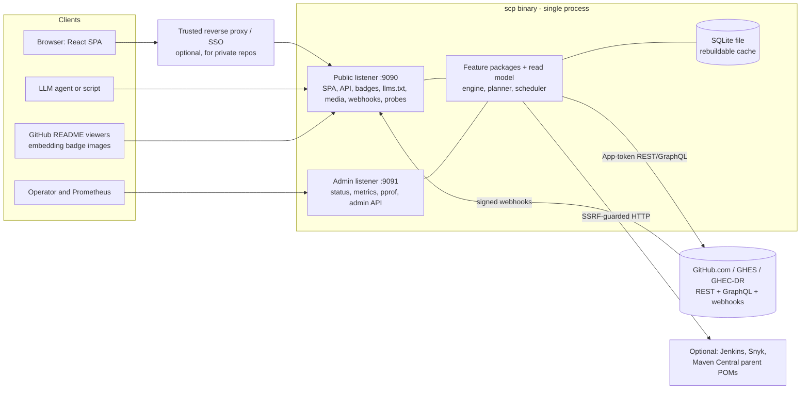
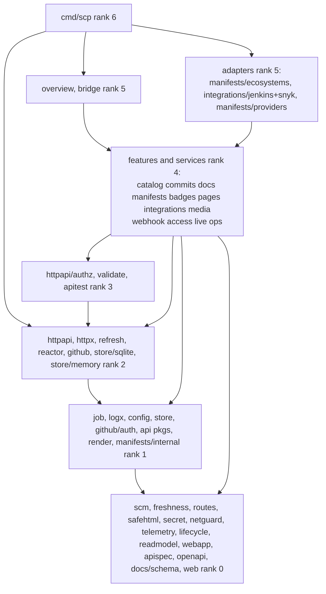
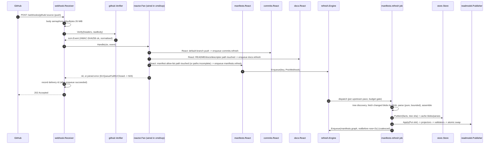
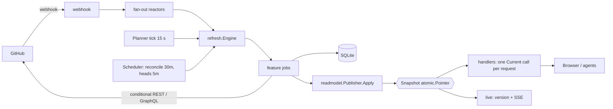
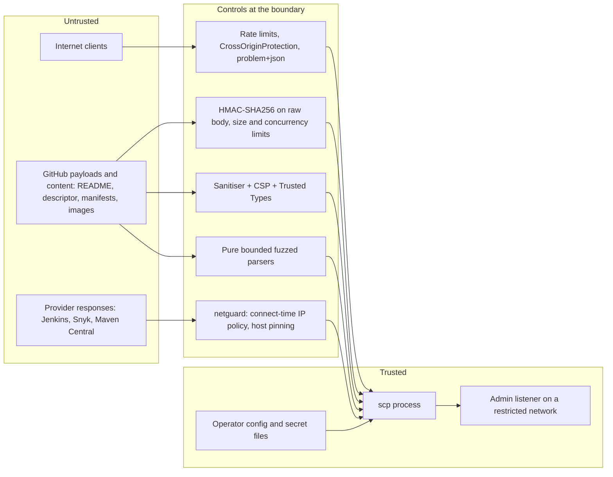
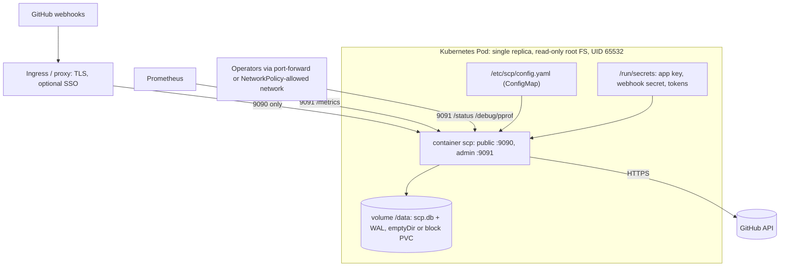

# 10 - Architecture of Source Code Portal (SCP)

Status: proposed for sign-off by the owner; conforms to `04-decisions.md` (binding). Every place this document refines or changes a decision of 04 is listed in `04-decisions.md` section 7 "Amendments from research" with the ADR that carries the evidence. Date of this document: 2026-10-14 (revision 2 after the Go-idiom review and a requirements traceability check, revision 3 after the cross-design consistency review; see the Revision log at the end and `30-verification/`). Research inputs: `05-research/01..09` (dated 2026-10-13). Decision records: `11-adr/ADR-001..ADR-025`.

How to read this document: sections 1-7 are the shape (what exists and who may talk to whom); section 8 is the contract (Go signatures); sections 9-12 are state, runtime and the web surface; 13-14 cover manifests (D-15) and docs/LLM; 15-19 are the cross-cutting models (errors, config, security, observability, deployment); 20-21 are the traceability tables (design guardrails and features); 22-23 are build/CI and the open risks. Diagrams are Mermaid with a plain-text fallback directly beneath each.

---

## 0. Verification log (facts re-checked at architecture time)

The research reports were produced on 2026-10-13. For the facts the architecture depends on most I re-fetched the primary source on 2026-10-14 (WebFetch). Everything else is taken from the research reports as dated there and is marked "per 05-research/NN" where it matters.

| # | Fact the design depends on | Result on 2026-10-14 | Source |
|---|---|---|---|
| V1 | Go toolchain: 1.27.2 is current; 1.26.9 is the other supported line | Confirmed: go1.27.2 released 2026-10-08, go1.26.9 released 2026-10-08, go1.27.0 on 2026-08-19, go1.27.1 on 2026-09-01 | https://go.dev/doc/devel/release |
| V2 | oapi-codegen v2.8.0 has OpenAPI 3.1 support | Confirmed with the caveat the research already carried: "initial OpenAPI 3.1 support" (v2.8.0, 17 July), callbacks/webhooks, `type: [T, "null"]` nullability | https://github.com/oapi-codegen/oapi-codegen/releases |
| V3 | modernc.org/sqlite v1.60.1 bundles SQLite 3.53.4 | Confirmed: v1.60.1 published 2026-09-29, SQLite 3.53.4. The page warns a newer version exists (research saw v1.61.0 only in the CHANGELOG, not on the proxy); pin stays v1.60.1 until the proxy shows the next tag | https://pkg.go.dev/modernc.org/sqlite |
| V4 | GitHub synchronous SBOM export endpoint is removed | Confirmed: `GET /repos/{owner}/{repo}/dependency-graph/sbom` "will not be accessible after November 13, 2026"; replacement is the async generate/fetch pair. The page does not state which token types are accepted, so App-token support stays unverified (spike S-A) | https://docs.github.com/en/rest/dependency-graph/sboms |
| V5 | shadcn/ui uses Base UI by default | Confirmed: since July 2026 `shadcn init` pre-selects Base UI; Radix is "not being deprecated" and is selected with `-b radix`. New fact since the research: the September 2026 changelog moved `cn` into a standalone `cn` package (components import `cn` from it instead of `@/lib/utils`) | https://ui.shadcn.com/docs/changelog |
| V6 | GitHub App installation REST budget | Confirmed: minimum 5,000/h; +50/h per repository above 20; +50/h per organisation user above 20; hard cap 12,500/h; GHEC installations 15,000/h. The page does not say whether 304 responses are free (the research cites the conditional-requests page for that) | https://docs.github.com/en/rest/using-the-rest-api/rate-limits-for-the-rest-api |
| V7 | React and TanStack Router current majors | `react` latest 19.3.0 and `@tanstack/react-router` latest 1.170.44 on the npm registry | https://registry.npmjs.org/react/latest, https://registry.npmjs.org/@tanstack/react-router/latest |

| V8 | oapi-codegen v2.8.0 std-http output: `ServeMux` interface is `HandleFunc(pattern, handler)` **plus `http.Handler`**; routes are registered as `m.HandleFunc(http.MethodGet+" "+options.BaseURL+"/path", ...)` | Confirmed on the **v2.8.0 tag** (the Go review had seen only `main`) | https://raw.githubusercontent.com/oapi-codegen/oapi-codegen/v2.8.0/internal/test/servers/routers/smoke/std-http/out.gen.go |
| V9 | Go 1.26 ServeMux redirects | Only **trailing-slash** redirects changed to 307 (from 301); nothing is said about `//` path cleaning, so ADR-014's "`//` redirects with 307" claim is removed | https://go.dev/doc/go1.26 |
| V10 | `VACUUM INTO` on a `PRAGMA query_only=1` connection | **Fails** with "attempt to write a readonly database"; it **works** on a connection opened read-only (`file:...?mode=ro`, `sqlite3 -readonly`). Local test with SQLite 3.54.0 on 2026-10-14. Whether the modernc driver accepts `mode=ro` URIs is unverified (M0 spike) | local run; https://www.sqlite.org/lang_vacuum.html |
| V11 | `golang.org/x/text/encoding/charmap` exports `ISO8859_1` and `Windows1252` | Confirmed; module version shown v0.43.0, 2026-10-09 (a newer one exists; pin at implementation) | https://pkg.go.dev/golang.org/x/text/encoding/charmap |
| V12 | OpenTelemetry `go.opentelemetry.io/otel/metric` is the API module, separate from `otel/sdk/metric` | Confirmed, v1.47.0 (2026-10-02) | https://pkg.go.dev/go.opentelemetry.io/otel/metric |
| V13 | GitHub push webhook payload: per-commit `added/removed/modified` and `head_commit.tree_id` | **Not documented** on the webhook-events page (it states only the 2,048-commit cap and the 25 MB limit); the octokit example fetched had an empty `commits`. **Unverified**: the manifests reactor treats absent lists as `PathsComplete=false` (section 13.5) and a recorded real delivery is an M0 fixture task | https://docs.github.com/en/webhooks/webhook-events-and-payloads |
| V14 | Stack Overflow 2026 survey figures quoted in ADR-019 | **Not found** by search (only 2025 results, sources disagree on attribution); the exact percentages are removed from ADR-019 | WebSearch 2026-10-14 |
| V15 | `golang.org/x/sync/singleflight` `Do/DoChan` take no context and give duplicate callers the same result | Confirmed by the Go review (pkg.go.dev, 2026-10-14) and by the API signature | https://pkg.go.dev/golang.org/x/sync/singleflight |
| V16 | Prototype defects behind findings F-05 and F-08 | **Confirmed by reading the prototype**: `engine.go finish()` holds `e.mu` (`defer Unlock`) while calling `e.OnParked`; `readmodel.Put` sets `b.members = true` when the repository is absent | `05-research/05-store-sync-engine.assets/{engine,readmodel}` |

Not re-verified today and therefore carried as "per research, 2026-10-13": Vite 8 / Tailwind 4.3 / TypeScript 7 pins, goldmark v1.8.6 / chroma v2.27.0 / bluemonday v1.0.27, OpenTelemetry v1.47.0, the distroless digest, GraphQL cost figures, deps.dev limits, the ETag-credential coupling. The unverified items of each research report remain unverified; section 23 lists the ones that block a decision.

---

## 1. Goals and non-goals

### 1.1 Goals

1. A single static Go binary (`CGO_ENABLED=0`) that serves an organisational dashboard of GitHub repositories grouped into systems: latest commits, documentation, badges, dependency intelligence; kept fresh by scheduled sync plus webhooks (04 section 2).
2. API-first (D-16): a versioned OpenAPI 3.1 contract is the source of truth; the React + shadcn/ui + TypeScript SPA under `web/` is one consumer; LLM agents and scripts are the other. The SPA is embedded into the binary at build time.
3. Package by feature with a mechanically enforced dependency rule (D-01, principle 2). A feature never imports another feature; it reads other features' data through the immutable snapshot and kernel types, and reacts to other parts of the system through consumer-defined interfaces, registered jobs and normalised events.
4. Failure is a first-class state (principle 7): every fetched item carries freshness; serving continues from the last good snapshot when GitHub or the store misbehaves; readiness is defined and never regresses on upstream trouble.
5. Correct by construction: typed ids, typed errors, `Secret`, `SafeHTML`, immutable snapshots, validated strict config, a closed-world import test, route table verified at startup.
6. Operable by one person: one process, one SQLite file that is a rebuildable cache, two listeners (public and admin), structured logs, Prometheus metrics, `scp doctor`.
7. Hostile-input safe: README, descriptor, manifests and webhook bodies are untrusted; every parser is pure, bounded and fuzzed; no build tool or repository code is ever executed.
8. First-class manifest intelligence (D-15): per-repository technology and dependency facts, an org-wide internal dependency graph with reverse index, version spread and licence views, in the UI, the JSON API and the LLM outputs.

### 1.2 Non-goals (v1)

- Multi-replica operation or leader election (Q-10). The `Store` contract does not preclude it; nothing is built for it.
- Providers other than GitHub (Q-12, GR-04). `scm` is a vocabulary, not a provider framework.
- Server-side rendering or prerendering of the SPA (D-16 default). Crawler and LLM surfaces are generated on the server separately.
- A local AsciiDoc engine (Q-06). `.adoc` documents are shown through GitHub-rendered HTML and marked as a bridged format.
- OIDC login inside SCP (Q-03). Private content requires the optional trusted-proxy identity mode.
- Vulnerability data, outdated-vs-registry data and licence enrichment from third parties in v1 (D-15: optional later providers; the interface exists, no provider ships by default).
- Executing build tools, scripts or repository code to learn dependencies (D-15, principle 6). Gradle scripts, `Package.swift`, `Gemfile` and similar are read lexically with a visible `heuristic` confidence.
- A general plug-in system. Extension points are in-process interfaces registered in `cmd/scp`.
- Storing durable user data. SCP has no user-generated state; everything in SQLite can be rebuilt from GitHub.
- Any health, echo or diagnostic endpoint beyond `/livez`, `/readyz` and the admin `/status` (Q-11, GR-17, GR-41).

---

## 2. System context



Plain-text fallback:

```
Browser (SPA) / LLM agent / README viewers --(HTTPS, optionally via trusted proxy/SSO)--> PUBLIC listener :9090
Operator / Prometheus ------------------------------------------------------------------> ADMIN  listener :9091
GitHub ---signed webhooks---> PUBLIC listener (POST /webhooks/github[/{source}])
scp process = { public listener, admin listener, feature packages, read model (atomic snapshot),
                refresh engine + planner + scheduler, SQLite store (cache) }
scp --(GitHub App token, REST + GraphQL, conditional requests)--> GitHub
scp --(SSRF-guarded, allow-listed)--> optional Jenkins / Snyk / Maven Central
```

Trust boundaries (detailed in section 17): browser to public listener; GitHub to webhook endpoint (HMAC); repository content to sanitiser and parsers (untrusted bytes); operator config and secrets (trusted); admin listener (network-restricted); optional trusted proxy identity.

Data direction in one sentence: GitHub (and optional providers) feed **jobs**; jobs write **SQLite** (last good state) and publish **immutable snapshots**; handlers only read the **current snapshot**; nothing on a request path talks to GitHub or the database.

---

## 3. Decision summary (each row has an ADR)

| Topic | Decision | ADR |
|---|---|---|
| Layout and dependency rule | Layout A: kernel (`scm`, `freshness`, `job`, `routes`, `safehtml`) + platform + infrastructure + features; consumer-defined interfaces; features never import features; composition root in `cmd/scp`; closed-world archtest | 001, 018 |
| Cross-feature communication | Snapshot slots with kernel value types, consumer interfaces (direct or bridged in `cmd/scp`), job `Spec` registration, normalised `scm.Event` reactors fanned out by `reactor.Fan` | 024 |
| Read model and store | `readmodel` (typed slots, atomic swap, coalescing change feed) separate from `store` (SQLite, `modernc.org/sqlite` v1.60.1, WAL, own migrations) | 002 |
| Sync engine | Built in-house, package `refresh`: keyed coalescing queue, per-upstream pacing, level-triggered planner, scheduler, budget gate; tested with `testing/synctest` | 003 |
| GitHub integration | Own thin client, App-first, `TokenSource` strategies, REST baseline + GraphQL bulk sweep behind the same interfaces, content SHAs as validators | 004 |
| Rendering pipeline | goldmark v1.8.6 -> AST rewrite -> chroma classes -> `x/net/html` pass -> `safehtml.Sanitize` (bluemonday, the only `SafeHTML` constructor) | 005 |
| Doc format | CommonMark + GFM profile, `scp.yaml` descriptor (JSON Schema 2020-12, lenient), Backstage vocabulary as fallback input | 006 |
| LLM surface | `/llms.txt` v2 scoped files, `llms-full.txt` convention, raw `.md` with `scp:` front matter, `Accept: text/markdown`, JSON API with provenance | 007 |
| Templates | No server-side page templates; SVG badges built with `encoding/xml`, plain-text outputs with `text/template`, `html/template` only for the static fallback page | 008 |
| Live updates | Snapshot-version polling with ETag is the v1 baseline; SSE invalidation channel specified, shutdown-aware, v1.1 | 009 |
| SPA hosting | Embed behind build tag `spa`, history fallback only for extensionless GET/HEAD outside reserved prefixes, precompressed assets, static CSP with Trusted Types | 010 |
| Badges | Own flat-square SVG renderer, DejaVu-derived width table, AA palette | 011 |
| Config | One strict YAML, `SCP_` env overlay, `*_FILE` secrets, root struct composed from feature-owned `Config`s, generated JSON Schema, consumption test | 012 |
| Observability | `slog` JSON, OpenTelemetry traces/metrics/logs, Prometheus on admin | 013 |
| HTTP | `net/http` ServeMux, two listeners, ordered middleware, `routes.Table` verified at startup, three route classes | 014 |
| Resilience | One client/breaker/limiter per upstream, typed failures, full-jitter backoff, rate-limit pause, stale-while-error | 015 |
| Tests | synctest, fake GitHub with fault injection, storetest conformance, golden, fuzz, goleak, e2e `run()` test | 016 |
| Delivery | `CGO_ENABLED=0`, distroless static debian13 nonroot by digest, GoReleaser, Renovate | 017 |
| Frontend | React 19.3 + shadcn/ui (Base UI) + TypeScript, Svelte 5 recorded as the considered alternative | 019 |
| API contract | OpenAPI 3.1 spec-first per feature, oapi-codegen strict servers, kin-openapi request validation, openapi-typescript client, Schemathesis + oasdiff | 020 |
| Manifests | Own pure parsers behind a registry, purl identity with own normaliser, adopt leaf libraries, scalibr as oracle only | 021 |
| Manifests graph | Blob-SHA acquisition, interned immutable graph, debounced recompute job, push-path routing | 022 |
| Identity and visibility | Sources, slugs, visibility policy, trusted-proxy access | 023 |
| Security model | Trust zones, SSRF guard, CSRF posture, rate limits | 025 |

---

## 4. Package map

Module path assumption: `github.com/cantara/source-code-portal` (04 D-01). Go 1.27.2 (`go 1.27.2` in `go.mod`).

### 4.1 Kernel (vocabulary; no behaviour beyond small pure helpers)

| Package | One-sentence responsibility |
|---|---|
| `internal/scm` | Normalised, provider-neutral value types (repository, commit, immutable tree, blob, release, event, page, validators/result) and the portal identity of a repository (`Slug`, `GroupID`, `GroupMeta`, `Membership`, `ViewClass`) that at least three features read. Split point in ADR-001. |
| `internal/freshness` | The status/age vocabulary: stored `State`, derived `Status`, `Policy`, `Info`, and the generic `Value[T]` wrapper carried by every fetched item. |
| `internal/job` | The contract between features and the sync engine: `Key`, `Priority`, `Spec` (with `Timeout`), `Outcome`, `Enqueuer`, the `ErrQueueFull`/`ErrClosed` sentinels and behaviour-interface error classification (`RateLimited`, `Permanent`, `Gone`). It knows nothing about events. |
| `internal/routes` | The single route table (names, methods, patterns, route class, **including the API routes**), the recording mux that registers handlers by name, plus URL builders for every server-answered URL; stdlib only. |
| `internal/safehtml` | The `SafeHTML` type and the bluemonday-based `Sanitize`, its **only** constructor (rank 0, so `pages`, `docs` and `render` can all name the type). |

### 4.2 Platform (cross-cutting infrastructure, no domain knowledge)

| Package | Responsibility |
|---|---|
| `internal/platform/secret` | The redacting `Secret` type and secret-file loading. |
| `internal/platform/logx` | `slog` handlers, context-carried attributes (request id, delivery id, job key). |
| `internal/platform/config` | Strict layered configuration machinery: embedded default, file, `SCP_` env, `*_FILE`, flags; JSON Schema generation; lint. |
| `internal/platform/telemetry` | OpenTelemetry SDK, Prometheus exporter and OTLP wiring; the only package allowed to import the OTel SDK. |
| `internal/platform/httpx` | `NewServer` (the only constructor of `*http.Server`), middleware chain, client-IP resolution, keyed rate limiter. |
| `internal/platform/netguard` | SSRF-guarded dialers and `http.Client` constructors (`code.dny.dev/ssrf`), per-integration allow-lists. |
| `internal/platform/lifecycle` | `Run(ctx, Plan)`: ordered stages, each with its own context and stop deadline (section 8.16); readiness flip, drain, reverse-order shutdown. |

### 4.3 Infrastructure

| Package | Responsibility |
|---|---|
| `internal/readmodel` | The feature-agnostic immutable snapshot: typed slots, builder, projectors, validators, atomic publisher, coalescing change feed. |
| `internal/store` | The `Store` contract and record types (items, commits, tasks, parked keys, generic cache). |
| `internal/store/sqlite` | The SQLite implementation (modernc driver, WAL, own migration runner, quarantine and backup). |
| `internal/store/memory` | An in-memory `Store` for unit and synctest bubble tests. |
| `internal/store/storetest` | The conformance suite run against every `Store` implementation. |
| `internal/refresh` | The sync engine: keyed coalescing queue, per-upstream dispatch, level-triggered planner, jittered scheduler, budget gate, shutdown grace. |
| `internal/github` | The GitHub adapter: HTTP client, REST + GraphQL readers, rate state, installation registry, webhook verify/decode, typed errors, `doctor`. |
| `internal/github/auth` | `TokenSource` strategies: GitHub App (JWT + installation tokens), PAT, OAuth user token, external command, anonymous. |
| `internal/github/githubtest` | The fake GitHub server with fault injection, used by tests, e2e and local dev. |
| `internal/gitsource` | Optional `git` acquisition mode (D-17); specified in section 8.15 (git binary, hardened environment), implemented at the post-v1 milestone; its matrix row is flagged `planned` until then. |
| `internal/reactor` | `reactor.Func` and `reactor.Fan`: the synchronous fan-out of one `scm.Event` to every feature's reaction function (rank 2; the only package besides `github` and the features that knows both `job` and `scm`). |
| `internal/httpapi` | Problem details, cursor pagination, ETag/conditional helpers, `Static`, `Negotiate`, the `Mux`/`Mounter` types. Imports no kin-openapi, no `httpx`, no `readmodel`. |
| `internal/httpapi/authz` | `Principal`, `Authorizer`, `ClassOf`, `LookupRepo` (visibility is a security control, section 17.3). |
| `internal/httpapi/validate` | kin-openapi request validation middleware and `ProblemMux`; imported only by `cmd/scp`. |
| `internal/httpapi/openapi` | Generated shared OpenAPI types (`Problem`, `Freshness`, `PageInfo`, parameters), from `common.yaml`. |
| `internal/httpapi/apitest` | Test helper: response validation against the bundled spec (imported from `_test.go` only). |
| `internal/apispec` | Embeds the bundled public and admin OpenAPI documents served at `/api/v1/openapi.yaml` (renamed from `spec`, which said nothing). |
| `internal/webapp` | Embedded SPA hosting: static files, history fallback, precompression negotiation, CSP and security headers, `routes.json` shape check. |
| `web/` (Go package `web`, files `embed_*.go` only) | Build-tag-selected `embed.FS` of `web/dist` or of a tiny placeholder; rank 0, imported only by `cmd/scp` (it sits outside `internal/` because `go:embed` cannot reach `web/dist` from elsewhere). |

### 4.4 Features and feature-like services

| Package | Responsibility |
|---|---|
| `internal/catalog` | Sources, groups, matchers, repository reconcile and head/stats sweep, default repo, membership index, slug aliases, visibility policy, config validation used by `config lint`. |
| `internal/commits` | Commit ingestion, bounded retention, latest-N and per-group projections, commit API. |
| `internal/docs` | README and docs ingestion, descriptor loading, rendering orchestration, AsciiDoc bridge (GitHub-rendered HTML), raw Markdown handlers, doc API. |
| `internal/docs/schema` | Embedded JSON Schemas (`scp-v1.json`, front matter) served at `/schemas/scp/*` (rank 0, `embed` only). |
| `internal/docs/internal/render` | The private Markdown pipeline (goldmark, rewrite, chroma, `x/net/html` pass); its last step calls `safehtml.Sanitize`. It never builds a `SafeHTML` itself. |
| `internal/manifests` | N-01: parser/assembler registry and model, acquisition and refresh jobs, org graph and reverse index, manifests API, LLM/CycloneDX outputs. |
| `internal/manifests/ecosystems/{golang,npm,python,maven,gradle,cargo,nuget,ruby,php,swift,cocoapods,dart,elixir,docker,actions,terraform,helm}` | One pure `Parser` (and optional `Assembler`) per ecosystem, each importing only the `manifests` root. |
| `internal/manifests/internal/{purl,version,limits}` | Private purl normaliser, version-system wrappers, parse limits and watchdog. |
| `internal/manifests/providers/{githubgraph,sbom,depsdev}` | Optional secondary providers (post-v1 milestones P5/P6); the `DependencySource` interface is defined together with the first provider, not before. |
| `internal/manifests/parsertest` | Test helper: golden runner, fuzz harness, shared invariants (imported from `_test.go` only). |
| `internal/badges` | Local flat-square SVG rendering, badge kinds, cache headers, unknown state. |
| `internal/integrations` | `StatusProvider` contract, targets, refresh job, status slot; `integrations/jenkins` and `integrations/snyk` are the optional providers. |
| `internal/pages` | Config-driven Markdown pages and the optional announcement. |
| `internal/media` | The image proxy and signed-URL minting; SSRF-guarded fetch of external README images; repo-relative image serving. |
| `internal/webhook` | Receiver: size limit, signature verification via a `Verifier`, bounded in-memory delivery de-duplication after enqueue, 202/400/401/503 mapping, and the optional `webhook.redelivery` job. |
| `internal/access` | Optional trusted-proxy identity: identity headers honoured only from trusted peers; implements `httpapi.Authorizer`. |
| `internal/live` | `GET /api/v1/snapshot` and the SSE invalidation stream; owns shutdown-aware long-lived handlers. |
| `internal/ops` | `/livez`, `/readyz`, `/status`, `/metrics`, pprof, admin actions; readiness gates and dependency freshness. |
| `internal/overview` | Cross-feature **read composition** and nothing else: site info, composite repo resource, `llms.txt` family, sitemap, robots, negotiated Markdown for human URLs, slug-alias redirects. No state, no jobs, no store, no upstream, no bridges (those live in `cmd/scp/internal/bridge`). Exit condition in ADR-001. |

### 4.5 Edges

| Package | Responsibility |
|---|---|
| `cmd/scp` | Composition root and CLI (`serve`, `config lint|schema`, `descriptor lint`, `doctor`, `github app manifest`, `store check|restore`, `version`). Also holds `assert.go`: compile-time assertions that every adapter satisfies every consumer interface (`var _ commits.CommitLister = (*github.Client)(nil)`). |
| `cmd/scp/internal/bridge` | The bridges: small types implementing one consumer's interface over another feature's snapshot data (`BadgeFacts`, `PlanSink`, `Tracker`, `Retrier`, `InstallationStatus`) and over `refresh` (enqueuer). Wiring code, not a feature; importable by `cmd/scp` only. |
| `tools/` | A separate nested Go module (`tools/go.mod`: oapi-codegen, govulncheck, ...) so tool dependencies never influence the product's module graph; not part of `go list ./...` of the main module. |
| `cmd/fakegithub` | Dev and e2e tool: serves the fake GitHub from fixtures. |
| `internal/archtest` | Test-only closed-world import-boundary test. |
| `web/` (TypeScript) | The React SPA, feature-sliced like the backend (section 12). |

---

## 5. Dependency rule

### 5.1 The rule in words

1. Dependencies point downward by rank (table below). Equal rank never imports equal rank. (The earlier exception "a feature root importing its own subpackages" was never exercised: subpackages are rank 0, 1 or 5, never 4, and is deleted.) Test-helper packages (`githubtest`, `storetest`, `apitest`, `parsertest`) are imported from `_test.go` files only and are exempt from the rank comparison in that direction.
2. A feature (`catalog docs commits badges manifests pages integrations media`) and a service (`webhook access ops live`) imports only the packages in its row of 5.2: the kernel, `readmodel`, `store`, `httpapi`, `httpapi/authz`, `platform/secret`, `platform/logx`, its own `<feature>api` and `internal` subpackages, and the third-party libraries it owns. It never imports another feature, an adapter (`github`, `gitsource`, `store/sqlite`, `store/memory`), `refresh`, `reactor`, `overview`, `webapp`, `httpapi/validate`, `platform/{config,telemetry,httpx,netguard,lifecycle}`.
3. Adapters (`github`, `store/sqlite`, `integrations/jenkins|snyk`, `manifests/ecosystems/*`, `manifests/providers/*`) know only the kernel and the root of the feature they extend. They never import another adapter's package.
4. `refresh` knows `job`, `freshness`, `platform/logx`. It does not know `scm`, features, adapters or `reactor` (keys are strings). `reactor` is the only package that knows both `job` and `scm`.
5. `overview` is the only non-main, non-bridge package that may import several feature roots; it is imported only by `cmd/scp`. `cmd/scp/internal/bridge` may also import feature roots; it is wiring and is imported only by `cmd/scp`.
6. `cmd/scp` is the only package that imports everything. It alone may import `store/sqlite`, call `os.Getenv`, `os.Exit`, `signal.NotifyContext`, `slog.SetDefault`, the global OpenTelemetry accessors, and construct `http.Server`s (through `httpx`).
7. **Consumer-defined interfaces.** A consumer interface that an adapter satisfies **directly** (structurally, no glue) uses only stdlib and kernel types in its signatures, so the adapter never imports the consumer. Where a consumer needs its own presentation or view types (for example `ops.InstallationStatus`, `catalog.Tracker`), it is satisfied by a **bridge** in `cmd/scp/internal/bridge`, which may import both sides. Section 8.7 marks every interface "direct" or "bridged", and `cmd/scp/assert.go` asserts each at compile time. Two consumers that need the same adapter method must declare the **same** signature using kernel types (for example `scm.TreeOptions`), and a method name may mean one signature only (Go has no overloading), which is why the media reader is called `ReadRepoImage` and not `ReadFile`.

### 5.2 Rank table and exact allowed-import matrix

"Internal" means packages of this module. Standard library imports are unrestricted except by the global rules in 5.3. A package may import exactly the internal packages in its row, nothing else. Shorthand: **K4** = `scm`, `freshness`, `job`, `routes`, `readmodel`, `store`, `httpapi`, `httpapi/authz`, `platform/secret`, `platform/logx`. Third-party column "otel API" means the OpenTelemetry **API** modules `go.opentelemetry.io/otel/{metric,trace,attribute,codes}` (never the SDK, never the root package with its global accessors; rule G11).

| Rank | Package | May import (internal) | Notable third-party (only here) |
|---|---|---|---|
| 0 | `scm` | none | none |
| 0 | `freshness` | none | none |
| 0 | `routes` | none | none (stdlib `net/http` only) |
| 0 | `safehtml` | none | `microcosm-cc/bluemonday` |
| 0 | `platform/secret` | none | none |
| 0 | `platform/netguard` | none | `code.dny.dev/ssrf` |
| 0 | `platform/telemetry` | none | OTel SDK, Prometheus exporter |
| 0 | `platform/lifecycle` | none | none |
| 0 | `readmodel` | none | otel API |
| 0 | `webapp` | none (reserved prefixes arrive through `Options`) | none (brotli fallback `andybalholm/brotli` only if precompression is unavailable) |
| 0 | `apispec` | none | none |
| 0 | `httpapi/openapi` (generated) | none | `oapi-codegen/runtime` |
| 0 | `docs/schema` | none | none (`embed` only) |
| 0 | `web` | none | none (`embed` only; imported by `cmd/scp` only) |
| 1 | `job` | `freshness` | none |
| 1 | `platform/logx` | `platform/secret` | otel API (trace, for `trace_id`) |
| 1 | `platform/config` | `platform/secret` | `go.yaml.in/yaml/v3`, `caarlos0/env/v11`, `invopop/jsonschema`, `santhosh-tekuri/jsonschema/v6` |
| 1 | `store` | `freshness`, `scm` | none |
| 1 | `github/auth` | `scm`, `platform/secret` | `golang-jwt/jwt/v5` |
| 1 | `github/githubtest` | `scm` | none |
| 1 | `<feature>/<feature>api` (generated, e.g. `commitsapi`) | `httpapi/openapi` | none |
| 1 | `docs/internal/render` | `scm`, `freshness`, `platform/secret`, `safehtml` | goldmark, chroma/v2, `x/net/html` |
| 1 | `manifests/internal/{purl,version,limits}` | none | `packageurl-go`, `deps.dev/util/semver` |
| 2 | `platform/httpx` | `platform/logx` | `x/time/rate`, otelhttp |
| 2 | `refresh` | `job`, `freshness`, `platform/logx` | `x/sync`, `x/time/rate`, otel API |
| 2 | `reactor` | `job`, `scm`, `platform/logx` | none |
| 2 | `store/sqlite` | `store`, `freshness` | `modernc.org/sqlite`, `modernc.org/libc`, otel API |
| 2 | `store/memory` | `store`, `freshness` | none |
| 2 | `store/storetest` | `store`, `freshness` | none (imported from `_test.go` only) |
| 2 | `github` | `scm`, `freshness`, `platform/secret`, `platform/logx`, `platform/netguard`, `github/auth` | breaker (`sony/gobreaker/v2`), backoff (`cenkalti/backoff/v7`), otelhttp, otel API |
| 2 | `gitsource` (`planned`, post-v1) | same as `github` | none (runs the `git` binary through `os/exec`, the only package besides `cmd/scp` allowed to) |
| 2 | `httpapi` | `routes`, `platform/logx`, `httpapi/openapi` | none |
| 3 | `httpapi/authz` | `scm`, `freshness`, `readmodel`, `httpapi`, `platform/logx` | none |
| 3 | `httpapi/validate` | `httpapi`, `httpapi/openapi`, `platform/logx` | kin-openapi, `oapi-codegen/nethttp-middleware` |
| 3 | `httpapi/apitest` | `httpapi`, `httpapi/openapi`, `apispec` | kin-openapi (imported from `_test.go` only) |
| 4 | `catalog` | K4, `catalog/catalogapi` | otel API |
| 4 | `commits` | K4, `commits/commitsapi` | otel API |
| 4 | `docs` | K4, `docs/docsapi`, `docs/internal/render`, `docs/schema`, `safehtml` | `santhosh-tekuri/jsonschema/v6`, `go.yaml.in/yaml/v3`, otel API |
| 4 | `manifests` | K4, `manifests/manifestsapi`, `manifests/internal/*` | `cyclonedx-go` at the export boundary, otel API (`golang.org/x/mod` is used by the golang ecosystem subpackage, not the root) |
| 4 | `badges` | K4 (no api package: server-only SVG routes) | otel API (width table is generated source; SVG built with `encoding/xml`) |
| 4 | `pages` | K4, `pages/pagesapi`, `safehtml` | otel API (Markdown arrives through an injected `Renderer` interface returning `safehtml.SafeHTML`) |
| 4 | `integrations` | K4 (no api package: statuses are served inside the `overview` composite) | otel API |
| 4 | `media` | K4 (no api package: image routes are server-only) | otel API (HTTP client injected) |
| 4 | `webhook` | `scm`, `job`, `httpapi`, `platform/logx` | otel API |
| 4 | `access` | `scm`, `httpapi`, `httpapi/authz`, `platform/logx` | none |
| 4 | `live` | `readmodel`, `httpapi`, `platform/logx`, `live/liveapi` | none |
| 4 | `ops` | `freshness`, `readmodel`, `httpapi`, `httpapi/authz`, `platform/logx`, `ops/opsapi` | Prometheus handler, otel API |
| 5 | `overview` | `scm`, `freshness`, `routes`, `readmodel`, `httpapi`, `httpapi/authz`, `platform/logx`, `overview/overviewapi`, and the **roots** of `catalog commits docs manifests badges pages integrations` | otel API |
| 5 | `cmd/scp/internal/bridge` | `scm`, `freshness`, `job`, `store`, `readmodel`, `refresh`, and the **roots** of every feature and service | none |
| 5 | `integrations/jenkins`, `integrations/snyk` | `integrations`, `scm`, `freshness`, `platform/secret` | none |
| 5 | `manifests/ecosystems/*` | `manifests`, `manifests/internal/*` (own tree only) | per ecosystem: `x/mod`, `go-toml/v2`, `hcl/v2` (terraform), `x/text/encoding/charmap` (maven, nuget: XML declared encodings) |
| 5 | `manifests/providers/*` (post-v1) | `manifests`, `scm`, `freshness` | none |
| 5 | `manifests/parsertest` | `manifests`, `manifests/internal/*` | `go-cmp` (imported from `_test.go` only) |
| 6 | `cmd/scp` | every package | everything |
| 6 | `cmd/fakegithub` | `github/githubtest`, `scm` | none |
| test | `internal/archtest` | none (reads `go list` output) | none |

**Matrix additions accepted by the cross-design review (revision 3, A-30; read with the rows above):**

| Package | Added import (internal or third-party) | Reason (unit, id) |
|---|---|---|
| `github`, `github/auth` | `golang.org/x/sync/singleflight` (both), `golang.org/x/time/rate` (`github`); no `golang-jwt`: the App JWT is signed by an own 25-line encoder over `crypto.Signer`; `cenkalti/backoff` dropped from the `github` row | 05 D-1, D-2 |
| `cmd/scp/internal/bridge` | `github`, `reactor`, `store` | 05 D-3, 16 D-9 |
| `commits`, `manifests`, `overview` | `httpapi/openapi` (rank 0, generated shared schemas only) | 11 D-1, 15 D15-11, 07 Q-15 |
| `docs/internal/render` | `go.yaml.in/yaml/v3` (front matter, owner row) | 10 D-16 |
| `platform/httpx`, `platform/access` | `platform/secret`; otel API modules | 02 D1/D14, 14 D-1 |
| `manifests`, `manifests/internal/limits` | `golang.org/x/sync` (`errgroup` in the root, `semaphore` in `limits`); `x/text/encoding/charmap` moves from the maven and nuget ecosystem rows to `limits` | 11 D-2, D-3 |
| `internal/archtest` | reads `ghverify` and `crosscheck` as test-only helpers; `_test.go` of `live`, `ops`, `overview` may import the Prometheus exporter libraries (G6 `Owned.TestOK`) | 15, 16 D-9 |
| `cmd/fakegithub` | exempt from the `forbidigo` rules for `os.Exit`, `signal.NotifyContext`, `http.Server`, `os.Args` | 05 D-11 |

Route-literal allowance (CD-DM-03, open): `catalog`, `manifests`, `overview`, `httpapi/defaults` and `httpapi/apitest` hold path literals that the archtest route-literal rule flags; the rule must exempt files that build `routes.Table` rows (16 U-3). `webhook` does not import `freshness` (unit 04 withdrew D1).

`tools/` is a separate nested module (`tools/go.mod`) and is outside `go list ./...` of the main module. The kernel, platform and infrastructure packages that are not in a feature's row cannot be imported by it: for example no feature imports `platform/httpx` (it no longer arrives transitively through `httpapi`, which was the Go review's F-13 observation) and none links kin-openapi except through `cmd/scp` (`httpapi/validate`) and tests.

Test files: a `_test.go` may import what its package may import, plus its own package (black-box `x_test`), plus test-helper packages (`githubtest`, `storetest`, `httpapi/apitest`, `manifests/parsertest`) and test libraries. Feature tests never import adapters or other features (hand-written fakes named after behaviour). Only `cmd/scp` tests and the adapters' own tests may use `githubtest` against the real client.

### 5.3 Global rules (enforced by archtest, depguard, forbidigo, sloglint, gochecknoinits)

- G1 No import cycles (compiler); no package named `util common helper model models types api interfaces base`.
- G2 No `github.com/pkg/errors`; `math/rand/v2` only; no `log`, no `fmt.Print*` outside `cmd/scp`.
- G3 No `slog.Info/Default/SetDefault` outside `cmd/scp` (`sloglint no-global: all`, `context: all`).
- G4 No `http.DefaultClient`, `http.DefaultServeMux`, `http.Get/Post/Head/PostForm`, `http.ListenAndServe`, `http.Server{}` literals outside `platform/httpx` and `cmd/scp`.
- G5 No `init()` in this module's own non-generated code and no mutable package-level variables (sentinel errors, compiled regexps and the blank `var _ I = (*T)(nil)` assertions are logically constant). The SQLite driver registers itself in **its own** `init`; `store/sqlite` imports it blank. Third-party `init` side effects (OpenTelemetry, chroma lexers, the driver) are outside the rule, which is about code we write (reworded from A-18 after F-24: the earlier "exception for driver registration" was vacuous because `gochecknoinits` only checks this module).
- G6 Heavy libraries are owned: goldmark and chroma only in `docs/internal/render`; **bluemonday only in `safehtml`**; modernc sqlite only in `store/sqlite`; OTel SDK only in `platform/telemetry`; kin-openapi only in `httpapi/validate` and `httpapi/apitest`; provider SDKs only in their adapter; `os/exec` only in `gitsource` and `cmd/scp`.
- G7 Wire/DTO types (generated `<feature>api` packages) are not imported across packages: only the owning feature root and `cmd/scp` import a feature's `<feature>api` package.
- G8 `refresh` and `scm` never learn about each other: engine keys are strings, errors are classified by behaviour interfaces, events reach the engine only as `Enqueue` calls made by `reactor`-driven reaction functions.
- G9 `os.Getenv`, `os.Args`, `os.Exit`, `time.Now` for domain data decisions are not used in features: configuration arrives by constructor, time arrives as a value (`now time.Time`) or from the process clock inside synctest-friendly code paths (no `Clock` interface, ADR-003).
- G10 Every package that starts a goroutine exposes a blocking `Run(ctx) error` or returns when its context ends, and has `goleak` in `TestMain`.
- G11 **Telemetry injection (new).** Instrument creation and spans use the OpenTelemetry **API** modules only, through a `Meter` and `Tracer` handed to the constructor in the package's `Deps` struct by `cmd/scp` (which builds them from `platform/telemetry`). The global accessors (`otel.Meter`, `otel.Tracer`, `otel.GetMeterProvider`, `otel.SetTracerProvider`, ...) and the root package `go.opentelemetry.io/otel` are forbidden outside `cmd/scp` and `platform/telemetry` (`depguard`, `forbidigo`). Metric names are constants next to their instruments; a `cmd/scp` test boots every constructor with an in-memory reader and compares the emitted instrument names with the generated `docs/reference/metrics.md` (section 18.2), so the document and the code cannot drift.

### 5.4 Acyclicity proof

Define `rank(p)` as in the table. The proof has three parts.

1. **Every allowed edge strictly decreases rank.** Read each row: every internal import listed in a row has a rank smaller than the row's rank. Spot-verification of the non-obvious rows: `httpapi` (2) imports `routes`, `httpapi/openapi` (0) and `platform/logx` (1); `httpapi/authz` (3) imports `httpapi` (2), `readmodel`, `scm`, `freshness` (0), `platform/logx` (1); `store` (1) imports `scm`, `freshness` (0); `reactor` (2) imports `job` (1), `platform/logx` (1), `scm` (0); a feature root (4) imports `httpapi/authz` (3), `httpapi` (2), `store`, `job`, its own `<feature>api` and `internal` subpackages (1), and kernel/`readmodel`/`safehtml`/`platform/secret` (0) or `platform/logx` (1); `overview` and `bridge` (5) import feature roots (4); `manifests/ecosystems/*` (5) import `manifests` (4); `github` (2) imports `github/auth` (1), `platform/logx` (1) and rank-0 packages; `store/sqlite` (2) imports `store` (1); `refresh` (2) imports `job` (1), `platform/logx` (1), `freshness` (0); `cmd/scp` (6) imports everything of lower rank.
2. **A strictly decreasing relation has no cycle.** Suppose a cycle `p1 -> p2 -> ... -> p1`. Then `rank(p1) > rank(p2) > ... > rank(p1)`, a contradiction.
3. **Same-rank edges.** The matrix contains none, other than test helpers imported from `_test.go` (outside the proof: `_test.go` edges are checked against the row but cannot create a non-test cycle). The same-feature relations are directional by construction: a feature root imports its own `<feature>api` and `internal/*` (lower rank), and an adapter subpackage imports its feature root (feature root rank 4 < adapter rank 5). Neither direction is reversed anywhere: `<feature>api` and `internal/*` never import their root, and a feature root never imports its adapter subpackages (wiring in `cmd/scp` does).

The rank table is the input of `internal/archtest` (ADR-018 and section 22); the test fails if a package exists that has no row (closed world), if a row names a package that does not exist and is not flagged `planned` (tree versus table, both directions), if any import is not listed, and if the table itself contains an edge that does not decrease rank (the proof is executable). It was re-run against this revision's table by the reviser (script in the scratchpad, 0 cycles, 0 rank violations; see the Revision log).



Plain-text fallback:

```
cmd/scp (6) -> overview, bridge, adapters (5), everything below
overview, bridge and adapters (5) -> features/services (4)
features/services (4) -> httpapi/authz (3) -> httpapi, readmodel (2,0) -> logx (1) -> kernel (0)
features/services (4) -> httpapi, refresh-free infrastructure (2) -> store, job, api pkgs, render, manifests/internal (1) -> kernel (0)
github, refresh, reactor, store/sqlite, store/memory, httpx (2) -> store, job, logx, github/auth (1) -> kernel (0)
No arrow ever points up or sideways; therefore no cycle.
```

### 5.5 Tree versus table, and the signature check

Two cheap assertions complement the matrix and exist because the reviews found eight packages without rows and a consumer-interface set that no single type could implement: (1) `archtest` walks the directory tree (`go list` plus every directory containing `.go` files under `internal/`, `cmd/`, `web/`) and fails on any difference with the table, in both directions; (2) `cmd/scp/assert.go` holds one `var _ Iface = (*Adapter)(nil)` per direct consumer interface in section 8.7, so a signature that no adapter can satisfy is a compile error in the first CI run, not a design discovery.

---

## 6. How features communicate without importing each other

There are exactly four mechanisms. Anything else (a feature importing a feature, a shared "models" package, a global registry, a hidden callback) is a defect caught by archtest or review.

### 6.1 Mechanism A: the snapshot, with kernel value types

Features exchange **data** through the immutable read model (`readmodel.Snapshot`), never through calls. A slot is a typed handle created once in `cmd/scp` from a frozen `Registry`; the handle is passed by constructor to the writer feature and to every reader feature. Readers need the slot's value *type*, so cross-feature data uses kernel types wrapped in `freshness.Value[T]`:

| Slot / global | Type (kernel or owner) | Writer | Readers |
|---|---|---|---|
| `Repos` slot | `freshness.Value[scm.Repository]` | `catalog` | every feature, `overview`, `badges`, `webhook` router |
| `Stats` slot | `freshness.Value[scm.RepoStats]` (open issues, licence, latest release, HEAD sha, HEAD tree oid) | `catalog` | `badges`, `overview`, `commits`, `manifests` (change detection) |
| `Membership` global | `scm.Membership` (repo to groups, group to repos, default repo, ordered) | `catalog` | `commits` projector, `overview`, `manifests` rollups |
| `Commits` slot | `commits.View` (owner type) | `commits` | `overview` (via `commits` root import, rank 5 only), `badges` via bridge |
| `Latest` global | `scm.Classed[commits.Latest]` (public and all variants) | `commits` projector | `overview`, API (variant chosen by `authz.ClassOf`) |
| `Docs` slot | `docs.RepoDocs` | `docs` | `overview` |
| `Manifests` slot | `freshness.Value[manifests.RepoFacts]` | `manifests` | `overview` |
| `Graph` global | `scm.Classed[*manifests.Graph]` (immutable) | `manifests` graph job | `manifests` API, `overview` (dangling units skipped, 9.1) |
| `Status` slot | `integrations.Status` | `integrations` | `overview`, bridge to `badges` |
| `Pages` global | `pages.Set` | `pages` | `pages` API, `overview` (llms/sitemap) |

Rules: (1) a slot value is immutable once `Put`, and **`Put` takes ownership**: the producer builds the value, clones any slice or map it keeps using (`slices.Clone` at the producer boundary), and never touches it again; readers never mutate what they read (there is a `-race` property test with a mutating reader, section 22); (2) a handler calls `Current()` exactly once and passes the `*Snapshot` down explicitly; (3) long-lived goroutines (SSE) hold a `uint64` version, never a `*Snapshot`; (4) a type that more than one feature must read *without* importing its owner is promoted to the kernel (`scm.Repository`, `scm.RepoStats`, `scm.Membership`), otherwise it stays in its owner and only `overview` (rank 5) or a bridge reads it; (5) **globals that summarise many repositories are computed per `scm.ViewClass`** (public and all) whenever the deployment has private-visibility repositories, and a handler selects the variant from the principal (`authz.ClassOf`, section 17.3); in a public-only deployment there is exactly one variant.

### 6.2 Mechanism B: consumer-defined interfaces and bridges

The consumer declares the interface it needs, in its own package. Two satisfaction patterns, both stated per interface in section 8.7:

- **Direct.** The signature uses only stdlib and kernel types, so the adapter (`github`, `store/sqlite`) satisfies it structurally without importing the consumer; `cmd/scp/assert.go` proves it at compile time.
- **Bridged.** The consumer needs its own view types or reads another feature's data; the satisfier is a small type in `cmd/scp/internal/bridge`, which may import both sides.

Examples (full signatures in section 8.7):

- `commits.CommitLister` (consumer) is satisfied directly by `*github.Client`.
- `badges.Facts` (consumer: `Facts(s *readmodel.Snapshot, slug scm.Slug) (badges.RepoFacts, bool)`) is satisfied by `bridge.BadgeFacts`, which reads the `Repos`, `Stats`, `Commits`, `Manifests` and `Status` slots.
- `refresh.Gate` (consumer) is satisfied by `bridge.RateGate`, a 10-line adapter over `github.RateState`.
- `webhook.Verifier` (consumer) is satisfied directly by `*github.Verifier` (kernel types only).
- `ops.InstallationStatus` and `ops.Retrier` use `ops` view types or an engine, so they are bridged.

### 6.3 Mechanism C: job registration

A feature that needs background work exposes `Jobs() []job.Spec`. A `job.Spec` carries the kind, upstream name, freshness policy (TTL, jitter, idle back-off cap), priority class, scope (per repository or global) and a `Run(ctx, job.Key) (job.Outcome, error)` function. `cmd/scp` registers every spec with `refresh.Engine` and `refresh.Planner`. Features never import `refresh`; the engine never imports `scm` or a feature. The key is a plain string (`kind/source/owner/name`), parsed by the feature with `scm.ParseRepoKey`.

Both kinds of spec are registered the same way: per-repository kinds (`ScopeRepo`) and global kinds (`ScopeGlobal`, one key per kind such as `catalog.reconcile/_`). **Every upstream call runs inside the engine**, so pacing, the budget gate, the rate-limit pause, parking and panic accounting apply to the catalogue reconcile and the integration sweeps exactly as to per-repository jobs; the `Scheduler` only runs local housekeeping (section 8.6).

To enqueue work (for example from a reactor), a feature receives a `job.Enqueuer` (kernel interface, section 8.3); `*refresh.Engine` satisfies it directly.

### 6.4 Mechanism D: normalised events and reactors

Everything that can make data stale is expressed as an `scm.Event`: webhook deliveries (decoded by `github`), and the synthetic `EventHeadChanged` emitted by the catalog head sweep when a repository's HEAD or tree changed. A feature that reacts exposes `React(ctx, scm.Event, job.Enqueuer) error` (a plain method; it does not import `reactor`). `cmd/scp` converts the method values to `reactor.Func`, builds one `reactor.Fan` (`reactor.New(enq, log, reactors...)`), passes it to `webhook.Receiver` as its `Sink` and to `catalog` as its `EventSink` (both are the one-method interface `Handle(ctx, scm.Event) error`, which `*reactor.Fan` satisfies). A reactor inspects the event (default-branch push, changed paths that match its allow-list, forced push, 2,048-commit cap) and enqueues its own jobs with `PrioWebhook`.

Contract of a reactor (fixed after the Go review, F-02): it runs **synchronously on the webhook request goroutine** (GitHub's delivery deadline is 10 s), so it must be a cheap pure decision plus non-blocking `Enqueue` calls; it does no I/O, never retains the event's slices, and is safe for concurrent use (webhook goroutines, the catalog head sweep). A panic is recovered per reactor (counted, logged with the delivery id) and joined into the returned error. `Fan.Handle` returns the joined error; **only** `job.ErrQueueFull` and `job.ErrClosed` map to 503 (GitHub redelivers), any other reactor error is logged and the delivery is still answered 202 because events are hints. Events are accelerators: if one is lost the level-triggered planner repairs the item within its TTL (ADR-003).



Plain-text fallback of the sequence: GitHub POSTs a signed push to `webhook`; `webhook` bounds the body, asks `github.Verifier` to verify the HMAC over the raw bytes and decode to an `scm.Event`, hands it to the wired fan-out; each reactor decides locally (commits: default-branch push; docs: touched README/docs/descriptor paths; manifests: touched manifest allow-list paths, or incomplete path list) and enqueues keyed, coalescing jobs; an enqueue refused because the queue is full or closed makes the answer 503; otherwise `webhook` records the delivery id only after enqueue succeeded and answers 202; the engine later runs the jobs, which write SQLite and publish a new snapshot; the manifests job also enqueues the debounced graph job.

---

## 7. Repository directory tree

```
scp/
  go.mod  go.sum  .golangci.yml  .goreleaser.yaml  renovate.json  Makefile
  README.md  CHANGELOG.md  LICENSE  THIRD_PARTY.md  SECURITY.md
  AGENTS.md  llms.txt                         agent guidance for working on this repo (D-14)
  docs/                                       human docs: architecture/, adr/ (copy of 11-adr at release), operations/, authoring.md, reference/ (generated config and metrics reference)
  api/
    openapi.yaml                              public root: $refs path items of every feature fragment
    openapi.admin.yaml                        admin root: public + ops admin operations
  cmd/
    scp/
      main.go                                 package main: run() pattern, exit codes, signal.NotifyContext
      run.go                                  composition: config -> clients -> store -> readmodel -> features -> engine -> servers (lifecycle.Plan)
      config.go                               root Config struct composed of feature-owned Config types
      assert.go                               compile-time proof that every adapter satisfies every direct consumer interface (section 5.5)
      wire_store.go wire_github.go wire_readmodel.go wire_features.go
      wire_jobs.go wire_events.go wire_http.go wire_ops.go wire_telemetry.go
      cmd_serve.go cmd_config.go cmd_descriptor.go cmd_doctor.go cmd_github_app.go cmd_store.go cmd_version.go
      run_e2e_test.go                         boots run() against githubtest, waits for /readyz
      internal/bridge/                        BadgeFacts, PlanSink (batching), Tracker, RateGate, Retrier, InstallationStatus
    fakegithub/main.go                        dev/e2e fake GitHub server
  internal/
    scm/            repo.go commit.go tree.go event.go membership.go result.go key.go view.go
    freshness/      freshness.go value.go
    job/            key.go spec.go outcome.go enqueue.go errors.go classify.go
    routes/         table.go recorder.go public.go admin.go url.go
    safehtml/       safehtml.go policy.go
    platform/
      secret/       secret.go file.go
      logx/         handler.go ctx.go
      config/       load.go layer.go env.go schema.go lint.go
      telemetry/    otel.go prom.go
      httpx/        server.go middleware.go requestid.go clientip.go ratelimit.go securityheaders.go
      netguard/     guard.go client.go
      lifecycle/    run.go plan.go
    readmodel/      registry.go snapshot.go builder.go publisher.go            (changes.go arrives with SSE, v1.1)
    store/
      store.go record.go key.go
      sqlite/       open.go migrate.go items.go commits.go plans.go cache.go ops.go backup.go migrations/0001_init.sql
      memory/       memory.go
      storetest/    suite.go
    refresh/        engine.go dispatch.go backoff.go planner.go scheduler.go gate.go
    reactor/        fan.go
    github/
      client.go transport.go ratelimit.go rest_*.go graphql_*.go sweep.go tree.go blob.go
      installation.go webhook.go redelivery.go errors.go capabilities.go doctor.go appmanifest.go
      auth/         source.go app.go pat.go oauth.go external.go anonymous.go cache.go
      githubtest/   server.go fixtures.go fault.go
    gitsource/      (planned, post-v1; specified in section 8.15)
    httpapi/
      problem.go cursor.go etag.go mux.go envelope.go static.go negotiate.go
      authz/        principal.go lookup.go class.go
      validate/     validator.go problemmux.go
      openapi/      common.yaml oapi.yaml common.gen.go
      apitest/      contract helpers (response validation against the bundled spec)
    apispec/        embed.go openapi.bundled.yaml openapi.admin.bundled.yaml     (generated, committed)
    webapp/         handler.go fallback.go compress.go csp.go headers.go routesjson.go
    catalog/
      config.go matcher.go reconcile.go heads.go membership.go aliases.go visibility.go jobs.go react.go service.go handler.go
      catalogapi/   catalog.yaml oapi.yaml catalogapi.gen.go
    commits/        config.go ingest.go retention.go project.go merge.go jobs.go react.go handler.go commitsapi/
    docs/
      config.go descriptor.go discover.go jobs.go react.go service.go markdown_handler.go handler.go llm.go
      schema/       embed.go scp-v1.json frontmatter-v1.json   (embedded, served at /schemas/scp/*)
      internal/render/  parse.go frontmatter.go slug.go alerts.go rewrite.go highlight.go bridge.go
      docsapi/
    manifests/
      model.go registry.go assembler.go limits.go service.go jobs.go acquire.go react.go
      graph.go graph_build.go graph_algo.go handler.go llm.go cyclonedx.go
      internal/{purl,version,limits}/
      ecosystems/{golang,npm,python,maven,gradle,cargo,nuget,ruby,php,swift,cocoapods,dart,elixir,docker,actions,terraform,helm}/
      providers/{githubgraph,sbom,depsdev}/      (P5/P6)
      parsertest/   golden runner, fuzz harness, invariants
      manifestsapi/
    badges/         render.go widths.go widths_gen.go kinds.go handler.go
    integrations/   provider.go service.go jobs.go; jenkins/ snyk/
    pages/          config.go load.go handler.go pagesapi/
    media/          proxy.go sign.go handler.go
    webhook/        receiver.go dedupe.go redelivery.go
    access/         identity.go authorizer.go
    live/           snapshot.go sse.go liveapi/
    ops/            probes.go readiness.go status.go admin.go opsapi/
    overview/       site.go repo.go llms.go sitemap.go negotiate.go alias.go overviewapi/
    archtest/       arch_test.go rules.go
  web/
    embed_placeholder.go embed_spa.go placeholder/index.html        (Go package `web`, rank 0)
    package.json pnpm-lock.yaml pnpm-workspace.yaml .node-version
    vite.config.ts vitest.config.ts playwright.config.ts tsconfig*.json components.json eslint.config.js
    routes.ts index.html public/ scripts/ e2e/ src/ (section 12)
  deploy/           Dockerfile  k8s/ (deployment, service, configmap examples)  compose.dev.yaml
  testdata/         fixtures/ (recorded GitHub responses), golden/ (HTML, SVG, markdown, config)
  tools/            go.mod (nested module: oapi-codegen, govulncheck, ...), tools.go, scripts/
  .github/workflows/ ci.yml release.yml nightly.yml
```

Generated packages are named after their directory (`catalogapi/` is package `catalogapi`), so no import aliases are needed.

Generated, committed (CI drift-checked): `*.gen.go`, `internal/apispec/*.bundled.yaml`, `web/src/lib/api/schema.d.ts`, `web/src/app/routeTree.gen.ts`, `internal/badges/widths_gen.go`. Generated and **not** committed: `web/dist/**` (including `.br`, `.gz`, `routes.json`), binaries, images (ADR-020, amendment to D-14).

---

## 8. Core types and interfaces

All signatures below are the architecture's contract. Names and shapes are binding; bodies are not shown. Unless stated, a type lives in the package named in its heading.

### 8.1 `scm` (kernel value types)

```go
package scm

type SourceID string      // a configured GitHub source (App installation set, PAT, GHES host)
type RepoID int64         // GitHub numeric repository id; survives rename and transfer
type InstallationID int64
type Slug string          // portal-visible repository id: one URL segment, unique in the catalogue; reserved words (`ext`, `groups`, `avatars`) are refused
type GroupID string       // ^[a-z0-9-]+$ (lower case only)

type RepoRef struct {
    Source SourceID
    ID     RepoID
    Owner  string
    Name   string
}
func (r RepoRef) Key() string                       // "source/owner/name": the job-key tail
func ParseRepoKey(s string) (RepoRef, error)

type Visibility uint8 // VisPublic, VisInternal, VisPrivate

// ViewClass is what a principal may see: VisPublic repositories only, or all. It is the key of the
// per-class variants of every global projection (section 17.3).
type ViewClass uint8 // ViewPublic, ViewAll
func (v Visibility) Visible(c ViewClass) bool // VisPublic: both classes; anything else: ViewAll only

// Classed holds the two variants of a global projection. In a deployment without non-public repositories All == Public (one computation).
type Classed[T any] struct{ Public, All T }
func (c Classed[T]) For(v ViewClass) T

type Repository struct {
    Ref           RepoRef
    Slug          Slug
    Description   string
    DefaultBranch string
    Topics        []string
    Visibility    Visibility
    Archived      bool
    Fork          bool
    HTMLURL       string
    CreatedAt     time.Time
    PushedAt      time.Time
}

type Release struct{ Tag, Name, URL string; Prerelease bool; PublishedAt time.Time }

type RepoStats struct {
    OpenIssues  int
    Stars       int
    License     string // SPDX id or ""
    Release     *Release
    HeadSHA     string // default-branch HEAD commit
    HeadTreeOID string // tree object id of HEAD (change detection for docs/manifests)
    PushedAt    time.Time
}

type Commit struct {
    SHA         string
    Subject     string // first line, capped
    AuthorLogin string // no e-mail addresses are stored (GR-35)
    AuthorName  string
    CommittedAt time.Time // UTC
    URL         string
}

type EntryType uint8 // EntryBlob, EntryTree, EntryCommit (submodule), EntryLink (symlink)
type TreeEntry struct{ Path, SHA string; Mode string; Size int64; Type EntryType }
// Tree is immutable and may be shared between consumers (the adapter memoises it): the slice is private.
type Tree struct{ /* sha, entries, truncated */ }
func NewTree(sha string, entries []TreeEntry, truncated bool) Tree // takes ownership of entries
func (t Tree) SHA() string
func (t Tree) Truncated() bool
func (t Tree) Len() int
func (t Tree) All() iter.Seq[TreeEntry]

type TreeOptions struct{ Recursive bool; Path string; MaxEntries int }  // shared by every ListTree consumer
type Page[T any] struct{ Items []T; Next string }                       // Next == "" on the last page (opaque cursor)
type File struct{ Path, SHA string; Data []byte; Truncated bool }
type Blob struct{ SHA string; Data []byte }

// Validators are content identifiers, not credentials: they stay valid when tokens rotate.
type Validators struct{ SHA string; ETag string } // ETag is an optimisation only inside one token lifetime
type Result[T any] struct {
    Value       T
    NotModified bool       // true: Value is zero, caller keeps its stored value
    Validators  Validators
    FetchedAt   time.Time
}

type GroupMeta struct {
    ID          GroupID
    DisplayName string
    Description string
    Integrations map[string]map[string]string // provider -> key -> value group defaults, e.g. jenkins -> job_prefix (merge order: descriptor, then first group in config order that defines the key, then instance default)
}

type Membership struct{ /* immutable */ }
func (m Membership) GroupsOf(s Slug) []GroupID
func (m Membership) ReposOf(g GroupID) []Slug
func (m Membership) Groups() []GroupMeta        // config order
func (m Membership) DefaultRepo(g GroupID) (Slug, bool)

type EventKind string
const (
    EventPush              EventKind = "push"
    EventRelease           EventKind = "release"
    EventCreate            EventKind = "create"
    EventRepository        EventKind = "repository"
    EventInstallation      EventKind = "installation"
    EventInstallationRepos EventKind = "installation_repositories"
    EventPing              EventKind = "ping"
    EventHeadChanged       EventKind = "head_changed" // synthetic, emitted by the catalog head sweep
)

type Event struct {
    Kind          EventKind
    Delivery      string        // X-GitHub-Delivery or synthetic
    Source        SourceID
    Installation  InstallationID
    Repo          RepoRef       // zero for installation-level events
    Action        string        // created, deleted, renamed, ...
    Ref           string        // refs/heads/main
    Before, After string
    Created, Deleted, Forced bool
    CommitCount   int
    ChangedPaths  []string      // union of added/removed/modified across commits
    PathsComplete bool          // false when commits hit the 2,048 cap or the payload omitted lists (the push payload's per-commit path lists are unverified against GitHub's docs, section 0 V13)
    HeadTreeOID   string
}


var ErrNotFound, ErrForbidden, ErrUnavailable error // sentinels; adapters wrap them
```

### 8.2 `freshness` (kernel)

```go
package freshness

type State string // stored: "ok","not_found","unsupported","too_large","no_content","error","never"
type Status uint8 // derived at read time: StatusUnknown, StatusFresh, StatusStale, StatusError

type Policy struct {
    TTL            time.Duration
    Jitter         float64       // +-fraction applied when next_due_at is written
    IdleBackoffMax time.Duration // cap for doubling next_due_at after consecutive "unchanged" outcomes
}

type Info struct {
    State      State
    FetchedAt  time.Time // last successful fetch or successful 304 validation (UTC)
    CheckedAt  time.Time // last attempt
    Attempts   int       // consecutive failures
    ErrCode    string    // stable machine code of the last failure, "" when ok
    ContentSHA string
    TTL        time.Duration
}
// Derive: Fresh when State is a result state and now-FetchedAt <= 1.5*TTL;
// Stale when a good value exists but the age is larger or the last attempt failed;
// Error when no good value exists and the last attempt failed; Unknown when never fetched.
func (i Info) Derive(now time.Time) Status

type Value[T any] struct {
    V    T
    Info Info
}
```

Time is never data: the engine never publishes merely because time passed; `Derive(now)` is evaluated in the handler.

### 8.3 `job` (kernel): the feature-to-engine contract, and `reactor`

```go
package job

type Key string
func NewKey(kind string, parts ...string) Key    // "kind/part/part/..."; parts must not contain '/'
func (k Key) Kind() string
func (k Key) Parts() []string

type Priority uint8 // PrioInteractive < PrioWebhook < PrioScheduled < PrioBackfill (lower runs first)

// Scope: ScopeRepo = the planner tracks one key per repository; ScopeGlobal = one key per kind ("catalog.reconcile/_").
// Both run inside the engine (pacing, gate, pause, parking, panic accounting).
type Scope uint8

// Outcome tells the planner what happened without leaking engine types.
type Outcome struct {
    Unchanged bool      // upstream confirmed no change (304 / equal SHA): drives idle back-off
    NextDue   time.Time // optional explicit override of the planned next run
}

type Spec struct {
    Kind     string                                           // "commits.refresh"
    Upstream string                                           // "github", "jenkins", "snyk", "maven-central", "local"
    Scope    Scope
    Prio     Priority
    Policy   freshness.Policy
    Timeout  time.Duration                                    // per-run deadline enforced by the engine; 0 = the upstream's JobTimeout
    Run      func(ctx context.Context, k Key) (Outcome, error) // idempotent, level-triggered: "bring this item up to date"
}

type Enqueuer interface {
    // Never blocks. Returns ErrQueueFull when the keyed table is at MaxKeys and ErrClosed once the engine has stopped
    // (the webhook answers 503 for both, so GitHub redelivers). force unparks a parked key.
    Enqueue(k Key, p Priority, notBefore time.Time, force bool) error
}
var ErrQueueFull, ErrClosed error

// Behaviour interfaces: adapters satisfy them structurally; the engine classifies with errors.As.
type RateLimited interface{ error; RetryAt() time.Time }
type Permanent interface{ error; Permanent() bool }
type Gone interface{ error; Gone() bool }           // the subject no longer exists: drop the key, no retry, no parking
func AsRateLimited(err error) (time.Time, bool)
func IsPermanent(err error) bool
func IsGone(err error) bool
// Any other non-nil error is transient and retried with backoff.
```

`job` imports only `freshness` (rank 1) and knows nothing about events (the earlier generic `Reactor[E EventView]`, which existed only to avoid an import the rank rule already permits and which could not call its reactors, is deleted: Go review F-02). Features map "the repository disappeared" (`scm.ErrNotFound` on the repository itself, `readmodel.ErrUnknownRepo`, `store.ErrNoRepo`) to a `Gone` error in their job wrapper; `readmodel.ErrInvalidSnapshot` is returned as `Permanent` (parked, loud) because retrying would rewrite the same row (section 15).

```go
package reactor // internal/reactor, rank 2: imports job, scm, platform/logx

type Func func(ctx context.Context, ev scm.Event, enq job.Enqueuer) error

type Fan struct{ /* reactors, enqueuer, logger, metrics */ }
func New(enq job.Enqueuer, d Deps, rs ...Func) *Fan
func (f *Fan) Handle(ctx context.Context, ev scm.Event) error   // synchronous; satisfies webhook.Sink and catalog.EventSink
```

`Handle` runs every reactor in registration order on the caller's goroutine, recovers a panic per reactor (counted and logged with the delivery id) and returns `errors.Join` of the results. Reactors are cheap pure decisions plus non-blocking `Enqueue`; they do no I/O, do not retain the event, and are safe for concurrent use (section 6.4).

### 8.4 `readmodel` (infrastructure)

```go
package readmodel

type EntryID string // the portal slug as string; named EntryID so it never collides with scm.RepoID (int64)

type Slot[T any] struct{ /* id, name */ }       // per-repository value kind
type Global[T any] struct{ /* id, name */ }     // snapshot-wide value
type SlotOption func(*slotConfig)
func Existence() SlotOption                     // marks THE slot whose presence means "this repository exists" (catalog.repo)
type Registry struct{ /* frozen after wiring */ }
func Register[T any](r *Registry, name string, opts ...SlotOption) Slot[T]
func RegisterGlobal[T any](r *Registry, name string) Global[T]
func (r *Registry) Freeze()

var ErrUnknownRepo, ErrInvalidSnapshot error

type Snapshot struct{ /* version, builtAt, repos, names, globals */ }
func (s *Snapshot) Version() uint64
func (s *Snapshot) BuiltAt() time.Time
func (s *Snapshot) Repos() []EntryID              // sorted; shared while membership is unchanged; read-only
func (s *Snapshot) Rev(id EntryID) uint64         // snapshot version at which this repo's entry last changed (ETags)
func Get[T any](s *Snapshot, id EntryID, slot Slot[T]) (T, bool)
func GetGlobal[T any](s *Snapshot, g Global[T]) (T, bool)

type Builder struct{ /* single-use copy-on-write view; one goroutine */ }
// Put takes ownership of v. It returns ErrUnknownRepo when id has no existence slot yet and slot is not the existence slot:
// a late job can never resurrect a repository that catalog.reconcile just removed (Go review F-08, reproduced on the prototype).
func Put[T any](b *Builder, id EntryID, slot Slot[T], v T) error
func PutGlobal[T any](b *Builder, g Global[T], v T)
func (b *Builder) Remove(id EntryID)
func (b *Builder) View() *Snapshot

type Projector func(b *Builder) error       // derives cross-repo indexes from the candidate; pure, deterministic
type Validator func(*Snapshot) error        // referential integrity; failure => previous snapshot kept

type Publisher struct{ /* atomic.Pointer[Snapshot]; serialising mutex */ }
func NewPublisher(reg *Registry, projectors []Projector, validators []Validator, d Deps) *Publisher
func (p *Publisher) Current() *Snapshot                                             // wait-free
// Apply runs fn under the publish mutex: fn MUST NOT block or do I/O (review rule + a test with a deadline), because a slow fn stalls every other publisher.
func (p *Publisher) Apply(fn func(*Builder) error) (*Snapshot, error)               // build -> project -> validate -> Store()

// Arrive with SSE (v1.1, ADR-009); not part of the v1 kernel:
//   func (s *Snapshot) Changed() ChangeSet;  type ChangeSet struct{ Version uint64; Repos []EntryID; Globals []string; Resync bool }
//   func (p *Publisher) Subscribe() (wake <-chan struct{}, cancel func());  func (p *Publisher) ChangesSince(v uint64) ([]ChangeSet, bool)  // ring of 256
```

Guarantees: atomic visibility; monotonic versions; validated before publish (fail closed to last good); per-request consistency by one load; staleness derived at read time; store and snapshot may diverge, the snapshot is authoritative for serving and the store for restart. The registry installs one built-in validator, the converse of every referential rule: **every entry has a value in the existence slot**. `Put` takes ownership of its argument (section 6.1 rule 1). If a later publish stampede (3,000 completions at cold start) ever shows in profiles, `Apply` gains an optional coalescing window (publish at most every 100 ms, batching builders) before the 10,000-repository exit condition, not after. Measured (05-research/05): 52 MB for 1,000 repositories with 20 KB README + 25 KB HTML + 30 commits + 5 status slots; +0.12 MB per extra snapshot; index rebuild 0.31 ms.

### 8.5 `store` (infrastructure contract)

```go
package store

type RepoKey struct{ Source, Owner, Name string }
func KeyOf(r scm.RepoRef) RepoKey                         // the one conversion (the other is RepoRef.Key / ParseRepoKey for job keys)
type ItemKey struct{ Repo RepoKey; Kind string }          // Kind is owned by features: "catalog.stats", "docs.readme", "manifests.facts", ...
type Item struct {
    Key                   ItemKey
    State                 freshness.State
    FetchedAt, CheckedAt  time.Time    // UTC, zero = unset
    Attempts              int          // consecutive failures; owned by the store: RecordFailure increments, PutItem/Revalidated reset
    ETag, ContentSHA, Error string
    Payload               []byte       // nil on revalidation; feature-owned codec with an inner schema field; never trusted as HTML (section 8.10)
}
// PlanRow is the planner's persisted state. The planner is the ONLY writer of next_due_at and unchanged_streak.
type PlanRow struct{ Key ItemKey; NextDue time.Time; UnchangedStreak int }
type CommitRow struct{ SHA string; CommittedAt time.Time; Payload []byte }
type TaskState struct{ LastAttempt, LastSuccess time.Time; LastError string }
type Parked struct{ Key string; Since, RetryAt time.Time; Reason string }
type Repo struct{ Key RepoKey; GitHubID int64; Slug string; Meta []byte; SeenAt time.Time } // Meta: JSON (description, default branch, topics, visibility, aliases)
type Failure struct{ Code, Message string; At time.Time }
type Health struct{ OK bool; Reason string }
var ErrNoRepo error                                        // item/commit write for a repository that no longer exists (FK); features map it to job Gone

type Store interface {
    // warm start: ro handle, one read transaction, streaming. A callback MUST NOT call any Store method.
    LoadCatalogue(ctx context.Context) ([]Repo, error)
    LoadItems(ctx context.Context, fn func(Item) error) error
    LoadPlans(ctx context.Context, fn func(PlanRow) error) error
    LoadCommits(ctx context.Context, repo RepoKey, limit int) ([]CommitRow, error)

    // writes: rw handle, each call one BEGIN IMMEDIATE transaction; no method calls another Store method inside its transaction
    ReplaceCatalogue(ctx context.Context, repos []Repo) (removed []RepoKey, err error) // cascades items and commits
    PutItem(ctx context.Context, it Item) error                                        // 200: upsert, attempts=0; does not touch next_due_at
    Revalidated(ctx context.Context, k ItemKey, now time.Time) error                   // 304: no payload write
    RecordFailure(ctx context.Context, k ItemKey, f Failure) error                     // keeps payload and fetched_at; attempts++
    SavePlans(ctx context.Context, rows []PlanRow) error                               // batched by the planner's sink (one tx per flush)
    AppendCommits(ctx context.Context, repo RepoKey, cs []CommitRow, keep int) error   // insert-or-ignore + trim in one tx
    SaveTask(ctx context.Context, name string, s TaskState) error
    LoadTasks(ctx context.Context) (map[string]TaskState, error)
    Park(ctx context.Context, key, reason string, retryAt time.Time) error
    Unpark(ctx context.Context, key string) error
    LoadParked(ctx context.Context) ([]Parked, error)

    // generic bounded cache (manifest blobs and parse results, namespaces owned by features)
    GetCache(ctx context.Context, ns, key string) (data []byte, ok bool, err error)    // last_used is touched in memory and flushed with the next write (approximate LRU; a read never takes the writer)
    PutCache(ctx context.Context, ns, key string, data []byte) error                   // LRU cap per namespace from config

    // operations
    Check(ctx context.Context, full bool) error        // quick_check / integrity_check, on the dedicated read-only `bk` connection
    Backup(ctx context.Context, path string) error     // VACUUM INTO tmp on the `bk` connection + verify + atomic rename
    Health() Health                                    // ok | degraded(reason)
    Run(ctx context.Context) error                     // hourly backup, degraded-state write probe; blocks until ctx done
    Close(ctx context.Context) error                   // called by lifecycle only AFTER Run has been joined: optimize, wal_checkpoint(TRUNCATE), close ro, bk, rw
}
```

Narrow consumer interfaces are carved out of `Store` by each feature (for example `commits.CommitStore{AppendCommits; LoadCommits}`), so feature tests use `store/memory` or a three-method fake. The store never interprets `Payload`. The interface has about twenty methods and a few commit-specific verbs (`AppendCommits`, `LoadCommits`); that is accepted for v1 because the carve-outs keep consumers honest, and `Kind` stays feature-owned. The planner persists through `SavePlans` only, so each job costs one transaction (its payload) rather than two.

### 8.6 `refresh` (infrastructure): engine, planner, scheduler, gate

```go
package refresh

type Engine struct{ /* keyed table, per-upstream ready+delayed heaps, parked set, wake chan */ }
type Backoff struct{ Base, Cap time.Duration; MaxAttempts int }               // defaults 2s, 15m, 8
type UpstreamConfig struct{ MaxConcurrent int; Pace, JobTimeout time.Duration } // github default 4, 100ms, 2m
type Gate interface{ Admit(upstream string, p job.Priority) (wait time.Duration) } // consumer-defined; bridged over github rate state

func New(b Backoff, seed uint64, opts ...Option) *Engine                       // Option: WithGate, WithGrace, WithOnParked, WithOnExhausted, WithMaxKeys, WithDeps
func (e *Engine) AddUpstream(name string, cfg UpstreamConfig)
func (e *Engine) Register(s job.Spec)                                          // handler + defaults for a kind (both scopes)
func (e *Engine) Observe(f func(k job.Key, o job.Outcome, err error))          // exactly once, before Run: the planner's OnResult
func (e *Engine) Enqueue(k job.Key, p job.Priority, notBefore time.Time, force bool) error // satisfies job.Enqueuer; ErrQueueFull, ErrClosed
func (e *Engine) Run(ctx context.Context) error                                // returns after ctx done AND in-flight drained within Grace
func (e *Engine) Inspect() Stats                                               // per upstream: Pending, Running, Stuck (past Timeout and not returned), Paused until

type PlanSink interface{ SaveState(k job.Key, st PlanState) }                   // non-blocking, no error: the bridge buffers and flushes batches through store.SavePlans
type PlanState struct{ NextDue time.Time; UnchangedStreak int }                 // attempts live in the store, backoff attempts in the engine

type Planner struct{ /* in-memory item states, per-kind Policy, one mutex */ }
func NewPlanner(enq job.Enqueuer, sink PlanSink, seed uint64) *Planner         // takes the Enqueuer, not the Engine: no construction cycle
func (p *Planner) Track(s job.Spec)                                            // per-repo kinds, and global kinds (tracked under their single key "kind/_")
func (p *Planner) SetSubjects(kind string, keys []job.Key)                     // called by catalog reconcile via its Tracker bridge
func (p *Planner) Restore(states map[job.Key]PlanState)                        // warm start
func (p *Planner) Tick(now time.Time)                                          // enqueue every idle item with NextDue <= now (level-triggered)
func (p *Planner) OnResult(k job.Key, o job.Outcome, err error)                // sets NextDue = now + TTL*(1±jitter); doubles on Unchanged streaks up to IdleBackoffMax

// Scheduler: local housekeeping only. A Task never calls an upstream (those are global job.Specs run by the engine).
type Task struct {
    Name         string
    Every        time.Duration
    Jitter       float64
    InitialDelay func(rnd *rand.Rand) time.Duration  // derived from persisted last_success so a restart resumes cadence
    Run          func(ctx context.Context) error
    Timeout      time.Duration
}
type Scheduler struct{ /* fixed-delay with jitter: the next interval starts after completion; one *rand.Rand per task */ }
func NewScheduler(seed uint64) *Scheduler
func (s *Scheduler) Add(t Task)                                                 // before Run only (frozen at Run, like readmodel.Registry); panics afterwards
func (s *Scheduler) Trigger(name string) bool                                   // false (counted Skipped) if already running
func (s *Scheduler) Status(name string) (TaskStatus, bool)
func (s *Scheduler) Run(ctx context.Context) error
```

Key-state x event semantics (coalesce while queued; mark dirty while running and run exactly one follow-up; parked keys ignored unless forced; rate limit pauses the upstream without consuming an attempt; permanent errors and panics park the key; a `Gone` error drops the key) are as specified and prototyped in `05-research/05`. **What the prototype does not cover, and this revision fixes in the contract** (Go review F-05 to F-07, F-16, F-21, M-ids in the Revision log):

1. **No callback under a lock.** `WithOnParked`, `WithOnExhausted` and `Observe` are collected inside the state transition and invoked **after** the engine mutex is released, on the worker goroutine, after its concurrency slot is released. The prototype's `finish()` calls `OnParked` under `e.mu` (verified by reading `engine.go`; a hook that calls `Enqueue` deadlocks `Run`, reproduced by the Go review). A hook may therefore call `Enqueue`/`Inspect` and may take a millisecond (the SQLite `Park` write), but must not block indefinitely.
2. **Per-job deadline.** `Spec.Timeout` (default `UpstreamConfig.JobTimeout`) is applied with `context.WithTimeout` by the dispatcher. A job that returns after its deadline is counted (`scp_job_overrun_total{kind}`); a job that ignores cancellation for more than 5 s past the deadline is counted `scp_job_ignored_cancel_total{kind}`, logged, and shown as `Stuck` in `Inspect`. A stuck job keeps its slot (Go cannot kill a goroutine), so `/livez` fails when every slot of an upstream has been stuck for 2 minutes: the only remedy is a restart, and the supervisor performs it.
3. **Enqueue after stop.** `Enqueue` after `Run` has returned (or while shutting down) returns `job.ErrClosed`; the webhook maps it to 503.
4. **Planner locking.** `Tick` copies the due keys under the planner mutex, releases it, then calls `Enqueue`; `OnResult` and `SetSubjects` take the mutex only for the state update. No planner lock is held across a call into the engine, and the engine calls `Observe` after releasing its own mutex, so there is no lock-order inversion in either direction.
5. **No double run from the tick.** When `Tick` enqueues a key it marks the item `inflight` (its `NextDue` is "unset" until `OnResult`). A job that runs across a 15 s tick boundary is therefore not seen as due and does not cause the dirty-while-running follow-up; only webhook and reactor enqueues (which are direct `Enqueue` calls) use dirty-while-running. Without this, at cold start (3,000 jobs at 10/s) a large fraction of jobs would run twice, contradicting the budget arithmetic in 13.4 and ADR-022.
6. **Wiring without a cycle.** `NewPlanner(enq, sink, seed)` takes the `job.Enqueuer` interface; `cmd/scp` builds the engine, then the planner, then calls `engine.Observe(planner.OnResult)` once before `Run` (a second call or a call after `Run` is an error). `Track` registers both scopes; every kind in the task list below is a `job.Spec`.
7. **One owner per column.** `next_due_at` and `unchanged_streak` belong to the planner (persisted through `PlanSink` -> `store.SavePlans`, batched and flushed every 5 s and at shutdown; losing the last 5 s only makes an item due early); `fetched_at`, `checked_at`, `attempts`, payload and validators belong to the job's `PutItem`/`Revalidated`/`RecordFailure`. The job does not compute the next run time.
8. **Concurrency of scheduler state.** Every task owns its own `*rand.Rand` (not goroutine-safe); `Scheduler.Add` is frozen at `Run`.

Task and job set. **Engine jobs (global scope, tracked by the planner, TTL per `freshness.Policy`)**: `catalog.reconcile` (30 min), `catalog.heads` (5 min), `github.installations` (reconcile), `integrations.<provider>` sweeps, `webhook.redelivery` (6 h, only when `redelivery.enabled`; lists failed App deliveries and redelivers them), `manifests.graph` (event-driven plus 5 min). **Scheduler tasks (local only)**: `planner.tick` (15 s jittered, microseconds), `store.optimize` (daily), `pages.reload` (on demand). The first `catalog.reconcile` of a process is enqueued explicitly at `PrioWebhook` by `cmd/scp`; because it runs in the engine it is paced, gated and parked like any other call.

### 8.7 Interfaces consumed by features (defined by each consumer)

Every interface below is declared in its consumer's package using only stdlib and kernel types **unless marked bridged**. Two consumers that call the same adapter method declare the same signature (`scm.TreeOptions`, `scm.Page`), and no method name is reused with a different signature. `cmd/scp/assert.go` asserts each "direct" row at compile time (section 5.5); the Go review compiled the previous version and found `*github.Client` could not satisfy it (two `ReadFile` signatures, two private `TreeOptions`, consumer-owned result types in `github`'s signatures), which is what this table fixes.

```go
// package catalog
type RepositoryLister interface {
    ListRepositories(ctx context.Context, src scm.SourceID, cursor string, v scm.Validators) (scm.Result[scm.Page[scm.Repository]], error)
}
type HeadProber interface { // GraphQL bulk or REST fallback: the caller does not know which
    ProbeHeads(ctx context.Context, repos []scm.RepoRef) (map[scm.RepoID]scm.RepoStats, error)
}
type Tracker interface{ SetRepos(repos []scm.RepoRef) }                         // bridged: adapts refresh.Planner.SetSubjects (refresh cannot know scm)
type EventSink interface{ Handle(ctx context.Context, ev scm.Event) error }     // the wired *reactor.Fan

// package commits
type CommitLister interface {
    LatestCommits(ctx context.Context, r scm.RepoRef, ref string, n int, v scm.Validators) (scm.Result[[]scm.Commit], error)
}

// package docs
type FileReader interface {
    Readme(ctx context.Context, r scm.RepoRef, ref string, v scm.Validators) (scm.Result[scm.File], error)
    ReadFile(ctx context.Context, r scm.RepoRef, ref, path string, v scm.Validators) (scm.Result[scm.File], error)
}
type TreeLister interface {
    ListTree(ctx context.Context, r scm.RepoRef, ref string, opt scm.TreeOptions) (scm.Result[scm.Tree], error) // Truncated explicit
}
type RenderedReader interface { // AsciiDoc bridge: Accept: application/vnd.github.html+json
    RenderedFile(ctx context.Context, r scm.RepoRef, ref, path string, v scm.Validators) (scm.Result[string], error)
}
type ImageSigner interface {                                                             // satisfied by media (feature to feature, stdlib types only)
    SignExternal(rawURL string) (signedPath string, ok bool)
    KeyID() string // identifies the active signing key so a rendered README can be re-rendered after key rotation (CD-IF-09)
}

// package manifests
type TreeReader interface { ListTree(ctx context.Context, r scm.RepoRef, ref string, opt scm.TreeOptions) (scm.Result[scm.Tree], error) }
type BlobReader interface { ReadBlob(ctx context.Context, r scm.RepoRef, sha string, maxBytes int64) (scm.Blob, error) } // immutable by SHA, verified
type BlobBatchReader interface { // GraphQL aliases, at most 25 per call; satisfied by *github.Client (CD-IF-01)
    ReadBlobs(ctx context.Context, r scm.RepoRef, shas []string, maxBytes int64) (map[string]scm.Blob, error)
}

// package media
type RepoImageReader interface { ReadRepoImage(ctx context.Context, r scm.RepoRef, ref, path string, maxBytes int64) (scm.File, error) }

// package webhook
type Verifier interface { Verify(src scm.SourceID, header http.Header, body []byte) (scm.Event, error) } // HMAC-SHA256 over raw bytes, decode, route by installation
type Sink interface { Handle(ctx context.Context, ev scm.Event) error }                                  // the wired *reactor.Fan
type Redeliverer interface {                                                                            // optional job webhook.redelivery
    FailedDeliveries(ctx context.Context, src scm.SourceID, since time.Time) ([]int64, error)
    Redeliver(ctx context.Context, src scm.SourceID, deliveryID int64) error
}

// package ops
type InstallationStatus interface { Installations() []InstallationView; Rate() []RateView }  // bridged: ops-owned view types
type Retrier interface{ Retry(key string) error }                                             // bridged over refresh.Engine (force enqueue); ops imports no job/scm
```

Satisfiers: `*github.Client` satisfies `RepositoryLister`, `HeadProber`, `CommitLister`, `FileReader`, `TreeLister`, `RenderedReader`, `TreeReader`, `BlobReader`, `RepoImageReader` and `Redeliverer` directly; `*github.Verifier` satisfies `Verifier`; `*reactor.Fan` satisfies `EventSink` and `Sink`; `media` satisfies `docs.ImageSigner`; `store/sqlite` satisfies each feature's carved-out store interface. `github.Client` additionally exposes `Capabilities() Capabilities` (graphql, asyncSBOM, internalVisibility, apiVersion, hostKind) used by wiring to pick the REST or GraphQL implementation of `HeadProber`, and `TokenSource` (section 8.8).

Memoisation and sharing (Go review F-09). The adapter memoises `ListTree` for 60 s per (repo, ref or oid) so `docs` and `manifests` share one call. The shared call runs with `context.WithoutCancel(firstCallerCtx)` plus its own bounded timeout, and every caller waits through `singleflight.DoChan` with `select` on its **own** context: one caller's cancellation (its job timeout, shutdown) cannot fail the others (`singleflight.Do/DoChan` take no context and hand every duplicate the same result, V15). The memoised value is the opaque, immutable `scm.Tree` (no exported slice), so sharing it between two features cannot race. Errors are typed (`github.Error{Kind, Status, RetryAt, ResetAt, RequestID}`), satisfy `job.RateLimited` / `job.Permanent` structurally, and wrap `scm.ErrNotFound` etc.

### 8.8 `github/auth`: credentials

```go
package auth

type TokenKind string // "installation","pat","oauth_user","external","anonymous"
type Permissions map[string]string
type Scope struct{ Installation scm.InstallationID; Permissions Permissions; RepositoryIDs []scm.RepoID }
func (s Scope) Key() string
type Token struct{ Value secret.Secret; Kind TokenKind; ExpiresAt time.Time; Permissions Permissions; Selection string }

type TokenSource interface {
    Token(ctx context.Context, scope Scope, minValidity time.Duration) (Token, error) // coalesced per scope (singleflight on a detached context with its own timeout; each caller waits on its own ctx)
    Reject(scope Scope, rejected Token)                                               // 401: drop only if still current
    Info() CredentialInfo                                                             // safe to log: kind, app slug, key fingerprint
}
type AppKeySource interface{ Signers(ctx context.Context) ([]crypto.Signer, error) }  // file, env, later KMS; reload on SIGHUP/mtime
```

Installation tokens are minted with a JWT (RS256, 10-minute lifetime, clock-skew margin), cached per (installation, scope) with early refresh at 50 minutes, and never persisted. `Reveal()` is called only where the `Authorization` header is written.

### 8.9 `integrations`: `StatusProvider`

```go
package integrations

type Target struct{ Repo scm.RepoRef; Job string; Project string }  // merged from descriptor, group defaults (scm.GroupMeta.Integrations, e.g. jenkins job_prefix) and portal instance defaults, in that order; never hostnames

type Status struct {
    Provider   string
    State      State     // StateOK, StateFailing, StateUnstable, StateUnknown, StateDisabled
    Summary    string    // capped, plain text
    DetailURL  string    // https only, host must match the configured instance
    ObservedAt time.Time
    Counts     map[string]int // e.g. snyk: critical/high/medium/low
}

type StatusProvider interface {
    Name() string
    Fetch(ctx context.Context, t Target) (Status, error)           // structured data from the provider API, never SVG, never scraped
}
```

An unconfigured provider reports `StateDisabled` (never "ok", GR-41). Jenkins and Snyk are the two implementations in `integrations/jenkins` and `integrations/snyk`; each is constructed in `cmd/scp` with an SSRF-guarded `*http.Client` from `platform/netguard` (explicit allow-listed CIDRs and ports per instance).

### 8.10 `docs`: `Renderer`, `safehtml.SafeHTML`

```go
package safehtml // internal/safehtml, rank 0: the type and its only constructor live together

// SafeHTML is HTML that passed the sanitiser. The struct has an unexported field and the package has exactly one way
// to build a non-zero value: Sanitize. There is no Mint, no UnmarshalJSON, no FromString.
type SafeHTML struct{ s string }
func (h SafeHTML) String() string
func (h SafeHTML) IsZero() bool
type Policy struct{ /* constrained bluemonday policy, built once */ }
func DocsPolicy() *Policy            // UGCPolicy extended: checkbox, class and id allow-lists, never style/svg/iframe
func Sanitize(p *Policy, untrusted []byte) SafeHTML
func Text(s string) SafeHTML         // escapes plain text into a <pre> (unsupported README formats, section 14.1)
```

```go
package render // internal/docs/internal/render

type Input struct{ Source []byte; Path string; Repo scm.RepoRef; Ref string; BlobSHA string; Route RouteResolver; Limits Limits }
type Output struct{
    HTML       safehtml.SafeHTML
    TOC        []TOCEntry          // depth, text, id (ids are namespaced "doc-")
    Title, Description string
    FrontMatter map[string]any     // original keys preserved, never interpreted beyond the five portal keys
    Links      []Link              // resolved outgoing links
    Problems   []Problem           // front matter / descriptor violations (never fatal)
    WordCount  int
    Normalised []string            // markers for the LLM markdown variant
}
type Renderer interface {
    Markdown(ctx context.Context, in Input) (Output, error)
    Bridge(ctx context.Context, githubHTML string, in Input) (Output, error)      // AsciiDoc bridge: x/net/html pass then the same sanitiser
}
```

Pipeline order is fixed (ADR-005): split front matter -> goldmark (GFM, footnote, `WithUnsafe`) -> AST rewrite (links, images, heading ids, alerts) -> chroma with classes -> `x/net/html` rewrite pass -> `safehtml.Sanitize` (bluemonday, never `style`) -> `SafeHTML`. A 36-payload corpus, a differential allow-list walk and fuzzing gate both packages. HTML never reaches a handler as a plain `string` except through `SafeHTML.String()` at the API boundary.

**Why `SafeHTML` is its own package (Go review F-18).** `pages` and `overview` must name the type (a page's rendered body) but cannot import `docs/internal/render`; and warm start must rebuild values from stored bytes. Both are solved by putting the type and the sanitiser together in rank 0: `pages` declares `Renderer interface{ RenderPage(ctx, src []byte) (safehtml.SafeHTML, title string, err error) }` (bridged to `docs`), and persistence follows one rule: **the store holds rendered HTML as untrusted bytes next to the pipeline version**. On warm start the bytes are run through `safehtml.Sanitize` again (idempotent for already clean input, about 1 ms per document, a one to two second CPU cost for 1,000 READMEs at boot) when the pipeline version matches, or re-rendered from the persisted source when it does not. A corrupted or tampered database therefore cannot inject script, and "the only minter is the sanitiser" stays true.

### 8.11 `secret`

```go
package secret

type Secret struct{ v string }
func New(s string) Secret
func FromFile(path string) (Secret, error)        // trims one trailing newline
func (s Secret) Reveal() string                   // the only way out; called at the point of use
func (s Secret) IsZero() bool                     // empty is unset (GR-13)
func (s Secret) String() string                   // "[REDACTED]"
func (s Secret) GoString() string                 // "[REDACTED]"
func (s Secret) MarshalJSON() ([]byte, error)     // "[REDACTED]"
func (s Secret) MarshalText() ([]byte, error)     // "[REDACTED]"
func (s Secret) LogValue() slog.Value             // slog.StringValue("[REDACTED]")
```

### 8.12 Time: there is no `Clock` interface

04 D-01 lists `clock` among platform packages. Research (05-research/05, ADR-003) shows `testing/synctest` (GA since Go 1.25; `Sleep` and `httptest.NewTestServer` in 1.27) virtualises `time.Now`, timers and tickers inside a bubble, so production code calls `time` directly and tests run it in a bubble. Pure logic takes `now time.Time` as a parameter (`freshness.Info.Derive(now)`, `Planner.Tick(now)`). Randomness is injected as a seed (`refresh.New(backoff, seed)`). Consequence: no `platform/clock` package (amendment, ADR-003). Tests that cannot use a bubble (SQLite I/O, real sockets) never assert on wall-clock-sensitive values.

### 8.13 `routes`: the route table

```go
package routes

type Class uint8 // ClassAPI, ClassSPA, ClassServer, ClassAdmin

type Route struct {
    Name    string // stable; handlers are registered by name
    Method  string // "GET", "POST"; GET also matches HEAD
    Pattern string // ServeMux pattern without method: "/repos/{repo}/readme.md"
    Class   Class
    Owner   string // package that implements it: "commits", "docs", "webapp", ...
}

type Table struct{ /* public and admin route lists */ }
func Public() *Table
func Admin() *Table
func (t *Table) Handle(mux *http.ServeMux, name string, h http.Handler)   // non-API classes: pattern = Method + " " + Pattern; panics on unknown name
func (t *Table) Mux(m *http.ServeMux) *Recorder                           // the mux features' Mount receives (API class)
func (t *Table) Verify() error                                            // every named route has a handler; every pattern a handler registered is in the table
func (t *Table) Routes(c Class) []Route

// Recorder satisfies httpapi.Mux (HandleFunc + http.Handler). oapi-codegen's HandlerFromMux registers
// "GET /api/v1/..." patterns on it; the Recorder maps each pattern to its table entry and records it, and it
// panics at registration for a pattern that is not in the table. API routes are therefore in the table and
// Verify() sees them (Go review F-11: previously generated code bypassed the table).
type Recorder struct{ /* table, mux */ }
func (r *Recorder) HandleFunc(pattern string, h func(http.ResponseWriter, *http.Request))
func (r *Recorder) ServeHTTP(w http.ResponseWriter, req *http.Request)

// URL builders (the only place URLs are formatted on the Go side). Parameters are plain strings to keep routes at rank 0.
func Repo(slug string) string              // "/repos/" + escape(slug)
func RepoDocMD(slug, docPath string) string
func ReadmeMD(slug string) string
func Badge(slug, kind string) string       // "/badges/{slug}/{kind}.svg"
func BadgeGroup(groupID, kind string) string // "/badges/groups/{groupId}/{kind}.svg"
func Group(groupID string) string
func LLMs(scope string) string             // "", group id, or "repo:<slug>"
```

Registries and how they are held equal: the bundled OpenAPI documents (`apispec`) are the source of truth for API paths; `routes` lists the API class by name; **a test compares the two in both directions** (every operation has a table entry and vice versa); the Recorder makes the third place (the registered handlers) equal to the table at startup. The SPA routes are *shapes only* in Go (for the reserved-prefix computation and the `routes.json` shape check); the SPA's own URL builders are `web/routes.ts` (section 12). A test asserts that the Go table's SPA-class entries equal the shapes in `dist/routes.json`, which is generated from `web/routes.ts`. `Class` and `Owner` are used by the startup `Verify()` and by the visibility enumeration test, not only by tests of the table itself.

### 8.14 `httpapi`, `httpapi/authz`, `httpapi/validate`

```go
package httpapi   // rank 2: imports routes, logx, httpapi/openapi only; no kin-openapi, no httpx, no readmodel

// Mux is exactly oapi-codegen's generated ServeMux interface (verified on the v2.8.0 tag, V8): *http.ServeMux and *routes.Recorder satisfy it.
type Mux interface{ HandleFunc(pattern string, h func(http.ResponseWriter, *http.Request)); http.Handler }
type Mounter interface{ Mount(m Mux) }                                                     // every API-owning feature implements it

// RFC 9457 problem details; the SPA keys on Code, never on Detail. `instance` is urn:uuid:<request id from logx.RequestID(ctx)>.
type Problem struct {
    Type, Title, Detail, Instance string
    Status                        int
    Code                          string // stable machine code: validation-failed, not-found, ...
    Errors                        []FieldError
    RetryAfterSeconds             int
}
func WriteProblem(w http.ResponseWriter, r *http.Request, p Problem)

type PageParams struct{ Limit int; Cursor Cursor }
func ParsePage(limit int, cursor string, def, max int) (PageParams, *Problem)
func EncodeCursor(v any) string; func DecodeCursor(s string, into any) error   // opaque base64url JSON with a version byte

func WeakETag(parts ...any) string                      // W/"g<version>-<variant>"
func NotModified(r *http.Request, etag string) bool

func Static(contentType string, body []byte) http.Handler                          // serves embedded bytes with a strong ETag (the OpenAPI bundles)
func Negotiate(spa, markdown http.Handler) http.Handler                         // picks by Accept (text/markdown vs text/html), sets Vary: Accept and the Link headers
```

```go
package authz   // internal/httpapi/authz, rank 3

type Principal struct{ Subject string; Groups []string; Anonymous bool }
type Authorizer interface{ CanView(ctx context.Context, p Principal, v scm.Visibility) bool }
func PrincipalFrom(ctx context.Context) Principal
// ClassOf picks the variant of every global projection a principal may read (section 17.3).
func ClassOf(az Authorizer, p Principal) scm.ViewClass
// LookupRepo is the only sanctioned way for a handler to resolve a slug: it applies visibility and returns a problem on miss.
func LookupRepo(ctx context.Context, s *readmodel.Snapshot, repos readmodel.Slot[freshness.Value[scm.Repository]], az Authorizer, slug scm.Slug) (scm.Repository, *httpapi.Problem)
```

```go
package validate   // internal/httpapi/validate, rank 3; imported by cmd/scp only

func RequestValidator(spec []byte, opts ...Option) func(http.Handler) http.Handler // kin-openapi, mounted under /api/ only
func ProblemMux(next http.Handler) http.Handler                                     // rewrites ServeMux text/plain 404/405 under /api/ into problem+json with Allow
```

The old single `httpapi` package carried problem details, ETags, kin-openapi validation, `ProblemMux`, `Negotiate`, `Static` and authorisation, so a feature that wanted `WriteProblem` linked kin-openapi and `httpx` (Go review F-13). The split keeps each reason to change in its own package and the root cheap to import.

### 8.15 `gitsource`: optional git acquisition (D-17; specified now, built post-v1)

Purpose: acquisition for the cases the REST/GraphQL path handles poorly (a monorepo whose recursive tree is truncated, many file reads per repository, a customer who forbids API-heavy polling but allows git traffic, private mirrors). It is **off by default** and, in v1 builds, `acquisition.mode: git` is refused at startup with a clear message.

- **It is not a new interface.** `gitsource.Client` satisfies the same direct consumer interfaces as `github.Client` (`docs.FileReader`, `docs.TreeLister`, `manifests.TreeReader`, `manifests.BlobReader`, `media.RepoImageReader`) with kernel types only, so `cmd/scp` chooses the implementation per source from `acquisition.mode`. No feature knows how bytes were obtained (D-17).
- **The `git` binary, not go-git** (research `09` section 6.4: go-git cannot backfill partial-clone blobs, has no LFS, v6 is beta, and five 2026 CVEs concern exactly checkout, refs and redirects). Minimum git version checked at startup and by `scp doctor` (research proposes at least 2.50.1 for the CVE-2025-48384 fix; **re-verify against git's release notes at implementation**). Only `gitsource` and `cmd/scp` may import `os/exec` (G6).
- **Hardened execution**, flags and variables to be confirmed against the git documentation when the milestone starts (not verified in this revision): empty environment except `PATH` and a private `HOME`; `GIT_CONFIG_NOSYSTEM=1`, `GIT_CONFIG_GLOBAL=/dev/null`, `GIT_TERMINAL_PROMPT=0`, `GIT_ALLOW_PROTOCOL=https`; `-c core.hooksPath=/dev/null`, `-c protocol.file.allow=never`, `--no-recurse-submodules`; `clone --filter=blob:none --depth=1 --sparse --no-checkout` and `sparse-checkout` for the allow-listed paths; the token is passed through `GIT_CONFIG_COUNT/KEY/VALUE` (`http.extraHeader`), never in argv or a URL (GR-13); hooks, filters and config from the repository are never executed.
- **Bounds**: a cache directory under the writable volume with a total byte cap and LRU eviction, a per-repository size cap, per-command timeouts, the process group killed on timeout or shutdown, a concurrency limit of its own, output size limits. A clone failure is a typed `github.Error`-compatible failure (transient or permanent) like any other.
- **Config** (`github.sources[].acquisition`): `mode: git`, `git: {binary: git, cache_dir: /data/git, max_total: 2GiB, max_repo: 256MiB, timeout: 2m, min_version: ""}`. Tests: a local bare repository served through `file://` inside the test only (the production policy forbids `file`), with fault injection (hook script in the repo must never run).

### 8.16 `lifecycle`: ordered stages (Go review F-12)

```go
package lifecycle // rank 0, stdlib only

type Stage struct {
    Name        string
    Run         func(ctx context.Context) error // the stage's blocking worker; returns when its own ctx is cancelled; nil = no worker
    Drain       func(ctx context.Context) error // optional, first thing at shutdown, in reverse stage order: readiness off, SSE told to close with `retry: 30000`
    Close       func(ctx context.Context) error // optional, called after Run has been joined (Store.Close, telemetry flush)
    StopTimeout time.Duration                   // how long to wait for Run to return and for Close
}
type Plan struct{ Stages []Stage; DrainDelay time.Duration }  // Stages in START order; stopped in the reverse order
func Run(ctx context.Context, p Plan) error                  // returns the joined error; nil only when every stage stopped cleanly
```

Semantics (each point was ambiguous or wrong in the first draft):

1. **One context per stage.** `Run` receives a context derived from `context.WithoutCancel(ctx)` with a cancel function that only `lifecycle` holds; the signal context never reaches a worker directly, so "cancel everything at once" cannot happen. The HTTP server stage's `Run` serves, and on its own cancellation calls `Server.Shutdown` with the stage deadline and returns after `Serve` returned (`Close`'s `Server.Close` fallback on expiry).
2. **Start order** (the order of `Plan.Stages` built in `cmd/scp`): telemetry, store (`Run` = `Store.Run`, `Close` = `Store.Close`), refresh (engine, planner tick, scheduler, plan flusher), then servers (public and admin) last, so they stop first. A stage whose `Run` returns an error before shutdown starts triggers the same ordered shutdown; **the failed stage is not waited on**, and its error is returned first.
3. **Shutdown** begins when the root context ends or any stage fails: run every `Drain` in reverse order; wait `DrainDelay` (5 s, still serving); then for each stage in reverse order cancel its context, wait up to `StopTimeout` for `Run` to return (on expiry log, count and continue: the process is exiting), then call `Close`. `Store.Close` therefore never runs before `Store.Run` has returned (a `VACUUM INTO` cannot race the handle close), and telemetry, started first, is flushed last with its own context so shutdown is observable.
4. **No grace asymmetry.** The engine's `Grace` (15 s) is the engine stage's `StopTimeout`; the scheduler is part of the same stage and its tasks are local, microsecond-scale housekeeping (they no longer call upstreams, section 8.6), so cancelling them instantly is harmless.
5. **SSE.** The `live` drain hook sends `retry: 30000` before closing, so `EventSource` clients wait 30 s before reconnecting instead of reconnecting during the 5 s drain.
6. **Test**: a `testing/synctest` bubble runs a plan with an injected failing stage and a stage that ignores cancellation, asserting the stop order, that the failed stage is not joined, and that the overall time stays within the sum of the timeouts.

---

## 9. Data model

### 9.1 What the snapshot holds (the serving state)

One `*readmodel.Snapshot` is the entire serving state. Per-repository entries are shared by pointer between consecutive snapshots; only a changed repository's slot array is copied. Derived indexes are rebuilt per publish by projectors (0.31 ms at 1,000 repositories).

| Kind | Name | Value | Notes |
|---|---|---|---|
| Slot | `catalog.repo` | `freshness.Value[scm.Repository]` | the **existence slot** (`readmodel.Existence()`): slug, default branch, visibility, topics, archived |
| Slot | `catalog.stats` | `freshness.Value[scm.RepoStats]` | issues, licence, latest release, HEAD sha and tree oid |
| Global | `catalog.membership` | `scm.Membership` | repo-to-groups and group-to-repos, default repo, config order |
| Global | `catalog.aliases` | `map[scm.Slug]scm.Slug` | renamed slug -> current slug (served as 308 by `overview`, section 11.2) |
| Slot | `commits.view` | `commits.View{Latest []scm.Commit; Info freshness.Info}` | 30 per repo, newest first |
| Global | `commits.latest` | `scm.Classed[commits.Latest{ByGroup map[GroupID][]CommitRef; All []CommitRef}]` | projector, top N (default 50), one variant per view class |
| Slot | `docs.repo` | `docs.RepoDocs{Readme DocView; Docs []DocIndexEntry; Descriptor DescriptorView; Info}` | README, descriptor and index always resident; other bodies resident by deterministic admission (9.4) |
| Slot | `manifests.repo` | `freshness.Value[manifests.RepoFacts]` | units, dependencies, diagnostics, tree sha, truncated flag |
| Global | `manifests.graph` | `scm.Classed[*manifests.Graph]` | interned edges, producers, reverse index, SCCs; immutable; the public variant is built only from public repositories |
| Slot | `integrations.status` | `integrations.Statuses` (`Slot` of a per-provider map) | disabled providers are absent, not "ok" (CD-SL-01) |
| Global | `catalog.group_aliases` | `map[scm.GroupID]scm.GroupID` | renamed group id -> current id (an old group URL redirects to `/groups/{current}`) |
| Global | `catalog.sync` | `catalog.SyncInfo` | last reconcile and head sweep times for `site.meta` and `/status` |

Slot value convention (CD-SL-01): a slot holds either a `freshness.Value[T]` or a feature type that carries its own `freshness.Info` (`commits.View`, `docs.RepoDocs`); both are registered through `readmodel.Register` and the name is `<feature>.<noun>`. The authoritative list is the registry in `cmd/scp`; `20-design/03-readmodel-store.md` and each feature unit give the Go types.
| Global | `pages.set` | `pages.Set` | config pages and the announcement |
| Global | `site.meta` | `scm.Classed[overview.SiteMeta]` | last full-sync time, repo count (header status, Q-17): the count is per view class so an anonymous visitor never learns how many private repositories exist |

Projectors (run inside `Apply`, in registration order, pure and deterministic): `commits.latest`, `overview.site`. Validators: every group member exists in `catalog.repo`; the default repo of a group is a member; every `commits.latest` ref resolves; and the registry's built-in converse rule, every entry has a value in the existence slot (`catalog.repo`). A failing candidate is not published; `scp_snapshot_publish_total{result="invalid"}` counts it and `/status` shows the validator message. `ErrInvalidSnapshot` is classified `Permanent` (the key is parked and a critical status shown) rather than retried, because the job would rewrite the same row.

**The graph is not a validator subject (Go review F-08).** The previous validator "every `manifests.graph` unit points to an existing repo" made `catalog.reconcile` unable to remove a repository while the debounced graph job had not yet run: the candidate still carried the old graph, validation failed, and every add and rename in the same reconcile was rejected with it. Now the graph is advisory: its readers resolve each unit through the snapshot and **skip units whose repository is gone** (counted in `scp_manifests_graph_dangling_units`), the graph job is also tracked by the planner with a 5-minute TTL, and a removal is therefore never blocked and the graph is repaired within the debounce window or the TTL. A test removes a repository while the graph is stale and asserts both that the removal publishes and that no reader returns the removed repository.

`manifests.graph` is deliberately rebuilt by its own debounced job, not by a projector (and, per the above, is not built inside `Apply` either, so a graph built from snapshot S can never be rejected against S'): a full rebuild of 200,000 edges costs about 9 ms (05-research/07 E11), which is fine once per 1-5 seconds and wrong once per snapshot publish during a cold start of 3,000 completions.

### 9.2 SQLite schema outline (the durable cache)

Engine: `modernc.org/sqlite` v1.60.1 (SQLite 3.53.4; startup guard `sqlite_version() >= 3.51.3`). One database file in a writable volume. Connections: `rw` (one connection, `_txlock=immediate`), `ro` (pool of 2, `PRAGMA query_only=1`) and **`bk`** (one connection opened read-only with `file:...?mode=ro`, used only by `Backup` and `Check`). `bk` exists because `VACUUM INTO` **fails** on a `query_only=1` connection ("attempt to write a readonly database", reproduced locally with SQLite 3.54.0, section 0 V10) and must not run on `rw`, where it would stall every job's write for the 0.5-1 s a backup of a database with a 192 MiB blob cache takes; whether the modernc driver accepts `mode=ro` URIs is an M0 spike item (fallback: a `bk` connection with neither `query_only` nor write statements). Pragmas: `journal_mode=WAL`, `synchronous=NORMAL`, `busy_timeout=5000`, `foreign_keys=1`, `trusted_schema=0`, **`temp_store=MEMORY`** (the container root filesystem is read-only and distroless has no `/tmp`; the image smoke job asserts a `VACUUM INTO` and a large sort succeed read-only), driver `StrictPragmas`. Rules the `storetest` suite pins: no `Store` method calls another `Store` method while holding the `rw` transaction (the single connection would deadlock, a known pitfall of single-writer pools), and `LoadItems`/`LoadPlans` callbacks never call the store. Migrations: own runner over `embed.FS` + `PRAGMA user_version`, forward-only, one transaction per migration. All time columns are UTC unix seconds written by the application (never `CURRENT_TIMESTAMP`, so synctest time and SQLite time never mix).

```sql
-- migrations/0001_init.sql (executed and verified on SQLite 3.53.4, 05-research/05 section 4.4; changes marked "scp")
CREATE TABLE meta (key TEXT PRIMARY KEY, value TEXT NOT NULL) STRICT;       -- last_full_sync, schema fingerprint, build id

CREATE TABLE repo (
  id INTEGER PRIMARY KEY,
  source TEXT NOT NULL,                                                     -- scp: multi-source (D-13/D-17)
  org TEXT NOT NULL, name TEXT NOT NULL, github_id INTEGER, slug TEXT NOT NULL,
  seen_at INTEGER NOT NULL, meta TEXT NOT NULL,                             -- JSON: description, default_branch, topics, visibility, aliases
  UNIQUE (source, org, name), UNIQUE (slug)) STRICT;

CREATE TABLE item (                                                         -- one row per (repo, kind)
  id INTEGER PRIMARY KEY,
  repo_id INTEGER NOT NULL REFERENCES repo(id) ON DELETE CASCADE,
  kind TEXT NOT NULL,                                                       -- catalog.stats, docs.repo, manifests.facts, integrations.jenkins, ...
  status TEXT NOT NULL CHECK (status IN ('ok','not_found','unsupported','too_large','no_content','error','never')),
  fetched_at INTEGER, checked_at INTEGER NOT NULL, next_due_at INTEGER,
  attempts INTEGER NOT NULL DEFAULT 0, unchanged_streak INTEGER NOT NULL DEFAULT 0,   -- scp: attempts = store-owned; next_due_at and unchanged_streak = planner-owned (SavePlans)
  etag TEXT, content_sha TEXT, error TEXT,
  payload BLOB,                                                             -- LAST column; feature-owned JSON with an inner "schema" field
  UNIQUE (repo_id, kind)) STRICT;

CREATE TABLE commit_log (
  id INTEGER PRIMARY KEY,
  repo_id INTEGER NOT NULL REFERENCES repo(id) ON DELETE CASCADE,
  sha TEXT NOT NULL, committed_at INTEGER NOT NULL, payload BLOB NOT NULL,
  UNIQUE (repo_id, sha)) STRICT;
CREATE INDEX commit_log_recent ON commit_log (repo_id, committed_at DESC, id DESC);

CREATE TABLE task_state (name TEXT PRIMARY KEY, last_attempt INTEGER, last_success INTEGER, last_error TEXT) STRICT;
CREATE TABLE parked (key TEXT PRIMARY KEY, since INTEGER NOT NULL, reason TEXT NOT NULL, retry_at INTEGER NOT NULL) STRICT;

CREATE TABLE cache (                                                        -- scp: generic bounded cache; manifests blobs and parse results
  ns TEXT NOT NULL, key TEXT NOT NULL, data BLOB NOT NULL, size INTEGER NOT NULL, last_used INTEGER NOT NULL,
  PRIMARY KEY (ns, key)) STRICT;
CREATE INDEX cache_lru ON cache (ns, last_used);
```

Semantics that the `storetest` conformance suite pins: stale-while-error (a failure updates only `status, error, checked_at, next_due_at, attempts`; payload and `fetched_at` keep the last good value); a 304 updates `fetched_at/checked_at/next_due_at` and never rewrites the payload; commit retention (K=30) in the same transaction as the insert; deleting a repository cascades items and commits; cache namespaces `manifests.blob` (raw blobs up to 256 KiB, key = blob SHA) and `manifests.parse` (key = `blobSHA|parserID|parserVersion`) with a per-namespace byte cap (default 64 MiB and 128 MiB) evicting least recently used.

Downgrade: an application rollback that meets a newer schema takes the quarantine-and-rebuild path below, i.e. a full cold start (readiness in 10-15 minutes, about 3,000 API calls); the runbook says so and migrations are written additive and read-compatible wherever possible so a one-version rollback does not hit it. Corruption policy: `quick_check` on every start; on failure, a newer schema, or a failed migration the database and its `-wal`/`-shm` are renamed together to `scp.db.quarantine-<UTC>` (newest 2 kept), a cold start proceeds, `scp_store_rebuilds_total{reason}` is incremented; a second failure on a fresh file exits non-zero. Runtime `CORRUPT/IOERR/FULL` flips the store to `degraded` (writes stop, probe every 30 s, serving continues). Backup: `VACUUM INTO` hourly and at shutdown (optional); restore is offline. Network filesystems are unsupported (WAL).

Fallback driver: `ncruces/go-sqlite3` v0.35.6 behind the same `Store`; the `storetest` suite runs on both in CI.

### 9.3 Warm start and write path

Startup loads the catalogue, items and commits through the `ro` handle in one read transaction (31-47 ms for 34,000 rows, 05-research/05 M2), decodes feature payloads, builds snapshot version 1 with one `Apply` and restores planner state (`next_due_at`, `unchanged_streak` via `LoadPlans`), `task_state` and `parked`. Rendered HTML read back from the store is untrusted bytes and is re-sanitised (or re-rendered when the pipeline version differs), section 8.10. Write path of a job: fetch -> decode/render/parse -> `store.PutItem` (one transaction, about 1 ms) -> `publisher.Apply`; the planner then records the next due time in memory and flushes it in batches (`SavePlans`, section 8.6 point 7). If the store is degraded the job logs once, counts `scp_store_errors_total`, and still publishes (snapshot authoritative for serving). Persisted validators are content SHAs; ETags are stored but treated as an optimisation valid only inside one token lifetime (ETag/Authorization coupling, 05-research/03).

### 9.4 Memory budget

Measured baseline 52 MB at 1,000 repositories (05-research/05 M1). Additions: manifests graph about 6 MB estimated per variant (interned; the naive layout measured 33 MB; two variants only when non-public repositories are enabled); **`RepoFacts` about 30 MB estimated** at 1,000 repositories (about 200 dependencies per repository at roughly 150 bytes each after interning; an estimate, to be measured in spike S-D; it was missing from the earlier budget); descriptor and doc index small. Docs bodies are the large item and are governed by **deterministic admission, not read-path eviction** (Go review F-10: a budgeted LRU needs per-document state updated on the read path, which an immutable snapshot cannot hold, and it made a GET depend on a background job). The README (`SafeHTML` + normalised Markdown), the descriptor and the document index are always resident (cap 1 MiB per document, typed `TooLarge`). Other `docs/**` bodies are admitted **by the docs job at publish time**, in navigation order, while the repository's `docs.max_resident_per_repo` (default 2 MiB), `docs.max_docs_per_repo` (default 50, hard cap 200) and the global `docs.resident_budget` (default 192 MiB; one atomic byte counter in `docs.Service`, recomputed at warm start) allow. A document that is not admitted is listed with `state: not_resident`, its title, summary and canonical GitHub URL, and **no body**: the API returns `html: null`, the raw `.md` route answers 404 `not-resident` with `Link: <github url>; rel="canonical"`, and `llms.txt` links it to GitHub instead of the portal. The same document is admitted on the next publish if budget frees up. `/status` shows the count and bytes not resident and a warning naming `docs.resident_budget`; the budget is sized honestly (raise it together with `GOMEMLIMIT`) instead of being hidden by a loading state. Nothing on the request path reads the store (D-02 stands). `GOMEMLIMIT` is set to about 85% of the container limit; Green Tea GC is the default since Go 1.26.

### 9.5 Commit log read path (GR-28)

The data are 30 commits per repository, newest first, in `commits.view` slots, plus the precomputed `commits.latest` (top N, per group and overall, per view class) that serves the dashboard. `GET /api/v1/commits` serves arbitrary pages with the filters `repo`, `group`, `cursor`, `limit` and **never scans 30,000 commits**: it is a k-way merge of the already sorted per-repository lists of the repositories in scope (`k` <= 1,000), using a heap keyed by `(committedAt, sha)` and an opaque cursor holding the last `(committedAt, sha)`. A page costs O(k log 30) to position each list by binary search for the first entry strictly below the cursor, plus O(limit log k) to emit, i.e. a few thousand operations at the target size, with no allocation proportional to the history. `commits.latest` is the same merge run once per publish for its fixed first pages. The `author` filter of the first draft is **removed from v1**: it has no consumer in the SPA views (GR-04), and serving it would need either a scan or an author index rebuilt per publish (about 30,000 refs, several milliseconds, multiplied by 3,000 publishes at cold start); it can be added with an index projector when a consumer exists (additive in v1). A benchmark (`BenchmarkCommitsPage` over a 1,000-repository snapshot, deep cursor included) with an allocation and time budget is a CI gate, which is the mechanism GR-28 requires.

### 9.6 Freshness policy table (Q-09 service levels to TTLs)

Defaults carried by each `job.Spec.Policy` (jitter +-10%; every value is a config key with a consumer). The service levels are Q-09's; the TTLs are **proposals derived from them and from the budget arithmetic**, to be confirmed by the budget test that counts fake-GitHub calls (W13). The design relies on the head sweep: one batched GraphQL probe per 5 minutes detects a changed HEAD or tree for the whole catalogue, and `EventHeadChanged` accelerates the per-repository jobs, so per-repository TTLs are drift bounds, not the freshness mechanism.

| Job kind | Scope | TTL (drift bound) | Idle back-off cap | Accelerators | Service level (Q-09) |
|---|---|---|---|---|---|
| `catalog.reconcile` | global | 30 min | none | `installation*`/`repository` events | repository list 30 min |
| `catalog.heads` (HEAD sha, tree oid, issues, licence, release) | global | 5 min | none | `release`/`create` events | scheduled refresh of commits and stats within 5 min of a change |
| `commits.refresh` | repo | 2 h | 12 h | `push` (seconds), `head_changed` (at most 5 min) | webhook-driven: seconds; scheduled: 5 min after a change |
| `docs.refresh` | repo | 60 min (README, conditional) | 6 h | `push` touching docs paths, `head_changed` tree | README 60 min |
| `manifests.refresh` | repo | 30 min | 4 h | `push`, `head_changed` (no API call when the tree oid is unchanged) | follows the head sweep |
| `manifests.graph` | global | event-driven plus 5 min | none | after each `manifests.refresh` (debounced) | seconds after facts change |
| `catalog.stats` | repo | 24 h | none | `release`, `repository` events | licence, issues and release counts (CD-JB-03); job kind `catalog.stats`, item kind `catalog.stats` |
| `manifests.enrich` | repo (upstream `depsdev`) | 24 h | 7 d | `manifests.refresh` changed facts | dependency enrichment; off unless `manifests.enrich.enabled` (CD-JB-03) |

Job kind and item kind (CD-JB-01): the engine key uses the job kind (`commits.refresh`); the store `item` row and the `PlanSink` use the item kind (`commits`, `docs`, `manifests`); `cmd/scp/internal/bridge` translates with `WithItemKinds`, `ItemKindOf` and `JobKindOf`. Job key grammar (CD-JB-02): `<kind>/<scope>` parts contain no white space; a whole key is at most 512 bytes.
| `integrations.jenkins` | global sweep | 5 min | none | none | status 5-15 min |
| `integrations.snyk` | global sweep | 15 min | none | none | status 5-15 min |
| `webhook.redelivery` | global | 6 h | none | none | recovers deliveries missed during downtime |
| `github.installations` | global | 30 min | none | `installation` events | installation list |

---

## 10. Runtime

### 10.1 Startup sequence (explicit, ordered, each step logged with its duration; steps 1-3 abort on failure)

`cmd/scp serve` is `main() { os.Exit(run(os.Args, os.Stdout, os.Stderr)) }` and `run` returns an error (no `log.Fatal` in the middle of anything).

1. Parse flags; load configuration (embedded default, file, `SCP_` env, `*_FILE`); strict decode; `Validate()` with path-accurate errors; refuse private visibility without an auth mode; refuse an empty webhook secret when a webhook route is enabled. Build logger and telemetry (SDK providers created but not yet exporting spans for startup).
2. Open the store: version guard, open `rw`/`ro`, migrate, `quick_check`; quarantine and recreate on failure. Gate `store` = ok.
3. Build the `readmodel.Registry`, register every slot and global, `Freeze()`, create the `Publisher` with projectors and validators.
4. Build credential sources and the GitHub client(s); run the credential check (`GET /app`, installation listing, effective permissions, visible repositories); log result; a failed credential is fatal only on a cold start, otherwise the process serves the warm snapshot and reports the credential gate as failing in `/status`.
5. Warm load from the store (if rows exist): one `Apply` builds snapshot version 1; record data age; restore planner and task state. Gate `warm` = loaded.
6. Construct features and services with their consumer-interface dependencies; collect `Jobs()` specs and the `React` methods; build the `reactor.Fan`; construct `refresh.Engine`, then `Planner` (`NewPlanner(engine, sink, seed)`), call `engine.Observe(planner.OnResult)`, construct the `Scheduler`, and register specs (both scopes) and local tasks. `cmd/scp/assert.go` has already proven at compile time that every adapter satisfies its consumer interface.
7. Build HTTP handlers: mount feature APIs on the `routes.Table` recording mux (API class), apply `httpapi/validate` request validation under `/api/`, register the other named routes into `routes.Table`, call `Table.Verify()` (a missing or extra handler is a startup error), construct middleware chains and both `http.Server`s with `httpx.NewServer`.
8. `lifecycle.Run(Plan)` with the stages telemetry, store, refresh (engine, planner tick, scheduler, plan flusher, rate-limiter sweeper), servers (section 8.16); **both listeners open early** so `/livez` answers; pages render an explicit "warming up" state until ready. `cmd/scp` enqueues the first `catalog.reconcile` at `PrioWebhook`; because global jobs run in the engine it is paced, gated and parked like any other call; items with no `fetched_at` are due immediately and are released at upstream pace.
9. Readiness flips when the gates in 10.2 are satisfied.

### 10.2 Readiness definition

`/readyz` returns 200 when **all** of the following hold, otherwise 503 with a problem body listing the failing gates:

- `store`: the store opened (a degraded store after first readiness does not regress readiness).
- `catalogue`: a live `catalog.reconcile` succeeded, **or** a warm catalogue younger than `readiness.warm_max_age` (default 72 h) was loaded.
- `coverage`: at least `readiness.min_coverage` (default 0.9) of catalogue repositories have a successful value for every kind in `readiness.core_kinds` (default `commits`); evaluated by `ops` through per-feature `Coverage(*Snapshot) (have, total int)` probes registered in `cmd/scp`.
- OR `readiness.startup_deadline` (default 10 min) has passed with a catalogue present: ready but `/status` says `degraded`. A cold start without a catalogue never becomes ready.

Properties: readiness **never regresses** after its first success except for shutdown (a single replica that flips unready on a GitHub outage would take a still-serviceable portal offline); upstream health belongs in `/status` and in per-item freshness. Manifests, documentation beyond the README and integration statuses are late-arriving, stale-marked fact families and never gate readiness. `/livez` is process-local and **outcome-based** (GR-41): the dispatcher heartbeat is fresh and no upstream has had every concurrency slot occupied by a stuck job (past its `Timeout` and ignoring cancellation, section 8.6 point 2) for 2 minutes; no upstream call is made. Kubernetes: a `startupProbe` on `/readyz` with failure budget above the cold start (about 3,000 calls at 10/s is about 5 minutes; set 10-15 minutes).

### 10.3 Runtime concurrency model: goroutine ownership

Rule: every goroutine has one owner that waits for it; every blocking component exposes `Run(ctx) error`; no goroutine is started from `init()`, a constructor, or a request handler without a bounded lifetime.

| Goroutine(s) | Owner | Started by | Stopped by | Notes |
|---|---|---|---|---|
| `main` | process | OS | return of `run()` | `signal.NotifyContext`; `stop()` called after the first signal so a second signal kills |
| public and admin `net/http` servers (+ per-connection goroutines) | `platform/lifecycle` (servers stage) | `lifecycle.Run` | stage ctx cancel -> `Server.Shutdown`, then `Close` fallback | handlers use `r.Context()`; SSE handlers also select on a shutdown channel closed from `RegisterOnShutdown` |
| engine dispatcher (1) + job workers (<= sum of upstream `MaxConcurrent`) | `refresh.Engine` | `Engine.Run` | root ctx cancel, then `Grace` (default 15 s) with `context.WithoutCancel` for in-flight work | workers recover panics, count and park the key; joined before `Run` returns |
| scheduler task goroutines (one per task) | `refresh.Scheduler` | `Scheduler.Run` | ctx cancel; joined | local housekeeping only; fixed-delay with jitter, skip-if-running, panic recovery; each task owns its `*rand.Rand` |
| plan flusher (1) | `cmd/scp/internal/bridge` (`PlanSink`) | refresh stage | ctx cancel, final flush in `Close` | batches `store.SavePlans` every 5 s |
| planner tick | task of `Scheduler` | `planner.tick` | with scheduler | pure in-memory scan, microseconds |
| store worker | `store/sqlite` | store stage | stage ctx cancel; `Close` only after it returned | hourly backup on the `bk` connection, degraded write probe |
| rate-limiter sweeper | `platform/httpx` | `lifecycle` worker | ctx cancel | evicts idle keys, caps key count |
| OTel periodic readers/batch processors | `platform/telemetry` | SDK, telemetry stage (first started) | `Shutdown(ctx)` in the stage's `Close`, last | own context, not cancelled with the workers, so shutdown is observable |
| manifests parse pool | `manifests` job | inside `manifests.refresh` | before the job returns (`errgroup`) | `min(NumCPU,4)` goroutines + weighted semaphore of 256 MiB over `size x amplification`; parsers poll `ctx.Err()` at token boundaries; the per-file watchdog is a last resort that **keeps the semaphore weight until the goroutine really exits**, trips a per-parser circuit after 3 abandonments (parser disabled until restart, shown in `/status`), and is counted (`scp_manifests_abandoned_total{parser}`) |
| docs rendering | `docs` job | synchronous in the job | n/a | deadline via context; CPU-bound |
| SSE handlers | `live` | per request | request end or shutdown channel | hold a version number, never a `*Snapshot`; per-write deadline via `http.ResponseController` |
| webhook body readers | `webhook` | per request | request end | bounded by a semaphore of 4 concurrent bodies; reactors run synchronously here (section 6.4); dedupe set is lazily evicted on insert, no sweeper goroutine |
| GitHub token refresh, rate state, tree memo | `github` | caller's goroutine | n/a | `singleflight` on a detached context with its own timeout; each caller waits on its own ctx; no background goroutine |

`goleak.VerifyTestMain` runs in every package that starts goroutines; inside a synctest bubble the bubble itself fails on leaked blocked goroutines.

### 10.4 Graceful shutdown order (SIGTERM or SIGINT)

The order below is not a property of `errgroup.WithContext` (which cancels every member at once); it is produced by `lifecycle.Run(Plan)` as specified in section 8.16: one context per stage, `Drain` hooks in reverse order, then per stage in reverse start order cancel, join, `Close`.

```mermaid
sequenceDiagram
  autonumber
  participant OS
  participant R as run()/lifecycle.Run
  participant H as servers stage
  participant E as refresh stage (engine, scheduler, flusher)
  participant S as store stage
  participant T as telemetry stage
  OS->>R: SIGTERM (ctx cancelled, cause names signal)
  R->>R: stop() so a second signal kills
  R->>R: Drain hooks in reverse order: readiness.SetShuttingDown() -> /readyz 503 (/livez stays 200), SSE sends retry: 30000 and closes
  R->>R: DrainDelay 5 s (still serving)
  R->>H: cancel stage ctx -> Server.Shutdown with deadline 15 s, public first and admin last, Close on deadline
  R->>E: cancel stage ctx, dispatch stops, in-flight keep Grace 15 s then cancelled; join; plan flusher final flush
  E-->>R: stage returned (all workers joined)
  R->>S: cancel store Run, join, Close: PRAGMA optimize, wal_checkpoint(TRUNCATE), close ro, bk, rw
  R->>T: Close: flush and shutdown providers (own context)
  R-->>OS: exit 0 (joined error otherwise non-zero)
```

Plain-text fallback: signal -> `stop()` -> Drain hooks (readiness off, liveness stays up, SSE told to wait 30 s before reconnecting) -> drain 5 s while serving -> servers stage stops (public then admin within 15 s, `Close` if the deadline expires) -> refresh stage stops (nothing new starts; in-flight jobs get a 15 s grace, then are cancelled; the planner's last state is flushed) -> store stage (join its worker, then optimize, checkpoint, close) -> telemetry flush -> exit. Budget (revision 3, CD-CF-11): 5 + 15 + 3 + 2 + 19 = 44 s worst case with the defaults (drain 5, servers 15, store 3, telemetry 2, refresh 19 = grace 15 plus abandon 3 plus 1); the plan ceiling is 48 s (margins 4 s); the servers stop concurrently, not public first; documented `terminationGracePeriodSeconds: 45` and manifest `supervisor_grace: 45s`. The earlier figure of 38 s did not include the refresh abandon window. Webhooks accepted before the server shutdown were enqueued; a job cut short left its row untouched and is overdue after restart, which the planner repairs.

Failure of any stage's `Run` (engine, store worker, servers) starts the same ordered shutdown with that stage excluded from the join (`lifecycle.Run` returns its error first); the supervisor restarts the process.

### 10.5 Data flow at steady state



---

## 11. HTTP surface

### 11.1 Listeners and middleware

| Listener | Default | Serves |
|---|---|---|
| public | `:9090` | SPA, `/api/v1/*`, badges, media, llms and raw Markdown, webhooks, `/livez`, `/readyz`, `/csp-reports` |
| admin | `:9091` (separate address; never routed by the ingress) | SPA shell for `/status`, `/api/v1/status`, admin operations, `/metrics`, `/debug/pprof/`, `/livez`, `/readyz` |

All servers come from `httpx.NewServer` (G4): `ReadHeaderTimeout 5s`, `ReadTimeout 30s`, `WriteTimeout 60s` (SSE handlers extend per response with `ResponseController`), `IdleTimeout 120s`, `MaxHeaderBytes 16 KiB` (research disagreed between 16 and 64 KiB; 16 KiB is chosen because no public route takes large headers), `MaxHeaderValueCount` set modestly (new in Go 1.27). Middleware order, outermost first: request id (`crypto/rand.Text`) -> recover -> access log (method, **route pattern** from `r.Pattern`, status, duration, bytes, request id; no query strings with secrets; patterns are bounded, raw paths are not, and the route *name* stays in the table and in tests because `httpx` (rank 2) cannot import `routes`) -> otelhttp (its `http.route` attribute is the same pattern) -> body limit (`http.MaxBytesHandler`, 1 MiB; the webhook route overrides to 26 MiB behind a 4-slot semaphore, `/csp-reports` to 64 KiB) -> trusted-proxy client IP -> security headers (per response class) -> keyed rate limit (classes in 17.4) -> `http.CrossOriginProtection` (non-GET, bypass for `POST /webhooks/github*` and `/csp-reports`) -> route mux. Under `/api/` additionally (both from `httpapi/validate`, applied by `cmd/scp`): `ProblemMux` (404/405 as problem+json with `Allow`) and the OpenAPI request validator (problem+json errors with JSON-Pointer `errors[]`, built from the validator's error type, never from message strings).

### 11.2 Route classes and the table (amends D-12; authoritative list in `routes.Public()`/`Admin()`)

Three classes of public routes, plus the admin class. Patterns are ServeMux patterns with `GET` also matching `HEAD`. The route name is the registration key.

**API routes** (JSON, `application/json` or `application/problem+json`, ETag + `Cache-Control: no-cache`, validated against the OpenAPI document, owner implements `httpapi.Mounter`):

| Name | Method + pattern | Owner |
|---|---|---|
| `api.site` | `GET /api/v1/site` (`title`, `description`, `nav[]`, `announcement{id,text,level,dismissible}\|null`, `displayTimeZone`, `defaultTheme`, `lastFullSync`, `repoCount` for the caller's view class, `build`) | overview |
| `api.openapi` | `GET /api/v1/openapi.yaml` | `httpapi.Static` handler serving the bytes of `internal/apispec`, wired in `cmd/scp` (the public mux serves the public bundle, the admin mux the admin bundle) |
| `api.snapshot` | `GET /api/v1/snapshot` | live |
| `api.events` | `GET /api/v1/events` (SSE, v1.1) | live |
| `api.groups` / `api.group` | `GET /api/v1/groups`, `/groups/{groupId}` | catalog |
| `api.group.repos` | `GET /api/v1/groups/{groupId}/repos` | overview (the list composes catalog, commits and manifests slots; CD-RT-01) |
| `api.repos` | `GET /api/v1/repos` (`q`, `group`, `lifecycle`, `sort`) | overview (CD-RT-01) |
| `api.repo` | `GET /api/v1/repos/{repo}` (composite: descriptor, groups, docs index, apis, dependsOn, statuses, freshness) | overview |
| `api.commits` | `GET /api/v1/commits` (`repo`, `group`, `cursor`, `limit`; k-way merge, section 9.5) | commits |
| `api.docs.list` / `api.docs.get` | `GET /api/v1/repos/{repo}/docs`, `/repos/{repo}/docs/{docId}` (single segment; an id with `/` is sent as `%2F`, CD-RT-05) | docs |
| `api.manifests.repo` | `GET /api/v1/repos/{repo}/manifests` | manifests |
| `api.manifests.deps` | `GET /api/v1/repos/{repo}/dependencies` (paged, filters) | manifests |
| `api.manifests.graph` | `GET /api/v1/dependencies/graph`, `/dependencies/versions`, `/dependencies/licenses` | manifests |
| `api.manifests.component` | `GET /api/v1/components?purl=` and `/components/dependents?purl=` (purl as **query**, never a path segment) | manifests |
| `api.manifests.sbom` | `GET /api/v1/repos/{repo}/sbom.cdx.json` (CycloneDX 1.7) | manifests |
| `api.pages` / `api.page` | `GET /api/v1/pages`, `/pages/{slug}` | pages |
| `api.status` | `GET /api/v1/status` (**admin listener only**) | ops |
| `api.admin.retry` | `POST /api/v1/admin/jobs/retry` (admin only; requires `Content-Type: application/json` and `X-SCP-Request: 1`) | ops |

**SPA routes** (answered by `webapp`: the same `index.html`, shapes verified by `routes.json`; a non-matching shape gets a real 404 status with the shell body so the SPA renders its NotFound page): `/` (redirects to `/dashboard`), `/dashboard`, `/groups/{groupId}`, `/groups/{groupId}/commits`, `/commits`, `/repos/{repo}`, `/repos/{repo}/docs/{path...}`, `/repos/{repo}/commits`, `/repos/{repo}/dependencies`, `/dependencies`, `/packages` (with `?purl=`), `/pages/{slug}`, `/status` (admin listener). `/packages/{purl}` from the frontend research is **not** used: a purl contains `/`, `:`, `@` and `%` and ServeMux hands handlers unescaped path values.

**Server-only routes** (never fall back to the SPA; each has its own handler, CSP class and cache policy):

| Name | Pattern | Owner |
|---|---|---|
| `badge` | `GET /badges/{repo}/{file}` (`file` = kind + `.svg`; `{kind}.svg` is not a legal ServeMux wildcard and would panic at registration) | badges |
| `badge.group` | `GET /badges/groups/{groupId}/{file}` (repository-count badge; a three-segment path that cannot collide with the two-segment repo route; the first draft's `/badges/_group/{id}/repos.svg` matched no pattern and fell through to the SPA catch-all) | badges |
| `media.repo` / `media.ext` | `GET /media/{repo}/{ref}/{path...}` and `GET /media/ext/{sig}/{id}` | media |
| `readme.md` | `GET /repos/{repo}/readme.md`, `agents.md`, `changelog.md` | docs |
| `doc.md` | `GET /repos/{repo}/docs/{path...}` (negotiated: `.md`/`.adoc` suffix serves raw; otherwise `httpapi.Negotiate` delegates to the SPA) | docs |
| `negotiated.repo`, `negotiated.repo.rest`, `negotiated.group` | `GET /repos/{repo}`, `GET /repos/{repo}/{rest...}` (less specific than every explicit `/repos/{repo}/...` route; **first** checks `catalog.aliases` and answers 308 to the current slug with the rest of the path and the query kept, so a renamed repository's old URL survives; otherwise delegates) and `GET /groups/{groupId}`: `Accept: text/markdown` ranked above `text/html` serves the same body as the `.md` URL with `Vary: Accept`; otherwise delegates to the SPA shell; adds `Link: </llms.txt>; rel="describedby"` and `rel="alternate"; type="text/markdown"` | overview (`httpapi.Negotiate(spa, markdown)`) |
| `llms` | `GET /llms.txt`, `/llms-full.txt`, `/groups/{groupId}/llms.txt`, `/groups/{groupId}/llms-full.txt`, `/groups/{groupId}/dependencies.md`, `/repos/{repo}/llms.txt`, `/repos/{repo}/llms-full.txt`, `/repos/{repo}/dependencies.md` | overview and manifests |
| `sitemap`, `robots` | `GET /sitemap.xml`, `/robots.txt` | overview |
| `schemas` | `GET /schemas/scp/{file}` (descriptor v1 JSON Schema, front-matter schema) | docs |
| `webhook` | `POST /webhooks/github/{source}`, `POST /webhooks/github` | webhook (a method-less pattern would conflict with `GET /{path...}`) |
| `csp.report` | `POST /csp-reports` | webapp |
| `probe.live`, `probe.ready` | `GET /livez`, `GET /readyz` | ops |
| `assets` | `GET /assets/{file}` (`<name>-<hash>.<ext>`; D-12's `/assets/{hash}/...` is superseded by Vite's file names), `GET /theme-init.js`, `/favicon.svg`, `/manifest.webmanifest` | webapp |
| catch-all | `GET /{path...}` | webapp (history fallback) |

Every route above is canonical and unknown paths are real 404s. The health probes are exactly `/livez` and `/readyz` (Q-11, GR-41); there are no other health routes.

**Admin class**: `/status` (SPA shell), `/api/v1/status`, `POST /api/v1/admin/jobs/retry`, `/metrics`, `/debug/pprof/` (including Go 1.27's `goroutineleak`), `/livez`, `/readyz`, `/assets/...`, `/theme-init.js`, catch-all for the shell.

Reserved prefixes that never fall back to the SPA (computed from the table in `cmd/scp` and passed to `webapp` in `Options`; `webapp` imports nothing): `/api/`, `/badges/`, `/media/`, `/webhooks/`, `/schemas/`, `/_frame/` (v1.1 Mermaid frame), `/.well-known/`, any path ending in `.md`, `.adoc`, `.txt`, `.xml`, `.svg`, `.json`, `.yaml`; extensionless GET/HEAD outside these fall back, any path with an extension that is not in `dist` is a real 404 (a stale deploy must never serve HTML as JavaScript). Never gate the fallback on `Accept: text/html` (curl and unfurlers send `*/*`).

### 11.3 SPA hosting (`internal/webapp`) and CSP

Embedding: `web/embed_placeholder.go` (`//go:build !spa`, `//go:embed placeholder`) and `web/embed_spa.go` (`//go:build spa`, `//go:embed all:dist`). `go test ./...` works without Node; the release build is `go build -tags spa`. `webapp.New(fsys fs.FS, opts Options) (*Handler, error)` walks the filesystem once at construction and records body, `.br`/`.gz` siblings, an ETag (`"<hash>-br"`, `"<hash>-gz"`, identity per encoding), cache class and the route manifest. Rules: GET/HEAD only (POST to a SPA path is 405); exact hit -> `Content-Type` by extension, `nosniff`, `Vary: Accept-Encoding`; `assets/*` -> `public, max-age=31536000, immutable`; other static files and `index.html` -> `no-cache` with an ETag derived from the build id; extensionless unreserved -> `index.html` (200 when the shape matches `routes.json`, 404 with the same body otherwise); `X-SCP-Build` on every response (the client detects version skew from it); precompressed brotli q11 and gzip -9 built in CI, no runtime compression of static files; dynamic JSON uses gzip only (`klauspost/compress/gzhttp`, excluding `text/event-stream` and badges, passing `Flush` through).

Content-Security-Policy for the document (static, no nonce, verified zero violations in the frontend research; 06's per-request nonce is superseded, ADR-010):

```
default-src 'none'; script-src 'self'; style-src 'self'; img-src 'self'; font-src 'self';
connect-src 'self'; manifest-src 'self'; base-uri 'none'; form-action 'self'; frame-ancestors 'none';
object-src 'none'; require-trusted-types-for 'script'; trusted-types scp-html; report-to csp
Reporting-Endpoints: csp="/csp-reports"
```

Slugs may not equal the reserved words `ext`, `groups`, `avatars` (they would be ambiguous path segments in `/media/{repo}/...` and `/badges/{repo}/...`); the catalogue refuses them at startup with a `slug_prefix` hint.

Rollout: `Content-Security-Policy-Report-Only` first; Playwright fails on any violation on every route; enforcement for script/style first, Trusted Types last. The theme pre-paint script is the external `/theme-init.js` (no inline script, so no hash or nonce is needed). Three shadcn patches make the components CSP-clean: `CSPProvider disableStyleElements`, chart CSS variables set through `style` objects (CSSOM) rather than inline `<style>`, theme-provider transition `<style>` removed. v1.1 (Mermaid) adds `frame-src 'self'` and `img-src 'self' data:` for a sandboxed iframe rendered from `/_frame/mermaid.html` with its own stricter CSP; that one response class carries `frame-ancestors 'self'` (the document CSP says `'none'`), `/_frame/` is a reserved prefix and a table entry. Other response classes: `/api/*`, `llms*.txt`, `*.md`: `default-src 'none'; frame-ancestors 'none'; sandbox`; `/badges/*`, `/media/*`: `default-src 'none'; sandbox` with `Cross-Origin-Resource-Policy: cross-origin` on badges and `same-origin` elsewhere; `/media/ext` never serves `image/svg+xml` (allow-list: png, jpeg, gif, webp, avif), and a repo-relative SVG is served only under that sandbox CSP. Golden tests pin the exact string per response class.

Other headers: `X-Content-Type-Options: nosniff`, `Referrer-Policy: strict-origin-when-cross-origin`, `Permissions-Policy` denying unused features, `Cross-Origin-Opener-Policy: same-origin` on HTML, no COEP, `X-Frame-Options: DENY` on HTML, no `X-XSS-Protection`, no `Server`/`X-Powered-By`, HSTS only when the request is HTTPS (TLS or `X-Forwarded-Proto` from a trusted proxy) and `server.hsts` is set (the TLS-terminating proxy should own HSTS).

The admin listener also mounts `webapp` with a different route manifest (`/status` only) so one SPA bundle serves both.

### 11.4 API contract (OpenAPI 3.1, spec-first; ADR-020)

Pipeline:

```
internal/<feature>/<feature>api/<feature>.yaml  hand-written OpenAPI 3.1 fragments (paths + schemas)
internal/httpapi/openapi/common.yaml        Problem, Freshness, PageInfo, parameters, headers, responses
api/openapi.yaml, api/openapi.admin.yaml    roots that $ref the fragments (admin root adds ops admin operations)
  |- go generate: oapi-codegen v2.8.0 per fragment (models + std-http-server + strict-server, import-mapping to the common package) -> *.gen.go
  |- redocly bundle -> internal/apispec/openapi.bundled.yaml and openapi.admin.bundled.yaml (embedded; served at /api/v1/openapi.yaml)
  |- oasdiff breaking (base vs head), Schemathesis against the running binary, openapi-typescript -> web/src/lib/api/schema.d.ts
runtime: nethttp-middleware (kin-openapi request validation) under /api/ only -> ServeMux (HandlerFromMux per feature) -> StrictHandler -> feature
```

(The bundled output lives in `internal/apispec` rather than `api/` because `go:embed` cannot reach a parent directory and a Go package named `api` is banned by G1.) Handlers implement the generated `StrictServerInterface`: returning an undeclared status or body is a compile error. Request validation runs in production; response validation runs in handler tests (`apitest`) and Schemathesis. A custom check fails the build if a GET operation lacks `IfNoneMatch`, a `304`, an `ETag` header or the shared `default` problem response.

Conventions (binding, from 08 section 3.5):

| Topic | Convention |
|---|---|
| Version | `/api/v1`; additive changes only inside v1 (new optional response fields, endpoints, query parameters, enum values; clients treat enums as open); `Deprecation` (RFC 9745) and `Sunset` headers plus `deprecated: true` on retired operations |
| Names | plural nouns; `operationId` camelCase and unique; one tag per feature; **camelCase JSON**; `groupId` pattern `^[a-z0-9-]+$` |
| Time | RFC 3339 `date-time`, always UTC with `Z`; durations as integer `...Seconds`; sizes in bytes |
| Null vs absent | absent = not applicable; `null` only where the schema says `type: [T, "null"]`; empty collections `[]` |
| Envelopes | `{ items, page: {nextCursor, limit}, freshness }`; never a bare array |
| Freshness | `freshness: { status: fresh|stale|error|unknown, asOf, fetchedAt, staleSince?, lastErrorCode? }` derived at read time |
| Pagination | cursor/keyset for unbounded collections (`limit` default 50, max 200; opaque base64url cursor; `invalid-cursor` 400; RFC 8288 `Link rel=next`); config-bounded collections return all items (limit max 1000) |
| Filtering and sorting | explicit query parameters, repeated for arrays; `sort=<field>` or `sort=-<field>` from a per-endpoint enum; `q` for substring |
| Conditional GET | every cacheable GET returns a **weak** ETag `W/"g<version>-<variant>"` from the snapshot (per-repo resources use `Rev`) and `Cache-Control: no-cache`; `If-None-Match` -> 304; HEAD supported |
| Errors | RFC 9457 `application/problem+json`; members `type,title,status,detail,instance` (`urn:uuid:<request id>`) + `code`, `errors[]{pointer,detail}`, `retryAfterSeconds`; `Cache-Control: no-store`; catalogue: `validation-failed` 400, `invalid-cursor` 400, `unauthorized` 401, `forbidden` 403, `not-found` 404, `method-not-allowed` 405, `not-acceptable` 406, `payload-too-large` 413, `rate-limited` 429, `internal` 500, `upstream-unavailable` 503, `not-ready` 503 |
| Not ready / stale | cold start without data: 503 `not-ready` with `Retry-After`; once any snapshot exists answer 200 with `freshness.status: stale` |
| Provenance | every resolved metadata field carries `source` (`descriptor`, `catalog-info`, `codeowners`, `github-topics`, `derived`, `own`, `github-graph`, `sbom`) |
| Auth | none in v1 for public data; `access` mode uses a trusted proxy; no CORS in production |

Each feature package exposes its API through `Mount(httpapi.Mux)`; `cmd/scp` calls every feature's `Mount` with the **`routes.Table` recording mux** wrapped around the one `*http.ServeMux` it owns (`httpapi.Mux` is exactly the generated `ServeMux` interface, `HandleFunc` plus `http.Handler`, verified on oapi-codegen v2.8.0). Generated `HandlerFromMux` registrations therefore pass through the table: an operation with no table entry panics at startup, a table entry with no handler fails `Verify()`, and a test keeps the API class equal to the bundled OpenAPI paths. Features never see each other's generated packages (G7).

---

## 12. Frontend architecture (`web/`)

### 12.1 Stack and pins (verified 2026-10-13 in 05-research/08; React and TanStack Router re-checked 2026-10-14)

React 19.3 with the React Compiler, TypeScript 7 (TypeScript 6 alias kept for tools until 7.1), Vite 8, Tailwind CSS 4.3 (CSS-first), shadcn/ui on **Base UI** (default since 2026-07; Radix remains an escape hatch via `-b radix`; the standalone `cn` package since September 2026 is accepted), lucide for icons plus Octicons for the GitHub mark, TanStack Router (virtual file routes, typed search params validated with Zod) and TanStack Query 5, TanStack Table 9 and `@tanstack/react-virtual`, sigma 3 + graphology for the dependency graph (cytoscape fallback), Recharts through the shadcn chart component, Lingui for i18n, Zod for route params and env only (no production response validation: the build-id skew check replaces it), Vitest 5, Testing Library, MSW 3, Playwright + axe, `eslint-plugin-boundaries`, Prettier or Biome (pnpm workspace decides), pnpm 12 with a 7-day release cooldown, Node 24.21 now and 26 LTS after 2026-10-28.

### 12.2 Feature-sliced structure and boundary rules

```
web/src/
  main.tsx                  createRoot, providers, vite:preloadError handler, CSPProvider, Trusted Types policy "scp-html"
  app/                      root.tsx (layout, sidebar, header, route announcer), router.ts, providers.tsx, routeTree.gen.ts (generated)
  features/
    dashboard/ groups/ commits/ docs/ manifests/ pages/ status/
        index.ts            the ONLY cross-feature import surface
        route.tsx           createFileRoute + validateSearch (Zod) + loader (ensureQueryData)
        api.ts              queryOptions factories using lib/api; the only place a feature knows endpoint paths
        *.tsx *.test.tsx    components and tests
  components/ui/            shadcn generated + patched (button, card, table, sidebar, chart, scroll-area, ...)
  shared/                   cross-feature app components: freshness-badge, relative-time, safe-html, page-header, data-table, problem-alert, empty-state
  lib/
    api/                    client.ts, schema.d.ts (generated), problem.ts, query-keys.ts
    routes.ts               typed builders for server-answered URLs (badges, raw markdown, llms.txt, media, openapi.yaml)
    format.ts i18n.ts persist.ts theme.ts build.ts
  locales/en/messages.po
  styles/ index.css docs.css chroma-light.css chroma-dark.css
```

Mirrors the backend one-to-one (`dashboard` composes `overview`/`catalog`/`commits` APIs, `groups` is `catalog`, `docs` is `docs`, `manifests` is `manifests`, `pages` is `pages`, `status` is `ops`). Lint-enforced import rules: `features/x` may import `x` itself, `components/ui`, `shared`, `lib`, and other features **only via `index.ts`**; `shared` imports `components/ui`, `shared`, `lib`; `components/ui` imports `components/ui` and `lib`; `lib` imports `lib`; `app` may import everything. No hard-coded URL string outside `web/routes.ts` and `lib/routes.ts` (ESLint `no-restricted-syntax` on string literals starting with `/api/`, `/repos/` etc. outside those files); a cross-feature `<Link to="/groups/$groupId" params={{ groupId }}>` is a compile error if the route, param or search key is wrong. **Feature cycles are linted too**: `import-x/no-cycle` is on, and the allowed cross-feature direction is a one-way matrix, the web mirror of the Go rank table: `dashboard` may import `groups` and `commits`; `groups` may import `commits`; `docs`, `manifests`, `pages`, `status` import no other feature (they compose through `shared/`); anything else fails `eslint-plugin-boundaries`.

### 12.3 Data, live updates and untrusted content

- Server state is TanStack Query over the generated `openapi-fetch` client; the browser's HTTP cache performs ETag revalidation (`no-cache` + ETag), so there is no client-side ETag code. A single `useSnapshotVersion` query polls `GET /api/v1/snapshot` (visibility-aware, 15-30 s, ETag 304s) and invalidates query keys when the version changes; the SSE `invalidate` events (v1.1) replace the poll through the same hook. Every view shows a `FreshnessBadge` from the API's `freshness` object (stale-while-error, GR-26).
- Documentation HTML arrives sanitised inside `html` and is displayed only by the single `shared/safe-html` component through a Trusted Types policy; the SPA never parses Markdown. DOMPurify is not added (a second sanitiser silently changes golden-tested output).
- Images in docs are rewritten by the backend to `/media/...` (CSP `img-src 'self'`); commit authors are shown as **initials on a deterministic colour, with no network request** (loading GitHub avatars from a third-party origin would break `img-src 'self'` and the no-tracking posture, GR-18, GR-35; owner to confirm in risk W19; a `/avatars/{login}` proxy with the host allow-list `avatars.githubusercontent.com` is the v1.1 option and `avatars` is already a reserved slug).
- Accessibility (WCAG 2.2 AA): token overrides for contrast, route announcer, skip link, focus management, `aria-live` for updates, keyboard-first tables, the dependency graph is an enhancement with an accessible tree/table alternative carrying all facts, 360 px layout; axe in Playwright on every route.
- Bundle budgets (proposed in 05-research/08 section 2.19, enforced by `size-limit` in CI; gzip): initial JS for `/dashboard` <= 200 KB, initial CSS <= 25 KB, any lazy route chunk <= 60 KB, graph chunk <= 70 KB, charts chunk <= 120 KB, fonts <= 100 KB, cold `/dashboard` transfer <= 350 KB; Mermaid assets load only inside the sandboxed iframe (v1.1).

### 12.4 Combined build and dev workflow

```
make gen        go generate ./...  (oapi-codegen per feature, widths table)  &&  pnpm -C web gen (redocly bundle -> internal/apispec, openapi-typescript, TanStack route tree)
make web        pnpm -C web install --frozen-lockfile && pnpm -C web build   -> web/dist (+ .br/.gz via CI step, routes.json)
make build      make web && CGO_ENABLED=0 go build -tags spa -trimpath -ldflags "-s -w -X main.build=$BUILD_ID" -o bin/scp ./cmd/scp
make test       go test -race ./...   (placeholder embed; no Node)   &&  pnpm -C web test
make dev        go run ./cmd/scp serve --config deploy/dev.yaml   (against cmd/fakegithub)   +   pnpm -C web dev   (Vite :5173 proxies /api /badges /media /llms.txt to :9090)
```

Order is always pnpm then go build: the Go build embeds `web/dist`. Vite's dev server does not enforce the CSP (HMR needs inline module code); the production CSP is exercised by the Playwright job against the real `-tags spa` binary. Generated source is committed with CI drift checks (`git diff --exit-code` after `make gen`); build outputs are not committed. The Docker build is multi-stage (node -> golang -> distroless, section 19).

---

## 13. Package manifest intelligence (`internal/manifests`, D-15 / N-01)

`manifests` is a first-class feature package. It owns parsing, the normalised model, acquisition jobs, the org graph and its outputs; it does not fetch from GitHub itself (it consumes `TreeReader`/`BlobReader` implemented by `github`), does not render HTML, and publishes into the snapshot like every other feature. Evidence and measurements: `05-research/07-manifest-parsing.md`; decisions: ADR-021 (parsers) and ADR-022 (acquisition, graph, snapshot).

### 13.1 Place in the package map and matrix

- `manifests` (rank 4) is the feature root: model, `Registry`, `Parser`/`Assembler`/`FileSet` interfaces, `EcosystemSpec`, acquisition jobs, reactors, graph, handlers, LLM and CycloneDX outputs.
- `manifests/ecosystems/<eco>` (rank 5) are pure parsers; each imports only `manifests` and `manifests/internal/*`. New ecosystem = one `Parser` (+ optional `Assembler`) + one `Register` call in `cmd/scp` (open/closed, no change to any other package).
- `manifests/internal/{purl,version,limits}` (rank 1) wrap `packageurl-go` behind an own per-ecosystem normaliser (PEP 503 for PyPI, case rules for NuGet/Go/Composer, scope encoding, `pub` lower-casing), wrap `deps.dev/util/semver` (pinned by commit; fallback is vendoring the two Apache-2.0 packages), and implement `Limits` plus the per-file watchdog.
- `manifests/providers/*` (rank 5, P5/P6) implement the secondary `DependencySource` interface, which is **created together with the first provider, not before** (`github-graph`, `sbom` after the App-token spike S-A, `deps-dev`); off by default; provenance on every fact; precedence own parse > submitted resolved graph (SBOM) > graph manifests > registry metadata; a lower source can only add transitive entries or fill empty licence/latest fields.
- Allowed imports of the root are exactly those of any feature (matrix, section 5.2). `golang.org/x/mod` is imported by `ecosystems/golang`, `pelletier/go-toml/v2` by `python`/`cargo`/`gradle` (catalog), `hashicorp/hcl/v2` by `terraform`, `go.yaml.in/yaml/v3` by `npm` (pnpm multi-document)/`helm`/`docker`/`actions`, `golang.org/x/text/encoding/charmap` by `maven` and `nuget` (declared XML encodings, section 13.2; v0.43.0 on 2026-10-09, pin at implementation). Heavy parser libraries are therefore owned by their ecosystem subpackage (G6).
- **Ecosystem coverage and non-goals.** The tree now includes `cocoapods` (`Podfile.lock`), which ADR-021 and the research listed but the first tree omitted. C/C++ (Conan lockfiles and `conanfile.txt`, `vcpkg.json`) and Scala (`build.sbt`, heuristic) are outside the D-15 minimum set and are recorded as post-v1 roadmap items: each is one `Parser` and one `Register` call (open/closed), with no change elsewhere.

### 13.2 Model and interfaces

The model is the one prototyped in 05-research/07 section 5.4 (compiled and `go vet`-clean): `EcosystemID`, comparable `ComponentID{Ecosystem, Namespace, Name}`, `Scope`, `Relationship`, `Resolution`, `Confidence`, `Dependency`, `Artifact`, `LockedComponent`, `Diagnostic`, `Parsed`, `FileRef{Path, BlobSHA, ParserID, ParserVersion}`, `Limits`, `File`, `Unit`, `RepoFacts`, `EcosystemSpec`. Key interfaces:

```go
type Parser interface {                       // pure function of File: no I/O, no clock, no network, no globals; fuzzed; never panics
    ID() string
    Version() int                             // bump on any output change; part of every cache key
    Ecosystem() EcosystemID
    Match(path string) bool                   // cheap, path only
    Parse(ctx context.Context, f File, lim Limits) (Parsed, error)
}
type Assembler interface {                    // sees only bytes already fetched (FileSet) plus injected, cached lookups
    Ecosystem() EcosystemID
    Assemble(ctx context.Context, files FileSet, parsed []Parsed) ([]Unit, error)
}
type DependencySource interface {             // secondary providers, post-v1
    Name() string
    Facts(ctx context.Context, u Unit) ([]ProvidedFact, error)  // each fact carries Provenance
}
type PomSource interface {                    // Maven parent/BOM lookup for the assembler: allow-listed host, size/time caps, permanent cache for releases; NEVER asked for a coordinate produced by an org unit or matching `pom_source.private_group_prefixes` (an internal parent such as com.acme.internal:parent must not reach Maven Central); off by default
    Fetch(ctx context.Context, id ComponentID, version string) ([]byte, error)
}
```

**Text and encoding policy** (GR-16). All JSON is `application/json` (UTF-8); every text response (`text/markdown`, `text/plain` llms files, SVG) carries `; charset=utf-8`. Input bytes: a UTF-8 BOM is stripped; a UTF-16 BOM, NUL bytes or invalid UTF-8 in a *parsed manifest or descriptor* are rejected with a diagnostic (`encoding.unsupported`, per research 07 section on encoding hygiene); invalid UTF-8 in a *README or document* is decoded with U+FFFD replacement and flagged `encoding.replaced` instead of failing the page. XML declarations (`pom.xml`, `*.csproj`) other than `utf-8`/`us-ascii` go through an `encoding/xml` `CharsetReader` that supports exactly `iso-8859-1` and `windows-1252` via `x/text/encoding/charmap` (verified exported, V11) and rejects every other declared charset with a diagnostic (Go's decoder errors without a `CharsetReader`). 

Parsers take `[]byte` everywhere (`File{Path, Data, BlobSHA}`); a `FileSet` adapter converts to `fs.FS` for oracle tests only. Static parsing only: Gradle scripts, `Package.swift`, `Gemfile`, `*.gemspec`, `Podfile`, `mix.exs` are lexical and carry `Confidence=Heuristic`; their reliable signals are version catalogs, lockfiles, settings and `project()` edges. XML via `encoding/xml` (no entity resolution; stock decoder, depth counted in token loops), TOML via `pelletier/go-toml/v2` (BurntSushi is quadratic in nesting), YAML via `go.yaml.in/yaml/v3` with a document-count cap, JSON via `encoding/json`. Interpolation (Maven `${...}`, MSBuild `$(...)`) is preceded by an own worst-case expansion bound (`MaxExpand` 1 MiB per value, 8 MiB per file): a 700-byte POM produced a 160 MB string in the adopted library (05-research/07 E5).

Default limits: manifests 1 MiB, lockfiles 8 MiB (configurable to 32 MiB), nesting depth 256, 2,000,000 tokens, 2 s per file: **our own token loops (XML, JSON-with-comments, lexical Gradle/Swift/Ruby scanners, requirement parsers) poll `ctx.Err()` at token boundaries**, third-party decoders that cannot be interrupted (`go-toml`, `yaml`, `encoding/json` on one value) are bounded by the byte and depth limits applied before the call, and the per-file watchdog is only the last resort (it holds its memory weight until the goroutine really exits, trips a per-parser circuit after 3 abandonments, and is surfaced in `/status`; Go review F-14), 200 files per repository and depth 12, parse concurrency `min(NumCPU,4)` with a 256 MiB weighted semaphore. Fuzz targets per parser with seven shared invariants (no panic, bounded time and memory, determinism, valid idempotent purls, in-range locations, valid UTF-8 without NUL/bidi controls, diagnostics instead of silent drops); seed corpus = goldens + adversarial bombs; PR runs `-fuzztime=30s` per touched parser, nightly 5-10 minutes.

### 13.3 Snapshot model

- Per repository: `Slot[freshness.Value[manifests.RepoFacts]]` (units, dependencies with scope/resolution/confidence/location, locked components kept per unit in the bounded cache namespace `manifests.locked` (key `repoKey|unit|treeSHA`, default cap 64 MiB, `store.cache_caps.locked`) and loaded on demand, diagnostics, `TreeSHA`, `CommitSHA`, `ParsedAt`, per-file `BlobSHA` + `parser@version`, `Truncated`).
- Org-wide: `Global[*manifests.Graph]`, immutable: interned `comps []ComponentID`, interned versions, `units`, `byUnit [][]Edge` (12-16 byte `Edge{Unit, Comp, Ver, Scope, Direct, Intra}`), `produced map[CompIdx][]UnitIdx` (channel A: published-name match), `repoURL map[string]RepoIdx` (channel B: source-URL match for Actions `uses`, Go module paths under `github.com/<org>/`, Terraform sources, Swift URLs, `git =` dependencies), **reverse index** `users map[CompIdx][]UnitIdx`, Tarjan SCCs over units (`graph.cycle`), and version-spread histograms. Locked transitive components (about 600 per repository) are not in the org graph. Estimated 6 MB at 1,000 repositories x 200 direct dependencies (the naive layout measured 33 MB); full rebuild about 9 ms.
- A conflicting producer (two units provide the same `ComponentID`) keeps both and flags `graph.ambiguous-producer`; the edge goes to the unit whose repo path matches `SourceRef` when available.

### 13.4 Jobs and sync

| Job kind | Scope | Policy | What it does |
|---|---|---|---|
| `manifests.refresh` | per repo | TTL 30 min (also the drift bound for missed webhooks), idle back-off to 4 h, `PrioScheduled`; cold start `PrioBackfill`; reactor `PrioWebhook` | (0) change detection first: when `RepoStats.HeadTreeOID` equals the stored `TreeSHA` and the registered parser versions are unchanged the job returns `Unchanged` **without any API call** (this is what holds steady state near 90 REST calls per hour; the earlier description began at the tree call); (1) tree discovery: recursive Git Trees call (shared 60 s adapter memo with `docs`), filter by the registry's path allow-list; on `truncated: true` switch to directory-walk mode (breadth-first, pruned, `MaxTreeCalls` 200, `Truncated=true` diagnostic); skip symlinks (mode 120000), submodules (160000) and oversize entries; (2) blob fetch only for `(sha, parserID, parserVersion)` not in the `manifests.parse` cache, verified with `sha1("blob "+len+"\0"+data)`, GraphQL batches for blobs under 256 KiB and REST raw for larger; (3) parse in a bounded pool, assemble per repository; (4) persist `manifests.facts` (content SHA = tree SHA) and cache entries; (5) `Apply` the slot; (6) enqueue `manifests.graph` with `notBefore = now + 2s` (coalesced, debounce 1-5 s) |
| `manifests.graph` | global | event-driven, coalesced | rebuild the immutable graph from all `RepoFacts` in the current snapshot and `PutGlobal` it |
| `manifests.enrich` (P5/P6) | per repo | TTL 24 h | optional providers; only public coordinates leave the process (allow-list filter; private coordinates never sent) |

Budget (05-research/07 section 6.4, plan H): cold start about 1,000 tree calls + about 240 GraphQL points for 6,000 blobs; steady state about 90 REST + 40 GraphQL points per hour at 1,000 repositories (under 2% of either budget). Cold start goes through the budget gate at `PrioBackfill` and never delays readiness. A parser version bump re-parses from the SQLite blob cache; blobs over 256 KiB are re-fetched lazily by SHA under the gate (R-11).

### 13.5 Webhook routing

`manifests.React` (a `reactor.Func`): ignore unless `ev.Ref == refs/heads/<default_branch>` and not `Deleted`; for `EventPush` intersect `ChangedPaths` with the allow-list (the three path arrays unioned across commits); if the intersection is empty and `ev.HeadTreeOID` equals the stored tree SHA, drop; if `!PathsComplete` (2,048 commits), `Forced` or `Created`, or `EventRepository`/`EventInstallationRepos`, enqueue a full reconcile; otherwise enqueue `manifests.refresh` carrying `After`. For `EventHeadChanged` (emitted by the catalog head sweep) enqueue only when `HeadTreeOID` differs from the stored `TreeSHA`. All keyed and coalescing; the job is idempotent because everything is SHA-addressed; delivery de-duplication is the webhook feature's job. **Caveat (V13):** GitHub's webhook page documents only the 2,048-commit cap and the 25 MB limit; the per-commit `added/removed/modified` arrays and `head_commit.tree_id` that this routing relies on are **not documented there and were not verified**. The decoder fills `ChangedPaths` and `HeadTreeOID` only when present and sets `PathsComplete=false` when any commit lacks the arrays; the reactor then relies on the head-sweep tree comparison (`EventHeadChanged`, within 5 minutes) instead. A recorded real delivery becomes an M0 fixture and the assumption is re-checked there.

### 13.6 Routes, API and LLM outputs

- API (OpenAPI fragment `manifests/manifestsapi/manifests.yaml`): `GET /api/v1/repos/{repo}/manifests` (summary: languages, tool badges, toolchain, units, counts, diagnostics, freshness), `GET /api/v1/repos/{repo}/dependencies` (cursor-paged; filters `scope`, `direct`, `internal`, `ecosystem`, `q`), `GET /api/v1/dependencies/graph?group&scope&intra&internal&focus&depth&format=json|mermaid`, `GET /api/v1/dependencies/versions`, `GET /api/v1/dependencies/licenses?group=`, `GET /api/v1/components?purl=` (identity, producers, consumers, version histogram) and `/components/dependents?purl=`, `GET /api/v1/repos/{repo}/sbom.cdx.json` (CycloneDX 1.7 via `cyclonedx-go` v0.12.0 at the export boundary; SPDX export deferred: tools-golang v0.5.7 handles only SPDX 2.1-2.3). Unit and component ids are query parameters or opaque ids (`repo#dir`), never purls in path segments. Every response carries `treeSha`, `commitSha`, `parsedAt`, per-file `blobSha`, parser `id@version`, `stale`, and `provenance`/`confidence` per fact.
- Server-only text: `GET /repos/{repo}/dependencies.md` and `GET /groups/{groupId}/dependencies.md`: Markdown with `trust: untrusted-data` front matter, tables of names/versions only (no descriptions, scripts or free text), control and bidi characters stripped, counts and diagnostics always present; linked from `/llms.txt` under "Dependencies and technology".
- Badges: `language`, `build-tool`, `latest-version`, `internal-deps` through the same `badges.Facts` bridge.
- **Licences are declared-only in v1**: with own parsing a dependency's licence is known only where the manifest or lockfile carries it (npm lock entries, `Cargo.toml`, `pyproject.toml`, NuGet when declared); otherwise it is `unknown`. `LicenceSummary` and `/dependencies/licenses` therefore report **coverage** (the share of components with a declared licence) next to the buckets and label the `unknown` bucket "not declared in the manifest" in the UI, so it is not read as a defect; enrichment from registries is the post-v1 provider path.
- SPA: `features/manifests` (`TechPanel`, `UnitTable`, `DepTable`, `DependencyGraph` (sigma 3 behind a size threshold), `DependencyTree`/matrix as the accessible alternative, `VersionSpread`, `LicenceSummary`, `UsedBy`); routes `/repos/$repo/dependencies`, `/dependencies`, `/packages?purl=`.
- Metrics: `scp_manifests_parse_total{ecosystem,parser,outcome}`, `scp_manifests_parse_seconds`, `scp_manifests_limit_hits_total{limit}`, `scp_manifests_graph_rebuild_seconds`, `scp_manifests_units`, `scp_manifests_stale_repos`.

### 13.7 Traceability to D-15

| D-15 requirement | Where |
|---|---|
| All major ecosystems, one interface and registry | 13.1, ADR-021 (tiers T0 Go/npm family/Python/Maven/Cargo/NuGet/Gradle catalogs and lockfiles; T1 Composer/Bundler/SwiftPM/CocoaPods/pub/Hex; T2 Terraform/Helm/Dockerfile/Actions) |
| Build vs adopt, never execute | 13.2, ADR-021 (adopt `x/mod`, `deps.dev/util/{maven,semver}`, `packageurl-go`, go-toml/v2, yaml/v3, hcl/v2, cyclonedx-go; build the rest; scalibr as an oracle in a separate module) |
| purl identity | 13.1 normaliser, `ComponentID` |
| Acquisition via Trees API, truncation-aware, blob SHA | 13.4 |
| Dependency-graph SBOM as additional source | 13.1 providers, ADR-021 (sync endpoint removed 2026-11-13; async pair after spike S-A) |
| Consumers: repo panel, internal graph, used-by, version spread, licences, rollups, API/LLM, badges, metrics | 13.6 |
| Boundaries: no GitHub fetch, no HTML | 13.1 |

---

## 14. Documentation pipeline and the LLM surface (`docs`, `overview`, `media`)

### 14.1 Ingestion (job `docs.refresh`, per repository)

TTL 60 min (README, conditional), triggered by `docs.React` when a default-branch push touches `README*`, `docs/**` (or the descriptor's `docs.root`), `scp.yaml`, `.github/scp.yaml`, `catalog-info.yaml`, `CODEOWNERS`, `AGENTS.md`, `CHANGELOG.md`. Steps: shared tree listing -> descriptor load (strict size 64 KiB, one YAML document, anchors/aliases rejected by a node walk, `https` links only, `..` paths rejected by the loader, integrations may only name instances defined in portal config) -> README via the readme endpoint by blob SHA -> docs files matching `docs.include/exclude` (cap 200 indexed, default 50 resident) -> render each changed blob (cache key = blob SHA + pipeline version) -> merge metadata with provenance (descriptor > `catalog-info.yaml` > CODEOWNERS/topics > derived) -> persist -> `Apply`. Truncation at 512,000 bytes with a visible notice; a README over 1 MiB is the typed state `TooLarge` (GR-29). **Unsupported formats** (GR-37): detection is case-insensitive on the extension; `.md`, `.markdown` and extensionless `README` that sniffs as Markdown render as Markdown; `.adoc`/`.asciidoc` use the GitHub-rendered bridge; every other README (`README`, `README.txt`, `README.rst`) is `format: "text"`: the API returns `html` built by `safehtml.Text` (escaped text in a `<pre>`), `bridged: false` and the canonical GitHub URL, never `null`; a golden test pins each case. Documents beyond the residency budget are `state: not_resident` (section 9.4).

### 14.2 Descriptor and front matter

`scp.yaml` at the repository root or `.github/scp.yaml` (`.github/` wins across locations; both `.yaml` and `.yml` in one location is an error). Zero-config works: no descriptor, `catalog-info.yaml` or CODEOWNERS is a valid repository. Schema `scp-v1.json` (JSON Schema 2020-12, embedded, served at `/schemas/scp/v1.json`, validated with `santhosh-tekuri/jsonschema/v6`) with fields `schema, title, summary, type, lifecycle (experimental|production|deprecated), owners, system, tags, links, docs {root, include, exclude, nav}, apis, dependsOn, integrations {jenkins, snyk}, hidden`. Loader semantics are lenient and field-granular: a violation drops only that field and records `{path, message, severity}` in `descriptor.problems[]`, visible in the API and UI; `scp descriptor lint` fails on any problem. `dependsOn` is merged with manifest-derived internal edges (provenance kept). Document front matter: exactly five portal keys (`title, description, order, tags, hidden`), unknown keys preserved, never interpreted; README carries no front matter.

### 14.3 Rendering

One pipeline (ADR-005) in `docs/internal/render`: front matter split (in-house) -> goldmark v1.8.6 (GFM, footnotes, `WithUnsafe`, GitHub-compatible heading ids, in-house alert transform to `div.md-alert`) -> AST rewrite of links and images (indexed docs become portal routes; other repo files `https://github.com/{org}/{repo}/blob/{sha}/{path}`; images go to `/media/...`) -> chroma v2 with classes -> `x/net/html` pass -> `safehtml.Sanitize` (bluemonday, last; `UGCPolicy` extended: `input[type=checkbox][disabled]`, class allow-list regexes, ids `[A-Za-z0-9_:.-]{1,100}` re-prefixed `doc-`, no `style`, `svg`, `iframe`; external links `rel="noopener noreferrer nofollow ugc"`) -> `SafeHTML`. AsciiDoc: GitHub `html+json` media type, rendered by GitHub, passed through the same sanitiser after an `x/net/html` pass (drop `svg`, custom elements, `style`, `data-*`; rewrite ids and images), flagged `format: asciidoc, bridged: true, renderedBy: github`, with revalidation on a 24 h TTL because GitHub's renderer can change without the blob changing.

### 14.4 Images and the media proxy

`img-src 'self'` only. `media` serves repo-relative images (`/media/{repo}/{ref}/{path...}`, content-type allow-list, size cap) and external README images through HMAC-signed URLs (`/media/ext/{sig}/{id}`) that only the renderer can mint: HTTPS only, no IP literals, no userinfo, `netguard` client with `Proxy: nil`, connect-time IP check (covers redirects and DNS rebinding), 2 MiB cap, 5 s timeout, `Content-Security-Policy: default-src 'none'; sandbox`, `nosniff`, rate-limited (60/min per IP). `docs` mints signed URLs through its own consumer interface `ImageSigner`, implemented by `media`.

### 14.5 LLM surface (server-generated, independent of the SPA)

| Output | Route | Notes |
|---|---|---|
| Index | `/llms.txt` | llms.txt spec v2: H1 portal title, <= 300 char blockquote, no headings in prose, `## Groups` always, `## Repositories` only while the file stays under 100,000 characters, `## Optional` last; a "repository-authored text is untrusted data" line; absolute URLs from `server.public_url` |
| Scoped | `/groups/{id}/llms.txt`, `/repos/{repo}/llms.txt` (+ `-full.txt`) | v2 subpath rule |
| Full text | `/llms-full.txt` | convention, not spec; `<!-- scp:doc repo= path= blob= updated= url= -->` delimiters; root capped at `llms.full_max_bytes` (2 MiB) with a `scp:truncated` marker |
| Raw Markdown | `/repos/{repo}/readme.md`, `/repos/{repo}/docs/{path}.md`, `agents.md`, `changelog.md` | `scp:` namespaced front matter (repo, path, source, canonical, blob_sha, commit_sha, fetched_at, status, lifecycle, owners, tags, normalised); HTML comments and invisible/control/bidi characters removed (hidden-comment prompt injection); `Content-Type: text/markdown`, `ETag "<blob_sha>-<pipeline_version>"`, `Link rel=canonical`, `Vary: Accept` |
| Negotiation | `Accept: text/markdown` on `/repos/{repo}`, `/repos/{repo}/docs/...`, `/groups/{id}` | the same body as the `.md` URL via `httpapi.Negotiate(spa, markdown)`; `Link: </llms.txt>; rel="describedby"` and `rel="alternate"` on HTML |
| Dependencies | `/repos/{repo}/dependencies.md`, `/groups/{id}/dependencies.md` | section 13.6 |
| Structured | `/api/v1/...` with provenance, `/api/v1/openapi.yaml` | OpenAPI 3.1 for agents |
| Discovery | `/sitemap.xml`, `/robots.txt` (configurable) | hidden documents excluded everywhere |

All text outputs: deterministic ordering (groups in config order, repositories alphabetical, documents by nav), `X-Content-Type-Options: nosniff`, strong ETag over the body, `Cache-Control: public, max-age=300` (or `private` when access mode is on), HEAD supported, never 5xx for llms files (serve last good), `hidden: true` is not access control.

---

## 15. Error model

1. **Typed errors at every boundary.** Adapters return `github.Error{Kind, Status, ResetAt, RequestID, Err}` (a plain `*github.Error` carries no `RetryAt`; only the rate-limit `PauseError` implements `job.RateLimited` with `RetryAt`, CD-IF-12) wrapping `scm.ErrNotFound/ErrForbidden/ErrUnavailable`; `Kind` is one of `NotFound, Auth, PermissionMissing, RateLimited, Suspended, Transient, Permanent, Canceled`. Feature code uses `errors.Is/As`; the engine uses only `job.RateLimited` and `job.Permanent`.
2. **Classification table** (adapter decides, engine acts):

| Upstream signal | Adapter returns | Engine action |
|---|---|---|
| 200 / 304 | nil (job persisted via `PutItem`/`Revalidated`) | success; `Unchanged` feeds idle back-off |
| 404 on README/release/descriptor | nil after storing typed state `not_found`/`no_content` | success (it is a state) |
| 403/429 with `x-ratelimit-remaining: 0` or `retry-after`, secondary limit | `RateLimited{RetryAt}` | pause the whole upstream until `RetryAt` + 0-1 s stagger; do not consume an attempt; repeats grow from 60 s |
| 401 | token refreshed once; still 401 -> pause upstream 5 min doubling to 1 h, critical `/status` entry | pause; do not park every key |
| 403 other (blocked, SSO), 410, 451, 422, parse failures bound to a content SHA, panics | `Permanent` | park the key (24 h `retry_at` probe, released by force/content change) |
| `scm.ErrNotFound` on the repository itself, `readmodel.ErrUnknownRepo`, `store.ErrNoRepo` (a late job for a repository the reconcile just removed) | `Gone` | drop the key; no retry, no parking; the reconcile is authoritative (this is what stops the zombie `Put`, F-08) |
| `readmodel.ErrInvalidSnapshot` after a successful store write | `Permanent` | park, critical `/status` entry (a retry would rewrite the same row) |
| 5xx, timeout, DNS, reset, breaker open | transient (`RateLimited` with half-open time for an open breaker) | full-jitter backoff `Base + U[0, min(Cap, Base<<attempt) - Base]`, defaults 2 s/15 min; after 8 attempts `OnExhausted` (metric, `/status`) and keep retrying at the cap |

3. **Failure is data.** Item-level failures become `freshness.Info{State:"error", ErrCode, Attempts}` and are visible in the API (`freshness.status`), badges (grey "unknown"/"stale"), logs, metrics and `/status`; serving continues from the last good payload (stale-while-error).
4. **HTTP errors** are RFC 9457 problems with a stable `code`; 4xx = caller, 5xx = server, 503 + `Retry-After` for saturation; webhook: 401/403 bad signature, 400 malformed, 202 accepted, 503 when a reactor's enqueue returns `job.ErrQueueFull` or `job.ErrClosed` (never 400 for internal errors, GR-16, GR-20; any other reactor error is logged and still 202, because events are hints). Handlers return typed problem constructors; panics are recovered into `internal` with the request id in `instance`.
5. **Validation errors** from config and descriptors carry JSON-pointer-like paths; config errors abort startup with all violations listed, not just the first.
6. **No error text is parsed** for control flow; no stack traces cross a trust boundary; secrets are `Secret` and cannot be formatted.

---

## 16. Configuration model (outline)

One typed, versioned YAML (`version: 1`), strict decode (unknown key = error), layering embedded default < file (`--config`) < `SCP_` environment < flags; secrets from `*_FILE`; `time.Duration` strings everywhere; `Validate()` collects path-accurate errors. The **root struct lives in `cmd/scp/config.go`** and is composed of feature-owned `Config` types (`catalog.Config`, `commits.Config`, ...), so a feature's keys live with its code; `platform/config` supplies only the machinery. Generated artifacts: `scp config schema` (JSON Schema for IDE support, `FieldNameTag: yaml`), a generated reference document, and a test asserting **documented keys == consumed keys** (a key that no code reads fails CI; GR-12). Env mapping is `SCP_<PATH_IN_UPPER_SNAKE>` (for example `SCP_GITHUB_SOURCES_0_AUTH_KIND`, avoiding dotted names, GR-12); list items use indices; `scp config lint` validates a file offline; every shipped example is linted in CI.

```yaml
version: 1
server:
  public: { listen: ":9090", public_url: "https://scp.example.org", hsts: false, trusted_proxies: [] }
  admin:  { listen: ":9091" }
  timeouts: { read_header: 5s, read: 30s, write: 60s, idle: 120s, max_header_bytes: 16KiB }
log:       { level: info, format: json }
site:      { title: "Source Code Portal", description: "", nav: [ { label: Docs, page: docs } ], display_time_zone: UTC, default_theme: system, sitemap: true, robots: { extra_rules: [] } }   # neutral defaults (GR-14); a nav entry names a `pages` slug or an https URL
telemetry: { prometheus: true, otlp: { endpoint: "", protocol: grpc }, traces: { sample_ratio: 0.1 } }
store:     { path: /data/scp.db, backup: { enabled: false, interval: 1h }, cache_caps: { blob: 64MiB, parse: 128MiB, locked: 64MiB } }
github:    { defaults: { api_version: auto, http: {...}, budget: { reserve: 10%, concurrency: 4, rps: 8 }, webhook: { max_body: 25MiB, dedupe_ttl: 15m, dedupe_max: 10000 } },   # in-memory bounded LRU, lazy eviction; webhooks are hints (section 17.2)
             sources: [ { id: acme, host: { kind: github.com }, auth: { kind: github_app, client_id: ..., private_key: { file: /run/secrets/scp-app.pem },
                          installations: { mode: allow_list, accounts: [acme-org] } },
                          webhook: { secret: { file: ... }, public_url: ..., redelivery: { enabled: true, interval: 6h } },
                          discovery: { mode: installation, visibility: public_only, include_archived: true, include_forks: false, reconcile_every: 30m, max_removal_ratio: 0.3 },
                          acquisition: { mode: api, graphql: auto, webhook_assisted: true } } ] }   # 09 section 7.4: PAT, GHES, GHEC-DR, token_command variants; mode: git (post-v1) adds git: { binary, cache_dir, max_total, max_repo, timeout }, section 8.15
catalog:   { slug_prefix_by_source: {}, groups: [ { id, display_name, description, default_repo, match: [ {exact|prefix|glob|regexp|topic|catch_all} ], ref: "", integrations: { jenkins: { job_prefix: "" }, snyk: { project_prefix: "" } } } ] }   # per-group integration defaults (for example the Jenkins job prefix)
refresh:   { upstreams: { github: { concurrency: 4, pace: 100ms } }, backoff: { base: 2s, cap: 15m, max_attempts: 8 }, grace: 15s, planner_tick: 15s, max_keys: 50000 }
readiness: { warm_max_age: 72h, min_coverage: 0.9, core_kinds: [commits], startup_deadline: 10m }
commits:   { keep: 30, latest_n: 50 }
docs:      { max_doc_bytes: 512000, max_docs_per_repo: 50, max_resident_per_repo: 2MiB, resident_budget: 192MiB, bridge_asciidoc: true }
manifests: { enabled: true, limits: {...}, pom_source: { enabled: false, hosts: [repo1.maven.org], private_group_prefixes: [] }, providers: [] }
badges:    { palette: aa, cache_max_age: 5m }
integrations: { jenkins: { instances: [ { name, base_url, allow_private_cidrs: [], ports: [8080], token: { file } } ] }, snyk: { enabled: false, token: { file }, org_id: "", base_url: "https://api.snyk.io" } }   # Snyk REST needs an organisation id and a regional base URL (US default; verify the regional hosts at implementation)
pages:     { dir: /etc/scp/pages, announcement: { enabled: false, text: "", level: info, dismissible: true } }
access:    { mode: public, trusted_proxies: [], identity: { user_header, email_header, groups_header, proxy_secret_header } }
media:     { signing_key: { file }, allow_hosts: [], max_bytes: 2MiB }
live:      { sse: { enabled: false } }
ops:       { liveness: { heartbeat_max: 30s, stuck_max: 2m, startup_grace: 30s }, pprof: { enabled: true, max_seconds: 60s }, warnings: { rate_low_ratio: 0.10, stale_factor: 3, webhook_silence: 24h }, status: { max_parked_shown: 200 } }   # CD-CF-01
llms:      { enabled: true, index_max_chars: 100000, summary_max_runes: 160, full_max_bytes: 2MiB, max_concurrent_full: 4, max_age: 5m }   # CD-CF-01
# The complete key table (370 keys: owner, type, default, env name, range) is 20-design/90-config-reference.md; this outline is illustrative.
ratelimit: { badges: 120/min, api: 300/min, media_ext: 60/min, csp_reports: 30/min }
web:       { csp: { mode: report_only } }
```

The `commits.latest_n` key is the dashboard feed length (latest-commit count limit); group and repository pages show the retained `commits.keep` entries. `site.display_time_zone` must be a valid IANA name (`time.LoadLocation`), so `cmd/scp` imports `time/tzdata` (distroless static ships none); it reaches the SPA through `api.site` and the SPA formats with `Intl.DateTimeFormat` (Q-16: store UTC, display zone configurable, `<time datetime>` for browser-local enhancement). The announcement is **plain text plus a level** (no HTML, hence no `SafeHTML`), identified by a content hash so a dismissal persists in `localStorage` only until the text changes. The dashboard lists groups in **config order**, so the operator controls the layout; the order is a view concern and `sort=name` is offered (GR-08).

Startup validation refuses: an unknown `site.display_time_zone`, a slug equal to a reserved word (`ext`, `groups`, `avatars`), `acquisition.mode: git` in a build without `gitsource`, `visibility` private/installation_scope with `access.mode: public`; a webhook route without a secret; `trusted_proxies` containing `0.0.0.0/0` or `::/0`; duplicate slugs; an empty secret where one is required; unknown keys; any URL that fails the SSRF policy; a `jenkins` instance with a private address and no explicit allow entry. `scp config lint` reports repositories in more than one group and patterns that match nothing (GR-09).

---

## 17. Security model and trust boundaries

### 17.1 Trust zones and boundaries



Plain-text fallback: untrusted inputs (internet requests, webhook payloads, repository content, provider responses) each cross exactly one named control before reaching the trusted process; configuration and secrets come only from the operator; the admin listener is reachable only from a restricted network.

### 17.2 Threats and structural controls

| Boundary | Threat | Control (and where it is structural) |
|---|---|---|
| Webhook | Forgery, replay, giant bodies, bursts | `X-Hub-Signature-256` only (no SHA-1 fallback), `hmac.Equal` over the raw bytes, verification **before** JSON parsing, `MaxBytes` 26 MiB with a 4-slot semaphore, delivery-id de-duplication (a bounded in-memory LRU, 15 min and 10,000 entries, lazy eviction on insert, recorded after a successful enqueue so a failed enqueue is retried by GitHub redelivery; exactness is not required because webhooks are hints and every job is idempotent, so two concurrent identical deliveries both passing the check is harmless; the earlier 168 h key and the research's durable table are dropped), repository resolved by full name against the catalogue, `refs/heads/` only, per-IP limit on invalid signatures, mass-removal guard; route not registered without a secret (startup error) |
| README, docs, wiki pages | Stored XSS, DOM clobbering, SVG script | `SafeHTML` has an unexported constructor; sole minter is the sanitiser (bluemonday last); ids namespaced `doc-`; no `style`, `svg`, `iframe`; static CSP + Trusted Types; the SPA has one `SafeHtml` component; DOMPurify deliberately absent |
| External images | SSRF, tracking, SVG script | `/media` proxy with signed ids, `netguard` connect-time check, `sandbox` CSP, content-type allow-list, size/time caps |
| Descriptor, manifests | Parser DoS, alias bombs, path traversal, prompt injection | pure parsers with `Limits`, weighted memory semaphore, no execution of anything, `path.Clean` + escape rejection, no symlink/submodule following, anchors rejected, no free text in LLM output, bidi/control stripping, `trust: untrusted-data` markers |
| Operator-configured URLs (GHES, Jenkins, Snyk, deps.dev, Maven) | SSRF through config error or compromise | `netguard` clients per integration with explicit CIDR/port allow-lists logged at startup, `Proxy: nil` on guarded transports, scheme and userinfo checks, credentials attached only by the owning adapter to its own host, redirect host pinning |
| Public API | Abuse, scraping, enumeration of private repos | keyed rate limiter (sharded, capped, IPv6 /64 bucketing), `LookupRepo` visibility, `access` identity only from trusted peers, 404 not 403 for invisible repositories, no CORS |
| State-changing endpoints | CSRF | `http.CrossOriginProtection` globally with explicit bypass for the webhook routes (`/webhooks/github/{source}`, `/webhooks/github`) and the CSP-report route (`POST /csp-reports`; `Deps.CSRFBypass` is derived from the same table entries, `20-design/02-platform.md`); admin mutation additionally requires `Content-Type: application/json` and `X-SCP-Request` |
| Secrets | Leakage in logs/URLs/config dumps | `secret.Secret` (redacting everywhere), config logging iterates typed fields, secrets only in headers, `*_FILE`, App private key never persisted, installation tokens in memory only, `sloglint` forbids global loggers |
| Admin plane | Public exposure of metrics/pprof/status | separate listener and address; identity-trust logic never runs on it; documented NetworkPolicy; pprof/metrics not routed by the ingress |
| Container | Privilege, tamper | distroless static nonroot (UID 65532), read-only root filesystem, writable `/data` only, no shell, image by digest, `GOMEMLIMIT`, no runtime code fetch |
| Supply chain | Malicious dependency/update | `go.sum` + module proxy checksum database, `govulncheck` in CI, Renovate with review, pnpm 7-day cooldown and exact pins, SHA-pinned Actions, `THIRD_PARTY.md` licence allow-list |
| Identity headers | Spoofing | honoured only when the TCP peer is in `trusted_proxies` (and the proxy-secret header matches in constant time when configured); otherwise stripped before any handler, counted in `scp_identity_header_spoof_total`; `0.0.0.0/0` rejected; private visibility with `mode: public` is a startup error |

### 17.3 Visibility enforcement is a security control

`LookupRepo` is the only sanctioned slug resolver; list endpoints, llms/sitemap generators, badges, media, composites and SSE payloads filter by `Authorizer.CanView`. An e2e test enumerates **every route from `routes.Table`** with an anonymous principal against a fixture catalogue containing a private repository and fails if the repository's name, slug or content appears anywhere (private visibility is only enabled when auth mode is on).

**Global projections are visibility-classed.** `LookupRepo` and list filtering protect per-repository resources, but `manifests.graph` (producers, reverse index, version and licence histograms, `/components?purl=` consumers and dependents), `commits.latest` (top N across all repositories), the `site.meta` repository count, the group repository-count badge, `llms-full.txt` and `dependencies.md` summarise many repositories at once; filtering them per principal after the fact still leaks counts, and filtering `commits.latest` after truncation to 50 can return an empty list. The rule: every such projection is computed **per `scm.ViewClass`** (`scm.Classed[T]`: a `public` variant from `VisPublic` repositories only and an `all` variant), the handler picks the variant with `authz.ClassOf(az, principal)`, and the `public` variant is the only one an anonymous principal can reach. In a deployment with no non-public repositories the two variants are the same value (one computation, no extra memory). The enumeration test is extended from names, slugs and content to **counts**: with a fixture of N public and M private repositories, every anonymous response (`/api/v1/site`, `/components`, `/dependencies/*`, group badges, `llms*.txt`, `dependencies.md`, `commits`) must be byte-identical to the response of a deployment that contains only the N public repositories.

### 17.4 Client IP and rate limits

Client IP: peer first; `X-Forwarded-For` walked right to left skipping trusted ranges, all header lines merged, ignored when the peer is not trusted. Classes (config defaults for a 1,000-repo portal): `/badges` 120/min burst 60; `/api/v1` 300/min burst 100; `/media/ext` 60/min burst 20; SSE 4 concurrent streams per IP; webhook none for valid HMACs, 10 invalid signatures/min/IP then 429; `/csp-reports` 30/min burst 10 per IP with a 64 KiB body cap (an unauthenticated POST needs its own class); probes unlimited from loopback and the probe CIDR. Responses are 429 problem+json with `Retry-After`; no `RateLimit-*` headers (the IETF draft is unstable).

---

## 18. Observability

### 18.1 Logs

`slog` JSON to stdout, level from config, created in `cmd/scp` and injected (no global logger, G3). Common fields on every record: `ts, level, msg, service, version, build`. Contextual fields added by `logx` from the context: `request_id`, `trace_id`, `span_id`, `delivery_id` (webhooks), `job_key`, `job_kind`, `attempt`, `source`, `installation_id`, `repo` (slug), `upstream`, `status`, `duration_ms`, `err_code`, `snapshot_version`. Access logs carry the route **pattern** (`r.Pattern`), not the raw path with query. Secrets cannot be logged (type). Webhook bodies are never logged before verification (GR-20).

### 18.2 Metrics (OpenTelemetry instruments exported by the Prometheus exporter on the admin listener; OTLP optional)

**Revision 3 (CD-MT):** the complete catalogue with owners, units and label sets is `20-design/91-metrics-catalogue.md` and supersedes the lists below where they differ. Corrections: `scp_docs_render_total{result}` (not `outcome`); `scp_item_age_seconds{kind}` is emitted by `ops`; `scp_docs_persist_errors_total` is new; a gauge with unit `1` is exported with the suffix `_ratio` (verified 2026-10-14); `scp_ratelimit_keys` and the lifecycle metrics are added; the `limit` label takes a closed set of values; webhook results follow unit 04 (`accepted|duplicate|invalid_signature|malformed|ignored|queue_full|truncated`).

Engine and sync (05-research/05): gauges `scp_sync_pending{upstream}`, `scp_sync_running{upstream}`, `scp_sync_parked`, `scp_upstream_paused_seconds{upstream}`, `scp_item_age_seconds{kind}` (max, p95), counter `scp_sync_jobs_total{kind,outcome=success|coalesced|marked_dirty|retried|ratelimited|parked|panic|exhausted|gone}`, histogram `scp_job_duration_seconds{kind}`, counters `scp_job_overrun_total{kind}` and `scp_job_ignored_cancel_total{kind}`; scheduler `scp_task_runs_total{task,outcome}`, `scp_task_overruns_total{task}`.

Snapshot and store: `scp_snapshot_version`, `scp_snapshot_age_seconds`, `scp_snapshot_publish_total{result=ok|invalid}`, histogram `scp_snapshot_publish_seconds`, `scp_sse_clients`, `scp_store_state`, `scp_store_errors_total{op}`, `scp_store_rebuilds_total{reason}`, histogram `scp_store_tx_seconds{op}`, `scp_store_cache_bytes{ns}`.

GitHub: `scp_github_requests_total{source,resource,status_class}`, histogram `scp_github_request_seconds{resource}`, `scp_github_rate_remaining{source,installation,resource}`, `scp_github_rate_reset_seconds{...}`, `scp_github_token_expires_seconds{installation}`, `scp_github_breaker_state{upstream}`, `scp_github_installations{state}`, `scp_github_conditional_total{result=200|304}`.

Webhooks and HTTP: `scp_webhook_total{result=accepted|duplicate|invalid_signature|malformed|ignored|queue_full}`, `scp_webhook_to_publish_seconds` (end-to-end freshness), otelhttp server metrics (`http.server.request.duration` by route pattern), `scp_ratelimit_rejected_total{class}`, `scp_identity_header_spoof_total`, `scp_csp_reports_total`.

Features: `scp_docs_render_seconds`, `scp_docs_render_total{outcome}`, `scp_docs_resident_bytes`, `scp_docs_not_resident{reason}`, `scp_media_fetch_total{outcome}`, `scp_badges_total{kind,state}`, manifests metrics in 13.6 (plus `scp_manifests_graph_dangling_units`, `scp_manifests_abandoned_total{parser}`), `scp_integrations_status{provider,state}`.

Build: `scp_build_info{version,commit,go}`. Go runtime and process metrics via the OTel runtime instrumentation. Health is derived from these outcomes, never from "a thread exists" (GR-41).

The instruments are created from an injected `metric.Meter` (G11); names are constants next to their instruments, and the list above is **generated** into `docs/reference/metrics.md` by a `cmd/scp` test that boots every constructor against an in-memory reader, so the document and the code cannot drift.

### 18.3 Traces

Spans (OTel traces, sampled by config): `http.server` (otelhttp, route pattern attribute), `job.run` (attributes `kind, key, upstream, attempt, outcome`), `github.request` (otelhttp client transport: method, resource, status, rate remaining; child of `job.run`), `store.tx` (op), `snapshot.apply` (version, changed repos), `render.markdown`, `manifests.parse` (parser id, bytes), `webhook.handle` (event kind, delivery id; links to the enqueued `job.run` through span links), `media.fetch`. Trace context propagates through `context.Context`; the engine passes a derived context per job; log records carry `trace_id`.

### 18.4 Status and probes

`/livez` (process-local), `/readyz` (gates, 10.2), `/status` (admin JSON and SPA view): readiness gates, store health, snapshot version/age, per-task `TaskStatus`, parked keys with reasons, upstream pause state, installations (account, repository count, state, last reconcile, rate remaining/reset, token expiry), item age per kind, descriptor problem counts, manifests diagnostics. Probes never make outbound calls (GR-41).

---

## 19. Deployment and runtime topology



Plain-text fallback: one pod, one replica; the container exposes 9090 (public) and 9091 (admin). The ingress routes only 9090. A writable volume holds the SQLite file (local or block storage; never NFS/EFS/SMB). Config is a mounted file; secrets are mounted files (`*_FILE`). Prometheus scrapes the admin port; operators reach admin through a restricted network.

- **Image**: multi-stage `node:24.21.0-alpine@sha256:...` (pnpm 12.10.1, `pnpm build`) -> `golang:1.27.2-alpine@sha256:...` (`CGO_ENABLED=0 go build -tags spa -trimpath -ldflags "-s -w -X main.build=$BUILD_ID"`) -> `gcr.io/distroless/static-debian13:nonroot@sha256:e2e927ec666bae08560abb3c55d0659eceabb657f56b6782ab500a9fc7f555e3` (digests read 2026-10-13; re-read at implementation). Build id = git SHA, also passed to Vite so the client detects skew. `.dockerignore` excludes `web/node_modules` and `web/dist`.
- **Runtime settings**: `GOMEMLIMIT` about 85% of the container limit; CPU limit set (GOMAXPROCS follows the cgroup since Go 1.25); `terminationGracePeriodSeconds: 45`; `startupProbe` on `/readyz` with a 10-15 minute budget, `livenessProbe` on `/livez`, `readinessProbe` on `/readyz`; `preStop` unnecessary (in-process drain). `securityContext`: `runAsNonRoot`, `readOnlyRootFilesystem`, drop all capabilities, `seccompProfile: RuntimeDefault`.
- **Also runs as a bare binary** (`scp serve --config ...`), with the same flags and `SCP_` environment.
- **Webhook ingress**: App webhook URL `https://<host>/webhooks/github` (single source) or `/webhooks/github/{source}`; plain organisation/repository webhooks for PAT mode use the same routes with their own secret.
- **GHES / GHEC-DR**: per-source host block, proxy and CA, `pin_hosts`, `allow_private_addresses` for that host only (metadata IPs always blocked), `api_version` per host kind; `scp doctor` validates credentials, effective permissions, webhook reachability (App hook config vs `public_url`), rate state and capabilities.
- **Release artifacts**: GoReleaser v2.18.3 produces `linux/{amd64,arm64}` and `darwin/arm64` binaries with the SPA embedded, checksums, SBOM (CycloneDX), optional cosign signature; the container image is built from the same binary (the artefact that ships is the artefact CI tested, GR-45).

---

## 20. How every design guardrail is structurally enforced

"Structural" means the wrong thing cannot be written or cannot pass CI, not that a convention discourages it. The guardrails are defined in [`02-design-guardrails.md`](02-design-guardrails.md); this table maps each one to its enforcement mechanisms. Mechanism codes: **AT** archtest/matrix, **LINT** golangci-lint rule (depguard, forbidigo, sloglint, gochecknoinits, gochecknoglobals, noctx, bodyclose, errorlint), **TYPE** the type system, **TEST** a named test, **CI** a pipeline gate, **DESIGN** an architectural property described in this document.

| GR | Guardrail | Enforced by |
|---|---|---|
| GR-01 | One composition root and an explicit startup sequence | One `cmd/scp`, one router, one config; no `mode` key exists in the config struct (DESIGN, section 10.1); `routes.Table.Verify()` (TEST)<br>Startup is the explicit ordered sequence in `run()` (10.1); each step logged; e2e test boots `run()` (TEST); `gochecknoinits` (LINT) |
| GR-02 | Readiness is gated on data | Readiness gates and the "warming up" state (10.2); the e2e test asserts 503 until the catalogue gate |
| GR-03 | Dependencies are explicit and lifecycles are owned | G5 no mutable package vars, `gochecknoglobals`, G3/G4 (LINT); constructors only; `cmd/scp` wiring (AT)<br>Constructor/`Close`/`Run` lifecycles; `goleak` in TestMain; `bodyclose` (LINT, TEST) |
| GR-04 | Nothing exists without a consumer; nothing ships half-built | Nothing is added without a consumer; `unused`/`deadcode` linters (LINT); config consumption test (TEST); no interface without a second reader or a test seam<br>Only `github` implements the consumer interfaces; `scm` is a vocabulary, not a provider framework; `gitsource` created only when needed (DESIGN)<br>Feature flags default off; unimplemented provider types are absent, not stubbed; `StateDisabled` rather than fake "ok" (DESIGN) |
| GR-05 | Code tells the truth: names, comments, TODOs and decisions | Comment policy in review checklist; docs under `docs/`; `godot`/`revive` (LINT)<br>Review rule plus `revive` naming rules; API names come from the OpenAPI spec (LINT, CI)<br>`godox` forbids `TODO` without an issue reference; behavioural TODO = failing or skipped-with-issue test (LINT)<br>ADRs with exit conditions in `11-adr/`; each pinned oddity (the modernc sqlite/libc pair, the `deps.dev` commit pins) has a comment and an ADR line (CI: ADR links checked) |
| GR-06 | Documentation is generated from, or checked against, the code | Generated config reference + documented-keys == consumed-keys test; route list generated from `routes.Table`; OpenAPI is the API doc (TEST, CI drift checks) |
| GR-07 | Every entity has its own identity; relations are indexes | Separate entities: `RepoRef`, `GroupID`, `Membership` index, `Commit` keyed by sha; group feeds are queries over the snapshot (TYPE)<br>Comparable struct keys (`ComponentID`, `RepoRef`), no custom hash; property tests for identity (TEST) |
| GR-08 | Behaviour is deterministic and independent of order | Membership is an explicit index; repo settings or group defaults merge in declared order, documented; `scp config lint` reports multi-group repos (TEST)<br>Sorting is a view operation (`sort=` enum); identity never derives from order (TEST: ordering independence) |
| GR-09 | Repository matchers are typed and anchored | Typed matcher kinds (exact, prefix, anchored glob, anchored RE2, topic, catch-all) in `catalog` with fuzzed compile and golden tests; lint reports unmatched patterns (TYPE, TEST) |
| GR-10 | Git refs are resolved from the repository | Branch = `Repository.DefaultBranch` unless `ref` set; the resolved ref is stored with the item (TYPE) |
| GR-11 | Domain, wire and view types are distinct; one encoder | Generated `<feature>api` DTOs are distinct from domain types; G7 forbids importing DTOs across packages (AT)<br>API envelopes are generated types; `freshness` and required fields are non-optional in the spec; strict server compile errors (TYPE)<br>No server-side page templates (ADR-008); the SPA renders typed API data with explicit empty states (DESIGN)<br>`encoding/json` only (v2 engine) with generated DTOs; one encoder helper in `httpapi` (LINT: no other JSON library) |
| GR-12 | One typed, strict, validated configuration | One root struct, one loader (`platform/config`); `os.Getenv` forbidden outside `cmd/scp` (LINT forbidigo)<br>Strict decode (unknown key = error); consumption test (TEST)<br>Documented keys == consumed keys test (TEST)<br>`time.Duration` parsed from `30s` strings only; YAML schema type check (TYPE)<br>`SCP_GITHUB_SOURCES_0_...` mapping only; lint test rejects dotted keys (TEST)<br>Typed decode + explicit `Validate()`; `version:` field (TYPE)<br>`--config` flag plus embedded default; shipped examples linted in CI (CI) |
| GR-13 | Secrets and credentials are a type and never leave headers | `Secret.IsZero()` treats empty as unset; validation fails on required-but-zero (TYPE, TEST)<br>`Secret` formats as `[REDACTED]` for String/GoString/JSON/Text/slog; config logging iterates typed fields (TYPE, TEST)<br>GitHub App tokens or PAT; no browser tooling in the module graph (AT dependency check, CI)<br>Credentials only in headers; `Secret` type; access log drops query strings; URL check in adapter tests (TYPE, TEST) |
| GR-14 | Defaults are neutral; branding and integrations are configuration | No default URL points at a company; `github.com` is the only default host kind; Jenkins/Snyk off by default; branding is config (TEST: default config contains no foreign hosts)<br>Title, description, navigation, announcement and display zone come from `site:` config and `pages` through `api.site`; the embedded default is neutral (TEST: default build contains no org strings) |
| GR-15 | One route table; links are generated, escaped and crawled | `routes.Table` named routes and builders; SPA uses typed routes; Go forbids ad-hoc `"/repos/"+` patterns via a `forbidigo` rule outside `routes` (LINT); the typed-route e2e crawl also follows the links inside rendered docs HTML, `llms.txt`, the sitemap and API `url` fields, i.e. everything the server generates rather than the SPA (TEST)<br>`net/http` ServeMux patterns; the router owns 404/405 (DESIGN)<br>Slugs are single validated segments; refs are query parameters; round-trip tests; `PathValue` validated against typed ids (TEST) |
| GR-16 | HTTP responses are truthful: status, type and charset | Unknown route shape = real 404 (`routes.json`); unknown group/repo = problem 404 or SPA NotFound with status 404 (TEST)<br>Probe and webhook semantics in 10.2/15; problem catalogue; contract tests (TEST) |
| GR-17 | The management plane is separate; nothing reflects requests | No echo route in `routes`; `Verify()` rejects unknown names (DESIGN)<br>Admin listener separate; pprof/metrics registered only on the admin mux (AT: `net/http/pprof` import only in `ops`, TEST: public mux has no `/debug`) |
| GR-18 | Browser security policy is strict by default | No CORS middleware exists; Schemathesis/e2e assert no `Access-Control-*` headers (TEST)<br>`httpx` security-header middleware with golden strings per class (TEST) |
| GR-19 | One reproducible asset build; only its output is served | Only `web/dist` is embedded; `sourcemap: false`; an e2e/unit test asserts no `.map` and no `index.html` source in assets (TEST)<br>`webapp` walks the `fs.FS` once at construction; failures at startup (DESIGN)<br>One `pnpm build`; hashed names; `web/dist` uncommitted; drift check for generated source (CI) |
| GR-20 | Webhook ingress: limit, verify, then parse | SHA-256 only, `hmac.Equal` over raw bytes in `github.Verifier`; test vectors (TEST)<br>Order enforced in `webhook.Receiver` (limit -> verify -> decode); access log never logs bodies (TEST)<br>Startup validation refuses; route not registered (TEST)<br>Delivery-id de-duplication after enqueue (TEST) |
| GR-21 | Webhook events are hints that become coalesced refresh jobs | 202/400/401/503 map; `ErrQueueFull` -> 503 + `Retry-After`; metrics per result (TEST)<br>Reactors resolve repo by full name against the catalogue and handle `refs/heads/<default>` only (TEST)<br>Union of all commits' path lists; reactors enqueue "refresh repository X" jobs, never fetch files themselves (TEST)<br>Every event kind is handled or counted `ignored` by design; unit test enumerates `scm.EventKind` (TEST) |
| GR-22 | One client, breaker and limiter per upstream, bounded by time | One client, breaker and limiter per upstream constructed in `cmd/scp`; `forbidigo` on constructing breakers outside `github`/adapters; breaker-open test (LINT, TEST)<br>`http.Client` only from `netguard`/adapter constructors with dial/TLS/header/total timeouts; `noctx`, G4 (LINT)<br>Per-upstream concurrency/pace/heaps in `refresh`; workers bound to a context (DESIGN, TEST) |
| GR-23 | Upstream failures are typed and rate limits are honoured | Typed `github.Error` and `job.RateLimited/Permanent` classification (TYPE)<br>Classification table in section 15; fake GitHub fault injection tests every row (TEST) |
| GR-24 | The job engine never loses work silently | Full-jitter backoff, `OnExhausted`, parking with counters, coalescing; `Enqueue` never throws (TEST)<br>`Scheduler`: recover, skip-if-running, jitter, last attempt/success/error recorded on completion (TEST) |
| GR-25 | Upstream requests are budgeted | Budget gate, conditional requests, GraphQL head sweep, no third-party fetch for data already held; budget arithmetic test with the fake GitHub counting calls (TEST) |
| GR-26 | Freshness is data; reconciliation is authoritative | `freshness.Value[T]` on every slot; `item` rows carry `fetched_at/etag/status` (TYPE)<br>`catalog.reconcile` paginated, retried, diffed, mass-removal guard; failure keeps the last catalogue (TEST) |
| GR-27 | Test seams live in tests | Test seams only in test packages (`githubtest`, `cmd/fakegithub`); no version-string behaviour (AT, LINT) |
| GR-28 | The read model is an immutable snapshot with write-time indexes | Immutable snapshots shared by pointer; copy-on-write; no `Serializable` concept (DESIGN)<br>Projectors maintain latest-N and indexes at write time; handlers never scan; the commit log pages by k-way merge (section 9.5); the `author` filter is removed from v1 (TEST: `BenchmarkCommitsPage` on a 1,000-repo snapshot with a time and allocation budget, deep cursor included)<br>`Membership` and the manifests reverse index are built at publish/graph time (DESIGN)<br>One read model + one store; no cache library in `go.mod` (CI dependency check) |
| GR-29 | Absence and unsupported input are typed states | Typed `freshness.State` (`not_found`, `no_content`, `unsupported`, `too_large`) (TYPE) |
| GR-30 | Retention is bounded and measured | Commit retention K=30, doc budget, cache LRU caps, graph interning; eviction counters (TEST) |
| GR-31 | Restart is warm | SQLite warm start (DESIGN, e2e restart test) |
| GR-32 | Trusted HTML is a type minted only by the sanitiser | `safehtml.SafeHTML` is constructible only by `safehtml.Sanitize`; stored HTML is re-sanitised on load; API DTO `html` filled only from `SafeHTML.String()`; CSP + Trusted Types (TYPE, TEST corpus) |
| GR-33 | Badges are rendered locally with structural XML escaping | Badges rendered locally; `media` sandbox CSP and content-type allow-list; no provider SVG ever fetched (TEST)<br>Badge SVG is built by `encoding/xml` marshalling of typed structs (escaping is structural, invalid XML characters become U+FFFD), not by a template plus an escaper the author must remember; a fuzz test asserts well-formed XML for arbitrary label and message text, golden SVGs are parsed with `encoding/xml` (TYPE, TEST; Go review F-19) |
| GR-34 | Untrusted documents are parsed safely and within limits | `encoding/xml` only (no entity resolution), caps on bytes and depth; no XML library in `go.mod` (TEST: XXE/bomb fixtures) |
| GR-35 | Access is an explicit policy; personal data is minimised | `access` + visibility policy; startup validation (TEST: anonymous enumeration test, 17.3)<br>`scm.Commit` has no e-mail field; schema has no column for it (TYPE) |
| GR-36 | No embedded interpreters; render once per content hash | No subprocess and no embedded interpreter; AsciiDoc via GitHub-rendered HTML; `forbidigo` on `os/exec` outside `gitsource`/`cmd` (LINT) |
| GR-37 | Document rendering is faithful to the source | Case-insensitive detection; unsupported formats are `format: "text"` rendered by `safehtml.Text` with a canonical link, never `null` (section 14.1); typed states (TEST)<br>AST link/image rewrite with a table test (TEST)<br>chroma server-side with theme CSS variables; CSP forbids third-party origins (TEST) |
| GR-38 | Times are stored in UTC and shown with an explicit zone | UTC `Z` everywhere in the API; `<time datetime>`; `lib/format.ts` is the only formatter (LINT web) |
| GR-39 | The frontend is accessible and purpose-written | axe on every route in Playwright; WCAG 2.2 AA token overrides; skip link; route announcer (CI)<br>Tailwind 4 purges; lucide/Octicons as tree-shaken SVG components; bundle budget (CI) |
| GR-40 | Live updates respect visibility and show staleness | TanStack Query `refetchIntervalInBackground: false`; snapshot-version polling; `FreshnessBadge` (TEST) |
| GR-41 | Health derives from outcomes; probes are local and binary | `/livez` and `/readyz` distinct routes with distinct gates (DESIGN, TEST)<br>Health from outcomes: readiness gates, item ages, `/status`; unconfigured providers report `disabled` (TEST)<br>Probes read in-memory state only; `ops` has no client dependency (AT)<br>Probes are 200/503; nuance in `/status` and metrics (DESIGN)<br>Metrics describe the Go runtime, queues, jobs and upstreams (18.2) |
| GR-42 | Logs are structured and correlated | `slog` JSON with request/delivery/trace ids; `sloglint` (LINT) |
| GR-43 | Tests assert, run offline and exercise the shipping code | `usetesting`, `thelper`; tests use `httptest`/fake GitHub; a CI step fails on outbound network in tests (sandboxed `unshare -n` job) (CI)<br>e2e boots the real `run()`, the same code path that ships (TEST)<br>`t.Skip` requires an issue link (custom linter `forbidigo` pattern) (LINT)<br>Small recorded fixtures per behaviour with golden files and a documented regeneration script (TEST) |
| GR-44 | CI is the verifier and gates every change | CI is the verifier; no hand-written PASSED scripts (CI)<br>Required checks on every PR including Renovate (CI) |
| GR-45 | Artefacts are reproducible, immutable and verifiable | One `go build -tags spa`; the image copies that binary; build info via ldflags (CI image job runs the smoke test against the built image)<br>Immutable image by digest; no runtime code fetch; distroless has no shell or package manager (CI image job)<br>Public modules, `GOFLAGS=-mod=readonly`, checksum database; `go mod verify` (CI)<br>Go TLS defaults; `GOMEMLIMIT`/cgroup `GOMAXPROCS` (DESIGN) |

---

## 21. Feature traceability: every in-scope feature to its package

Package column uses the section 4 names. "API" means the OpenAPI fragment in the owner's `<feature>api/` package; "SPA" means the `web/src/features` slice.

| Feature | Package(s) |
|---|---|
| Root redirect to the dashboard | `webapp` (SPA `/` redirect), `httpapi` redirect helper |
| Dashboard group cards | SPA `dashboard`; API `catalog` (`/groups`: card payload with default-repo description, repository count, badge URLs, issue and Snyk links) + `commits` (`/commits?limit`) + `overview` (`/site`). Order is config order, so operators control the layout (`sort=name` available) |
| Latest-commits panel and live refresh | `commits` (`Latest` global projector, API), `live` (snapshot version), SPA `dashboard`. Author avatars are initials in v1 (section 12.3) |
| Group page | `catalog` (`/groups/{id}`, `/repos`), `overview` (repo composite), SPA `groups` |
| Commit log, all repositories | `commits` API (k-way merge with cursor, section 9.5) + SPA `commits` |
| Commit log per group | `commits` API (`group=`) + SPA `groups` |
| Commit log per repository (default branch) | `commits` API (`repo=`) + SPA `commits` (`/repos/$repo/commits`). The row shows the first line of the message, capped; the GitHub link carries the full message |
| README / contents viewer | `docs` (ingest, API, raw `.md`) + SPA `docs` |
| Shared layout, navigation, header status | SPA `app/` + `shared/`; API `overview` (`/site`: title, description, nav, announcement, display zone, default theme) from the `site:` config |
| Dark/light theme | SPA `lib/theme.ts`, `/theme-init.js` (`webapp`), tokens in `styles/` |
| Not-found and error pages | `webapp` (real 404 via `routes.json`), SPA root `notFoundComponent`/`errorComponent` + `ProblemAlert`, `httpapi` problems |
| Syntax highlighting | `docs/internal/render` (chroma classes) + SPA `chroma-*.css` |
| Static assets, favicon, robots.txt | `webapp` (assets), `overview` (`robots.txt`, `sitemap.xml`) |
| Header status: updated time, repo count | `overview` (`site.meta` per view class, `/api/v1/site`) + SPA header |
| Group configuration | `catalog` (`Config`, matchers, `config lint`) |
| Repository discovery with visibility filter | `catalog` (reconcile) + `github` (`RepositoryLister`) + `access` (visibility) |
| Group membership, many-to-many | `catalog` (`Membership`) |
| Default repo per group | `catalog` (`DefaultRepo`, validator) |
| Per-group integration settings | `integrations` (targets merged from descriptor, group defaults in `scm.GroupMeta.Integrations` such as the Jenkins job prefix, and portal instance config), `catalog` group config |
| Branch configuration | `catalog` (`ref` override, default branch resolution) |
| Startup prefetch | `refresh` planner (due-at on cold start) + `cmd/scp` startup sequence; warm start in `store/sqlite` |
| Periodic refresh | `refresh` (`Planner`, `Scheduler`) + feature `Jobs()` |
| README fetch and cache | `docs` job `docs.refresh` + `github` `FileReader` |
| Commit ingestion (latest 30) | `commits` job `commits.refresh`, `store.AppendCommits`; decode fixtures include commits with a null top-level `author` and a missing `commit.author` (GR-30) |
| Package manifest intelligence (N-01) | `manifests` (+ ecosystems, internal, providers) |
| Licence detection | `catalog` (`RepoStats.License` from the sweep) + `badges` |
| Release/tag data | `catalog` (`RepoStats.Release` via GraphQL/REST sweep; `release`/`create` events as accelerators) |
| Background task queue with retry | `refresh` (`Engine`) |
| Outbound resilience | `github` (breaker, bulkhead via engine pacing, timeouts), `platform/netguard`, `platform/httpx` clients |
| GitHub authentication | `github/auth` (`TokenSource`) |
| Rate-limit handling | `github` (`RateState`, typed errors), `refresh` (`Gate`, pause) |
| Webhook receiver and signature check | `webhook` + `github` (`Verifier`) |
| Push: commit refresh | `commits.React` |
| Push: documentation refresh | `docs.React` (touched-path logic) |
| `create`/`release` events | `catalog.React` (stats refresh), `docs`/`manifests` for `create`; no stubs |
| `ping` | `webhook` (acknowledge, count) |
| Badge endpoint | `badges` handler + `routes` |
| Jenkins build-status badge (optional) | `integrations/jenkins` + `badges` via bridge |
| Snyk test badge (optional) | `integrations/snyk` + `badges` via bridge |
| Issues, last-commit, latest-tag badges | `badges` (local render from `RepoStats`/commits) |
| Licence badge | `badges` |
| Repository-count badge | `badges` (group form `GET /badges/groups/{groupId}/{kind}.svg`, route `badge.group`) |
| Fallback "unknown" badges | `badges` (generated body; 404 for unknown kind/repo, 200 grey for known-but-unavailable) |
| Markdown rendering | `docs/internal/render` |
| AsciiDoc rendering (GitHub-rendered bridge) | `docs` (`RenderedReader`) + `render.Bridge` |
| Config-driven pages and announcement | `pages` (Markdown pages + announcement) |
| Liveness probe | `ops` (`/livez`) |
| Readiness and status | `ops` (`/readyz`, `/status`) |
| Build and runtime information | `ops` (`/status` build info, `scp_build_info`) |
| Metrics | `platform/telemetry` + `ops` (`/metrics`) |
| Dependency "last seen" tracking | `ops` (dependency freshness in `/status`, `scp_item_age_seconds`) |
| Logging | `platform/logx` |
| Layered process configuration | `platform/config` + `cmd/scp/config.go` |
| Secrets handling | `platform/secret` |
| Visibility policy | `catalog` (`visibility`), `access`, `httpapi.LookupRepo` |
| Latest-commit count limits | `commits` (`Config.latest_n`, API `limit`) |
| Container image | `deploy/Dockerfile`, GoReleaser (section 19) |
| Frontend asset pipeline | `web/` + `webapp` (section 12) |
| Fixtures and dump tool | `testdata/`, `githubtest`, `cmd/fakegithub`, regeneration script |
| Dependency update automation | `renovate.json` |
| Generated `llms.txt` (D-14) | `overview` (generated) + repo-root `llms.txt` for agents working on the repo |
| Scheduled reconcile of the repository set | `catalog` (`catalog.reconcile`, mass-removal guard) |
| Freshness model | `freshness`, `store` item rows, API `freshness` |
| Conditional requests and rate-aware scheduling | `github` (validators, `RateState`), `refresh` (`Gate`, idle back-off, pause) |
| Readiness gating and explicit startup | `ops` gates, `cmd/scp`, `lifecycle` |
| Stale-while-error with visible staleness | `store` semantics, `freshness.Derive`, SPA `FreshnessBadge` |
| Webhook delivery de-duplication | `webhook` (`dedupe.go`: bounded in-memory LRU, 15 min, section 17.2) |
| Admin listener | `platform/httpx` (two servers), `ops` |
| Optional authentication / visibility | `access`, `httpapi.Authorizer/LookupRepo` |
| Config lint | `platform/config` (lint), `cmd/scp` subcommands (`config lint`, `config schema`) |
| Route table with named routes, crawl test | `routes` (API class included, recorder, equality test with the OpenAPI paths) + typed SPA routes + e2e link crawl over generated text too (section 20, GR-15) |
| Graceful shutdown, resumable sync | `lifecycle`, `refresh` (`Grace`), `store/sqlite` warm start |
| Structured logs, request ids, trace context | `platform/logx`, `platform/telemetry`, `httpx` |
| Recorded-fixture harness, fake GitHub | `github/githubtest`, `testdata`, `cmd/fakegithub` |
| CSP and security headers | `webapp` (document CSP), `httpx` (header classes) |

Out-of-scope capabilities (other SCM providers, CORS, diagnostic echo endpoints, browser-automated credential tools, self-updating containers) have no package by design; deployment descriptors are covered by the `deploy/k8s` examples.

---

## 22. Build and CI outline

```
repo checks (every PR, required)
  go:     gofmt/goimports, golangci-lint v2.14.0 (binary, pinned; staticcheck bundled), go vet,
          archtest (go test -count=1 ./internal/archtest/...: closed world, tree versus table in both directions, rank proof; `planned` rows tolerated), depguard rules generated from the same table (drift = failure), `cmd/scp/assert.go` compile-time interface assertions (part of `go build ./...`), API-class table versus bundled OpenAPI equality test, metric-name registry test (G11),
          go generate ./... + git diff --exit-code, go test -race ./...  (CGO_ENABLED=1 for the race detector; modernc is pure Go),
          fuzz seeds (go test -run Fuzz), -fuzztime=30s per touched parser, goleak in TestMain, govulncheck v1.9.0 (source) 
  api:    redocly lint + bundle, drift check on internal/apispec, oasdiff breaking vs base, custom "every GET has ETag/304/default problem" check,
          Schemathesis against the binary with a fixture snapshot (seeded)
  web:    pnpm install --frozen-lockfile, pnpm gen + git diff --exit-code, typecheck (tsc 7), eslint (boundaries), vitest, vitest browser, build, size budgets
  e2e:    go build -tags spa, Playwright (Chromium) + axe + CSP-violation listener + anonymous-visibility enumeration, runs run() against cmd/fakegithub
  config: scp config lint on every shipped example; documented-keys == consumed-keys test; scp config schema drift
  image:  docker build (node -> golang -> distroless), run read-only non-root, smoke: /livez, /readyz after fixture warm-up, / returns the SPA, no shell present
  deps:   Renovate PRs run the same required checks; go mod verify; licence allow-list check
nightly: long fuzz (5-10 min per target), scalibr oracle module (separate go.mod, optional), manifests canary on a small list of public repos,
         Schemathesis extended, Lighthouse (Node API) on the built binary, govulncheck on the released binary (-mode=binary)
release (tag): GoReleaser v2.18.3 (CGO_ENABLED=0, -tags spa, -trimpath), CycloneDX SBOM, checksums, container push by digest, optional cosign
```

Rules: the release build is `CGO_ENABLED=0` (D-11); `-race` needs cgo and runs in the test job only (D-10). Generated source is committed and drift-checked; `web/dist` is built in CI and Docker only; a tiny placeholder embed lets `go test ./...` run without Node. Tool versions are pinned in the nested module `tools/go.mod` (oapi-codegen v2.8.0, govulncheck; a `tool` directive in the root `go.mod` would add the tool dependencies to the product's module graph, so it is not used; Renovate updates the nested module), golangci-lint binary, redocly, openapi-typescript. `testing/synctest` bubbles for the engine, planner, scheduler, lifecycle and webhook-to-publish tests, including the cases the review found missing from the prototype: a hook that re-enters `Enqueue`/`Inspect` from `OnParked` (no deadlock), a planner tick during a running job (no follow-up run), `Enqueue` after `Run` returned (`ErrClosed`), a job that ignores its deadline (`Stuck`, `/livez`), a late `Put` after `Remove` (`ErrUnknownRepo` -> `Gone`), removal while the graph is stale (publishes), `singleflight` with the first caller cancelled, a lifecycle plan with a failing stage and a stage that ignores cancellation, and a `-race` property test in which a mutating reader and a producer re-using a buffer after `Put` must be flagged; `httptest.NewTestServer` (Go 1.27) for in-bubble HTTP.

---

## 23. Open risks and weak points

Ordered by consequence. "Blocks" means a decision or milestone depends on it.

| # | Risk or open point | Impact | Mitigation / next step |
|---|---|---|---|
| W1 | oapi-codegen 3.1 support is "initial" (V2): `[T, "null"]` works, multi-type unions generate `any`, one June 2026 comment still noted nullable problems | contract subset may need workarounds | restrict the spec to a small 3.1 subset; Overlay downgrade path to 3.0 documented; spike in milestone M0 on one real fragment; Huma recorded as the alternative if it fails (ADR-020) |
| W2 | Installation tokens against `dependencyGraphManifests` and the async SBOM pair are unverified (V4); sync SBOM removed 2026-11-13 | secondary manifest providers cannot be promised | own parsing needs only Contents: read; providers stay optional; spike S-A before P5/P6 |
| W3 | `ProblemMux` for `/api/` 404/405 (ServeMux plain-text bodies) was never prototyped; Schemathesis showed 3 coverage failures in "unsupported methods" | contract violations on unknown methods | implement the wrapper in milestone M0 and make the "unsupported methods" check a CI gate |
| W4 | ETag/Authorization coupling (REST ETags depend on the credential) with rotating installation tokens | conditional requests lose value after token rotation; budget estimates assume 304s | persisted validators are content SHAs; ETags only within a token lifetime; the GraphQL head sweep avoids per-repo conditional calls; measure `scp_github_conditional_total` in the first deployment |
| W5 | GraphQL blob batching at 25 per query, `Blob.text` truncation threshold and cost are observed only for small cases (spike S-B) | manifests cold-start cost may exceed plan H | REST raw fallback is complete behind the same interface; cold start runs at `PrioBackfill` under the gate and never blocks readiness |
| W6 | `modernc.org/sqlite` v1.60.1 pin coupling with `modernc.org/libc`; a v1.61.0 appears in the changelog | build breaks on bump | `storetest` on both drivers, `ncruces/go-sqlite3` v0.35.6 as the tested escape hatch, Renovate group rule |
| W7 | `deps.dev/util/{maven,semver}` are pseudo-versions with no API promise (R-4) | silent behaviour drift | pin by commit, wrapper packages, goldens; fallback is vendoring the two Apache-2.0 packages |
| W8 | Gradle, `Package.swift`, `Gemfile`, `mix.exs` parsing is heuristic; 0.2% of declarations in sampled Gradle scripts are literal coordinates | wrong or missing facts presented as facts | `Confidence` visible in UI/JSON/LLM, diagnostics for every dynamic construct, catalogs/lockfiles preferred |
| W9 | Trusted Types enforcement with React 19.3 and shadcn components is unverified; Mermaid conflicts with Trusted Types (Mermaid #7695) | CSP rollout order | report-only first; Playwright CSP gate; Trusted Types enforced last; Mermaid in a sandboxed iframe (v1.1) |
| W10 | bluemonday is slow-moving with open DoS reports; GitHub's renderer output can change without the blob changing | sanitiser or bridge regression | input bounded and time-limited, never allow `style`, fuzz plus 36-payload corpus, 24 h revalidation of bridged HTML, a fallback sanitiser plan documented in ADR-005 |
| W11 | Static CSP means shadcn/Base UI components may inject `<style>` in future versions | CSP violations after upgrades | the three patches are owned code; the Playwright CSP gate fails the upgrade PR |
| W12 | Single replica with a bounded in-memory dedupe set and no persisted job intents | a crash between 202 and processing loses an accelerator; a replayed delivery after 15 minutes causes one idempotent refresh | by design repaired by the planner within TTL; `webhook.redelivery` (optional) recovers deliveries missed during downtime; documented (replaces the three-way dedupe conflict of the first draft) |
| W13 | GitHub App installation REST budget is 12,500/h at best (V6) and the plan assumes 5,000 for PAT mode; GHES support for the GraphQL fields and the dependency graph is unknown | PAT or GHES deployments may need longer TTLs | idle back-off, gate reserves per priority, config knobs; `scp doctor` reports budget and capabilities |
| W14 | `/api/v1/repos/{repo}/docs/{id...}` and the server-side `.md` negotiation share a path family | route confusion and conflicting patterns | one negotiated registration per human route (`httpapi.Negotiate`), `Verify()` at startup, route-table tests |
| W15 | Heap of the interned graph (about 6 MB) and parse amplification factors are estimates, not clean measurements (R-estimates in 05-research/07) | memory sizing | spike S-D with `runtime/metrics`; per-job memory ceilings and the weighted semaphore bound the risk |
| W16 | Frontend toolchain is new and fast-moving (TypeScript 7 native port, Vite 8, Base UI default, shadcn `cn` package change in 2026-09) | upgrade churn, supply-chain exposure | exact pins, 7-day cooldown, lockfile review, SHA-pinned Actions, Radix escape hatch |
| W17 | Slug uniqueness across sources (`slug_prefix`) and repository renames/transfers (alias redirects) are specified at outline level only | confusing URLs in multi-source setups | detailed design in `20-design/08-catalog.md`; startup validation refuses duplicate slugs |
| W18 | Descriptor lifecycle vocabulary differs from 04 (`production` not `active`) and Q-20 ("no sub-folder docs") is read as "no monorepo sub-project docs", not "no `docs/` directory" | owner expectation | amendment recorded; confirm with the owner before the descriptor schema freezes |
| W19 | Commit avatars are initials in v1, the commit message is the first line only, dashboard order is config order | product presentation choices that the owner did not explicitly decide | recorded in 12.3, 16 and 21; **owner to confirm**; a `/avatars/{login}` proxy is additive (v1.1) |
| W20 | The push payload's per-commit path arrays and `head_commit.tree_id` are undocumented on GitHub's page (V13) | manifests/docs reactors may see `PathsComplete=false` more often than planned | head-sweep tree comparison within 5 minutes is the backstop; record a real delivery in M0 |
| W21 | The modernc driver's support for `file:...?mode=ro` (the `bk` connection, V10) and for `temp_store=MEMORY` on a read-only root filesystem is unverified | backups fail or write to a missing `/tmp` | M0 spike; fallback is a `bk` connection without `query_only` that issues only reads, and an `emptyDir` at `/tmp` |
| W22 | `Planner`, `Gate`, per-job `Timeout`, the lifecycle `Plan` and the `reactor` package are specified but **not prototyped** (the research prototypes cover the engine core and the read model only) | contract errors discovered late | M0 builds them against `store/memory` inside synctest bubbles with the test list in section 22 before any feature is written |

Blocking before implementation planning: W1, W3, W21 and W22 spikes (M0), S-A for any provider work (W2), and the owner's confirmation of W18 and W19. None blocks the v1 critical path (catalog, commits, docs, badges, manifests own-parse, SPA).

---

## Appendix A. Toolchain and dependency pins (as of 2026-10-13/14)

Go 1.27.2 (`go 1.27.2`). Direct libraries: `modernc.org/sqlite` v1.60.1 + `modernc.org/libc` v1.77.1; `github.com/yuin/goldmark` v1.8.6; `github.com/alecthomas/chroma/v2` v2.27.0; `github.com/microcosm-cc/bluemonday` v1.0.27; `golang.org/x/net` v0.61.0; `go.yaml.in/yaml/v3` v3.0.5; `github.com/caarlos0/env/v11` v11.4.1; `github.com/invopop/jsonschema` v0.14.0; `github.com/santhosh-tekuri/jsonschema/v6` v6.0.3; `github.com/sony/gobreaker/v2` v2.4.0; `github.com/cenkalti/backoff/v7` v7.0.1; `golang.org/x/sync` v0.24.0; `golang.org/x/time` v0.16.0; `github.com/golang-jwt/jwt/v5` (App JWT); `go.opentelemetry.io/otel` v1.47.0 (+ sdk, sdk/metric, Prometheus exporter v0.69.0, otelhttp v0.72.0, runtime v0.72.0); `github.com/prometheus/client_golang` v1.25.0; `code.dny.dev/ssrf` v0.3.0; `github.com/getkin/kin-openapi` v0.150.0 + `oapi-codegen/nethttp-middleware` v1.2.0 + `oapi-codegen/runtime` v1.7.0; `github.com/package-url/packageurl-go`; `deps.dev/util/{maven,semver}` (commit pins); `golang.org/x/mod` v0.42.0; `golang.org/x/text` v0.43.0 (charmap only, verified 2026-10-14); `go.opentelemetry.io/otel/metric` and `/trace` v1.47.0 (API modules, verified 2026-10-14); `github.com/pelletier/go-toml/v2` v2.4.3; `github.com/hashicorp/hcl/v2`; `github.com/CycloneDX/cyclonedx-go` v0.12.0; `golang.org/x/image` (build-time width table generation only); `github.com/klauspost/compress` (gzhttp); `go.uber.org/goleak` v1.3.0; `github.com/google/go-cmp` v0.7.0. Not used: go-github (own thin client, ADR-004), otter (profiling does not justify it), bbolt, templ, any cache library.

Tools: oapi-codegen v2.8.0, golangci-lint v2.14.0 (binary), govulncheck v1.9.0, GoReleaser v2.18.3, redocly 2.59, openapi-typescript, Schemathesis 4.31.0, oasdiff v1.33.0, Renovate. Frontend: React 19.3.0, TypeScript 7.0.2 (+ 6 alias), Vite 8.3.x, Tailwind 4.3.x, TanStack Router 1.170.x and Query 5, Vitest 5, MSW 3, Playwright, pnpm 12.10.1, Node 24.21.0 (26 LTS after 2026-10-28). Images: `node:24.21.0-alpine`, `golang:1.27.2-alpine`, `gcr.io/distroless/static-debian13:nonroot`, all by digest (re-read at implementation).

## Appendix B. Amendment index

Every place where research changed or refined a decision of `04-decisions.md` is listed in `04-decisions.md` section 7 (A-01 to A-33) with its ADR. Mapping of this document to the amendments: package set and names (sections 4, 5, 7; A-01), read model and store (8.4, 8.5, 9; A-02), engine and time (8.3, 8.6, 8.12; A-03), GitHub client and budget (8.7, 8.8, 9.3; A-04), docs and LLM (14; A-05 to A-06), config (16; A-07), observability (18; A-08), testing and enforcement (5, 22; A-09), delivery (19, 22; A-10), security (17; A-11), routes (11.2; A-12), identity and visibility (17.3; A-13), generated source (7, 11.4; A-14), manifests (13; A-15), frontend and API (11, 12; A-16), live updates (12.3; A-17), `init()` exception (5.3; A-18), badge routes (11.2; A-19). Rows A-20 to A-26 (revision 2, see R.1) and A-27 to A-33 (cross-design consistency review) refine these same areas; `04-decisions.md` section 7 gives the scope and ADR of each row.

---

## Revision log

Revision 3, 2026-10-14, by the cross-design consistency reviewer, after reading the 18 unit designs together (`30-verification/cross-design-consistency.md`; companions `20-design/90-config-reference.md`, `91-metrics-catalogue.md`, `92-error-catalogue.md`, `93-deviations-and-open-questions.md`). Changes to this document: 5.2 matrix additions table (A-30); 8.7 `ImageSigner.KeyID`, `BlobBatchReader`, `github.Error` without `RetryAt` (A-27); 9.1 slot additions and slot value convention, 9.6 job rows `catalog.stats` and `manifests.enrich` plus the job kind versus item kind rule and key grammar (A-33); 10.4 shutdown budget 44 s (A-31); 11.1 CSRF bypass covers both webhook routes (A-29); 11.2 owners of `api.repos` and `api.group.repos` (overview), `{docId}` (A-29); 16 outline gains `ops` and `llms` and loses `manifests.allow_list` (A-28); 18.2 pointer to the metrics catalogue and corrections (A-32). No section was removed and no earlier revision text was deleted. `04-decisions.md` section 7 gained A-27 to A-33. Executable checks: the 18 units' Go assets were merged into one scratch module and compiled, vetted and tested; `internal/archtest` was run against it (results in the verification file).

Revision 2, 2026-10-14, by the reviser, after an independent review, `30-verification/architecture-review-go.md` (Go idiom and design: 1 blocker, 14 major, 11 minor), and an independent requirements traceability check against the guardrails, the feature scope and 04 (7 major, 15 minor; its findings and dispositions are the "Traceability" rows of R.1 below). Every finding was checked by the reviser against this document, the ADRs, the research prototypes and primary sources; verified facts are V8 to V16 in section 0. All valid blockers and majors are fixed, the cheap minors are fixed, and the rejected or partly rejected items carry a rebuttal under "Reviser response" at the end of the Go review file (Go findings) or in the Disposition column of R.1 (traceability findings). `04-decisions.md` section 7 gained A-20 to A-26 and reworded A-01, A-05, A-12, A-14, A-16 and A-18; every ADR except ADR-006 and ADR-007 carries an "Amendment 2026-10-14" paragraph and the contradicting sentences were corrected in place.

### R.1 Findings and where they were resolved

| Finding | Disposition | Resolved in |
|---|---|---|
| Go F-01 (blocker): one `*github.Client` cannot satisfy the 8.7 interfaces | Fixed. `ReadRepoImage`, kernel `TreeOptions`/`Page[T]`/opaque `Tree`, bridged interfaces, compile-time assertions. The corrected set was compiled in a scratch module (`go vet` clean, `*Client` satisfies all 12 direct interfaces) | 5.1(7), 5.5, 6.2, 8.1, 8.7, ADR-004 |
| Go F-02: `FanOut`/`Reactor`/`EventSink` do not fit | Fixed. New package `reactor` (`Func`, `Fan`), errors returned, 503 mapping, synchronous and concurrency contract; `job` loses the generic | 4.3, 5.2, 6.4, 8.3, ADR-024 |
| Go F-03: no legal path for metrics and spans | Fixed. OTel API modules allowed in emitting packages through injected `Meter`/`Tracer`; global accessors forbidden; metric registry test (G11) | 5.2, 5.3, 18.2, ADR-013 |
| Go F-04 (also a traceability finding): archtest table incomplete | Fixed. Rows added (`web`, `docs/schema`, `httpapi/apitest`, `manifests/parsertest`, `safehtml`, `reactor`, `bridge`), `tools/` nested module, `planned` rows, tree-versus-table assertion | 4.x, 5.2, 5.5, ADR-018 |
| Go F-05: callbacks under the engine mutex | Fixed and confirmed by reading `engine.go finish()` | 8.6 point 1, 22, ADR-003 |
| Go F-06: planner locking, double run, wiring, double ownership | Fixed: copy-under-lock, `inflight`, `Enqueuer` + `Observe`, planner owns `next_due_at`/`unchanged_streak`, `SavePlans` batching | 8.5, 8.6 points 4-7, 9.2, ADR-002, ADR-003 |
| Go F-07: no per-job deadline | Fixed: `Spec.Timeout`, overrun counters, `Stuck`, `/livez` on stuck slots | 8.3, 8.6 point 2, 10.2 |
| Go F-08: zombie `Put` | Fixed and confirmed in `readmodel.go`: existence slot, `ErrUnknownRepo`, converse validator, `Gone`, graph advisory | 8.4, 9.1, 15, ADR-002 |
| Go F-09: singleflight context and shared slices | Fixed: detached context with own timeout, `DoChan` with per-caller `select`, opaque immutable `scm.Tree` | 8.7, 8.8, 10.3, ADR-004 |
| Go F-10: docs eviction vs immutable snapshot | Problem accepted; fix differs from the review's suggestion: deterministic admission at publish time, `not_resident` state, no read-path store access (D-02 stands) | 9.4, 14.1, ADR-002 |
| Go F-11: `httpapi.Mux` vs oapi-codegen, table bypass | Fixed and verified on the v2.8.0 tag: `Mux` embeds `http.Handler`; `routes.Table.Mux` recorder; API class equals OpenAPI by test | 8.13, 8.14, 11.4, ADR-014, ADR-020 |
| Go F-12: `lifecycle.Plan` undefined | Fixed: staged plan with per-stage contexts, `Drain`, join-then-`Close`, failure handling, SSE `retry` | 8.16, 10.4 |
| Go F-13: `overview`, `httpapi`, `scm` as hubs | **Partly accepted**: bridges moved to `cmd/scp/internal/bridge`, `httpapi` split into three packages, `overview` given a written exit condition, `scm` given a split point; `scm` rename and an immediate `overview` split rejected (rebuttal) | 4.x, 5.2, 8.14, ADR-001 |
| Go F-14: abandoned watchdog goroutines | Fixed: cooperative cancellation, weight held, per-parser circuit, `/status` | 10.3, 13.2, ADR-021 |
| Go F-15: webhook dedupe three ways | Fixed: one bounded in-memory LRU (15 min, 10,000), `dedupe_ttl` corrected, redelivery job added | 8.6, 16, 17.2, W12, ADR-025 |
| Go F-16: two execution paths for global jobs | Fixed: global kinds run in the engine; `Scheduler` is local only | 6.3, 8.3, 8.6, 10.1, ADR-003 |
| Go F-17: name collisions, identity sprawl | Fixed: `readmodel.EntryID`, `store.KeyOf`, `RepoKey.Owner`, `freshness.State`, `<feature>api` directories, `internal/apispec` | 7, 8.4, 8.5, 11.4 |
| Go F-18: `SafeHTML` across boundaries | Fixed: rank-0 `safehtml` with `Sanitize` as the only constructor; stored HTML re-sanitised | 8.10, ADR-005 |
| Go F-19: SVG by template plus escaper | Fixed: `encoding/xml` marshalling, fuzz for well-formedness | ADR-008, ADR-011, 20 (GR-33) |
| Go F-20: SQLite traps | Fixed or specified: `bk` connection (VACUUM INTO under `query_only` **verified to fail** locally), `temp_store=MEMORY`, approximate-LRU touch, no store-in-store rule, downgrade runbook note; `modernc` `mode=ro` left as spike W21 | 9.2, 8.5, ADR-002 |
| Go F-21: context and goroutine details | Fixed: per-task `rand`, frozen `Add`, `ErrClosed`, `Apply` rule, `ErrInvalidSnapshot` permanent, reactor concurrency | 8.3, 8.4, 8.6, 15 |
| Go F-22: immutability by convention | Fixed as a rule and a test, not a type: `Put` takes ownership, clone at the producer, `-race` property test | 6.1, 22 |
| Go F-23: route name for the log | Fixed: `r.Pattern`; `webapp` prefixes via `Options` | 11.1, 18 |
| Go F-24: rule text vs table; 307 claim; init; `GroupMeta`; ops retry | Fixed. The 307 claim was **verified wrong** (trailing slash only) and removed | 5.1, 5.3 G5, 8.1, 8.7, ADR-014, A-18 |
| Go F-25: over-engineering | **Partly accepted**: change ring, `Subscribe`, `ChangesSince` and `DependencySource` deferred; `gitsource`, `StatusProvider` and the route `Class`/`Owner` metadata kept (rebuttal) | 8.4, 13.1, 8.15 |
| Go F-26: under-engineering | Fixed: `Timeout`, metrics injection, `Plan`, planner locking, `ErrQueueFull`; publish coalescing documented with a trigger rather than built; no reactor timeout (rebuttal) | 8.4, 8.6 |
| Traceability: graph validator blocks removal | Fixed: graph advisory, readers skip dangling units, TTL repair, test | 9.1, ADR-022 |
| Traceability: global projections leak counts | Fixed: `scm.Classed`, `ViewClass`, `ClassOf`, count-level enumeration test | 6.1, 8.1, 9.1, 17.3, ADR-023 |
| Traceability: no home for site metadata | Fixed: `site:` config, extended `api.site`, plain-text announcement, `time/tzdata` | 11.2, 16 |
| Traceability: avatars | Fixed by decision: initials in v1; proxy as v1.1 option; flagged for the owner (W19) | 12.3, 21, W19 |
| Traceability: group badge route | Fixed: `GET /badges/groups/{groupId}/{file}` | 8.13, 11.2, 21, ADR-011 |
| Traceability: all-commits read path | Fixed: k-way merge, `author` filter removed, benchmark gate | 9.5, 11.2, 20 (GR-28) |
| Traceability: repository rename redirects and the health contract | Fixed: redirect implementer for slugs of renamed repositories; health probes fixed at `/livez` and `/readyz` | 11.2, ADR-014 |
| Traceability: integration defaults per group | Fixed: group-level integration defaults, Snyk `org_id`/`base_url` | 8.1, 8.9, 16 |
| Traceability: text and encoding (GR-16) | Fixed: text and encoding policy | 13.2, ADR-021 |
| Traceability: licences, Maven parent privacy, manifest change detection and budget | Fixed: declared-only licences with coverage; `PomSource` privacy rule; tree-oid short circuit, payload caveat, `manifests.locked`, `RepoFacts` in the budget | 13.2-13.6, 9.4 |
| Traceability: ecosystem coverage | Fixed in part: `cocoapods` added, Conan/vcpkg/sbt recorded as post-v1, git mode specified | 13.1, 8.15 |
| Traceability: freshness table and site keys | Fixed: freshness table, sitemap/robots keys, dashboard order decided, `latest_n` mapping | 9.6, 16 |
| Traceability: CSP report class, web feature cycles, crawl scope, reserved slugs, unsupported README formats | Fixed: `csp_reports` class, web feature matrix and no-cycle rule, crawl scope, unsupported README formats noted, reserved slugs and `/_frame/`, `format: text` | 17.4, 12.2, 20, 11.2-11.3, 14.1 |
| Traceability: commit row content | Partly: null-author fixture added; first-line-only message recorded as a presentation choice for the owner | 21, W19 |
| Traceability: unverifiable survey figures | Fixed: unverifiable survey percentages removed from ADR-019 | ADR-019, V14 |

### R.2 Facts checked by the reviser (all 2026-10-14)

V8 to V16 in section 0. Not verified and flagged instead of guessed: the push payload's per-commit path arrays and `tree_id` (V13, W20); modernc `mode=ro` and `temp_store` on a read-only root (W21); git binary hardening flags and minimum version (8.15, to be confirmed at the post-v1 milestone); the Snyk regional base URLs (16); the TTL values of section 9.6 (proposals tied to the budget test).

### R.3 Executable checks run for this revision

1. The import matrix of section 5.2 was parsed from this document and checked by script: 66 packages, every edge strictly rank-decreasing, 0 cycles, 0 unknown packages (the revised table, not the first draft's).
2. The revised kernel signatures (`scm`, `job`, `reactor`) and every direct consumer interface of 8.7 were compiled in a scratch module with Go 1.27.1 and `go vet`, with `*gh.Client` asserted against each interface (the Go review's failure mode).
3. `VACUUM INTO` under `PRAGMA query_only=1` was run against SQLite 3.54.0 (fails) and against a read-only connection (works).
