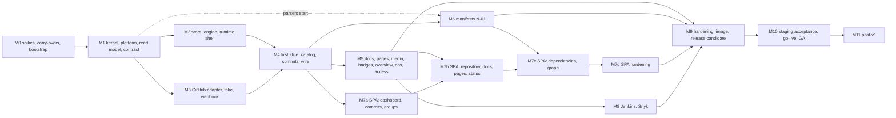

# 40 - Implementation plan: ordered build of Source Code Portal (SCP)

Status: proposed for owner sign-off. Date: 2026-10-14. Binding inputs, in precedence order: `04-decisions.md` (including section 7, A-01 to A-33), `10-architecture.md` (revision 3), `11-adr/ADR-001..ADR-025`; the guardrails of `02-design-guardrails.md` (GR-01 to GR-45) are binding at every level and are not a tier of that order. Derived from: the "Implementation tasks" sections (section 13) of the 18 unit designs in `20-design/`, the cross-design consolidation (`20-design/90..93`, `30-verification/cross-design-consistency.md`) and the architecture.

How to read this document. Sections 1 to 3 say what is being built, with what effort, and what the owner must decide. Section 4 is the plan proper: milestones M0 to M10 plus M11, the post-v1 backlog, each with goal, tasks (unit and task ids), dependencies, a demo-able outcome, exit criteria and the tests that gate it. Sections 5 to 7 give the critical path, the work streams for 1, 3 and 6 engineers, and the risk register. Section 8 maps every v1 capability to the milestone where it becomes demonstrable. Section 9 is the first production deployment: staging acceptance, go-live and rollback. Section 10 is the checkable Definition of Done. Section 11 lists deviations proposed and planning findings. The appendices give the task coverage matrix, the carry-over inventory and the plan-added tasks.

---

## 0. Verification log (facts re-checked for this plan, 2026-10-14)

The architecture's own log (10-architecture section 0, V1 to V16) was taken as given. For the facts that decide the order or the dates of this plan I re-fetched the primary source today.

| # | Fact the plan depends on | Result on 2026-10-14 | Source |
|---|---|---|---|
| P-V1 | Go toolchain pin | go1.27.2 and go1.26.9 released 2026-10-08 (matches V1) | https://go.dev/doc/devel/release |
| P-V2 | oapi-codegen version and 3.1 maturity (spike SP-5) | v2.8.0 is marked "Latest" (release dated 17 July); the notes say "initial" OpenAPI 3.1 support, webhooks/callbacks, `type: [T, "null"]` nullability | https://github.com/oapi-codegen/oapi-codegen/releases |
| P-V3 | GitHub signs webhooks with both headers (webhook setup) | `X-Hub-Signature-256` (HMAC-SHA256) is sent with every delivery when a secret is configured and is absent without a secret; `X-Hub-Signature` (HMAC-SHA1) is still sent for older consumers. The receiver verifies SHA-256 only and ignores the SHA-1 header (GR-20), so any existing organisation hook secret works without re-keying | https://docs.github.com/en/webhooks/using-webhooks/validating-webhook-deliveries |
| P-V4 | SBOM endpoints (spike SP-1) | The synchronous `GET .../dependency-graph/sbom` "will not be accessible after November 13, 2026"; the replacement is `GET .../sbom/generate-report` (201 with `sbom_url`) then `GET .../sbom/fetch-report/{sbom_uuid}` (202 while processing, 302 when ready). The page names no token types and requires "at least read access to the repository" (App installation token support stays unverified: SP-1) | https://docs.github.com/en/rest/dependency-graph/sboms |
| P-V5 | modernc sqlite pin (spike SP-8) | v1.60.1 published 2026-09-29, bundled SQLite 3.53.4; the page warns a newer module version exists but does not name it. The pin stays v1.60.1 until the proxy shows the next tag (as V3) | https://pkg.go.dev/modernc.org/sqlite |
| P-V6 | Node line | v24.21.0 is "Latest LTS"; Node 26 is listed as "Current" (first released 2026-05-05). The page gives no LTS date for 26: the date 2026-10-28 in 16 Q16-12 and the architecture is **unconfirmed**; owner default is to stay on Node 24 for v0.1 (Q16-12), so nothing in this plan depends on it | https://nodejs.org/en/about/previous-releases |
| P-V7 | GitHub Camo proxy follows redirects and honours `max-age` (badges embedded in READMEs) | **Not verifiable**: only the archived open-source Camo (default redirect cap 4) is documented; GitHub's production behaviour is not. Badge URLs are therefore always answered directly with 200 or 404, never through a redirect (GR-33), and a manual check is scheduled in M10 (09:H4) | web search 2026-10-14 |

Not re-verified here and carried "as dated in the architecture": every other pin of Appendix A of `10-architecture.md` (Vite 8, Tailwind 4.3, TypeScript 7, goldmark, chroma, bluemonday, OTel, distroless digest, Renovate). Task PL-9 (pin refresh, Appendix C) re-reads them at the start of M0 and again at the start of M7, because three weeks of drift is normal for this toolchain.

---

## 1. Planning basis

### 1.1 What is built

One Go module (`github.com/cantara/source-code-portal`, Go 1.27.2) with about 65 archtest rows (67 packages in the matrix of revision 2; `internal/archtest` closed world), one static binary `scp` (`CGO_ENABLED=0`, `-tags spa`) with the React + shadcn/ui + TypeScript SPA embedded, two listeners (public `:9090`, admin `:9091`), the OpenAPI 3.1 contract (24 operations: 22 public, 2 admin only; the admin listener serves all 24), 370 configuration keys, 179 metric names, 19 problem codes. The in-scope feature set is `04-decisions.md` section 2 plus N-01 (package manifest intelligence). Post-v1 items are listed in section 4 under "M11 Post-v1 backlog".

### 1.2 How the unit designs are used

Sixteen of the eighteen units ship reference code in `20-design/NN-*.assets/` (reference tests for unit 05) that was compiled and tested in scratch modules; the cross-design review compiled all of them in one union module. The rule for every unit (stated by units 01, 02, 03, 04, 12 and 16) is: copy the reference code into the real repository, rename the module path, re-run its tests against the real kernel, review it line by line, and own it. Two units have **no code**: unit 05 (GitHub adapter: compile-checked code appears in the document only; `05-github-adapter.assets/` holds `worlds/` fixtures and `05-github-adapter.reference-tests.md` holds the reference tests) and unit 13 (ecosystems B: specification plus compile-checked excerpts). They carry the highest implementation risk, which is why they start early in the order below.

### 1.3 Task identifiers

A task is written `NN:id` where `NN` is the unit number and `id` is the identifier used in that unit's section 13: `01:K6`, `02:T1.5`, `03:T-SQ-5`, `04:T1.2`, `05:M3` (05 numbers milestones, not tasks), `06:7` (06 numbers tasks 1 to 17), `07:T-4`, `08:C-3.4`, `09:C4`, `09:B2`, `09:H1`, `10:U10-M3` (10 numbers unit milestones), `11:M2-2`, `12:2.1`, `13:B1-3`, `14:I-2.5`, `15:T4.2`, `16:B-5`, `17:M1-3` (17 numbers tasks within its milestones M0 to M3), `18:T-18-010`. A range `03:T-SQ-1..6` is shorthand for the six tasks. "(part)" means the task is split across milestones and the part listed here is the stated one. Tasks that the unit designs do not contain but that this plan needs (spikes, live GitHub session, staging acceptance harness, traceability check, drills) carry the prefix `PL-` or `SP-` and are listed in Appendix C.

### 1.4 Effort basis (read this before using the numbers)

Effort is in engineer-days. The base is the sizes the unit designs state themselves (S, M, L, or an explicit total), converted with each unit's own scale, plus an estimate where a unit gives none (04, 05, 09, 10, 14, 15, 16, 17, 18; marked "e"). All of it assumes the reference code is ported, reviewed and owned, not written from nothing. It is a planning estimate with a stated error of about +-40%; the plan contains a re-baseline gate at the end of M2 (section 6.5).

| Unit | Scope | Reference code | Effort (days) | Basis |
|---|---|---|---|---|
| 01 | kernel: `scm`, `freshness`, `job`, `reactor`, `routes`, `safehtml` | yes | 6 | stated 5.75 |
| 02 | platform: secret, lifecycle, logx, config, telemetry, netguard, httpx, composition | yes | 30 | stated sum of task days |
| 03 | `readmodel`, `store`, `store/sqlite`, `store/memory`, `storetest` | yes | 31 | own scale (S 0.25, M 1, L 2.5) |
| 04 | `refresh` engine, planner, scheduler, `webhook`, redelivery | yes | 30 | e |
| 05 | `github` adapter, `github/auth`, `githubtest`, `cmd/fakegithub` | **no** (worlds + reference tests) | 49 | e |
| 06 | `httpapi`, `authz`, `validate`, `apitest`, `webapp` | yes | 22 | e |
| 07 | OpenAPI contract, tools, route table entries | yes (tools, fragments) | 17 | stated sizes |
| 08 | `catalog` | yes | 26 | own scale |
| 09 | `commits`, `badges` | yes | 28 | e |
| 10 | `docs`, `pages`, `media`, `render` | yes | 30 | e (about 2,500 new lines on 5,490) |
| 11 | `manifests` core and graph | yes | 30 | stated "about 30" |
| 12 | ecosystems A (Go, Cargo, npm, Python, Maven, Gradle) | yes | 45 | e from sizes (port, review, own) |
| 13 | ecosystems B (NuGet, Docker, Actions, Ruby, PHP, Swift, CocoaPods, Dart, Elixir, Terraform, Helm) | **no** | 30 (P5/P6 excluded, post-v1) | e |
| 14 | `access`, `integrations`, Jenkins, Snyk | yes | 20 | e |
| 15 | `ops`, `live`, `overview` | yes | 26 (SSE excluded) | e |
| 16 | `cmd/scp` wiring, bridges, CI, image, release | yes | 25 | e |
| 17 | web foundation | yes | 15 | e |
| 18 | web pages | yes | 38 | e |
| | **Units total** | | **about 450** | |
| | Plan-added: spikes, live session, staging acceptance, drills, traceability (Appendix C) | | about 100 | e |
| | **Programme total to GA** | | **about 550** | |

### 1.5 Release ladder

| Label | Reached at | What it is | Audience |
|---|---|---|---|
| A0 internal alpha | M4 plus M7a | portal against the fake GitHub and one real test organisation: groups, commits, group pages; no docs | engineers |
| A1 feature beta | M5 plus M7b (plus M8 when the first deployment uses Jenkins or Snyk) | every v1 capability of section 8 except package manifests; a staging deployment may start | the owner and a pilot group |
| RC | M6, M7d, M9 | the complete v1 scope, signed `v0.1.0-rc.1` (16:B-13), then further candidates | staging acceptance |
| GA | M10 | `v1.0.0` after staging acceptance and go-live | everyone |

---

## 2. Owner decisions and external prerequisites

The unit designs mark 16 items as owner decisions with a default (93, section 3). None is a blocker with its default; the ones below must be answered **before the named milestone** or the default is built and rework is possible. "Default" is what ships if the owner says nothing.

| # | Decision or prerequisite | Needed before | Default | Reference |
|---|---|---|---|---|
| O-1 | Read of Q-20 ("no sub-folder docs" means no monorepo sub-project docs; `docs/` supported) and descriptor lifecycle vocabulary `experimental/production/deprecated` | M5 (10:U10-M2 freezes the descriptor schema) | as designed | A-06, W18 |
| O-2 | Presentation decisions: commit authors as initials, first line of the commit message, dashboard in config order, dashboard shows 10 commits, health probes at `/livez` and `/readyz` only | M7a (first UI), and the launch announcement of M10 | as designed | A-25, W19, 18 D-18-05 |
| O-3 | Admin listener also serves the 22 public operations | M1 (01:K6) | keep | 01 Q9, CD-RT-08 |
| O-4 | External SVG in `/media/ext`: deny or sandboxed | M5 (10:U10-M5) | sandboxed (93 recommends approving) | 10 D-1 |
| O-5 | Per-installation rate-pause granularity: one global pause per upstream in v1 | M3 (05:M3) | global | 05 Q-10, 04 Q1 |
| O-6 | Reserve gate in the adapter (X6); keep both concurrency knobs; plan table P1 not adopted | M2 (04:T2.1) and M3 | as designed | CD-CF-02, CD-CF-05, 03 P1 |
| O-7 | `include_forks`: runtime default false; whether the production catalogue includes forks (relevant when a group's default repository is a fork) | M4 default; **M10 production configuration** | false by default; set per deployment from the inventory of 9.2 | 08 Q-2 |
| O-8 | Image namespace `ghcr.io/cantara/source-code-portal`; no `knowledge.yaml`; merge queue on; stay on Node 24; no early `/livez` listener; SIGHUP is a reload request; shutdown 44 s | M0 (namespace, merge queue), M9 (rest) | as listed | 16 Q16-7, Q16-8, Q16-12, Q16-16, Q16-19, D-12, D-15 |
| O-9 | Admin bind `:9091` with a startup warning; Host guard off | M2 | as listed | 02 Q5, Q15 |
| O-10 | Spike S-A (App tokens for graph and SBOM), Snyk regional base URLs, S-C (Maven Central policy) | M0 (S-A, S-C), M8 (Snyk) | providers off, `pom_source` off | 13 OQ-4, 14 |
| O-11 | Archtest allowance for route-literal files; matrix additions of A-30 incl. `httpapi/openapi` for features | M0 | accept (CD-DM-03 recommendation) | CD-DM-01..03 |
| O-12 | Not adopting `author`/`q` commit filters and `site.dashboard_commits` in v1 | M7a | not adopted | 18 D-18-02, D-18-03 |
| O-13 | Terraform and Helm (13:B5) are the single scope cut-line candidate | M6 | built, last in order, may slip to v1.1 by owner decision without failing the Definition of Done | D-15 "where cheap" |
| O-14 | Credential for the first deployment: GitHub App (recommended) or PAT | M0 live session | App; PAT accepted for the staging instance | D-17 |
| P-1 | A GitHub **test organisation** with an App installed, one public and one private repository with Maven and npm manifests, and a repository with a recent push webhook | M0 (SP-1, SP-2, SP-10) | none: without it SP-1, SP-2 and V13 stay open and only the REST path is built | W2, W5, W20 |
| P-2 | A Linux container host (amd64 and arm64) and a Kubernetes namespace (or Compose host) with ingress control | M0 (SP-8), M9 (smoke), M10 (staging) | local Docker | 03 Q1 |
| P-3 | Control of the production hostname, ingress and the GitHub webhook settings of the target organisation | M9 (runbook), M10 | none | section 9 |

---

## 3. Conventions that apply to every milestone

1. **Green from the first commit** (16 section 4.12): `main` is protected, CI jobs are added only when their subject exists, `gate.needs` lists exactly the jobs that exist. Every pull request that lands a package flips its archtest row from `Planned: true`.
2. **Reference code first**: a task that has reference code is "port, review, own" and its definition of done is that the unit's own listed tests are green in the real module, not that new code was written.
3. **No milestone ends red**: the exit criteria below are the CI jobs `go`, `gen`, `api`, `web`, `build`, `image`, `e2e` and `gate` named by 16 section 4.7, available as far as their subjects exist.
4. **Generated source is committed and drift-checked** (A-14): `make gen && git diff --exit-code` is part of every gate from M1.
5. **Fixtures before features**: the fake GitHub world must contain a case before the feature that needs it is accepted (the fixture tasks FX-1 to FX-5 of Appendix C close CD-FX-01 to CD-FX-05).
6. **Open design items are tasks**: CD-CF-10 (catalog `Describe` tags and one-key matcher `UnmarshalYAML`), CD-MT-06 (telemetry View keeps explicit histogram buckets), CD-DM-03 (route-literal allowance), and CD-IF-07 (overview source accessors) each have a named task and milestone in section 4.

---

## 4. Milestones

Each milestone is an integration point, not a time box. A task may start earlier than its milestone when its dependencies exist (the stream plan of section 6 uses this: the pure core of `catalog`, the render core, the parsers and the web toolchain all start long before the milestone that integrates them). The order of milestones follows the dependency rank of the architecture: kernel, platform and read model (M1); persistence and engine (M2); GitHub adapter (M3); the first end-to-end slice (M4); content, presentation and operations (M5); manifests (M6); the web application (M7, in four sub-gates a to d that follow the API milestones); optional integrations (M8); hardening and the first signed candidate (M9); staging acceptance, go-live and GA (M10).

Plain-text fallback: M0 -> M1 -> {M2, M3} -> M4 -> {M5, M7a, M6}; M5 and M7a -> M7b; M6 and M7b -> M7c -> M7d; M5 -> M8; M5, M6, M7d, M8 -> M9 -> M10 -> M11. The manifests parsers (12, 13) and the pure cores of 08 and 10 start at M1 without waiting for their milestone.

Effort per milestone (engineer-days, estimates of section 1.4): M0 20, M1 53, M2 53, M3 52, M4 72, M5 76, M6 100, M7 46, M8 15, M9 48, M10 15; total 550.

---

### M0. Spikes, prototype carry-overs and repository bootstrap

**Goal.** Settle every open fact that could change the design before any feature is built, prove the unprototyped parts of the architecture (W22), and create a repository that is green from its first commit. This is the milestone the architecture calls "M0 (spikes and kernel contracts)".

**Included tasks.**

| Group | Tasks |
|---|---|
| Repository bootstrap (16 section 4.12 steps 0 and 1) | `16:B-1`, `16:B-2` (skeleton: `cmd/scp`, `internal/archtest` with every unbuilt row `Planned`, `web/` embed placeholder, `docs/reference/`), `16:B-3` (CI jobs `go` and `gate`, `renovate.json`, branch protection, merge queue per O-8), `PL-9` pin refresh |
| Kernel vocabulary (KM0, day 1) | `01:K1`, `01:K3`, `01:K4` (so spikes and the W22 prototype run against the real kernel) |
| W22 carry-over: engine, planner, gate, timeout, reactor, lifecycle prototype | `04:T0.1` (copy `04-refresh-webhook.assets` into the real module, `go test -race -timeout 5m -count=20` green against the real `job`, `freshness`, `scm`), `02:T0.2` (lifecycle `Plan`), `01:K5` (reactor) as the real packages these tests need |
| Webhook fixtures | `04:T0.2` (push default branch, tag, deleted, forced, two commits, release, create, repository, installation, ping; recorded from real deliveries in SP-10) |
| Spikes | `SP-1` to `SP-10` below |
| Fixture recordings that block nothing | `14:I-0.1` (Jenkins), `14:I-0.2` (Snyk), `14:I-0.3` (proxy snippet) are scheduled in M8 but may be run in the same live session as SP-10 |

**Prototype carry-overs** (full inventory in Appendix B). Everything in `05-research/*-prototypes`, `05-research/05-store-sync-engine.assets` and `20-design/*.assets` is throwaway scaffolding that proved a claim; the rule is: adopt the `20-design` asset of the owning unit (it supersedes the research prototype), keep the research prototype only as the oracle named in Appendix B, and cite the experiment in the spike report.

**Spikes.** Each spike is a time-boxed experiment with a recorded verdict in `docs/spikes/SP-nn.md` of the new repository (date, commit, tool versions, raw numbers) and an update of the verdict column of this table by the owner. Pass criteria are numeric so that the verdict is not an opinion.

| ID | Subject | Procedure | Pass | Fail or partial: decision fallback | Gates |
|---|---|---|---|---|---|
| **SP-1** (S-A) | SBOM and dependency graph with GitHub App installation tokens (W2, V4, 13 OQ-4) | With the P-1 App (minimum permissions: Metadata and Contents read) installed on a public and a private test repository: (a) GraphQL `repository.dependencyGraphManifests` with an installation token; (b) `GET .../dependency-graph/sbom/generate-report` then poll `fetch-report/{uuid}` (201, 202, 302); record HTTP status, permission names needed, latency, payload size, GraphQL cost, behaviour when Advanced Security or the dependency graph is disabled | both calls return decodable data for the public **and** the private repository with an installation token whose added permissions are read-only and acceptable to the owner | **Partial** (public only): providers are restricted to public repositories and documented so. **Fail** (403, "Resource not accessible by integration", user token required): delete `manifests/providers/githubgraph` and `.../sbom` and the key `acknowledge_spike_sa`; do not keep them disabled (GR-04, 13 P6-3). Own parsing is unaffected either way | post-v1 tasks `13:P5-3`, `13:P6-1..3` only; **does not gate v1** |
| **SP-2** (S-B) | GraphQL blob batching at 25 aliases (W5, U-5, CD-FX-02) | Through a throw-away client: batches of 25 `object(oid:)` aliases of blobs of 1 KB, 100 KB and 256 KB, plus the `object(expression:)` form; 200 queries; record `rateLimit.cost`, latency p50/p95, response size, the `Blob.text` truncation threshold (research saw it between 348,960 and 810,106 bytes), behaviour at 50 aliases; verify `sha1("blob "+len+"\0"+text)` equals the blob oid on a corpus of real manifests (BOM, CRLF, non-UTF-8 manifests) | cost at most 2 points per 25-alias query (plan H assumed 1), p95 under 3 s, no timeout in 200 queries, truncation is reported by `isTruncated` or null, and the SHA verification holds for at least 99% of manifests | cost over 2 points, timeouts, or text that cannot be verified: `acquisition.graphql_blobs` stays `off` (default) and the complete REST-raw path is the production path; cold-start manifests load runs at `PrioBackfill` for hours but never gates readiness (ADR-022); update the budget table of 13.4. If only the SHA check fails, GraphQL is used for discovery of changed oids only | `11:M2-2` (fetch strategy), `05:M4` (`graphql_blobs` default), `05` `ReadBlobs` |
| **SP-3** (S-C) | Maven Central parent-POM fetch policy (CD-FX, 12 task 5.3) | Over the real `pom.xml` set of the owner's target organisation (P-1 plus the production organisation where readable) through the real adapter: list parent and BOM coordinates not produced inside the organisation; fetch from `repo1.maven.org` through `netguard` with the allow-list; count unique requests, bytes, latency, hit rate of the permanent release cache on a second run, any 429 or block; assert from the request log that no coordinate matching an organisation unit or `private_group_prefixes` was requested | at least 95% of effective-model resolutions complete; second run issues 0 requests for releases; zero requests for private coordinates; no throttling | under 90% resolved or throttling: `pom_source.enabled` stays `false` (already the default), `maven.parent-unresolved` diagnostics stay visible, document a corporate mirror host through `hosts`; between 90 and 95%: ship with the warning in the runbook (12:7.5) | `12:5.3`, `12:7.6` |
| **SP-4** (S-D) | Heap of `RepoFacts` and the interned graph (W15) | Harness with `runtime/metrics` (`/gc/heap/live:bytes` after `runtime.GC()`): 1,000 repositories x 200 direct dependencies (synthetic) and the SP-3 corpus; measure `RepoFacts` total, one graph variant, two variants, and `BenchmarkBuildGraph200k` | graph at most 9 MB per variant and `RepoFacts` at most 45 MB (the estimates 6 MB and 30 MB times 1.5); rebuild within +50% of 52 ms | over 1.5x: record the measured numbers in 9.4 of the architecture, size `docs.resident_budget` and the container limit from them (container limit = measured total / 0.85 for `GOMEMLIMIT`), and if `RepoFacts` alone exceeds 100 MB open a deviation to load per-unit dependency lists lazily from the store cache (ADR-022 alternatives) | memory sizing in `deploy/k8s`; `11:M5-6` thresholds |
| **SP-5** | oapi-codegen v2.8.0 against the 3.1 subset (W1, P-V2) | `go generate` the real public and admin documents of 07 (all 24 operations, `type: [T, "null"]`, shared `common.yaml`, `{docId}`), compile, `go vet`, run `tools/apicheck` (27 rules), request validation of every operation through kin-openapi, `openapi-typescript` plus `tsc --strict` on a client call per operation, second generation produces no diff | all 24 strict handlers generate and compile, no `any` for a field declared `[T, "null"]`, apicheck 0 failures, deterministic output | a failure on a multi-type union or nullable: first remove the construct from the subset; second apply the Overlay 3.1 to 3.0 downgrade for the **codegen input only** (ADR-020), clients keep 3.1; third (owner decision, ADR amendment) switch to Huma v2 code-first, which reverses contract-first and costs about 10 days in 06 and 07 | `07:T-1`, `07:T-2` start of M1 |
| **SP-6** | `ProblemMux` for 404 and 405 under `/api/` (W3) | Implement `validate/problemmux.go` from 06 section 4 on the M0 skeleton; run Schemathesis 4.31.0 (seeded) against the binary with a fixture snapshot with the checks "unsupported methods", "negative data rejection", "content type conformance"; check `Allow` on 405, `nosniff`, HEAD as GET, and that non-`/api/` requests pass through untouched | zero failures on all 24 operations; the three coverage failures seen in research (E8) are gone | register an explicit `/api/` catch-all and per-pattern 405 from the route table (the table knows each pattern's methods); cost one day; Schemathesis stays a required check either way | `06:9`, `06:11`; CI job `api` |
| **SP-7** | Trusted Types and static CSP with React 19.3 and shadcn on Base UI (W9, W11) | Use `08-prototypes/shadcn-csp-spike` and `18-web-pages.assets/csp-probe`; serve the Vite build with the **real** document CSP of 11.3 (`require-trusted-types-for 'script'; trusted-types scp-html`, enforced) from the `webapp` handler; Playwright (Chromium) visits every route shape and exercises dialog, command palette, combobox, sheet, popover, tooltip, chart, data table, theme toggle, `SafeHtml`, and a module worker; collect `securitypolicyviolation` events and `/csp-reports`; manual pass in Firefox and Safari (research tested Chromium only) | zero violations in Chromium over three consecutive runs; Firefox and Safari render every route (Trusted Types is feature-detected) | violations from React, Base UI or shadcn internals: keep `require-trusted-types-for` in report-only for v1 (ADR-010 enforces it last), keep script and style CSP enforced, record the waiver in the Definition of Done (owner sign-off); a component that injects `<style>` is patched or replaced | `17:M0-2`, `18:T-18-005`, `18:T-18-074` |
| **SP-8** | modernc read-only mode and read-only root filesystem (W21, 03 D12, Q1) | In the real image base (`gcr.io/distroless/static-debian13:nonroot`, read-only root, `/data` the only writable volume) on linux/amd64 and linux/arm64 with modernc v1.60.1: open the `bk` connection `file:...?mode=ro`, `VACUUM INTO ?` with a bound parameter, `PRAGMA temp_store=2`, a sort larger than the page cache (50 MB, 16 Q16-20), WAL `-shm` creation on `/data`, `quick_check`; confirm `VACUUM INTO` still fails under `query_only=1` | all pass on both architectures | fallbacks in order: `bk` connection without `query_only` issuing only reads; `emptyDir` at `/tmp`; the tested escape hatch `ncruces/go-sqlite3` v0.35.6 behind build tag `scp_ncruces` (03 Q2) with `storetest` on both | `03:T-SQ-2`, `03:T-SQ-15`, image smoke `03:T-IN-4` |
| **SP-9** | W22 prototype carry-over: `Planner`, `Gate`, per-job `Timeout`, `reactor`, `lifecycle.Plan` | Run the synctest list of architecture section 22 (hook that re-enters `Enqueue` from `OnParked`, planner tick during a running job, `Enqueue` after `Run` returned, job ignoring its deadline, late `Put` after `Remove`, removal while the graph is stale, `singleflight` with the first caller cancelled, lifecycle plan with a failing stage and a stage that ignores cancellation, `-race` mutating-reader property test) against `store/memory` in the real module; `-timeout 5m -count=20` | all cases green, `goleak` clean | a contract error found here is fixed in the owning unit's design before M1 closes (record in `93`); no feature is started on an unproven engine contract | exit of M0 |
| **SP-10** | Live GitHub facts session (U-1 to U-11, V13, W4, W20) | One scripted session with the P-1 App, run through the real adapter prototype where it exists and `curl` otherwise: U-1 REST ETag across a token change and whether 304 is free; U-2 and V13 record real push deliveries (per-commit `added/removed/modified`, `head_commit.tree_id`) into `testdata/fixtures/webhook/`; U-3 redelivery window and the meaning of 400/422; U-4 304 on `application/vnd.github.sha`; U-5 real GraphQL cost of the 50-alias head query (formula about 1); U-6 `html+json` on `contents/{path}` for non-README files; U-7 status of an exhausted GraphQL bucket; U-10 `X-GitHub-Hook-Installation-Target-ID`; U-11 base64 wrapping | each item recorded with a measured value or a recorded refusal | none blocks v1: every item already has a containment in 05 section 15.1 ("how it is contained"); a negative result flips the corresponding `Capabilities` default and is entered in `docs/spikes/SP-10.md` | `05:M4`, `04:T0.2`, `08:C-5.1` |

**Dependencies.** Entry: P-1, P-2, O-8 (namespace), O-11, O-14, `PL-9`. The spikes SP-5, SP-6 and SP-7 have no dependency on each other and can run in parallel with the bootstrap.

**Demo-able outcome.** A fresh clone builds and tests green (`go test -race ./...` without Node, `go build -tags spa` of a placeholder); `scp version` prints build info; the archtest passes with 65 rows mostly `Planned`; a one-page spike report per SP with a verdict; a recorded real `push` delivery in `testdata/fixtures/webhook/`; the engine, planner and lifecycle prototype green in the real module.

**Exit criteria.**
1. Every SP-n has a verdict (pass, partial, fail) with its fallback adopted or explicitly deferred (SP-1 deferral is allowed because it gates only post-v1 work).
2. `go test -race -timeout 5m -count=20` of `refresh` and `webhook` green against the real kernel (`04:T0.1`).
3. CI jobs `go` and `gate` required on `main`; archtest `TestTableMaterialises` and `TestTableIsAcyclic` green with the Planned flags.
4. Owner answers for O-8 (namespace, merge queue), O-11 and O-14 recorded in `docs/decisions.md`.

**Tests that gate M0.** archtest (`TestTableMaterialises`, `TestTableIsAcyclic`, `TestRealTree`), the 04 engine and webhook suites, the synctest list of section 22, the SP-5 apicheck run, the SP-6 Schemathesis run, the SP-7 Playwright CSP run, the SP-8 image smoke.

---

### M1. Kernel, platform, read model and contract skeleton (ranks 0 and 1)

**Goal.** Everything below the features that has no network and no persistence: the vocabulary, the cross-cutting platform packages, the immutable snapshot, the store contract with its in-memory implementation and conformance suite, the HTTP/API foundation, the OpenAPI toolchain and the web toolchain skeleton.

**Included tasks.**

| Unit | Tasks |
|---|---|
| 01 kernel | `01:K1..4` (completed), `01:K5` (reactor package; metrics bridge in M2), `01:K6` (adopt `routes`: names, tables, recorder, `Verify`; handler registration completes in M4), `01:K8` (adopt `safehtml` and `testdata/policy_golden.json`; the wiring into render and store is M5), `01:K9` (fold `kerneltest` into `archtest`, kernel depguard rows), `01:K10` (architecture amendments), `01:K11` (close Q1 to Q3: owners of `api.repos`, empty doc path, planner uses `Policy.Interval`) |
| 02 platform | `02:T0.1..4` (secret, lifecycle, logx, archtest rows), `02:T1.1..7` (config machinery: `Describe`, tree and merge, env overlay, schema, `Load`, validator fan-out, reference and env generators), `02:T2.1..2` (telemetry provider, Prometheus, OTLP; **CD-MT-06**: the View keeps explicit histogram buckets), `02:T3.1` (netguard), `02:T4.1..4` (httpx server, client IP, limiter, header classes) |
| 03 read model and store contract | `03:T-00`, `03:T-RM-1..11` (readmodel), `03:T-ST-1..4` (store contract, memory store, 46-subtest conformance suite) |
| 06 HTTP foundation | `06:1..8` (web embed package, `httpapi/openapi` generation, `apispec`, problems, cursor, ETag, envelope, static, mux, negotiation, defaults, gzip, `authz`) |
| 07 contract | `07:T-1..8`, `07:T-16` (the generated packages, bundle, `tools/apicheck`, route-table entries for all 24 operations, `httpapi` additions, `apitest`, contract mock and MSW fixtures, typed web client, process epoch) |
| 17 web foundation | `17:M0-1..8` (toolchain skeleton, shadcn with the three CSP patches, `routes.ts`, build scripts, ESLint boundaries, i18n, Vitest and Playwright, generated types from the 07 bundles) |
| 16 | `16:B-4` starts (root `Config` composition: each landed unit adds its section) |
| 08 early start | `08:C-1.1..10` (pure core: matchers, slugs, config, discovery policy, `PlanReconcile`, membership, lint, schema) may start now; integrated in M4 |
| Plan-added | `FX-1` (demo world: docs pages, `scp.yaml`, `catalog-info.yaml`, `CODEOWNERS`, images: CD-FX-03), `PL-10` (archtest route-literal allowance, CD-DM-03; O-11) |

**Dependencies.** M0 (kernel KM0, SP-5, SP-6, SP-7 verdicts, O-3, O-11). `03:T-RM` needs `01:K1..4`; `02:T4.*` needs `02:T0.3` and `02:T2.1`; `06:*` needs `01` and `logx.RequestID`; `07:T-1` needs SP-5.

**Demo-able outcome.** From a cold clone: `make gen test` is green and drift-free; `scp config schema`, `scp config lint docs/examples/*.yaml` and the generated reference run (`scp config reference`, `scp config env`) with the platform sections; the archtest closed world is green with rows flipped for the packages that landed; the bundled OpenAPI of 24 operations is generated and served as a static handler in a test; the SPA toolchain builds an empty shell (`pnpm build` writes `dist` with hashed assets, `.br`/`.gz`, `routes.json`) and Playwright runs one passing spec; the `readmodel` benchmarks and the immutability property tests run.

**Exit criteria.**
1. `go test -race ./...` green with the placeholder embed (no Node needed); `make gen && git diff --exit-code` clean.
2. Every kernel unit test, fuzz seed and golden of 01 green (`FuzzCleanLine` 20 s clean, `TestPolicyGolden`, `TestVisibilityZeroValueIsNotPublic`, route `Verify`).
3. `02`: the five lifecycle synctest tests with `-race -count=3`; `TestNeverPrints`, `TestPrecedence`, `TestListFromEnvAndGap`, `FuzzEnv`, `TestGenArtifacts` committed outputs; `TestProviderMetricsNames`; `TestHeaderGolden`; `FuzzClientIP`.
4. `03`: `TestModelBased`, `TestConcurrentReadersDuringWrites`, `TestRegistryMisuse`, zombie-`Put` and fail-closed validator tests; store conformance (46 subtests) green on `store/memory`; benchmark ratio gate recorded.
5. `07`: `apicheck: 0 failures` with every rule backed by a failing mutation; route-table equality test and `TestMuxRegistration` green (names and owners; API class equals bundled paths).
6. `06`: unit tests of `problem`, `cursor`, `etag`, `negotiate`, `gzip`, `authz` (indistinguishability test).
7. `17`: `pnpm install --frozen-lockfile`, `pnpm typecheck`, `pnpm lint`, `check-pins` green; bundle budget script fails on its negative fixture.

**Tests that gate M1.** CI jobs `go`, `gen`, `api` (spec lint, bundle drift, `oasdiff` skeleton), `web` (pins, types, lint, unit); the tests named above.

---

### M2. Persistence, sync engine and runtime shell

**Goal.** A process that starts, persists, shuts down in order and says whether it is ready, with no GitHub and no features. This is the "shortest path to a deployable container" of unit 15 (probes) combined with unit 03 (SQLite) and unit 04 (engine).

**Included tasks.**

| Unit | Tasks |
|---|---|
| 03 SQLite | `03:T-SQ-1..16` (config, DSN, migrations, open and quarantine, data operations, differential test against memory in `cmd/scp`, worker, metrics, ops: backup, check, restore, ncruces conformance), `03:T-IN-3` (metrics-name test), `03:T-IN-5` (CI jobs: race, ncruces, coverage gates, fuzz smoke, benchmark ratios), `03:T-IN-7` (`testdata/v1.db`, migration chain test) |
| 04 engine | `04:T1.1..9` (backoff, keyed coalescing queue, dispatch with pace and concurrency, finish classification, rate-limit pause, parking and probe, per-job timeout and stuck detection, shutdown, metrics), `04:T2.1..4` (Gate interface, planner, `Planner.Enqueue`, scheduler) |
| 02 platform | `02:T1.8` (root `Config`, `default.yaml`, `scp config {lint,schema,reference,env,show}`, consumed-keys test, CI drift steps), `02:T2.3`, `02:T4.5` (public and admin chains), `02:T5.1..2` (platform part of `run()`, goleak, soak, race matrix, metrics reference generator) |
| 01 | `01:K5` (reactor metrics bridge), `01:K12` (re-sync siblings against the one kernel) |
| 06 | `06:9..11` (validate, `ProblemMux`, request validator; `apitest`; chain test), `06:12..14` (webapp: options, `routes.json`, handler, CSP, `/csp-reports`), `06:17` (generate-and-diff, spec lint) |
| 15 ops shell | `15:T0.1..3` (packages, the missing problem constants and `WithRetry`, config schema for `live`, `readiness`, `ops`, `site`, `llms`), `15:T1.1` (readiness, liveness, kind registry), `15:T1.3` (mount `/livez` and `/readyz`, joined `servers` Drain hook) |
| 16 | `16:B-4` (platform sections of the root config, `TestEveryConfigKeyIsConsumed`), `16:B-5` (first stages: store, read-model registry, credentials stub, warm start, engine, lifecycle) |
| 17 | `17:M1-1..10` (shared layers: API client, problem, theme, persist, tokens, shared components, shell, reference slices against MSW, e2e fixtures, script tests, `web` CI job) |

**Dependencies.** M1. `03:T-SQ-1` uses the real strict decoder of `02`; `04:T1.*` needs `job`, `freshness`, `logx`; `15:T1.1` needs `readmodel.Publisher.Current` and the engine `Stats` (04); SP-8 verdict.

**Demo-able outcome.** `scp serve --config deploy/dev.yaml` starts both listeners with a SQLite store and no features: `/livez` 200, `/readyz` 503 `not-ready` listing the failing gates, `/metrics` on the admin listener, `/status` skeleton; SIGTERM runs the ordered shutdown (drain, servers, engine, store with `PRAGMA optimize` and checkpoint, telemetry) within the documented 44 s; a restart over a synthetic store row reaches `warm` and serves snapshot version 1; `scp store check`, `scp store restore` and `scp config show` work; the SPA shell is served from the embedded placeholder with the real CSP in report-only.

**Exit criteria.**
1. `storetest` 46 subtests green on memory, modernc and ncruces; coverage gates of 03 section 12.5; both benchmark ratio gates.
2. Engine suite of 04 (`TestBackoffBounds`, coalesce, dirty-while-running, promotion, parked, `ErrQueueFull`, `ErrClosed`, pause without consuming an attempt, stuck job, grace and abandon) green with `-race -count=3`; planner property test (no double enqueue while in flight).
3. `TestRunServesAndStops`, `TestServeAllStopsTogetherAndOneFailureStopsAll`, `TestBudgetFormulaMatchesPlan` (44 s) green; `TestMetricsReferenceDrift` green.
4. `TestDifferentialAgainstMemory` over every store operation green; `testdata/v1.db` migration chain green.
5. The chain test of 06 (`internal/e2e/chain_test.go`) and `TestAdminAPIIsTheSupersetOfThePublicAPI` green; Schemathesis profile of SP-6 required.
6. **Re-baseline gate**: the measured velocity of M1 and M2 is compared with section 1.4 and the schedule of section 6 is re-issued (section 6.5).

**Tests that gate M2.** CI jobs `go`, `gen`, `api`, `web`; nightly fuzz started for `FuzzEnv`, `FuzzLoadFile`, `FuzzClientIP`, `FuzzRate`, `FuzzConfigDecode`, `FuzzDSN`.

---

### M3. GitHub adapter, fake GitHub and webhook receiver

**Goal.** The only package that talks to GitHub, proven against a fake GitHub with fault injection, plus the webhook path from signed HTTP request to an engine enqueue. Unit 05 has no reference code, so this is the highest-risk build and starts as soon as the kernel exists (it needs only M0 KM0 and `platform/secret`); it runs in parallel with M2.

**Included tasks.**

| Unit | Tasks |
|---|---|
| 05 adapter | `05:M0` (kernel types, netguard contract), `05:M1` (`github/auth`: App JWT with the own 25-line signer, PAT, OAuth, external command, anonymous; errors and classification; config; paging, cursors, path hygiene, content SHA verification; webhook verifier and decoder), `05:M2` (fake GitHub core `githubtest`, `cmd/fakegithub`, auth simulation, pagination, conditional and rate-limit simulation, fault injection, ledger, `TestDemoFixtureDecodes`), `05:M3` (transport pipeline: breaker, limiter, semaphore, rate book, metrics, spans; REST reads: repositories, commits, contents, trees with memo and single flight, blobs, images; consumer interface assertions), `05:M4` (GraphQL head sweep with chunk halving and cool-down, REST fallback, capabilities, budget tests), `05:M5` (installations registry, `ReconcileInstallations`, `ObserveEvent`, `Redeliverer`, fake hooks, payload builders, control API; doctor checks and the App manifest flow are wired in M4) |
| 04 webhook | `04:T2.5` (budget arithmetic against the fake world), `04:T4.1..3` (`github.Verifier` port, `dedupe.go`, receiver pipeline and status mapping), `04:T4.8` (`TestEveryEventKindIsHandledOrCountedIgnored`), `04:T5.1..2` (`FailedDeliveries`, `Redeliver`, `webhook.Redelivery`, watermarks) |
| 02 | `02:T3.2` (netguard client factory from `Network` fields; Jenkins, Snyk and OTLP policies) |
| Plan-added | `FX-2` (demo world: non-Maven manifests and lockfiles, truncated monorepo tree, `object(oid:)` batch support: CD-FX-02, CD-FX-04), `FX-3` (rename, multi-group, installation-scoped private repository), `FX-4` (1,000-repository generated world for budget tests), `PL-2` (record real fixtures with `record-github.sh` from the SP-10 session) |

**Dependencies.** M0 (KM0, SP-2 and SP-10 verdicts, O-5), M1 (`secret`, `logx`, `scm`, `store` types for the tests of the fake). `05:M3` precedes every feature job that talks to GitHub.

**Demo-able outcome.** `cmd/fakegithub serve` serves the demo world (`payments-api`, `docs-site`, `archived-tool`, extended by FX-1 to FX-3); a client test lists repositories through an installation, reads README, commits (including the 409 empty repository and null authors), trees, blobs and a GraphQL head sweep; `scp doctor` against the fake prints credentials, permissions and rate state; a signed `push` posted to the receiver returns 202 and enqueues a job in a test engine; an unsigned or wrongly signed one returns 401, an oversized one 413, a full queue 503.

**Exit criteria.**
1. The test plan of 05 section 12 incl. the reference tests green with `-race`: `TestClassify`, breaker tests, `TestContentsBoundFitsGitHubBase64`, `TestGateReservesPerPriority`, verifier vector and rejection matrix, fuzz targets (`fuzz_test.go`), schema test.
2. `04:T2.5`: call counts for a cold start and one steady-state hour at 1,000 repositories within the numbers of architecture 13.4 and 9.6 (about 3,000 calls cold; about 90 REST + 40 GraphQL points per hour for manifests).
3. Every direct consumer interface of architecture 8.7 holds at compile time (`cmd/scp/assert.go` rows for the adapter, CD-IF-01).
4. Nothing outside `internal/github`, `cmd/scp` and tests imports the adapter (archtest).
5. A live smoke run of the adapter against the P-1 organisation passes read-only and its ledger is attached (not required in CI).

**Tests that gate M3.** `go` (race, fuzz seeds), the schema job, a nightly fuzz of the verifier and decoder, the budget test.

---

### M4. First end-to-end slice: catalog, commits, composition

**Goal.** Fake GitHub in, JSON API out, through the real engine, store, snapshot, catalog, commits and wire, with webhooks accelerating refresh. This is unit 16's "M1 Data plane" plus the two features it needs and the first API fragments.

**Included tasks.**

| Unit | Tasks |
|---|---|
| 08 catalog | `08:C-1.1..10`, `08:C-2.1..2` (goldens and `cmd/scp` cross-checks; `scp config lint` with `--repos` and `scp config schema`), `08:C-3.1..8` (service, reconcile with the `pubMu`/`hideGen` rules, warm start, head sweep, `React`, synctest suite), `08:C-4.1..5` (`catalogapi`, `ListGroups`, `GetGroup`, wiring, `scp doctor` catalog part, `/status` bridge), `08:C-5.1` (recorded listing and webhook fixtures); **CD-CF-10**: add the `Describe` tags and the one-key matcher `UnmarshalYAML` (units 02 and 08) |
| 09 commits | `09:C0..C10` (re-sync to the real kernel, config, model, normalise with `scm.CleanLine`, ring codec and restore, job `commits.refresh` with the push-marker bypass, `React`, metrics, `Merge`, projector and validator, `ListCommits`, readiness `Coverage`) |
| 01 | `01:K2` (catalog builds `MembershipSpec`), `01:K6` (handlers registered, `Table.Verify` on both tables with every mounted feature), `01:K7` (API equality test; the SPA-shape half waits for M7) |
| 02 | `02:T4.6` (route classifier, CSRF bypass derivation, per-class goldens), `02:T5.1` (rest: all stages) |
| 03 | `03:T-IN-1` (`assert.go` carve-outs), `03:T-IN-2` (warm start per 4.6 with the features' decoders), `03:T-IN-6` (`store.optimize` daily and `store.check` weekly as scheduler tasks, `scp store` verbs), `03:T-IN-8` (job kind to item kind plan wiring; **blocks the engine integration of 04 and 09**) |
| 04 wiring | `04:T3.1..4` (bridges `PlanSink`, `RateGate` or the adapter `Admit` per X6, parked persistence, `Tracker`, `Retrier`; `wire_jobs.go`; config; `/livez` and `/status` inputs), `04:T4.4..7` (webhook limiter, route registration for the two webhook patterns, config refusals, metrics and `Stats`), `04:T5.3` (`catalog.React` for `installation_repositories` and `resync`) |
| 05 | `05` doctor and App manifest wiring (`05:M5` rest), `05:M4` default for `graphql_blobs` per SP-2 |
| 06 | `06:15..16` (wire the chain for both listeners; `SPAShapes()` against `dist/routes.json` where the placeholder allows) |
| 07 | `07:T-12` (`apicheck catalogue` generating `docs/reference/api.md`, `oasdiff` job), `07:T-13` for the `catalog` and `commits` fragments |
| 15 | `15:T1.2` (bridges `EngineStatus`, `CatalogueStatus`, `StoreStatus`, `Kinds()`; composite `Engine.Observe`) |
| 16 | `16:B-4` (rest), `16:B-5` (catalog, commits, webhook, remaining wire steps), `16:B-6` (bridges of 2.3.1 needed so far), `16:B-7` (`cmd/fakegithub` image, `testdata/worlds/demo`, `make dev`, `deploy/dev.yaml`, `compose.dev.yaml`, the `devtools` tag of D-1, `productDoctor`, `productAppManifest`) |

**Dependencies.** M2 (store, engine, runtime) and M3 (adapter, fake, receiver); M1 (`catalog` pure core). CD-FX-04 world cases FX-2/FX-3 before `08:C-3.8`.

**Demo-able outcome.** `make dev` starts the fake GitHub and `scp`; the catalogue reconciles into groups; `/readyz` flips to 200 when coverage is reached; `GET /api/v1/groups`, `/api/v1/groups/{id}` and `/api/v1/commits` answer with freshness, cursors and weak ETags; a signed `push` through `fakegithub` updates the commit list within seconds; a restart serves the warm snapshot immediately; `scp config lint --repos <listing>` prints the membership report for the demo world; `scp doctor --strict` reports green against the fake.

**Exit criteria.**
1. `16:B-5` acceptance: the serve test with the in-memory store and the fake reaches ready; a feature with a missing handler fails startup listing every problem.
2. `TestEveryRepoJobKindHasAPlanItemKind`, `TestKnownKindsAreItemKinds`, `TestRoutesClassComplete`, `TestConfigLintExitCodes`, `TestPushBypassesTheHeadSweepSkip`, `TestJobSpecIsValidForTheEngine`, `TestRevalidationHealsAMissingStoreItem`.
3. `BenchmarkCommitsPage` (1,000 repositories, deep cursor) and `BenchmarkPublish` within their ratio gates.
4. The chaos invariants of `08:C-3.8`/`TestPlanInvariants` on the published snapshot; readiness gates `store`, `catalogue`, `coverage` behave as architecture 10.2.
5. Archtest green with every row of M1 to M4 flipped; Schemathesis green on the catalog and commits operations.

**Tests that gate M4.** CI jobs `go`, `gen`, `api`, plus the new `e2e-lite` step (boots `run()` against `cmd/fakegithub`, waits for `/readyz`: `cmd/scp/run_e2e_test.go`).

---

### M5. Documentation, pages, media, badges, overview, operations and access

**Goal.** Every remaining v1 capability that is not UI and not optional integrations: README and documents rendered through the one sanitising pipeline, config-driven pages and announcement, signed image proxy, locally rendered badges, the composite repository resource, the LLM surface, `/status` and the operator action, the snapshot poll endpoint, and the optional trusted-proxy access mode with visibility enforcement.

**Included tasks.**

| Unit | Tasks |
|---|---|
| 10 docs, pages, media | `10:U10-M1` (render core, safehtml policy version 2 with the D-2 and D-3 deltas, golden corpus of 43 payloads and 13 real documents), `10:U10-M2` (descriptor loader, discovery, config, codecs, `schema/`, `Resolve`; needs O-1), `10:U10-M3` (refresh run loop, `React`, raw Markdown handlers and negotiation, hint map, `Decode`/`Restore`), `10:U10-M4` (`docsapi`/`pagesapi`, strict servers, pages bridge, ETag and 308 behaviour, `authz.LookupRepo`), `10:U10-M5` (media wiring over `netguard`, `ImageSigner`, warm start and budget end to end, link crawl; needs O-4) |
| 01 | `01:K8` (wire `safehtml.Sanitize` as the last render step; `store` re-sanitises on load; TK-9 and TK-10) |
| 07 | `07:T-17` (injective `docId` encoding), `07:T-13` for `docs`, `pages`, `overview`, `live`, `ops`, `access`-adjacent fragments, `07:T-9` (alias redirect and `AliasSource`), `07:T-14` (anonymous enumeration e2e extended to counts), `07:T-15` (deprecation middleware) |
| 09 badges | `09:B0..B5` (re-sync, `tools/badgewidths` and width table, palette and text sanitising, renderer with golden SVG and fuzz, kinds and `Evaluate`, handlers `Repo` and `Group`, `bridge.BadgeFacts`), `09:H1` (integration tests with the fake) |
| 15 ops, live, overview | `15:T2.1..4` (status collector and warnings, retry action, pprof, metrics), `15:T3.1` (`live` snapshot poll), `15:T4.1..4` (`overview`: site projector, list and composite resources, bridges `DocsSource`, `ManifestsSource`, `IntegrationsSource`, `PagesSource`, `BadgesSource`, alias middleware and negotiated routes; **CD-IF-07**: accessors `R-DOCS-1`, `R-PAGES-1`, `R-09-1`, `R-OVR-1` land in units 09, 10, 11 and 14 as part of these tasks), `15:T5.1..4` (llms outputs, full text and semaphore, sitemap and robots, LOC tripwire and the decision on a pre-emptive split) |
| 14 access | `14:I-1.1..6` (config, identity extraction, authorizer, middleware, archtest and `forbidigo` rules, `TestRemoteAddrUntouchedByChain`), `14:I-4.2` (chain order, `TestAccessNotOnAdmin`), `14:I-4.4` (part: root validation that refuses non-public visibility without an access mode), `14:I-5.1` (`E2E-enum-anon`, `E2E-authed-all`, `E2E-spoof`, `E2E-enum-etag` pinned as expected failure until R-1) |
| 08 | `08:C-5.3` (readiness gate wiring and `/status` rendering reviewed with `ops`) |
| 16 | `16:B-5` (remaining features), `16:B-6` (remaining bridges), `16:B-11` (goleak in `TestMain`, `doctor` against the examples, `t.Skip` rule), `16:B-12` (`TestMetricsReference`) |
| Plan-added | `FX-5` (Jenkins, Snyk, deps.dev recorded fixtures are M8; here: README variants, images, `.adoc`, oversized README), `PL-3` (traceability check scaffold, Appendix C) |

**Dependencies.** M4 (slice), O-1 (descriptor schema freeze), O-4, `01:K8`, `FX-1`. `15:T4.4` needs the accessors from 09, 10, 11 and 14: the manifests accessor (`ManifestsSource.Technology` with a view class, 11 OQ-3) is delivered as a stub returning "not enabled" until M6.

**Demo-able outcome.** For the demo world: `GET /api/v1/repos/{repo}` returns the composite (descriptor with provenance, groups, docs index, statuses, freshness); `GET /repos/{repo}/readme.md` returns Markdown with `scp:` front matter, `Accept: text/markdown` on `/repos/{repo}` returns the same body; `/llms.txt`, `/llms-full.txt`, `/groups/{id}/llms.txt`, `/sitemap.xml`, `/robots.txt` render with deterministic ordering; `/pages/{slug}` and the announcement come from config; badges (`issues`, `last-commit`, `release`, `licence`, group `repos`) render as SVG with ETag and CSP, and an unknown repository answers 404; the admin listener shows `/status` JSON with parked keys, rate state and warnings and accepts `POST /api/v1/admin/jobs/retry`; with `access.mode: trusted_proxy` a private repository is invisible to the anonymous caller (including counts) and visible to the identified one; the sanitiser golden corpus shows no script, `style`, `svg` or `iframe` survive.

**Exit criteria.**
1. Docs unit: every row of 10 section 12.2 green, `go test -race -count=1 ./...`, the OpenAPI conformance suite for its four operations, benchmarks within the numbers of 10 section 4.0, fuzz 30 s clean (nightly 10 min).
2. `TestWarmStartEndToEnd`, `TestBudgetEndToEnd`, `TestLinksResolveToRoutes` (the crawl follows every link emitted by `llms.txt`, markdown outputs and API payloads), the SSRF corpus, `TestRawMarkdown*` through `authz.Middleware` (308, `LookupRepo` first).
3. `TestRenamedRepositoryRedirects`, `TestVisibilityFirst`, `E2E-enum-anon`, `E2E-authed-all`, `E2E-spoof`, anonymous enumeration test at count level (A-23), `TestMetricNames`, `TestMetricsReference`, `TestLOCTripwire`.
4. Badges: `TestGoldenSVG`, `FuzzRenderWellFormed` (well-formed XML for any input), `TestPaletteContrast` (AA), `TestHandlerUnknownAndHidden`, `TestBadgeCacheHeaders`, `BenchmarkRender`.
5. Every route of the public table has a handler and an OpenAPI or SPA or server-only classification (`Table.Verify`, API class equals bundled spec).
6. 22 public plus 2 admin operations conform (`apitest` response validation, Schemathesis).

**Tests that gate M5.** CI jobs `go`, `gen`, `api`; nightly: sanitiser and render fuzz, Schemathesis extended.

---

### M6. Manifests (N-01): package manifest intelligence

**Goal.** Parse the package-manager data of all D-15 ecosystems statically and safely, publish per-repository facts and the org-wide internal dependency graph with reverse index, version spread and licence coverage, and expose them through the API, `dependencies.md`, CycloneDX, badges and `llms.txt`.

**Included tasks.**

| Unit | Tasks |
|---|---|
| 11 core | `11:M1-1..4` (limits, purl, version; model, registry, render, assembler, sanitize, codec, config; `parsertest` and CI fuzz jobs; goleak, archtest rows), `11:M2-1..6` (discover, refresh with change detection by tree oid, tree walk on truncation, batched blob fetch with SHA verification, `parseOne`, assemble, `Service`, `WarmItem`, `PrivacyGuard`, `PomSource`, `React`), `11:M3-1..3` (graph, graph job, views and `BadgeView`), `11:M4-1..6` (strict-server adapters, `dependencies.md` routes, CycloneDX, ETag helpers, `apitest`, Schemathesis profile), `11:M5-1..8` (composition, bridges `BadgeFacts`/`ManifestsSource`/`FeatureHealth`, metric registry test, documented-equals-consumed, e2e against the fake with 1,000 synthetic repositories, heap ceiling and cold-start timing, nightly canary, operations notes) |
| 12 ecosystems A | `12:0.1..6` (core adoption patches RR-A1..A8), `12:1.1..4` (helpers `linex`, `repopath`, `redact`, `expand`, `tomlx`, purity guard), `12:2.1..3` (Go, Cargo, integration harness), `12:3.1..3` (npm family), `12:4.1..3` (Python), `12:5.1..3` (Maven; `PomSource` wiring per SP-3), `12:6.1..2` (Gradle), `12:7.1`, `12:7.6` (composition lines, `PomSource` satisfier escaping) |
| 13 ecosystems B | `13:B0-1..6` (shared contracts: `join.go`, `yamlsafe`, `rubydsl`, `FormatPURL`, fixtures hygiene), `13:B1-1..5` (NuGet), `13:B2-1..3` (Docker and GitHub Actions), `13:B3-1..4` (Ruby, PHP), `13:B4-1..5` (Swift, CocoaPods, Dart, Elixir), `13:B5-1..3` (Terraform, Helm; **the cut line**, O-13) |
| 07, 15, 09, 18 interfaces | `07:T-13` for the `manifests` fragment (eight paths), `15:T4.2` manifests parts, `09:B5` (badge facts `language`, `build-tool`, `latest-version`, `internal-deps`) |
| 16 | `16:B-5`, `16:B-6` (manifests bridges) |
| Plan-added | `FX-2` (non-Maven manifests, lockfiles and truncated monorepo tree in the world), `PL-11` (oracle diff harness against `osv-scalibr` as a separate module, nightly) |

**Dependencies.** Parsers (`12`, `13`) and `11:M1` are pure and **start at M1**; they need only `scm.Slug` and the archtest rows (`11` gate G0-8, D-1..D-3 applied). `11:M2` needs M3 (`ListTree`, `ReadBlob`, optional `ReadBlobs`; or fakes) and M4 (catalogue slots, engine). SP-2 sets the fetch strategy, SP-3 the `PomSource` default, SP-4 the memory sizing; none blocks the pure parsers.

**Demo-able outcome.** For a repository with one manifest of each ecosystem the API shows units by ecosystem, direct and transitive dependencies with scope, resolution, confidence and location, per-file `blobSha` and `parser@version`, diagnostics (including the Gradle, `Package.swift`, `Gemfile`, `Podfile` and `mix.exs` heuristics marked `Heuristic`); the org graph answers "who depends on what" and "used by", flags cycles and ambiguous producers, reports version spread and licence coverage ("not declared in the manifest"); `GET /repos/{repo}/sbom.cdx.json` validates against the CycloneDX schema; `dependencies.md` is inert text; badges for language, build tool, latest version and internal dependencies render; a push touching `pom.xml` re-parses only that blob; removing a repository while the graph is stale publishes and no reader returns it.

**Exit criteria.**
1. Every parser: goldens, fuzz target with the seven shared invariants (no panic, bounded time and memory, determinism, valid idempotent purls, in-range locations, valid UTF-8, diagnostics instead of silent drops); PR runs seeds, nightly runs 5 to 10 minutes; oracle diffs documented (for example Go: kubernetes 114/198; Cargo: ripgrep 52 locked; npm: react 2,388, vue 634, ai 4,061, Berry 2,050; Python: flask 78, poetry 78, uv 95).
2. Core: `TestBuildGraph*`, `TestCycles...`, `TestEdgeCapTruncates`, `FuzzBuildGraph`, `BenchmarkBuildGraph200k` within +50% of 52 ms; `TestConcurrentRefreshGraphAndReads`; `TestMarkdownIsInert`; `TestETagCoversDerivedFreshness`; `TestPrivateGuard`; `TestGuardUsesTheAllVariant`.
3. A 1,000-repository synthetic snapshot builds in under 100 ms and the manifests share of the heap stays inside the SP-4 numbers; steady state is within plan H (about 90 REST + 40 GraphQL points per hour at 1,000 repositories); cold start never delays readiness.
4. Removal-while-graph-stale test (architecture 9.1), anonymous enumeration test over graph variants (per view class).
5. `scp_manifests_*` metrics registered; documented-keys equals consumed-keys for `manifests.*`.

**Tests that gate M6.** CI jobs `go` (race, fuzz seeds, purity guard, import-table check), `api` (eight manifests operations), nightly oracle and canary.

---

### M7. Web application (SPA)

**Goal.** The React + shadcn/ui + TypeScript SPA embedded in the binary, feature-sliced like the backend, WCAG 2.2 AA, strict CSP, typed routes, every view showing freshness. It integrates in four sub-gates that follow the API milestones, so the web stream (section 6) is never idle and never ahead of an API.

| Sub-gate | After | Tasks |
|---|---|---|
| **M7a** dashboard, commits, groups | M4 | `18:T-18-001..009` (graph libraries and size-limit entries, shadcn additions, tokens and contrast gate, `ProblemPage`, Trusted Types module, search helper, shared components, `lib/routes.ts`, MSW handlers), `18:T-18-010..011` (dashboard, commits), `18:T-18-020` (group page), `16:B-8` (web build integration: `make web`, `check-binary.sh`, `routes.json` and `VITE_BUILD_ID` contract, `pnpm gen` in `gen`), `17:M2-1..2` (real `cmd/scp -tags spa` in the `e2e` job, `routes.json` seam test, `X-SCP-Build`, reserved-prefix list shared with the Vite proxy), `01:K7` (SPA-shape half), `09:B6` (badge `alt` and day grouping in the commits page) |
| **M7b** repository, docs, pages, status, search | M5 | `18:T-18-030..032` (repository layout, README panel, document page with extension-less URLs), `18:T-18-040..042` (pages, status page independent of site and snapshot, search palette), `17:M2-3..4`, `17:M2-7..8` (slice integration, real API shapes in fixtures, `getSite` alignment, crawl spec of generated text surfaces and the stale-chunk scenario) |
| **M7c** dependencies and graph | M6 | `18:T-18-050..053` (repository dependencies, organisation tables, versions and licences, package page), `18:T-18-060..062` (sigma 3 graph with accessible tree alternative, performance harness with CDP throttling, CSP probe against the real binary) |
| **M7d** hardening | M7c | `18:T-18-070..074` (error matrix, accessibility matrix and manual screen-reader pass, crawl and brand grep and third-party request guard, bundle budgets and ESLint boundary matrix, **CSP flipped from report-only to enforced** when zero violations in five consecutive runs), `17:M2-9` (one redocly pin) |

**Dependencies.** SP-7 verdict, O-2, O-12, `PL-9` pin refresh at the start of M7a. The foundation (`17:M0`, `17:M1`) is already done in M1 and M2.

**Demo-able outcome.** One binary serves the portal: dashboard with group cards and the latest commits with a freshness badge and a stale banner; commit logs for all, a group and a repository with day grouping and load more; group page with table, cards and filters; repository page with README, descriptor, statuses and technology aside; document pages with navigation tree, TOC and prev/next; pages and announcement; admin `/status` with retry dialog; command palette search; organisation dependency views and the graph with the table alternative; dark and light themes without flash; 404 and error pages; everything at 360 px.

**Exit criteria.**
1. Playwright suites of units 17 and 18 green against the real `-tags spa` binary: `E18-DASH`, `E18-COM`, `E18-GRP`, `E18-REPO`, `E18-DOC`, `E18-PAGE`, `E18-STA`, `E18-SRCH`, `E18-DEP`, `E18-ORG`, `E18-PKG`, `E18-GRF-01..05`, `E18-ERR`, `E18-A11Y`, `E18-CRAWL-01`, `E18-BRAND-01`, `E18-SEC`; axe zero violations on every route; zero CSP violations; `--repeat-each=3` nightly.
2. Bundle budgets enforced by `scripts/budget.ts`: initial JS for `/dashboard` at most 200 KB gzip, initial CSS 25 KB, lazy route chunk 60 KB, graph chunk 70 KB, cold `/dashboard` transfer 350 KB.
3. Component tests `C18-*`, `U18-*`, contrast gate, lint boundary rules (`dashboard` may import `groups` and `commits`; `groups` may import `commits`; others none) and no hard-coded URL strings.
4. The Go-side equality tests of `routes.json` against `routes.Public().SPAShapes()` and of `serverRoutes` against `routes.Table` green.
5. Manual passes recorded: screen reader pass, Firefox and Safari pass (OQ-18-11), forced colours.

**Tests that gate M7.** CI jobs `web`, `build` (with `check-binary.sh`), `e2e`.

---

### M8. Optional integrations: Jenkins and Snyk

**Goal.** `StatusProvider` implementations, off by default, driven by structured data, SSRF-guarded, with the `build` and `security` badges and the status columns of the UI.

**Included tasks.** `14:I-0.1..3` (recorded Jenkins and Snyk fixtures and the proxy snippet; may run in the M0 session), `14:I-2.1..7` (config, status model, targets, provider contract, `Service`, metrics, goleak), `14:I-3.1..2` (Jenkins and Snyk providers), `14:I-4.1`, `14:I-4.3`, `14:I-4.4` (rest), `14:I-4.5..8` (wiring, `IntegrationOverrides`, `BadgeFacts` additions, root validation, warm load, consumers in overview, badges, ops and the SPA, doctor, runbook), `14:I-5.2..3` (`TestSweepAgainstRealEngine`, `TestBudgetJenkinsSweep`, nightly fuzz), `09:B5` (the `build` and `security` badge facts), `FX-5` (Jenkins, Snyk, deps.dev fixtures). Needs O-10 (Snyk regional base URLs).

**Dependencies.** M5 (slot, overview and badges consumers); independent of M6.

**Demo-able outcome.** Against a fake Jenkins and a fake Snyk the portal shows build and security status per repository with the instance's `job_prefix` and the group defaults applied; the badges `build` and `security` render; a disabled provider is absent, never shown as "ok"; `scp doctor` prints instance, host and result code.

**Exit criteria.** Jenkins and Snyk test suites with recorded fixtures; `TestConcurrentProvidersMerge` x 50 iterations clean under `-race`; `TestAccessNotOnAdmin`; redirect pinning and private-address refusal in the SSRF tests; `TestBudgetJenkinsSweep` numbers recorded in the runbook.

**Tests that gate M8.** `go`, `e2e` with the fake Jenkins and Snyk, nightly fuzz `FuzzIdentify`, `FuzzParseJobPath`, `FuzzNextCursor`.

---

### M9. Hardening, release engineering and the first signed release candidate

**Goal.** Turn a feature-complete tree into a release: image, smoke, full CI, supply-chain, load, soak, chaos, disaster-recovery and upgrade drills, runbooks, and the first signed candidate.

**Included tasks.**

| Area | Tasks |
|---|---|
| Release engineering (16) | `16:B-9` (third-party notices), `16:B-10` (Dockerfile, `smoke.sh` FULL, `check-final-stage.sh`, `e2e` job with Playwright, axe, CSP listener, anonymous enumeration, Schemathesis; nightly jobs), `16:B-13` (GoReleaser, `release.yml`, tag `v0.1.0-rc.1`, `cosign verify` and `gh attestation verify`), `16:B-14` (maintenance rules, continuous) |
| Store and platform | `03:T-IN-4` (image smoke: read-only root, `/data` writable, `VACUUM INTO`, large sort), `02:T6.1` (nightly fuzz, `govulncheck`, OTel dependency review, `docs/reference/*`) |
| Engine and adapter | `04:T5.4` (model-based fuzz and stress, `-race -count=30` nightly), `04:T5.5` (webhook runbook), `05:M6` (nightly fuzz, canary scan, recorded fixtures and `record-github.sh`, schema job, live smoke, generated 1,000-repository world, benchmarks) |
| Content | `09:H2` (browser width check nightly), `09:H3` (runbook entries), `10:U10-M6` (fuzz in CI, runbook entries, SVG policy applied, generated references), `08:C-5.2` (chaos run over 24 virtual hours), `12:7.2..5` (oracle scripts, fuzz in CI, benchmarks, diagnostics reference), `14:I-4.8`, `14:I-5.3` |
| Ops and API | `15:T6.1..3` (generated `metrics.md`, runbook pages, benchmark gates), `07:T-11` (response sizes at 212 and 1,000 repositories), `06` hardening (fuzz targets: cursor, ETag tokenizer, Accept, shape matcher; visibility AST scan; `web.csp.mode` rollout runbook) |
| Web | `17:M2-5..6` (Dockerfile web stage by digest, Renovate for `web/`), `17:M3-1..2` (Lighthouse nightly and budget JSON, `knip`) |
| Plan-added | `PL-3` (traceability check complete), `PL-6` (load test at 1,000 repositories, 24 h soak, chaos with the fault injector, backup-restore drill, upgrade and downgrade drill: schema newer than the binary takes the quarantine-and-rebuild path), `PL-7` (security review against the threat tables of units 04, 06, 10, 14), `PL-1` (owner decision log closed), `PL-5` (the deployment guide `docs/operations/deployment.md` and the go-live runbook; section 9) |

**Dependencies.** M5, M6, M7d, M8; P-2 and P-3; O-8.

**Demo-able outcome.** `make image smoke` passes locally and in CI; the container runs non-root with a read-only root filesystem and the SPA behind `/`; a draft GitHub release has archives for linux/amd64, linux/arm64 and darwin/arm64, checksums, CycloneDX SBOMs and a cosign signature bundle; `v0.1.0-rc.1` verifies with `cosign verify` and `gh attestation verify`; `scp doctor --strict` is green on a staging instance; the dashboards and alerts of the metrics catalogue exist as examples.

**Exit criteria.**
1. All CI jobs required in `gate`: `go`, `gen`, `api`, `web`, `build`, `image`, `e2e`; nightly green for 14 consecutive days (fuzz, oracle, canary, Schemathesis extended, Lighthouse, `govulncheck -mode=binary`).
2. Load, soak, chaos, backup-restore and upgrade drills executed and recorded under `docs/operations/drills/` with numbers: cold start to ready at 1,000 repositories within 10 minutes and about 3,000 calls; steady-state API budget; heap and goroutine count flat over 24 h; shutdown within 44 s; restore from a backup; a newer schema takes the quarantine path.
3. The verification recipe of 16 section 4.9.4 is run once by a person who did not write it.
4. Traceability check (`PL-3`) is green: every capability of architecture 21 and every guardrail row (GR-01 to GR-45) of architecture 20 names an existing test or structural mechanism.

**Tests that gate M9.** The whole pipeline plus `TestMetricsReference`, goleak in the product `TestMain`, `smoke.sh` FULL, `check-final-stage.sh`, `check-binary.sh`.

---

### M10. Staging acceptance, go-live and GA

**Goal.** Prove the signed candidate on a staging deployment against the target organisation, put it into production without losing a webhook delivery or the ability to go back, and tag `v1.0.0`. The plan itself is section 9; this entry gives the milestone frame.

**Included tasks.** `PL-4` (staging acceptance harness and the staging deployment), `PL-5` (go-live runbook rehearsal), `09:H4` (Camo check against a real README, resolves 09 Q-3 and P-V7), the go-live steps of section 9, `16:B-13` (candidates after `v0.1.0-rc.1`), tag `v1.0.0`.

**Dependencies.** M9 (signed candidate), P-3, O-2 (launch announcement), O-7 (`include_forks` decision for the production configuration).

**Demo-able outcome.** The production hostname is served by the instance promoted from staging; badges embedded in a real README render through GitHub's image proxy; `v1.0.0` is tagged from the same pipeline that built the candidate.

**Exit criteria.** The staging acceptance criteria of 9.4, the go-live verification of 9.5, 14 days after go-live without a rollback trigger (9.6), Definition of Done of section 10 fully checked.

---

### M11. Post-v1 backlog (not scheduled; each item is already designed)

| Item | Source | Notes |
|---|---|---|
| SSE invalidation channel | `15:T7.1..3`, `07:T-10`, `17:M3-3`, ADR-009 | change ring, `Subscribe`, `ChangesSince`; behind `live.sse.enabled`; needs `01` R-01-2 for the admin instance |
| Mermaid in a sandboxed iframe | `17:M3-4`, `/_frame/` prefix | v1.1 CSP class |
| Avatar proxy | `/avatars/{login}` swap inside `AuthorAvatar` | `avatars` slug is already reserved |
| `gitsource` acquisition mode | `05:M7` | git binary, hardened environment; matrix row stays `planned` |
| Manifests providers | `13:P5-1..5`, `13:P6-1..3`, `11:M6-1..5` | `DependencySource` interface is created with the first provider; SBOM and `githubgraph` only if SP-1 passes; deps.dev enrichment off by default |
| Server-side commit filters, document full-text search, facet counts | 18 D-18-02, OQ-18-06, OQ-18-15 | additive in v1 |
| TypeScript 7.1 migration, Node 26 switch | `17:M3-5..6`, Q16-12 | after the first minor of Node 26 |
| Conan, vcpkg, sbt parsers | `11:M6-3` | one `Parser` and one `Register` each |
| SPDX export | `11:M6-2` | when a maintained library exists |

---

## 5. Critical path and dependency structure

### 5.1 The chains

Durations are engineer-days of work on the chain itself (not elapsed calendar time with other work in between); numbers come from the unit sizes of section 1.4.

**Chain A: M0 to the first end-to-end slice (M4), about 45 days.**

| Step | Task | Days | Why it is on the path |
|---|---|---|---|
| 1 | `16:B-1..3`, `01:K1,K3,K4` (bootstrap, KM0) | 3 | nothing compiles without the kernel in the real module |
| 2 | `05:M2` fake GitHub core (`githubtest`, `cmd/fakegithub`) | 10 | every feature test and `make dev` needs a GitHub; unit 05 has no code |
| 3 | `05:M3` transport and REST reads | 12 | `catalog`, `commits`, `docs`, `manifests`, `media` all read through it |
| 4 | `08:C-3.3..3.5` service, reconcile, warm start | 4.5 | first writer of the snapshot that anything reads |
| 5 | `09:C4`, `09:C8..C9` commits job, projector, handler | 7 | the first feature the dashboard shows |
| 6 | `16:B-5`, `16:B-6`, `03:T-IN-8` wire and plan-kind translation | 6 | `T-IN-8` "blocks readiness of the sync engine integration (04 + 09)" |
| 7 | M4 acceptance (`run_e2e_test.go`, benchmarks, chaos invariants) | 2.5 | |

Near-critical feeders (slack under 10 days each when staffed in parallel): `02` platform (30 days; the wire needs `config`, `httpx`, `lifecycle`, `telemetry`), `03` readmodel and store (the `readmodel` chain `T-RM-1..4` is 2.5 days, `T-ST-1..4` 4.75 days, SQLite 16 days), `04` engine and planner (14 days) and `06` HTTP foundation (22 days). Together they must be ready when step 6 starts, about day 38.

**Chain B: M4 to the release candidate, about 55 further days (about 100 in total).**

| Step | Task | Days |
|---|---|---|
| 8 | `10:U10-M3..M5` refresh and raw handlers, API and pages, media (the render core and descriptor start early) | 15 |
| 9 | `15:T4.1..T4.4`, `15:T5.1..T5.3` overview, llms outputs, sitemap | 10 |
| 10 | `18:T-18-030..042` repository, document, pages, status, search (M7b) | 12 |
| 11 | `18:T-18-070..074` and `17:M2-9` hardening, CSP enforcement (M7d) | 7 |
| 12 | `16:B-10` image, smoke, e2e job | 6 |
| 13 | `16:B-13` release pipeline and `v0.1.0-rc.1` | 3 |
| | M5 and M7 sub-gates overlap; the 55 days include the integration waits | about 55 |

**Chain C: manifests (not on Chain A or B for a team of 3 or more, on the path for a team of 1 or 2).** `11:M1` (5 days, from M1) then `11:M2` (9, needs M3 and the catalogue slots of M4), `11:M3` (4), `11:M4` (8), `11:M5` (8): about 34 days of sequential core work, and in parallel about 75 days of parser work (`12`, `13`) that parallelises across engineers. It must be complete before M7c and M9; with six engineers it completes before M7c; with three it is the longest stream (section 6.3).

**Chain D: staging acceptance and go-live (calendar, not effort).** After the signed candidate: staging acceptance of at least 14 days, go-live day, 14 days of watch before `v1.0.0`: about 5 weeks of elapsed time with about 15 days of effort.

### 5.2 Slack and sequencing rules

1. Never start an integration task before its producer's interface exists as code: the compile-time assertions of `cmd/scp/assert.go` are the contract; a failing assertion is the first CI failure of a week, not a late discovery.
2. Pure work starts at M1 whatever its milestone: `08:C-1.*`, `08:C-2.*`, `10:U10-M1..M2`, `11:M1-*`, all of `12`, `13:B0..B4`, `17:M0`, `18:T-18-001..009` after `17:M1`.
3. Anything that needs a real GitHub (SP-1, SP-2, SP-10, `PL-2`, `09:H4`) happens in one scheduled session per milestone gate, not ad hoc, because it needs the owner's App and organisation (P-1).
4. A task that finds a contract error in a design (cross-unit item) is fixed in the design file first (the design is the specification; `93` records it) and only then in code.
5. The owner decisions of section 2 are scheduled gates: O-1 before M5, O-2 before M7a, O-7 before M10.

### 5.3 Milestone gates (what must be true to start the next)

| Gate | Needs |
|---|---|
| M0 to M1 | SP-5 and SP-6 verdicts (the contract toolchain), `04:T0.1` green, O-3, O-11 |
| M1 to M2 | kernel, `readmodel`, store contract and `storetest` green; the config machinery loads the platform sections |
| M2 and M3 to M4 | `store/sqlite` conformance, engine suite, `05:M3` transport and REST, receiver tests, `FX-2` and `FX-3` in the world |
| M4 to M5 | `T-IN-8` landed, `e2e-lite` green, route classes complete, O-1 |
| M4 to M7a | stable `catalogapi` and `commitsapi` (the contract is frozen by then), O-2 |
| M5 to M7b | docs, pages, overview, status APIs conform; Playwright fixtures replaced by real shapes |
| M6 to M7c | manifests API conforms; SP-4 numbers recorded |
| M5, M6, M7d, M8 to M9 | all of them |
| M9 to M10 | signed candidate, drills recorded, P-3, O-2 communication ready |

---

## 6. Work streams and staffing

### 6.1 The streams

| Stream | Content | Effort (days) | Earliest start | Depends on |
|---|---|---|---|---|
| S1 Foundations | `16:B-1..3`, `01` (all), `02` (all) | 39 | day 1 | none |
| S2 Data plane | `03` (all), `04:T1.*`, `04:T2.1..4`, `15:T0.*`, `15:T1.1,T1.3` | 49 | M1 (`readmodel` day 3) | S1 kernel |
| S3 GitHub | `05` (all, M7 excluded), `04:T2.5`, `04:T4.*`, `04:T5.1..2`, `02:T3.2`, `FX-1..4`, `PL-2` | 62 | day 2 (needs KM0 only) | S1 kernel, `secret` |
| S4 API foundation and composition | `06`, `07`, `16:B-4..B-7`, `16:B-11..12`, `04:T3.*`, `04:T4.4..7`, `04:T5.3` | 53 | M1 | S1, S2 |
| S5 Catalog and commits | `08`, `09:C0..C10` | 40 | pure core at M1; service after S2 and S3 | S1; S3 for the service |
| S6 Content and operations | `10`, `09:B0..B6`, `09:H1`, `14:I-1`, `14:I-4.2`, `14:I-4.4` (part), `14:I-5.1`, `15:T2..T5` | 71 | render core at M1; rest after M4 | S4, S5 |
| S7 Manifests | `11`, `12`, `13:B0..B5` | 105 | parsers at M1 | S1; S3 and S5 for `11:M2` |
| S8 Web | `17`, `18` | 53 | `17:M0` at M1 | S4 (contract), feature APIs for each sub-gate |
| S9 Optional integrations | `14:I-0`, `I-2`, `I-3`, `I-4` rest, `I-5.2..3` | 15 | M5 | S6 |
| S10 Release, hardening, go-live | `16:B-8..B-14`, M9 hardening tasks, `PL-1`, `PL-3..7`, M10 | 71 | bootstrap at M0; the rest at M7a onward | all |
| S0 Spikes | `SP-1..10`, `PL-9` | 20 | day 1 | P-1, P-2 |

### 6.2 One engineer

Run the milestones in order with no parallel streams, but choose the order of the optional parts so that a staging deployment can run as early as possible:

M0 -> M1 -> M2 -> M3 -> M4 -> M5 -> M7a -> M7b (release A1, the feature beta, at about 356 days of effort) -> M8 only if the first deployment uses Jenkins or Snyk -> M6 (core first, then the T0 parsers `12` and `13:B1`, then the rest) -> M7c -> M7d -> M9 -> M10.

Rules: finish each milestone's exit criteria before starting the next (no half-built layer); pure work whose reference code exists is the filler for waiting on a spike or an owner reply; take the re-baseline gate seriously (6.5) because estimation error is the main risk at this team size. At 4 effective days a week the total of 550 days is about 138 weeks; A1 comes at about 89 weeks. Owner option for this team size: the staged scope of 9.7, which goes live at A1 and ships manifests as `v1.0.x` (a scope decision for the owner; it is not assumed by the Definition of Done).

### 6.3 Three engineers

| Engineer | Streams (in order) | Effort | Notes |
|---|---|---|---|
| E-A backend core | S0 (SP-8, SP-9), S1, S2, S4, then S10 | about 200 | owns kernel, platform, store, engine, the HTTP foundation and the wire; releases |
| E-B GitHub and features | S3, S5, S6, S9 | about 175 | owns the adapter, catalog, commits, docs, badges, overview, integrations |
| E-C manifests and web | S0 (SP-5, SP-7), S7, S8 | about 185 | parsers and core from M1 in the gaps of the web stream; the web sub-gates M7a to M7d follow E-B's milestones |

Calendar at 4 effective days a week: about 46 to 50 weeks to the release candidate, plus 6 weeks for M10. E-C carries the longest stream (manifests 105 days plus web 53); if the schedule slips, move `13:B3`, `13:B4` to E-A after M4 and `09:B*` to E-A. Pair on `05:M3` for its first two weeks (it is the critical step).

### 6.4 Six engineers

| Engineer | Streams (in order) | Effort |
|---|---|---|
| E1 platform and release lead | S0 bootstrap and spikes, S1, then S10 | about 110 |
| E2 data plane | S2, then S9, then `15:T2..T5` (ops, live, overview), then part of `12` | about 106 |
| E3 GitHub and catalog | S3, then S5 | about 105 |
| E4 contract, composition, content | S4, then S6 without `15` | about 102 |
| E5 manifests | `11` and `12`, then `09:B*` badges | about 89 |
| E6 web | S8, `13` (ecosystems B) in the gaps while APIs mature | about 83 |

Calendar at 4 effective days a week: about 26 weeks to the release candidate (the longest assignment is about 110 days and Chain B is about 100), about 32 weeks to GA including M10. The first end-to-end slice (M4) is reached at about week 11 to 12. Hand-offs: E1 takes over `16:B-5` when E2 and E3 finish their units; E3 pairs with E2 on the planner wiring (`04:T3.*`); E5 starts `11:M1` and the Go and Cargo parsers in week 3.

### 6.5 Re-baseline gate and scope cut line

At the end of M2 the lead compares the days actually spent on M1 and M2 (about 106 planned) with the plan. If the ratio is above 1.3, the schedule of 6.2 to 6.4 is re-issued with the measured factor and the owner is offered the cut line below. The cut line is deliberately narrow: `04-decisions.md` D-15 sets a minimum ecosystem set, so only items that D-15 words as "where cheap" or that the architecture adds beyond it can be cut without a deviation:

1. `13:B5` Terraform and Helm (D-15: "container/IaC where cheap"; O-13) moves to v1.1.
2. The Docker and Actions parsers (`13:B2`) are research-P2 "v1-critical" and are **not** cut.
3. Anything else (a Tier 1 ecosystem, a feature of section 2 of the decisions, the optional integrations) needs an explicit owner decision recorded as a deviation to D-15 or section 2, with the effort saved stated.

---

## 7. Risk register

Likelihood (L) and impact (I) are H, M or L. "Arch" cites the architecture risk (W1 to W22) the entry extends. The register is reviewed at every milestone gate; a risk whose early warning fires is escalated to the owner with the fallback already costed.

| ID | Risk | L | I | Early warning | Mitigation and fallback | When |
|---|---|---|---|---|---|---|
| R-01 | Unit 05 has no reference code and sits on the critical path (Chain A steps 2 and 3) | H | H | `05:M3` not complete at day 30 of the schedule; adapter assertions in `assert.go` still failing | start on day 2 (needs only KM0); two engineers split `05:M2` (fake) and `05:M1` (auth, errors, verifier) then pair on `05:M3`; REST is complete before GraphQL is started; the reference tests in `05-github-adapter.reference-tests.md` are written first | M0 to M3 |
| R-02 | Estimates are off by more than the stated +-40% | M | H | ratio actual/planned above 1.3 at the end of M2 | re-baseline gate (6.5); the ladder A0, A1, RC lets the owner stop at a useful point; cut line O-13 | M2, then every gate |
| R-03 | GitHub behaviours that the design could not verify turn out negative (U-1 ETag/credential coupling, U-2 and V13 push payload path arrays, U-3 redelivery window, U-5 GraphQL cost) | M | M | SP-10 results; `scp_github_conditional_total` and `scp_github_graphql_cost_total` in the staging run | every item has a stated containment (05 section 15.1): content SHAs as validators, `PathsComplete=false` routes to a tree comparison, chunk size configurable, REST fallback; `Capabilities` defaults flip with the evidence | M0, M10 |
| R-04 | GitHub rate budget is exhausted (App 5,000 to 12,500 per hour; PAT 5,000; cold start about 3,000 calls) or a staging and a production instance share one credential | M | H | `/status` warning `rate_low_ratio` 0.10; budget test exceeds architecture 13.4 numbers | gate reserves 40/15/2 per priority, backfill never gates readiness, idle back-off, GraphQL head sweep every 5 minutes instead of per-repository polling; **the staging instance uses its own App or token, never the production one** | M3, M10 |
| R-05 | oapi-codegen 3.1 support is "initial" (P-V2) and a needed construct breaks | M | M | SP-5 fails or a later fragment regenerates differently | restrict to the subset; Overlay downgrade for codegen input; Huma as the recorded alternative (owner decision) | M0 |
| R-06 | `modernc.org/sqlite` and `modernc.org/libc` pin coupling; a new tag breaks the build (W6) | M | M | Renovate PR fails `go`; v1.61 appears | pins; `storetest` runs on both drivers; ncruces behind build tag; Renovate group rule | M2, ongoing |
| R-07 | Trusted Types or static CSP breaks with React, Base UI or shadcn updates (W9, W11) | M | M | SP-7 fail; Playwright CSP gate red on an upgrade PR | three owned shadcn patches; report-only waiver for Trusted Types (script and style stay enforced); Radix escape hatch | M0, M7d |
| R-08 | Front-end toolchain churn and supply-chain exposure (TypeScript 7 native port, Vite 8, pnpm 12, the 2026-09 `cn` package move) (W16) | M | M | `check-pins` fails; a dependency below the 7-day cooldown is required | exact pins, 7-day cooldown, lockfile review, SHA-pinned Actions, `PL-9` refresh at M0 and M7a | M1, M7 |
| R-09 | Parser quality: heuristic ecosystems produce wrong facts (W8) or a hostile manifest exhausts memory or time | M | H | oracle diffs unexplained; fuzz finds a limit breach; `scp_manifests_abandoned_total` non-zero | `Confidence` visible in UI, JSON and LLM output; diagnostics for every dynamic construct; byte, depth, token and time limits before the call; per-parser circuit after three abandonments; seven fuzz invariants; nightly canary | M6, M9 |
| R-10 | Memory sizing of `RepoFacts`, the graph and docs residency is an estimate (W15) | M | M | SP-4 over 1.5x; `/status` shows docs not resident | SP-4 sizes `GOMEMLIMIT`, `docs.resident_budget` and the container limit from measurements; deterministic admission instead of eviction | M0, M6 |
| R-11 | The owner rejects presentation or vocabulary choices late (W18, W19: initials, first-line subject, config order, 10 commits, probes only at `/livez` and `/readyz`, lifecycle `production`) | M | M | owner reaction to the A0 demo | decide O-1 and O-2 before M5 and M7a; each alternative is additive (avatar proxy, subject length, order key) except the lifecycle vocabulary, which is why O-1 is before the descriptor schema freeze | M4, M7a |
| R-12 | Cross-unit contract drift: designs were integrated in a union module of scratch assets, not the final layout; `overview` was compiled against stand-ins (CD-IF-07) | M | M | an `assert.go` row fails; archtest rule gaps | `01:K12` re-sync at M2; accessors `R-DOCS-1`, `R-PAGES-1`, `R-09-1`, `R-OVR-1` are tasks (M5); weekly full-tree build; compile-time assertions are the contract | M2, M5 |
| R-13 | Known open items from the consistency review stay open: CD-CF-10, CD-MT-06, CD-DM-03, CD-FX-01..05 | H | M | `scp config lint` fails on `catalog`; histogram buckets wrong; archtest route-literal failures | each has a task: CD-CF-10 in M4 (`08`, `02`), CD-MT-06 in M1 (`02:T2.1`), CD-DM-03 in M1 (`PL-10`), CD-FX in `FX-1..5` | M1 to M5 |
| R-14 | A Maven parent lookup leaks internal coordinates to Maven Central, or Central throttles (SP-3) | L | H | request log contains a private prefix | `pom_source` off by default; privacy guard never asks for org units or `private_group_prefixes`; allow-listed host; permanent cache for releases | M0, M6 |
| R-15 | GitHub's Camo proxy does not follow redirects, or caches badges longer than expected (P-V7) | M | M | broken or stale badge images in a real README after go-live | badges answered directly (never a redirect) with `Cache-Control` 5 minutes; manual check `09:H4` against a real README in M10 | M10 |
| R-16 | Webhook deliveries are lost during go-live (W12) | M | M | `scp_webhook_*` shows a gap; GitHub "Recent Deliveries" shows failures | webhook URL set once from `public_url` (9.3); `webhook.redelivery` (App) and manual redelivery (org hook); the planner repairs any item within its TTL, the head sweep within 5 minutes | M10 |
| R-17 | Single replica and cold start: a new instance needs 10 to 15 minutes to be ready | M | M | `startupProbe` failure budget used | promote the long-running staging instance (warm SQLite) instead of redeploying; store on a block volume; `startupProbe` budget 10 to 15 minutes; warm start serves immediately | M10 |
| R-18 | Private content exposed by a wrong visibility setting at go-live | L | H | `scp doctor` lists non-public repositories; enumeration test fails | default `public_only`; startup refuses non-public visibility without an access mode; anonymous enumeration test at count level; doctor dry run on the production configuration | M5, M10 |
| R-19 | The synchronous SBOM endpoint disappears on 2026-11-13 and a code path or doc still uses it | L | L | grep in CI finds `dependency-graph/sbom` without `generate-report` | the design never calls it (own parsing; providers post-v1 use the async pair); `forbidigo`-style CI grep | M1, ongoing |
| R-20 | SQLite on a network filesystem or a volume without `fsync` semantics | L | H | `quick_check` fails; WAL errors in logs | runbook requires a local or block volume; SP-8 and the image smoke run on the target class; quarantine-and-rebuild is the safety net (a cold start, not data loss) | M2, M9 |
| R-21 | GitHub API or GraphQL schema changes, or GHES feature gaps (U-9) | M | M | nightly canary against public repositories fails; doctor `host.version` | `Capabilities`, REST fallback for the head sweep for one hour after a failing sweep, canary job, fixtures re-recorded by `record-github.sh` | ongoing |
| R-22 | Bus factor and context loss for a small team | M | M | one person is the only reviewer of a unit | the 25 ADRs have exit conditions; each unit design is the specification; the traceability check (`PL-3`) keeps tests tied to features | ongoing |
| R-23 | Fixtures drift from real GitHub (hand-written Jenkins, Snyk and deps.dev fixtures) | M | M | recorded fixture differs from the hand-written one | `PL-2` records real fixtures; `14:I-0.1..2`; a nightly canary diff | M3, M8 |

---

## 8. Capability order: which v1 capability reaches which milestone

"Reaches" means the first milestone where the behaviour is demonstrable end to end (API level first, then user interface when the SPA sub-gate that shows it lands). The capability list is the in-scope set of `04-decisions.md` section 2 plus N-01, as listed in architecture section 21; the GR column names the guardrail that shapes the behaviour.

### 8.1 Capabilities

| Capability | Milestone (API, then UI) | GR or decision | Notes |
|---|---|---|---|
| Dashboard at `/` and `/dashboard` (the root serves the SPA) | M4 (data), M7a (SPA) | GR-15 | `spa.root`, `spa.dashboard` |
| Dashboard group cards in configuration order, `sort=name` offered | M4, M7a | O-2 | |
| Latest commits panel: author initials with no third-party request, refresh by snapshot-version poll (SSE is v1.1), 10 shown | M4, M7a | GR-40, O-2 | live poll `15:T3.1` in M5 |
| Group page (table and cards, filters) | M4 (groups), M5 (repository lists via overview), M7a | | |
| Commit log, all repositories | M4, M7a | GR-28 | k-way merge, cursor |
| Commit log per group | M4, M7a | | |
| Commit log per repository: default branch, first line of the message | M4, M7a | GR-10 | Q-18 |
| README and document viewer (Markdown profile) | M5, M7b | GR-37 | |
| Config-driven pages and a plain-text announcement | M5, M7b | GR-14 | `/pages/{slug}` |
| Layout, navigation and header from the `site:` block | M5 (`api.site`), M7a | GR-14 | |
| Dark and light theme without flash (external `/theme-init.js`) | M7a | GR-18 | |
| Not-found and error pages with a real 404 for unknown shapes | M2 (`webapp`), M7d | GR-16 | |
| Syntax highlighting with server-side classes | M5, M7b | GR-37 | |
| Static assets (content-hashed), favicon, generated `robots.txt` and `sitemap.xml` | M2, M5 | GR-19 | |
| Header status: last update and repository count per view class | M5, M7a | GR-35 | |
| Typed YAML catalogue with `scp config lint` and the membership report | M4 | GR-09, GR-12 | |
| Installation-based discovery with pagination and a `public_only` default | M4 (reconcile), M5 (access) | GR-26, GR-35 | |
| Typed anchored matchers and many-to-many membership | M4 | GR-07, GR-09 | |
| Default repository per group | M4 | GR-07 | |
| Per-group Jenkins and Snyk defaults | M4 (configuration), M8 | GR-14 | |
| Default branch unless `ref` is set | M4 | GR-10 | |
| Readiness-gated warm and cold start | M2, M4 | GR-02, GR-31 | |
| Level-triggered planner with TTLs and the head sweep | M4 | GR-26 | |
| README fetch, conditional and keyed by content SHA | M5 | GR-25 | |
| Commit ingestion with bounded retention (30 per repository) | M4 | GR-30 | |
| Package manifest intelligence for all D-15 ecosystems (N-01) | M6, M7c | GR-34 | |
| Licence detection | M4 (stats), M5 (badge) | | |
| Release and tag data (stats sweep; events accelerate) | M4, M5 | GR-21 | |
| Keyed coalescing job engine with backoff and parking | M2 | GR-24 | |
| Per-upstream breaker, limiter and typed failures | M3 | GR-22, GR-23 | |
| GitHub authentication: GitHub App first; PAT, OAuth, external command | M3 | GR-13 | D-17 |
| Rate-limit budget gate; a pause does not consume an attempt | M3 | GR-23, GR-25 | |
| Webhook receiver at `/webhooks/github`: HMAC-SHA256 on the raw body, delivery de-duplication, 202 and 503 mapping | M3, M4 | GR-20 | the SHA-1 header is ignored |
| Push: commit refresh as one coalesced job | M4 | GR-21 | |
| Push: docs refresh from the touched paths | M5 | GR-21 | |
| `create` and `release` events (stats and manifests react) | M4, M5, M6 | GR-21 | |
| `ping` event | M3 | | |
| Badges rendered locally at `/badges/{repo}/{file}`; unknown repositories 404 | M5 | GR-33, GR-16 | |
| Build badge from Jenkins (optional, structured data) | M8 | GR-33 | kind `build` |
| Security badge from Snyk (optional, REST API with a token) | M8 | GR-33 | kind `security` |
| Issues, last-commit and release badges without a third-party call | M5 | GR-33 | |
| Licence badge | M5 | | |
| Group repository-count badge `/badges/groups/{id}/{file}` | M5 | | |
| Grey 200 badge for a known but unavailable value, 404 for an unknown repository | M5 | GR-29 | |
| Renamed-repository redirects (308 through slug aliases, visibility first) | M5 | GR-15, GR-35 | `07:T-9` |
| Markdown rendering (goldmark, GFM, sanitised) | M5 | GR-32 | |
| AsciiDoc as GitHub-rendered HTML through the same sanitiser | M5 | GR-36 | no local engine |
| Probes `/livez` and `/readyz`; admin `/status` | M2, M5 | GR-41 | Q-11 |
| Build information in `/status` and `scp_build_info` | M5 | GR-41 | |
| Metrics: OpenTelemetry to Prometheus on the admin listener, one catalogue | M2 | GR-17, GR-41 | |
| Item age (`scp_item_age_seconds`, `/status`) | M5 | GR-26 | |
| Structured `slog` JSON logs with request ids and trace context | M1 | GR-42 | |
| Strict YAML configuration, `SCP_` environment, `*_FILE` secrets | M1, M2 | GR-12 | |
| Typed `Secret` with redaction | M1 | GR-13 | |
| Visibility policy (`public_only`, `installation_scope` with an access mode) | M4, M5 | GR-35 | |
| Configurable latest-commit count (`commits.latest_n`, API `limit`) | M4 | GR-14 | |
| Container image: static binary, distroless, read-only root | M9 | GR-45 | |
| Frontend asset pipeline: Vite and pnpm, outputs not committed | M1, M7, M9 | GR-19 | |
| Fake GitHub plus recorded fixtures | M3 | GR-43 | |
| Dependency automation (Renovate) | M0 | GR-44 | |
| `llms.txt` generated by the app; repository-root `llms.txt` and `AGENTS.md` for agents; no `knowledge.yaml` | M0 (repository files), M5 (generated) | D-14 | Q16-7 |

### 8.2 Order in which a user experiences the product

1. M4 (A0): groups and commits through the API, against the fake GitHub or a test organisation.
2. M5 plus M7a and M7b (A1): every page and badge; a staging deployment may start.
3. M8: Jenkins and Snyk columns and badges, only for deployments that use them.
4. M6 plus M7c (RC): the dependency intelligence of N-01.
5. M9, M10: operability, staging acceptance and go-live.

---

## 9. First production deployment: staging acceptance and go-live

### 9.1 Principles

1. **State is rebuildable.** The SQLite file is a rebuildable cache of GitHub (architecture 10.2, GR-31); no data is moved into or out of the portal. A rollback is a release or routing change, never a data repair.
2. **Public URLs are stable from the first deployment.** Bookmarks, embedded badge URLs (`/badges/...`) and the GitHub webhook (`/webhooks/github`) are built from `server.public.public_url` (GR-15); go-live sets that value once and changes no path.
3. **Promote the staging instance, do not redeploy.** A new instance needs 10 to 15 minutes to reach readiness from cold (architecture 10.2); the instance that has run in staging for 14 days already has a warm SQLite file and a warm snapshot.
4. **Separate credentials.** The staging instance uses its own GitHub App or token, so that it never spends the production rate budget (GR-25).
5. **Decisions are measured, not felt.** Every step below has a criterion that a script or a dashboard can answer.

### 9.2 Step 0: deployment inventory (during M5 to M9, deliverable `docs/operations/deployment.md`)

| Source | What to record | Used for |
|---|---|---|
| Target organisation | repository count, visibility mix, forks, archived repositories, the largest repositories and manifests | catalogue (9.3), O-7 (`include_forks`), container sizing from SP-4 |
| GitHub settings | existing organisation and repository webhooks, whether a GitHub App can be installed, who may edit hooks | webhook plan (9.3) |
| Platform | ingress and TLS, probe configuration, volume class (local or block volume, R-20), Prometheus scrape, alert routing | probes, scrape and alert configuration |
| Optional integrations | Jenkins instances and job naming, Snyk organisation and region | M8 configuration |
| Expected consumers | where the portal's badges and pages will be embedded or linked (READMEs, wikis, `docs/`) | the badge and link replay set of the acceptance harness `PL-4` |

### 9.3 Step 1: configuration and webhook

1. Write `catalog.yaml` for the target organisation: groups with typed matchers and their default repositories. `scp config lint --strict --repos <listing>` prints the membership report (every repository's groups and every pattern that matches nothing) before anything is deployed (GR-09).
2. Decide O-7 (`discovery.include_forks`, default `false`) and the visibility policy: `public_only` by default; `installation_scope` only together with `access.mode: trusted_proxy`, which the startup validation enforces (GR-35).
3. Fill in the remaining settings and check them with `scp config lint --strict`:

| Setting | Configuration | Note |
|---|---|---|
| Repository visibility | `github.sources[].discovery.visibility` | refusing non-public visibility without an access mode is a startup error |
| Credential | `github.sources[].auth` as `github_app` (recommended; `scp github app manifest` creates the App with the minimal permission set) or `pat` | staging and production use different credentials (9.1) |
| Webhook secret | `github.sources[].webhook.secret: {file: ...}` | SHA-256 signatures only (P-V3) |
| Dashboard feed length | `commits.latest_n`; the dashboard shows 10 (A-25, 18 D-18-05) | O-2 |
| Refresh intervals | per-job freshness policies of architecture 9.6 and the readiness gates | there is no prefetch switch |
| Jenkins and Snyk | `integrations.jenkins.instances[]`, `integrations.snyk`, group `integrations` defaults | Snyk needs `org_id` and a regional base URL (M8) |
| Listeners | `server.public.listen: ":9090"`; admin `:9091` | O-9 |
| Cross-origin access | none: the portal emits no CORS headers | GR-18 |

4. Commit the result (without secrets) to the deployment repository and lint it in CI like every shipped example.
5. **Webhook.** During staging, the staging instance has its own organisation webhook (GitHub allows several) with its own secret, targeting `https://<staging-host>/webhooks/github`. At go-live the production webhook targets `https://<host>/webhooks/github`; with a GitHub App, create it with `scp github app manifest`, install it and set its webhook URL there. Disable the staging webhook (do not delete it) one week after go-live. After any webhook change, run `webhook.redelivery` (App) or redeliver failed deliveries from "Recent Deliveries" (organisation hook) to recover anything missed; the planner repairs any other item within its TTL and the head sweep within five minutes (W12). `scp doctor --strict` checks the hook configuration against `public_url`, reachability and rate state.

### 9.4 Step 2: staging acceptance and its exit criteria

**Topology.** The release candidate runs as a staging instance against the target organisation, with its own credential and `server.public.public_url` set to the staging URL. Duration at least 14 days (longer if a criterion is not met). The acceptance harness `PL-4` runs daily and on demand: it queries `/api/v1/groups`, `/api/v1/repos` and `/api/v1/commits`, compares groups with the membership report of 9.3 and newest commits with GitHub (through its own low-rate credential), replays the badge and link set of 9.2, and reads the instance's metrics.

**Exit criteria (all required; each is a script result or a dashboard query).**

| ID | Criterion |
|---|---|
| SA-1 | 14 consecutive days; at least 20 push events across at least 5 repositories observed through the staging webhook |
| SA-2 | `/readyz` 200 for at least 99.9% of one-minute probe samples; no unplanned restart except at most one that is explained in the log |
| SA-3 | for every group, the member set equals the set the membership report of `scp config lint` predicts: zero unexplained differences |
| SA-4 | the newest commit shown per repository equals GitHub's HEAD within the freshness objective: webhook-driven p95 under 30 seconds from delivery to published snapshot (`scp_webhook_*`, `scp_snapshot_publish_*`), scheduled change detection within 5 minutes plus jitter, for at least 99% of sampled (repository, hour) pairs |
| SA-5 | README rendered for every repository that has one; no sanitiser golden regression; `descriptor.problems[]` reviewed; documents `not_resident` explained by the budget line in `/status` |
| SA-6 | badge replay (a sample of 200 repository badges plus every kind and every group badge): 100% return 200 `image/svg+xml` when the repository is in the catalogue and 404 otherwise; the numeric value (issues, licence, count) equals GitHub's value in at least 95% of samples after allowing the refresh delay |
| SA-7 | at least 99% of GitHub deliveries to the staging hook answered 202; zero unexplained 401; a redelivered delivery is accepted once |
| SA-8 | GitHub REST budget use of the staging credential averages under 25% of its hourly limit; no upstream pause over 5 minutes; no `Permanent` parked key without an explanation in `/status` |
| SA-9 | heap and goroutine counts flat (growth under 10% over 7 days); two rolling restarts complete within 44 seconds; a backup restore drill on the staging data succeeded |
| SA-10 | zero CSP reports from real browsers over the last 7 days after enforcement; the anonymous enumeration test still reports zero private repositories or counts; `govulncheck` clean on the release binary |
| SA-11 | `scp doctor --strict` exits 0 against the production configuration |
| SA-12 | the owner and the pilot group sign off the presentation decisions of O-2 in writing; the deployment guide and the user note are published |

### 9.5 Step 3: go-live runbook

| When | Action | Check |
|---|---|---|
| T-14 days | announce the launch date and how the portal presents information (commit authors as initials with no avatar fetch, groups in config order, 10 latest commits, probes at `/livez` and `/readyz`); staging keeps running | SA-12 draft |
| T-7 days | freeze the staging configuration; final harness run; lower the DNS TTL or the ingress cache to 60 s | SA-1 to SA-12 green |
| T-1 day | `VACUUM INTO` backup of the staging store; rehearse the rollback on a copy of the ingress rule; confirm who may edit the organisation webhook; on-call named | rehearsal log |
| T-0 (1) | configure the production platform probes: liveness `/livez`, readiness and startup `/readyz` (startup budget 10 to 15 minutes), Prometheus scrape of `:9091/metrics`, alerts from the catalogue | probes green on the staging instance |
| T-0 (2) | set `server.public.public_url` to the production URL and restart the staging instance (warm start serves the snapshot at once); keep the staging hostname as an alias for one week | `/readyz` 200 within minutes, `/llms.txt` and `sitemap.xml` carry the production URL |
| T-0 (3) | point the production hostname's ingress at the instance | smoke list below |
| T-0 (4) | webhook: production hook or App webhook URL to `https://<host>/webhooks/github` (9.3); redeliver the last failed deliveries | `scp doctor --strict`, GitHub "Redeliver ping" answered 202 |
| T-0 (5) | war room for 2 hours: watch 5xx rate, `/status` warnings, GitHub budget, readiness, badge request rate | no rollback trigger (9.6) |
| T+1 day, T+7 days | review: access logs for unexpected 404s (mistyped or stale links to repositories and groups); budget; user feedback | inventory table updated |

Smoke list (a script, `deploy/golive-smoke.sh`, 18 checks): `/` serves the SPA; one `/groups/{id}` per configured group; `/repos/{repo}` and `/repos/{repo}/commits` samples; three badge URLs and one unknown repository (404); `POST /webhooks/github` ping answered 202 (signed with the production secret); `/api/v1/site`, `/api/v1/groups`, `/api/v1/openapi.yaml`; `/llms.txt`; one README raw `.md`; `/readyz`, `/livez`; admin `/status` from the operator network and `/metrics` from Prometheus; the SPA loads with no console or CSP violations (Playwright); `X-SCP-Build` equals the release; `scp doctor --strict`.

### 9.6 Rollback

**Triggers** (any one, decided by the on-call engineer without a meeting): sustained 5xx above 1% of public requests for 10 minutes; readiness not reached within 20 minutes after the switch; a data-correctness defect (a group or default repository wrong for more than one group, a private repository visible, a badge showing another repository's data); GitHub budget exhausted (`rate_low_ratio` warning with an upstream pause over 15 minutes); loss of webhook deliveries that redelivery cannot recover; a security finding.

**Action.** Point the production hostname back at its previous backend (a maintenance page at the first go-live, the previous signed release afterwards; target under 5 minutes thanks to the lowered TTL); keep the instance running on the staging hostname for diagnosis; collect the `/status` export, `scp store check`, logs and metrics; open an incident. There is nothing to roll back in data: the store is a rebuildable cache, and a store written by a newer schema takes the quarantine-and-rebuild path when an older binary opens it (D8).

**Retry criteria.** The cause is fixed, a new signed candidate passes the M9 exit criteria, staging acceptance restarts for at least 7 days with the failing criterion monitored, and the owner approves.

### 9.7 Option for a small team: staged scope

Package manifest intelligence (M6, M7c) is the largest single block of work and nothing else depends on it. A team of one or two may, with explicit owner approval, go live at A1 plus the release engineering part of M9 (`16:B-9`, `B-10`, `B-13`, drills `PL-6`) with `manifests.enabled: false`, and deliver M6 and M7c as `v1.0.x`. This changes when `v1.0.0` is tagged but not the Definition of Done below, which still applies to the first release that claims D-15 complete. The owner decides; the plan does not assume it.

### 9.8 Communication

`docs/operations/deployment.md` (`PL-5`) contains: the inventory of 9.2, the configuration of 9.3, the presentation decisions of O-2 in user language, the go-live and rollback runbooks, and the contact for reporting a broken link or badge. A one-page launch note goes to users at T-14 days and a launch banner introducing the portal is shown through the `announcement:` config for the first two weeks after T-0.

---

## 10. Definition of Done for v1

`v1.0.0` is tagged only when every line below is true. Each line says how it is checked; "CI" means a required job of the `gate`; "drill" means a recorded run under `docs/operations/drills/`; "log" means an entry in `docs/decisions.md`.

| # | Criterion | How it is checked |
|---|---|---|
| **Scope** | | |
| D1 | every capability of architecture section 21 is implemented as listed in section 8 of this plan, and the traceability check names an existing test or mechanism for each; every guardrail GR-01 to GR-45 in architecture section 20 names its mechanism | `PL-3` traceability test in CI |
| D2 | N-01 minimum ecosystem set of D-15 supported with goldens and fuzz targets: Maven, Gradle, npm family, Python, Go, Rust, .NET, Ruby, PHP, Swift, Dart, Elixir, CocoaPods, Dockerfile, GitHub Actions; the org graph, reverse index, version spread, licence coverage, `dependencies.md` and CycloneDX export work; Terraform and Helm shipped or deferred by owner decision O-13 | M6 exit criteria; `parsertest` registry contract; log |
| D3 | Jenkins and Snyk providers exist, are off by default and pass their suites with recorded fixtures | M8 exit |
| **Contract and behaviour** | | |
| D4 | the 24 operations (22 public, 2 admin) conform: strict servers compile, request validation on, response validation in handler tests, Schemathesis reports zero failures, `oasdiff breaking` is clean against the baseline, every GET declares `ETag`, `304` and the shared problem response | CI job `api`; `apitest` |
| D5 | the route table has a handler for every row on both listeners and the API class equals the bundled paths; the SPA shapes equal `routes.json`; the crawl test follows every emitted link including generated text | `Table.Verify`, `TestRoutesClassComplete`, `E18-CRAWL-01`, `TestLinksResolveToRoutes` |
| D6 | cold start at 1,000 repositories against the generated world reaches `/readyz` within 10 minutes using about 3,000 calls; steady state stays inside plan H (about 90 REST plus 40 GraphQL points per hour for manifests) and the reserve gates; `webhook` to published snapshot p95 under 30 seconds | `04:T2.5` budget test, `11:M5-5`, load drill `PL-6` |
| D7 | stale-while-error holds: with the fake GitHub down the portal keeps serving, shows `stale` and `error` freshness, readiness never regresses after first success | chaos run `08:C-5.2`, `TestPlanInvariants`, e2e fault injection |
| D8 | graceful shutdown completes within 44 s with defaults and loses no data; a restart serves the warm snapshot at once; a newer schema takes the quarantine and rebuild path; backup and restore work | `TestBudgetFormulaMatchesPlan`, drills |
| D9 | all benchmark gates hold: `BenchmarkCommitsPage`, `BenchmarkPublish`, `BenchmarkRender`, `BenchmarkBuildGraph200k`, the readmodel ratio gates | CI bench job |
| **Security** | | |
| D10 | the anonymous enumeration test reports zero private repositories, counts or ETag differences; visibility refusals at startup tested; trusted-proxy spoofing test passes | `E2E-enum-anon`, `E2E-authed-all`, `E2E-spoof`, `E2E-enum-etag` (expected-failure pin removed) |
| D11 | webhook: HMAC-SHA256 on the raw body, constant-time, size cap, delivery de-duplication, 401, 413, 415, 429 and 503 mapping; SSRF corpus passes; sanitiser golden corpus (43 payloads, 13 real documents) and fuzz clean | receiver tests, `10:U10-M5` corpus |
| D12 | CSP enforced for script and style with zero violations over five consecutive e2e runs; Trusted Types enforced, or a recorded owner waiver (SP-7) | `18:T-18-074`, `E18-SEC`, log |
| D13 | secrets never print or serialise (`TestNeverPrints`); the image is non-root with a read-only root filesystem; `govulncheck` clean on source and on the release binary; licence allow-list clean | CI `go`, `image`, nightly |
| **Quality** | | |
| D14 | `go test -race ./...` and `go vet`, `golangci-lint` clean; archtest closed world green with no `Planned` row left except `gitsource` and `manifests/providers/*`; documented config keys equal consumed keys; metrics reference equals the emitted instruments; generated source has no drift | CI `go`, `gen`, `TestEveryConfigKeyIsConsumed`, `TestMetricsReference` |
| D15 | fuzz targets run nightly for 14 consecutive green days (parsers, config, env, client IP, rate, DSN, verifier, receiver, render, badges) | nightly workflow history |
| D16 | accessibility: axe zero violations on every route, WCAG 2.2 AA manual pass (screen reader, 320 and 360 px reflow, forced colours, target sizes) recorded, Firefox and Safari pass recorded | `E18-A11Y`, manual record |
| D17 | bundle budgets hold (initial JS 200 KB gzip, CSS 25 KB, lazy chunk 60 KB, graph 70 KB, cold `/dashboard` transfer 350 KB); Lighthouse nightly meets its budget file | `scripts/budget.ts`, nightly |
| **Operations and release** | | |
| D18 | image builds from the pinned Dockerfile, smoke passes (`/livez`, `/readyz` after warm-up, `/` serves the SPA, no shell in the image, `VACUUM INTO` and a large sort succeed on a read-only root), `check-binary.sh` and `check-final-stage.sh` pass | CI `image`, `build` |
| D19 | release artefacts: linux/amd64 and linux/arm64 and darwin/arm64 archives, checksums, CycloneDX SBOM, cosign signature, provenance attestation; `cosign verify` and `gh attestation verify` succeed; the artefact CI tested is the artefact shipped | release workflow; recipe of 16 section 4.9.4 run by a second person |
| D20 | runbooks exist and were exercised: readiness states, status warnings, parked key retry, webhook setup and secret rotation, backup and restore, upgrade and downgrade, pprof, go-live and rollback; alert examples exist | `docs/operations/*`, drills |
| D21 | documentation: README, CHANGELOG, ADRs copied with their exit conditions, `docs/reference` (config, env, metrics, routes, API, diagnostics) generated and drift-free, authoring guide for `scp.yaml`, deployment guide, `llms.txt` and `AGENTS.md` at the repository root | CI `gen`, review |
| **Decisions and risks** | | |
| D22 | every spike has a verdict (SP-1 may be deferred because it gates post-v1 work only); every owner decision O-1 to O-14 and prerequisite P-1 to P-3 is logged; the open items CD-CF-10, CD-MT-06, CD-DM-03 and CD-FX-02 to CD-FX-05 are closed (CD-FX-01 only if SP-1 passes) | `docs/spikes/`, `docs/decisions.md` |
| D23 | no `TODO`, `FIXME` or `t.Skip` without an issue reference; no code path calls the removed synchronous SBOM endpoint | lint rules of 16 B-11, CI grep |
| **Go-live** | | |
| D24 | the staging acceptance criteria SA-1 to SA-12 are met; the go-live verification (smoke list) passed; no rollback trigger fired within 14 days of go-live | harness reports, runbook log |

---

## 11. Deviations proposed and planning findings

### 11.1 Deviations proposed

None of these changes the architecture or an ADR as written; the plan follows them. Each is a choice the plan makes inside the freedom the documents leave, or an addition, with its evidence, so the owner can veto it.

| # | Proposal | Evidence | If rejected |
|---|---|---|---|
| DP-1 | Add spikes SP-9 (W22 prototype carry-over) and SP-10 (one live GitHub facts session) to the listed M0 spikes, and treat SP-8 as a Linux re-verification of 03 D12 instead of an open question | architecture section 23 "Blocking before implementation planning: W1, W3, W21 and W22"; 05 section 15.1 lists 11 unverified GitHub facts; 03 D12 already resolved the modernc question on the author's machine only | W22 and the 11 facts surface as defects in M3 and M4 instead |
| DP-2 | Split M7 (web) into sub-gates a to d that follow the API milestones, and start pure work early | units 17 and 18 depend on APIs that arrive in M4, M5, M6; 17 M0 and M1 need only the 07 bundles | one web milestone after M6 leaves the web stream idle for most of the schedule and puts all UI risk at the end |
| DP-3 | Promote the staging instance at go-live instead of deploying a fresh one | architecture 10.2 and 19: readiness from cold takes 10 to 15 minutes and about 3,000 calls | accept a cold start at go-live with the `startupProbe` budget |
| DP-4 | A traceability test (`PL-3`) generated from architecture sections 20 and 21 is part of the Definition of Done | section 20 cites a mechanism per guardrail row ("TEST", "AT", "LINT"); nothing currently checks that the cited test exists | rely on review |
| DP-5 | The first signed candidate is `v0.1.0-rc.1` (16:B-13) and GA is `v1.0.0` only after staging acceptance and go-live (D24) | 16 task B-13 acceptance; staging acceptance needs a candidate that can be run before it is called 1.0 | tag 1.0.0 at M9 and treat staging acceptance as post-release |

### 11.2 Planning findings (conflicts and gaps found while ordering the tasks)

| # | Finding | Evidence | Resolution in this plan |
|---|---|---|---|
| PF-1 | Unit 05 (GitHub adapter) and unit 13 (ecosystems B) have no reference code; all other units have | `05-github-adapter.assets/` holds `worlds/` only; 16 U-6; 13 Appendix C | highest-risk build started first (R-01); two engineers on 05 M1 and M2 |
| PF-2 | The plan flusher: architecture 10.3 lists it in the refresh stage; 16 D-11 (accepted in 93) puts it in the store stage so the final flush follows the engine stop and precedes the store close | 16 D-11, `TestStoreStageFlushesBeforeTheStoreCloses`; 93 status ACCEPT | the plan builds 16's behaviour; the architecture table is amended in `01:K10` |
| PF-3 | 16 Q16-10 says unit 12 has no design document; `12-manifests-ecosystems-a.md` exists | `20-design/12-manifests-ecosystems-a.md` | no action; 16:B-5 registers the ecosystem providers through the unit 11 registry |
| PF-4 | `03:T-IN-8` (job kind to item kind plan wiring) "blocks readiness of the sync engine integration (04 + 09)" | 03 section 13 | placed on Chain A (step 6) |
| PF-5 | `14:I-4.4` mixes two concerns (access mode versus visibility validation, needed at M5; group integration defaults validation, needed at M8) | 14 section 13 | split between M5 and M8 |
| PF-6 | The `common.yaml` copies under the assets of units 06, 09 and 15 are older snapshots; `20-design/api/common.yaml` is authoritative | cross-design review section 5 | Appendix B adoption rule |
| PF-7 | Unit 17's end-to-end stand-in server is replaced by the real `-tags spa` binary at M7a; 18's compile-check copies of `client.ts`, `problem.ts`, `query-keys.ts` are replaced by 17's | 17 M2-1, M2-3 | in M7a and M7b |
| PF-8 | Node 26 LTS date (2026-10-28) is unconfirmed on nodejs.org (P-V6) | web fetch 2026-10-14 | stay on Node 24 (O-8); re-check at M9 |
| PF-9 | `15:T4.4` is listed between `T4.2` and `T4.3` and the manifests accessor of `overview` has no view class (11 OQ-3) | 15 section 13; 11 section 15 | accessor stub in M5, real in M6 |
| PF-10 | `09:H4` (Camo check against a real README) needs a deployment, not a test | 09 section 13 | scheduled in M10 |
| PF-11 | The shutdown worst case is 44 s (5 + 15 + 3 + 2 + 19) and the supervisor grace is 45 s, thinner than a casual reading of "45 s" suggests | A-31, 16 D-12 | `TestBudgetFormulaMatchesPlan` is an exit test of M2 |

---

## Appendix A. Task coverage matrix

Every task of the section "Implementation tasks" of each unit design appears exactly once below with its home milestone; a task split across two milestones lists both ("M1 then M4"). Ranges use the unit's own id scheme (`T-SQ-1..16` means T-SQ-1 to T-SQ-16) so a script can expand them. Id forms: unit 01 `K1..K12`; unit 02 `T0.1..T6.1`; unit 03 `T-00`, `T-RM-n`, `T-ST-n`, `T-SQ-n`, `T-IN-n`; unit 04 `T0.1..T5.5`; unit 05 and 10 milestone rows (`M0..M7`, `U10-M1..M6`); unit 06 numbered tasks `1..17` plus the M7 hardening row; unit 07 `T-1..T-17`; unit 08 `C-1.1..C-5.3`; unit 09 `C0..C10`, `B0..B6`, `H1..H4`; unit 11 gates `G0-1..8` and `M1-1..M6-5`; unit 12 numbered `0.1..7.6`; unit 13 `B0-1..B5-3`, `P5-n`, `P6-n`; unit 14 `I-0.1..I-5.3`; unit 15 `T0.1..T7.3`; unit 16 `B-1..B-14`; unit 17 `M0-1..M3-6`; unit 18 `T-18-001..T-18-074`.

### A.1 Unit 01 kernel (milestones M1, M4)

| Tasks | Milestone | Note |
|---|---|---|
| `01:K1`, `01:K3`, `01:K4` | M0 (KM0, day 1) | adopt `scm`, `freshness`, `job` into the real module so that `02`, `03`, `05` can compile |
| `01:K5` | M0 (adopt `reactor`), M2 (metrics bridge `reactormetrics.go`) | |
| `01:K2` | M4 | `Membership` wired into the catalogue builder |
| `01:K6` | M1 (adopt `routes`), M4 (registration in `cmd/scp`) | |
| `01:K7` | M4 (TK-1 API equality), M7a (TK-2 SPA shape against `web/routes.ts`) | |
| `01:K8` | M1 (adopt `safehtml`, golden policy), M5 (docs render calls it last, store re-sanitises) | |
| `01:K9`, `01:K10`, `01:K11` | M1 | archtest rows; cross-unit amendments to the architecture text (PF-2); Q1 to Q3 closed with owners |
| `01:K12` | M2 | re-sync of every sibling snapshot of the kernel |

### A.2 Unit 02 platform

| Tasks | Milestone |
|---|---|
| `02:T0.1..T0.4` | M1 (`T0.2` lifecycle is also used by the M0 spikes) |
| `02:T1.1..T1.7` | M1 |
| `02:T1.8` | M2 (root `Config`, `default.yaml`, `scp config` subcommands, consumption test) |
| `02:T2.1..T2.2` | M1 |
| `02:T2.3` | M2 |
| `02:T3.1` | M1 |
| `02:T3.2` | M3 (client factory needs the `Network` of 05 and the instance policies of 14) |
| `02:T4.1..T4.4` | M1 |
| `02:T4.5` | M2 |
| `02:T4.6` | M4 (classifier from `routes.Table`) |
| `02:T5.1..T5.2` | M2 (platform parts of `run()`, goleak, soak), M4 (feature stages added) |
| `02:T6.1` | M9 |

### A.3 Unit 03 read model and store

| Tasks | Milestone |
|---|---|
| `03:T-00` | M1 |
| `03:T-RM-1..T-RM-11` | M1 |
| `03:T-ST-1..T-ST-4` | M1 |
| `03:T-SQ-1..T-SQ-16` | M2 (`T-SQ-2` and `T-SQ-15` first as the M0 spike SP-8) |
| `03:T-IN-3`, `03:T-IN-5`, `03:T-IN-7` | M2 |
| `03:T-IN-1`, `03:T-IN-2`, `03:T-IN-6`, `03:T-IN-8` | M4 (`T-IN-8` is the plan-kind translation on Chain A) |
| `03:T-IN-4` | M9 (image smoke with read-only root, `VACUUM INTO`, large sort) |

### A.4 Unit 04 refresh and webhook

| Tasks | Milestone |
|---|---|
| `04:T0.1..T0.2` | M0 |
| `04:T1.1..T1.9` | M2 |
| `04:T2.1..T2.4` | M2 |
| `04:T2.5` | M3 (budget model test) |
| `04:T3.1..T3.4` | M4 |
| `04:T4.1..T4.3`, `04:T4.8` | M3 |
| `04:T4.4..T4.7` | M4 |
| `04:T5.1..T5.2` | M3 |
| `04:T5.3` | M4 |
| `04:T5.4..T5.5` | M9 |

### A.5 Unit 05 GitHub adapter

| Tasks | Milestone |
|---|---|
| `05:M0` kernel types present, netguard client factory contract | M3 (first week) |
| `05:M1` auth, errors, config, paging and path hygiene, webhook verifier | M3 |
| `05:M2` fake GitHub core | M3 (first engineering step of Chain A) |
| `05:M3` transport pipeline, REST reads | M3 |
| `05:M4` GraphQL head sweep and capabilities | M3, finished against the catalogue in M4 |
| `05:M5` installations, webhooks around the fake, doctor and manifest flow | M3 (installations, fake hooks), M4 (doctor wiring) |
| `05:M6` hardening, recorded fixtures, 1,000-repository world, live smoke | M9 (the world `FX-4` already in M3) |
| `05:M7` `gitsource` (post-v1) | M11 |

### A.6 Unit 06 HTTP foundation (numbered tasks as in the design)

| Tasks | Milestone |
|---|---|
| `06:1..8` (web embed package, generation setup, `apispec` stub, problems, cursor, ETag, envelope, mux, negotiation, defaults, gzip, `authz`) | M1 (task 6, the `freshness.Status.String()` gate, with `01:K3`) |
| `06:9..11` (validator, `ProblemMux`, `apitest`, chain test) | M2 (`ProblemMux` verified first in M0 as SP-6) |
| `06:12..14` (webapp options, `routes.json`, handler, CSP, `/csp-reports`) | M2 |
| `06:15..16` (wire the chain for both listeners; cross-checks) | M4 |
| `06:17` (generate-and-diff, spec lint, release smoke) | M2 |
| `06:M7` hardening row (fuzz targets, visibility AST scan, `web.csp.mode` rollout runbook) | M9 |

### A.7 Unit 07 contract

| Tasks | Milestone |
|---|---|
| `07:T-1..T-8` | M1 (`T-1` and `T-2` first, they are the oapi-codegen 3.1 spike SP-5) |
| `07:T-16` | M1 |
| `07:T-12`, `07:T-13` | M4 (catalog and commits fragments), then M5 and M6 for the other features |
| `07:T-9`, `07:T-14`, `07:T-15`, `07:T-17` | M5 |
| `07:T-11` | M9 |
| `07:T-10` | M11 (SSE channel) |

### A.8 Unit 08 catalog

| Tasks | Milestone |
|---|---|
| `08:C-1.1..C-1.10` | M1 (pure core), re-run in M4 against the real `scm.NewMembership` |
| `08:C-2.1..C-2.2` | M4 (goldens and cross-checks, `scp config lint` and `scp config schema`) |
| `08:C-3.1..C-3.8` | M4 (service, reconcile, warm start, head sweep, reactions) |
| `08:C-4.1..C-4.5` | M4 (API, wiring, doctor, status bridge) |
| `08:C-5.1` | M4 (hand-recorded real listing and webhook fixtures; `PL-2`) |
| `08:C-5.2` | M9 (chaos run) |
| `08:C-5.3` | M5 (readiness gate and `/status` rendering reviewed with `ops`) |

### A.9 Unit 09 commits and badges

| Tasks | Milestone |
|---|---|
| `09:C0..C10` | M4 (pure core `C0..C3` from M1; the job `C4`, projector, handler `C8..C9` on Chain A) |
| `09:B0..B5` | M5 (`B5` again in M8 for the `build` and `security` facts) |
| `09:B6` | M7a (SPA badge consumers and the contrast gate) |
| `09:H1` | M5 |
| `09:H2..H3` | M9 |
| `09:H4` | M10 (Camo check against a real README needs a deployment) |

### A.10 Unit 10 docs, pages, media

| Tasks | Milestone |
|---|---|
| `10:U10-M1` render core, `10:U10-M2` descriptor and pure logic | M5 (the work is pure and starts at M1) |
| `10:U10-M3` refresh and raw, `10:U10-M4` API and pages, `10:U10-M5` media and integration | M5 |
| `10:U10-M6` hardening and docs | M9 |

### A.11 Unit 11 manifests core

| Tasks | Milestone |
|---|---|
| `11:G0-1..G0-8` entry gates (kernel, read model and store namespaces, `httpapi` and `authz`, generated `manifestsapi`, adapter methods `ListTree`, `ReadBlob`, `ReadBlobs`, catalogue slots, engine, archtest rows with D-1..D-3) | checked at the start of M6 (the pure parts at M1) |
| `11:M1-1..M1-4` | M6 (pure, starts at M1) |
| `11:M2-1..M2-6` | M6 (needs M3 and M4) |
| `11:M3-1..M3-3` | M6 |
| `11:M4-1..M4-6` | M6 |
| `11:M5-1..M5-8` | M6 |
| `11:M6-1..M6-5` | M11 (SBOM and `githubgraph` providers, deps.dev enrichment) |

### A.12 Unit 12 ecosystems A

| Tasks | Milestone |
|---|---|
| `12:0.1..0.6` (core adoption and the two fixes `0.3`, `0.4` = the unit's M0-1, M0-2) | M6 (pure, starts at M1) |
| `12:1.1..1.4` helpers and harness | M6 |
| `12:2.1..2.3` Go and Cargo | M6 |
| `12:3.1..3.3` npm | M6 |
| `12:4.1..4.3` Python | M6 |
| `12:5.1..5.3` Maven (`5.3` is the Maven Central parent policy SP-3) | M6 (`5.3` first as SP-3 in M0) |
| `12:6.1..6.2` Gradle | M6 |
| `12:7.1` integration | M6 |
| `12:7.2..7.5` oracle scripts, fuzz in CI, benchmarks, diagnostics reference page | M9 (SP-4 in M0 supplies the heap numbers the benchmarks assert) |
| `12:7.6` `PomSource` satisfier escapes URL path segments | M6 (follows `5.3`) |

### A.13 Unit 13 ecosystems B

| Tasks | Milestone |
|---|---|
| `13:B0-1..B0-6` shared helpers and harness | M6 |
| `13:B1-1..B1-5` .NET, Ruby, PHP, Swift, Dart, Elixir, CocoaPods | M6 |
| `13:B2-1..B2-3` Dockerfile, GitHub Actions | M6 (not cuttable) |
| `13:B3-1..B3-4` | M6 |
| `13:B4-1..B4-5` | M6 |
| `13:B5-1..B5-3` Terraform and Helm | M6 (the only cuttable group, 6.5) |
| `13:P5-1..P5-5`, `13:P6-1..P6-3` post-v1 providers | M11 (the SBOM-related assessments `P5-3` and `P6-1..3` are reflected in SP-1) |

### A.14 Unit 14 integrations and access

| Tasks | Milestone |
|---|---|
| `14:I-0.1..I-0.3` interfaces, config, shared types | M8 (the `Config` shape needed by `16:B-4` is in M1) |
| `14:I-1.1..I-1.6` access (`trusted_proxy`, `authz`, visibility enumeration) | M5 |
| `14:I-2.1..I-2.7` Jenkins | M8 |
| `14:I-3.1..I-3.2` Snyk | M8 |
| `14:I-4.1` | M8 |
| `14:I-4.2` | M5 |
| `14:I-4.3` | M8 |
| `14:I-4.4` | M5 (access versus visibility validation), M8 (group integration defaults) |
| `14:I-4.5..I-4.8` | M8 (`I-4.8` hardening tail M9) |
| `14:I-5.1` | M5 |
| `14:I-5.2..I-5.3` | M8 (`I-5.3` M9) |

### A.15 Unit 15 live, ops, overview

| Tasks | Milestone |
|---|---|
| `15:T0.1..T0.3` | M2 |
| `15:T1.1`, `15:T1.3` | M2 |
| `15:T1.2` | M4 (bridges need the engine and catalogue) |
| `15:T2.1..T2.4` | M5 |
| `15:T3.1` | M5 |
| `15:T4.1..T4.4` | M5 (`T4.2` row builders for manifests M6; `T4.4` bridges, manifests accessor stub in M5) |
| `15:T5.1..T5.4` | M5 |
| `15:T6.1..T6.3` | M9 |
| `15:T7.1..T7.3` | M11 (SSE, v1.1) |

### A.16 Unit 16 command, build, release

| Tasks | Milestone |
|---|---|
| `16:B-1..B-3` | M0 |
| `16:B-4` | M1 (grows with every unit) |
| `16:B-5` | M2 to M6 (one feature per pull request, in the order of milestones) |
| `16:B-6` | M4 to M6 (specified bridges as their producers land) |
| `16:B-7` | M4 (`cmd/fakegithub`, `make dev`, the demo world) |
| `16:B-8` | M7a (web build integration, `check-binary.sh`) |
| `16:B-9`, `16:B-10` | M9 |
| `16:B-11`, `16:B-12` | M5 (hygiene and metrics-reference tests, extended in M6) |
| `16:B-13` | M9 (`v0.1.0-rc.1`), M10 (`v1.0.0` by the same pipeline) |
| `16:B-14` | continuous from M1; closed at M9 |

### A.17 Unit 17 web foundation

| Tasks | Milestone |
|---|---|
| `17:M0-1..M0-8` | M1 (pure; `M0-2` shadcn with the CSP patches doubles as SP-7 in M0) |
| `17:M1-1..M1-10` | M2 (pure, MSW-backed) |
| `17:M2-1..M2-2` | M7a (stand-in server replaced by the real `-tags spa` binary) |
| `17:M2-3..M2-4` | M7b |
| `17:M2-5..M2-6` | M9 |
| `17:M2-7..M2-8` | M7b |
| `17:M2-9` | M7d (one `@redocly/cli` pin) |
| `17:M3-1..M3-2` | M9 |
| `17:M3-3` | M11 (`useEventStream` behind `live.sse.enabled`) |
| `17:M3-4` | M11 (Mermaid frame) |
| `17:M3-5..M3-6` | M11 (TypeScript 7.1 migration, Node 26 switch) |

### A.18 Unit 18 web pages

| Tasks | Milestone |
|---|---|
| `18:T-18-001..T-18-009` | M7a (`T-18-005` the Trusted Types module is first as SP-7; `T-18-074` CSP enforcement in M7d) |
| `18:T-18-010..T-18-011` | M7a |
| `18:T-18-020` | M7a |
| `18:T-18-030..T-18-032` | M7b |
| `18:T-18-040..T-18-042` | M7b |
| `18:T-18-050..T-18-053` | M7c (manifests, graph, dependencies pages) |
| `18:T-18-060..T-18-062` | M7c |
| `18:T-18-070..T-18-074` | M7d |

---

## Appendix B. Carry-over inventory

### B.1 Rule

The design assets under `20-design/*.assets/` are the adopted, compile-checked starting points: the owning unit's design says which files are copied unchanged and which are extended. The earlier research prototypes (`05-research/**`) are **oracles**: they stay in the design workspace, are used to cross-check a ported component (golden outputs, benchmark numbers, bug reproductions) and are never copied into the product. Where an asset carries a snapshot of a sibling unit (06, 09, 15 carry first-draft kernel code; every unit carries `api/common.yaml` copies), the owning unit's module wins: copy `20-design/api/common.yaml` and the kernel assets of unit 01, and re-run the sibling's tests (`01:K12`).

### B.2 Table

| Source (relative to the plans root) | Destination | Task | Adoption rule |
|---|---|---|---|
| `20-design/01-kernel.assets/internal/{scm,freshness,job,reactor,routes,safehtml}` and `testdata/policy_golden.json` | `internal/...` | `01:K1..K8` | copy unchanged, keep every `_test.go`; `kerneltest` folds into `archtest` and `cmd/scp/assert.go` (K9) then is deleted; `cmd/routestsv` optional |
| `20-design/02-platform.assets/internal/platform/*` | `internal/platform/*` | `02:T0..T4` | copy the prototype `secret`, `lifecycle`, `logx` (T0), build config machinery (T1) |
| `20-design/03-readmodel-store.assets` | `internal/readmodel`, `internal/store`, `internal/store/sqlite` | `03:T-RM`, `T-ST`, `T-SQ` | adopt; the store contract suite `storetest` is the acceptance; sqlite conformance includes the modernc read-only spike (SP-8) |
| `05-research/05-store-sync-engine.assets/{engine,readmodel,snapshot-bench,sqlite-bench,sqlite-in-synctest}` | none (oracle) | `PL-6`, `03:T-SQ-15`, `04:T5.4` | the benchmarks are re-run against the product as a regression oracle; `sqlite-in-synctest` explains the synctest and database/sql constraint that shapes `04` tests |
| `20-design/04-refresh-webhook.assets` | `internal/refresh`, `internal/webhook` | `04:T0..T5` | adopt; `testdata` model-based fuzz corpora move with it |
| `20-design/05-github-adapter.assets/worlds` | `internal/github/githubtest/testdata/worlds` | `05:M2`, `FX-1..4` | only the world fixtures exist; the code is built from design section 7 and the compile-checked excerpts of the document; `05-github-adapter.reference-tests.md` supplies the test inventory |
| `20-design/06-httpapi.assets` | `internal/httpapi`, `internal/webapp`, `web/` embed package | `06:1..17` | adopt, replace its kernel snapshots by unit 01, `common.yaml` by `20-design/api/common.yaml` (PF-6) |
| `05-research/06-prototypes/{httpapi,webapp,badge,san}` | none (oracle) | `06:*`, `09:B*`, `01:K8` | the badge prototype's golden SVGs and the sanitiser's payload corpus cross-check the ported code |
| `20-design/07-openapi-contract.assets/{tools,ts,diff,sketch}` and `20-design/api/*` | `api/`, `internal/apispec`, `tools/apicheck`, CI | `07:T-1..T-17` | `api/*.yaml` is the authoritative contract; `tools/apicheck`, `catalogue.py`, `keycheck.py`, `prove.sh`, `split.py` are kept as repository tools; `sketch/` is design sketch code adopted by the tasks that name it |
| `05-research/08-prototypes/{contract,router}` | none (oracle) | `07:T-1..T-3`, `17:M0-3` | the oapi-codegen 3.1 subset and the TanStack Router generation facts are re-proved by SP-5 and the first CI run |
| `20-design/08-catalog.assets` (`catalog.schema.json`, `fixtures`, `mod`) | `internal/catalog`, `testdata/` | `08:C-1..C-5` | adopt; the schema is generated by the code and compared by a drift test |
| `20-design/09-commits-badges.assets` (`internal`, `testdata`, `tools`, `contrast.py`, `ttfwidth.py`) | `internal/commits`, `internal/badges` | `09:C0..C10`, `B0..B6` | adopt; font metrics tool and contrast script are build tools; `testdata` badge goldens are the oracle |
| `20-design/10-docs-pages-media.assets` (`internal`, `testdata`, `cmd`, `safehtml-D2-D3.patch`, `assemble.sh`) | `internal/docs`, `internal/pages`, `internal/media`, `internal/render` | `10:U10-M1..M6` | adopt; apply the `safehtml` patch (PolicyVersion 2) at `01:K8`; `assemble.sh` documents the layout |
| `20-design/11-manifests-core.assets` (`internal`, `verification`) | `internal/manifests` | `11:M1..M5` | adopt; the `verification` programs are the SP-4 oracle |
| `20-design/12-manifests-ecosystems-a.assets` (`overlay`, `patches`, `oracle`, `tools`, `apply.sh`) | `internal/manifests/providers/*` | `12:0.1..7.6` | `apply.sh` copies the overlay onto the unit 11 tree and applies the patches; `oracle` is the scalibr diff harness (`PL-11`) |
| `20-design/13-manifests-ecosystems-b.md` | `internal/manifests/providers/*` | `13:B0..B5` | no reference code: built from the document, reusing the unit 12 helpers (`13:B0`) |
| `20-design/14-integrations-access.assets` | `internal/integrations`, `internal/access` | `14:I-0..I-5` | adopt |
| `20-design/15-live-ops-overview.assets` | `internal/live`, `internal/ops`, `internal/overview` | `15:T0..T7` | adopt, replace the kernel snapshot |
| `20-design/16-cmd-build-release.assets` and `16-seed-files` | `cmd/scp`, `internal/archtest`, `.github/workflows`, `deploy/`, `Makefile`, `tools/` | `16:B-1..B-3` | the skeleton and CI seed files are copied at bootstrap; `compilecheck` and `union` are proof artefacts, not product code |
| `20-design/17-web-foundation.assets` (`web`, `go`, `api`, `pins.py`) | `web/`, `scripts/` | `17:M0..M3` | adopt; `pins.py` is the pin-check oracle for `check-pins.ts` |
| `20-design/18-web-pages.assets` (`web`, `tokens`, `csp-probe`) | `web/src/features/*` | `18:T-18-*` | adopt the feature slices; `tokens` becomes the token source (17 Q8); `csp-probe` is used by SP-7 |
| `05-research/08-prototypes/{shadcn-csp-spike,eslint-boundaries,graph-bench,mermaid-csp,bundle-bench,contrast.py}` | none (oracles) | SP-7, `17:M0-5`, `18:T-18-001`, `18:T-18-073` | their numbers are the reference for the bundle and graph budget tests |
| `41-test-plan.md` and `50-repo-seed/` (companion deliverables of the same programme) | not binding on the order of this plan | `PL-3`, `16:B-1` | `50-repo-seed/bootstrap.sh` may be used to create the first commit of the new repository; nothing in this plan depends on them |

---

## Appendix C. Plan-added tasks

Tasks that no unit design contains, added by this plan, with the milestone that owns them. Their ids are used throughout sections 4 to 10.

| Id | Task | Milestone | Acceptance |
|---|---|---|---|
| SP-1 | S-A: SBOM and dependency graph with GitHub App tokens | M0 | section 4, M0 spike table |
| SP-2 | S-B: GraphQL blob batching (`object(oid:)` aliases) | M0 | same |
| SP-3 | S-C: Maven Central parent policy | M0 | same |
| SP-4 | S-D: interned graph heap | M0 | same |
| SP-5 | oapi-codegen 3.1 subset | M0 | same |
| SP-6 | `ProblemMux` for 404 and 405 under `/api/` | M0 | same |
| SP-7 | Trusted Types and static CSP with React and shadcn | M0 | same |
| SP-8 | modernc SQLite read-only mode, Linux re-verification | M0 | same |
| SP-9 | W22 prototype carry-over (architecture 23 blocking list) | M0 | same |
| SP-10 | one live GitHub facts session (the 11 unverified facts of 05 section 15.1) | M0 (repeated at M3 gate) | same |
| FX-1 | docs pages, `scp.yaml`, `catalog-info.yaml`, `CODEOWNERS`, image fixtures in the world (CD-FX-03) | M1 | docs and overview tests use them |
| FX-2 | non-Maven manifests with lockfiles, truncated monorepo tree, `object(oid:)` batching (CD-FX-02, CD-FX-04) | M3 | manifests e2e uses them |
| FX-3 | rename, multi-group membership, installation-scoped private repository | M3 | catalogue and enumeration tests use them |
| FX-4 | generated 1,000-repository world | M3 | cold-start budget test (about 3,000 calls) |
| FX-5 | recorded Jenkins, Snyk, deps.dev and README-variant fixtures (CD-FX-05) | M5 (README variants), M8 (Jenkins, Snyk) | integration and badge tests |
| FX-6 | dependency-graph SBOM endpoints in the fake (CD-FX-01) | post-v1, only if SP-1 passes | M11 provider tests |
| PL-1 | decision log `docs/decisions.md` and spike report template `docs/spikes/` | M0 (closed M9) | every spike has a verdict file |
| PL-2 | real fixtures: `record-github.sh` against the P-1 test organisation | M3 (rerun M9) | `08:C-5.1` and `05:M6` use the output |
| PL-3 | traceability check: every capability of architecture 21 and every guardrail row (GR-01 to GR-45) of architecture 20 names an existing test or mechanism | M1 skeleton, M9 complete | D1 |
| PL-4 | staging acceptance harness and staging deployment | M9 (built), M10 (run) | SA-1 to SA-12 |
| PL-5 | deployment guide `docs/operations/deployment.md` and go-live runbook | M9 | D21, 9.8 |
| PL-6 | load test at 1,000 repositories, 24 h soak, chaos with the fault injector, backup-restore drill, upgrade and downgrade drill | M9 | D6 to D8 |
| PL-7 | security review against the threat tables of units 04, 06, 10, 14 | M9 | D10 to D13 |
| PL-9 | pin refresh (toolchain, actions, npm, Go modules) | M0 and the start of M7a | `check-pins` passes with fresh dates |
| PL-10 | archtest route-literal allowance (CD-DM-03) | M1 | the archtest passes with the SPA literals in `routes` |
| PL-11 | scalibr oracle diff harness | M6 (with `12:7.2`) | the diff report is a CI artefact |

---

## Appendix D. Cross-reference of owner decisions and open items

| Item | First needed | Closed by |
|---|---|---|
| O-1 first-release repository visibility policy | before M5 | `14:I-1`, `14:I-4.4` |
| O-2 presentation decisions (author initials with no avatar fetch, commits 10, group order, probes at `/livez` and `/readyz`) | before M7a, launch announcement at M10 | D24, 9.8 |
| O-3, O-11 toolchain and module path | M0 | `16:B-1` |
| O-7 `include_forks` default for the production configuration | before M10 | 9.3 |
| O-8 Node line | M0, re-check M9 | PF-8 |
| O-12 accessibility baseline | M7a | D16 |
| O-13 Terraform and Helm scope | M6 | 6.5 cut line |
| CD-CF-10, CD-MT-06, CD-DM-03, CD-FX-02..05 | M1 to M5 | D22 |
