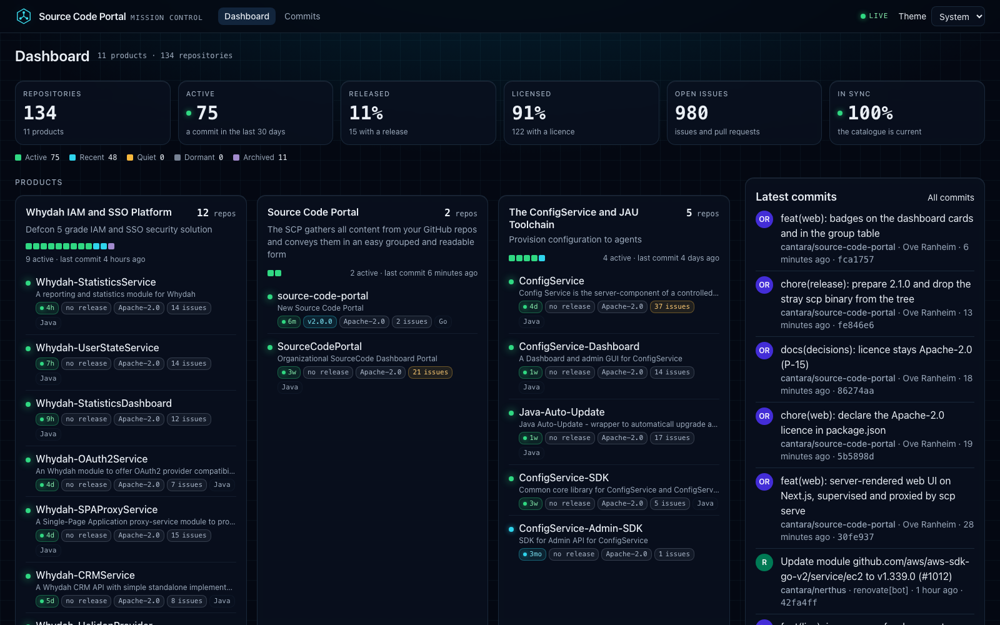
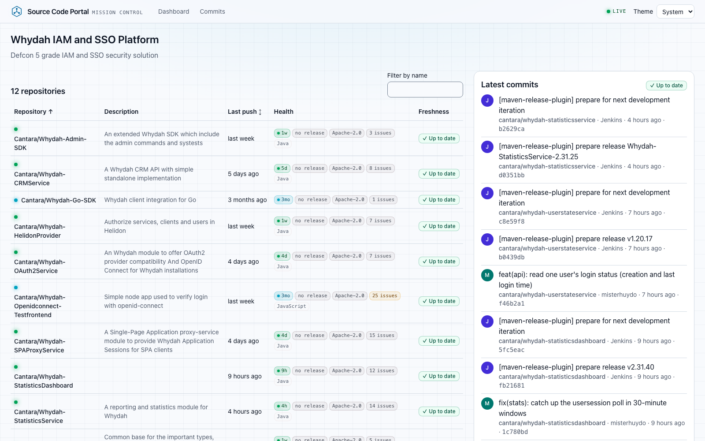
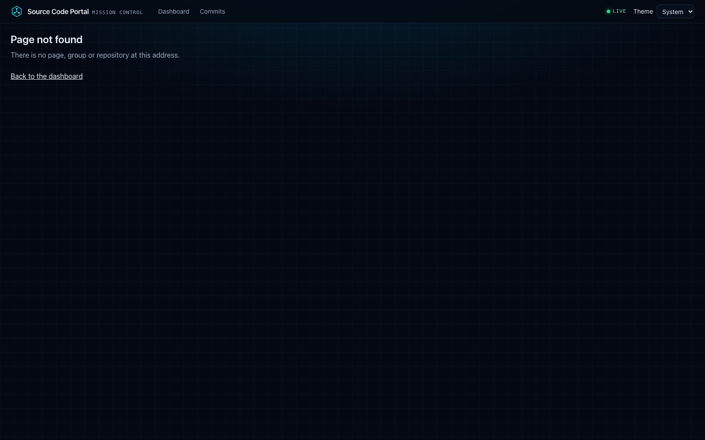

# Source Code Portal

[](https://github.com/Cantara/source-code-portal/actions/workflows/ci.yml)
[](https://github.com/Cantara/source-code-portal/releases)
[](LICENSE)

Source Code Portal (SCP) is an organisational dashboard for GitHub. It groups an organisation's repositories into the products and
systems they make up and shows, for every product and every repository, how healthy it is: when it last changed, whether it has a
release and a licence, how many issues are open, what it is built with and what it depends on. Commit logs, rendered READMEs and
documentation, status badges and a Markdown surface for LLM agents come from the same catalogue.

It is one static Go binary that serves the API and runs the server-rendered web UI (Next.js), kept current by GitHub webhooks and a
scheduled sync, and built for organisations from a handful to thousands of repositories.



| A product (group) | A repository |
|---|---|
|  |  |

## Features

**Products and groups**
- Repositories grouped into products by exact name, prefix, glob, regular expression, topic or a catch-all (`catalog.groups`), each with a default repository.
- One card per product with all its repositories, an activity strip and health badges per repository; large products span the width.
- A group page with every repository, sortable and filterable, and the merged commit log of the whole product.

**Organisation**
- Telemetry for the whole catalogue: repositories, active ones, the share with a release and with a licence, open issues, sync state.
- Activity by the newest commit: active (30 days), recent (6 months), quiet (2 years), dormant and archived.
- The commit log of the entire organisation, filterable by group and repository, with live updates.

**Repositories**
- README and up to 50 Markdown documents under `docs/`, rendered with syntax highlighting, GitHub alerts and an outline, sanitised once.
- Images in documents served through the portal's image proxy, so pages stay within a strict Content Security Policy.
- Technology and dependencies from `go.mod`, `package.json` and `pom.xml`, with links between repositories that use each other.
- An optional `scp.yaml` descriptor in the repository: title, owners, lifecycle, tags and links ([repository guide](docs/repository-guide.md)).

**Badges and integrations**
- SVG badges: `/badges/repos/{owner}/{name}/{last-commit,release,license,issues}.svg` and `/badges/groups/{group}/repos.svg`.
- The JSON API under `/api/v1`, described by [`api/openapi.yaml`](api/openapi.yaml) and served at `/api/v1/openapi.yaml`.
- `/llms.txt`, `/llms-full.txt` and Markdown answers for every page (`Accept: text/markdown`), for LLM agents and scripts.
- Server-sent events at `/api/v1/events`: open pages update when the catalogue changes.
- Every page is complete HTML with its own title, description and canonical URL, plus `/sitemap.xml` and `/robots.txt`.

**Operations**
- GitHub App or token authentication; webhooks (signed, with secret rotation) for updates within seconds.
- Private repositories for viewers an authenticating proxy names, kept out of every public answer.
- Several instances on a Hazelcast cluster: one leader syncs, the others apply its results.
- Survives GitHub outages and rate limits: the last good data is kept in SQLite and served with its age.
- Prometheus metrics, liveness and readiness probes and a status page on a separate admin port.

## Quick start

You need a GitHub App or a token that can read the organisation's repositories ([operator guide, section 1](docs/operator-guide.md#1-connect-github)).
A minimal `scp.yaml`:

```yaml
github:
  sources:
    - id: github
      orgs: [Cantara]
      token_file: /run/secrets/github-token
      # app: { id: 123456, private_key_file: /run/secrets/scp-app.pem }
catalog:
  groups:
    - id: whydah
      name: Whydah
      description: Identity and access management
      default_repo: Whydah-OAuth2Service
      match:
        - prefix: Whydah-
    - id: other
      name: Other
      default_repo: source-code-portal
      match:
        - catch_all: true
```

Run the image:

```sh
docker run --rm -p 9090:9090 -p 9091:9091 -v scp-data:/data \
  -v "$PWD/scp.yaml:/etc/scp/scp.yaml:ro" -v "$PWD/secrets:/run/secrets:ro" \
  ghcr.io/cantara/source-code-portal:2.0.0 serve --config /etc/scp/scp.yaml
```

Open http://localhost:9090. The first sync of a large organisation takes a few minutes; the pages show what is loaded so far.

Without containers, take the binary for Linux (amd64, arm64) or macOS (arm64) and the web UI bundle `scp-web_<version>.tar.gz` from the
[releases page](https://github.com/Cantara/source-code-portal/releases), unpack the bundle and run it with Node.js 24:

```sh
SCP_WEB_DIR=./scp-web scp serve --config scp.yaml
```

Releases are signed: the checksums with cosign, the image by digest.

## Configuration

Configuration is one YAML file (`--config`); every key can also be set as `SCP_<KEY>` with dots as underscores, for example
`SCP_SERVER_PUBLIC_ADDR`. [`deploy/config.example.yaml`](deploy/config.example.yaml) shows every key and
`scp config check --config scp.yaml` prints the effective settings. The main ones:

| Key | Purpose |
|---|---|
| `github.sources[]` | organisations and user accounts to read, with a GitHub App or a token file; forks, archived and private repositories on or off |
| `catalog.groups[]` | the products: id, name, description, default repository and matchers |
| `catalog.reconcile_interval` | how often each organisation is listed (default 5 minutes) |
| `webhook.secret_file` | turns on `POST /webhooks/github`; `previous_secret_file` for rotation |
| `server.public_url` | the portal's public address, for absolute links and HSTS |
| `access.*` | identity headers and groups that may see private repositories |
| `cluster.addresses` | Hazelcast members for several instances |
| `store.path` | the SQLite cache (rebuildable) |
| `web.dir`, `web.node` | the web UI bundle and the Node.js binary; the image sets both |

**Webhooks.** Point the App's webhook, or an organisation webhook with content type `application/json`, at
`https://<portal>/webhooks/github` with the secret from `webhook.secret_file` and the events *Push*, *Release* and *Repository*.
For a portal on your own machine, a tunnel such as `ngrok http 9090` gives GitHub an https address to deliver to. Without a webhook the
portal still refreshes on its schedule.

## Endpoints

| Listener | Path | What |
|---|---|---|
| public `:9090` | `/`, `/groups/{id}`, `/repos/{owner}/{name}`, `/commits` | the web UI |
| | `/api/v1/...` | the JSON API ([API guide](docs/api.md)) |
| | `/badges/...` | SVG badges |
| | `/llms.txt`, `/llms-full.txt` | the catalogue for LLM agents |
| | `/webhooks/github` | GitHub deliveries |
| admin `:9091` | `/livez`, `/readyz` | probes |
| | `/metrics` | Prometheus |
| | `/api/v1/status` | sync, rate limits, webhooks and cluster at a glance |

## Architecture

```
GitHub ──webhooks──┐
   │               ▼
   └──REST──▶ sync engine ──▶ SQLite (last good) ──▶ immutable snapshot ──▶ API, badges, llms, events
                                                                           │
                                         browser ◀── Go (CSP, proxy) ◀── Next.js server (renders from the API)
```

- **Sync.** GitHub feeds a job engine with priorities, a rate budget, backoff and per-source pauses. Webhooks and the organisation
  listing tell it what changed; ETags keep unchanged data free.
- **Snapshot.** Jobs write SQLite and publish an immutable snapshot behind an atomic pointer. Request handlers read only the snapshot,
  so a page never waits for GitHub.
- **Features.** Each part is a package under `internal/`: `catalog`, `commits`, `docs`, `badges`, `manifests`, `llms` and `webhook`.
  Features never import each other (a test enforces it); `cmd/scp` wires them together.
- **Untrusted input.** Everything from repositories passes bounded parsers and one HTML sanitiser.
- **Web UI.** A Next.js App Router application, rendered on the server for every request and hydrated in the browser. Go starts and
  supervises it on loopback and proxies every page through itself, adding a per-request nonce Content Security Policy.

Stack: Go 1.27 with go-github, goldmark, bluemonday, modernc SQLite, Cobra and Viper, and the Hazelcast Go client; Next.js 16, React 19,
TypeScript 7, Tailwind CSS 4, TanStack Query and openapi-fetch typed from the contract; Vitest, MSW and Playwright with axe.

## Develop

Requirements: Go 1.27, Node.js 24, pnpm 12 and golangci-lint 2.14.

```sh
make check        # the gate: generated code, tidy modules, lint, Go and web tests, Playwright
make dev          # the Go server (scp.yaml) on :9090 and the web UI with hot reload on :3000
make build web    # bin/scp and the web UI bundle in web/bundle
make image        # the container image scp:dev
make gen          # regenerate the API code from api/openapi.yaml
go test -race -run TestName ./internal/catalog/
```

Tests never touch the network: GitHub is a fake in `internal/github/githubtest`. The Playwright tests need
`pnpm -C web exec playwright install chromium`.

## Documentation

- [Operator guide](docs/operator-guide.md): connect GitHub, configure, run, several instances, monitor, troubleshoot.
- [Repository guide](docs/repository-guide.md): what the portal reads from a repository and the `scp.yaml` descriptor.
- [API guide](docs/api.md): the JSON API, badges and Markdown for agents.
- [Changelog](CHANGELOG.md) and [security policy](SECURITY.md).

## Contributing

Issues and pull requests are welcome. Keep changes small, follow [Conventional Commits](https://www.conventionalcommits.org/) and run
`make check` before you push. [AGENTS.md](AGENTS.md) describes the layout and the rules the code follows.

## Roadmap

Next is search-engine support: structured data, richer sitemaps, social cards and IndexNow.

## Licence

Apache License 2.0, see [LICENSE](LICENSE). Source Code Portal is a [Cantara](https://github.com/Cantara) project.
